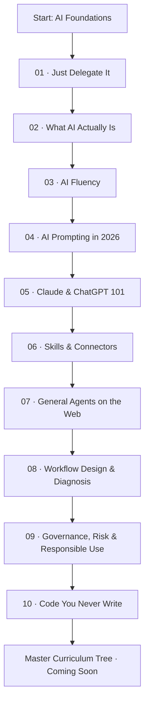

<div align="center">

# 🧭 Agent Factory — Complete Curriculum Maps

### From AI Foundations to Confident, Responsible AI Workflows

**A visual, structured, and revision-friendly learning companion for the Panaversity / GIAIC Agent Factory curriculum.**

[](https://www.markdownguide.org/)
[](#-course-library)
[](#-how-to-use-this-repository)
[](https://github.com/ISMAIL-AHMED-SHAH)

**Explore • Expand • Understand • Practice • Review**

[📚 Browse Courses](#-course-library) · [🗺️ Learning Roadmap](#-learning-roadmap) · [🧠 Study Strategy](#-how-to-use-this-repository) · [🌐 Official Source](https://agentfactory.panaversity.org/)

Curated for structured learning, revision, and viva preparation.
</div>

---

> [!IMPORTANT]
> **What this repository is:** A companion collection of topic trees and curriculum maps—not a replacement for the official course lessons. The maps distinguish original headings from summarized `[Concept]` entries and retain `[NOT VERIFIED]` notices where interactive or external content could not be inspected.

## ✨ Why this repository?

Long courses are easier to master when you can see **the big picture** and **the smallest concept** in one place. These maps turn the learning journey into an organized, navigable reference.

- 🌳 **Deep topic trees:** Explore courses from major sections down to individual ideas.
- 🔽 **Expandable sections:** Open only the branches you want to study.
- 🎯 **Revision-focused:** Quickly identify concepts, frameworks, exercises, and projects.
- 🔗 **Source-aware:** Keep a clear connection to the official learning material.
- 📝 **GitHub-native:** Designed for `.md` files, without a separate website or setup.

## 🗺️ Learning roadmap



> [!NOTE]
> This diagram is a **navigation sequence for this collection**, not a claim that the official courses impose these prerequisites or must be completed in this order.

## 📚 Course library

| # | Curriculum map | Primary focus | Open map |
|:--:|---|---|:--:|
| 01 | **Just Delegate It** | Delegation mindset and opportunities | [Explore →](./course-01-just-delegate-it.md) |
| 02 | **What AI Actually Is** | Core mental models and AI capabilities | [Explore →](./course-02-what-ai-actually-is.md) |
| 03 | **AI Fluency** | Working effectively with AI | [Explore →](./course-03-ai-fluency.md) |
| 04 | **AI Prompting in 2026** | Clear instructions and iterative prompting | [Explore →](./course-04-Ai-Prompting.md) |
| 05 | **Claude & ChatGPT 101** | Practical use of conversational AI tools | [Explore →](./course-07-general-agents-on-web.md) |
| 06 | **Skills & Connectors** | Reusable instructions and app connections | [Explore →](./course-06-skills-connectors.md) |
| 07 | **General Agents on the Web** | Delegating multistep tasks to agents | [Explore →](./course-07-general-agents-web.md) |
| 08 | **Workflow Design & Diagnosis** | Task design, delegation and troubleshooting | [Explore →](./course-08-workflow-design-&-diagnosis.md) |
| 09 | **Governance, Risk & Responsible Use** | Accountability, risk and oversight | [Explore →](./course-09-governance-risk-responsible-use.md) |
| 10 | **Code You Never Write** | Commissioning, verifying and safely using AI-written code | [Explore →](./course-10-code-you-never-write.md) |

> [!TIP]
> **Repository setup:** Place this file as `curriculum-map/README.md` alongside the individual course maps. Replace the five *Link to add* cells with the exact filenames for Courses 01–05 once confirmed. The links for Courses 06–10 assume the filenames shown above.

## 🌐 Master curriculum tree

**Coming next:** One consolidated master map connecting the complete collection.

When added, this section will link to a single navigable **Master Curriculum Tree** for high-level review and cross-course connections.

<!-- Replace the placeholder below once the master file is created. -->
**Status:** ⏳ Awaiting final master curriculum map

## 🧩 How the maps are organized

<details>
<summary><strong>🌲 1. Expandable topic hierarchy</strong></summary>

Each map groups related topics under collapsible sections, helping you move from a course overview to individual concepts without scrolling through everything at once.

</details>

<details>
<summary><strong>🏷️ 2. Source labels and verification notices</strong></summary>

- **Unmarked headings** represent headings in the supplied topic-tree source.
- **`[Concept]`** identifies a summarized point drawn from paragraphs, lists, figures, tables, or callouts rather than a page heading.
- **`[NOT VERIFIED]`** indicates that the relevant interactive, embedded, or gated content was not fully inspected.

These labels should not be silently removed or treated as proof that the full underlying content was verified.

</details>

<details>
<summary><strong>🛠️ 3. Practical learning elements</strong></summary>

Depending on the course, maps may highlight frameworks, exercises, checklists, projects, scenarios, examples, and safety practices.

</details>

<details>
<summary><strong>📖 4. Source-first revision</strong></summary>

Use each map to find a topic quickly, then return to the [official Agent Factory learning materials](https://agentfactory.panaversity.org/) for full explanations and activities.

</details>

## 🧠 How to use this repository

- [ ] **Preview** the roadmap to understand where a course fits.
- [ ] **Expand** the major branches before studying the individual concepts.
- [ ] **Learn** each concept from the official course, not the map alone.
- [ ] **Practice** exercises, prompts, projects, and verification steps.
- [ ] **Recall** the ideas without looking, then reopen the branches you missed.
- [ ] **Review** `[NOT VERIFIED]` items against the original interactive materials when available.

> [!TIP]
> **Active-recall trick:** Collapse a section, try to name its subtopics from memory, then expand it to check yourself. Repeat with the deepest branches before a quiz or viva.

## 🔍 A quick framework index

| Framework or habit | Where to look |
|---|---|
| Reusable AI skills and app connections | Course 06 |
| General agents and delegated work | Course 07 |
| Workflow decomposition and diagnosis | Course 08 |
| Governance, risk and human oversight | Course 09 |
| **VPRF** — Volume, Precision, Repetition, Files | Course 10 |
| **Five-part code brief** — Goal, Input, Output, Rules, Edge cases | Course 10 |
| Verification ladder and known-answer tests | Course 10 |
| Blast-radius controls and dry runs | Course 10 |

## 📁 Suggested repository structure

```text
Exam-Prep-Agent-Factory/
└── curriculum-map/
    ├── README.md
    ├── course-01-....md
    ├── course-02-....md
    ├── course-03-....md
    ├── course-04-....md
    ├── course-05-....md
    ├── course-06-skills-connectors.md
    ├── course-07-general-agents-web.md
    ├── course-08-workflow-design-diagnosis.md
    ├── course-09-governance-risk-responsible-use.md
    ├── course-10-code-you-never-write.md
    └── master-curriculum-tree.md       # Coming soon
```

> [!WARNING]
> **Accuracy matters:** Topic trees are study aids. For assessments, professional decisions, safety-sensitive work, or disputed details, consult the official lesson and verify examples, tool behavior, and claims directly. Not every map has the same level of source coverage.

## 🔗 References and attribution

**Official learning source:** [Panaversity Agent Factory](https://agentfactory.panaversity.org/)

This is an independently organized study and navigation resource. Course names and educational concepts belong to their respective creators. It is **not an official Panaversity or GIAIC publication**.

---

<div align="center">

### Built for curious minds who learn by connecting the dots. ✨

**Curated & organized by [Ismail Ahmed Shah](https://github.com/ISMAIL-AHMED-SHAH)**

*Learn the concept. See the connection. Practice the skill.*

⭐ If this collection helps your learning, consider starring the repository.

</div>
