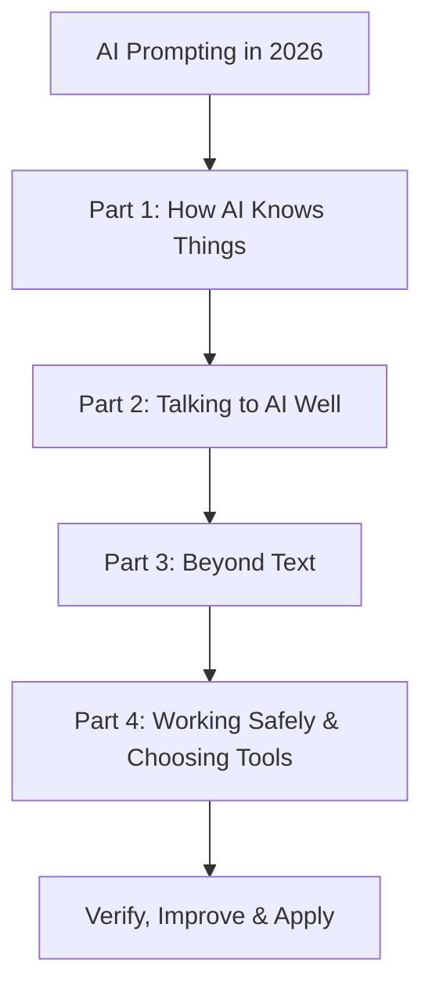

# 🚀 Course 04 — AI Prompting in 2026

> **13 Core Concepts · Practical Prompting · Context Engineering · AI Productivity & Safety**

[](https://agentfactory.panaversity.org/docs/ai-prompting-2026)
[](https://agentfactory.panaversity.org/docs/ai-prompting-2026)
[](https://agentfactory.panaversity.org/docs/ai-prompting-2026)

**Official Course:** [AI Prompting in 2026 — A Crash Course](https://agentfactory.panaversity.org/docs/ai-prompting-2026)

## 🎯 Course Overview

This course teaches you how to move beyond simple questions and work with AI like a skilled professional. Learn to provide the right context, define clear constraints, compare alternatives, improve outputs through iteration, and verify results before relying on them.

The central principle is simple:

> **A powerful AI prompt is a briefing, not merely a question.**

## 🗺️ Learning Roadmap



## 🧠 The 13 Core Concepts

### Part 1 — How AI Knows Things

| # | Concept | Key Learning |
|---|---|---|
| 1 | Novice vs. Power User | Give AI a proper briefing: files, goal, limits, and exact ask. |
| 2 | Pretrained Knowledge | AI learns from training data; coverage and reliability vary by topic. |
| 3 | Three Retrieval Modes | Understand pretrained knowledge, web search, and deep research. |

### Part 2 — Talking to AI Well

| # | Concept | Key Learning |
|---|---|---|
| 4 | Context Is the Whole Game | Supply relevant context, manage memory, and avoid context rot. |
| 5 | Reasoning — “Think Hard” | Use deeper reasoning for complex, multi-step problems. |
| 6 | Sycophancy and How to Neutralize It | Ask neutral questions, use rubrics, and invite disagreement. |
| 7 | The Brainstorm–Iterate Loop | Generate options, provide feedback, refine, and then expand. |
| 8 | One Loop, Four Kinds of Ask | Adapt your approach for brainstorming, research, drafting, and analysis. |

### Part 3 — Beyond Text

| # | Concept | Key Learning |
|---|---|---|
| 9 | Multimodal: Images, Audio, and What's Next | Combine text, images, and audio while checking their limitations. |
| 10 | Building Small Apps with One Prompt | Create small, focused applications by defining goals, inputs, and outputs. |
| 11 | Data Analysis | Use code execution for calculations and verify the results. |

### Part 4 — Working Safely and Choosing Tools

| # | Concept | Key Learning |
|---|---|---|
| 12 | AI Desktop Apps and Permissions | Review plans, approve actions, and grant the minimum required access. |
| 13 | Cost, Speed, and Which Model to Use When / Models Checking Models | Compare model capabilities, balance cost and speed, and use independent critique where appropriate. |

> **Source note:** The supplied topic tree numbers Concepts 1–13 across the course, but the last concept covers both model selection and models checking models in the supplied structure. Preserve the original headings in the full tree rather than treating this summary table as a verbatim source outline.

## ⚡ Essential Prompting Principles

### 1. Brief AI Like a Colleague

A strong briefing includes:

- **Context:** Relevant background, files, and prior decisions.
- **Goal:** What you want to achieve.
- **Constraints:** Requirements, limitations, and things to avoid.
- **Exact ask:** The task AI should perform.
- **Output format:** The structure in which you need the result.

### 2. Choose the Right Knowledge Mode

| Mode | Best Used For |
|---|---|
| Pretrained knowledge | General explanations and established concepts |
| Web search | Recent information, current events, and live sources |
| Deep research | Multi-source investigations and structured reports |

Always check whether the chosen mode is suitable for the task. Recent, private, or obscure information may not be reliable from training alone.

### 3. Manage Context Intentionally

- Attach relevant source documents.
- State constraints AI cannot infer.
- Remove duplicate or irrelevant material.
- Start a fresh chat when the topic changes.
- Use projects or persistent workspaces for recurring tasks.
- Review stored memory and correct wrong assumptions.

### 4. Use the Brainstorm–Iterate Loop

```text
Load Context
     ↓
Generate 3–5 Options
     ↓
Give Specific Feedback
     ↓
Generate Improved Options
     ↓
Repeat Until Satisfied
     ↓
Expand the Best Option
```

**Remember:** Improve the direction before expanding the final answer.

### 5. Reduce Sycophancy

AI may lean toward agreeing with the way a question is framed. To obtain more balanced feedback:

- Ask for evaluation rather than confirmation.
- Present competing options fairly.
- Define explicit scoring criteria.
- Request counterarguments and weaknesses.
- Allow the model to say “I don't know.”
- Mark claims that remain unverified.

### 6. Verify Before You Trust

- Ask for sources supporting important factual claims.
- Check calculations, totals, and graph labels.
- Confirm that code actually ran when execution is claimed.
- Review generated images and application behavior.
- Treat AI output as work that needs appropriate verification.

### 7. Use AI Tools Safely

- Ask desktop agents to propose a plan before acting.
- Review and approve the plan before execution.
- Grant access only to the smallest necessary folder or resource.
- Preserve version history and backups.
- Avoid exposing confidential information to unapproved tools.
- Increase permissions gradually as reliability is demonstrated.

## 🧰 Practical Prompt Template

Use this reusable structure for meaningful tasks:

```text
ROLE:
Act as [relevant role or specialist].

CONTEXT:
Here is the background and relevant information:
[Provide details or attach files.]

GOAL:
I want to achieve [specific outcome].

CONSTRAINTS:
- Follow these requirements: [...]
- Avoid: [...]
- Consider these limitations: [...]

TASK:
Please [describe the exact action].

OUTPUT FORMAT:
Return the result as [table, report, checklist, code, etc.].

VERIFICATION:
Identify assumptions, explain important decisions,
and flag anything that could not be verified.
```

## ✅ Revision Checklist

- [ ] Explain the difference between novice and power-user prompting.
- [ ] Distinguish pretrained knowledge, web search, and deep research.
- [ ] Explain context windows, memory, context rot, and projects.
- [ ] Know when deeper reasoning is useful.
- [ ] Recognize and reduce sycophancy.
- [ ] Apply the brainstorm–iterate loop.
- [ ] Adjust prompting for brainstorming, research, drafting, and analysis.
- [ ] Understand the strengths and limitations of multimodal AI.
- [ ] Build small applications with clearly defined goals, inputs, and outputs.
- [ ] Verify code execution and data-analysis results.
- [ ] Apply least-privilege access to AI desktop apps.
- [ ] Compare models instead of assuming one tool is best for every task.
- [ ] Use independent review appropriately for important work.

## ⚠️ Source Verification Notes

The supplied topic tree is **partially verified**. The source fetch was truncated during Concept 13.

- Teaching slides and some interactive learning aids could not be inspected.
- Material following the truncated portion is based partly on search-index excerpts and is marked unverified in the supplied tree.
- The headings and content of later sections—including the twelve practice prompts and any subsequent self-check, glossary, or resources—must not be presented as fully verified.

Consult the [official course page](https://agentfactory.panaversity.org/docs/ai-prompting-2026) to verify the missing material before finalizing the course map.

---

**Built for structured learning and exam preparation — Agent Factory, 2026.**
