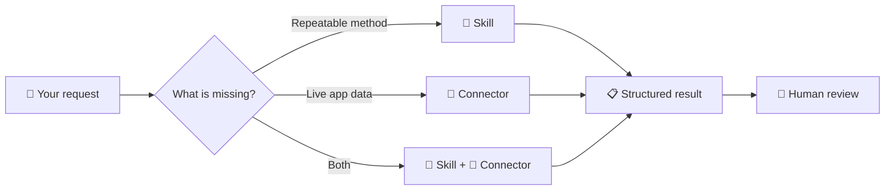

<div align="center">

# 🧩 Course 06 — Skills & Connectors

### Teach AI Once · Connect It to Your Apps


**2 features · 5 tools · 0 code from you**

[📖 Official Course](https://agentfactory.panaversity.org/docs/skills-connectors-crash-course) · [🌳 Full Topic Tree](#-complete-original-topic-tree--verbatim) · [☑️ Revision Checklist](#-revision-checklist)

</div>

> [!IMPORTANT]
> **Zero omissions:** The complete user-provided Course 06 topic tree is reproduced **verbatim** below, including all words, numbering, symbols, headings, `[Concept]` markers, and `[NOT VERIFIED]` annotations. The visual guide above it is an **additional navigation layer**, not a replacement.

## 🧭 Course at a glance

| 🟣 Learn | 🔵 Connect | 🟢 Build | 🟠 Verify |
|:--|:--|:--|:--|
| Skills, Connectors, Projects, custom instructions | App access, MCP, permissions, read-only scope | `SKILL.md`, description triggers, testing and sharing | Safety, prompt injection, data exfiltration, output review |



## 🗺️ Learning roadmap

| Section | Focus |
|:--|:--|
| **6.1–6.4** | Introduction, 14 ideas, teaching aid, kitchen analogy |
| **6.5** | Part 1 — Two upgrades: Skills and Connectors |
| **6.6** | Part 2 — Built-in skills, connecting apps, combining both |
| **6.7** | Part 3 — Create, describe, test, save and share `SKILL.md` |
| **6.8** | Part 4 — Portability across five tools |
| **6.9** | Part 5 — Risks, permissions and safe-use checklist |
| **6.10–6.11** | Recap and six hands-on activities |
| **6.12** | Five practical projects and troubleshooting |
| **6.13–6.15** | Next steps, flashcards, scenario test |

## 🧠 Quick mental model

> [!TIP]
> **Skill = HOW** the work should be done. **Connector = WHERE** the work's data lives. **Project = SHARED CONTEXT** for related chats. **Custom instructions = GLOBAL PREFERENCES**.

> [!WARNING]
> A Skill can contain instructions from an untrusted source. A Connector can expose real data and actions. Start with trusted skills, minimal permissions, read-only access, and human review.

## ☑️ Revision checklist

- [ ] Explain Skills, Connectors, Projects, and custom instructions without mixing them up.
- [ ] Identify when a task needs a Skill, Connector, both, or neither.
- [ ] Describe `SKILL.md`, frontmatter, descriptions, and progressive disclosure.
- [ ] Test automatic activation, non-activation, outputs, and edge cases.
- [ ] Explain read-only vs write access and the role of MCP.
- [ ] Distinguish portable Agent Skills from vendor-specific saved assistants.
- [ ] Identify prompt injection, data exfiltration, and excessive access.
- [ ] Complete the six exercises and five projects in the original tree.
- [ ] Review every item in the complete topic tree below.

---

## 🌳 Complete original topic tree — verbatim

<details open>
<summary><strong>📚 Expand / collapse the entire Course 06 source tree (all original text preserved)</strong></summary>

# Course 06: Skills & Connectors — Topic Tree

Source: https://agentfactory.panaversity.org/docs/skills-connectors-crash-course (fetched and read in full, 14 Oct 2026)

Legend: unmarked nodes are actual headings (H2 = level 2, H3 = level 3). `[Concept]` = paragraph-, list-, table-, callout- or figure-derived, not a heading. Heading names are verbatim; `[Concept]` labels are condensed from the source wording.

```text
06. Skills & Connectors: Teach AI Once, Connect It to Your Apps
│
├── 6.1 Introduction (text under H1, before first H2) [Concept]
│   ├── 6.1.1 Subtitle: 2 Features, 5 Tools, 0 Code From You. Turn your chat box into a coworker [Concept]
│   ├── 6.1.2 Vending-machine habit: retype the same request daily; the machine remembers nothing [Concept]
│   ├── 6.1.3 Skill: teach AI a task once, done your way every time [Concept]
│   ├── 6.1.4 Connector: safe access to the apps where your work lives [Concept]
│   ├── 6.1.5 No programming background needed; examples for accountant, doctor, marketer, engineer, teacher, student [Concept]
│   ├── 6.1.6 Outcomes: what Skills and Connectors are, when to use each, use existing ones, build your own, work safely across five tools [Concept]
│   └── 6.1.7 Quick glossary (27 entries) [Concept]
│       ├── 6.1.7.1 Skill [Concept]
│       ├── 6.1.7.2 Connector [Concept]
│       ├── 6.1.7.3 fire [Concept]
│       ├── 6.1.7.4 scope [Concept]
│       ├── 6.1.7.5 expense head [Concept]
│       ├── 6.1.7.6 tax-withholding threshold [Concept]
│       ├── 6.1.7.7 SOAP [Concept]
│       ├── 6.1.7.8 read-only [Concept]
│       ├── 6.1.7.9 write access [Concept]
│       ├── 6.1.7.10 progressive disclosure [Concept]
│       ├── 6.1.7.11 operating layer [Concept]
│       ├── 6.1.7.12 SKILL.md [Concept]
│       ├── 6.1.7.13 frontmatter [Concept]
│       ├── 6.1.7.14 description [Concept]
│       ├── 6.1.7.15 negative trigger [Concept]
│       ├── 6.1.7.16 MCP [Concept]
│       ├── 6.1.7.17 Tool access [Concept]
│       ├── 6.1.7.18 CLI [Concept]
│       ├── 6.1.7.19 custom connector [Concept]
│       ├── 6.1.7.20 interactive connector [Concept]
│       ├── 6.1.7.21 Project [Concept]
│       ├── 6.1.7.22 custom instructions [Concept]
│       ├── 6.1.7.23 skill-creator [Concept]
│       ├── 6.1.7.24 Agent Skills open standard [Concept]
│       ├── 6.1.7.25 prompt injection [Concept]
│       ├── 6.1.7.26 data exfiltration [Concept]
│       └── 6.1.7.27 market-of-one test [Concept]
├── 6.2 The fourteen ideas in one line each
│   ├── 6.2.1 Open the map; nothing needs to make sense yet [Concept]
│   ├── 6.2.2 1 From chat box to operating layer: the two kinds of work you keep redoing by hand [Concept]
│   ├── 6.2.3 2 What a Skill actually is: a folder with a text file, no code from you [Concept]
│   ├── 6.2.4 3 What a Connector actually is: safe access to one app, with your permissions [Concept]
│   ├── 6.2.5 4 Skills vs Connectors vs Projects vs Custom Instructions: four features, one clean split [Concept]
│   ├── 6.2.6 5 Slash command, or automatic: in Claude.ai skills start on their own [Concept]
│   ├── 6.2.7 6 The skills that come built in: Word, PowerPoint, Excel, PDF behind one switch [Concept]
│   ├── 6.2.8 7 Connecting your apps: a minute per app, then enable per chat [Concept]
│   ├── 6.2.9 8 Skills and Connectors together: what each half does [Concept]
│   ├── 6.2.10 9 Which problem needs which: diagnose by the friction you feel [Concept]
│   ├── 6.2.11 10 The fastest path: describe the skill, AI writes it [Concept]
│   ├── 6.2.12 11 Anatomy of a SKILL.md: which part AI keeps in view [Concept]
│   ├── 6.2.13 12 The description field: decides whether your skill ever starts [Concept]
│   ├── 6.2.14 13 Test, then iterate: what starts it, the output, the hard cases [Concept]
│   ├── 6.2.15 14 Saving and sharing: one click saves; team plans can share [Concept]
│   ├── 6.2.16 Where this sits in the book (callout) [Concept]
│   │   ├── 6.2.16.1 Foundations crash course; assumes What AI Actually Is [Concept]
│   │   ├── 6.2.16.2 AI Prompting in 2026 teaches how to talk to AI; How to Think in the AI Era comes after [Concept]
│   │   └── 6.2.16.3 This course shows what becomes possible; the other two show how to do it well [Concept]
│   └── 6.2.17 Last verified: June 2026 (callout) [Concept]
│       ├── 6.2.17.1 Menu paths, free-plan limits, and open-standard timeline will drift [Concept]
│       ├── 6.2.17.2 Free tier includes one custom connector; standard published December 2025 [Concept]
│       └── 6.2.17.3 Ideas are stable; when a step does not match your screen, trust the screen [Concept]
├── 6.3 📚 Teaching Aid
│   └── 6.3.1 Full presentation link and slideshow embed (Skills & Connectors) [NOT VERIFIED: slide content not readable] [Concept]
├── 6.4 The one idea under everything
│   ├── 6.4.1 A chat message tells AI what to do this once; a Skill teaches how every time; a Connector gives hands to reach real apps [Concept]
│   ├── 6.4.2 Professional kitchen picture [Concept]
│   │   ├── 6.4.2.1 One-time chat message: an order shouted across the counter [Concept]
│   │   ├── 6.4.2.2 Connectors: the kitchen (stove, knives, pantry, your real ingredients) [Concept]
│   │   └── 6.4.2.3 Skills: recipe cards for making one dish your way [Concept]
│   ├── 6.4.3 Where the kitchen picture stops [Concept]
│   │   ├── 6.4.3.1 Ingredients never move into AI's kitchen; AI reaches into your live app as far as your account reaches [Concept]
│   │   └── 6.4.3.2 AI follows the card, so two runs can differ; tasting stays your job [Concept]
│   ├── 6.4.4 Figure: kitchen analogy (Drive, Gmail, Slack, tracker; recipe cards; your dish every time) [Concept]
│   └── 6.4.5 Kitchen without recipes is improvised; recipes without a kitchen cannot cook; both is reliable [Concept]
├── 6.5 Part 1: The two upgrades
│   ├── 6.5.1 1. From chat box to operating layer
│   │   ├── 6.5.1.1 Repeatable tasks done your way (Skill friction) [Concept]
│   │   │   ├── 6.5.1.1.1 Accountant: monthly client summary (expense head, tax-withholding threshold, template) [Concept]
│   │   │   ├── 6.5.1.1.2 Doctor: SOAP notes with allergies at the top [Concept]
│   │   │   ├── 6.5.1.1.3 Marketer: brand-voice captions (no exclamation marks, question hook) [Concept]
│   │   │   └── 6.5.1.1.4 Engineer: design review notes grouped by severity with checklist [Concept]
│   │   ├── 6.5.1.2 Same shape: repeatable task, your specific way, only the input changes [Concept]
│   │   ├── 6.5.1.3 Skill: saved instructions for that shape [Concept]
│   │   ├── 6.5.1.4 Data living in other apps (Connector friction) [Concept]
│   │   │   ├── 6.5.1.4.1 Accountant: Excel file and last quarter's email [Concept]
│   │   │   ├── 6.5.1.4.2 Doctor: patient history in Google Drive [Concept]
│   │   │   ├── 6.5.1.4.3 Marketer: content calendar in a planning tool, past posts in Drive [Concept]
│   │   │   └── 6.5.1.4.4 Engineer: open issues in Jira or Linear [Concept]
│   │   ├── 6.5.1.5 Copy-pasting is the price of AI having no hands [Concept]
│   │   ├── 6.5.1.6 Connector: safe link to one of your apps; reads, and writes back when allowed [Concept]
│   │   └── 6.5.1.7 Together: an operating layer (AI acting on real work) [Concept]
│   ├── 6.5.2 2. What a Skill actually is
│   │   ├── 6.5.2.1 A folder with a text file in it [Concept]
│   │   ├── 6.5.2.2 SKILL.md: required file; name, short line on when to use, instructions [Concept]
│   │   ├── 6.5.2.3 First skill can be five sentences of formatting rules [Concept]
│   │   ├── 6.5.2.4 Optional folder contents: example files, template document, reference notes, small programs [Concept]
│   │   ├── 6.5.2.5 AI writes any code a skill needs (Part 3) [Concept]
│   │   ├── 6.5.2.6 Anthropic's description: folders of instructions, scripts, resources loaded dynamically [Concept]
│   │   ├── 6.5.2.7 Progressive disclosure: AI keeps only the description; opens full instructions on a match [Concept]
│   │   └── 6.5.2.8 Why dozens of skills do not slow anything down [Concept]
│   ├── 6.5.3 3. What a Connector actually is
│   │   ├── 6.5.3.1 How AI safely reaches your apps and data [Concept]
│   │   │   ├── 6.5.3.1.1 Google Drive: search files [Concept]
│   │   │   ├── 6.5.3.1.2 Gmail: read mail, draft replies [Concept]
│   │   │   └── 6.5.3.1.3 Slack, Linear, Asana, Notion: pull and act [Concept]
│   │   ├── 6.5.3.2 MCP: Model Context Protocol; the open standard connectors run on [Concept]
│   │   ├── 6.5.3.3 Connector is software built by a company or AI; you click Connect [Concept]
│   │   ├── 6.5.3.4 Code you never write [Concept]
│   │   ├── 6.5.3.5 Three facts [Concept]
│   │   │   ├── 6.5.3.5.1 AI inherits the permissions you already have [Concept]
│   │   │   ├── 6.5.3.5.2 You choose how much AI may do [Concept]
│   │   │   │   ├── 6.5.3.5.2.1 Read-only: look, not change [Concept]
│   │   │   │   ├── 6.5.3.5.2.2 Write access: edit, create, send, delete [Concept]
│   │   │   │   └── 6.5.3.5.2.3 Start read-only [Concept]
│   │   │   └── 6.5.3.5.3 You turn connectors on per conversation; you choose the scope (smaller is safer) [Concept]
│   │   ├── 6.5.3.6 Directory of ready-made connectors (Drive, Gmail, Slack, Notion, Figma, Linear, Atlassian) [Concept]
│   │   ├── 6.5.3.7 Custom connector: set up yourself for any MCP service [Concept]
│   │   └── 6.5.3.8 Interactive connector: draws a live panel in the chat [Concept]
│   ├── 6.5.4 4. Skills vs Connectors vs Projects vs Custom Instructions
│   │   ├── 6.5.4.1 Project: workspace holding files and instructions for every chat inside it [Concept]
│   │   ├── 6.5.4.2 Custom instructions: preferences for all chats [Concept]
│   │   ├── 6.5.4.3 Comparison table [Concept]
│   │   │   ├── 6.5.4.3.1 Skill: reusable how-to loaded only when relevant; test "I keep re-explaining how" [Concept]
│   │   │   ├── 6.5.4.3.2 Connector: safe access to an outside app; test "I keep copy-pasting from another app" [Concept]
│   │   │   ├── 6.5.4.3.3 Project: workspace with standing context; test "same files and rules apply to everything here" [Concept]
│   │   │   └── 6.5.4.3.4 Custom instructions: global preferences; test "true everywhere, always" [Concept]
│   │   └── 6.5.4.4 Three lines people confuse [Concept]
│   │       ├── 6.5.4.4.1 Skill and Project: Project always on; Skill sleeps until a request matches [Concept]
│   │       ├── 6.5.4.4.2 Skill and Connector: access vs expertise; partners, not alternatives [Concept]
│   │       └── 6.5.4.4.3 Skill and custom instructions: all you do vs one kind of task [Concept]
│   └── 6.5.5 5. The question everyone asks: do I type a slash command, or does AI just know?
│       ├── 6.5.5.1 In Claude.ai skills start on their own [Concept]
│       ├── 6.5.5.2 Fire: a skill activates without being named [Concept]
│       ├── 6.5.5.3 Slash commands live in more hands-on tools [Concept]
│       │   ├── 6.5.5.3.1 Cowork and Microsoft 365 add-ins (Excel, Word, PowerPoint, Outlook): type / to browse [Concept]
│       │   └── 6.5.5.3.2 Claude Code and OpenCode: skills load on their own; can call deliberately [Concept]
│       ├── 6.5.5.4 Third option everywhere: name the skill in plain English [Concept]
│       ├── 6.5.5.5 Table: Let AI decide / Force a skill / Browse what's available, across three tool groups [Concept]
│       ├── 6.5.5.6 Figure: How a skill gets used, automatic by default (about 90% of the time) [Concept]
│       └── 6.5.5.7 Connectors work the same way once connected and enabled [Concept]
├── 6.6 Part 2: Using what already exists (no building required)
│   ├── 6.6.1 Intro: Anthropic and partners already made skills and connectors switchable in two minutes [Concept]
│   ├── 6.6.2 6. The skills that come built in
│   │   ├── 6.6.2.1 Built-in skills depend on "Code execution and file creation" (Settings, Capabilities) [Concept]
│   │   │   ├── 6.6.2.1.1 Word: formatted .docx [Concept]
│   │   │   ├── 6.6.2.1.2 PowerPoint: slide decks [Concept]
│   │   │   ├── 6.6.2.1.3 Excel: real spreadsheets with formulas [Concept]
│   │   │   └── 6.6.2.1.4 PDF: creating and filling [Concept]
│   │   ├── 6.6.2.2 Figure: Capabilities settings; "Required for skills" [Concept]
│   │   ├── 6.6.2.3 Just ask (example: deck about agentfactory.panaversity.org) [Concept]
│   │   ├── 6.6.2.4 Customize, then Skills: fresh account shows only skill-creator [Concept]
│   │   │   ├── 6.6.2.4.1 skill-creator builds skills for you [Concept]
│   │   │   └── 6.6.2.4.2 Document skills live in the engine, not this list [Concept]
│   │   ├── 6.6.2.5 Figure: Customize Skills list [Concept]
│   │   ├── 6.6.2.6 Browse skills directory: one-click install; partner skills from Notion, Figma, Atlassian [Concept]
│   │   │   └── 6.6.2.6.1 Installed skills are view-only; download, edit, upload as your own [Concept]
│   │   ├── 6.6.2.7 Figure: Skills Directory [Concept]
│   │   ├── 6.6.2.8 Wider ecosystem: open standard (late 2025); public marketplaces; tens of thousands of skills [Concept]
│   │   └── 6.6.2.9 Free skill from a stranger is a text file AI will follow; start with built-ins and official directory [Concept]
│   ├── 6.6.3 7. Connecting your apps
│   │   ├── 6.6.3.1 Path: "+" in chat or /, Connectors, Manage connectors, "+"; or Customize, Connectors [Concept]
│   │   ├── 6.6.3.2 Pick service, Connect, sign in [Concept]
│   │   ├── 6.6.3.3 Figures: Customize Connectors page; Connectors Directory [Concept]
│   │   ├── 6.6.3.4 Four practical notes [Concept]
│   │   │   ├── 6.6.3.4.1 After connecting, enable it for the conversation [Concept]
│   │   │   ├── 6.6.3.4.2 Free plans include one custom connector; directory connectors broadly available [Concept]
│   │   │   ├── 6.6.3.4.3 Each connector's actions are called tools; Tool access setting; load-on-demand with ten or more [Concept]
│   │   │   └── 6.6.3.4.4 Watch for the "Interactive" badge [Concept]
│   │   ├── 6.6.3.5 Worked example for the doctor on made-up data [Concept]
│   │   │   ├── 6.6.3.5.1 Create fake intake form (DEMO-Okafor-2026-03) and save to Drive [Concept]
│   │   │   └── 6.6.3.5.2 Read it back and summarize into a SOAP-style note [Concept]
│   │   ├── 6.6.3.6 Two honest notes [Concept]
│   │   │   ├── 6.6.3.6.1 Drive connector reads but cannot edit in place; "write" means saving a new file (needs file creation and Drive write permission) [Concept]
│   │   │   └── 6.6.3.6.2 Invented details let you run the full loop without real records [Concept]
│   │   └── 6.6.3.7 Regulated data (healthcare, legal, student): use only organization-approved accounts [Concept]
│   ├── 6.6.4 8. The real magic: Skills + Connectors together
│   │   ├── 6.6.4.1 Connector fetches real data; Skill shapes output [Concept]
│   │   ├── 6.6.4.2 The accountant's monthly close [Concept]
│   │   │   ├── 6.6.4.2.1 Prompt 1: create sample ledger for DEMO Trading and save to Drive [Concept]
│   │   │   ├── 6.6.4.2.2 Prompt 2: prepare the March client summary from DEMO-ledger-March [Concept]
│   │   │   └── 6.6.4.2.3 Result: two-hour ritual becomes two-minute review [Concept]
│   │   ├── 6.6.4.3 Figure: connector fetches, skill formats, you review [Concept]
│   │   ├── 6.6.4.4 The marketer's weekly content batch [Concept]
│   │   │   ├── 6.6.4.4.1 brand-voice skill rules [Concept]
│   │   │   ├── 6.6.4.4.2 Notion connector reads the calendar [Concept]
│   │   │   └── 6.6.4.4.3 Request: draft captions for the three scheduled posts [Concept]
│   │   └── 6.6.4.5 Same template fits engineer (design-review skill + Linear) and teacher (lesson-plan skill + Drive) [Concept]
│   └── 6.6.5 9. Which problems need a Skill, which need a Connector, which need both?
│       ├── 6.6.5.1 Two questions: re-explaining how (Skill); fetching data from another app (Connector); both [Concept]
│       ├── 6.6.5.2 Figure: Which do I need? (Skill, Connector, Both, Neither; scope is safety) [Concept]
│       ├── 6.6.5.3 Friction table [Concept]
│       │   ├── 6.6.5.3.1 Paste same formatting, voice, method rules: Skill [Concept]
│       │   ├── 6.6.5.3.2 Output should always look a certain way: Skill [Concept]
│       │   ├── 6.6.5.3.3 Keep copying data out of Drive, Gmail, Slack, tracker: Connector [Concept]
│       │   ├── 6.6.5.3.4 Want AI to do something in another app: Connector (write access) [Concept]
│       │   ├── 6.6.5.3.5 Fetch real data and output must be your way: Both [Concept]
│       │   └── 6.6.5.3.6 One-off answer: Neither [Concept]
│       └── 6.6.5.4 Two cautions [Concept]
│           ├── 6.6.5.4.1 Not everything deserves a skill; a once-done task is a good prompt [Concept]
│           └── 6.6.5.4.2 A connector you do not need is a door left open; connect what a workflow requires [Concept]
├── 6.7 Part 3: Building your own Skill (the AI builds it for you)
│   ├── 6.7.1 Intro: describe in plain English, AI writes SKILL.md, you test and fix; accountant's client-summary skill is the running example [Concept]
│   ├── 6.7.2 10. The fastest path: let AI write it
│   │   ├── 6.7.2.1 Ask skill-creator (quoted prompt: monthly client summary skill, four rules) [Concept]
│   │   ├── 6.7.2.2 AI asks clarifying questions (threshold, template) then generates the skill [Concept]
│   │   ├── 6.7.2.3 Brainstorm-and-iterate loop pointed at a tool [Concept]
│   │   └── 6.7.2.4 Your first "code you never write" (callout) [Concept]
│   │       ├── 6.7.2.4.1 You described an outcome; AI produced file and code [Concept]
│   │       ├── 6.7.2.4.2 You are the client, not the contractor; write a clear brief, check measurable results [Concept]
│   │       └── 6.7.2.4.3 Code You Never Write turns this into a discipline [Concept]
│   ├── 6.7.3 11. Anatomy of a SKILL.md
│   │   ├── 6.7.3.1 Minimal client-monthly-summary example [Concept]
│   │   │   ├── 6.7.3.1.1 Frontmatter (name, description) [Concept]
│   │   │   ├── 6.7.3.1.2 Settings (reporting currency, withholding threshold) [Concept]
│   │   │   ├── 6.7.3.1.3 Instructions (four numbered steps) [Concept]
│   │   │   └── 6.7.3.1.4 Example [Concept]
│   │   ├── 6.7.3.2 Two parts: frontmatter and instructions [Concept]
│   │   ├── 6.7.3.3 Figure: what is inside a SKILL.md and when AI loads each part [Concept]
│   │   │   ├── 6.7.3.3.1 Frontmatter: always loaded; how AI decides relevance (progressive disclosure level one) [Concept]
│   │   │   ├── 6.7.3.3.2 Instructions: loaded when description matches (level two) [Concept]
│   │   │   └── 6.7.3.3.3 Optional folders [Concept]
│   │   │       ├── 6.7.3.3.3.1 references/: detailed docs read when needed (level three) [Concept]
│   │   │       ├── 6.7.3.3.3.2 assets/: template to fill in [Concept]
│   │   │       └── 6.7.3.3.3.3 scripts/: programs for exact steps [Concept]
│   │   └── 6.7.3.4 Rules that prevent upload errors [Concept]
│   │       ├── 6.7.3.4.1 File named exactly SKILL.md [Concept]
│   │       ├── 6.7.3.4.2 Folder name in kebab-case [Concept]
│   │       ├── 6.7.3.4.3 No XML-style tags in name or description; short, specific description within limit [Concept]
│   │       └── 6.7.3.4.4 No "claude" or "anthropic" in a skill name [Concept]
│   ├── 6.7.4 12. The description field is the whole game
│   │   ├── 6.7.4.1 Description decides whether a skill ever fires; AI does not read instructions to judge relevance [Concept]
│   │   ├── 6.7.4.2 Formula: what it does, when to use it, the exact phrases you would say [Concept]
│   │   ├── 6.7.4.3 Bad vs better descriptions (table) [Concept]
│   │   │   ├── 6.7.4.3.1 "Helps with reports." vs client-summary description [Concept]
│   │   │   ├── 6.7.4.3.2 "Handles patient documentation." vs SOAP-note description [Concept]
│   │   │   └── 6.7.4.3.3 "Brand stuff for marketing." vs brand-voice captions description [Concept]
│   │   ├── 6.7.4.4 Debugging trick: ask "When would you use my client-summary skill?" [Concept]
│   │   └── 6.7.4.5 Negative trigger: a line saying when not to use the skill [Concept]
│   ├── 6.7.5 13. Test, then iterate
│   │   ├── 6.7.5.1 A skill is never done on the first draft [Concept]
│   │   ├── 6.7.5.2 Six steps [Concept]
│   │   │   ├── 6.7.5.2.1 Describe the skill in plain English; AI writes the first version [Concept]
│   │   │   ├── 6.7.5.2.2 Read the draft before testing (would two colleagues do the same thing) [Concept]
│   │   │   ├── 6.7.5.2.3 Test what starts the skill (should and should not) [Concept]
│   │   │   ├── 6.7.5.2.4 Test the output (currency, grouping, flags, four sections) [Concept]
│   │   │   ├── 6.7.5.2.5 Test the awkward cases (no income, payment exactly on threshold, messy ledger) [Concept]
│   │   │   └── 6.7.5.2.6 Bring failures back to skill-creator [Concept]
│   │   └── 6.7.5.3 Timing list: note when it went wrong [Concept]
│   │       ├── 6.7.5.3.1 Wrong from the first reply: problem is in the file [Concept]
│   │       │   ├── 6.7.5.3.1.1 Never starts: description too vague [Concept]
│   │       │   ├── 6.7.5.3.1.2 Starts on wrong things: description too broad; narrow or add negative trigger [Concept]
│   │       │   └── 6.7.5.3.1.3 Starts but output off: loose instruction [Concept]
│   │       ├── 6.7.5.3.2 Right at first, worse as chat grows: chat got long; start fresh [Concept]
│   │       ├── 6.7.5.3.3 Same mistake every run: wrong place; exact steps belong in a small program; data through a connector [Concept]
│   │       └── 6.7.5.3.4 Used to work, now does not: something around it changed [Concept]
│   └── 6.7.6 14. Saving and sharing your skill
│       ├── 6.7.6.1 Save skill button after skill-creator finishes; lands in personal skills, switched on, private [Concept]
│       ├── 6.7.6.2 Figures: Save skill panel; personal skills list ("Added by You") [Concept]
│       ├── 6.7.6.3 Skill folder from elsewhere: Customize, Skills, "+", Create skill, upload [Concept]
│       ├── 6.7.6.4 Team and Enterprise: share with named colleagues or publish to organization directory [Concept]
│       └── 6.7.6.5 Shared skills are view-only and update with the original; sharing off by default until an owner enables it [Concept]
├── 6.8 Part 4: The same skill, five places
│   ├── 6.8.1 Agent Skills open standard published December 2025 at agentskills.io [Concept]
│   ├── 6.8.2 Tools from other vendors read SKILL.md, including Codex CLI and Gemini CLI (CLI defined) [Concept]
│   ├── 6.8.3 Caveat: basic SKILL.md travels; install path, calling, permissions, extras differ [Concept]
│   ├── 6.8.4 For the curious: who keeps the standard honest (collapsible) [Concept]
│   │   ├── 6.8.4.1 Linux Foundation formed Agentic AI Foundation the same month [Concept]
│   │   └── 6.8.4.2 MCP is a founding project; Skills and Connectors plumbing steered in the open [Concept]
│   ├── 6.8.5 Five-places table [Concept]
│   │   ├── 6.8.5.1 Claude.ai (web/mobile): install from directory or zip; "+" Connectors; skill-creator then Save skill [Concept]
│   │   ├── 6.8.5.2 Cowork / OpenWork (desktop): same directory; plus files on your computer; agent can save to a folder [Concept]
│   │   └── 6.8.5.3 Claude Code / OpenCode (terminal): drop folder in skills directory; config file for connectors; ask agent to create a skill [Concept]
│   ├── 6.8.6 Commercial tool first, open-source alternative second; both read the same SKILL.md [Concept]
│   ├── 6.8.7 Figure: Five tools, one skill (portable vs not portable) [Concept]
│   ├── 6.8.8 For non-programmers: start and stay in Claude.ai [Concept]
│   └── 6.8.9 What about ChatGPT and Gemini?
│       ├── 6.8.9.1 Skills are cross-vendor via the open standard (Codex CLI, Gemini CLI, VS Code, Cursor) [Concept]
│       ├── 6.8.9.2 "Teach it once" in consumer chat apps is vendor-specific and does not travel [Concept]
│       │   ├── 6.8.9.2.1 Custom GPTs: ChatGPT's saved assistants, GPT Store, live only in ChatGPT [Concept]
│       │   └── 6.8.9.2.2 Gems: Gemini's saved assistants, live only in Google's apps [Concept]
│       ├── 6.8.9.3 Portability matters if strategy spans models; Skills are future-proof [Concept]
│       ├── 6.8.9.4 Connectors: ChatGPT connectors and apps; Gemini Workspace integration and extensions; MCP increasingly shared [Concept]
│       ├── 6.8.9.5 Principle identical: grant access, AI inherits permissions, start read-only [Concept]
│       └── 6.8.9.6 For this course (callout): learn it in Claude.ai; concepts transfer; Claude-specific features flagged [Concept]
├── 6.9 Part 5: Use this safely (the part most tutorials rush)
│   ├── 6.9.1 Nothing inside the model checks safety or correctness; you are that check [Concept]
│   ├── 6.9.2 A skill is instructions you let AI follow; a connector is a door into real data [Concept]
│   ├── 6.9.3 The two real risks
│   │   ├── 6.9.3.1 Malicious skills [Concept]
│   │   │   ├── 6.9.3.1.1 Hidden instructions to leak data or contact a suspicious server [Concept]
│   │   │   ├── 6.9.3.1.2 Prompt injection defined [Concept]
│   │   │   ├── 6.9.3.1.3 Data exfiltration defined [Concept]
│   │   │   └── 6.9.3.1.4 "Free skill from social media" should make you pause [Concept]
│   │   └── 6.9.3.2 Over-broad connector access [Concept]
│   │       ├── 6.9.3.2.1 Careless write access: wrong edit, wrong place, deleted file with no undo [Concept]
│   │       ├── 6.9.3.2.2 Reach is also the list of actions built into the connector [Concept]
│   │       ├── 6.9.3.2.3 Drive connector example: can save new files, cannot edit existing in place [Concept]
│   │       └── 6.9.3.2.4 Ask: "What can you actually do in my Drive through this connector, and what can't you do?" [Concept]
│   ├── 6.9.4 The safe-use checklist
│   │   ├── 6.9.4.1 Install skills from trusted sources [Concept]
│   │   ├── 6.9.4.2 Read a skill before enabling it (or ask AI to read and flag risks) [Concept]
│   │   ├── 6.9.4.3 Start a new connector read-only [Concept]
│   │   ├── 6.9.4.4 Scope to the smallest folder or app the task needs [Concept]
│   │   ├── 6.9.4.5 Scope is a connector idea, not a Skill idea (Skills have no scope dial; reading first is the control) [Concept]
│   │   ├── 6.9.4.6 Check recovery before you allow edits (version history, undo, backups) [Concept]
│   │   └── 6.9.4.7 On a team, route shared skills through the organization's directory [Concept]
│   └── 6.9.5 None of this should scare you off; caution rises with capability [Concept]
├── 6.10 Recap
│   ├── 6.10.1 A chat tells AI once; a Skill teaches how every time; a Connector gives hands [Concept]
│   ├── 6.10.2 A Skill is a folder with SKILL.md [Concept]
│   ├── 6.10.3 A Connector is scoped access on MCP; AI inherits your permissions [Concept]
│   ├── 6.10.4 In Claude.ai skills fire on their own; description is the most important thing you write [Concept]
│   ├── 6.10.5 Diagnose by the friction you feel [Concept]
│   ├── 6.10.6 Build skills by describing them; test what starts it, the output, and fix [Concept]
│   ├── 6.10.7 A skill runs across many tools via the open standard, unlike GPTs and Gems [Concept]
│   ├── 6.10.8 Care rises as capability rises [Concept]
│   └── 6.10.9 AI becomes a layer that knows your standards and reaches your tools [Concept]
├── 6.11 Try this now
│   ├── 6.11.1 Intro: Claude.ai free tier; about thirty minutes; run in order [Concept]
│   ├── 6.11.2 1 Start a built-in skill (one-slide PowerPoint; watch it fire on its own) [Concept]
│   ├── 6.11.3 2 Connect one app, read-only (Drive or Gmail; find a document and summarize) [Concept]
│   ├── 6.11.4 3 Build your first skill by talking (skill-creator with your rules) [Concept]
│   ├── 6.11.5 4 Pressure-test the skill's description (when would and would you NOT use it) [Concept]
│   ├── 6.11.6 5 Audit a skill for safety (read and flag external servers, credentials, data leaks) [Concept]
│   └── 6.11.7 6 Diagnose three of your own tasks (Skill, Connector, or both) [Concept]
├── 6.12 🚀 Projects
│   ├── 6.12.1 Intro: projects chain the chapter into a private skill (SKILL.md plus workflow) [Concept]
│   ├── 6.12.2 Market-of-one test: a skill earns its place when it captures your specific repeated way [Concept]
│   ├── 6.12.3 Do Project 1 this week; each fits a free account [Concept]
│   ├── 6.12.4 Project 1: Build your first real skill (30-45 min) [Concept]
│   │   ├── 6.12.4.1 Three-message build loop with weekly study-notes skill [Concept]
│   │   ├── 6.12.4.2 Check the description (when would and would not) [Concept]
│   │   ├── 6.12.4.3 Prove it fires in a new chat without naming it [Concept]
│   │   └── 6.12.4.4 Done when: fires on its own, produces your format, does not hijack unrelated requests [Concept]
│   ├── 6.12.5 Project 2: Connect one app, read-only, and use it (20-30 min) [Concept]
│   │   ├── 6.12.5.1 Drive or Gmail prompts [Concept]
│   │   ├── 6.12.5.2 State what access you granted; decide if write access is ever needed [Concept]
│   │   └── 6.12.5.3 Done when: real data pulled through a connector; one-sentence can and cannot [Concept]
│   ├── 6.12.6 Project 3: Wire a skill and a connector together (45-60 min) [Concept]
│   │   ├── 6.12.6.1 Combine Projects 1 and 2; one-sentence weekly ritual [Concept]
│   │   ├── 6.12.6.2 Accountant version with DEMO-ledger-March [Concept]
│   │   ├── 6.12.6.3 Check one slice by hand [Concept]
│   │   └── 6.12.6.4 Done when: one plain-English sentence yields a finished result from live data [Concept]
│   ├── 6.12.7 Project 4: Make it portable, or hand it off (30 min; capstone) [Concept]
│   │   ├── 6.12.7.1 Hand it off: share or publish; colleague runs it cold [Concept]
│   │   ├── 6.12.7.2 Or travel it: load the same SKILL.md in Cowork or Claude Code [Concept]
│   │   └── 6.12.7.3 Done when: someone else or a second tool produces a correct result [Concept]
│   ├── 6.12.8 Project 5: Audit a skill before you trust it (15-20 min) [Concept]
│   │   ├── 6.12.8.1 Install a skill from the official directory; make AI read it back and flag risks [Concept]
│   │   └── 6.12.8.2 Done when: one-sentence account of what it does and whether it reaches outside your account [Concept]
│   └── 6.12.9 If you get stuck mid-project (collapsible) [Concept]
│       ├── 6.12.9.1 Skill never fires or fires on wrong things: description problem [Concept]
│       ├── 6.12.9.2 Connector can't find a file: permissions or scope; enabled for this chat [Concept]
│       ├── 6.12.9.3 AI answered from a glance: tell it to fetch the actual file and name it [Concept]
│       ├── 6.12.9.4 Nervous about write access or sensitive data: stay read-only; strip what is not needed [Concept]
│       └── 6.12.9.5 Chat has grown long and confused: start fresh and restate in two lines [Concept]
├── 6.13 Where to next
│   ├── 6.13.1 How to Think in the AI Era: next Foundations course [Concept]
│   ├── 6.13.2 Code You Never Write: previous course; skills can contain code, connectors are code [Concept]
│   ├── 6.13.3 AI Prompting in 2026: prompting fundamentals that give skills good inputs [Concept]
│   └── 6.13.4 Ready for agents that do this work on their own [Concept]
├── 6.14 Flashcards Study Aid
│   └── 6.14.1 Flashcard content [NOT VERIFIED: interactive widget, no text delivered] [Concept]
└── 6.15 Test Your Understanding
    ├── 6.15.1 Intro: scenarios reward knowing what to do, not reciting definitions; answer from the reasoning [Concept]
    └── 6.15.2 Scenario content [NOT VERIFIED: gated, page showed "Checking access..."] [Concept]
```

</details>

---

> [!NOTE]
> **Source integrity:** The embedded tree above is the original provided text, without paraphrasing, deletions, or reordering. The original explicitly marks the slideshow, flashcard widget, and gated scenario content as **not verified**. Interface paths and product availability are source-era descriptions and may change.
