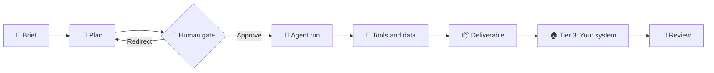

<div align="center">

# 🌐 Course 07 — General Agents on the Web

### From Chat to Delegated Work · A Crash Course


[📖 Official Course](https://agentfactory.panaversity.org/docs/general-agents-web-crash-course) · [🌳 Interactive Topic Tree](#-interactive-topic-tree--expand--collapse) · [📜 Original Tree](#-original-source-tree--exact-formatting)

</div>

> [!IMPORTANT]
> **Source completeness:** This is a faithful transformation of the **supplied partial topic tree**, not a claim that the original course page is complete. Appendix A was truncated; Appendices B–G contain search-excerpt-only material. Unknown later sections are explicitly marked `[NOT VERIFIED]`. The complete supplied text is retained verbatim in the archive below.

## 🧭 Learning map

| 🔵 Shift | 🟣 Surface | 🟢 Working unwatched | 🟠 Routing & limits |
|:--|:--|:--|:--|
| Chat vs delegated runs, cloud/local runtime, six-part harness | Context layers, file custody, reach, approvals | Brief → plan → approve → review; scheduling | Web/desktop/terminal, open path, security and custody |



## 🧩 Six-part agent harness

| Component | Core question |
|:--|:--|
| ❤️ **Heartbeat** | What starts the run? |
| 🔌 **Reach** | What can it read or change? |
| 🔁 **Run-until-done loop** | How does it keep going? |
| 🧠 **State spine** | What persists? |
| 🛑 **Human gate** | When must it stop and ask? |
| 💻 **Body** | Where does execution happen? |

> [!WARNING]
> A cloud agent reading a local file through a desktop bridge may still process that file in the cloud. Match permission gates to risk, and ensure finished work exits to a system you control.

## ☑️ Revision checklist

- [ ] Distinguish a chat turn from a delegated run.
- [ ] Identify agent-loop location separately from tool-execution location.
- [ ] Name the six harness parts and the five persistence layers.
- [ ] Explain the three file custody tiers and the Tier 3 exit.
- [ ] Choose connector, browser, desktop bridge, or local runtime.
- [ ] Apply the human gate and assess blast radius.
- [ ] Write an unwatched-work brief and review the plan.
- [ ] Verify outcome evidence before scheduling a recurring run.
- [ ] Complete the six projects and inspect appendix verification labels.

---

## 🌳 Interactive topic tree — expand / collapse

> [!TIP]
> Click any section or topic to reveal its children. The hierarchy is nested throughout; no numbered item from the supplied tree is omitted.

<details open>
<summary><strong>7.1 Introduction (text under H1, before first heading) [Concept]</strong> <sub>(16 direct topics)</sub></summary>

<ul>
<li>7.1.1 Subtitle: 12 Concepts; your first general agent, in the same browser tab where your Foundations ran [Concept]</li>
<li>7.1.2 Hero graphic: "Harness Wars" (Claude Cowork vs ChatGPT Work; six shared parts: Heartbeat, Connectors, Run-until-done, State spine, Human gate, Body) [Concept]</li>
<li>7.1.3 For six courses you worked in a chat tab; a conversation stops doing when you stop asking [Concept]</li>
<li>7.1.4 General agent: a worker you hand an assignment to; plans, uses tools, works through steps; may run now, later, on a schedule, or after you close the tab [Concept]</li>
<li>7.1.5 Mid-2026 change was packaging: sessions, files, connectors, scheduling, approvals, file creation in one surface beside chat [Concept]</li>
<li>7.1.6 August 2026 changed the surface again: Cowork memory across surfaces, own browser, link to Claude in Chrome, richer plugins, cloud session reaching tools on your computer via Claude Desktop [Concept]</li>
<details>
<summary><strong>7.1.7 Two questions instead of one [Concept]</strong> <sub>(2 direct topics)</sub></summary>

<ul>
<li>7.1.7.1 Where does the agent loop run? [Concept]</li>
<li>7.1.7.2 Where does each tool execute? [Concept]</li>
</ul>
</details>

<li>7.1.8 Browser-first course; core route needs nothing installed; optional bridges decide what web Cowork can reach [Concept]</li>
<li>7.1.9 Claude Cowork and ChatGPT Work: same anatomy (heartbeat, reach, run-until-done loop, persistent state, human gate, body) [Concept]</li>
<li>7.1.10 Harness defined (everything around the model); model defined (trained AI that writes the answer) [Concept]</li>
<li>7.1.11 Durable skill: learn the shape, then inspect the implementation [Concept]</li>
<li>7.1.12 Who this course is for: knowledge workers first; gentle entry for engineers before desktop and terminal courses [Concept]</li>
<details>
<summary><strong>7.1.13 What you will be able to do by the end [Concept]</strong> <sub>(7 direct topics)</sub></summary>

<ul>
<li>7.1.13.1 Tell chat apart from delegated work [Concept]</li>
<li>7.1.13.2 Explain cloud and local execution without a false split [Concept]</li>
<li>7.1.13.3 Choose among connector, browser, and local reach [Concept]</li>
<li>7.1.13.4 Place every file in the right custody tier [Concept]</li>
<li>7.1.13.5 Match approval mode to the stakes [Concept]</li>
<li>7.1.13.6 Brief work you will not watch [Concept]</li>
<li>7.1.13.7 Schedule only proven workflows [Concept]</li>
</ul>
</details>

<li>7.1.14 Do this first: Foundations, above all AI Prompting in 2026 and Skills &amp; Connectors [Concept]</li>
<li>7.1.15 How long this takes: core route Parts 1 to 3 about 2 to 2.5 hours; Part 4 adds 30 to 45 minutes; seven appendices are reference; projects add hands-on time including one week for scheduling [Concept]</li>
<details>
<summary><strong>7.1.16 New here? A 2-minute recap of what you should already know (collapsible) [Concept]</strong> <sub>(5 direct topics)</sub></summary>

<ul>
<li>7.1.16.1 Briefing: describing a task in full (Foundations Course 2) [Concept]</li>
<li>7.1.16.2 Context: everything the model sees in one turn (Foundations Course 2) [Concept]</li>
<li>7.1.16.3 A Skill: a task taught once in SKILL.md (Foundations Course 5) [Concept]</li>
<li>7.1.16.4 A Connector: safe limited access to a service over MCP (Foundations Course 5) [Concept]</li>
<li>7.1.16.5 A chatbot vs an agent: answers vs plans, uses tools, finishes steps [Concept]</li>
</ul>
</details>

</ul>
</details>

<details>
<summary><strong>7.2 📚 Teaching Aid (H3 in source, directly under the H1)</strong> <sub>(2 direct topics)</sub></summary>

<ul>
<li>7.2.1 Full presentation link and slideshow embed (General Agents on the Web) [NOT VERIFIED: slide content not readable] [Concept]</li>
<details>
<summary><strong>7.2.2 For instructors and self-learners: teach one transferable idea; every agent surface reads as the same small set of parts [Concept]</strong> <sub>(6 direct topics)</sub></summary>

<ul>
<li>7.2.2.1 Pass 1: Concepts 1 to 3, the shift from chat to delegated work [Concept]</li>
<li>7.2.2.2 Pass 2: Concepts 4 to 7, the surface [Concept]</li>
<li>7.2.2.3 Pass 3: Concepts 8 and 9, working unwatched [Concept]</li>
<li>7.2.2.4 Pass 4: Concepts 10 to 12, routing and limits [Concept]</li>
<li>7.2.2.5 Six projects are the assessment [Concept]</li>
<li>7.2.2.6 Two habits: finished work exits the platform; high-consequence work earns tighter gates [Concept]</li>
</ul>
</details>

</ul>
</details>

<details>
<summary><strong>7.3 Key words in plain English (H3 in source)</strong> <sub>(2 direct topics)</sub></summary>

<ul>
<li>7.3.1 Read once now; come back when product words outpace the idea [Concept]</li>
<details>
<summary><strong>7.3.2 Quick glossary (43 entries) [Concept]</strong> <sub>(43 direct topics)</sub></summary>

<ul>
<li>7.3.2.1 Chat box [Concept]</li>
<li>7.3.2.2 Agent surface [Concept]</li>
<li>7.3.2.3 Agent loop [Concept]</li>
<li>7.3.2.4 Cloud session [Concept]</li>
<li>7.3.2.5 Local session [Concept]</li>
<li>7.3.2.6 Desktop bridge [Concept]</li>
<li>7.3.2.7 Tool execution location [Concept]</li>
<li>7.3.2.8 Connector [Concept]</li>
<li>7.3.2.9 Browser agent [Concept]</li>
<li>7.3.2.10 Task filesystem [Concept]</li>
<li>7.3.2.11 Platform storage [Concept]</li>
<li>7.3.2.12 The exit (Tier 3) [Concept]</li>
<li>7.3.2.13 Session history [Concept]</li>
<li>7.3.2.14 Project [Concept]</li>
<li>7.3.2.15 Semantic memory [Concept]</li>
<li>7.3.2.16 Standing instructions [Concept]</li>
<li>7.3.2.17 State spine [Concept]</li>
<li>7.3.2.18 Human gate [Concept]</li>
<li>7.3.2.19 Approval mode [Concept]</li>
<li>7.3.2.20 Scheduled task [Concept]</li>
<li>7.3.2.21 Custody [Concept]</li>
<li>7.3.2.22 Metered usage [Concept]</li>
<li>7.3.2.23 Harness [Concept]</li>
<li>7.3.2.24 Heartbeat [Concept]</li>
<li>7.3.2.25 Reach [Concept]</li>
<li>7.3.2.26 Run-until-done loop [Concept]</li>
<li>7.3.2.27 Body [Concept]</li>
<li>7.3.2.28 Prompt injection [Concept]</li>
<li>7.3.2.29 Blast radius [Concept]</li>
<li>7.3.2.30 Workflow discovery [Concept]</li>
<li>7.3.2.31 Model [Concept]</li>
<li>7.3.2.32 MCP [Concept]</li>
<li>7.3.2.33 Sub-agents [Concept]</li>
<li>7.3.2.34 Hooks [Concept]</li>
<li>7.3.2.35 Sandbox [Concept]</li>
<li>7.3.2.36 Safety classifiers [Concept]</li>
<li>7.3.2.37 CLAUDE.md [Concept]</li>
<li>7.3.2.38 Codex [Concept]</li>
<li>7.3.2.39 HIPAA [Concept]</li>
<li>7.3.2.40 PHI [Concept]</li>
<li>7.3.2.41 BAA [Concept]</li>
<li>7.3.2.42 CI [Concept]</li>
<li>7.3.2.43 Dogfooding [Concept]</li>
</ul>
</details>

</ul>
</details>

<details>
<summary><strong>7.4 Preview: the twelve ideas in one line each (H3 in source)</strong> <sub>(13 direct topics)</sub></summary>

<ul>
<li>7.4.1 1 Chat waits for you; an agent surface keeps working after you stop typing [Concept]</li>
<li>7.4.2 2 A cloud session runs on the vendor's servers; your tab is a window [Concept]</li>
<li>7.4.3 3 Every serious agent product is built from the same six parts [Concept]</li>
<li>7.4.4 4 Persistent context is a stack of layers, not one thing called memory [Concept]</li>
<li>7.4.5 5 Every file sits in one of three tiers; only the third is yours [Concept]</li>
<li>7.4.6 6 A connector is the cleanest way to reach a real system [Concept]</li>
<li>7.4.7 7 The human gate is the rule for when the agent must stop and ask [Concept]</li>
<li>7.4.8 8 Brief the work, read the plan, approve it, review the result [Concept]</li>
<li>7.4.9 9 A schedule starts work on a clock; runs without your device only if every tool does too [Concept]</li>
<li>7.4.10 10 Route each task by what the work touches and who may hold the data [Concept]</li>
<li>7.4.11 11 The open path gives custody and asks you to build the spine [Concept]</li>
<li>7.4.12 12 The surface makes weak work faster, not better [Concept]</li>
<details>
<summary><strong>7.4.13 Where this came from (collapsible) [Concept]</strong> <sub>(6 direct topics)</sub></summary>

<ul>
<li>7.4.13.1 Before 2026: scheduled tasks, deep research, agent mode, cloud coding sessions already existed [Concept]</li>
<li>7.4.13.2 July 2026: Cowork on web and mobile cloud sessions; ChatGPT Work beside chat [Concept]</li>
<li>7.4.13.3 August 12: Claude in Chrome side panel became a Cowork session [Concept]</li>
<li>7.4.13.4 August 25: Cowork gained semantic memory shared with Claude chat; saved sessions and memory are now different things [Concept]</li>
<li>7.4.13.5 August 26: built-in browser in Claude Desktop; Claude in Chrome generally available on paid plans with autonomous actions and safety screening [Concept]</li>
<li>7.4.13.6 Inspect agent-loop location, tool-execution location, custody, and gate separately [Concept]</li>
</ul>
</details>

</ul>
</details>

<details>
<summary><strong>7.5 Why this happened, and what it lets you do that you could not before (H3 in source)</strong> <sub>(5 direct topics)</sub></summary>

<ul>
<li>7.5.1 The change was assembly, not a sudden new capability; August added memory, browser reach, hybrid execution [Concept]</li>
<details>
<summary><strong>7.5.2 The six practical changes in one list (collapsible) [Concept]</strong> <sub>(6 direct topics)</sub></summary>

<ul>
<li>7.5.2.1 Delegated work has a home beside chat [Concept]</li>
<li>7.5.2.2 Cloud sessions survive the device [Concept]</li>
<li>7.5.2.3 Persistence is layered, not one blob called memory [Concept]</li>
<li>7.5.2.4 The agent has several ways to reach the world (connector, browser, desktop bridge, computer use) [Concept]</li>
<li>7.5.2.5 Autonomy is configurable (Manual, Auto, Skip) [Concept]</li>
<li>7.5.2.6 Scheduling turns a good workflow into a recurring worker; it does not repair a bad one [Concept]</li>
</ul>
</details>

<li>7.5.3 Business consequence: switching cost; separate working continuity from system-of-record custody [Concept]</li>
<li>7.5.4 Security consequence: what can it read, what can it change, what stops it when content is hostile [Concept]</li>
<li>7.5.5 In simple terms: capable worker, files, tools, memory, schedule, and gate sit together; more of your work sits in someone else's system [Concept]</li>
</ul>
</details>

<details>
<summary><strong>7.6 The mindset shift, in one picture (H3 in source)</strong> <sub>(2 direct topics)</sub></summary>

<ul>
<li>7.6.1 Figure: same address, two things (before vs after July 2026; closed laptop, clock chip, phone approval card) [Concept]</li>
<li>7.6.2 Caution: facts checked 31 August 2026; rollouts, plan access, permission defaults, button names still change [Concept]</li>
</ul>
</details>

<details>
<summary><strong>7.7 What this course covers (H3 in source)</strong> <sub>(4 direct topics)</sub></summary>

<ul>
<details>
<summary><strong>7.7.1 Four-part table [Concept]</strong> <sub>(4 direct topics)</sub></summary>

<ul>
<li>7.7.1.1 Part 1 The Shift: chat vs delegated work, cloud vs local, desktop bridges, six-part harness lens [Concept]</li>
<li>7.7.1.2 Part 2 The Surface: sessions, Projects, memory, instructions, file custody, connectors, browsers, approval modes [Concept]</li>
<li>7.7.1.3 Part 3 Working Unwatched: discovering a workflow, briefing, reviewing the plan, scheduling proven work [Concept]</li>
<li>7.7.1.4 Part 4 Choosing, and the Open Path: cloud-only, cloud plus bridge, local desktop, coding agents, open paths, limits [Concept]</li>
</ul>
</details>

<li>7.7.2 Two ways to read this course: first time (Why this happened, Parts 1 to 3, Projects 1 to 3); second read (Part 4, deeper notes, Projects 4 to 6) [Concept]</li>
<li>7.7.3 What to remember (architecture) vs what to look up (plan tiers, run limits, model names, permission labels, browser availability, rollout status) [Concept]</li>
<li>7.7.4 One boundary stated up front: runtime decision, what travels in a move, and re-earning trust belong to Leaving the Laptop [Concept]</li>
</ul>
</details>

<details>
<summary><strong>7.8 Part 1: The Shift</strong> <sub>(3 direct topics)</sub></summary>

<ul>
<details>
<summary><strong>7.8.1 1. Same address, two different things</strong> <sub>(11 direct topics)</sub></summary>

<ul>
<li>7.8.1.1 claude.ai and chatgpt.com host two products; ChatGPT shows Chat mode and Work mode side by side [Concept]</li>
<li>7.8.1.2 Codex: OpenAI's separate coding agent, desktop experience; supported desktop Codex sessions open from the Remote tab on mobile [Concept]</li>
<li>7.8.1.3 Chat box: waits every turn; cannot start on a schedule, react to an event, or continue after the tab closes [Concept]</li>
<li>7.8.1.4 Agent surface: assign an assignment, not a message; plans, uses tools, produces a deliverable; keeps working [Concept]</li>
<li>7.8.1.5 One test: if I stop typing, does the work stop (chat yes, agent surface no) [Concept]</li>
<li>7.8.1.6 Deeper version: synchronous chat turn vs delegated run [Concept]</li>
<li>7.8.1.7 Caution: you often start a delegated run from the chat box in plain words; watch what the work does, not where you typed [Concept]</li>
<li>7.8.1.8 Chat keeps its job: design the task, draft the brief, test an idea by hand [Concept]</li>
<li>7.8.1.9 In simple terms: one window, two rooms [Concept]</li>
<li>7.8.1.10 Remember: chat waits; an agent surface keeps working [Concept]</li>
<li>7.8.1.11 Check yourself: correct "I already use claude.ai so I already use agents" [Concept]</li>
</ul>
</details>

<details>
<summary><strong>7.8.2 2. The remote session: the tab is a window, not the runtime</strong> <sub>(12 direct topics)</sub></summary>

<ul>
<li>7.8.2.1 First edition's cloud-or-local split is no longer enough; use two axes [Concept]</li>
<details>
<summary><strong>7.8.2.2 Axis 1: where does the loop run [Concept]</strong> <sub>(2 direct topics)</sub></summary>

<ul>
<li>7.8.2.2.1 Cloud session: planning, tool selection, code execution, task state on vendor infrastructure [Concept]</li>
<li>7.8.2.2.2 Local session: agent loop on your machine [Concept]</li>
</ul>
</details>

<details>
<summary><strong>7.8.2.3 Axis 2: where does the tool execute [Concept]</strong> <sub>(1 direct topics)</sub></summary>

<ul>
<li>7.8.2.3.1 Cloud session may call a connector, or via a bridge a browser or file tool on your computer [Concept]</li>
</ul>
</details>

<details>
<summary><strong>7.8.2.4 Three runtime patterns (table) [Concept]</strong> <sub>(3 direct topics)</sub></summary>

<ul>
<li>7.8.2.4.1 Cloud-only: vendor cloud loop; cloud files, connectors, web tools; run keeps going if laptop closes [Concept]</li>
<li>7.8.2.4.2 Cloud plus desktop bridge: cloud loop; plus selected browser or file tools via desktop; bridged tools vanish when desktop offline [Concept]</li>
<li>7.8.2.4.3 Local: your machine; depends on machine staying available [Concept]</li>
</ul>
</details>

<details>
<summary><strong>7.8.2.5 Cowork (web): cloud loop and code execution on Anthropic servers; sessions and files with your Claude account; local folder or browser via Claude Desktop while online [Concept]</strong> <sub>(3 direct topics)</sub></summary>

<ul>
<li>7.8.2.5.1 Bridge does not turn a cloud session local [Concept]</li>
<li>7.8.2.5.2 Local file opened through the bridge is processed in the cloud [Concept]</li>
<li>7.8.2.5.3 Access varies by plan and organization policy [Concept]</li>
</ul>
</details>

<details>
<summary><strong>7.8.2.6 ChatGPT Work: web and mobile work runs in OpenAI's cloud; desktop Work can use local folders and apps with permission; local Work stays on that computer [Concept]</strong> <sub>(1 direct topics)</sub></summary>

<ul>
<li>7.8.2.6.1 Enterprise controls: Work Cloud and Work Local can be separated [Concept]</li>
</ul>
</details>

<li>7.8.2.7 Figure: two architectures side by side (local runtime vs vendor servers; one session ID across windows) [Concept]</li>
<li>7.8.2.8 Add a cable to the picture: a remote worker borrows a tool in your house; what it reads travels out [Concept]</li>
<details>
<summary><strong>7.8.2.9 Four consequences [Concept]</strong> <sub>(4 direct topics)</sub></summary>

<ul>
<li>7.8.2.9.1 Closing a tab is not stopping a cloud run [Concept]</li>
<li>7.8.2.9.2 Closing the laptop can remove a bridged tool without killing the session [Concept]</li>
<li>7.8.2.9.3 A local file can be processed in the cloud [Concept]</li>
<li>7.8.2.9.4 Scheduling is device-independent only when the workflow is [Concept]</li>
</ul>
</details>

<li>7.8.2.10 In simple terms: where is the worker, where is the tool [Concept]</li>
<li>7.8.2.11 Remember: the tab is a window, not the runtime [Concept]</li>
<li>7.8.2.12 Check yourself: Ayesha's cloud task with a connected local folder goes offline halfway [Concept]</li>
</ul>
</details>

<details>
<summary><strong>7.8.3 3. Two vendors, one shape</strong> <sub>(12 direct topics)</sub></summary>

<ul>
<li>7.8.3.1 Serious agent surfaces rebuild the same anatomy [Concept]</li>
<details>
<summary><strong>7.8.3.2 Six parts [Concept]</strong> <sub>(6 direct topics)</sub></summary>

<ul>
<li>7.8.3.2.1 Heartbeat: what starts a run [Concept]</li>
<li>7.8.3.2.2 Reach: what the run can read and act on [Concept]</li>
<li>7.8.3.2.3 Run-until-done loop: how it keeps moving toward an outcome [Concept]</li>
<li>7.8.3.2.4 State spine: what persists [Concept]</li>
<li>7.8.3.2.5 Human gate: where autonomy stops or gets screened [Concept]</li>
<li>7.8.3.2.6 Body: where the work executes [Concept]</li>
</ul>
</details>

<li>7.8.3.3 Figure: two vendors, one shape (July snapshot of vendor labels) [Concept]</li>
<details>
<summary><strong>7.8.3.4 Product-neutral comparison table (six rows) [Concept]</strong> <sub>(6 direct topics)</sub></summary>

<ul>
<li>7.8.3.4.1 Heartbeat: Scheduled Tasks and supported triggers / scheduled tasks and on-demand [Concept]</li>
<li>7.8.3.4.2 Reach: plugins, connected apps, cloud browser / connectors, plugins, web tools, built-in browser, Claude in Chrome [Concept]</li>
<li>7.8.3.4.3 Run-until-done: outcome-oriented work with Plan mode / multi-step execution and sub-agents [Concept]</li>
<li>7.8.3.4.4 State spine: sessions, Projects, files, memory, instructions / sessions, Projects, cloud memory, three levels of instructions, files [Concept]</li>
<li>7.8.3.4.5 Human gate: approval prompts and policy / Manual, Auto, Skip, connector permissions, organization controls [Concept]</li>
<li>7.8.3.4.6 Body: cloud Work, cloud browser, desktop or local / cloud sandbox plus optional local session and bridged tools [Concept]</li>
</ul>
</details>

<li>7.8.3.5 Run the lens over any new agent product; find the six parts first [Concept]</li>
<li>7.8.3.6 ChatGPT Work Plan mode: gather context, ask questions, plan, approve before execution (Concept 8 built in) [Concept]</li>
<li>7.8.3.7 Figure: Cowork vs ChatGPT Work packaging differences (model, surface, sale, connectors, extra artifact, coding sibling) [Concept]</li>
<li>7.8.3.8 Managed surface gives the spine for free; open path gives control of runtime and custody [Concept]</li>
<details>
<summary><strong>7.8.3.9 Two warnings [Concept]</strong> <sub>(2 direct topics)</sub></summary>

<ul>
<li>7.8.3.9.1 Same shape does not mean same trust [Concept]</li>
<li>7.8.3.9.2 Same label does not mean same implementation [Concept]</li>
</ul>
</details>

<li>7.8.3.10 In simple terms: cars share steering, brakes, power [Concept]</li>
<li>7.8.3.11 Remember: every serious agent product has the same six parts [Concept]</li>
<li>7.8.3.12 Check yourself: map a new product's claims to the six parts [Concept]</li>
</ul>
</details>

</ul>
</details>

<details>
<summary><strong>7.9 Part 2: The Surface</strong> <sub>(7 direct topics)</sub></summary>

<ul>
<li>7.9.1 Intro: inspect persistence, files, reach, gates; Concept 5 is the custody discipline; Concept 6 carries the largest August update [Concept]</li>
<details>
<summary><strong>7.9.2 4. The account spine: sessions and files you did not have to build</strong> <sub>(13 direct topics)</sub></summary>

<ul>
<li>7.9.2.1 Persistent context is a stack of layers, not one thing called memory [Concept]</li>
<details>
<summary><strong>7.9.2.2 Five layers [Concept]</strong> <sub>(5 direct topics)</sub></summary>

<ul>
<li>7.9.2.2.1 Session history: what happened in this task [Concept]</li>
<li>7.9.2.2.2 Project: continuing body of work with own files and instructions [Concept]</li>
<li>7.9.2.2.3 Semantic memory: facts and preferences across cloud sessions [Concept]</li>
<li>7.9.2.2.4 Standing instructions: rules that apply again and again [Concept]</li>
<li>7.9.2.2.5 User-owned context file: your portable, vendor-neutral copy [Concept]</li>
</ul>
</details>

<li>7.9.2.3 Layer table with question each answers and typical lifetime [Concept]</li>
<li>7.9.2.4 Figure: The Persistent Context Stack [Concept]</li>
<li>7.9.2.5 August change: cloud Cowork shares memory with Claude chat; inspect topic by topic, edit or delete; project memory stays in the Project; local Cowork does not use cloud memory [Concept]</li>
<li>7.9.2.6 An old session is not memory; a Project is not memory; a global instruction is not memory [Concept]</li>
<details>
<summary><strong>7.9.2.7 Cowork (web): sessions, Projects, cloud memory, instructions (global and folder), files [Concept]</strong> <sub>(1 direct topics)</sub></summary>

<ul>
<li>7.9.2.7.1 CLAUDE.md as a portable context file [Concept]</li>
</ul>
</details>

<li>7.9.2.8 ChatGPT Work: cloud-synced sessions and files, Projects, saved instructions, memory [Concept]</li>
<li>7.9.2.9 Price of convenience: custody and dependency; keep a portable source of truth [Concept]</li>
<details>
<summary><strong>7.9.2.10 Three habits [Concept]</strong> <sub>(3 direct topics)</sub></summary>

<ul>
<li>7.9.2.10.1 Name sessions like work products [Concept]</li>
<li>7.9.2.10.2 Keep one workstream per session or Project [Concept]</li>
<li>7.9.2.10.3 Put durable instructions in the right layer [Concept]</li>
</ul>
</details>

<li>7.9.2.11 In simple terms: meeting notes, client room, colleague's learning, office rules, briefcase copy [Concept]</li>
<li>7.9.2.12 Remember: narrowest layer that reliably applies [Concept]</li>
<li>7.9.2.13 Check yourself: client prefers one-page updates only inside that client's work [Concept]</li>
</ul>
</details>

<details>
<summary><strong>7.9.3 5. The three file tiers: where does the deliverable actually live?</strong> <sub>(12 direct topics)</sub></summary>

<ul>
<details>
<summary><strong>7.9.3.1 Every file lives in one of three tiers [Concept]</strong> <sub>(3 direct topics)</sub></summary>

<ul>
<li>7.9.3.1.1 Tier 1: task filesystem (temporary working space; scratch; never storage) [Concept]</li>
<li>7.9.3.1.2 Tier 2: platform storage (survives the task; vendor's custody, format, login) [Concept]</li>
<li>7.9.3.1.3 Tier 3: the exit (a system you control: connector save, email or Slack post, download, local write, repository commit) [Concept]</li>
</ul>
</details>

<li>7.9.3.2 Figure: three stacked shelves (custody: theirs, theirs, yours) [Concept]</li>
<li>7.9.3.3 One line to memorize: finished work exits the platform; everything else may stay [Concept]</li>
<li>7.9.3.4 Risk ladder reading: tier 1 only is lost; tier 2 only is hostage; tier 3 is yours [Concept]</li>
<li>7.9.3.5 Cowork (web): tiers 1, 2, 3; local write only via desktop bridge; local file opened through Desktop is processed in the cloud [Concept]</li>
<details>
<summary><strong>7.9.3.6 ChatGPT Work: isolated working environment; finished docs, sheets, decks, dashboards, Sites; exits via Plugin Directory connector save, download, desktop bridge write [Concept]</strong> <sub>(1 direct topics)</sub></summary>

<ul>
<li>7.9.3.6.1 A Site on the platform is tier 2 with a public door, not tier 3 [Concept]</li>
</ul>
</details>

<li>7.9.3.7 Worked example: Ayesha's monthly invoicing (drafts in tier 1, template in tier 2, invoice PDF to tier 3 twice) [Concept]</li>
<li>7.9.3.8 Closing instruction: list every file created and where each landed [Concept]</li>
<li>7.9.3.9 In simple terms: scratch pad, worker's drawer, your filing cabinet [Concept]</li>
<li>7.9.3.10 Remember: tier 1 scratch; tier 2 safe but vendor custody; tier 3 yours [Concept]</li>
<li>7.9.3.11 Going deeper: Loop Engineering (state spine) and Leaving the Laptop (suitcase test; the repo holds the truth) [Concept]</li>
<li>7.9.3.12 Check yourself: lawyer shares a platform link to a memo (custody and access problems; fix is tier 3) [Concept]</li>
</ul>
</details>

<details>
<summary><strong>7.9.4 6. Connectors on the web: reach and exit door in one</strong> <sub>(9 direct topics)</sub></summary>

<ul>
<li>7.9.4.1 Connector: structured, permission-scoped access; no longer the whole reach story [Concept]</li>
<details>
<summary><strong>7.9.4.2 Four reach paths (table) [Concept]</strong> <sub>(4 direct topics)</sub></summary>

<ul>
<li>7.9.4.2.1 Connector: Gmail, Drive, Slack, DocuSign, CRMs, databases [Concept]</li>
<li>7.9.4.2.2 Built-in Cowork browser: portals, forms, dashboards [Concept]</li>
<li>7.9.4.2.3 Claude in Chrome: the page in front of you, existing logins [Concept]</li>
<li>7.9.4.2.4 Computer use and desktop tools: highest risk [Concept]</li>
</ul>
</details>

<li>7.9.4.3 Default rule: connector before browser; browser before full computer use [Concept]</li>
<li>7.9.4.4 Figure: How an Agent Reaches the World (four-rung reach ladder) [Concept]</li>
<li>7.9.4.5 The ladder ranks exposure, not safety; a connector is still a real door [Concept]</li>
<details>
<summary><strong>7.9.4.6 Cowork (web) [Concept]</strong> <sub>(3 direct topics)</sub></summary>

<ul>
<li>7.9.4.6.1 Built-in browser in Claude Desktop; separate from your browser; steered from web or mobile while desktop online [Concept]</li>
<li>7.9.4.6.2 Separate browser state; can import selected site logins; login state is a permission [Concept]</li>
<li>7.9.4.6.3 Claude in Chrome: your Chrome browser; side panel is part of Cowork's session story since August 12 [Concept]</li>
</ul>
</details>

<details>
<summary><strong>7.9.4.7 ChatGPT Work: three browser paths [Concept]</strong> <sub>(3 direct topics)</sub></summary>

<ul>
<li>7.9.4.7.1 Work cloud browser: remote computer; continues after you close your computer; separate sign-in sessions [Concept]</li>
<li>7.9.4.7.2 Desktop built-in browser: in-app, own state, several tabs; local files and apps where plan allows [Concept]</li>
<li>7.9.4.7.3 Codex Chrome extension: existing Chrome profile, cookies, tabs, extensions; belongs to Codex, not Work [Concept]</li>
</ul>
</details>

<li>7.9.4.8 Same routing rule on both vendors [Concept]</li>
<li>7.9.4.9 Figure: five-path browser comparison [Concept]</li>
</ul>
</details>

<details>
<summary><strong>7.9.5 The security model changes when the agent can both read and act</strong> <sub>(9 direct topics)</sub></summary>

<ul>
<li>7.9.5.1 Two conditions: reads outside the trusted boundary and can take a consequential action [Concept]</li>
<li>7.9.5.2 Prompt injection defined; safety classifiers reduce but do not erase risk [Concept]</li>
<li>7.9.5.3 Anthropic prohibits following instructions found in emails or web content in every permission mode; your brief is authority [Concept]</li>
<details>
<summary><strong>7.9.5.4 Five rules [Concept]</strong> <sub>(5 direct topics)</sub></summary>

<ul>
<li>7.9.5.4.1 Start with trusted sites and low-stakes accounts [Concept]</li>
<li>7.9.5.4.2 Do not casually import or reuse logins for banking, medical, identity, or sensitive systems [Concept]</li>
<li>7.9.5.4.3 Use Manual approval for unfamiliar sites, new plugins or connectors, and send, spend, delete, publish, or change actions [Concept]</li>
<li>7.9.5.4.4 Give each workflow only the connectors and browser reach it needs [Concept]</li>
<li>7.9.5.4.5 Use connectors as both an entry and an exit [Concept]</li>
</ul>
</details>

<li>7.9.5.5 Read is not send, draft is not publish, view is not edit; write access raises blast radius [Concept]</li>
<li>7.9.5.6 Plugins can bundle skills, connectors, sub-agents, and hooks; install only trusted plugins [Concept]</li>
<li>7.9.5.7 In simple terms: service entrance, front door and hallways, giving the worker your mouse and keyboard [Concept]</li>
<li>7.9.5.8 Remember: smallest scope that finishes the work [Concept]</li>
<li>7.9.5.9 Check yourself: vendor portal with no connector (browser; start with Manual) [Concept]</li>
</ul>
</details>

<details>
<summary><strong>7.9.6 7. The gate in your pocket</strong> <sub>(8 direct topics)</sub></summary>

<ul>
<li>7.9.6.1 The phone is one place a gate can reach you; the gate is the whole rule for what may happen without you [Concept]</li>
<details>
<summary><strong>7.9.6.2 Gate layers [Concept]</strong> <sub>(6 direct topics)</sub></summary>

<ul>
<li>7.9.6.2.1 Connector permission scope [Concept]</li>
<li>7.9.6.2.2 Organization policy [Concept]</li>
<li>7.9.6.2.3 Per-task approval mode [Concept]</li>
<li>7.9.6.2.4 Safety screening on actions [Concept]</li>
<li>7.9.6.2.5 Explicit approval for destructive actions [Concept]</li>
<li>7.9.6.2.6 Escalation to your phone or another surface [Concept]</li>
</ul>
</details>

<details>
<summary><strong>7.9.6.3 Cowork's three modes (table) [Concept]</strong> <sub>(3 direct topics)</sub></summary>

<ul>
<li>7.9.6.3.1 Manual: pauses for actions needing approval [Concept]</li>
<li>7.9.6.3.2 Auto: keeps moving, screens each action; side-panel default; consumes more usage [Concept]</li>
<li>7.9.6.3.3 Skip: no ordinary approvals and no Auto action check [Concept]</li>
</ul>
</details>

<li>7.9.6.4 Figure: The Human Gate: Approval Modes [Concept]</li>
<li>7.9.6.5 Anthropic warns no automated defense is perfect; explicit protection for permanent deletion [Concept]</li>
<li>7.9.6.6 Side panel defaults to Automatically approve; a product default, not a recommendation [Concept]</li>
<li>7.9.6.7 Two better questions: what is allowed to happen without me; what mechanism stops or screens the action [Concept]</li>
<li>7.9.6.8 Cloud sessions can notify you when finished or needing input [Concept]</li>
</ul>
</details>

<details>
<summary><strong>7.9.7 Match the gate to blast radius</strong> <sub>(8 direct topics)</sub></summary>

<ul>
<details>
<summary><strong>7.9.7.1 Autonomy ladder [Concept]</strong> <sub>(4 direct topics)</sub></summary>

<ul>
<li>7.9.7.1.1 Read and summarize [Concept]</li>
<li>7.9.7.1.2 Draft but do not send [Concept]</li>
<li>7.9.7.1.3 Write to reversible records [Concept]</li>
<li>7.9.7.1.4 Send, publish, purchase, delete, or change critical data [Concept]</li>
</ul>
</details>

<li>7.9.7.2 Review thresholds: stakes, reversibility, audience, regulatory exposure [Concept]</li>
<li>7.9.7.3 Rung picks the gate on the action; thresholds pick the review on the result (Just Delegate It teaches the thresholds) [Concept]</li>
<li>7.9.7.4 Choose the gate before the run [Concept]</li>
<li>7.9.7.5 Ring the gate on purpose: create a harmless step needing input and confirm the request reaches a surface you watch [Concept]</li>
<li>7.9.7.6 In simple terms: the whole rule for when the worker must stop [Concept]</li>
<li>7.9.7.7 Remember: autonomy is a setting chosen before the run [Concept]</li>
<li>7.9.7.8 Check yourself: tested research workflow vs customer renewal-notice workflow [Concept]</li>
</ul>
</details>

</ul>
</details>

<details>
<summary><strong>7.10 Part 3: Working Unwatched</strong> <sub>(9 direct topics)</sub></summary>

<ul>
<li>7.10.1 Intro: handing over work you will not watch; delegation loop, then work on a clock [Concept]</li>
<details>
<summary><strong>7.10.2 8. The delegation loop: brief, plan, approve, review</strong> <sub>(6 direct topics)</sub></summary>

<ul>
<li>7.10.2.1 Handoff quality matters more when the product works without you [Concept]</li>
<li>7.10.2.2 Workflow discovery: let the agent interview you (quoted Monday-checks prompt) [Concept]</li>
<details>
<summary><strong>7.10.2.3 Four-step delegation loop [Concept]</strong> <sub>(4 direct topics)</sub></summary>

<ul>
<li>7.10.2.3.1 Brief [Concept]</li>
<li>7.10.2.3.2 Plan [Concept]</li>
<li>7.10.2.3.3 Approve or redirect [Concept]</li>
<li>7.10.2.3.4 Review [Concept]</li>
</ul>
</details>

<details>
<summary><strong>7.10.2.4 Plan-first is an instruction, not a guarantee of Manual mode (callout) [Concept]</strong> <sub>(2 direct topics)</sub></summary>

<ul>
<li>7.10.2.4.1 Cowork Manual does not auto-create a plan to approve; put "show me your plan first" in the brief [Concept]</li>
<li>7.10.2.4.2 ChatGPT Work Plan mode makes it explicit [Concept]</li>
</ul>
</details>

<li>7.10.2.5 Figure: delegation loop (redirect arrow; plan is the intercept) [Concept]</li>
<li>7.10.2.6 "Approve" can mean choosing an autonomy mode, approving a site or connector, or judging a workflow mature [Concept]</li>
</ul>
</details>

<details>
<summary><strong>7.10.3 A brief for work you will not watch</strong> <sub>(2 direct topics)</sub></summary>

<ul>
<details>
<summary><strong>7.10.3.1 Template [Concept]</strong> <sub>(8 direct topics)</sub></summary>

<ul>
<li>7.10.3.1.1 Outcome [Concept]</li>
<li>7.10.3.1.2 Audience [Concept]</li>
<li>7.10.3.1.3 Sources [Concept]</li>
<li>7.10.3.1.4 Boundaries [Concept]</li>
<li>7.10.3.1.5 Method [Concept]</li>
<li>7.10.3.1.6 Escalation [Concept]</li>
<li>7.10.3.1.7 Destination (name the tier-3 system) [Concept]</li>
<li>7.10.3.1.8 Done [Concept]</li>
</ul>
</details>

<li>7.10.3.2 Extra line: if necessary evidence is missing, say what is missing and stop rather than inventing it [Concept]</li>
</ul>
</details>

<details>
<summary><strong>7.10.4 Review the plan, not every click</strong> <sub>(6 direct topics)</sub></summary>

<ul>
<details>
<summary><strong>7.10.4.1 Four checks when reading the plan [Concept]</strong> <sub>(4 direct topics)</sub></summary>

<ul>
<li>7.10.4.1.1 Scope [Concept]</li>
<li>7.10.4.1.2 Order [Concept]</li>
<li>7.10.4.1.3 Reach [Concept]</li>
<li>7.10.4.1.4 Assumptions [Concept]</li>
</ul>
</details>

<li>7.10.4.2 Redirect with one sentence [Concept]</li>
<li>7.10.4.3 New browser or connector workflow: stay close the first few times [Concept]</li>
<li>7.10.4.4 In simple terms: explain the job, review the plan, that is management [Concept]</li>
<li>7.10.4.5 Remember: brief, plan, approve, review; fix the plan, not the cleanup [Concept]</li>
<li>7.10.4.6 Check yourself: cannot describe the weekly client update (interview, not a 40-line guess) [Concept]</li>
</ul>
</details>

<details>
<summary><strong>7.10.5 9. Scheduled tasks with no device online</strong> <sub>(6 direct topics)</sub></summary>

<ul>
<li>7.10.5.1 A schedule is the heartbeat [Concept]</li>
<li>7.10.5.2 Four heartbeat patterns: once, on a schedule, on a supported event, monitoring [Concept]</li>
<li>7.10.5.3 Figure: four heartbeats (reporting ceiling; acting schedules wait for Loop Engineering) [Concept]</li>
<li>7.10.5.4 OpenAI event-triggered tasks from Gmail, Slack, GitHub pull request activity; Trigger, Condition, Prompt [Concept]</li>
<li>7.10.5.5 Runtime requirement: device-independent only if every required tool is reachable without your device [Concept]</li>
<li>7.10.5.6 Cowork scheduled task runs in the cloud; local files and some browser capabilities depend on the desktop bridge [Concept]</li>
</ul>
</details>

<details>
<summary><strong>7.10.6 The four answers before you schedule</strong> <sub>(6 direct topics)</sub></summary>

<ul>
<li>7.10.6.1 What starts the run [Concept]</li>
<li>7.10.6.2 What does it touch [Concept]</li>
<li>7.10.6.3 Can it reach all of that with your devices off [Concept]</li>
<li>7.10.6.4 How will you know it succeeded [Concept]</li>
<li>7.10.6.5 Safety question 5: what may it do without approval [Concept]</li>
<li>7.10.6.6 Safety question 6: what happens on the empty or unclear case [Concept]</li>
</ul>
</details>

<details>
<summary><strong>7.10.7 Ran is not the same as worked</strong> <sub>(4 direct topics)</sub></summary>

<ul>
<li>7.10.7.1 Scheduler shows it started or completed, not that the output was correct or delivered [Concept]</li>
<li>7.10.7.2 Observable success signal for every recurring workflow [Concept]</li>
<li>7.10.7.3 Figure: runtime evidence vs outcome evidence [Concept]</li>
<li>7.10.7.4 If output is missing: check waiting for input, usage limits, permissions, connector or browser availability, destination [Concept]</li>
</ul>
</details>

<details>
<summary><strong>7.10.8 Start with reporting, then graduate carefully</strong> <sub>(2 direct topics)</sub></summary>

<ul>
<li>7.10.8.1 Safest scheduled agent reads, analyzes, reports [Concept]</li>
<li>7.10.8.2 Teaching ceiling, not a claim products cannot act [Concept]</li>
</ul>
</details>

<details>
<summary><strong>7.10.9 Walk it before you schedule it</strong> <sub>(5 direct topics)</sub></summary>

<ul>
<li>7.10.9.1 Run by hand at least twice; inspect sources, plan, permissions, output, empty case, tier-3 destination [Concept]</li>
<li>7.10.9.2 Scheduling photocopies the workflow into the future [Concept]</li>
<li>7.10.9.3 In simple terms: alarm clock for a worker [Concept]</li>
<li>7.10.9.4 Remember: a cloud clock is not enough; ran is not worked [Concept]</li>
<li>7.10.9.5 Check yourself: cloud connectors version vs adding a desktop-bridged local file [Concept]</li>
</ul>
</details>

</ul>
</details>

<details>
<summary><strong>7.11 Part 4: Choosing, and the Open Path</strong> <sub>(6 direct topics)</sub></summary>

<ul>
<li>7.11.1 Intro: when is this surface wrong; what does the open path look like; what can it never do [Concept]</li>
<details>
<summary><strong>7.11.2 10. Web, desktop, or terminal: pick by what the work touches</strong> <sub>(9 direct topics)</sub></summary>

<ul>
<li>7.11.2.1 Old router had two buckets; August turned the middle into a spectrum [Concept]</li>
<details>
<summary><strong>7.11.2.2 Three questions [Concept]</strong> <sub>(3 direct topics)</sub></summary>

<ul>
<li>7.11.2.2.1 What does the work touch [Concept]</li>
<li>7.11.2.2.2 Must it run while my device is off [Concept]</li>
<li>7.11.2.2.3 Who is allowed to hold and process the data [Concept]</li>
</ul>
</details>

<li>7.11.2.3 Figure: router diagram (Web, Desktop, Coding agents, Stop for regulated data) [Concept]</li>
<details>
<summary><strong>7.11.2.4 Work pattern table (seven rows) [Concept]</strong> <sub>(7 direct topics)</sub></summary>

<ul>
<li>7.11.2.4.1 One-off thinking and drafting: Chat [Concept]</li>
<li>7.11.2.4.2 Cloud files and connectors, must keep working with device off: cloud-only Cowork or Work [Concept]</li>
<li>7.11.2.4.3 Cloud session needs one approved local folder or browser: cloud plus desktop bridge [Concept]</li>
<li>7.11.2.4.4 Fundamentally local files and apps, custody matters: local desktop agent [Concept]</li>
<li>7.11.2.4.5 Repository, terminal, tests, codebase, CI: coding agent or terminal [Concept]</li>
<li>7.11.2.4.6 Website with no connector: browser path [Concept]</li>
<li>7.11.2.4.7 Regulated or contractually restricted data: stop and verify [Concept]</li>
</ul>
</details>

<details>
<summary><strong>7.11.2.5 Compliance examples: HIPAA, PHI, BAA defined [Concept]</strong> <sub>(2 direct topics)</sub></summary>

<ul>
<li>7.11.2.5.1 Anthropic exposes Cowork activity to Enterprise compliance tooling; Cowork not covered under its BAA for HIPAA use [Concept]</li>
<li>7.11.2.5.2 OpenAI: event-triggered Work tasks in ChatGPT for Healthcare are not BAA-covered and must not process PHI [Concept]</li>
</ul>
</details>

<li>7.11.2.6 The row has a branch: ask whether the task needs the identifiers or only the pattern [Concept]</li>
<li>7.11.2.7 Removing what the task does not need is a route, not an evasion [Concept]</li>
<li>7.11.2.8 Claude Certified Associate, Foundations exam guide (v1.0, July 2026): remove or mask regulated identifiers before use [Concept]</li>
<li>7.11.2.9 Stripping identifiers can fail in two hard-to-see ways; Governance, Risk &amp; Responsible Use owns the treatment [Concept]</li>
</ul>
</details>

<details>
<summary><strong>7.11.3 A bridge is a convenience, not a custody loophole</strong> <sub>(2 direct topics)</sub></summary>

<ul>
<li>7.11.3.1 Cloud Cowork reading a local file through Claude Desktop processes contents in Anthropic's cloud [Concept]</li>
<li>7.11.3.2 First question is where processing happens, not where the file sat [Concept]</li>
</ul>
</details>

<details>
<summary><strong>7.11.4 Browser choice is also routing</strong> <sub>(7 direct topics)</sub></summary>

<ul>
<li>7.11.4.1 Built-in Cowork browser: "go handle this website task for me" [Concept]</li>
<li>7.11.4.2 Claude in Chrome: "work with me on this page I already have open" [Concept]</li>
<li>7.11.4.3 Connector: use the service's structured interface [Concept]</li>
<li>7.11.4.4 The route can change inside one assignment [Concept]</li>
<li>7.11.4.5 In simple terms: choose by where the work lives, device-off need, who processes the data [Concept]</li>
<li>7.11.4.6 Remember: route by what the work touches; regulated work needs a written answer first [Concept]</li>
<li>7.11.4.7 Check yourself: route a Slack and Drive brief, 200 local files, a vendor-portal pull [Concept]</li>
</ul>
</details>

<details>
<summary><strong>7.11.5 11. The open path: no vendor cloud</strong> <sub>(8 direct topics)</sub></summary>

<ul>
<li>7.11.5.1 Vendor tool plus open-source twin pattern (Claude Code and OpenCode; Cowork and OpenWork); this course pairs two closed products on purpose [Concept]</li>
<details>
<summary><strong>7.11.5.2 Two open paths [Concept]</strong> <sub>(2 direct topics)</sub></summary>

<ul>
<li>7.11.5.2.1 OpenWork, remote and shared workspaces: self-hosted worker by URL and access token, or organization's shared cloud workers [Concept]</li>
<li>7.11.5.2.2 OpenCode with a scheduler you own: cron or scheduled GitHub Actions job; Loop Engineering teaches the pattern [Concept]</li>
</ul>
</details>

<li>7.11.5.3 The trade: companies sell you a spine; the open path makes you build one [Concept]</li>
<li>7.11.5.4 Open path gives custody (data on machines you control) and choice (which model sees your prompts) [Concept]</li>
<li>7.11.5.5 Neither side is noble; most readers hold both answers, one per task [Concept]</li>
<li>7.11.5.6 In simple terms: furnished office vs empty room [Concept]</li>
<li>7.11.5.7 Remember: pick per task, not once [Concept]</li>
<li>7.11.5.8 Check yourself: NGO donor-report automation with a no-third-party policy and no engineer [Concept]</li>
</ul>
</details>

<details>
<summary><strong>7.11.6 12. What this surface cannot do, and where this goes</strong> <sub>(10 direct topics)</sub></summary>

<ul>
<li>7.11.6.1 The web surface does not make weak work good [Concept]</li>
<li>7.11.6.2 The vendor still owns important parts of the harness [Concept]</li>
<li>7.11.6.3 A cloud-to-desktop bridge is not a local runtime [Concept]</li>
<li>7.11.6.4 Browser agents have a security ceiling [Concept]</li>
<li>7.11.6.5 Persistent context creates both power and lock-in [Concept]</li>
<details>
<summary><strong>7.11.6.6 Some work belongs elsewhere [Concept]</strong> <sub>(6 direct topics)</sub></summary>

<ul>
<li>7.11.6.6.1 Cowork &amp; OpenWork: desktop and local work [Concept]</li>
<li>7.11.6.6.2 Agentic Coding: repository work [Concept]</li>
<li>7.11.6.6.3 Spec-Driven Development: brief into checkable specification [Concept]</li>
<li>7.11.6.6.4 Loop Engineering: recurring loops with stopping conditions, state, checkers [Concept]</li>
<li>7.11.6.6.5 Harness Engineering and Trusting the Checker: designed and evaluated controls [Concept]</li>
<li>7.11.6.6.6 Leaving the Laptop: runtime decision [Concept]</li>
</ul>
</details>

<li>7.11.6.7 Closing line: chat is where you design; the agent surface is where delegated work runs [Concept]</li>
<li>7.11.6.8 In simple terms: more capability makes old disciplines more valuable [Concept]</li>
<li>7.11.6.9 Remember: brief, plan review, permission boundary, checker, exit [Concept]</li>
<li>7.11.6.10 Check yourself: "bridge means cloud vs local no longer matters" [Concept]</li>
</ul>
</details>

</ul>
</details>

<details>
<summary><strong>7.12 Where this book uses this surface (dogfooding)</strong> <sub>(4 direct topics)</sub></summary>

<ul>
<li>7.12.1 Dogfooding defined [Concept]</li>
<li>7.12.2 As of 31 August 2026 the book's own unattended loops do not run on this surface; the book is a repository, review gate beside merge gate in CI [Concept]</li>
<details>
<summary><strong>7.12.3 Surface earns its keep in two ways [Concept]</strong> <sub>(2 direct topics)</sub></summary>

<ul>
<li>7.12.3.1 Chat-side design work before every loop [Concept]</li>
<li>7.12.3.2 Connector and document tasks around the book (reporting work) [Concept]</li>
</ul>
</details>

<li>7.12.4 Design in the chat box, run on the surface the work touches [Concept]</li>
</ul>
</details>

<details>
<summary><strong>7.13 🚀 Projects</strong> <sub>(7 direct topics)</sub></summary>

<ul>
<li>7.13.1 Intro: six projects, easy to hard; real but low-stakes work; no banking, medical, identity, privileged, or regulated data [Concept]</li>
<li>7.13.2 Project 1: The worker and tool location test (20 min; Concept 2) [Concept]</li>
<li>7.13.3 Project 2: The three-tier audit (30 min; Concepts 4 to 6 and 8) [Concept]</li>
<li>7.13.4 Project 3: The gate lab (30 min; Concept 7) [Concept]</li>
<li>7.13.5 Project 4: The first cloud schedule (30 min plus one week; Concept 9) [Concept]</li>
<li>7.13.6 Project 5: One task, two harnesses (45 min; Concept 3; optional) [Concept]</li>
<li>7.13.7 Project 6: The portability drill (60 min; Concepts 4, 5, 10, 11; capstone) [Concept]</li>
</ul>
</details>

<details>
<summary><strong>7.14 Appendices: the later courses, on the web</strong> <sub>(11 direct topics)</sub></summary>

<ul>
<details>
<summary><strong>7.14.1 Intro: appendices ask three precise questions instead of "can the web do this" [Concept]</strong> <sub>(3 direct topics)</sub></summary>

<ul>
<li>7.14.1.1 Can a browser-only cloud session do it with nothing installed [Concept]</li>
<li>7.14.1.2 Can a cloud session do it only when a desktop bridge is available [Concept]</li>
<li>7.14.1.3 Does the job require a truly local or user-owned runtime [Concept]</li>
</ul>
</details>

<li>7.14.2 Rule: on the managed surface you rent most of the harness; later courses you build, inspect, and own it [Concept]</li>
<li>7.14.3 Figure: managed vs owned harness (constrain, inform, verify, correct, escalate) [Concept]</li>
<li>7.14.4 The picture shows the earlier, more sealed managed-harness model; current Cowork gives more shaping power; durable boundary is ownership and reproducibility [Concept]</li>
<details>
<summary><strong>7.14.5 Appendix A · Agentic Coding, on the web</strong> <sub>(4 direct topics)</sub></summary>

<ul>
<li>7.14.5.1 Agentic Coding course teaches Claude Code and OpenCode through filesystem, terminal, repositories, harnesses; deepest subject is context engineering plus enforceable execution [Concept]</li>
<li>7.14.5.2 Much of the discipline transfers; what does not is ownership of the coding runtime [Concept]</li>
<details>
<summary><strong>7.14.5.3 Transfers cleanly (table) [Concept]</strong> <sub>(5 direct topics)</sub></summary>

<ul>
<li>7.14.5.3.1 Plan before action: Concept 8 [Concept]</li>
<li>7.14.5.3.2 Persistent project instructions: Concept 4 [Concept]</li>
<li>7.14.5.3.3 Context discipline: fresh session vs continue; memory does not replace deliberate context [Concept]</li>
<li>7.14.5.3.4 MCP and connected systems: Concept 6 [Concept]</li>
<li>7.14.5.3.5 Skills: packaged know-how transfers [NOT VERIFIED: page truncated mid-row at "transfers dir"] [Concept]</li>
</ul>
</details>

<li>7.14.5.4 Remainder of Appendix A (including any "does not transfer" content) [NOT VERIFIED: page truncated by the fetch tool] [Concept]</li>
</ul>
</details>

<details>
<summary><strong>7.14.6 Appendix B · Cowork and OpenWork, on the web [NOT VERIFIED: heading and fragments seen only in a search-index excerpt]</strong> <sub>(4 direct topics)</sub></summary>

<ul>
<li>7.14.6.1 Cowork now spans cloud sessions, local sessions, web and mobile steering, Chrome, built-in desktop browser, connected folders, plugins, sub-agents, optional computer use [NOT VERIFIED: search excerpt only] [Concept]</li>
<li>7.14.6.2 Table: what that course teaches vs here on the managed cloud surface [NOT VERIFIED] [Concept]</li>
<li>7.14.6.3 Hooks and sub-agents run in Cowork [NOT VERIFIED: search excerpt only] [Concept]</li>
<li>7.14.6.4 Still a different subject in the desktop course (table) [NOT VERIFIED: search excerpt only] [Concept]</li>
</ul>
</details>

<details>
<summary><strong>7.14.7 Appendix C · Loop Engineering, on the web [NOT VERIFIED: heading and fragments seen only in a search-index excerpt]</strong> <sub>(1 direct topics)</sub></summary>

<ul>
<li>7.14.7.1 Table: loop concept vs managed-web version [NOT VERIFIED: search excerpt only] [Concept]</li>
</ul>
</details>

<li>7.14.8 Appendix D · Harness Engineering, on the web [NOT VERIFIED: heading seen only in a search-index excerpt; content not read]</li>
<details>
<summary><strong>7.14.9 Appendix E · Trusting the Checker, on the web [NOT VERIFIED: heading and fragments seen only in a search-index excerpt]</strong> <sub>(3 direct topics)</sub></summary>

<ul>
<li>7.14.9.1 Table: what that course teaches vs on the web, a habit of mind [NOT VERIFIED: search excerpt only] [Concept]</li>
<li>7.14.9.2 Review sub-agents still need evidence [NOT VERIFIED: search excerpt only] [Concept]</li>
<li>7.14.9.3 Does not transfer in the course's engineered form (table) [NOT VERIFIED: search excerpt only] [Concept]</li>
</ul>
</details>

<details>
<summary><strong>7.14.10 Appendix F · Leaving the Laptop, on the web [NOT VERIFIED: heading and fragments seen only in a search-index excerpt]</strong> <sub>(2 direct topics)</sub></summary>

<ul>
<li>7.14.10.1 How the web course maps to the runtime journey [NOT VERIFIED: search excerpt only] [Concept]</li>
<li>7.14.10.2 The web surface no longer has one clean ceiling [NOT VERIFIED: search excerpt only] [Concept]</li>
</ul>
</details>

<li>7.14.11 Appendix G · The harness war, industry-wide [NOT VERIFIED: heading seen only in a search-index excerpt; content not read]</li>
</ul>
</details>

<li>7.15 Sections after the appendices [NOT VERIFIED: page truncated; flashcards, test-your-understanding, sources or similar closing sections could not be confirmed] [Concept]</li>

## 📜 Original source tree — exact formatting

<details>
<summary><strong>📜 Expand the exact original topic tree (verbatim source)</strong></summary>

```text
07. General Agents on the Web: A Crash Course
│
├── 7.1 Introduction (text under H1, before first heading) [Concept]
│   ├── 7.1.1 Subtitle: 12 Concepts; your first general agent, in the same browser tab where your Foundations ran [Concept]
│   ├── 7.1.2 Hero graphic: "Harness Wars" (Claude Cowork vs ChatGPT Work; six shared parts: Heartbeat, Connectors, Run-until-done, State spine, Human gate, Body) [Concept]
│   ├── 7.1.3 For six courses you worked in a chat tab; a conversation stops doing when you stop asking [Concept]
│   ├── 7.1.4 General agent: a worker you hand an assignment to; plans, uses tools, works through steps; may run now, later, on a schedule, or after you close the tab [Concept]
│   ├── 7.1.5 Mid-2026 change was packaging: sessions, files, connectors, scheduling, approvals, file creation in one surface beside chat [Concept]
│   ├── 7.1.6 August 2026 changed the surface again: Cowork memory across surfaces, own browser, link to Claude in Chrome, richer plugins, cloud session reaching tools on your computer via Claude Desktop [Concept]
│   ├── 7.1.7 Two questions instead of one [Concept]
│   │   ├── 7.1.7.1 Where does the agent loop run? [Concept]
│   │   └── 7.1.7.2 Where does each tool execute? [Concept]
│   ├── 7.1.8 Browser-first course; core route needs nothing installed; optional bridges decide what web Cowork can reach [Concept]
│   ├── 7.1.9 Claude Cowork and ChatGPT Work: same anatomy (heartbeat, reach, run-until-done loop, persistent state, human gate, body) [Concept]
│   ├── 7.1.10 Harness defined (everything around the model); model defined (trained AI that writes the answer) [Concept]
│   ├── 7.1.11 Durable skill: learn the shape, then inspect the implementation [Concept]
│   ├── 7.1.12 Who this course is for: knowledge workers first; gentle entry for engineers before desktop and terminal courses [Concept]
│   ├── 7.1.13 What you will be able to do by the end [Concept]
│   │   ├── 7.1.13.1 Tell chat apart from delegated work [Concept]
│   │   ├── 7.1.13.2 Explain cloud and local execution without a false split [Concept]
│   │   ├── 7.1.13.3 Choose among connector, browser, and local reach [Concept]
│   │   ├── 7.1.13.4 Place every file in the right custody tier [Concept]
│   │   ├── 7.1.13.5 Match approval mode to the stakes [Concept]
│   │   ├── 7.1.13.6 Brief work you will not watch [Concept]
│   │   └── 7.1.13.7 Schedule only proven workflows [Concept]
│   ├── 7.1.14 Do this first: Foundations, above all AI Prompting in 2026 and Skills & Connectors [Concept]
│   ├── 7.1.15 How long this takes: core route Parts 1 to 3 about 2 to 2.5 hours; Part 4 adds 30 to 45 minutes; seven appendices are reference; projects add hands-on time including one week for scheduling [Concept]
│   └── 7.1.16 New here? A 2-minute recap of what you should already know (collapsible) [Concept]
│       ├── 7.1.16.1 Briefing: describing a task in full (Foundations Course 2) [Concept]
│       ├── 7.1.16.2 Context: everything the model sees in one turn (Foundations Course 2) [Concept]
│       ├── 7.1.16.3 A Skill: a task taught once in SKILL.md (Foundations Course 5) [Concept]
│       ├── 7.1.16.4 A Connector: safe limited access to a service over MCP (Foundations Course 5) [Concept]
│       └── 7.1.16.5 A chatbot vs an agent: answers vs plans, uses tools, finishes steps [Concept]
├── 7.2 📚 Teaching Aid (H3 in source, directly under the H1)
│   ├── 7.2.1 Full presentation link and slideshow embed (General Agents on the Web) [NOT VERIFIED: slide content not readable] [Concept]
│   └── 7.2.2 For instructors and self-learners: teach one transferable idea; every agent surface reads as the same small set of parts [Concept]
│       ├── 7.2.2.1 Pass 1: Concepts 1 to 3, the shift from chat to delegated work [Concept]
│       ├── 7.2.2.2 Pass 2: Concepts 4 to 7, the surface [Concept]
│       ├── 7.2.2.3 Pass 3: Concepts 8 and 9, working unwatched [Concept]
│       ├── 7.2.2.4 Pass 4: Concepts 10 to 12, routing and limits [Concept]
│       ├── 7.2.2.5 Six projects are the assessment [Concept]
│       └── 7.2.2.6 Two habits: finished work exits the platform; high-consequence work earns tighter gates [Concept]
├── 7.3 Key words in plain English (H3 in source)
│   ├── 7.3.1 Read once now; come back when product words outpace the idea [Concept]
│   └── 7.3.2 Quick glossary (43 entries) [Concept]
│       ├── 7.3.2.1 Chat box [Concept]
│       ├── 7.3.2.2 Agent surface [Concept]
│       ├── 7.3.2.3 Agent loop [Concept]
│       ├── 7.3.2.4 Cloud session [Concept]
│       ├── 7.3.2.5 Local session [Concept]
│       ├── 7.3.2.6 Desktop bridge [Concept]
│       ├── 7.3.2.7 Tool execution location [Concept]
│       ├── 7.3.2.8 Connector [Concept]
│       ├── 7.3.2.9 Browser agent [Concept]
│       ├── 7.3.2.10 Task filesystem [Concept]
│       ├── 7.3.2.11 Platform storage [Concept]
│       ├── 7.3.2.12 The exit (Tier 3) [Concept]
│       ├── 7.3.2.13 Session history [Concept]
│       ├── 7.3.2.14 Project [Concept]
│       ├── 7.3.2.15 Semantic memory [Concept]
│       ├── 7.3.2.16 Standing instructions [Concept]
│       ├── 7.3.2.17 State spine [Concept]
│       ├── 7.3.2.18 Human gate [Concept]
│       ├── 7.3.2.19 Approval mode [Concept]
│       ├── 7.3.2.20 Scheduled task [Concept]
│       ├── 7.3.2.21 Custody [Concept]
│       ├── 7.3.2.22 Metered usage [Concept]
│       ├── 7.3.2.23 Harness [Concept]
│       ├── 7.3.2.24 Heartbeat [Concept]
│       ├── 7.3.2.25 Reach [Concept]
│       ├── 7.3.2.26 Run-until-done loop [Concept]
│       ├── 7.3.2.27 Body [Concept]
│       ├── 7.3.2.28 Prompt injection [Concept]
│       ├── 7.3.2.29 Blast radius [Concept]
│       ├── 7.3.2.30 Workflow discovery [Concept]
│       ├── 7.3.2.31 Model [Concept]
│       ├── 7.3.2.32 MCP [Concept]
│       ├── 7.3.2.33 Sub-agents [Concept]
│       ├── 7.3.2.34 Hooks [Concept]
│       ├── 7.3.2.35 Sandbox [Concept]
│       ├── 7.3.2.36 Safety classifiers [Concept]
│       ├── 7.3.2.37 CLAUDE.md [Concept]
│       ├── 7.3.2.38 Codex [Concept]
│       ├── 7.3.2.39 HIPAA [Concept]
│       ├── 7.3.2.40 PHI [Concept]
│       ├── 7.3.2.41 BAA [Concept]
│       ├── 7.3.2.42 CI [Concept]
│       └── 7.3.2.43 Dogfooding [Concept]
├── 7.4 Preview: the twelve ideas in one line each (H3 in source)
│   ├── 7.4.1 1 Chat waits for you; an agent surface keeps working after you stop typing [Concept]
│   ├── 7.4.2 2 A cloud session runs on the vendor's servers; your tab is a window [Concept]
│   ├── 7.4.3 3 Every serious agent product is built from the same six parts [Concept]
│   ├── 7.4.4 4 Persistent context is a stack of layers, not one thing called memory [Concept]
│   ├── 7.4.5 5 Every file sits in one of three tiers; only the third is yours [Concept]
│   ├── 7.4.6 6 A connector is the cleanest way to reach a real system [Concept]
│   ├── 7.4.7 7 The human gate is the rule for when the agent must stop and ask [Concept]
│   ├── 7.4.8 8 Brief the work, read the plan, approve it, review the result [Concept]
│   ├── 7.4.9 9 A schedule starts work on a clock; runs without your device only if every tool does too [Concept]
│   ├── 7.4.10 10 Route each task by what the work touches and who may hold the data [Concept]
│   ├── 7.4.11 11 The open path gives custody and asks you to build the spine [Concept]
│   ├── 7.4.12 12 The surface makes weak work faster, not better [Concept]
│   └── 7.4.13 Where this came from (collapsible) [Concept]
│       ├── 7.4.13.1 Before 2026: scheduled tasks, deep research, agent mode, cloud coding sessions already existed [Concept]
│       ├── 7.4.13.2 July 2026: Cowork on web and mobile cloud sessions; ChatGPT Work beside chat [Concept]
│       ├── 7.4.13.3 August 12: Claude in Chrome side panel became a Cowork session [Concept]
│       ├── 7.4.13.4 August 25: Cowork gained semantic memory shared with Claude chat; saved sessions and memory are now different things [Concept]
│       ├── 7.4.13.5 August 26: built-in browser in Claude Desktop; Claude in Chrome generally available on paid plans with autonomous actions and safety screening [Concept]
│       └── 7.4.13.6 Inspect agent-loop location, tool-execution location, custody, and gate separately [Concept]
├── 7.5 Why this happened, and what it lets you do that you could not before (H3 in source)
│   ├── 7.5.1 The change was assembly, not a sudden new capability; August added memory, browser reach, hybrid execution [Concept]
│   ├── 7.5.2 The six practical changes in one list (collapsible) [Concept]
│   │   ├── 7.5.2.1 Delegated work has a home beside chat [Concept]
│   │   ├── 7.5.2.2 Cloud sessions survive the device [Concept]
│   │   ├── 7.5.2.3 Persistence is layered, not one blob called memory [Concept]
│   │   ├── 7.5.2.4 The agent has several ways to reach the world (connector, browser, desktop bridge, computer use) [Concept]
│   │   ├── 7.5.2.5 Autonomy is configurable (Manual, Auto, Skip) [Concept]
│   │   └── 7.5.2.6 Scheduling turns a good workflow into a recurring worker; it does not repair a bad one [Concept]
│   ├── 7.5.3 Business consequence: switching cost; separate working continuity from system-of-record custody [Concept]
│   ├── 7.5.4 Security consequence: what can it read, what can it change, what stops it when content is hostile [Concept]
│   └── 7.5.5 In simple terms: capable worker, files, tools, memory, schedule, and gate sit together; more of your work sits in someone else's system [Concept]
├── 7.6 The mindset shift, in one picture (H3 in source)
│   ├── 7.6.1 Figure: same address, two things (before vs after July 2026; closed laptop, clock chip, phone approval card) [Concept]
│   └── 7.6.2 Caution: facts checked 31 August 2026; rollouts, plan access, permission defaults, button names still change [Concept]
├── 7.7 What this course covers (H3 in source)
│   ├── 7.7.1 Four-part table [Concept]
│   │   ├── 7.7.1.1 Part 1 The Shift: chat vs delegated work, cloud vs local, desktop bridges, six-part harness lens [Concept]
│   │   ├── 7.7.1.2 Part 2 The Surface: sessions, Projects, memory, instructions, file custody, connectors, browsers, approval modes [Concept]
│   │   ├── 7.7.1.3 Part 3 Working Unwatched: discovering a workflow, briefing, reviewing the plan, scheduling proven work [Concept]
│   │   └── 7.7.1.4 Part 4 Choosing, and the Open Path: cloud-only, cloud plus bridge, local desktop, coding agents, open paths, limits [Concept]
│   ├── 7.7.2 Two ways to read this course: first time (Why this happened, Parts 1 to 3, Projects 1 to 3); second read (Part 4, deeper notes, Projects 4 to 6) [Concept]
│   ├── 7.7.3 What to remember (architecture) vs what to look up (plan tiers, run limits, model names, permission labels, browser availability, rollout status) [Concept]
│   └── 7.7.4 One boundary stated up front: runtime decision, what travels in a move, and re-earning trust belong to Leaving the Laptop [Concept]
├── 7.8 Part 1: The Shift
│   ├── 7.8.1 1. Same address, two different things
│   │   ├── 7.8.1.1 claude.ai and chatgpt.com host two products; ChatGPT shows Chat mode and Work mode side by side [Concept]
│   │   ├── 7.8.1.2 Codex: OpenAI's separate coding agent, desktop experience; supported desktop Codex sessions open from the Remote tab on mobile [Concept]
│   │   ├── 7.8.1.3 Chat box: waits every turn; cannot start on a schedule, react to an event, or continue after the tab closes [Concept]
│   │   ├── 7.8.1.4 Agent surface: assign an assignment, not a message; plans, uses tools, produces a deliverable; keeps working [Concept]
│   │   ├── 7.8.1.5 One test: if I stop typing, does the work stop (chat yes, agent surface no) [Concept]
│   │   ├── 7.8.1.6 Deeper version: synchronous chat turn vs delegated run [Concept]
│   │   ├── 7.8.1.7 Caution: you often start a delegated run from the chat box in plain words; watch what the work does, not where you typed [Concept]
│   │   ├── 7.8.1.8 Chat keeps its job: design the task, draft the brief, test an idea by hand [Concept]
│   │   ├── 7.8.1.9 In simple terms: one window, two rooms [Concept]
│   │   ├── 7.8.1.10 Remember: chat waits; an agent surface keeps working [Concept]
│   │   └── 7.8.1.11 Check yourself: correct "I already use claude.ai so I already use agents" [Concept]
│   ├── 7.8.2 2. The remote session: the tab is a window, not the runtime
│   │   ├── 7.8.2.1 First edition's cloud-or-local split is no longer enough; use two axes [Concept]
│   │   ├── 7.8.2.2 Axis 1: where does the loop run [Concept]
│   │   │   ├── 7.8.2.2.1 Cloud session: planning, tool selection, code execution, task state on vendor infrastructure [Concept]
│   │   │   └── 7.8.2.2.2 Local session: agent loop on your machine [Concept]
│   │   ├── 7.8.2.3 Axis 2: where does the tool execute [Concept]
│   │   │   └── 7.8.2.3.1 Cloud session may call a connector, or via a bridge a browser or file tool on your computer [Concept]
│   │   ├── 7.8.2.4 Three runtime patterns (table) [Concept]
│   │   │   ├── 7.8.2.4.1 Cloud-only: vendor cloud loop; cloud files, connectors, web tools; run keeps going if laptop closes [Concept]
│   │   │   ├── 7.8.2.4.2 Cloud plus desktop bridge: cloud loop; plus selected browser or file tools via desktop; bridged tools vanish when desktop offline [Concept]
│   │   │   └── 7.8.2.4.3 Local: your machine; depends on machine staying available [Concept]
│   │   ├── 7.8.2.5 Cowork (web): cloud loop and code execution on Anthropic servers; sessions and files with your Claude account; local folder or browser via Claude Desktop while online [Concept]
│   │   │   ├── 7.8.2.5.1 Bridge does not turn a cloud session local [Concept]
│   │   │   ├── 7.8.2.5.2 Local file opened through the bridge is processed in the cloud [Concept]
│   │   │   └── 7.8.2.5.3 Access varies by plan and organization policy [Concept]
│   │   ├── 7.8.2.6 ChatGPT Work: web and mobile work runs in OpenAI's cloud; desktop Work can use local folders and apps with permission; local Work stays on that computer [Concept]
│   │   │   └── 7.8.2.6.1 Enterprise controls: Work Cloud and Work Local can be separated [Concept]
│   │   ├── 7.8.2.7 Figure: two architectures side by side (local runtime vs vendor servers; one session ID across windows) [Concept]
│   │   ├── 7.8.2.8 Add a cable to the picture: a remote worker borrows a tool in your house; what it reads travels out [Concept]
│   │   ├── 7.8.2.9 Four consequences [Concept]
│   │   │   ├── 7.8.2.9.1 Closing a tab is not stopping a cloud run [Concept]
│   │   │   ├── 7.8.2.9.2 Closing the laptop can remove a bridged tool without killing the session [Concept]
│   │   │   ├── 7.8.2.9.3 A local file can be processed in the cloud [Concept]
│   │   │   └── 7.8.2.9.4 Scheduling is device-independent only when the workflow is [Concept]
│   │   ├── 7.8.2.10 In simple terms: where is the worker, where is the tool [Concept]
│   │   ├── 7.8.2.11 Remember: the tab is a window, not the runtime [Concept]
│   │   └── 7.8.2.12 Check yourself: Ayesha's cloud task with a connected local folder goes offline halfway [Concept]
│   └── 7.8.3 3. Two vendors, one shape
│       ├── 7.8.3.1 Serious agent surfaces rebuild the same anatomy [Concept]
│       ├── 7.8.3.2 Six parts [Concept]
│       │   ├── 7.8.3.2.1 Heartbeat: what starts a run [Concept]
│       │   ├── 7.8.3.2.2 Reach: what the run can read and act on [Concept]
│       │   ├── 7.8.3.2.3 Run-until-done loop: how it keeps moving toward an outcome [Concept]
│       │   ├── 7.8.3.2.4 State spine: what persists [Concept]
│       │   ├── 7.8.3.2.5 Human gate: where autonomy stops or gets screened [Concept]
│       │   └── 7.8.3.2.6 Body: where the work executes [Concept]
│       ├── 7.8.3.3 Figure: two vendors, one shape (July snapshot of vendor labels) [Concept]
│       ├── 7.8.3.4 Product-neutral comparison table (six rows) [Concept]
│       │   ├── 7.8.3.4.1 Heartbeat: Scheduled Tasks and supported triggers / scheduled tasks and on-demand [Concept]
│       │   ├── 7.8.3.4.2 Reach: plugins, connected apps, cloud browser / connectors, plugins, web tools, built-in browser, Claude in Chrome [Concept]
│       │   ├── 7.8.3.4.3 Run-until-done: outcome-oriented work with Plan mode / multi-step execution and sub-agents [Concept]
│       │   ├── 7.8.3.4.4 State spine: sessions, Projects, files, memory, instructions / sessions, Projects, cloud memory, three levels of instructions, files [Concept]
│       │   ├── 7.8.3.4.5 Human gate: approval prompts and policy / Manual, Auto, Skip, connector permissions, organization controls [Concept]
│       │   └── 7.8.3.4.6 Body: cloud Work, cloud browser, desktop or local / cloud sandbox plus optional local session and bridged tools [Concept]
│       ├── 7.8.3.5 Run the lens over any new agent product; find the six parts first [Concept]
│       ├── 7.8.3.6 ChatGPT Work Plan mode: gather context, ask questions, plan, approve before execution (Concept 8 built in) [Concept]
│       ├── 7.8.3.7 Figure: Cowork vs ChatGPT Work packaging differences (model, surface, sale, connectors, extra artifact, coding sibling) [Concept]
│       ├── 7.8.3.8 Managed surface gives the spine for free; open path gives control of runtime and custody [Concept]
│       ├── 7.8.3.9 Two warnings [Concept]
│       │   ├── 7.8.3.9.1 Same shape does not mean same trust [Concept]
│       │   └── 7.8.3.9.2 Same label does not mean same implementation [Concept]
│       ├── 7.8.3.10 In simple terms: cars share steering, brakes, power [Concept]
│       ├── 7.8.3.11 Remember: every serious agent product has the same six parts [Concept]
│       └── 7.8.3.12 Check yourself: map a new product's claims to the six parts [Concept]
├── 7.9 Part 2: The Surface
│   ├── 7.9.1 Intro: inspect persistence, files, reach, gates; Concept 5 is the custody discipline; Concept 6 carries the largest August update [Concept]
│   ├── 7.9.2 4. The account spine: sessions and files you did not have to build
│   │   ├── 7.9.2.1 Persistent context is a stack of layers, not one thing called memory [Concept]
│   │   ├── 7.9.2.2 Five layers [Concept]
│   │   │   ├── 7.9.2.2.1 Session history: what happened in this task [Concept]
│   │   │   ├── 7.9.2.2.2 Project: continuing body of work with own files and instructions [Concept]
│   │   │   ├── 7.9.2.2.3 Semantic memory: facts and preferences across cloud sessions [Concept]
│   │   │   ├── 7.9.2.2.4 Standing instructions: rules that apply again and again [Concept]
│   │   │   └── 7.9.2.2.5 User-owned context file: your portable, vendor-neutral copy [Concept]
│   │   ├── 7.9.2.3 Layer table with question each answers and typical lifetime [Concept]
│   │   ├── 7.9.2.4 Figure: The Persistent Context Stack [Concept]
│   │   ├── 7.9.2.5 August change: cloud Cowork shares memory with Claude chat; inspect topic by topic, edit or delete; project memory stays in the Project; local Cowork does not use cloud memory [Concept]
│   │   ├── 7.9.2.6 An old session is not memory; a Project is not memory; a global instruction is not memory [Concept]
│   │   ├── 7.9.2.7 Cowork (web): sessions, Projects, cloud memory, instructions (global and folder), files [Concept]
│   │   │   └── 7.9.2.7.1 CLAUDE.md as a portable context file [Concept]
│   │   ├── 7.9.2.8 ChatGPT Work: cloud-synced sessions and files, Projects, saved instructions, memory [Concept]
│   │   ├── 7.9.2.9 Price of convenience: custody and dependency; keep a portable source of truth [Concept]
│   │   ├── 7.9.2.10 Three habits [Concept]
│   │   │   ├── 7.9.2.10.1 Name sessions like work products [Concept]
│   │   │   ├── 7.9.2.10.2 Keep one workstream per session or Project [Concept]
│   │   │   └── 7.9.2.10.3 Put durable instructions in the right layer [Concept]
│   │   ├── 7.9.2.11 In simple terms: meeting notes, client room, colleague's learning, office rules, briefcase copy [Concept]
│   │   ├── 7.9.2.12 Remember: narrowest layer that reliably applies [Concept]
│   │   └── 7.9.2.13 Check yourself: client prefers one-page updates only inside that client's work [Concept]
│   ├── 7.9.3 5. The three file tiers: where does the deliverable actually live?
│   │   ├── 7.9.3.1 Every file lives in one of three tiers [Concept]
│   │   │   ├── 7.9.3.1.1 Tier 1: task filesystem (temporary working space; scratch; never storage) [Concept]
│   │   │   ├── 7.9.3.1.2 Tier 2: platform storage (survives the task; vendor's custody, format, login) [Concept]
│   │   │   └── 7.9.3.1.3 Tier 3: the exit (a system you control: connector save, email or Slack post, download, local write, repository commit) [Concept]
│   │   ├── 7.9.3.2 Figure: three stacked shelves (custody: theirs, theirs, yours) [Concept]
│   │   ├── 7.9.3.3 One line to memorize: finished work exits the platform; everything else may stay [Concept]
│   │   ├── 7.9.3.4 Risk ladder reading: tier 1 only is lost; tier 2 only is hostage; tier 3 is yours [Concept]
│   │   ├── 7.9.3.5 Cowork (web): tiers 1, 2, 3; local write only via desktop bridge; local file opened through Desktop is processed in the cloud [Concept]
│   │   ├── 7.9.3.6 ChatGPT Work: isolated working environment; finished docs, sheets, decks, dashboards, Sites; exits via Plugin Directory connector save, download, desktop bridge write [Concept]
│   │   │   └── 7.9.3.6.1 A Site on the platform is tier 2 with a public door, not tier 3 [Concept]
│   │   ├── 7.9.3.7 Worked example: Ayesha's monthly invoicing (drafts in tier 1, template in tier 2, invoice PDF to tier 3 twice) [Concept]
│   │   ├── 7.9.3.8 Closing instruction: list every file created and where each landed [Concept]
│   │   ├── 7.9.3.9 In simple terms: scratch pad, worker's drawer, your filing cabinet [Concept]
│   │   ├── 7.9.3.10 Remember: tier 1 scratch; tier 2 safe but vendor custody; tier 3 yours [Concept]
│   │   ├── 7.9.3.11 Going deeper: Loop Engineering (state spine) and Leaving the Laptop (suitcase test; the repo holds the truth) [Concept]
│   │   └── 7.9.3.12 Check yourself: lawyer shares a platform link to a memo (custody and access problems; fix is tier 3) [Concept]
│   ├── 7.9.4 6. Connectors on the web: reach and exit door in one
│   │   ├── 7.9.4.1 Connector: structured, permission-scoped access; no longer the whole reach story [Concept]
│   │   ├── 7.9.4.2 Four reach paths (table) [Concept]
│   │   │   ├── 7.9.4.2.1 Connector: Gmail, Drive, Slack, DocuSign, CRMs, databases [Concept]
│   │   │   ├── 7.9.4.2.2 Built-in Cowork browser: portals, forms, dashboards [Concept]
│   │   │   ├── 7.9.4.2.3 Claude in Chrome: the page in front of you, existing logins [Concept]
│   │   │   └── 7.9.4.2.4 Computer use and desktop tools: highest risk [Concept]
│   │   ├── 7.9.4.3 Default rule: connector before browser; browser before full computer use [Concept]
│   │   ├── 7.9.4.4 Figure: How an Agent Reaches the World (four-rung reach ladder) [Concept]
│   │   ├── 7.9.4.5 The ladder ranks exposure, not safety; a connector is still a real door [Concept]
│   │   ├── 7.9.4.6 Cowork (web) [Concept]
│   │   │   ├── 7.9.4.6.1 Built-in browser in Claude Desktop; separate from your browser; steered from web or mobile while desktop online [Concept]
│   │   │   ├── 7.9.4.6.2 Separate browser state; can import selected site logins; login state is a permission [Concept]
│   │   │   └── 7.9.4.6.3 Claude in Chrome: your Chrome browser; side panel is part of Cowork's session story since August 12 [Concept]
│   │   ├── 7.9.4.7 ChatGPT Work: three browser paths [Concept]
│   │   │   ├── 7.9.4.7.1 Work cloud browser: remote computer; continues after you close your computer; separate sign-in sessions [Concept]
│   │   │   ├── 7.9.4.7.2 Desktop built-in browser: in-app, own state, several tabs; local files and apps where plan allows [Concept]
│   │   │   └── 7.9.4.7.3 Codex Chrome extension: existing Chrome profile, cookies, tabs, extensions; belongs to Codex, not Work [Concept]
│   │   ├── 7.9.4.8 Same routing rule on both vendors [Concept]
│   │   └── 7.9.4.9 Figure: five-path browser comparison [Concept]
│   ├── 7.9.5 The security model changes when the agent can both read and act
│   │   ├── 7.9.5.1 Two conditions: reads outside the trusted boundary and can take a consequential action [Concept]
│   │   ├── 7.9.5.2 Prompt injection defined; safety classifiers reduce but do not erase risk [Concept]
│   │   ├── 7.9.5.3 Anthropic prohibits following instructions found in emails or web content in every permission mode; your brief is authority [Concept]
│   │   ├── 7.9.5.4 Five rules [Concept]
│   │   │   ├── 7.9.5.4.1 Start with trusted sites and low-stakes accounts [Concept]
│   │   │   ├── 7.9.5.4.2 Do not casually import or reuse logins for banking, medical, identity, or sensitive systems [Concept]
│   │   │   ├── 7.9.5.4.3 Use Manual approval for unfamiliar sites, new plugins or connectors, and send, spend, delete, publish, or change actions [Concept]
│   │   │   ├── 7.9.5.4.4 Give each workflow only the connectors and browser reach it needs [Concept]
│   │   │   └── 7.9.5.4.5 Use connectors as both an entry and an exit [Concept]
│   │   ├── 7.9.5.5 Read is not send, draft is not publish, view is not edit; write access raises blast radius [Concept]
│   │   ├── 7.9.5.6 Plugins can bundle skills, connectors, sub-agents, and hooks; install only trusted plugins [Concept]
│   │   ├── 7.9.5.7 In simple terms: service entrance, front door and hallways, giving the worker your mouse and keyboard [Concept]
│   │   ├── 7.9.5.8 Remember: smallest scope that finishes the work [Concept]
│   │   └── 7.9.5.9 Check yourself: vendor portal with no connector (browser; start with Manual) [Concept]
│   ├── 7.9.6 7. The gate in your pocket
│   │   ├── 7.9.6.1 The phone is one place a gate can reach you; the gate is the whole rule for what may happen without you [Concept]
│   │   ├── 7.9.6.2 Gate layers [Concept]
│   │   │   ├── 7.9.6.2.1 Connector permission scope [Concept]
│   │   │   ├── 7.9.6.2.2 Organization policy [Concept]
│   │   │   ├── 7.9.6.2.3 Per-task approval mode [Concept]
│   │   │   ├── 7.9.6.2.4 Safety screening on actions [Concept]
│   │   │   ├── 7.9.6.2.5 Explicit approval for destructive actions [Concept]
│   │   │   └── 7.9.6.2.6 Escalation to your phone or another surface [Concept]
│   │   ├── 7.9.6.3 Cowork's three modes (table) [Concept]
│   │   │   ├── 7.9.6.3.1 Manual: pauses for actions needing approval [Concept]
│   │   │   ├── 7.9.6.3.2 Auto: keeps moving, screens each action; side-panel default; consumes more usage [Concept]
│   │   │   └── 7.9.6.3.3 Skip: no ordinary approvals and no Auto action check [Concept]
│   │   ├── 7.9.6.4 Figure: The Human Gate: Approval Modes [Concept]
│   │   ├── 7.9.6.5 Anthropic warns no automated defense is perfect; explicit protection for permanent deletion [Concept]
│   │   ├── 7.9.6.6 Side panel defaults to Automatically approve; a product default, not a recommendation [Concept]
│   │   ├── 7.9.6.7 Two better questions: what is allowed to happen without me; what mechanism stops or screens the action [Concept]
│   │   └── 7.9.6.8 Cloud sessions can notify you when finished or needing input [Concept]
│   └── 7.9.7 Match the gate to blast radius
│       ├── 7.9.7.1 Autonomy ladder [Concept]
│       │   ├── 7.9.7.1.1 Read and summarize [Concept]
│       │   ├── 7.9.7.1.2 Draft but do not send [Concept]
│       │   ├── 7.9.7.1.3 Write to reversible records [Concept]
│       │   └── 7.9.7.1.4 Send, publish, purchase, delete, or change critical data [Concept]
│       ├── 7.9.7.2 Review thresholds: stakes, reversibility, audience, regulatory exposure [Concept]
│       ├── 7.9.7.3 Rung picks the gate on the action; thresholds pick the review on the result (Just Delegate It teaches the thresholds) [Concept]
│       ├── 7.9.7.4 Choose the gate before the run [Concept]
│       ├── 7.9.7.5 Ring the gate on purpose: create a harmless step needing input and confirm the request reaches a surface you watch [Concept]
│       ├── 7.9.7.6 In simple terms: the whole rule for when the worker must stop [Concept]
│       ├── 7.9.7.7 Remember: autonomy is a setting chosen before the run [Concept]
│       └── 7.9.7.8 Check yourself: tested research workflow vs customer renewal-notice workflow [Concept]
├── 7.10 Part 3: Working Unwatched
│   ├── 7.10.1 Intro: handing over work you will not watch; delegation loop, then work on a clock [Concept]
│   ├── 7.10.2 8. The delegation loop: brief, plan, approve, review
│   │   ├── 7.10.2.1 Handoff quality matters more when the product works without you [Concept]
│   │   ├── 7.10.2.2 Workflow discovery: let the agent interview you (quoted Monday-checks prompt) [Concept]
│   │   ├── 7.10.2.3 Four-step delegation loop [Concept]
│   │   │   ├── 7.10.2.3.1 Brief [Concept]
│   │   │   ├── 7.10.2.3.2 Plan [Concept]
│   │   │   ├── 7.10.2.3.3 Approve or redirect [Concept]
│   │   │   └── 7.10.2.3.4 Review [Concept]
│   │   ├── 7.10.2.4 Plan-first is an instruction, not a guarantee of Manual mode (callout) [Concept]
│   │   │   ├── 7.10.2.4.1 Cowork Manual does not auto-create a plan to approve; put "show me your plan first" in the brief [Concept]
│   │   │   └── 7.10.2.4.2 ChatGPT Work Plan mode makes it explicit [Concept]
│   │   ├── 7.10.2.5 Figure: delegation loop (redirect arrow; plan is the intercept) [Concept]
│   │   └── 7.10.2.6 "Approve" can mean choosing an autonomy mode, approving a site or connector, or judging a workflow mature [Concept]
│   ├── 7.10.3 A brief for work you will not watch
│   │   ├── 7.10.3.1 Template [Concept]
│   │   │   ├── 7.10.3.1.1 Outcome [Concept]
│   │   │   ├── 7.10.3.1.2 Audience [Concept]
│   │   │   ├── 7.10.3.1.3 Sources [Concept]
│   │   │   ├── 7.10.3.1.4 Boundaries [Concept]
│   │   │   ├── 7.10.3.1.5 Method [Concept]
│   │   │   ├── 7.10.3.1.6 Escalation [Concept]
│   │   │   ├── 7.10.3.1.7 Destination (name the tier-3 system) [Concept]
│   │   │   └── 7.10.3.1.8 Done [Concept]
│   │   └── 7.10.3.2 Extra line: if necessary evidence is missing, say what is missing and stop rather than inventing it [Concept]
│   ├── 7.10.4 Review the plan, not every click
│   │   ├── 7.10.4.1 Four checks when reading the plan [Concept]
│   │   │   ├── 7.10.4.1.1 Scope [Concept]
│   │   │   ├── 7.10.4.1.2 Order [Concept]
│   │   │   ├── 7.10.4.1.3 Reach [Concept]
│   │   │   └── 7.10.4.1.4 Assumptions [Concept]
│   │   ├── 7.10.4.2 Redirect with one sentence [Concept]
│   │   ├── 7.10.4.3 New browser or connector workflow: stay close the first few times [Concept]
│   │   ├── 7.10.4.4 In simple terms: explain the job, review the plan, that is management [Concept]
│   │   ├── 7.10.4.5 Remember: brief, plan, approve, review; fix the plan, not the cleanup [Concept]
│   │   └── 7.10.4.6 Check yourself: cannot describe the weekly client update (interview, not a 40-line guess) [Concept]
│   ├── 7.10.5 9. Scheduled tasks with no device online
│   │   ├── 7.10.5.1 A schedule is the heartbeat [Concept]
│   │   ├── 7.10.5.2 Four heartbeat patterns: once, on a schedule, on a supported event, monitoring [Concept]
│   │   ├── 7.10.5.3 Figure: four heartbeats (reporting ceiling; acting schedules wait for Loop Engineering) [Concept]
│   │   ├── 7.10.5.4 OpenAI event-triggered tasks from Gmail, Slack, GitHub pull request activity; Trigger, Condition, Prompt [Concept]
│   │   ├── 7.10.5.5 Runtime requirement: device-independent only if every required tool is reachable without your device [Concept]
│   │   └── 7.10.5.6 Cowork scheduled task runs in the cloud; local files and some browser capabilities depend on the desktop bridge [Concept]
│   ├── 7.10.6 The four answers before you schedule
│   │   ├── 7.10.6.1 What starts the run [Concept]
│   │   ├── 7.10.6.2 What does it touch [Concept]
│   │   ├── 7.10.6.3 Can it reach all of that with your devices off [Concept]
│   │   ├── 7.10.6.4 How will you know it succeeded [Concept]
│   │   ├── 7.10.6.5 Safety question 5: what may it do without approval [Concept]
│   │   └── 7.10.6.6 Safety question 6: what happens on the empty or unclear case [Concept]
│   ├── 7.10.7 Ran is not the same as worked
│   │   ├── 7.10.7.1 Scheduler shows it started or completed, not that the output was correct or delivered [Concept]
│   │   ├── 7.10.7.2 Observable success signal for every recurring workflow [Concept]
│   │   ├── 7.10.7.3 Figure: runtime evidence vs outcome evidence [Concept]
│   │   └── 7.10.7.4 If output is missing: check waiting for input, usage limits, permissions, connector or browser availability, destination [Concept]
│   ├── 7.10.8 Start with reporting, then graduate carefully
│   │   ├── 7.10.8.1 Safest scheduled agent reads, analyzes, reports [Concept]
│   │   └── 7.10.8.2 Teaching ceiling, not a claim products cannot act [Concept]
│   └── 7.10.9 Walk it before you schedule it
│       ├── 7.10.9.1 Run by hand at least twice; inspect sources, plan, permissions, output, empty case, tier-3 destination [Concept]
│       ├── 7.10.9.2 Scheduling photocopies the workflow into the future [Concept]
│       ├── 7.10.9.3 In simple terms: alarm clock for a worker [Concept]
│       ├── 7.10.9.4 Remember: a cloud clock is not enough; ran is not worked [Concept]
│       └── 7.10.9.5 Check yourself: cloud connectors version vs adding a desktop-bridged local file [Concept]
├── 7.11 Part 4: Choosing, and the Open Path
│   ├── 7.11.1 Intro: when is this surface wrong; what does the open path look like; what can it never do [Concept]
│   ├── 7.11.2 10. Web, desktop, or terminal: pick by what the work touches
│   │   ├── 7.11.2.1 Old router had two buckets; August turned the middle into a spectrum [Concept]
│   │   ├── 7.11.2.2 Three questions [Concept]
│   │   │   ├── 7.11.2.2.1 What does the work touch [Concept]
│   │   │   ├── 7.11.2.2.2 Must it run while my device is off [Concept]
│   │   │   └── 7.11.2.2.3 Who is allowed to hold and process the data [Concept]
│   │   ├── 7.11.2.3 Figure: router diagram (Web, Desktop, Coding agents, Stop for regulated data) [Concept]
│   │   ├── 7.11.2.4 Work pattern table (seven rows) [Concept]
│   │   │   ├── 7.11.2.4.1 One-off thinking and drafting: Chat [Concept]
│   │   │   ├── 7.11.2.4.2 Cloud files and connectors, must keep working with device off: cloud-only Cowork or Work [Concept]
│   │   │   ├── 7.11.2.4.3 Cloud session needs one approved local folder or browser: cloud plus desktop bridge [Concept]
│   │   │   ├── 7.11.2.4.4 Fundamentally local files and apps, custody matters: local desktop agent [Concept]
│   │   │   ├── 7.11.2.4.5 Repository, terminal, tests, codebase, CI: coding agent or terminal [Concept]
│   │   │   ├── 7.11.2.4.6 Website with no connector: browser path [Concept]
│   │   │   └── 7.11.2.4.7 Regulated or contractually restricted data: stop and verify [Concept]
│   │   ├── 7.11.2.5 Compliance examples: HIPAA, PHI, BAA defined [Concept]
│   │   │   ├── 7.11.2.5.1 Anthropic exposes Cowork activity to Enterprise compliance tooling; Cowork not covered under its BAA for HIPAA use [Concept]
│   │   │   └── 7.11.2.5.2 OpenAI: event-triggered Work tasks in ChatGPT for Healthcare are not BAA-covered and must not process PHI [Concept]
│   │   ├── 7.11.2.6 The row has a branch: ask whether the task needs the identifiers or only the pattern [Concept]
│   │   ├── 7.11.2.7 Removing what the task does not need is a route, not an evasion [Concept]
│   │   ├── 7.11.2.8 Claude Certified Associate, Foundations exam guide (v1.0, July 2026): remove or mask regulated identifiers before use [Concept]
│   │   └── 7.11.2.9 Stripping identifiers can fail in two hard-to-see ways; Governance, Risk & Responsible Use owns the treatment [Concept]
│   ├── 7.11.3 A bridge is a convenience, not a custody loophole
│   │   ├── 7.11.3.1 Cloud Cowork reading a local file through Claude Desktop processes contents in Anthropic's cloud [Concept]
│   │   └── 7.11.3.2 First question is where processing happens, not where the file sat [Concept]
│   ├── 7.11.4 Browser choice is also routing
│   │   ├── 7.11.4.1 Built-in Cowork browser: "go handle this website task for me" [Concept]
│   │   ├── 7.11.4.2 Claude in Chrome: "work with me on this page I already have open" [Concept]
│   │   ├── 7.11.4.3 Connector: use the service's structured interface [Concept]
│   │   ├── 7.11.4.4 The route can change inside one assignment [Concept]
│   │   ├── 7.11.4.5 In simple terms: choose by where the work lives, device-off need, who processes the data [Concept]
│   │   ├── 7.11.4.6 Remember: route by what the work touches; regulated work needs a written answer first [Concept]
│   │   └── 7.11.4.7 Check yourself: route a Slack and Drive brief, 200 local files, a vendor-portal pull [Concept]
│   ├── 7.11.5 11. The open path: no vendor cloud
│   │   ├── 7.11.5.1 Vendor tool plus open-source twin pattern (Claude Code and OpenCode; Cowork and OpenWork); this course pairs two closed products on purpose [Concept]
│   │   ├── 7.11.5.2 Two open paths [Concept]
│   │   │   ├── 7.11.5.2.1 OpenWork, remote and shared workspaces: self-hosted worker by URL and access token, or organization's shared cloud workers [Concept]
│   │   │   └── 7.11.5.2.2 OpenCode with a scheduler you own: cron or scheduled GitHub Actions job; Loop Engineering teaches the pattern [Concept]
│   │   ├── 7.11.5.3 The trade: companies sell you a spine; the open path makes you build one [Concept]
│   │   ├── 7.11.5.4 Open path gives custody (data on machines you control) and choice (which model sees your prompts) [Concept]
│   │   ├── 7.11.5.5 Neither side is noble; most readers hold both answers, one per task [Concept]
│   │   ├── 7.11.5.6 In simple terms: furnished office vs empty room [Concept]
│   │   ├── 7.11.5.7 Remember: pick per task, not once [Concept]
│   │   └── 7.11.5.8 Check yourself: NGO donor-report automation with a no-third-party policy and no engineer [Concept]
│   └── 7.11.6 12. What this surface cannot do, and where this goes
│       ├── 7.11.6.1 The web surface does not make weak work good [Concept]
│       ├── 7.11.6.2 The vendor still owns important parts of the harness [Concept]
│       ├── 7.11.6.3 A cloud-to-desktop bridge is not a local runtime [Concept]
│       ├── 7.11.6.4 Browser agents have a security ceiling [Concept]
│       ├── 7.11.6.5 Persistent context creates both power and lock-in [Concept]
│       ├── 7.11.6.6 Some work belongs elsewhere [Concept]
│       │   ├── 7.11.6.6.1 Cowork & OpenWork: desktop and local work [Concept]
│       │   ├── 7.11.6.6.2 Agentic Coding: repository work [Concept]
│       │   ├── 7.11.6.6.3 Spec-Driven Development: brief into checkable specification [Concept]
│       │   ├── 7.11.6.6.4 Loop Engineering: recurring loops with stopping conditions, state, checkers [Concept]
│       │   ├── 7.11.6.6.5 Harness Engineering and Trusting the Checker: designed and evaluated controls [Concept]
│       │   └── 7.11.6.6.6 Leaving the Laptop: runtime decision [Concept]
│       ├── 7.11.6.7 Closing line: chat is where you design; the agent surface is where delegated work runs [Concept]
│       ├── 7.11.6.8 In simple terms: more capability makes old disciplines more valuable [Concept]
│       ├── 7.11.6.9 Remember: brief, plan review, permission boundary, checker, exit [Concept]
│       └── 7.11.6.10 Check yourself: "bridge means cloud vs local no longer matters" [Concept]
├── 7.12 Where this book uses this surface (dogfooding)
│   ├── 7.12.1 Dogfooding defined [Concept]
│   ├── 7.12.2 As of 31 August 2026 the book's own unattended loops do not run on this surface; the book is a repository, review gate beside merge gate in CI [Concept]
│   ├── 7.12.3 Surface earns its keep in two ways [Concept]
│   │   ├── 7.12.3.1 Chat-side design work before every loop [Concept]
│   │   └── 7.12.3.2 Connector and document tasks around the book (reporting work) [Concept]
│   └── 7.12.4 Design in the chat box, run on the surface the work touches [Concept]
├── 7.13 🚀 Projects
│   ├── 7.13.1 Intro: six projects, easy to hard; real but low-stakes work; no banking, medical, identity, privileged, or regulated data [Concept]
│   ├── 7.13.2 Project 1: The worker and tool location test (20 min; Concept 2) [Concept]
│   ├── 7.13.3 Project 2: The three-tier audit (30 min; Concepts 4 to 6 and 8) [Concept]
│   ├── 7.13.4 Project 3: The gate lab (30 min; Concept 7) [Concept]
│   ├── 7.13.5 Project 4: The first cloud schedule (30 min plus one week; Concept 9) [Concept]
│   ├── 7.13.6 Project 5: One task, two harnesses (45 min; Concept 3; optional) [Concept]
│   └── 7.13.7 Project 6: The portability drill (60 min; Concepts 4, 5, 10, 11; capstone) [Concept]
├── 7.14 Appendices: the later courses, on the web
│   ├── 7.14.1 Intro: appendices ask three precise questions instead of "can the web do this" [Concept]
│   │   ├── 7.14.1.1 Can a browser-only cloud session do it with nothing installed [Concept]
│   │   ├── 7.14.1.2 Can a cloud session do it only when a desktop bridge is available [Concept]
│   │   └── 7.14.1.3 Does the job require a truly local or user-owned runtime [Concept]
│   ├── 7.14.2 Rule: on the managed surface you rent most of the harness; later courses you build, inspect, and own it [Concept]
│   ├── 7.14.3 Figure: managed vs owned harness (constrain, inform, verify, correct, escalate) [Concept]
│   ├── 7.14.4 The picture shows the earlier, more sealed managed-harness model; current Cowork gives more shaping power; durable boundary is ownership and reproducibility [Concept]
│   ├── 7.14.5 Appendix A · Agentic Coding, on the web
│   │   ├── 7.14.5.1 Agentic Coding course teaches Claude Code and OpenCode through filesystem, terminal, repositories, harnesses; deepest subject is context engineering plus enforceable execution [Concept]
│   │   ├── 7.14.5.2 Much of the discipline transfers; what does not is ownership of the coding runtime [Concept]
│   │   ├── 7.14.5.3 Transfers cleanly (table) [Concept]
│   │   │   ├── 7.14.5.3.1 Plan before action: Concept 8 [Concept]
│   │   │   ├── 7.14.5.3.2 Persistent project instructions: Concept 4 [Concept]
│   │   │   ├── 7.14.5.3.3 Context discipline: fresh session vs continue; memory does not replace deliberate context [Concept]
│   │   │   ├── 7.14.5.3.4 MCP and connected systems: Concept 6 [Concept]
│   │   │   └── 7.14.5.3.5 Skills: packaged know-how transfers [NOT VERIFIED: page truncated mid-row at "transfers dir"] [Concept]
│   │   └── 7.14.5.4 Remainder of Appendix A (including any "does not transfer" content) [NOT VERIFIED: page truncated by the fetch tool] [Concept]
│   ├── 7.14.6 Appendix B · Cowork and OpenWork, on the web [NOT VERIFIED: heading and fragments seen only in a search-index excerpt]
│   │   ├── 7.14.6.1 Cowork now spans cloud sessions, local sessions, web and mobile steering, Chrome, built-in desktop browser, connected folders, plugins, sub-agents, optional computer use [NOT VERIFIED: search excerpt only] [Concept]
│   │   ├── 7.14.6.2 Table: what that course teaches vs here on the managed cloud surface [NOT VERIFIED] [Concept]
│   │   ├── 7.14.6.3 Hooks and sub-agents run in Cowork [NOT VERIFIED: search excerpt only] [Concept]
│   │   └── 7.14.6.4 Still a different subject in the desktop course (table) [NOT VERIFIED: search excerpt only] [Concept]
│   ├── 7.14.7 Appendix C · Loop Engineering, on the web [NOT VERIFIED: heading and fragments seen only in a search-index excerpt]
│   │   └── 7.14.7.1 Table: loop concept vs managed-web version [NOT VERIFIED: search excerpt only] [Concept]
│   ├── 7.14.8 Appendix D · Harness Engineering, on the web [NOT VERIFIED: heading seen only in a search-index excerpt; content not read]
│   ├── 7.14.9 Appendix E · Trusting the Checker, on the web [NOT VERIFIED: heading and fragments seen only in a search-index excerpt]
│   │   ├── 7.14.9.1 Table: what that course teaches vs on the web, a habit of mind [NOT VERIFIED: search excerpt only] [Concept]
│   │   ├── 7.14.9.2 Review sub-agents still need evidence [NOT VERIFIED: search excerpt only] [Concept]
│   │   └── 7.14.9.3 Does not transfer in the course's engineered form (table) [NOT VERIFIED: search excerpt only] [Concept]
│   ├── 7.14.10 Appendix F · Leaving the Laptop, on the web [NOT VERIFIED: heading and fragments seen only in a search-index excerpt]
│   │   ├── 7.14.10.1 How the web course maps to the runtime journey [NOT VERIFIED: search excerpt only] [Concept]
│   │   └── 7.14.10.2 The web surface no longer has one clean ceiling [NOT VERIFIED: search excerpt only] [Concept]
│   └── 7.14.11 Appendix G · The harness war, industry-wide [NOT VERIFIED: heading seen only in a search-index excerpt; content not read]
└── 7.15 Sections after the appendices [NOT VERIFIED: page truncated; flashcards, test-your-understanding, sources or similar closing sections could not be confirmed] [Concept]
```

</details>

### Source notes (preserved)

# Course 07: General Agents on the Web — Topic Tree (PARTIAL: not fully verified)

Source: https://agentfactory.panaversity.org/docs/general-agents-web-crash-course

**Access limitation:** the page output was cut off partway through Appendix A (mid-table, at "Skills | Packaged know-how transfers dir"). Everything before that point was read in full. For Appendices B to G, only headings and a few fragments were visible in a search-index excerpt; they are marked `[NOT VERIFIED]`. Any sections after the appendices are unknown.

**Heading-level note:** the page has no H2 before "Part 1". Its opening headings (Teaching Aid, Key words in plain English, Preview, Why this happened, The mindset shift, What this course covers) are H3-level and sit directly under the H1. Several sub-headings inside Parts 2 to 4 (for example "The security model changes when the agent can both read and act") are also H3-level, the same level as the numbered concepts, so the tree lists them as siblings of the concepts in source order.

Legend: unmarked nodes are actual headings. `[Concept]` = paragraph-, list-, table-, callout- or figure-derived, not a heading. Heading names are verbatim; `[Concept]` labels are condensed from the source wording.


