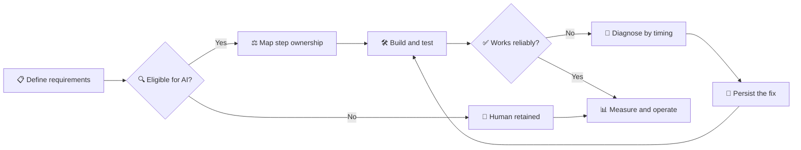

<div align="center">

# 🧩 Course 08 — Workflow Design & Diagnosis

### Design the work · Map ownership · Diagnose failures · Make fixes stick


[📖 Official Course](https://agentfactory.panaversity.org/docs/workflow-design-diagnosis-crash-course) · [🌳 Expandable Tree](#-interactive-topic-tree--expand--collapse) · [📜 Verbatim Source](#-original-source-tree--exact-formatting)

</div>

> [!IMPORTANT]
> **Complete supplied topic tree preserved.** The interactive hierarchy below includes every numbered topic from your file, and the original supplied text is reproduced **word for word** in the archive. `[NOT VERIFIED]` markers remain unchanged.

## 🧭 Visual learning roadmap

| 🔵 Design | 🟣 Delegate | 🟢 Build | 🟠 Diagnose | 🟡 Persist | 🔴 Operate |
|:--|:--|:--|:--|:--|:--|
| Requirements, computation, window test | Reversibility, stakes, accountability | Ideate → prototype → feedback → refine | Timing and cheap-first checks | Rules, references, procedures | Stop, scope, notify, update map |



## 🧠 Key frameworks at a glance

| Framework | What to remember |
|:--|:--|
| **Eligibility → Ownership → Implementation** | Decide whether AI may touch the step, who owns it, then what tool carries it. |
| **Three ownership criteria** | Reversibility · Stakes · Accountability. |
| **Four diagnostic causes** | Under-specification · Context overload · Wrong feature/model · Stale configuration. |
| **Promotion of fixes** | Rule → standing instruction · Reference → knowledge base · Procedure → Skill. |
| **Operating discipline** | Named owner · Review date · Human checkpoint · Baseline · Incident response. |

> [!WARNING]
> Good output does not justify handing over a high-stakes decision. Name the human reviewer, the review moment, and exactly what they check.

## ☑️ Study & revision checklist

- [ ] Extract traceable, testable requirements and identify missing inputs.
- [ ] Compute consequential numbers with code execution; verify assumptions.
- [ ] Apply the window test before assigning a step to AI.
- [ ] Classify each step as AI-appropriate, collaborative, or human-retained.
- [ ] Spot halo delegation, over-delegation, and unstaffed gates.
- [ ] Build a prototype and distinguish feature failures from description failures.
- [ ] Diagnose by symptom timing, then check cheapest causes first.
- [ ] Promote repeated fixes into the correct configuration home.
- [ ] Establish a baseline and measure the intended outcome.
- [ ] Complete the exercises, one-page map, five prompts, and capstone project.

---

## 🌳 Interactive topic tree — expand / collapse

> [!TIP]
> Click a section or any nested topic with children to expand it. All numbered nodes are retained, including deeper subtopics and source verification labels.

<details>
<summary><strong>8.1 Introduction (text under H1, before first H2) [Concept]</strong> <sub>(9 direct topics)</sub></summary>

<ul>
<li>8.1.1 Tagline: which steps AI should own, what to do when work goes wrong, how to say what it actually does [Concept]</li>
<details>
<summary><strong>8.1.2 Contract-review story: two teams, same AI assistant [Concept]</strong> <sub>(3 direct topics)</sub></summary>

<ul>
<li>8.1.2.1 Team 1 mapped the work step by step; lawyer approved every change; review time dropped by about half [Concept]</li>
<li>8.1.2.2 Team 2 pointed AI at the whole process and let it approve low-risk clauses; an uncaught obligation; tool pulled [Concept]</li>
<li>8.1.2.3 Difference was which steps each team handed over [Concept]</li>
</ul>
</details>

<li>8.1.3 Smaller failure: disappointing answer; concluding the tool cannot do it, or changing words at random [Concept]</li>
<li>8.1.4 Same mistake in two directions: the output is not the verdict [Concept]</li>
<li>8.1.5 Figure: good result and bad result both lead to the wrong conclusion; four things decide (which step, what it costs, who answers, when the symptom started) [Concept]</li>
<li>8.1.6 Reading time: about 55 minutes plus about 40 for two graded exercises and the project [Concept]</li>
<details>
<summary><strong>8.1.7 Quick glossary (37 entries) [Concept]</strong> <sub>(37 direct topics)</sub></summary>

<ul>
<li>8.1.7.1 step [Concept]</li>
<li>8.1.7.2 Project [Concept]</li>
<li>8.1.7.3 knowledge base [Concept]</li>
<li>8.1.7.4 standing instruction [Concept]</li>
<li>8.1.7.5 Skill [Concept]</li>
<li>8.1.7.6 code execution [Concept]</li>
<li>8.1.7.7 context [Concept]</li>
<li>8.1.7.8 context window [Concept]</li>
<li>8.1.7.9 delegation map [Concept]</li>
<li>8.1.7.10 reversibility, stakes, accountability [Concept]</li>
<li>8.1.7.11 AI-appropriate [Concept]</li>
<li>8.1.7.12 human-retained [Concept]</li>
<li>8.1.7.13 collaborative [Concept]</li>
<li>8.1.7.14 window test [Concept]</li>
<li>8.1.7.15 synthesis [Concept]</li>
<li>8.1.7.16 judgment step [Concept]</li>
<li>8.1.7.17 task definition [Concept]</li>
<li>8.1.7.18 over-delegation [Concept]</li>
<li>8.1.7.19 halo delegation [Concept]</li>
<li>8.1.7.20 unstaffed gate [Concept]</li>
<li>8.1.7.21 map owner [Concept]</li>
<li>8.1.7.22 scheduled read [Concept]</li>
<li>8.1.7.23 escalation signal [Concept]</li>
<li>8.1.7.24 under-specification [Concept]</li>
<li>8.1.7.25 context overload [Concept]</li>
<li>8.1.7.26 wrong feature or model [Concept]</li>
<li>8.1.7.27 tier [Concept]</li>
<li>8.1.7.28 stale configuration [Concept]</li>
<li>8.1.7.29 expectation mismatch [Concept]</li>
<li>8.1.7.30 diagnostic sequence [Concept]</li>
<li>8.1.7.31 rule, reference, or procedure [Concept]</li>
<li>8.1.7.32 promotion [Concept]</li>
<li>8.1.7.33 ideate, prototype, feedback, refine [Concept]</li>
<li>8.1.7.34 artifact [Concept]</li>
<li>8.1.7.35 friction [Concept]</li>
<li>8.1.7.36 baseline [Concept]</li>
<li>8.1.7.37 parallel run [Concept]</li>
</ul>
</details>

<details>
<summary><strong>8.1.8 The whole course in one minute (callout table of six stages) [Concept]</strong> <sub>(6 direct topics)</sub></summary>

<ul>
<li>8.1.8.1 Design: what are the requirements, which numbers must be computed [Concept]</li>
<li>8.1.8.2 Map: can it be undone, what does an error cost, who answers [Concept]</li>
<li>8.1.8.3 Build: does it fit prompt-and-iterate or has it outgrown it [Concept]</li>
<li>8.1.8.4 Diagnose: when did the symptom first appear [Concept]</li>
<li>8.1.8.5 Persist: is the fix a rule, a reference, or a procedure [Concept]</li>
<li>8.1.8.6 Communicate: what does it do, where exactly is the human gate [Concept]</li>
</ul>
</details>

<details>
<summary><strong>8.1.9 Before you start (callout) [Concept]</strong> <sub>(3 direct topics)</sub></summary>

<ul>
<li>8.1.9.1 Read AI Fluency first; this course takes delegation to a team workflow [Concept]</li>
<li>8.1.9.2 Assumes Projects and standing instructions (Quick Reference), Skills (Skills &amp; Connectors), code execution (Code You Never Write) [Concept]</li>
<li>8.1.9.3 Not covered: whether AI may touch this work or data at all (Governance, Risk &amp; Responsible Use, next) [Concept]</li>
</ul>
</details>

</ul>
</details>

<details>
<summary><strong>8.2 📚 Teaching Aid</strong> <sub>(2 direct topics)</sub></summary>

<ul>
<li>8.2.1 Click through the slides once before reading; use them to teach someone else [Concept]</li>
<li>8.2.2 Full presentation link and slideshow embed (Workflow Design &amp; Diagnosis) [NOT VERIFIED: slide content not readable] [Concept]</li>
</ul>
</details>

<details>
<summary><strong>8.3 Try it before you read it</strong> <sub>(7 direct topics)</sub></summary>

<ul>
<li>8.3.1 Two-minute exercise on a real workflow with more than three steps and one decision [Concept]</li>
<li>8.3.2 Prompt: redesign the workflow with AI inside; for each step say whether AI should do it [Concept]</li>
<li>8.3.3 Find the step that cannot be undone (payment, customer message, shared record) [Concept]</li>
<li>8.3.4 If the assistant handed it to AI or was vague: a confident redesign went wrong where it matters most [Concept]</li>
<li>8.3.5 If it flagged and kept it human: ask why [Concept]</li>
<li>8.3.6 Answer is built from what that kind of step usually looks like, not your organization [Concept]</li>
<li>8.3.7 Missing information: which step cannot be undone, error cost, who answers [Concept]</li>
</ul>
</details>

<details>
<summary><strong>8.4 Preview: the questions this course answers</strong> <sub>(21 direct topics)</sub></summary>

<ul>
<li>8.4.1 Eighteen questions, each linked to its answer [Concept]</li>
<li>8.4.2 Q1 What changes when a habit becomes a team workflow (Concept 1; D4.4) [Concept]</li>
<li>8.4.3 Q2 Turn a messy document into requirements (Concept 2; D4.1) [Concept]</li>
<li>8.4.4 Q3 When must a number be computed, not written (Concept 3; D4.2) [Concept]</li>
<li>8.4.5 Q4 Which steps can be given everything they need (Concept 4; D4.2) [Concept]</li>
<li>8.4.6 Q5 What three criteria decide who owns a step (Concept 5; D4.4) [Concept]</li>
<li>8.4.7 Q6 Why unrelated workflows produce the same pattern (Concept 6; D4.4) [Concept]</li>
<li>8.4.8 Q7 Three ways a map goes wrong (Concept 7; D4.4) [Concept]</li>
<li>8.4.9 Q8 Who keeps the map true as the workflow moves (Concept 8; additive) [Concept]</li>
<li>8.4.10 Q9 What a build loop looks like (Concept 9; D4.3) [Concept]</li>
<li>8.4.11 Q10 When something has outgrown prompt-and-iterate (Concept 10; D4.3) [Concept]</li>
<li>8.4.12 Q11 Tell four causes of bad output apart (Concept 11; D7.1) [Concept]</li>
<li>8.4.13 Q12 What order to check things in (Concept 12; D7.1) [Concept]</li>
<li>8.4.14 Q13 Turn "not quite right" into an instruction (Concept 13; D7.2) [Concept]</li>
<li>8.4.15 Q14 Where a fix belongs so it lasts (Concept 14; D7.2) [Concept]</li>
<li>8.4.16 Q15 Find friction you stopped noticing (Concept 15; D7.3) [Concept]</li>
<li>8.4.17 Q16 What to measure and when to stop (Concept 16; D7.3) [Concept]</li>
<li>8.4.18 Q17 What to do after a bad output gets out (Concept 17; additive) [Concept]</li>
<li>8.4.19 Q18 Describe it without overstating it (Concept 18; D4.5) [Concept]</li>
<details>
<summary><strong>8.4.20 For teachers using this table (collapsible) [Concept]</strong> <sub>(3 direct topics)</sub></summary>

<ul>
<li>8.4.20.1 Before: answer three cold in writing; Q6, Q7, Q11 give best wrong answers [Concept]</li>
<li>8.4.20.2 During: each concept closes one row; unreached rows are assigned, not skipped [Concept]</li>
<li>8.4.20.3 After: any question needing a scroll-up marks the section that did not land [Concept]</li>
</ul>
</details>

<details>
<summary><strong>8.4.21 Objective column maps rows to the CCAO-F exam blueprint [Concept]</strong> <sub>(3 direct topics)</sub></summary>

<ul>
<li>8.4.21.1 D4: Workflow Integration and Solution Design [Concept]</li>
<li>8.4.21.2 D7: Troubleshooting and Optimization [Concept]</li>
<li>8.4.21.3 Additive rows are not blueprint objectives [Concept]</li>
</ul>
</details>

</ul>
</details>

<details open>
<summary><strong>8.5 Part 1: Design the work before you place the tool</strong> <sub>(4 direct topics)</sub></summary>

<ul>
<details>
<summary><strong>8.5.1 1. The unit of value is the step, not the session</strong> <sub>(5 direct topics)</sub></summary>

<ul>
<li>8.5.1.1 "I use AI" (personal habit) vs "our workflow uses AI" (repeatable team process) [Concept]</li>
<li>8.5.1.2 Only the second grows in value; only the second can be wrong in a way that keeps being wrong [Concept]</li>
<li>8.5.1.3 Figure: scattered blocks vs five numbered steps with fixed owners [Concept]</li>
<li>8.5.1.4 Step: one named piece of a workflow with one owner [Concept]</li>
<li>8.5.1.5 Judge a session afterwards; decide about a step in advance [Concept]</li>
</ul>
</details>

<details>
<summary><strong>8.5.2 2. Extract the requirements, then attack them</strong> <sub>(13 direct topics)</sub></summary>

<ul>
<li>8.5.2.1 Real work starts from a forty-page document, email thread, or a remark [Concept]</li>
<li>8.5.2.2 Requirements: specific, traceable, testable; AI is strong at extraction [Concept]</li>
<li>8.5.2.3 "We need better reporting" is not a requirement [Concept]</li>
<details>
<summary><strong>8.5.2.4 Task definition: five settled answers [Concept]</strong> <sub>(5 direct topics)</sub></summary>

<ul>
<li>8.5.2.4.1 What is produced [Concept]</li>
<li>8.5.2.4.2 For whom [Concept]</li>
<li>8.5.2.4.3 How often [Concept]</li>
<li>8.5.2.4.4 From what data [Concept]</li>
<li>8.5.2.4.5 In what format [Concept]</li>
</ul>
</details>

<li>8.5.2.5 Each missing answer is a clarifying question you owe, not a blank for the model to fill [Concept]</li>
<li>8.5.2.6 Prompt: turn the request into a task definition; say where I have not told you [Concept]</li>
<li>8.5.2.7 Asked to define a task, a model closes unspecified slots at likely defaults [Concept]</li>
<li>8.5.2.8 Ask for structure not a summary (RFP example); prompt for table with label, section, whether answered, whether ambiguous [Concept]</li>
<li>8.5.2.9 Source column lets someone not in the room check the list [Concept]</li>
<li>8.5.2.10 Attack the requirements: ambiguous, interpretable two ways, implied [Concept]</li>
<li>8.5.2.11 Moves checking forward, from output stage to requirements stage [Concept]</li>
<details>
<summary><strong>8.5.2.12 An ambiguous requirement does not look ambiguous (callout) [Concept]</strong> <sub>(2 direct topics)</sub></summary>

<ul>
<li>8.5.2.12.1 "Delivered promptly after month end" is not a requirement [Concept]</li>
<li>8.5.2.12.2 Test: can you write a check for it [Concept]</li>
</ul>
</details>

<details>
<summary><strong>8.5.2.13 Why this is a Project rather than a one-off chat (collapsible) [Concept]</strong> <sub>(4 direct topics)</sub></summary>

<ul>
<li>8.5.2.13.1 Past winning proposals in the knowledge base [Concept]</li>
<li>8.5.2.13.2 Extraction format in standing instructions [Concept]</li>
<li>8.5.2.13.3 Formatting procedure in a Skill (account level) [Concept]</li>
<li>8.5.2.13.4 Concept 14 tells the three homes apart [Concept]</li>
</ul>
</details>

</ul>
</details>

<details>
<summary><strong>8.5.3 3. A plan is only as good as the numbers under it</strong> <sub>(10 direct topics)</sub></summary>

<ul>
<li>8.5.3.1 Planning mixes synthesis and calculation [Concept]</li>
<li>8.5.3.2 Synthesis: gather considerations and shape options; AI does it well [Concept]</li>
<li>8.5.3.3 Calculation: you cannot tell from the page whether the model computed; written and calculated figures look the same [Concept]</li>
<li>8.5.3.4 Rule: if a result matters, compute it, never write it [Concept]</li>
<li>8.5.3.5 Code execution: assistant writes and runs code and reports what it computed (fourth output format) [Concept]</li>
<li>8.5.3.6 Limit: code can still pick the wrong column; check what was computed [Concept]</li>
<li>8.5.3.7 Staffing plan on a guessed utilization rate is a guess in a table [Concept]</li>
<li>8.5.3.8 Prompt: use code execution on ticket data; then recommend headcount; show assumptions [Concept]</li>
<li>8.5.3.9 Separates computation from recommendation, and asks for assumptions [Concept]</li>
<li>8.5.3.10 Diagnostic habit: numbers slightly wrong usually means a calculation was asked for in prose [Concept]</li>
</ul>
</details>

<details>
<summary><strong>8.5.4 4. Where AI insight actually changes a plan</strong> <sub>(12 direct topics)</sub></summary>

<ul>
<li>8.5.4.1 Operations lead's capacity plan recommends hiring three analysts; team was under a hiring freeze announced two weeks earlier [Concept]</li>
<li>8.5.4.2 Plan useless because one step needed an input the machine could not reach [Concept]</li>
<li>8.5.4.3 Synthesis steps run on information you can supply [Concept]</li>
<li>8.5.4.4 Judgment step: runs on information you cannot supply or would not (risk appetite, hiring freeze, client patience) [Concept]</li>
<li>8.5.4.5 A model with missing inputs fills the gap with what such a decision usually looks like [Concept]</li>
<li>8.5.4.6 Window test: can everything the step needs be put in front of the model [Concept]</li>
<li>8.5.4.7 Context and context window defined; link to Concept 11 (long sessions lose early instructions) [Concept]</li>
<li>8.5.4.8 Question: could I put everything this step needs into the window; if not, the step is mine [Concept]</li>
<li>8.5.4.9 A step whose inputs fit still has to survive the three criteria in Part 2 [Concept]</li>
<li>8.5.4.10 Figure: context window with four supplyable and four outside inputs [Concept]</li>
<li>8.5.4.11 Window test catches "needs a human touch" work (condolence note, hard conversation) [Concept]</li>
<details>
<summary><strong>8.5.4.12 Research is a synthesis step, so run the window test on it too [Concept]</strong> <sub>(4 direct topics)</sub></summary>

<ul>
<li>8.5.4.12.1 Model knowledge stops at a date [Concept]</li>
<details>
<summary><strong>8.5.4.12.2 Split research questions [Concept]</strong> <sub>(2 direct topics)</sub></summary>

<ul>
<li>8.5.4.12.2.1 Stable concept or method: model's own knowledge is fine [Concept]</li>
<li>8.5.4.12.2.2 Current, priced, or dated: external source you can open; ask for the answer and the link [Concept]</li>
</ul>
</details>

<li>8.5.4.12.3 Web search in chat for quick lookups; Research for a deeper multi-source pass (paid plans); both return links [Concept]</li>
<li>8.5.4.12.4 Rule: for anything current, ask for a source you can open [Concept]</li>
</ul>
</details>

</ul>
</details>

</ul>
</details>

<details open>
<summary><strong>8.6 Part 2: The delegation map</strong> <sub>(10 direct topics)</sub></summary>

<ul>
<details>
<summary><strong>8.6.1 Every step takes three decisions; mixing them builds a wrong map [Concept]</strong> <sub>(3 direct topics)</sub></summary>

<ul>
<details>
<summary><strong>8.6.1.1 1 Eligibility: may AI touch this at all [Concept]</strong> <sub>(2 direct topics)</sub></summary>

<ul>
<li>8.6.1.1.1 Gate: may this data enter this tool (Governance course) [Concept]</li>
<li>8.6.1.1.2 Gate: can everything the step needs be supplied (window test) [Concept]</li>
</ul>
</details>

<li>8.6.1.2 2 Ownership: who owns the step (Concepts 5 to 7) [Concept]</li>
<li>8.6.1.3 3 Implementation: what carries it (decided last) [Concept]</li>
</ul>
</details>

<details>
<summary><strong>8.6.2 Implementation table [Concept]</strong> <sub>(5 direct topics)</sub></summary>

<ul>
<li>8.6.2.1 Repeatable procedure with fixed steps: a Skill [Concept]</li>
<li>8.6.2.2 Rules and reference the step always needs: Project knowledge [Concept]</li>
<li>8.6.2.3 Calculation the output depends on: code execution [Concept]</li>
<li>8.6.2.4 Standing constraint on every output: standing instruction [Concept]</li>
<li>8.6.2.5 A step a person owns: a named review gate [Concept]</li>
</ul>
</details>

<li>8.6.3 Figure: three cards (eligibility, ownership, implementation; backwards arrow crossed out) [Concept]</li>
<li>8.6.4 Keep the third decision out of the second: "must be computed" is not a reason to hand over the step [Concept]</li>
<li>8.6.5 The first four rows say one thing: configuration makes a step work for the colleague who takes it over [Concept]</li>
<li>8.6.6 A human step needs a named person, a named moment, and a named thing checked [Concept]</li>
<details>
<summary><strong>8.6.7 5. Three criteria decide every step</strong> <sub>(5 direct topics)</sub></summary>

<ul>
<details>
<summary><strong>8.6.7.1 Write steps in order; classify each [Concept]</strong> <sub>(3 direct topics)</sub></summary>

<ul>
<li>8.6.7.1.1 AI-appropriate: AI may own it [Concept]</li>
<li>8.6.7.1.2 Human-retained: a person owns it outright [Concept]</li>
<li>8.6.7.1.3 Collaborative: AI produces, a named person judges [Concept]</li>
</ul>
</details>

<details>
<summary><strong>8.6.7.2 Ownership decided by three criteria only [Concept]</strong> <sub>(3 direct topics)</sub></summary>

<ul>
<li>8.6.7.2.1 Reversibility: can the step be undone [Concept]</li>
<li>8.6.7.2.2 Stakes: what a mistake costs in the bad case [Concept]</li>
<li>8.6.7.2.3 Accountability: is this the call they answer for, or an input they judge; never moves onto the machine [Concept]</li>
</ul>
</details>

<li>8.6.7.3 Figure: three criteria cards [Concept]</li>
<li>8.6.7.4 How well AI performed in your test run is not a criterion (Concept 7) [Concept]</li>
<details>
<summary><strong>8.6.7.5 These are three questions, not a score (callout) [Concept]</strong> <sub>(3 direct topics)</sub></summary>

<ul>
<li>8.6.7.5.1 Usually one decides and the other two agree; name it [Concept]</li>
<li>8.6.7.5.2 Where they disagree the strictest wins [Concept]</li>
<li>8.6.7.5.3 Four-criterion version adds whether the work needs human creativity or empathy; that answers Eligibility, not ownership [Concept]</li>
</ul>
</details>

</ul>
</details>

<details>
<summary><strong>8.6.8 6. Two workflows, same criteria, different answers</strong> <sub>(7 direct topics)</sub></summary>

<ul>
<details>
<summary><strong>8.6.8.1 Contract review map [Concept]</strong> <sub>(6 direct topics)</sub></summary>

<ul>
<li>8.6.8.1.1 Extract clauses: AI; reversible, low stakes; Skill [Concept]</li>
<li>8.6.8.1.2 Flag departures from playbook: AI; reversible, errors surface at the redline; Skill [Concept]</li>
<li>8.6.8.1.3 Draft redline and rationale: Collaborative; high stakes, human judges each edit; Skill plus gate [Concept]</li>
<li>8.6.8.1.4 Compute financial exposure of a penalty clause: AI; reversible, checked at approval gate; code execution [Concept]</li>
<li>8.6.8.1.5 Approve or reject each change: Human; this step is the decision; named reviewer [Concept]</li>
<li>8.6.8.1.6 Sign and send: Human; irreversible and externally binding; named signer [Concept]</li>
</ul>
</details>

<li>8.6.8.2 Penalty-exposure row: arithmetic does not make a step low-stakes; safe because reversible and a human follows [Concept]</li>
<li>8.6.8.3 Playbook row: AI-appropriate only because somebody reads the flags at the next row [Concept]</li>
<li>8.6.8.4 AI does real work in the middle; human owns decisions and irreversible actions [Concept]</li>
<details>
<summary><strong>8.6.8.5 Onboarding documents map [Concept]</strong> <sub>(5 direct topics)</sub></summary>

<ul>
<li>8.6.8.5.1 Pull new-hire details from the HR export: AI; checked at confirmation; code execution [Concept]</li>
<li>8.6.8.5.2 Draft the offer letter from the approved template: AI; reversible draft; Skill [Concept]</li>
<li>8.6.8.5.3 Personalise the welcome note: Collaborative; manager's voice cannot be supplied; named reviewer [Concept]</li>
<li>8.6.8.5.4 Confirm compensation matches the approved req: Human; this step is the check [Concept]</li>
<li>8.6.8.5.5 Send the signed offer: Human; irreversible; named signer [Concept]</li>
</ul>
</details>

<li>8.6.8.6 Same pattern in unrelated fields; the criteria decided it twice [Concept]</li>
<li>8.6.8.7 Figure: two maps, one pattern [Concept]</li>
</ul>
</details>

<details>
<summary><strong>8.6.9 7. Three ways a map goes wrong</strong> <sub>(13 direct topics)</sub></summary>

<ul>
<li>8.6.9.1 Second team responded reasonably to evidence; most common way a workflow picks up a risk nobody chose [Concept]</li>
<li>8.6.9.2 Over-delegation: more than the risk allows; happens through reward [Concept]</li>
<li>8.6.9.3 Drafting quality is evidence about the draft, not about the decision [Concept]</li>
<li>8.6.9.4 Halo delegation: handing a step over because the previous step went well [Concept]</li>
<li>8.6.9.5 Unstaffed gate: a collaborative step whose review is no longer really done (glance, then click) [Concept]</li>
<li>8.6.9.6 Mapping the tool instead of the work: workflow grows around a liked feature [Concept]</li>
<details>
<summary><strong>8.6.9.7 A map with all three in it: customer-complaint workflow (six rows) [Concept]</strong> <sub>(6 direct topics)</sub></summary>

<ul>
<li>8.6.9.7.1 Pull the complaint and ticket history: AI; mechanical retrieval [Concept]</li>
<li>8.6.9.7.2 Summarise into the issue template: AI; summarising Skill is very good [Concept]</li>
<li>8.6.9.7.3 Classify severity: AI; summaries accurate for three months [Concept]</li>
<li>8.6.9.7.4 Draft the customer response: Collaborative; duty agent reviews [Concept]</li>
<li>8.6.9.7.5 Send the response: AI; low severity only, drafts strong [Concept]</li>
<li>8.6.9.7.6 Log the outcome in the CRM: AI; mechanical write [Concept]</li>
</ul>
</details>

<li>8.6.9.8 Find the three problems before continuing [Concept]</li>
<details>
<summary><strong>8.6.9.9 The diagnosis (collapsible) [Concept]</strong> <sub>(4 direct topics)</sub></summary>

<ul>
<li>8.6.9.9.1 Row 3 is halo delegation (summaries accurate does not mean severity classification is safe) [Concept]</li>
<li>8.6.9.9.2 Row 5 is over-delegation; row 4 is where it came from (step cannot give itself permission to skip the gate) [Concept]</li>
<li>8.6.9.9.3 Row 2 is mapping the tool instead of the work [Concept]</li>
<li>8.6.9.9.4 Row 4 is the one to watch: sensible design with no capacity check [Concept]</li>
</ul>
</details>

<li>8.6.9.10 Bad maps are built from true statements about the wrong step [Concept]</li>
<li>8.6.9.11 Figure: three panels (tick carried forward, empty reviewer box, workflow bent around a Skill) [Concept]</li>
<li>8.6.9.12 Order to check: map the work with no tools in mind; classify each step; ask who reviews each collaborative step and when [Concept]</li>
<li>8.6.9.13 Ask regularly: are the gates I designed still being staffed [Concept]</li>
</ul>
</details>

<details>
<summary><strong>8.6.10 8. Who owns the map, and when it is read again</strong> <sub>(8 direct topics)</sub></summary>

<ul>
<li>8.6.10.1 Delegation map defined; written once, slowly becomes wrong as the workflow moves [Concept]</li>
<details>
<summary><strong>8.6.10.2 Three controls decay the same way (table; no signal at the moment of failure) [Concept]</strong> <sub>(3 direct topics)</sub></summary>

<ul>
<li>8.6.10.2.1 A review gate: reviews become glances, then clicks [Concept]</li>
<li>8.6.10.2.2 A standing instruction: output slowly stops meeting a rule [Concept]</li>
<li>8.6.10.2.3 The map itself: describes a workflow nobody runs [Concept]</li>
</ul>
</details>

<li>8.6.10.3 Answer to a failure with no signal: a scheduled read [Concept]</li>
<li>8.6.10.4 Figure: three decaying tracks resuming at a scheduled read; alarm count zero [Concept]</li>
<details>
<summary><strong>8.6.10.5 Two things a map needs [Concept]</strong> <sub>(2 direct topics)</sub></summary>

<ul>
<li>8.6.10.5.1 An owner: one named person answerable for whether the map matches reality [Concept]</li>
<li>8.6.10.5.2 A review date: quarterly default; sooner if volume, staffing, or legal position changes [Concept]</li>
</ul>
</details>

<details>
<summary><strong>8.6.10.6 Four review questions (about twenty minutes) [Concept]</strong> <sub>(4 direct topics)</sub></summary>

<ul>
<li>8.6.10.6.1 Has a step been added or removed that is not on the map [Concept]</li>
<li>8.6.10.6.2 For every collaborative step: who reviewed it last week, how long did they spend [Concept]</li>
<li>8.6.10.6.3 Has anything changed the volume or the stakes [Concept]</li>
<li>8.6.10.6.4 Is every configuration the map depends on still current [Concept]</li>
</ul>
</details>

<li>8.6.10.7 Question 2 finds the real problems (asks about last week, not policy) [Concept]</li>
<li>8.6.10.8 Without owner and date the map is accurate for about a quarter; with them it is an operating document [Concept]</li>
</ul>
</details>

</ul>
</details>

<details>
<summary><strong>8.7 Part 3: Build it, and watch it</strong> <sub>(2 direct topics)</sub></summary>

<ul>
<details>
<summary><strong>8.7.1 9. The loop: ideate, prototype, feedback, refine</strong> <sub>(8 direct topics)</sub></summary>

<ul>
<li>8.7.1.1 AI is a design partner, not a vending machine [Concept]</li>
<details>
<summary><strong>8.7.1.2 Four steps [Concept]</strong> <sub>(4 direct topics)</sub></summary>

<ul>
<li>8.7.1.2.1 Ideate: produce options [Concept]</li>
<li>8.7.1.2.2 Prototype: make one concrete enough to react to [Concept]</li>
<li>8.7.1.2.3 Feedback: show what is wrong with it [Concept]</li>
<li>8.7.1.2.4 Refine: fix it, then round again [Concept]</li>
</ul>
</details>

<li>8.7.1.3 Run the loop inside a Project so background, limits, and decisions stay stable [Concept]</li>
<details>
<summary><strong>8.7.1.4 Worked example: three cycles, no code written (analytics team's dashboard artifact; artifact defined) [Concept]</strong> <sub>(4 direct topics)</sub></summary>

<ul>
<li>8.7.1.4.1 Cycle 1 build: five metrics, a chart each; works; makes people overconfident [Concept]</li>
<li>8.7.1.4.2 Cycle 2 filter and totals: filter works; totals wrong (written, not computed); noticed because an analyst knew roughly what a number should be [Concept]</li>
<li>8.7.1.4.3 Fix: Concept 3, totals row belongs in code execution [Concept]</li>
<li>8.7.1.4.4 Cycle 3 color and print: works first time; a description problem [Concept]</li>
</ul>
</details>

<li>8.7.1.5 Cycle 3 was a description problem; cycle 2 was a feature problem [Concept]</li>
<li>8.7.1.6 Figure: three build cycles with the middle one flagged [Concept]</li>
<li>8.7.1.7 Telling those two apart is the skill; Part 4 is the procedure [Concept]</li>
<li>8.7.1.8 Why the failing cycle is in the middle (callout): the realistic failure passes review because output is smooth [Concept]</li>
</ul>
</details>

<details>
<summary><strong>8.7.2 10. When it has outgrown prompt-and-iterate</strong> <sub>(5 direct topics)</sub></summary>

<ul>
<li>8.7.2.1 Dashboard artifact serves one team; six months later three departments use it and one puts numbers in a board report [Concept]</li>
<li>8.7.2.2 Dependency is the escalation signal: other people rely on it as infrastructure [Concept]</li>
<li>8.7.2.3 New requirements: uptime, access control, someone to call, a guarantee it does today what it did in March [Concept]</li>
<li>8.7.2.4 Escalating is a correct answer, not an admission of failure; failure is not marking the moment it stopped being small [Concept]</li>
<details>
<summary><strong>8.7.2.5 Two signals that sound alike and point elsewhere (callout table) [Concept]</strong> <sub>(2 direct topics)</sub></summary>

<ul>
<li>8.7.2.5.1 Other people now depend on this: infrastructure, needs engineering [Concept]</li>
<li>8.7.2.5.2 I have solved this the same way three times: shape is stable, can be manufactured (From One-Off to Worker) [Concept]</li>
</ul>
</details>

</ul>
</details>

</ul>
</details>

<details>
<summary><strong>8.8 Part 4: When it misbehaves</strong> <sub>(2 direct topics)</sub></summary>

<ul>
<details>
<summary><strong>8.8.1 11. Four causes, told apart by when the symptom appeared</strong> <sub>(8 direct topics)</sub></summary>

<ul>
<li>8.8.1.1 Most people give up or change things at random; the question is when the symptom first appeared [Concept]</li>
<li>8.8.1.2 Timing tells you where to look first, not what the cause is [Concept]</li>
<li>8.8.1.3 Figure: timeline of one session with four numbered points [Concept]</li>
<details>
<summary><strong>8.8.1.4 Four causes [Concept]</strong> <sub>(4 direct topics)</sub></summary>

<ul>
<li>8.8.1.4.1 Under-specification: prompt never carried what the step needed; wrong from the first response [Concept]</li>
<li>8.8.1.4.2 Context overload: conversation longer than the context window; early instructions lose force [Concept]</li>
<li>8.8.1.4.3 Wrong feature or model: one repeatable error type; numbers off means calculation in prose; shallow work means wrong tier [Concept]</li>
<li>8.8.1.4.4 Stale configuration: "it used to work"; nothing reports an error [Concept]</li>
</ul>
</details>

<details>
<summary><strong>8.8.1.5 Diagnosis table (symptom timing, first hypothesis, cheap confirmation, fix) [Concept]</strong> <sub>(4 direct topics)</sub></summary>

<ul>
<li>8.8.1.5.1 Wrong from the first answer: under-specification; re-read the prompt; add what it left out [Concept]</li>
<li>8.8.1.5.2 Started fine then degraded: context overload; restate in a fresh session; restart or summarise [Concept]</li>
<li>8.8.1.5.3 One repeatable error type: wrong feature or model; run once with right feature or stronger tier; change feature or tier [Concept]</li>
<li>8.8.1.5.4 Used to work now does not: stale configuration; check the date of instruction or knowledge source; maintenance [Concept]</li>
</ul>
</details>

<li>8.8.1.6 Each confirmation takes under a minute; a negative result still rules out the likeliest cause [Concept]</li>
<li>8.8.1.7 When handing off, name where the failure lives (prompt, context, feature choice, or task) [Concept]</li>
<li>8.8.1.8 Stale configuration is the one that fails silently (callout); twin of the unstaffed gate [Concept]</li>
</ul>
</details>

<details>
<summary><strong>8.8.2 12. The sequence runs cheapest first</strong> <sub>(8 direct topics)</sub></summary>

<ul>
<details>
<summary><strong>8.8.2.1 Diagnostic sequence [Concept]</strong> <sub>(5 direct topics)</sub></summary>

<ul>
<li>8.8.2.1.1 Re-read the prompt against its five parts (role, context, task, constraints, format) [Concept]</li>
<li>8.8.2.1.2 Check the length of the conversation [Concept]</li>
<li>8.8.2.1.3 Check the feature and the model [Concept]</li>
<li>8.8.2.1.4 Check whether the configuration is current [Concept]</li>
<li>8.8.2.1.5 Only then question whether the task is a fit at all [Concept]</li>
</ul>
</details>

<li>8.8.2.2 Step 1 is slot-by-slot, because the missing piece sits in the writer's head [Concept]</li>
<li>8.8.2.3 Re-reading is cheapest and resolves the most common cause; questioning the task is last [Concept]</li>
<li>8.8.2.4 Figure: five rungs from cheap to expensive; most people start at the bottom [Concept]</li>
<li>8.8.2.5 Step 5 is sometimes right: expectation mismatch (predicting an exact future number); reshape into a range with assumptions or a model of drivers [Concept]</li>
<details>
<summary><strong>8.8.2.6 Same complaints, different diagnoses (table) [Concept]</strong> <sub>(5 direct topics)</sub></summary>

<ul>
<li>8.8.2.6.1 "Summary keeps missing key points": under-specification; name the criteria [Concept]</li>
<li>8.8.2.6.2 "Stopped following my format halfway": context overload; restart from summary or persist the format [Concept]</li>
<li>8.8.2.6.3 "Numbers subtly wrong": wrong feature; code execution [Concept]</li>
<li>8.8.2.6.4 "Worked last month, now off": stale configuration; audit instructions and knowledge [Concept]</li>
<li>8.8.2.6.5 "Can't predict next quarter's exact figure": expectation mismatch; reshape the task [Concept]</li>
</ul>
</details>

<li>8.8.2.7 Reach for the sequence before forming an opinion about whose fault it is [Concept]</li>
<details>
<summary><strong>8.8.2.8 Graded exercise: Your Work, Get Your Score (interactive; ChatGPT or Claude) [Concept]</strong> <sub>(3 direct topics)</sub></summary>

<ul>
<li>8.8.2.8.1 Prompt: real disappointing output, what you asked, what came back, when it went wrong [Concept]</li>
<li>8.8.2.8.2 Prompt: which of the four causes and what in the timing tells you [Concept]</li>
<li>8.8.2.8.3 Prompt: the specific fix; check under-specification is really diagnosed [Concept]</li>
</ul>
</details>

</ul>
</details>

</ul>
</details>

<details>
<summary><strong>8.9 Part 5: Make the fix stick</strong> <sub>(4 direct topics)</sub></summary>

<ul>
<details>
<summary><strong>8.9.1 13. Turn a reaction into an instruction</strong> <sub>(5 direct topics)</sub></summary>

<ul>
<li>8.9.1.1 Reaction names how output feels; instruction names what to change [Concept]</li>
<li>8.9.1.2 One question: what would have to be present for this to be right, and which part of the setup controls that [Concept]</li>
<details>
<summary><strong>8.9.1.3 Reaction to instruction table [Concept]</strong> <sub>(4 direct topics)</sub></summary>

<ul>
<li>8.9.1.3.1 "Too generic": name audience and the one action; the prompt [Concept]</li>
<li>8.9.1.3.2 "Wrong tone": add a tone constraint for every draft; the instruction [Concept]</li>
<li>8.9.1.3.3 "Missed the point": state the single question up front; the prompt [Concept]</li>
<li>8.9.1.3.4 "Using old data": replace the source in the knowledge base; the knowledge [Concept]</li>
</ul>
</details>

<li>8.9.1.4 Figure: three vague reactions, one question, three levers [Concept]</li>
<li>8.9.1.5 If you cannot name the lever, the critique is still a reaction [Concept]</li>
</ul>
</details>

<details>
<summary><strong>8.9.2 14. Rule, reference, or procedure</strong> <sub>(9 direct topics)</sub></summary>

<ul>
<li>8.9.2.1 A fix left in a conversation is found again next Monday, by whoever covers [Concept]</li>
<li>8.9.2.2 Test: will this correction be needed again, by me or someone else [Concept]</li>
<li>8.9.2.3 Promotion: moving a fix from a chat into configuration [Concept]</li>
<details>
<summary><strong>8.9.2.4 One question: is the fix a rule, a reference, or a procedure [Concept]</strong> <sub>(3 direct topics)</sub></summary>

<ul>
<li>8.9.2.4.1 Rule: a limit that always applies [Concept]</li>
<li>8.9.2.4.2 Reference: material the work has to read [Concept]</li>
<li>8.9.2.4.3 Procedure: a sequence of steps [Concept]</li>
</ul>
</details>

<li>8.9.2.5 Figure: fix sorted three ways [Concept]</li>
<details>
<summary><strong>8.9.2.6 Each home changes a different thing [Concept]</strong> <sub>(3 direct topics)</sub></summary>

<ul>
<li>8.9.2.6.1 Rules to standing instructions: change behavior inside a Project [Concept]</li>
<li>8.9.2.6.2 References to the knowledge base: change what is known [Concept]</li>
<li>8.9.2.6.3 Procedures to Skills: change how the work is done [Concept]</li>
</ul>
</details>

<li>8.9.2.7 Wrong home is why some improvements do not stick [Concept]</li>
<details>
<summary><strong>8.9.2.8 Two people, one habit apart [Concept]</strong> <sub>(2 direct topics)</sub></summary>

<ul>
<li>8.9.2.8.1 Marketer writes two standing instructions into the briefs Project [Concept]</li>
<li>8.9.2.8.2 Analyst types canceled-orders reminder monthly; colleague runs the report while he is away [Concept]</li>
</ul>
</details>

<details>
<summary><strong>8.9.2.9 Why memory is not the answer here (collapsible) [Concept]</strong> <sub>(3 direct topics)</sub></summary>

<ul>
<li>8.9.2.9.1 Per-user [Concept]</li>
<li>8.9.2.9.2 Best-effort [Concept]</li>
<li>8.9.2.9.3 Configuration is the shared home you can open and read; use both, rely on configuration [Concept]</li>
</ul>
</details>

</ul>
</details>

<details>
<summary><strong>8.9.3 15. Find the friction before you optimize</strong> <sub>(8 direct topics)</sub></summary>

<ul>
<li>8.9.3.1 Friction: small repeated cost you stopped noticing [Concept]</li>
<details>
<summary><strong>8.9.3.2 Three signals (table) [Concept]</strong> <sub>(3 direct topics)</sub></summary>

<ul>
<li>8.9.3.2.1 Repetition: paste or type the same thing every run; saved context or standing instruction [Concept]</li>
<li>8.9.3.2.2 Correction: fix the same flaw every output; configuration change [Concept]</li>
<li>8.9.3.2.3 Variance: different people get different results; shared Skill or knowledge base [Concept]</li>
</ul>
</details>

<li>8.9.3.3 Figure: three people producing differently shaped outputs landing on one reviewer [Concept]</li>
<li>8.9.3.4 Variance is the one teams miss [Concept]</li>
<li>8.9.3.5 If you cannot see friction, run once writing down every manual step; that list is the backlog [Concept]</li>
<details>
<summary><strong>8.9.3.6 Two moves [Concept]</strong> <sub>(2 direct topics)</sub></summary>

<ul>
<li>8.9.3.6.1 Consolidate: run steps together [Concept]</li>
<li>8.9.3.6.2 Promote: move the repeated pattern into configuration [Concept]</li>
</ul>
</details>

<li>8.9.3.7 Consolidation reduces number of steps; promotion reduces cost of remaining steps; do them in that order [Concept]</li>
<details>
<summary><strong>8.9.3.8 Worked audit: weekly reporting, 45 minutes to about 25 minutes per analyst [Concept]</strong> <sub>(3 direct topics)</sub></summary>

<ul>
<li>8.9.3.8.1 Background is a reference: shared Project knowledge base [Concept]</li>
<li>8.9.3.8.2 Report format is a procedure: Skill [Concept]</li>
<li>8.9.3.8.3 Checking step is a rule: standing instruction [Concept]</li>
</ul>
</details>

</ul>
</details>

<details>
<summary><strong>8.9.4 16. Measure the thing you actually care about</strong> <sub>(8 direct topics)</sub></summary>

<ul>
<li>8.9.4.1 Measure the before; baseline defined [Concept]</li>
<li>8.9.4.2 Baseline: run once unchanged and record time, revision rounds, manual steps [Concept]</li>
<li>8.9.4.3 You cannot rebuild a baseline afterwards [Concept]</li>
<details>
<summary><strong>8.9.4.4 Pick the metric that matches why the workflow mattered (table) [Concept]</strong> <sub>(4 direct topics)</sub></summary>

<ul>
<li>8.9.4.4.1 Internal draft: time [Concept]</li>
<li>8.9.4.4.2 Customer-facing report: consistency [Concept]</li>
<li>8.9.4.4.3 Compliance or finance output: accuracy [Concept]</li>
<li>8.9.4.4.4 Work done by several people: variance [Concept]</li>
</ul>
</details>

<li>8.9.4.5 Naming the metric tells you when to stop [Concept]</li>
<li>8.9.4.6 Parallel run: old and new together for a few cycles; evidence, fallback, agreement of affected people [Concept]</li>
<details>
<summary><strong>8.9.4.7 Be able to answer what it costs [Concept]</strong> <sub>(3 direct topics)</sub></summary>

<ul>
<li>8.9.4.7.1 Cost: tool cost plus remaining human time (gates) [Concept]</li>
<li>8.9.4.7.2 Saving: baseline times frequency times number of people (example: about fifty hours a year) [Concept]</li>
<li>8.9.4.7.3 Name the risk that survives your gates [Concept]</li>
</ul>
</details>

<li>8.9.4.8 Prove the change before you rely on it (callout) [Concept]</li>
</ul>
</details>

</ul>
</details>

<details>
<summary><strong>8.10 Part 6: Operate it, and explain it</strong> <sub>(2 direct topics)</sub></summary>

<ul>
<details>
<summary><strong>8.10.1 17. When a bad output gets out</strong> <sub>(4 direct topics)</sub></summary>

<ul>
<li>8.10.1.1 Nothing removes the chance entirely; design is judged by the next hour [Concept]</li>
<details>
<summary><strong>8.10.1.2 First-hour procedure lives in Governance, Risk &amp; Responsible Use; these four are decided in advance [Concept]</strong> <sub>(4 direct topics)</sub></summary>

<ul>
<li>8.10.1.2.1 1 How it gets stopped: fastest way to halt, who can, permission needed [Concept]</li>
<li>8.10.1.2.2 2 What is already out: how many outputs affected and where they went [Concept]</li>
<li>8.10.1.2.3 3 Who is told, and by when [Concept]</li>
<li>8.10.1.2.4 4 What changes in the map: which of the four causes; record with a date [Concept]</li>
</ul>
</details>

<li>8.10.1.3 Figure: four cards (stop, scope, tell, change the map) [Concept]</li>
<li>8.10.1.4 Decisions 1 and 4 are made at design time or not at all [Concept]</li>
</ul>
</details>

<details>
<summary><strong>8.10.2 18. Say what it does, then name the gate</strong> <sub>(7 direct topics)</sub></summary>

<ul>
<li>8.10.2.1 You are believed when you state limits as clearly as value [Concept]</li>
<details>
<summary><strong>8.10.2.2 Three phrases that overstate [Concept]</strong> <sub>(3 direct topics)</sub></summary>

<ul>
<li>8.10.2.2.1 "Fully automated" [Concept]</li>
<li>8.10.2.2.2 "AI handles X" [Concept]</li>
<li>8.10.2.2.3 "It's basically as good as a person at Y" [Concept]</li>
</ul>
</details>

<li>8.10.2.3 Repair: state what the tool does, then name the human checkpoint [Concept]</li>
<li>8.10.2.4 Third clause: say what it refuses [Concept]</li>
<details>
<summary><strong>8.10.2.5 The same workflow described three ways [Concept]</strong> <sub>(3 direct topics)</sub></summary>

<ul>
<li>8.10.2.5.1 To the legal lead: mechanism and failure modes [Concept]</li>
<li>8.10.2.5.2 To the practice executive: outcome in turnaround time and oversight [Concept]</li>
<li>8.10.2.5.3 To the client's risk function: the control [Concept]</li>
</ul>
</details>

<li>8.10.2.6 Stakeholders trust an AI workflow more when human checkpoints are explicit [Concept]</li>
<li>8.10.2.7 Accurate description comes after diagnosing the workflow [Concept]</li>
</ul>
</details>

</ul>
</details>

<details>
<summary><strong>8.11 Recap: the sentence to carry</strong> <sub>(2 direct topics)</sub></summary>

<ul>
<li>8.11.1 The output is not the verdict; judge the step by what it costs and who answers; judge a failure by when it started [Concept]</li>
<li>8.11.2 Six stages in one line: requirements, map by three criteria, build by loop, diagnose by timing, fix in configuration, say what it does and name the gate [Concept]</li>
</ul>
</details>

<details>
<summary><strong>8.12 Map your own workflow</strong> <sub>(1 direct topics)</sub></summary>

<ul>
<details>
<summary><strong>8.12.1 Graded exercise: Your Work, Get Your Score (interactive; ChatGPT or Claude) [Concept]</strong> <sub>(4 direct topics)</sub></summary>

<ul>
<li>8.12.1.1 Workflow as an ordered list of five or six steps [Concept]</li>
<li>8.12.1.2 One step you would give to AI and which of the three criteria makes it safe [Concept]</li>
<li>8.12.1.3 One step you would keep human and which criterion decides it [Concept]</li>
<li>8.12.1.4 If any step is collaborative: who reviews, at what moment, checking what [Concept]</li>
</ul>
</details>

</ul>
</details>

<details>
<summary><strong>8.13 The one-page map: copy this</strong> <sub>(7 direct topics)</sub></summary>

<ul>
<li>8.13.1 Template header: workflow name, owner, last reviewed, next review [Concept]</li>
<li>8.13.2 ELIGIBILITY: data gate; input gate [Concept]</li>
<li>8.13.3 STEPS: number, step, owner, criterion, carried by [Concept]</li>
<li>8.13.4 GATES: one line per collaborative or human step (reviewer, when, checking what) [Concept]</li>
<li>8.13.5 BASELINE: time per run, revision rounds, manual steps, metric optimised [Concept]</li>
<li>8.13.6 IF IT GOES WRONG: stopped by, scope check, told, map change [Concept]</li>
<li>8.13.7 Three most-often-missing lines: owner, next review date, what each gate checks [Concept]</li>
</ul>
</details>

<details>
<summary><strong>8.14 Try this now: five prompts</strong> <sub>(6 direct topics)</sub></summary>

<ul>
<li>8.14.1 Intro: not all five in one sitting [Concept]</li>
<details>
<summary><strong>8.14.2 1. Extract and then attack</strong> <sub>(3 direct topics)</sub></summary>

<ul>
<li>8.14.2.1 Prompt: extract every requirement with label, section, direct or implied; table [Concept]</li>
<li>8.14.2.2 Prompt: review your own list for ambiguity and merged requirements [Concept]</li>
<li>8.14.2.3 Notice: the second pass usually changes the list [Concept]</li>
</ul>
</details>

<details>
<summary><strong>8.14.3 2. Find the step you cannot undo</strong> <sub>(2 direct topics)</sub></summary>

<ul>
<li>8.14.3.1 Prompt: for each step, answer three questions only; no recommendation yet [Concept]</li>
<li>8.14.3.2 Notice: holding back the recommendation is the point [Concept]</li>
</ul>
</details>

<details>
<summary><strong>8.14.4 3. Diagnose by timing</strong> <sub>(2 direct topics)</sub></summary>

<ul>
<li>8.14.4.1 Prompt: ask one question at a time to diagnose among five causes; no fix until diagnosed [Concept]</li>
<li>8.14.4.2 Notice: how often it lands on under-specification [Concept]</li>
</ul>
</details>

<details>
<summary><strong>8.14.5 4. Promote one fix</strong> <sub>(2 direct topics)</sub></summary>

<ul>
<li>8.14.5.1 Prompt: is this correction a rule, reference, or procedure; write it for its home [Concept]</li>
<li>8.14.5.2 Notice: procedures are the ones people misfile [Concept]</li>
</ul>
</details>

<details>
<summary><strong>8.14.6 5. Say it three ways</strong> <sub>(2 direct topics)</sub></summary>

<ul>
<li>8.14.6.1 Prompt: three descriptions (technical, executive, risk) each naming the human checkpoint; avoid three phrases [Concept]</li>
<li>8.14.6.2 Notice: whether the executive version still contains the gate [Concept]</li>
</ul>
</details>

</ul>
</details>

<details>
<summary><strong>8.15 A project: map, break, fix, and explain</strong> <sub>(10 direct topics)</sub></summary>

<ul>
<li>8.15.1 One workflow, all six parts, about an hour [Concept]</li>
<li>8.15.2 1 Map it (step, owner, reason naming one criterion) [Concept]</li>
<li>8.15.3 2 Place the features (what carries each AI step; person and moment for each human step) [Concept]</li>
<li>8.15.4 3 Run one step for real [Concept]</li>
<li>8.15.5 4 Break it deliberately (figure in prose; diagnose using Concept 11) [Concept]</li>
<li>8.15.6 5 Promote one fix [Concept]</li>
<li>8.15.7 6 Measure the before [Concept]</li>
<li>8.15.8 7 Fill in the one-page map [Concept]</li>
<li>8.15.9 8 Write the three descriptions [Concept]</li>
<li>8.15.10 Outcome: one page, one working step, one diagnosed failure, one permanent fix, three sentences [Concept]</li>
</ul>
</details>

<details>
<summary><strong>8.16 What this course leaves out, and where it lives</strong> <sub>(3 direct topics)</sub></summary>

<ul>
<details>
<summary><strong>8.16.1 Ten topics (collapsible table) [Concept]</strong> <sub>(10 direct topics)</sub></summary>

<ul>
<li>8.16.1.1 Whether AI may do this work or touch this data: Governance, Risk &amp; Responsible Use [Concept]</li>
<li>8.16.1.2 Whether the task needed AI at all: Is This an Agent Problem? [Concept]</li>
<li>8.16.1.3 Deciding what to delegate in personal work: AI Fluency [Concept]</li>
<li>8.16.1.4 Configuring Projects, knowledge, Skills: Quick Reference and Skills &amp; Connectors [Concept]</li>
<li>8.16.1.5 Judging output correctness in depth: Trusting the Checker [Concept]</li>
<li>8.16.1.6 Choosing a model: Which AI Employees in 2026 [Concept]</li>
<li>8.16.1.7 Debugging a system with a harness and loop: The Four Layers [Concept]</li>
<li>8.16.1.8 Building once outgrown prompt-and-iterate: Spec-Driven Development and From One-Off to Worker [Concept]</li>
<li>8.16.1.9 Turning review gates into evaluation infrastructure: Eval-Driven Development [Concept]</li>
<li>8.16.1.10 Incident response with a legal clock: your compliance function [Concept]</li>
</ul>
</details>

<li>8.16.2 Next in Foundations: Governance, Risk &amp; Responsible Use [Concept]</li>
<li>8.16.3 Credentials: covers the Workflow Integration and Solution Design and Troubleshooting and Optimization domains of the Associate exam [Concept]</li>
</ul>
</details>

<details>
<summary><strong>8.17 Terms this course adds</strong> <sub>(1 direct topics)</sub></summary>

<ul>
<details>
<summary><strong>8.17.1 Open the full term list (collapsible, 22 entries) [Concept]</strong> <sub>(22 direct topics)</sub></summary>

<ul>
<li>8.17.1.1 Delegation map [Concept]</li>
<li>8.17.1.2 Reversibility [Concept]</li>
<li>8.17.1.3 Stakes [Concept]</li>
<li>8.17.1.4 Accountability [Concept]</li>
<li>8.17.1.5 AI-appropriate [Concept]</li>
<li>8.17.1.6 Human-retained [Concept]</li>
<li>8.17.1.7 Collaborative [Concept]</li>
<li>8.17.1.8 Over-delegation [Concept]</li>
<li>8.17.1.9 Halo delegation [Concept]</li>
<li>8.17.1.10 The unstaffed gate [Concept]</li>
<li>8.17.1.11 Map owner [Concept]</li>
<li>8.17.1.12 Scheduled read [Concept]</li>
<li>8.17.1.13 Escalation signal [Concept]</li>
<li>8.17.1.14 Under-specification [Concept]</li>
<li>8.17.1.15 Context overload [Concept]</li>
<li>8.17.1.16 Stale configuration [Concept]</li>
<li>8.17.1.17 Expectation mismatch [Concept]</li>
<li>8.17.1.18 The diagnostic sequence [Concept]</li>
<li>8.17.1.19 Promotion [Concept]</li>
<li>8.17.1.20 Rule, reference, procedure [Concept]</li>
<li>8.17.1.21 Baseline [Concept]</li>
<li>8.17.1.22 Parallel run [Concept]</li>
</ul>
</details>

</ul>
</details>

<details>
<summary><strong>8.18 Sources and grounding</strong> <sub>(4 direct topics)</sub></summary>

<ul>
<li>8.18.1 Built on Anthropic's Claude Certified Associate material for Workflow Integration and Solution Design and Troubleshooting and Optimization [Concept]</li>
<li>8.18.2 Prose, diagrams, exercises, assessment, and rewritten scenarios are this book's own [Concept]</li>
<details>
<summary><strong>8.18.3 Four additions rather than restatements [Concept]</strong> <sub>(4 direct topics)</sub></summary>

<ul>
<li>8.18.3.1 The window test in Concept 4 and the hiring-freeze failure [Concept]</li>
<li>8.18.3.2 The failing cycle in Concept 9 [Concept]</li>
<li>8.18.3.3 The unstaffed gate paired with stale configuration [Concept]</li>
<li>8.18.3.4 Map ownership and scheduled read (Concept 8) and the incident decisions (Concept 17) [Concept]</li>
</ul>
</details>

<li>8.18.4 Product behavior current as of mid-2026; check current documentation [Concept]</li>
</ul>
</details>

<details>
<summary><strong>8.19 Flashcards Study Aid</strong> <sub>(1 direct topics)</sub></summary>

<ul>
<li>8.19.1 Flashcard content [NOT VERIFIED: interactive widget, no text delivered] [Concept]</li>
</ul>
</details>

<details>
<summary><strong>8.20 Test Your Understanding</strong> <sub>(2 direct topics)</sub></summary>

<ul>
<li>8.20.1 Intro: scenarios drop you into someone else's workflow with a decision waiting; notice which criterion or cause each tests [Concept]</li>
<li>8.20.2 Scenario content [NOT VERIFIED: gated, page showed "Checking access..."] [Concept]</li>
</ul>
</details>

---

## 📜 Original source tree — exact formatting

<details>
<summary><strong>📂 Expand the complete original supplied text (verbatim archive)</strong></summary>

# Course 08: Workflow Design & Diagnosis — Topic Tree

Source: https://agentfactory.panaversity.org/docs/workflow-design-diagnosis-crash-course (fetched and read in full, 15 Oct 2026)

Legend: unmarked nodes are actual headings (H2 = level 2, H3 = level 3). `[Concept]` = paragraph-, list-, table-, callout- or figure-derived, not a heading. Heading names are verbatim; `[Concept]` labels are condensed from the source wording.

```text
08. Workflow Design & Diagnosis
│
├── 8.1 Introduction (text under H1, before first H2) [Concept]
│   ├── 8.1.1 Tagline: which steps AI should own, what to do when work goes wrong, how to say what it actually does [Concept]
│   ├── 8.1.2 Contract-review story: two teams, same AI assistant [Concept]
│   │   ├── 8.1.2.1 Team 1 mapped the work step by step; lawyer approved every change; review time dropped by about half [Concept]
│   │   ├── 8.1.2.2 Team 2 pointed AI at the whole process and let it approve low-risk clauses; an uncaught obligation; tool pulled [Concept]
│   │   └── 8.1.2.3 Difference was which steps each team handed over [Concept]
│   ├── 8.1.3 Smaller failure: disappointing answer; concluding the tool cannot do it, or changing words at random [Concept]
│   ├── 8.1.4 Same mistake in two directions: the output is not the verdict [Concept]
│   ├── 8.1.5 Figure: good result and bad result both lead to the wrong conclusion; four things decide (which step, what it costs, who answers, when the symptom started) [Concept]
│   ├── 8.1.6 Reading time: about 55 minutes plus about 40 for two graded exercises and the project [Concept]
│   ├── 8.1.7 Quick glossary (37 entries) [Concept]
│   │   ├── 8.1.7.1 step [Concept]
│   │   ├── 8.1.7.2 Project [Concept]
│   │   ├── 8.1.7.3 knowledge base [Concept]
│   │   ├── 8.1.7.4 standing instruction [Concept]
│   │   ├── 8.1.7.5 Skill [Concept]
│   │   ├── 8.1.7.6 code execution [Concept]
│   │   ├── 8.1.7.7 context [Concept]
│   │   ├── 8.1.7.8 context window [Concept]
│   │   ├── 8.1.7.9 delegation map [Concept]
│   │   ├── 8.1.7.10 reversibility, stakes, accountability [Concept]
│   │   ├── 8.1.7.11 AI-appropriate [Concept]
│   │   ├── 8.1.7.12 human-retained [Concept]
│   │   ├── 8.1.7.13 collaborative [Concept]
│   │   ├── 8.1.7.14 window test [Concept]
│   │   ├── 8.1.7.15 synthesis [Concept]
│   │   ├── 8.1.7.16 judgment step [Concept]
│   │   ├── 8.1.7.17 task definition [Concept]
│   │   ├── 8.1.7.18 over-delegation [Concept]
│   │   ├── 8.1.7.19 halo delegation [Concept]
│   │   ├── 8.1.7.20 unstaffed gate [Concept]
│   │   ├── 8.1.7.21 map owner [Concept]
│   │   ├── 8.1.7.22 scheduled read [Concept]
│   │   ├── 8.1.7.23 escalation signal [Concept]
│   │   ├── 8.1.7.24 under-specification [Concept]
│   │   ├── 8.1.7.25 context overload [Concept]
│   │   ├── 8.1.7.26 wrong feature or model [Concept]
│   │   ├── 8.1.7.27 tier [Concept]
│   │   ├── 8.1.7.28 stale configuration [Concept]
│   │   ├── 8.1.7.29 expectation mismatch [Concept]
│   │   ├── 8.1.7.30 diagnostic sequence [Concept]
│   │   ├── 8.1.7.31 rule, reference, or procedure [Concept]
│   │   ├── 8.1.7.32 promotion [Concept]
│   │   ├── 8.1.7.33 ideate, prototype, feedback, refine [Concept]
│   │   ├── 8.1.7.34 artifact [Concept]
│   │   ├── 8.1.7.35 friction [Concept]
│   │   ├── 8.1.7.36 baseline [Concept]
│   │   └── 8.1.7.37 parallel run [Concept]
│   ├── 8.1.8 The whole course in one minute (callout table of six stages) [Concept]
│   │   ├── 8.1.8.1 Design: what are the requirements, which numbers must be computed [Concept]
│   │   ├── 8.1.8.2 Map: can it be undone, what does an error cost, who answers [Concept]
│   │   ├── 8.1.8.3 Build: does it fit prompt-and-iterate or has it outgrown it [Concept]
│   │   ├── 8.1.8.4 Diagnose: when did the symptom first appear [Concept]
│   │   ├── 8.1.8.5 Persist: is the fix a rule, a reference, or a procedure [Concept]
│   │   └── 8.1.8.6 Communicate: what does it do, where exactly is the human gate [Concept]
│   └── 8.1.9 Before you start (callout) [Concept]
│       ├── 8.1.9.1 Read AI Fluency first; this course takes delegation to a team workflow [Concept]
│       ├── 8.1.9.2 Assumes Projects and standing instructions (Quick Reference), Skills (Skills & Connectors), code execution (Code You Never Write) [Concept]
│       └── 8.1.9.3 Not covered: whether AI may touch this work or data at all (Governance, Risk & Responsible Use, next) [Concept]
├── 8.2 📚 Teaching Aid
│   ├── 8.2.1 Click through the slides once before reading; use them to teach someone else [Concept]
│   └── 8.2.2 Full presentation link and slideshow embed (Workflow Design & Diagnosis) [NOT VERIFIED: slide content not readable] [Concept]
├── 8.3 Try it before you read it
│   ├── 8.3.1 Two-minute exercise on a real workflow with more than three steps and one decision [Concept]
│   ├── 8.3.2 Prompt: redesign the workflow with AI inside; for each step say whether AI should do it [Concept]
│   ├── 8.3.3 Find the step that cannot be undone (payment, customer message, shared record) [Concept]
│   ├── 8.3.4 If the assistant handed it to AI or was vague: a confident redesign went wrong where it matters most [Concept]
│   ├── 8.3.5 If it flagged and kept it human: ask why [Concept]
│   ├── 8.3.6 Answer is built from what that kind of step usually looks like, not your organization [Concept]
│   └── 8.3.7 Missing information: which step cannot be undone, error cost, who answers [Concept]
├── 8.4 Preview: the questions this course answers
│   ├── 8.4.1 Eighteen questions, each linked to its answer [Concept]
│   ├── 8.4.2 Q1 What changes when a habit becomes a team workflow (Concept 1; D4.4) [Concept]
│   ├── 8.4.3 Q2 Turn a messy document into requirements (Concept 2; D4.1) [Concept]
│   ├── 8.4.4 Q3 When must a number be computed, not written (Concept 3; D4.2) [Concept]
│   ├── 8.4.5 Q4 Which steps can be given everything they need (Concept 4; D4.2) [Concept]
│   ├── 8.4.6 Q5 What three criteria decide who owns a step (Concept 5; D4.4) [Concept]
│   ├── 8.4.7 Q6 Why unrelated workflows produce the same pattern (Concept 6; D4.4) [Concept]
│   ├── 8.4.8 Q7 Three ways a map goes wrong (Concept 7; D4.4) [Concept]
│   ├── 8.4.9 Q8 Who keeps the map true as the workflow moves (Concept 8; additive) [Concept]
│   ├── 8.4.10 Q9 What a build loop looks like (Concept 9; D4.3) [Concept]
│   ├── 8.4.11 Q10 When something has outgrown prompt-and-iterate (Concept 10; D4.3) [Concept]
│   ├── 8.4.12 Q11 Tell four causes of bad output apart (Concept 11; D7.1) [Concept]
│   ├── 8.4.13 Q12 What order to check things in (Concept 12; D7.1) [Concept]
│   ├── 8.4.14 Q13 Turn "not quite right" into an instruction (Concept 13; D7.2) [Concept]
│   ├── 8.4.15 Q14 Where a fix belongs so it lasts (Concept 14; D7.2) [Concept]
│   ├── 8.4.16 Q15 Find friction you stopped noticing (Concept 15; D7.3) [Concept]
│   ├── 8.4.17 Q16 What to measure and when to stop (Concept 16; D7.3) [Concept]
│   ├── 8.4.18 Q17 What to do after a bad output gets out (Concept 17; additive) [Concept]
│   ├── 8.4.19 Q18 Describe it without overstating it (Concept 18; D4.5) [Concept]
│   ├── 8.4.20 For teachers using this table (collapsible) [Concept]
│   │   ├── 8.4.20.1 Before: answer three cold in writing; Q6, Q7, Q11 give best wrong answers [Concept]
│   │   ├── 8.4.20.2 During: each concept closes one row; unreached rows are assigned, not skipped [Concept]
│   │   └── 8.4.20.3 After: any question needing a scroll-up marks the section that did not land [Concept]
│   └── 8.4.21 Objective column maps rows to the CCAO-F exam blueprint [Concept]
│       ├── 8.4.21.1 D4: Workflow Integration and Solution Design [Concept]
│       ├── 8.4.21.2 D7: Troubleshooting and Optimization [Concept]
│       └── 8.4.21.3 Additive rows are not blueprint objectives [Concept]
├── 8.5 Part 1: Design the work before you place the tool
│   ├── 8.5.1 1. The unit of value is the step, not the session
│   │   ├── 8.5.1.1 "I use AI" (personal habit) vs "our workflow uses AI" (repeatable team process) [Concept]
│   │   ├── 8.5.1.2 Only the second grows in value; only the second can be wrong in a way that keeps being wrong [Concept]
│   │   ├── 8.5.1.3 Figure: scattered blocks vs five numbered steps with fixed owners [Concept]
│   │   ├── 8.5.1.4 Step: one named piece of a workflow with one owner [Concept]
│   │   └── 8.5.1.5 Judge a session afterwards; decide about a step in advance [Concept]
│   ├── 8.5.2 2. Extract the requirements, then attack them
│   │   ├── 8.5.2.1 Real work starts from a forty-page document, email thread, or a remark [Concept]
│   │   ├── 8.5.2.2 Requirements: specific, traceable, testable; AI is strong at extraction [Concept]
│   │   ├── 8.5.2.3 "We need better reporting" is not a requirement [Concept]
│   │   ├── 8.5.2.4 Task definition: five settled answers [Concept]
│   │   │   ├── 8.5.2.4.1 What is produced [Concept]
│   │   │   ├── 8.5.2.4.2 For whom [Concept]
│   │   │   ├── 8.5.2.4.3 How often [Concept]
│   │   │   ├── 8.5.2.4.4 From what data [Concept]
│   │   │   └── 8.5.2.4.5 In what format [Concept]
│   │   ├── 8.5.2.5 Each missing answer is a clarifying question you owe, not a blank for the model to fill [Concept]
│   │   ├── 8.5.2.6 Prompt: turn the request into a task definition; say where I have not told you [Concept]
│   │   ├── 8.5.2.7 Asked to define a task, a model closes unspecified slots at likely defaults [Concept]
│   │   ├── 8.5.2.8 Ask for structure not a summary (RFP example); prompt for table with label, section, whether answered, whether ambiguous [Concept]
│   │   ├── 8.5.2.9 Source column lets someone not in the room check the list [Concept]
│   │   ├── 8.5.2.10 Attack the requirements: ambiguous, interpretable two ways, implied [Concept]
│   │   ├── 8.5.2.11 Moves checking forward, from output stage to requirements stage [Concept]
│   │   ├── 8.5.2.12 An ambiguous requirement does not look ambiguous (callout) [Concept]
│   │   │   ├── 8.5.2.12.1 "Delivered promptly after month end" is not a requirement [Concept]
│   │   │   └── 8.5.2.12.2 Test: can you write a check for it [Concept]
│   │   └── 8.5.2.13 Why this is a Project rather than a one-off chat (collapsible) [Concept]
│   │       ├── 8.5.2.13.1 Past winning proposals in the knowledge base [Concept]
│   │       ├── 8.5.2.13.2 Extraction format in standing instructions [Concept]
│   │       ├── 8.5.2.13.3 Formatting procedure in a Skill (account level) [Concept]
│   │       └── 8.5.2.13.4 Concept 14 tells the three homes apart [Concept]
│   ├── 8.5.3 3. A plan is only as good as the numbers under it
│   │   ├── 8.5.3.1 Planning mixes synthesis and calculation [Concept]
│   │   ├── 8.5.3.2 Synthesis: gather considerations and shape options; AI does it well [Concept]
│   │   ├── 8.5.3.3 Calculation: you cannot tell from the page whether the model computed; written and calculated figures look the same [Concept]
│   │   ├── 8.5.3.4 Rule: if a result matters, compute it, never write it [Concept]
│   │   ├── 8.5.3.5 Code execution: assistant writes and runs code and reports what it computed (fourth output format) [Concept]
│   │   ├── 8.5.3.6 Limit: code can still pick the wrong column; check what was computed [Concept]
│   │   ├── 8.5.3.7 Staffing plan on a guessed utilization rate is a guess in a table [Concept]
│   │   ├── 8.5.3.8 Prompt: use code execution on ticket data; then recommend headcount; show assumptions [Concept]
│   │   ├── 8.5.3.9 Separates computation from recommendation, and asks for assumptions [Concept]
│   │   └── 8.5.3.10 Diagnostic habit: numbers slightly wrong usually means a calculation was asked for in prose [Concept]
│   └── 8.5.4 4. Where AI insight actually changes a plan
│       ├── 8.5.4.1 Operations lead's capacity plan recommends hiring three analysts; team was under a hiring freeze announced two weeks earlier [Concept]
│       ├── 8.5.4.2 Plan useless because one step needed an input the machine could not reach [Concept]
│       ├── 8.5.4.3 Synthesis steps run on information you can supply [Concept]
│       ├── 8.5.4.4 Judgment step: runs on information you cannot supply or would not (risk appetite, hiring freeze, client patience) [Concept]
│       ├── 8.5.4.5 A model with missing inputs fills the gap with what such a decision usually looks like [Concept]
│       ├── 8.5.4.6 Window test: can everything the step needs be put in front of the model [Concept]
│       ├── 8.5.4.7 Context and context window defined; link to Concept 11 (long sessions lose early instructions) [Concept]
│       ├── 8.5.4.8 Question: could I put everything this step needs into the window; if not, the step is mine [Concept]
│       ├── 8.5.4.9 A step whose inputs fit still has to survive the three criteria in Part 2 [Concept]
│       ├── 8.5.4.10 Figure: context window with four supplyable and four outside inputs [Concept]
│       ├── 8.5.4.11 Window test catches "needs a human touch" work (condolence note, hard conversation) [Concept]
│       └── 8.5.4.12 Research is a synthesis step, so run the window test on it too [Concept]
│           ├── 8.5.4.12.1 Model knowledge stops at a date [Concept]
│           ├── 8.5.4.12.2 Split research questions [Concept]
│           │   ├── 8.5.4.12.2.1 Stable concept or method: model's own knowledge is fine [Concept]
│           │   └── 8.5.4.12.2.2 Current, priced, or dated: external source you can open; ask for the answer and the link [Concept]
│           ├── 8.5.4.12.3 Web search in chat for quick lookups; Research for a deeper multi-source pass (paid plans); both return links [Concept]
│           └── 8.5.4.12.4 Rule: for anything current, ask for a source you can open [Concept]
├── 8.6 Part 2: The delegation map
│   ├── 8.6.1 Every step takes three decisions; mixing them builds a wrong map [Concept]
│   │   ├── 8.6.1.1 1 Eligibility: may AI touch this at all [Concept]
│   │   │   ├── 8.6.1.1.1 Gate: may this data enter this tool (Governance course) [Concept]
│   │   │   └── 8.6.1.1.2 Gate: can everything the step needs be supplied (window test) [Concept]
│   │   ├── 8.6.1.2 2 Ownership: who owns the step (Concepts 5 to 7) [Concept]
│   │   └── 8.6.1.3 3 Implementation: what carries it (decided last) [Concept]
│   ├── 8.6.2 Implementation table [Concept]
│   │   ├── 8.6.2.1 Repeatable procedure with fixed steps: a Skill [Concept]
│   │   ├── 8.6.2.2 Rules and reference the step always needs: Project knowledge [Concept]
│   │   ├── 8.6.2.3 Calculation the output depends on: code execution [Concept]
│   │   ├── 8.6.2.4 Standing constraint on every output: standing instruction [Concept]
│   │   └── 8.6.2.5 A step a person owns: a named review gate [Concept]
│   ├── 8.6.3 Figure: three cards (eligibility, ownership, implementation; backwards arrow crossed out) [Concept]
│   ├── 8.6.4 Keep the third decision out of the second: "must be computed" is not a reason to hand over the step [Concept]
│   ├── 8.6.5 The first four rows say one thing: configuration makes a step work for the colleague who takes it over [Concept]
│   ├── 8.6.6 A human step needs a named person, a named moment, and a named thing checked [Concept]
│   ├── 8.6.7 5. Three criteria decide every step
│   │   ├── 8.6.7.1 Write steps in order; classify each [Concept]
│   │   │   ├── 8.6.7.1.1 AI-appropriate: AI may own it [Concept]
│   │   │   ├── 8.6.7.1.2 Human-retained: a person owns it outright [Concept]
│   │   │   └── 8.6.7.1.3 Collaborative: AI produces, a named person judges [Concept]
│   │   ├── 8.6.7.2 Ownership decided by three criteria only [Concept]
│   │   │   ├── 8.6.7.2.1 Reversibility: can the step be undone [Concept]
│   │   │   ├── 8.6.7.2.2 Stakes: what a mistake costs in the bad case [Concept]
│   │   │   └── 8.6.7.2.3 Accountability: is this the call they answer for, or an input they judge; never moves onto the machine [Concept]
│   │   ├── 8.6.7.3 Figure: three criteria cards [Concept]
│   │   ├── 8.6.7.4 How well AI performed in your test run is not a criterion (Concept 7) [Concept]
│   │   └── 8.6.7.5 These are three questions, not a score (callout) [Concept]
│   │       ├── 8.6.7.5.1 Usually one decides and the other two agree; name it [Concept]
│   │       ├── 8.6.7.5.2 Where they disagree the strictest wins [Concept]
│   │       └── 8.6.7.5.3 Four-criterion version adds whether the work needs human creativity or empathy; that answers Eligibility, not ownership [Concept]
│   ├── 8.6.8 6. Two workflows, same criteria, different answers
│   │   ├── 8.6.8.1 Contract review map [Concept]
│   │   │   ├── 8.6.8.1.1 Extract clauses: AI; reversible, low stakes; Skill [Concept]
│   │   │   ├── 8.6.8.1.2 Flag departures from playbook: AI; reversible, errors surface at the redline; Skill [Concept]
│   │   │   ├── 8.6.8.1.3 Draft redline and rationale: Collaborative; high stakes, human judges each edit; Skill plus gate [Concept]
│   │   │   ├── 8.6.8.1.4 Compute financial exposure of a penalty clause: AI; reversible, checked at approval gate; code execution [Concept]
│   │   │   ├── 8.6.8.1.5 Approve or reject each change: Human; this step is the decision; named reviewer [Concept]
│   │   │   └── 8.6.8.1.6 Sign and send: Human; irreversible and externally binding; named signer [Concept]
│   │   ├── 8.6.8.2 Penalty-exposure row: arithmetic does not make a step low-stakes; safe because reversible and a human follows [Concept]
│   │   ├── 8.6.8.3 Playbook row: AI-appropriate only because somebody reads the flags at the next row [Concept]
│   │   ├── 8.6.8.4 AI does real work in the middle; human owns decisions and irreversible actions [Concept]
│   │   ├── 8.6.8.5 Onboarding documents map [Concept]
│   │   │   ├── 8.6.8.5.1 Pull new-hire details from the HR export: AI; checked at confirmation; code execution [Concept]
│   │   │   ├── 8.6.8.5.2 Draft the offer letter from the approved template: AI; reversible draft; Skill [Concept]
│   │   │   ├── 8.6.8.5.3 Personalise the welcome note: Collaborative; manager's voice cannot be supplied; named reviewer [Concept]
│   │   │   ├── 8.6.8.5.4 Confirm compensation matches the approved req: Human; this step is the check [Concept]
│   │   │   └── 8.6.8.5.5 Send the signed offer: Human; irreversible; named signer [Concept]
│   │   ├── 8.6.8.6 Same pattern in unrelated fields; the criteria decided it twice [Concept]
│   │   └── 8.6.8.7 Figure: two maps, one pattern [Concept]
│   ├── 8.6.9 7. Three ways a map goes wrong
│   │   ├── 8.6.9.1 Second team responded reasonably to evidence; most common way a workflow picks up a risk nobody chose [Concept]
│   │   ├── 8.6.9.2 Over-delegation: more than the risk allows; happens through reward [Concept]
│   │   ├── 8.6.9.3 Drafting quality is evidence about the draft, not about the decision [Concept]
│   │   ├── 8.6.9.4 Halo delegation: handing a step over because the previous step went well [Concept]
│   │   ├── 8.6.9.5 Unstaffed gate: a collaborative step whose review is no longer really done (glance, then click) [Concept]
│   │   ├── 8.6.9.6 Mapping the tool instead of the work: workflow grows around a liked feature [Concept]
│   │   ├── 8.6.9.7 A map with all three in it: customer-complaint workflow (six rows) [Concept]
│   │   │   ├── 8.6.9.7.1 Pull the complaint and ticket history: AI; mechanical retrieval [Concept]
│   │   │   ├── 8.6.9.7.2 Summarise into the issue template: AI; summarising Skill is very good [Concept]
│   │   │   ├── 8.6.9.7.3 Classify severity: AI; summaries accurate for three months [Concept]
│   │   │   ├── 8.6.9.7.4 Draft the customer response: Collaborative; duty agent reviews [Concept]
│   │   │   ├── 8.6.9.7.5 Send the response: AI; low severity only, drafts strong [Concept]
│   │   │   └── 8.6.9.7.6 Log the outcome in the CRM: AI; mechanical write [Concept]
│   │   ├── 8.6.9.8 Find the three problems before continuing [Concept]
│   │   ├── 8.6.9.9 The diagnosis (collapsible) [Concept]
│   │   │   ├── 8.6.9.9.1 Row 3 is halo delegation (summaries accurate does not mean severity classification is safe) [Concept]
│   │   │   ├── 8.6.9.9.2 Row 5 is over-delegation; row 4 is where it came from (step cannot give itself permission to skip the gate) [Concept]
│   │   │   ├── 8.6.9.9.3 Row 2 is mapping the tool instead of the work [Concept]
│   │   │   └── 8.6.9.9.4 Row 4 is the one to watch: sensible design with no capacity check [Concept]
│   │   ├── 8.6.9.10 Bad maps are built from true statements about the wrong step [Concept]
│   │   ├── 8.6.9.11 Figure: three panels (tick carried forward, empty reviewer box, workflow bent around a Skill) [Concept]
│   │   ├── 8.6.9.12 Order to check: map the work with no tools in mind; classify each step; ask who reviews each collaborative step and when [Concept]
│   │   └── 8.6.9.13 Ask regularly: are the gates I designed still being staffed [Concept]
│   └── 8.6.10 8. Who owns the map, and when it is read again
│       ├── 8.6.10.1 Delegation map defined; written once, slowly becomes wrong as the workflow moves [Concept]
│       ├── 8.6.10.2 Three controls decay the same way (table; no signal at the moment of failure) [Concept]
│       │   ├── 8.6.10.2.1 A review gate: reviews become glances, then clicks [Concept]
│       │   ├── 8.6.10.2.2 A standing instruction: output slowly stops meeting a rule [Concept]
│       │   └── 8.6.10.2.3 The map itself: describes a workflow nobody runs [Concept]
│       ├── 8.6.10.3 Answer to a failure with no signal: a scheduled read [Concept]
│       ├── 8.6.10.4 Figure: three decaying tracks resuming at a scheduled read; alarm count zero [Concept]
│       ├── 8.6.10.5 Two things a map needs [Concept]
│       │   ├── 8.6.10.5.1 An owner: one named person answerable for whether the map matches reality [Concept]
│       │   └── 8.6.10.5.2 A review date: quarterly default; sooner if volume, staffing, or legal position changes [Concept]
│       ├── 8.6.10.6 Four review questions (about twenty minutes) [Concept]
│       │   ├── 8.6.10.6.1 Has a step been added or removed that is not on the map [Concept]
│       │   ├── 8.6.10.6.2 For every collaborative step: who reviewed it last week, how long did they spend [Concept]
│       │   ├── 8.6.10.6.3 Has anything changed the volume or the stakes [Concept]
│       │   └── 8.6.10.6.4 Is every configuration the map depends on still current [Concept]
│       ├── 8.6.10.7 Question 2 finds the real problems (asks about last week, not policy) [Concept]
│       └── 8.6.10.8 Without owner and date the map is accurate for about a quarter; with them it is an operating document [Concept]
├── 8.7 Part 3: Build it, and watch it
│   ├── 8.7.1 9. The loop: ideate, prototype, feedback, refine
│   │   ├── 8.7.1.1 AI is a design partner, not a vending machine [Concept]
│   │   ├── 8.7.1.2 Four steps [Concept]
│   │   │   ├── 8.7.1.2.1 Ideate: produce options [Concept]
│   │   │   ├── 8.7.1.2.2 Prototype: make one concrete enough to react to [Concept]
│   │   │   ├── 8.7.1.2.3 Feedback: show what is wrong with it [Concept]
│   │   │   └── 8.7.1.2.4 Refine: fix it, then round again [Concept]
│   │   ├── 8.7.1.3 Run the loop inside a Project so background, limits, and decisions stay stable [Concept]
│   │   ├── 8.7.1.4 Worked example: three cycles, no code written (analytics team's dashboard artifact; artifact defined) [Concept]
│   │   │   ├── 8.7.1.4.1 Cycle 1 build: five metrics, a chart each; works; makes people overconfident [Concept]
│   │   │   ├── 8.7.1.4.2 Cycle 2 filter and totals: filter works; totals wrong (written, not computed); noticed because an analyst knew roughly what a number should be [Concept]
│   │   │   ├── 8.7.1.4.3 Fix: Concept 3, totals row belongs in code execution [Concept]
│   │   │   └── 8.7.1.4.4 Cycle 3 color and print: works first time; a description problem [Concept]
│   │   ├── 8.7.1.5 Cycle 3 was a description problem; cycle 2 was a feature problem [Concept]
│   │   ├── 8.7.1.6 Figure: three build cycles with the middle one flagged [Concept]
│   │   ├── 8.7.1.7 Telling those two apart is the skill; Part 4 is the procedure [Concept]
│   │   └── 8.7.1.8 Why the failing cycle is in the middle (callout): the realistic failure passes review because output is smooth [Concept]
│   └── 8.7.2 10. When it has outgrown prompt-and-iterate
│       ├── 8.7.2.1 Dashboard artifact serves one team; six months later three departments use it and one puts numbers in a board report [Concept]
│       ├── 8.7.2.2 Dependency is the escalation signal: other people rely on it as infrastructure [Concept]
│       ├── 8.7.2.3 New requirements: uptime, access control, someone to call, a guarantee it does today what it did in March [Concept]
│       ├── 8.7.2.4 Escalating is a correct answer, not an admission of failure; failure is not marking the moment it stopped being small [Concept]
│       └── 8.7.2.5 Two signals that sound alike and point elsewhere (callout table) [Concept]
│           ├── 8.7.2.5.1 Other people now depend on this: infrastructure, needs engineering [Concept]
│           └── 8.7.2.5.2 I have solved this the same way three times: shape is stable, can be manufactured (From One-Off to Worker) [Concept]
├── 8.8 Part 4: When it misbehaves
│   ├── 8.8.1 11. Four causes, told apart by when the symptom appeared
│   │   ├── 8.8.1.1 Most people give up or change things at random; the question is when the symptom first appeared [Concept]
│   │   ├── 8.8.1.2 Timing tells you where to look first, not what the cause is [Concept]
│   │   ├── 8.8.1.3 Figure: timeline of one session with four numbered points [Concept]
│   │   ├── 8.8.1.4 Four causes [Concept]
│   │   │   ├── 8.8.1.4.1 Under-specification: prompt never carried what the step needed; wrong from the first response [Concept]
│   │   │   ├── 8.8.1.4.2 Context overload: conversation longer than the context window; early instructions lose force [Concept]
│   │   │   ├── 8.8.1.4.3 Wrong feature or model: one repeatable error type; numbers off means calculation in prose; shallow work means wrong tier [Concept]
│   │   │   └── 8.8.1.4.4 Stale configuration: "it used to work"; nothing reports an error [Concept]
│   │   ├── 8.8.1.5 Diagnosis table (symptom timing, first hypothesis, cheap confirmation, fix) [Concept]
│   │   │   ├── 8.8.1.5.1 Wrong from the first answer: under-specification; re-read the prompt; add what it left out [Concept]
│   │   │   ├── 8.8.1.5.2 Started fine then degraded: context overload; restate in a fresh session; restart or summarise [Concept]
│   │   │   ├── 8.8.1.5.3 One repeatable error type: wrong feature or model; run once with right feature or stronger tier; change feature or tier [Concept]
│   │   │   └── 8.8.1.5.4 Used to work now does not: stale configuration; check the date of instruction or knowledge source; maintenance [Concept]
│   │   ├── 8.8.1.6 Each confirmation takes under a minute; a negative result still rules out the likeliest cause [Concept]
│   │   ├── 8.8.1.7 When handing off, name where the failure lives (prompt, context, feature choice, or task) [Concept]
│   │   └── 8.8.1.8 Stale configuration is the one that fails silently (callout); twin of the unstaffed gate [Concept]
│   └── 8.8.2 12. The sequence runs cheapest first
│       ├── 8.8.2.1 Diagnostic sequence [Concept]
│       │   ├── 8.8.2.1.1 Re-read the prompt against its five parts (role, context, task, constraints, format) [Concept]
│       │   ├── 8.8.2.1.2 Check the length of the conversation [Concept]
│       │   ├── 8.8.2.1.3 Check the feature and the model [Concept]
│       │   ├── 8.8.2.1.4 Check whether the configuration is current [Concept]
│       │   └── 8.8.2.1.5 Only then question whether the task is a fit at all [Concept]
│       ├── 8.8.2.2 Step 1 is slot-by-slot, because the missing piece sits in the writer's head [Concept]
│       ├── 8.8.2.3 Re-reading is cheapest and resolves the most common cause; questioning the task is last [Concept]
│       ├── 8.8.2.4 Figure: five rungs from cheap to expensive; most people start at the bottom [Concept]
│       ├── 8.8.2.5 Step 5 is sometimes right: expectation mismatch (predicting an exact future number); reshape into a range with assumptions or a model of drivers [Concept]
│       ├── 8.8.2.6 Same complaints, different diagnoses (table) [Concept]
│       │   ├── 8.8.2.6.1 "Summary keeps missing key points": under-specification; name the criteria [Concept]
│       │   ├── 8.8.2.6.2 "Stopped following my format halfway": context overload; restart from summary or persist the format [Concept]
│       │   ├── 8.8.2.6.3 "Numbers subtly wrong": wrong feature; code execution [Concept]
│       │   ├── 8.8.2.6.4 "Worked last month, now off": stale configuration; audit instructions and knowledge [Concept]
│       │   └── 8.8.2.6.5 "Can't predict next quarter's exact figure": expectation mismatch; reshape the task [Concept]
│       ├── 8.8.2.7 Reach for the sequence before forming an opinion about whose fault it is [Concept]
│       └── 8.8.2.8 Graded exercise: Your Work, Get Your Score (interactive; ChatGPT or Claude) [Concept]
│           ├── 8.8.2.8.1 Prompt: real disappointing output, what you asked, what came back, when it went wrong [Concept]
│           ├── 8.8.2.8.2 Prompt: which of the four causes and what in the timing tells you [Concept]
│           └── 8.8.2.8.3 Prompt: the specific fix; check under-specification is really diagnosed [Concept]
├── 8.9 Part 5: Make the fix stick
│   ├── 8.9.1 13. Turn a reaction into an instruction
│   │   ├── 8.9.1.1 Reaction names how output feels; instruction names what to change [Concept]
│   │   ├── 8.9.1.2 One question: what would have to be present for this to be right, and which part of the setup controls that [Concept]
│   │   ├── 8.9.1.3 Reaction to instruction table [Concept]
│   │   │   ├── 8.9.1.3.1 "Too generic": name audience and the one action; the prompt [Concept]
│   │   │   ├── 8.9.1.3.2 "Wrong tone": add a tone constraint for every draft; the instruction [Concept]
│   │   │   ├── 8.9.1.3.3 "Missed the point": state the single question up front; the prompt [Concept]
│   │   │   └── 8.9.1.3.4 "Using old data": replace the source in the knowledge base; the knowledge [Concept]
│   │   ├── 8.9.1.4 Figure: three vague reactions, one question, three levers [Concept]
│   │   └── 8.9.1.5 If you cannot name the lever, the critique is still a reaction [Concept]
│   ├── 8.9.2 14. Rule, reference, or procedure
│   │   ├── 8.9.2.1 A fix left in a conversation is found again next Monday, by whoever covers [Concept]
│   │   ├── 8.9.2.2 Test: will this correction be needed again, by me or someone else [Concept]
│   │   ├── 8.9.2.3 Promotion: moving a fix from a chat into configuration [Concept]
│   │   ├── 8.9.2.4 One question: is the fix a rule, a reference, or a procedure [Concept]
│   │   │   ├── 8.9.2.4.1 Rule: a limit that always applies [Concept]
│   │   │   ├── 8.9.2.4.2 Reference: material the work has to read [Concept]
│   │   │   └── 8.9.2.4.3 Procedure: a sequence of steps [Concept]
│   │   ├── 8.9.2.5 Figure: fix sorted three ways [Concept]
│   │   ├── 8.9.2.6 Each home changes a different thing [Concept]
│   │   │   ├── 8.9.2.6.1 Rules to standing instructions: change behavior inside a Project [Concept]
│   │   │   ├── 8.9.2.6.2 References to the knowledge base: change what is known [Concept]
│   │   │   └── 8.9.2.6.3 Procedures to Skills: change how the work is done [Concept]
│   │   ├── 8.9.2.7 Wrong home is why some improvements do not stick [Concept]
│   │   ├── 8.9.2.8 Two people, one habit apart [Concept]
│   │   │   ├── 8.9.2.8.1 Marketer writes two standing instructions into the briefs Project [Concept]
│   │   │   └── 8.9.2.8.2 Analyst types canceled-orders reminder monthly; colleague runs the report while he is away [Concept]
│   │   └── 8.9.2.9 Why memory is not the answer here (collapsible) [Concept]
│   │       ├── 8.9.2.9.1 Per-user [Concept]
│   │       ├── 8.9.2.9.2 Best-effort [Concept]
│   │       └── 8.9.2.9.3 Configuration is the shared home you can open and read; use both, rely on configuration [Concept]
│   ├── 8.9.3 15. Find the friction before you optimize
│   │   ├── 8.9.3.1 Friction: small repeated cost you stopped noticing [Concept]
│   │   ├── 8.9.3.2 Three signals (table) [Concept]
│   │   │   ├── 8.9.3.2.1 Repetition: paste or type the same thing every run; saved context or standing instruction [Concept]
│   │   │   ├── 8.9.3.2.2 Correction: fix the same flaw every output; configuration change [Concept]
│   │   │   └── 8.9.3.2.3 Variance: different people get different results; shared Skill or knowledge base [Concept]
│   │   ├── 8.9.3.3 Figure: three people producing differently shaped outputs landing on one reviewer [Concept]
│   │   ├── 8.9.3.4 Variance is the one teams miss [Concept]
│   │   ├── 8.9.3.5 If you cannot see friction, run once writing down every manual step; that list is the backlog [Concept]
│   │   ├── 8.9.3.6 Two moves [Concept]
│   │   │   ├── 8.9.3.6.1 Consolidate: run steps together [Concept]
│   │   │   └── 8.9.3.6.2 Promote: move the repeated pattern into configuration [Concept]
│   │   ├── 8.9.3.7 Consolidation reduces number of steps; promotion reduces cost of remaining steps; do them in that order [Concept]
│   │   └── 8.9.3.8 Worked audit: weekly reporting, 45 minutes to about 25 minutes per analyst [Concept]
│   │       ├── 8.9.3.8.1 Background is a reference: shared Project knowledge base [Concept]
│   │       ├── 8.9.3.8.2 Report format is a procedure: Skill [Concept]
│   │       └── 8.9.3.8.3 Checking step is a rule: standing instruction [Concept]
│   └── 8.9.4 16. Measure the thing you actually care about
│       ├── 8.9.4.1 Measure the before; baseline defined [Concept]
│       ├── 8.9.4.2 Baseline: run once unchanged and record time, revision rounds, manual steps [Concept]
│       ├── 8.9.4.3 You cannot rebuild a baseline afterwards [Concept]
│       ├── 8.9.4.4 Pick the metric that matches why the workflow mattered (table) [Concept]
│       │   ├── 8.9.4.4.1 Internal draft: time [Concept]
│       │   ├── 8.9.4.4.2 Customer-facing report: consistency [Concept]
│       │   ├── 8.9.4.4.3 Compliance or finance output: accuracy [Concept]
│       │   └── 8.9.4.4.4 Work done by several people: variance [Concept]
│       ├── 8.9.4.5 Naming the metric tells you when to stop [Concept]
│       ├── 8.9.4.6 Parallel run: old and new together for a few cycles; evidence, fallback, agreement of affected people [Concept]
│       ├── 8.9.4.7 Be able to answer what it costs [Concept]
│       │   ├── 8.9.4.7.1 Cost: tool cost plus remaining human time (gates) [Concept]
│       │   ├── 8.9.4.7.2 Saving: baseline times frequency times number of people (example: about fifty hours a year) [Concept]
│       │   └── 8.9.4.7.3 Name the risk that survives your gates [Concept]
│       └── 8.9.4.8 Prove the change before you rely on it (callout) [Concept]
├── 8.10 Part 6: Operate it, and explain it
│   ├── 8.10.1 17. When a bad output gets out
│   │   ├── 8.10.1.1 Nothing removes the chance entirely; design is judged by the next hour [Concept]
│   │   ├── 8.10.1.2 First-hour procedure lives in Governance, Risk & Responsible Use; these four are decided in advance [Concept]
│   │   │   ├── 8.10.1.2.1 1 How it gets stopped: fastest way to halt, who can, permission needed [Concept]
│   │   │   ├── 8.10.1.2.2 2 What is already out: how many outputs affected and where they went [Concept]
│   │   │   ├── 8.10.1.2.3 3 Who is told, and by when [Concept]
│   │   │   └── 8.10.1.2.4 4 What changes in the map: which of the four causes; record with a date [Concept]
│   │   ├── 8.10.1.3 Figure: four cards (stop, scope, tell, change the map) [Concept]
│   │   └── 8.10.1.4 Decisions 1 and 4 are made at design time or not at all [Concept]
│   └── 8.10.2 18. Say what it does, then name the gate
│       ├── 8.10.2.1 You are believed when you state limits as clearly as value [Concept]
│       ├── 8.10.2.2 Three phrases that overstate [Concept]
│       │   ├── 8.10.2.2.1 "Fully automated" [Concept]
│       │   ├── 8.10.2.2.2 "AI handles X" [Concept]
│       │   └── 8.10.2.2.3 "It's basically as good as a person at Y" [Concept]
│       ├── 8.10.2.3 Repair: state what the tool does, then name the human checkpoint [Concept]
│       ├── 8.10.2.4 Third clause: say what it refuses [Concept]
│       ├── 8.10.2.5 The same workflow described three ways [Concept]
│       │   ├── 8.10.2.5.1 To the legal lead: mechanism and failure modes [Concept]
│       │   ├── 8.10.2.5.2 To the practice executive: outcome in turnaround time and oversight [Concept]
│       │   └── 8.10.2.5.3 To the client's risk function: the control [Concept]
│       ├── 8.10.2.6 Stakeholders trust an AI workflow more when human checkpoints are explicit [Concept]
│       └── 8.10.2.7 Accurate description comes after diagnosing the workflow [Concept]
├── 8.11 Recap: the sentence to carry
│   ├── 8.11.1 The output is not the verdict; judge the step by what it costs and who answers; judge a failure by when it started [Concept]
│   └── 8.11.2 Six stages in one line: requirements, map by three criteria, build by loop, diagnose by timing, fix in configuration, say what it does and name the gate [Concept]
├── 8.12 Map your own workflow
│   └── 8.12.1 Graded exercise: Your Work, Get Your Score (interactive; ChatGPT or Claude) [Concept]
│       ├── 8.12.1.1 Workflow as an ordered list of five or six steps [Concept]
│       ├── 8.12.1.2 One step you would give to AI and which of the three criteria makes it safe [Concept]
│       ├── 8.12.1.3 One step you would keep human and which criterion decides it [Concept]
│       └── 8.12.1.4 If any step is collaborative: who reviews, at what moment, checking what [Concept]
├── 8.13 The one-page map: copy this
│   ├── 8.13.1 Template header: workflow name, owner, last reviewed, next review [Concept]
│   ├── 8.13.2 ELIGIBILITY: data gate; input gate [Concept]
│   ├── 8.13.3 STEPS: number, step, owner, criterion, carried by [Concept]
│   ├── 8.13.4 GATES: one line per collaborative or human step (reviewer, when, checking what) [Concept]
│   ├── 8.13.5 BASELINE: time per run, revision rounds, manual steps, metric optimised [Concept]
│   ├── 8.13.6 IF IT GOES WRONG: stopped by, scope check, told, map change [Concept]
│   └── 8.13.7 Three most-often-missing lines: owner, next review date, what each gate checks [Concept]
├── 8.14 Try this now: five prompts
│   ├── 8.14.1 Intro: not all five in one sitting [Concept]
│   ├── 8.14.2 1. Extract and then attack
│   │   ├── 8.14.2.1 Prompt: extract every requirement with label, section, direct or implied; table [Concept]
│   │   ├── 8.14.2.2 Prompt: review your own list for ambiguity and merged requirements [Concept]
│   │   └── 8.14.2.3 Notice: the second pass usually changes the list [Concept]
│   ├── 8.14.3 2. Find the step you cannot undo
│   │   ├── 8.14.3.1 Prompt: for each step, answer three questions only; no recommendation yet [Concept]
│   │   └── 8.14.3.2 Notice: holding back the recommendation is the point [Concept]
│   ├── 8.14.4 3. Diagnose by timing
│   │   ├── 8.14.4.1 Prompt: ask one question at a time to diagnose among five causes; no fix until diagnosed [Concept]
│   │   └── 8.14.4.2 Notice: how often it lands on under-specification [Concept]
│   ├── 8.14.5 4. Promote one fix
│   │   ├── 8.14.5.1 Prompt: is this correction a rule, reference, or procedure; write it for its home [Concept]
│   │   └── 8.14.5.2 Notice: procedures are the ones people misfile [Concept]
│   └── 8.14.6 5. Say it three ways
│       ├── 8.14.6.1 Prompt: three descriptions (technical, executive, risk) each naming the human checkpoint; avoid three phrases [Concept]
│       └── 8.14.6.2 Notice: whether the executive version still contains the gate [Concept]
├── 8.15 A project: map, break, fix, and explain
│   ├── 8.15.1 One workflow, all six parts, about an hour [Concept]
│   ├── 8.15.2 1 Map it (step, owner, reason naming one criterion) [Concept]
│   ├── 8.15.3 2 Place the features (what carries each AI step; person and moment for each human step) [Concept]
│   ├── 8.15.4 3 Run one step for real [Concept]
│   ├── 8.15.5 4 Break it deliberately (figure in prose; diagnose using Concept 11) [Concept]
│   ├── 8.15.6 5 Promote one fix [Concept]
│   ├── 8.15.7 6 Measure the before [Concept]
│   ├── 8.15.8 7 Fill in the one-page map [Concept]
│   ├── 8.15.9 8 Write the three descriptions [Concept]
│   └── 8.15.10 Outcome: one page, one working step, one diagnosed failure, one permanent fix, three sentences [Concept]
├── 8.16 What this course leaves out, and where it lives
│   ├── 8.16.1 Ten topics (collapsible table) [Concept]
│   │   ├── 8.16.1.1 Whether AI may do this work or touch this data: Governance, Risk & Responsible Use [Concept]
│   │   ├── 8.16.1.2 Whether the task needed AI at all: Is This an Agent Problem? [Concept]
│   │   ├── 8.16.1.3 Deciding what to delegate in personal work: AI Fluency [Concept]
│   │   ├── 8.16.1.4 Configuring Projects, knowledge, Skills: Quick Reference and Skills & Connectors [Concept]
│   │   ├── 8.16.1.5 Judging output correctness in depth: Trusting the Checker [Concept]
│   │   ├── 8.16.1.6 Choosing a model: Which AI Employees in 2026 [Concept]
│   │   ├── 8.16.1.7 Debugging a system with a harness and loop: The Four Layers [Concept]
│   │   ├── 8.16.1.8 Building once outgrown prompt-and-iterate: Spec-Driven Development and From One-Off to Worker [Concept]
│   │   ├── 8.16.1.9 Turning review gates into evaluation infrastructure: Eval-Driven Development [Concept]
│   │   └── 8.16.1.10 Incident response with a legal clock: your compliance function [Concept]
│   ├── 8.16.2 Next in Foundations: Governance, Risk & Responsible Use [Concept]
│   └── 8.16.3 Credentials: covers the Workflow Integration and Solution Design and Troubleshooting and Optimization domains of the Associate exam [Concept]
├── 8.17 Terms this course adds
│   └── 8.17.1 Open the full term list (collapsible, 22 entries) [Concept]
│       ├── 8.17.1.1 Delegation map [Concept]
│       ├── 8.17.1.2 Reversibility [Concept]
│       ├── 8.17.1.3 Stakes [Concept]
│       ├── 8.17.1.4 Accountability [Concept]
│       ├── 8.17.1.5 AI-appropriate [Concept]
│       ├── 8.17.1.6 Human-retained [Concept]
│       ├── 8.17.1.7 Collaborative [Concept]
│       ├── 8.17.1.8 Over-delegation [Concept]
│       ├── 8.17.1.9 Halo delegation [Concept]
│       ├── 8.17.1.10 The unstaffed gate [Concept]
│       ├── 8.17.1.11 Map owner [Concept]
│       ├── 8.17.1.12 Scheduled read [Concept]
│       ├── 8.17.1.13 Escalation signal [Concept]
│       ├── 8.17.1.14 Under-specification [Concept]
│       ├── 8.17.1.15 Context overload [Concept]
│       ├── 8.17.1.16 Stale configuration [Concept]
│       ├── 8.17.1.17 Expectation mismatch [Concept]
│       ├── 8.17.1.18 The diagnostic sequence [Concept]
│       ├── 8.17.1.19 Promotion [Concept]
│       ├── 8.17.1.20 Rule, reference, procedure [Concept]
│       ├── 8.17.1.21 Baseline [Concept]
│       └── 8.17.1.22 Parallel run [Concept]
├── 8.18 Sources and grounding
│   ├── 8.18.1 Built on Anthropic's Claude Certified Associate material for Workflow Integration and Solution Design and Troubleshooting and Optimization [Concept]
│   ├── 8.18.2 Prose, diagrams, exercises, assessment, and rewritten scenarios are this book's own [Concept]
│   ├── 8.18.3 Four additions rather than restatements [Concept]
│   │   ├── 8.18.3.1 The window test in Concept 4 and the hiring-freeze failure [Concept]
│   │   ├── 8.18.3.2 The failing cycle in Concept 9 [Concept]
│   │   ├── 8.18.3.3 The unstaffed gate paired with stale configuration [Concept]
│   │   └── 8.18.3.4 Map ownership and scheduled read (Concept 8) and the incident decisions (Concept 17) [Concept]
│   └── 8.18.4 Product behavior current as of mid-2026; check current documentation [Concept]
├── 8.19 Flashcards Study Aid
│   └── 8.19.1 Flashcard content [NOT VERIFIED: interactive widget, no text delivered] [Concept]
└── 8.20 Test Your Understanding
    ├── 8.20.1 Intro: scenarios drop you into someone else's workflow with a decision waiting; notice which criterion or cause each tests [Concept]
    └── 8.20.2 Scenario content [NOT VERIFIED: gated, page showed "Checking access..."] [Concept]
```

</details>
