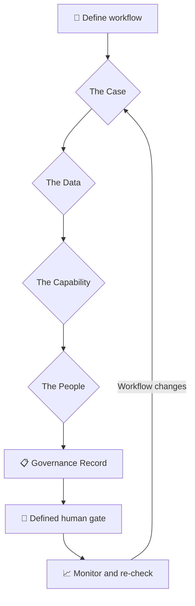

<div align="center">

# 🛡️ Course 09 — Governance, Risk & Responsible Use

### Classify before you act · Name the gate · Record the decision


[📖 Official Course](https://agentfactory.panaversity.org/docs/governance-risk-responsible-use-crash-course) · [🌳 Interactive Tree](#-interactive-topic-tree--expand--collapse) · [📋 Governance Record](#-one-page-governance-record-template)

</div>

> [!NOTE]
> This structured study map follows the **user-supplied Course 09 topic tree**. The expandable hierarchy is an abridged transcription of that tree; some of the deepest concept-level leaves are not included in this edition. `[NOT VERIFIED]` labels remain on the corresponding topics. Consult the supplied original text for the exhaustive listing.

## 🧭 Visual learning roadmap

| 🟦 The Case | 🟨 The Data | 🟪 The Capability | 🟩 The People | 🟥 The Evidence |
|:--|:--|:--|:--|:--|
| Can AI do this work? | Can this data use this route? | Should this authority be enabled? | Who is affected and what must be disclosed? | How will we measure and monitor risk? |



> [!IMPORTANT]
> **The middle answer is a commitment, not a vague maybe.** Name the reviewer, data control, approved route, escalation question, or disclosure requirement.

## ☑️ Study & revision checklist

- [ ] Apply reversibility, consequence, human judgment, and accountability to a use case.
- [ ] Classify the Case as appropriate, appropriate with review, or inappropriate.
- [ ] Define a gate with **who**, **what**, and **when**.
- [ ] Distinguish green, yellow, and red data and verify the approved entry route.
- [ ] Apply source, reach, fit, outside-content, and action checks to a Skill or connector.
- [ ] Identify prompt injection, excessive permissions, and irreversible actions.
- [ ] Review people excluded by a shortlist, not only those included.
- [ ] Complete all five blocks of the Governance Record.
- [ ] Practice first-hour incident response and quarterly usage audits.

---

## 🌳 Interactive topic tree — expand / collapse

> [!TIP]
> Open any section, subsection, or concept with children to reveal its nested topics. GitHub supports `<details>` / `<summary>` directly in Markdown.

<details>
<summary><strong>9.1 Introduction (subtitle under H1) [Concept]</strong> <sub>(1 direct topics)</sub></summary>

<ul>
<li>9.1.1 Four questions. Three possible answers. One habit that keeps useful AI work safe enough to survive [Concept]</li>
</ul>
</details>

<details>
<summary><strong>9.2 Start with an ordinary Tuesday</strong> <sub>(6 direct topics)</sub></summary>

<ul>
<li>9.2.1 Logistics company has a good year with AI; tools become ordinary and uses stop being framed as "AI decisions" [Concept]</li>
<li>9.2.2 Project manager uploads a customer spreadsheet (names, account numbers) into everyday AI chat to answer a director before lunch [Concept]</li>
<li>9.2.3 Company freezes AI use; innocent teams lose workflows; made-up mix of real cases [Concept]</li>
<li>9.2.4 A policy document cannot look at the file on your screen, decide whether the task needs the names, or notice a connector can now send [Concept]</li>
<li>9.2.5 This course gives a small decision procedure, quick enough to run and written in a form a manager can review [Concept]</li>
<li>9.2.6 Quick glossary (28 entries) [Concept]</li>
</ul>
</details>

<details>
<summary><strong>9.3 The whole course in brief</strong> <sub>(8 direct topics)</sub></summary>

<ul>
<details>
<summary><strong>9.3.1 The 30-second version: before AI does meaningful work, ask four questions [Concept]</strong> <sub>(4 direct topics)</sub></summary>

<ul>
<li>9.3.1.1 The Case: can AI do this work? Yes, yes with a defined human review, or no [Concept]</li>
<li>9.3.1.2 The Data: can this information go in? Yes, check first or add a control, or not through this route [Concept]</li>
<li>9.3.1.3 The Capability: can I turn this tool, Skill, connector, or action on? Enable, escalate for review, or decline [Concept]</li>
<li>9.3.1.4 The People: could this affect someone unfairly or require disclosure? Decide and document, disclose, or escalate the question [Concept]</li>
</ul>
</details>

<li>9.3.2 The middle answer is where most professional judgment lives (names a reviewer, control, route, disclosure, or escalation) [Concept]</li>
<li>9.3.3 Sections 5 to 8 put the four together: one workflow, the Governance Record, what to do when something goes wrong, why governance drifts [Concept]</li>
<li>9.3.4 Figure: three-answers grid (middle cell of every band highlighted; two-way thinking produces recklessness and abandonment) [Concept]</li>
<li>9.3.5 When not to run this: "meaningful work" touches someone else's data, money, or a decision about a person [Concept]</li>
<li>9.3.6 Pick a workflow now: each question ends with a Now do it block filling one part of a one-page record; Going deeper is optional [Concept]</li>
<li>9.3.7 Practice safely (callout): do not paste confidential, personal, regulated, privileged, or restricted material; use made-up or synthetic data or an approved entry point [Concept]</li>
<li>9.3.8 An AI assistant helps apply the framework; it is not your policy owner, security reviewer, compliance function, legal adviser, or final authority [Concept]</li>
</ul>
</details>

<details>
<summary><strong>9.4 📚 Teaching Aid</strong> <sub>(1 direct topics)</sub></summary>

<ul>
<li>9.4.1 Full presentation link and slideshow embed (Governance, Risk &amp; Responsible Use) [NOT VERIFIED: slide content not readable] [Concept]</li>
</ul>
</details>

<details>
<summary><strong>9.5 Part 1: The four questions (H1-level divider in source)</strong> <sub>(4 direct topics)</sub></summary>

<ul>
<details>
<summary><strong>9.5.1 1. The Case: Can AI do this work?</strong> <sub>(8 direct topics)</sub></summary>

<ul>
<li>9.5.1.1 Opening scenario: billing complaint, customer charged twice; yes, yes with review, or no [Concept]</li>
<li>9.5.1.2 This question comes first; if AI should not do the work, data and tool questions do not matter [Concept]</li>
<details>
<summary><strong>9.5.1.3 Delegation criteria: four screens (AI Fluency Framework) [Concept]</strong> <sub>(4 direct topics)</sub></summary>

<ul>
<li>9.5.1.3.1 Reversibility: can we catch and undo it before harm [Concept]</li>
<li>9.5.1.3.2 Consequence of error: trivial, expensive, harmful, regulated, or irreversible [Concept]</li>
<li>9.5.1.3.3 Human judgment or empathy: relationship, care, context a person should own [Concept]</li>
<li>9.5.1.3.4 Accountability: who is answerable and can really review and own it [Concept]</li>
</ul>
</details>

<details>
<summary><strong>9.5.1.4 1.1 Choose one of three answers</strong> <sub>(3 direct topics)</sub></summary>

<ul>
<li>9.5.1.4.1 Fully appropriate: low consequence, reversible, easy to review (internal FAQ, restructured notes, first-pass meeting summary) [Concept]</li>
<li>9.5.1.4.2 Appropriate with review: a specific human check before use (customer billing reply, management summary, shortlist) [Concept]</li>
<li>9.5.1.4.3 Inappropriate: task stays human-owned (final medical, legal, or disciplinary determination) [Concept]</li>
</ul>
</details>

<details>
<summary><strong>9.5.1.5 1.2 Find the deciding factor</strong> <sub>(4 direct topics)</sub></summary>

<ul>
<li>9.5.1.5.1 Deciding factor: the one screen actually carrying the classification [Concept]</li>
<li>9.5.1.5.2 Test: if one answer changed, which change would move the use case to a different classification [Concept]</li>
<li>9.5.1.5.3 Examples: condolence message (human relationship); billing reply (accountability) [Concept]</li>
<li>9.5.1.5.4 Naming it makes the reasoning checkable [Concept]</li>
</ul>
</details>

<details>
<summary><strong>9.5.1.6 1.3 A human in the loop is not a gate</strong> <sub>(4 direct topics)</sub></summary>

<ul>
<details>
<summary><strong>9.5.1.6.1 Defined gate names three things [Concept]</strong> <sub>(3 direct topics)</sub></summary>

<ul>
<li>9.5.1.6.1.1 Who reviews (role that holds responsibility) [Concept]</li>
<li>9.5.1.6.1.2 What they verify (the specific risk) [Concept]</li>
<li>9.5.1.6.1.3 When they review (before the output becomes hard to undo) [Concept]</li>
</ul>
</details>

<li>9.5.1.6.2 "Someone will check it" vs account manager checks delivery facts against the dispatch record before sending [Concept]</li>
<li>9.5.1.6.3 Figure: A defined gate vs Not a gate [Concept]</li>
<li>9.5.1.6.4 Going deeper: consequence and accountability are different (collapsible) [Concept]</li>
</ul>
</details>

<li>9.5.1.7 Worked examples</li>
<li>9.5.1.8 Now do it: Block 1 of your record</li>
</ul>
</details>

<details>
<summary><strong>9.5.2 2. The Data: Can this information go in?</strong> <sub>(10 direct topics)</sub></summary>

<ul>
<li>9.5.2.1 Opening scenario: customer spreadsheet for spending trends under a restricted-data policy; upload as is, strip identifiers, instruct not to retain, or skip [Concept]</li>
<li>9.5.2.2 Order: classify the data, ask whether the task needs identifying details, confirm the route, choose the control [Concept]</li>
<details>
<summary><strong>9.5.2.3 2.1 Use three practical tiers</strong> <sub>(6 direct topics)</sub></summary>

<ul>
<li>9.5.2.3.1 Data tier: how carefully information must be handled; translate to your policy [Concept]</li>
<li>9.5.2.3.2 Green: generally permitted (public, aggregated, approved internal, anonymized) [Concept]</li>
<li>9.5.2.3.3 Yellow: check first or add a control (internal-only, contact details, identifiers, confidential drafts, unannounced deals) [Concept]</li>
<li>9.5.2.3.4 Red: not through an unapproved route (credentials, secrets, highly regulated, privileged, third-party confidential, licensed material) [Concept]</li>
<li>9.5.2.3.5 Figure: three stacked bands with controls [Concept]</li>
<li>9.5.2.3.6 Unsure between two tiers: use the more sensitive one [Concept]</li>
</ul>
</details>

<details>
<summary><strong>9.5.2.4 2.2 Ask the most useful data question</strong> <sub>(4 direct topics)</sub></summary>

<ul>
<li>9.5.2.4.1 Does the task need the identifiers, or only the pattern? (the discriminator) [Concept]</li>
<li>9.5.2.4.2 Pattern only: redaction, removing fields the task does not need [Concept]</li>
<li>9.5.2.4.3 "Customer 17" is a first move; if a mapping list exists, the data is pseudonymized and keeps its tier [Concept]</li>
<li>9.5.2.4.4 Figure: discriminator fork (no: remove then verify; yes: confirm the route first) [Concept]</li>
</ul>
</details>

<details>
<summary><strong>9.5.2.5 2.3 Redaction is useful, but it is not magic</strong> <sub>(4 direct topics)</sub></summary>

<ul>
<li>9.5.2.5.1 Failure 1: partial redaction leaves clues (rare title, exact date, region, age) [Concept]</li>
<li>9.5.2.5.2 Failure 2: redaction that breaks the task [Concept]</li>
<li>9.5.2.5.3 Pseudonymized data must not be treated as anonymous [Concept]</li>
<li>9.5.2.5.4 Anonymized status depends on your organization's standard, not relabeling [Concept]</li>
</ul>
</details>

<li>9.5.2.6 2.4 The route matters as much as the tool name</li>
<li>9.5.2.7 2.5 Privacy and workspace controls answer narrower questions</li>
<li>9.5.2.8 2.6 Claude routes and controls: five distinctions</li>
<li>9.5.2.9 Worked examples</li>
<li>9.5.2.10 Now do it: Block 2 of your record</li>
</ul>
</details>

<details>
<summary><strong>9.5.3 3. The Capability: Can I turn this on?</strong> <sub>(8 direct topics)</sub></summary>

<ul>
<li>9.5.3.1 Opening scenario: colleague's forum Skill that summarizes meeting notes with no stated limits; enable, escalate, or decline [Concept]</li>
<li>9.5.3.2 AI systems now use Skills, tools, plugins, connectors, web pages, files, code, browsers, email, calendars [Concept]</li>
<li>9.5.3.3 Question: what authority am I adding to this session or agent [Concept]</li>
<details>
<summary><strong>9.5.3.4 3.1 Treat extensions like software, not like prompts</strong> <sub>(6 direct topics)</sub></summary>

<ul>
<li>9.5.3.4.1 Skill, connector, plugin contents; do not judge by friendly description or colleague sharing [Concept]</li>
<li>9.5.3.4.2 A Skill does not carry its own permission list; it runs with whatever access the session has; tool lists pre-approve, they do not narrow [Concept]</li>
<details>
<summary><strong>9.5.3.4.3 Five checks [Concept]</strong> <sub>(5 direct topics)</sub></summary>

<ul>
<li>9.5.3.4.3.1 Source: who created or published it [Concept]</li>
<li>9.5.3.4.3.2 Reach: what could it touch where it runs [Concept]</li>
<li>9.5.3.4.3.3 Fit (appropriateness): is the reach proportionate [Concept]</li>
<li>9.5.3.4.3.4 Outside content: web pages, email, customer files you did not write [Concept]</li>
<li>9.5.3.4.3.5 Actions: send, pay, delete, publish, edit, approve, hard-to-reverse changes [Concept]</li>
</ul>
</details>

<li>9.5.3.4.4 First three decide whether it belongs; last two decide how dangerous a mistake or hostile instruction is [Concept]</li>
<li>9.5.3.4.5 Open the package; scope creep is the warning sign [Concept]</li>
<li>9.5.3.4.6 Internal does not mean vetted (callout): confirm with the publisher what it accesses and why [Concept]</li>
</ul>
</details>

<details>
<summary><strong>9.5.3.5 3.2 Use three outcomes</strong> <sub>(3 direct topics)</sub></summary>

<ul>
<li>9.5.3.5.1 Enable: source known, reach proportionate, task fits, actions controlled [Concept]</li>
<li>9.5.3.5.2 Escalate: useful but something important is unsettled [Concept]</li>
<li>9.5.3.5.3 Decline: clearly disproportionate, untrustworthy, or unnecessary [Concept]</li>
</ul>
</details>

<details>
<summary><strong>9.5.3.6 3.3 Trusted tool, untrusted content</strong> <sub>(4 direct topics)</sub></summary>

<ul>
<li>9.5.3.6.1 Prompt injection: instructions in email, web page, upload, or document that steer the model [Concept]</li>
<li>9.5.3.6.2 Who wrote the tool and who wrote the content are two different trust questions [Concept]</li>
<li>9.5.3.6.3 Risk rises when a workflow reads untrusted content and can take consequential actions [Concept]</li>
<details>
<summary><strong>9.5.3.6.5 Defaults [Concept]</strong> <sub>(3 direct topics)</sub></summary>

<ul>
<li>9.5.3.6.5.1 Let AI read only what it needs [Concept]</li>
<li>9.5.3.6.5.2 Prefer read-only (defined) [Concept]</li>
<li>9.5.3.6.5.3 Keep send, publish, pay, delete, approve, irreversible edits behind a defined human gate [Concept]</li>
</ul>
</details>

</ul>
</details>

<li>9.5.3.7 Worked examples</li>
<li>9.5.3.8 Now do it: Block 3 of your record</li>
</ul>
</details>

<details>
<summary><strong>9.5.4 4. The People: Could this affect someone unfairly or require disclosure?</strong> <sub>(8 direct topics)</sub></summary>

<ul>
<li>9.5.4.1 Opening scenario: hiring coordinator forwards an AI-screened shortlist as "the candidates who qualified"; manager never sees dropped candidates [Concept]</li>
<details>
<summary><strong>9.5.4.2 Five questions [Concept]</strong> <sub>(5 direct topics)</sub></summary>

<ul>
<li>9.5.4.2.1 Who is affected, including people who never see the output [Concept]</li>
<li>9.5.4.2.2 What could go wrong for them [Concept]</li>
<li>9.5.4.2.3 Would they be able to notice or challenge it [Concept]</li>
<li>9.5.4.2.4 What would a fair process look like [Concept]</li>
<li>9.5.4.2.5 Is disclosure required, or would AI involvement reasonably matter to them [Concept]</li>
</ul>
</details>

<li>9.5.4.3 Bias can enter through the prompt, the task framing, and language patterns ("strongest candidates" carries an unstated standard) [Concept]</li>
<details>
<summary><strong>9.5.4.4 4.1 Look at who was excluded</strong> <sub>(3 direct topics)</sub></summary>

<ul>
<li>9.5.4.4.1 Risk when AI narrows a set and humans inspect only survivors [Concept]</li>
<li>9.5.4.4.2 Examples: shortlists, fraud or risk flags, escalations, leads, relevance selection, priority ranking [Concept]</li>
<li>9.5.4.4.3 Control: sample exclusions as well as inclusions [Concept]</li>
</ul>
</details>

<details>
<summary><strong>9.5.4.5 4.2 Disclosure: use rules first, judgment second</strong> <sub>(2 direct topics)</sub></summary>

<ul>
<li>9.5.4.5.1 First: is disclosure required (law, policy, contract, professional rules, client commitments) [Concept]</li>
<li>9.5.4.5.2 Second: would AI involvement reasonably change the person's understanding [Concept]</li>
</ul>
</details>

<details>
<summary><strong>9.5.4.6 4.3 Escalate the question, not a verdict</strong> <sub>(1 direct topics)</sub></summary>

<ul>
<details>
<summary><strong>9.5.4.6.1 Three signals that mean not to decide alone [Concept]</strong> <sub>(3 direct topics)</sub></summary>

<ul>
<li>9.5.4.6.1.1 Affected population is large [Concept]</li>
<li>9.5.4.6.1.2 Potential harm is significant [Concept]</li>
<li>9.5.4.6.1.3 Question touches law, contract, employment, or professional obligation [Concept]</li>
</ul>
</details>

</ul>
</details>

<li>9.5.4.7 Worked example: performance-review drafting</li>
<li>9.5.4.8 Now do it: Block 4 of your record</li>
</ul>
</details>

</ul>
</details>

<details>
<summary><strong>9.6 Part 2: Put the four questions together (H1-level divider in source)</strong> <sub>(3 direct topics)</sub></summary>

<ul>
<details>
<summary><strong>9.6.1 5. One ordinary workflow, start to finish</strong> <sub>(8 direct topics)</sub></summary>

<ul>
<li>9.6.1.1 Ayesha leads operations at a regional logistics company; AI drafts the weekly service-exception report; account manager sends it [Concept]</li>
<li>9.6.1.2 5.1 The Case</li>
<li>9.6.1.3 5.2 The Data</li>
<li>9.6.1.4 5.3 The Capability</li>
<li>9.6.1.5 5.4 The People</li>
<li>9.6.1.6 5.5 The Evidence</li>
<li>9.6.1.7 Figure: one case through four questions (adds escalate the driver-disclosure question to HR) [Concept]</li>
<li>9.6.1.8 One modest workflow produced all of that; governance as work design [Concept]</li>
</ul>
</details>

<details>
<summary><strong>9.6.2 6. The Governance Record: one page that survives the meeting</strong> <sub>(5 direct topics)</sub></summary>

<ul>
<li>9.6.2.1 Governance Record: one page for one workflow [Concept]</li>
<li>9.6.2.2 If you filled the Now do it blocks, four of five parts exist [Concept]</li>
<li>9.6.2.3 Fifth part: the Evidence line (success measure, failure threshold, monitor, residual risk) [Concept]</li>
<li>9.6.2.4 A blank field beats a guessed one; write OPEN QUESTION [Concept]</li>
<li>9.6.2.5 Figure: Governance Record page layout [Concept]</li>
</ul>
</details>

<details>
<summary><strong>9.6.3 7. What to do when something goes wrong</strong> <sub>(7 direct topics)</sub></summary>

<ul>
<li>9.6.3.1 Governance is the ability to surface mistakes early enough to contain them [Concept]</li>
<details>
<summary><strong>9.6.3.2 Incident types [Concept]</strong> <sub>(5 direct topics)</sub></summary>

<ul>
<li>9.6.3.2.1 Data: information entered an unapproved route [Concept]</li>
<li>9.6.3.2.2 Output: an AI-assisted output went out with a serious error or harmful framing [Concept]</li>
<li>9.6.3.2.3 Action: a tool sent, changed, deleted, approved, or shared something it should not have [Concept]</li>
<li>9.6.3.2.4 Security: untrusted content steered an AI system [Concept]</li>
<li>9.6.3.2.5 Fairness: a ranking or screening process disadvantaged people and review did not catch it [Concept]</li>
</ul>
</details>

<details>
<summary><strong>9.6.3.3 The first-hour procedure</strong> <sub>(5 direct topics)</sub></summary>

<ul>
<li>9.6.3.3.1 Stop the spread [Concept]</li>
<li>9.6.3.3.2 Record the facts [Concept]</li>
<li>9.6.3.3.3 Report promptly through your organization's incident path [Concept]</li>
<li>9.6.3.3.4 State the facts plainly [Concept]</li>
<li>9.6.3.3.5 Follow the incident owner's instructions [Concept]</li>
</ul>
</details>

<li>9.6.3.4 Figure: the instinct (crossed-out actions) vs the move [Concept]</li>
<li>9.6.3.5 Do not delete evidence and hope the issue disappears [Concept]</li>
<li>9.6.3.6 Report near misses too [Concept]</li>
<li>9.6.3.7 For managers: how the first good-faith report is treated decides whether the next ten are reported [Concept]</li>
</ul>
</details>

</ul>
</details>

<details>
<summary><strong>9.7 Part 3: Make the habit survive real work (H1-level divider in source)</strong> <sub>(1 direct topics)</sub></summary>

<ul>
<details>
<summary><strong>9.7.1 8. Why governance drifts</strong> <sub>(9 direct topics)</sub></summary>

<ul>
<li>9.7.1.1 Routine decisions are more dangerous than high-stakes ones because each feels too small to count [Concept]</li>
<li>9.7.1.2 Drift examples: easier tool, review becomes a glance, stale connector permission, sensitive field appears in a dataset [Concept]</li>
<li>9.7.1.3 Diligence gap: distance between what the policy requires and what people do [Concept]</li>
<li>9.7.1.4 Figure: policy line vs actual practice line [Concept]</li>
<details>
<summary><strong>9.7.1.5 8.1 Run a usage audit on the work people actually do</strong> <sub>(1 direct topics)</sub></summary>

<ul>
<details>
<summary><strong>9.7.1.5.1 Questions [Concept]</strong> <sub>(5 direct topics)</sub></summary>

<ul>
<li>9.7.1.5.1.1 Which AI workflows are actually in use [Concept]</li>
<li>9.7.1.5.1.2 What data is actually going through them [Concept]</li>
<li>9.7.1.5.1.3 Did defined human gates actually run [Concept]</li>
<li>9.7.1.5.1.4 What new tools, Skills, connectors, or permissions were added [Concept]</li>
<li>9.7.1.5.1.5 What changed in the model, feature, route, data, or audience [Concept]</li>
</ul>
</details>

</ul>
</details>

<li>9.7.1.6 8.2 Audit the process, not the person</li>
<details>
<summary><strong>9.7.1.7 8.3 The friction rule</strong> <sub>(3 direct topics)</sub></summary>

<ul>
<li>9.7.1.7.1 Shadow AI defined [Concept]</li>
<li>9.7.1.7.2 Treat usability as part of the control system [Concept]</li>
<li>9.7.1.7.3 Ask: what makes the approved way harder than the unsafe way [Concept]</li>
</ul>
</details>

<li>9.7.1.8 8.4 When there is no AI policy</li>
<li>9.7.1.9 8.5 Re-check when the workflow changes</li>
</ul>
</details>

</ul>
</details>

<details>
<summary><strong>9.8 Part 4: Use it tomorrow (H1-level divider in source)</strong> <sub>(5 direct topics)</sub></summary>

<ul>
<details>
<summary><strong>9.8.1 9. Recap: the one-minute checklist</strong> <sub>(3 direct topics)</sub></summary>

<ul>
<details>
<summary><strong>9.8.1.1 Checklist table [Concept]</strong> <sub>(4 direct topics)</sub></summary>

<ul>
<li>9.8.1.1.1 Case: can AI do this responsibly; middle answer requires a defined gate; trap "a human will review it" [Concept]</li>
<li>9.8.1.1.2 Data: can this go through this route; middle answer requires a control, less data, or confirmed route [Concept]</li>
<li>9.8.1.1.3 Capability: should this authority be enabled; middle answer requires a specific review question [Concept]</li>
<li>9.8.1.1.4 People: could this affect people or require disclosure; middle answer requires fairness check, disclosure, or escalation [Concept]</li>
</ul>
</details>

<li>9.8.1.2 Under all four: the trap of forcing a plain yes or no [Concept]</li>
<li>9.8.1.3 Final question: what changed since the last time we decided this was okay [Concept]</li>
</ul>
</details>

<details>
<summary><strong>9.8.2 10. Finish the Governance Record</strong> <sub>(3 direct topics)</sub></summary>

<ul>
<details>
<summary><strong>9.8.2.1 Step 5: The Evidence</strong> <sub>(4 direct topics)</sub></summary>

<ul>
<li>9.8.2.1.1 Success measure [Concept]</li>
<li>9.8.2.1.2 Failure threshold [Concept]</li>
<li>9.8.2.1.3 Monitoring owner and cadence [Concept]</li>
<li>9.8.2.1.4 Residual risk [Concept]</li>
</ul>
</details>

<li>9.8.2.2 Step 6: Share the record</li>
<details>
<summary><strong>9.8.2.3 Copyable Governance Record block [Concept]</strong> <sub>(7 direct topics)</sub></summary>

<ul>
<li>9.8.2.3.1 Header: workflow, owner, date [Concept]</li>
<li>9.8.2.3.2 THE CASE: classification, deciding factor, gate [Concept]</li>
<li>9.8.2.3.3 THE DATA: tier, needs identifiers, fields removed, approved route [Concept]</li>
<li>9.8.2.3.4 THE CAPABILITY: tools enabled, source, reach, outside content, actions needing review [Concept]</li>
<li>9.8.2.3.5 THE PEOPLE: who is affected, fairness check, disclosure decision, open question [Concept]</li>
<li>9.8.2.3.6 THE EVIDENCE: success measure, failure threshold, monitored by, residual risk [Concept]</li>
<li>9.8.2.3.7 RE-CHECK IF: model, feature, data, audience, permission, policy, vendor term, or business consequence changes [Concept]</li>
</ul>
</details>

</ul>
</details>

<details>
<summary><strong>9.8.3 11. Plain-English glossary</strong> <sub>(1 direct topics)</sub></summary>

<ul>
<li>9.8.3.1 The fuller glossary entries, with caveats (collapsible, 20 entries) [Concept]</li>
</ul>
</details>

<details>
<summary><strong>9.8.4 12. What this course does not replace</strong> <sub>(8 direct topics)</sub></summary>

<ul>
<li>9.8.4.1 Applicable law or sector regulation [Concept]</li>
<li>9.8.4.2 Organization privacy, security, acceptable-use, records, HR, legal, procurement, risk policies [Concept]</li>
<li>9.8.4.3 Client contracts, confidentiality terms, professional obligations [Concept]</li>
<li>9.8.4.4 Formal security assessment of software or agent architecture [Concept]</li>
<li>9.8.4.5 Structured model evaluation for high-impact systems [Concept]</li>
<li>9.8.4.6 Legal advice on whether data is personal, anonymous, privileged, regulated, or permitted [Concept]</li>
<li>9.8.4.7 Practitioner's slice of formal systems (NIST AI Risk Management Framework; ISO/IEC 42001) [Concept]</li>
<li>9.8.4.8 Pointers: How to Think in the AI Era; Skills &amp; Connectors; Certifications [Concept]</li>
</ul>
</details>

<details>
<summary><strong>9.8.5 13. Where this leads in The AI Agent Factory</strong> <sub>(6 direct topics)</sub></summary>

<ul>
<li>9.8.5.1 The Case becomes autonomy design and human-agent operating model (Human-Agent Teams) [Concept]</li>
<li>9.8.5.2 The Data becomes custody, context, minimization, approved routes (General Agents on the Web, Cowork) [Concept]</li>
<li>9.8.5.3 The Capability becomes tool boundaries, scoped credentials, confirmations, typed actions, audit logs (Designing Agent Experiences, Mode 2) [Concept]</li>
<li>9.8.5.4 The People becomes evaluation, disclosure, fairness checks, monitoring, recourse (System of Record governance layer) [Concept]</li>
<li>9.8.5.5 The Governance Record becomes input to design review, testing, launch criteria, monitoring [Concept]</li>
<li>9.8.5.6 Read AI Fluency alongside this course [Concept]</li>
</ul>
</details>

</ul>
</details>

<details>
<summary><strong>9.9 Appendix: Going deeper for managers and builders (H1-level divider in source)</strong> <sub>(3 direct topics)</sub></summary>

<ul>
<li>9.9.1 Both sections optional on a first read [Concept]</li>
<details>
<summary><strong>9.9.2 A.1 For managers: evidence, residual risk, and review quality</strong> <sub>(4 direct topics)</sub></summary>

<ul>
<li>9.9.2.1 Add evidence to every important control; residual risk is not a confession of failure [Concept]</li>
<li>9.9.2.2 Review quality matters more than review volume (source material, time, specific risk, authority to reject, position before irreversibility) [Concept]</li>
<li>9.9.2.3 Sample the edge cases (unusual inputs, minority categories, escalations, low-confidence outputs, exclusions, near-threshold cases) [Concept]</li>
<li>9.9.2.4 Evaluation eventually moves into structured test sets, baselines, monitoring; the Governance Record is the bridge [Concept]</li>
</ul>
</details>

<details>
<summary><strong>9.9.3 A.2 For agent builders: the four questions as architecture</strong> <sub>(5 direct topics)</sub></summary>

<ul>
<li>9.9.3.1 The Case becomes an autonomy level (draft only; propose; act within a narrow reversible boundary; act alone) [Concept]</li>
<li>9.9.3.2 The Data becomes custody and minimization [Concept]</li>
<li>9.9.3.3 The Capability becomes scoped authority (narrow credentials, read-only, allow-lists, confirmation, audit trails, separate agent identities) [Concept]</li>
<li>9.9.3.4 The People becomes evaluation and recourse [Concept]</li>
<li>9.9.3.5 If the record says "human approves before send" but the token can send without confirmation, the architecture overruled the policy [Concept]</li>
</ul>
</details>

</ul>
</details>

<details>
<summary><strong>9.10 Sources and product notes</strong> <sub>(18 direct topics)</sub></summary>

<ul>
<li>9.10.1 Screening approach builds on the AI Fluency Framework by Rick Dakan and Joseph Feller (Delegation and Diligence) [Concept]</li>
<li>9.10.2 Three-answer structure, deciding-factor test, route-first data reasoning, Governance Record are adaptations for this book [Concept]</li>
<li>9.10.3 Claude examples re-checked September 2, 2026 [Concept]</li>
<li>9.10.4 Use incognito chats [Concept]</li>
<li>9.10.5 Is my data used for model training? (consumer plans) [Concept]</li>
<li>9.10.6 Is my data used for model training? (commercial products) [Concept]</li>
<li>9.10.7 Use Claude's chat search and memory [Concept]</li>
<li>9.10.8 What are Projects? [Concept]</li>
<li>9.10.9 How can I create and manage Projects? [Concept]</li>
<li>9.10.10 Roles and permissions [Concept]</li>
<li>9.10.11 Export your organization's data [Concept]</li>
<li>9.10.12 Configure custom data retention controls for Enterprise plans [Concept]</li>
<li>9.10.13 Claude Cowork architecture overview [Concept]</li>
<li>9.10.14 What are skills? [Concept]</li>
<li>9.10.15 Use skills in Claude [Concept]</li>
<li>9.10.16 Agent Skills, Claude Platform Docs [Concept]</li>
<li>9.10.17 Get started with skill and plugin scanning [Concept]</li>
<li>9.10.18 Anonymized and regulated data treatment is principle-based; jurisdictions use different legal tests [Concept]</li>
</ul>
</details>

<details>
<summary><strong>9.11 Flashcards Study Aid</strong> <sub>(1 direct topics)</sub></summary>

<ul>
<li>9.11.1 Flashcard content [NOT VERIFIED: interactive widget, no text delivered] [Concept]</li>
</ul>
</details>

<details>
<summary><strong>9.12 Test Your Understanding</strong> <sub>(2 direct topics)</sub></summary>

<ul>
<li>9.12.1 Intro: scenarios drop you into someone else's decision under pressure; twelve per sitting from a larger pool; identify which of the four is being asked [Concept]</li>
<li>9.12.2 Scenario content [NOT VERIFIED: gated, page showed "Checking access..."] [Concept]</li>
</ul>
</details>

<details>
<summary><strong>9.13 The sentence to remember</strong> <sub>(1 direct topics)</sub></summary>

<ul>
<li>9.13.1 Classify before you act. If the answer is in the middle, name the commitment. Then write down why. [Concept]</li>
</ul>
</details>


---

## 📋 One-page Governance Record template

<details>
<summary><strong>📝 Expand the copyable governance record</strong></summary>

```text
WORKFLOW:
OWNER:
DATE:

THE CASE
- Classification:
- Deciding factor:
- Human gate (who / what / when):

THE DATA
- Data tier:
- Are identifiers necessary?:
- Fields removed:
- Approved entry point and purpose:

THE CAPABILITY
- Skills, connectors, and tools:
- Source / reach / fit:
- Untrusted content:
- Consequential actions and controls:

THE PEOPLE
- Affected people (including exclusions):
- Fairness checks:
- Disclosure decision:
- Open question / escalation:

THE EVIDENCE
- Success measure:
- Failure threshold:
- Monitoring owner and frequency:
- Residual risk:

RE-CHECK IF
- Model, feature, route, data, audience, permissions,
  policy, contract, vendor terms, or stakes change.
```

</details>

> [!WARNING]
> This learning resource is not an organizational policy, legal opinion, security approval, or a substitute for required reviews. Product and privacy behavior can change; confirm current documentation.

---

<div align="center">

**Course 09 · Governance, Risk & Responsible Use**  
*The AI Agent Factory · Curriculum Map*

</div>
