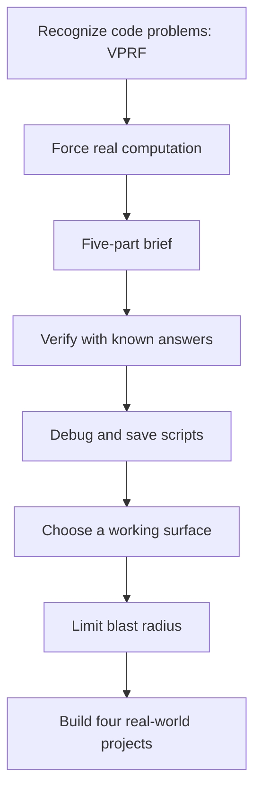

# 🧠 Course 10 — Code You Never Write

[](https://agentfactory.panaversity.org/docs/code-you-never-write-crash-course)  

> [!IMPORTANT]
> **Source fidelity:** This is a **curated, condensed interactive study map** built from the topic tree provided in the conversation. It preserves the principal headings, course sequence, major concepts, and `[NOT VERIFIED]` warnings, but **does not reproduce every numbered source node verbatim**. Consult the [course page](https://agentfactory.panaversity.org/docs/code-you-never-write-crash-course) for the complete wording.

## 🧭 Learning roadmap



## 📌 Quick navigation

- [10.1 Getting AI to do the real, tedious work of your job, and trust the result, without writing or reading a single line of code](#101-getting-ai-to-do-the-real-tedious-work-of-your-job-and-trust-the-result-without-writing-or-reading-a-single-line-of-code)
- [10.2 📚 Teaching Aid](#102--teaching-aid)
- [10.3 Prove it in two minutes](#103-prove-it-in-two-minutes)
- [10.4 The four parts, in brief](#104-the-four-parts-in-brief)
- [10.5 Part 1: The deal](#105-part-1-the-deal)
- [10.6 Part 2: Commissioning code](#106-part-2-commissioning-code)
- [10.7 Part 3: One problem, five surfaces](#107-part-3-one-problem-five-surfaces)
- [10.8 Part 4: Power, safely held](#108-part-4-power-safely-held)
- [10.9 A short recap before you try the prompts](#109-a-short-recap-before-you-try-the-prompts)
- [10.10 You have already done it, ten times over](#1010-you-have-already-done-it-ten-times-over)
- [10.11 🚀 Projects](#1011--projects)
- [10.12 Flashcards Study Aid](#1012-flashcards-study-aid)
- [10.13 Test Your Understanding](#1013-test-your-understanding)

## ⚡ Frameworks at a glance

| Framework | Remember | Why it matters |
|---|---|---|
| **VPRF** | Volume · Precision · Repetition · Files | Decide when the task calls for code |
| **Five-part brief** | Goal · Input · Output · Rules · Edge cases | Specify what correct work looks like |
| **Verification ladder** | Known answer · Reality questions · Plain-English replay · Adversarial pass · Cross-model check | Check outputs without reading syntax |
| **Blast-radius rules** | Copies · Dry run · Smallest folder · New output files | Protect real files |

> [!TIP]
> Open each section below to explore the course. Each topic is collapsed by default except the two central learning parts.

## 🌳 Expandable curriculum map


<a id="101-getting-ai-to-do-the-real-tedious-work-of-your-job-and-trust-the-result-without-writing-or-reading-a-single-line-of-code"></a>
<details>
<summary><strong>10.1 Getting AI to do the real, tedious work of your job, and trust the result, without writing or reading a single line of code</strong></summary>

<ul>
<li>Bookkeeper story: 23 mismatches in a minute [Concept]</li>
<li>AI writes, runs, and fixes code; you define the problem and check results [Concept]</li>
<li>Not reading syntax is freedom; checking results is responsibility [Concept]</li>
</ul>

</details>

<a id="102--teaching-aid"></a>
<details>
<summary><strong>10.2 📚 Teaching Aid</strong></summary>

<ul>
<li>Full presentation link and slideshow embed [NOT VERIFIED: slide content not readable] [Concept]</li>
</ul>

</details>

<a id="103-prove-it-in-two-minutes"></a>
<details>
<summary><strong>10.3 Prove it in two minutes</strong></summary>

<ul>
<li>Expense-list demonstration: write and run code to total by category [Concept]</li>
<li>Hand-check Groceries: 4,250 + 2,890 + 3,120 [Concept]</li>
<li>Builds on What AI Actually Is, AI Prompting in 2026, Markdown In, HTML Out [Concept]</li>
<li>What you need: a chat account and your own spreadsheet or folder [Concept]</li>
<li>Quick glossary: 26 terms (script, sandbox, brief, VPRF, known-answer test, dry run, blast radius, etc.) [Concept]</li>
<li>Short on time? The 30-minute path [Concept]</li>
</ul>

</details>

<a id="104-the-four-parts-in-brief"></a>
<details>
<summary><strong>10.4 The four parts, in brief</strong></summary>

<ul>
<li>The deal: recognize code problems [Concept]</li>
<li>Commissioning code: compute, brief, verify, fix, save [Concept]</li>
<li>One problem, five surfaces [Concept]</li>
<li>Power, safely held [Concept]</li>
</ul>

</details>

<a id="105-part-1-the-deal"></a>
<details open>
<summary><strong>10.5 Part 1: The deal</strong></summary>

<details>
<summary><strong>1. Code is no longer gated by coding</strong></summary>

<ul>
<li>AI writes working code [Concept]</li>
<li>AI runs code itself [Concept]</li>
<li>AI repairs code itself [Concept]</li>
<li>You are the client, not the developer [Concept]</li>
<li>From the field: bookkeeper, doctor, marketer, teacher, student, network engineer [Concept]</li>
<li>Do this now: filter eight students [Concept]</li>
</ul>

</details>

<details>
<summary><strong>2. What code actually is (the 60-second version)</strong></summary>

<ul>
<li>Code is exact instructions [Concept]</li>
<li>Python: data, files, charts and reports [Concept]</li>
<li>JavaScript and TypeScript: interactive things you click [Concept]</li>
<li>Code is exact in both directions: wrong instructions scale too [Concept]</li>
<li>Do this now: total, average, count [Concept]</li>
</ul>

</details>

<details>
<summary><strong>3. The dividing line: which problems are code problems</strong></summary>

<ul>
<li>Answer problem vs code problem [Concept]</li>
<li>Volume [Concept]</li>
<li>Precision [Concept]</li>
<li>Repetition [Concept]</li>
<li>Files [Concept]</li>
<li>VPRF: any signal is enough [Concept]</li>
<li>Eight-task sorting examples [Concept]</li>
<li>Do this now: classify tasks and name signal [Concept]</li>
</ul>

</details>


</details>

<a id="106-part-2-commissioning-code"></a>
<details open>
<summary><strong>10.6 Part 2: Commissioning code</strong></summary>

<details>
<summary><strong>4. Make the AI’s hands move: automatic vs. explicit</strong></summary>

<ul>
<li>Write and run code to answer this [Concept]</li>
<li>Show me the code you ran [Concept]</li>
<li>Tell me exact row count, column names and date range [Concept]</li>
<li>Distinguish computed results from estimates [Concept]</li>
<li>Do this now: commute log, Bus total 105 [Concept]</li>
</ul>

</details>

<details>
<summary><strong>5. Brief the problem, not the program</strong></summary>

<ul>
<li>Goal [Concept]</li>
<li>Input [Concept]</li>
<li>Output [Concept]</li>
<li>Rules [Concept]</li>
<li>Edge cases [Concept]</li>
<li>Five-section Markdown brief template [Concept]</li>
<li>Teacher example: class-list.csv and submissions.csv [Concept]</li>
<li>Do this now: messy calories file [Concept]</li>
</ul>

</details>

<details>
<summary><strong>6. Verifying work you cannot read</strong></summary>

<ul>
<li>Known-answer test [Concept]</li>
<li>Reality questions [Concept]</li>
<li>Plain-English replay [Concept]</li>
<li>Adversarial pass [Concept]</li>
<li>Cross-model check [Concept]</li>
<li>Verification ladder by stakes [Concept]</li>
<li>Wrong-but-running: why tests matter [Concept]</li>
<li>Do this now: 8,000 + 6,500 + 9,000 = 23,500 [Concept]</li>
</ul>

</details>

<details>
<summary><strong>7. When it breaks: errors are dialogue, not failure</strong></summary>

<ul>
<li>Paste full error: diagnose, fix, rerun [Concept]</li>
<li>Wrong-but-running: report symptom and expected value [Concept]</li>
<li>After three failed fixes, ask for alternative approaches [Concept]</li>
<li>Do this now: deliberately misspell Pagse [Concept]</li>
</ul>

</details>

<details>
<summary><strong>8. Keep the script: a solved problem becomes a button</strong></summary>

<ul>
<li>Save the script as a file [Concept]</li>
<li>Keep the brief next to it: Intent Layer [Concept]</li>
<li>Keep sample input in one folder [Concept]</li>
<li>Chat is where scripts are born; your machine is where they live [Concept]</li>
<li>Do this now: save study-log script [Concept]</li>
</ul>

</details>


</details>

<a id="107-part-3-one-problem-five-surfaces"></a>
<details>
<summary><strong>10.7 Part 3: One problem, five surfaces</strong></summary>

<details>
<summary><strong>9. Claude.ai: the home surface (and ChatGPT, Gemini)</strong></summary>

<ul>
<li>Browser sandbox: uploads in, results out [Concept]</li>
<li>Twelve monthly expense CSVs: merge, total, flag duplicates, HTML report [Concept]</li>
<li>Download scripts; temporary sandbox is not permanent storage [Concept]</li>
<li>Do this now: screen-time HTML report [Concept]</li>
</ul>

</details>

<details>
<summary><strong>10. Claude Code &amp; OpenCode: the agent in your folder</strong></summary>

<ul>
<li>Terminal-based agent operates in a chosen folder [Concept]</li>
<li>Agent finds 12 files and saves reusable report script [Concept]</li>
<li>Claude Code vs OpenCode [Concept]</li>
<li>Non-programmers belong here too [Concept]</li>
</ul>

</details>

<details>
<summary><strong>11. Cowork &amp; OpenWork: delegation with a safety ritual</strong></summary>

<ul>
<li>Desktop apps with file-touching power [Concept]</li>
<li>Plan-then-approve [Concept]</li>
<li>Five-surface selection guide [Concept]</li>
<li>Stay with browser chat until uploading becomes burdensome [Concept]</li>
</ul>

</details>


</details>

<a id="108-part-4-power-safely-held"></a>
<details>
<summary><strong>10.8 Part 4: Power, safely held</strong></summary>

<details>
<summary><strong>12. Blast radius: the rules for code that touches your files</strong></summary>

<ul>
<li>Work on copies until a script earns trust [Concept]</li>
<li>Dry run: see changes before they happen [Concept]</li>
<li>Point the agent at the smallest folder [Concept]</li>
<li>Write output to new files, never over originals [Concept]</li>
<li>Permission ladder and review before destructive actions [Concept]</li>
<li>Do this now: PDF rename plan before changes [Concept]</li>
</ul>

</details>

<details>
<summary><strong>13. The edge of the map, and what’s across it</strong></summary>

<ul>
<li>Multi-user software needs more than one-prompt code [Concept]</li>
<li>Always-on automation and Digital FTE [Concept]</li>
<li>Irreversible actions require human control [Concept]</li>
<li>Judgment wearing a computation costume [Concept]</li>
<li>Next: general agents, agentic coding, Cowork &amp; OpenWork [Concept]</li>
</ul>

</details>


</details>

<a id="109-a-short-recap-before-you-try-the-prompts"></a>
<details>
<summary><strong>10.9 A short recap before you try the prompts</strong></summary>

<ul>
<li>13-concept recap: recognize, compute, brief, verify, fix, save, choose surface, protect files [Concept]</li>
<li>You are the client, not the contractor [Concept]</li>
</ul>

</details>

<a id="1010-you-have-already-done-it-ten-times-over"></a>
<details>
<summary><strong>10.10 You have already done it, ten times over</strong></summary>

<ul>
<li>Six rehearsed moves: spot, compute, brief, test, recover, dry run [Concept]</li>
<li>Run the same moves on your data [Concept]</li>
</ul>

</details>

<a id="1011--projects"></a>
<details>
<summary><strong>10.11 🚀 Projects</strong></summary>

<details>
<summary><strong>Project 1: Money Detective (45 min) [Concept]</strong></summary>

<ul>
<li>Detect subscriptions, duplicate charges, and spending leaks [Concept]</li>
<li>Known-answer: money in 23,000; PrimeVideo 796 [Concept]</li>
<li>Save a reusable monthly money-check script [Concept]</li>
<li>Sample report [NOT VERIFIED: external embed not read] [Concept]</li>
</ul>

</details>

<details>
<summary><strong>Project 2: What’s My Grade, Really (30–45 min) [Concept]</strong></summary>

<ul>
<li>Encode exact grading rules and dropped scores [Concept]</li>
<li>Known-answer: homework subtotal 88.75 [Concept]</li>
<li>Compute score required for 90 percent [Concept]</li>
</ul>

</details>

<details>
<summary><strong>Project 3: The Books Don’t Match (45 min) [Concept]</strong></summary>

<ul>
<li>Reconcile eight people × 500 = 4,000 [Concept]</li>
<li>Find unmatched payments and missing dues [Concept]</li>
<li>Known catch: 500 short, unplaced 500, Usman owes [Concept]</li>
</ul>

</details>

<details>
<summary><strong>Project 4: Photo Gallery Rescue (45 min) [Concept]</strong></summary>

<ul>
<li>Identify duplicate candidates by perceptual hash [Concept]</li>
<li>Backup, preview, approve, avoid false matches [Concept]</li>
<li>Sort survivors by date into a copy [Concept]</li>
<li>Live demo [NOT VERIFIED: external embed not read] [Concept]</li>
</ul>

</details>

<details>
<summary><strong>If you get stuck mid-project [Concept]</strong></summary>

<ul>
<li>File cannot open: re-export as CSV or Excel [Concept]</li>
<li>No code executed: explicitly request code execution [Concept]</li>
<li>Wrong number: provide expected value [Concept]</li>
<li>Private data: clean copy and check policy [Concept]</li>
<li>Free-tier usage exhausted: wait or switch model [Concept]</li>
</ul>

</details>


</details>

<a id="1012-flashcards-study-aid"></a>
<details>
<summary><strong>10.12 Flashcards Study Aid</strong></summary>

<ul>
<li>Flashcard content [NOT VERIFIED: interactive widget, no text delivered] [Concept]</li>
</ul>

</details>

<a id="1013-test-your-understanding"></a>
<details>
<summary><strong>10.13 Test Your Understanding</strong></summary>

<ul>
<li>32 scenario-based questions [Concept]</li>
<li>Scenario content [NOT VERIFIED: gated, page showed “Checking access...”] [Concept]</li>
</ul>

</details>

## 🧪 Copyable five-part code brief

```markdown
# Goal
What result should the script produce?

# Input
What files, columns, and formats will it read?

# Output
What exactly should it save or show?

# Rules
What business rules must be followed?

# Edge cases
What should happen with blanks, duplicates, mismatches, or unreadable data?
```

## ✅ Revision checklist

- [ ] I can distinguish an answer problem from a code problem using VPRF.
- [ ] I can request **executed computation**, not a plausible estimate.
- [ ] I can write a five-part brief without programming jargon.
- [ ] I can independently check at least one known answer.
- [ ] I can debug errors and detect wrong-but-running scripts.
- [ ] I can save a brief, script, and sample input together.
- [ ] I can select between browser, terminal, and desktop-agent workflows.
- [ ] I can protect files using copies, dry runs, narrow folders, and new outputs.
- [ ] I can explain the goals and safety gates of all four projects.

---

**Source:** [Panaversity Agent Factory — Code You Never Write](https://agentfactory.panaversity.org/docs/code-you-never-write-crash-course) · Source topic tree supplied by user, 15 October 2026.
