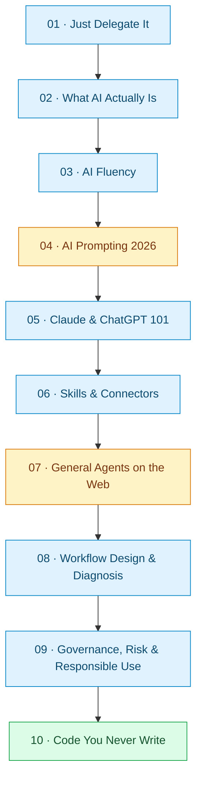

<div align="center">

# 🧠 Agent Factory — Master Curriculum Tree

### 10 Courses · 4,442 Curriculum Nodes · One Learning Roadmap

   

**From understanding AI to delegating work, building reliable workflows, and applying responsible governance.**

*Curated for structured learning, revision, and viva preparation.*

</div>

> [!IMPORTANT]
> This map preserves the supplied topic-tree content and its `[Concept]` and `[NOT VERIFIED]` markers. **Courses 04 and 07 are partial.** The source reports 8 of 10 courses verified for accessible content; embedded slides, gated exercises, and other marked elements were not verified. This is a curriculum map, not a substitute for the original course material.

## 🧭 Quick navigation

[Course Explorer](#-interactive-course-explorer) · [Visual Roadmap](#-learning-roadmap) · [Curriculum Statistics](#-curriculum-at-a-glance) · [Viva Guide](#-viva-preparation) · [Coverage Notes](#-coverage--source-integrity) · [Complete Source Archive](#-complete-original-source-archive)

## 🗺️ Learning roadmap



> [!NOTE]
> This is a **course-navigation sequence**, not a claim that each course requires completion of every preceding course. Amber nodes indicate partial source coverage.

## 📊 Curriculum at a glance

| # | Course | Nodes | Coverage | Main focus |
|:--:|---|--:|---|---|
| 01 | [Just Delegate It](#course-01) | 596 | ✅ Verified* | Delegation Loop and Brief |
| 02 | [What AI Actually Is](#course-02) | 407 | ✅ Verified* | Mental models and AI limitations |
| 03 | [AI Fluency](#course-03) | 415 | ✅ Verified* | The four Ds of AI Fluency |
| 04 | [AI Prompting in 2026](#course-04) | 465 | ⚠️ Partial | Prompting methods and iteration |
| 05 | [Claude & ChatGPT 101](#course-05) | 432 | ✅ Verified* | Product and model reference |
| 06 | [Skills & Connectors](#course-06) | 364 | ✅ Verified* | Skills, connectors, and access |
| 07 | [General Agents on the Web](#course-07) | 483 | ⚠️ Partial | Agent anatomy and file custody |
| 08 | [Workflow Design & Diagnosis](#course-08) | 506 | ✅ Verified* | Delegation maps and diagnosis |
| 09 | [Governance, Risk & Responsible Use](#course-09) | 428 | ✅ Verified* | Case, Data, Capability, People |
| 10 | [Code You Never Write](#course-10) | 346 | ✅ Verified* | VPRF, code briefs, verification |
| | **Total** | **4,442** | **8 verified / 2 partial** | |

*“Verified” means the source reports the accessible page text as read, **not** that every embedded widget or slide was verified.

## 🎤 Viva preparation

Use each expandable branch as a mini viva syllabus: **define the concept → explain why it matters → give a practical example → describe how to verify the result.**

- [ ] Explain each course’s central framework without reading notes.
- [ ] Compare similar ideas across courses (delegation, prompting, tools, workflow, risk).
- [ ] Give a real-life scenario and justify the appropriate AI approach.
- [ ] State the verification method, human approval gate, or safety boundary.
- [ ] Mark weak branches and revisit the linked course material.

> [!TIP]
> For viva practice, close a topic branch, explain it aloud in 60–90 seconds, then expand it to check what you missed. `[Concept]` labels are condensed study cues—not direct quotations from the course.

## 🌳 Interactive course explorer

**Click any course or topic to expand its nested concepts.** All 4,442 numbered curriculum nodes from the supplied master tree are included below, with their original labels and markers.

<a id="course-01"></a>
### 01 · Just Delegate It

<details>
<summary><strong>📂 Explore Course 01 — 596 nodes · verified accessible content</strong></summary>

<ul>
<li>
<details><summary><strong>1.1 Introduction (text under H1, before first H2) [Concept]</strong></summary>
<ul>
<li>1.1.1 Tagline: 11 concepts. 1 loop. 1 brief. Give AI the job. Watch it work. [Concept]</li>
<li>1.1.2 Asking AI vs handing AI a job (the premise) [Concept]</li>
<li>1.1.3 Free account in a browser; the page adds the habit [Concept]</li>
</ul>
</details>
</li>
<li>
<details><summary><strong>1.2 📚 Teaching Aid</strong></summary>
<ul>
<li>1.2.1 Full Slideshow embed (Google Slides: "Just Delegate") [NOT VERIFIED: slide content not readable] [Concept]</li>
</ul>
</details>
</li>
<li>
<details><summary><strong>1.3 See it in two minutes</strong></summary>
<ul>
<li>1.3.1 Starter job: find three free online courses for learning AI agents (table: provider, language, time, link) [Concept]</li>
<li>1.3.2 Check two things on the page: really free? in the stated language? [Concept]</li>
<li>
<details><summary><strong>1.3.3 Three possible outcomes [Concept]</strong></summary>
<ul>
<li>1.3.3.1 Page agrees with the table [Concept]</li>
<li>1.3.3.2 Page disagrees on a detail (language or price) [Concept]</li>
<li>1.3.3.3 Link does not lead to the course [Concept]</li>
</ul>
</details>
</li>
<li>1.3.4 Lesson: AI did an hour's work in a minute but cannot tell you whether to trust it [Concept]</li>
<li>
<details><summary><strong>1.3.5 Time plan: about three hours in two or three sittings [Concept]</strong></summary>
<ul>
<li>
<details><summary><strong>1.3.5.1 Reading: about 65 minutes [Concept]</strong></summary>
<ul>
<li>1.3.5.1.1 Eleven concepts about 40 minutes (Part 1 ~10, Part 2 ~11, Part 3 ~13, Part 4 ~6) [Concept]</li>
</ul>
</details>
</li>
<li>1.3.5.2 Doing: about 90 minutes [Concept]</li>
<li>1.3.5.3 Closing work: about 30 minutes [Concept]</li>
</ul>
</details>
</li>
<li>
<details><summary><strong>1.3.6 Where this sits in Foundations (collapsible table) [Concept]</strong></summary>
<ul>
<li>1.3.6.1 What the machine is, why it sounds sure when wrong: What AI Actually Is [Concept]</li>
<li>1.3.6.2 Four competencies (Delegation, Description, Discernment, Diligence): AI Fluency [Concept]</li>
<li>1.3.6.3 Prompting technique (context, examples, formats, iteration): AI Prompting in 2026 [Concept]</li>
<li>1.3.6.4 Work that runs while you are away (plans, permission modes, schedules): General Agents on the Web [Concept]</li>
<li>1.3.6.5 Where each control lives in Claude and ChatGPT: Quick Reference [Concept]</li>
<li>1.3.6.6 Giving AI a job and deciding whether to accept: this course [Concept]</li>
<li>1.3.6.7 Sequence: the job first, then the machine, then the collaboration, then the techniques [Concept]</li>
</ul>
</details>
</li>
<li>
<details><summary><strong>1.3.7 This page describes products at one moment (callout) [Concept]</strong></summary>
<ul>
<li>1.3.7.1 Statements checked against vendor help pages on 8 September 2026 [Concept]</li>
<li>1.3.7.2 Every required exercise runs on a free plan [Concept]</li>
<li>1.3.7.3 Upgrade path: free, affordable paid, advanced, agentic environment [Concept]</li>
</ul>
</details>
</li>
</ul>
</details>
</li>
<li>
<details><summary><strong>1.4 The questions this course answers</strong></summary>
<ul>
<li>1.4.1 Q1 Difference between asking AI and giving it a job (Concept 1) [Concept]</li>
<li>1.4.2 Q2 Six steps of the Delegation Loop; which stay yours (Part 2 opener) [Concept]</li>
<li>1.4.3 Q3 Why describe the result rather than dictate steps (Concept 2) [Concept]</li>
<li>1.4.4 Q4 Six questions of a Delegation Brief; brief vs prompt (Concept 3) [Concept]</li>
<li>1.4.5 Q5 When AI should search the web; how to know it did (Concept 4) [Concept]</li>
<li>1.4.6 Q6 Give a source, keep AI inside it, keep private things out (Concept 5) [Concept]</li>
<li>1.4.7 Q7 Answer vs deliverable (Concept 6) [Concept]</li>
<li>1.4.8 Q8 How much AI decides; setting a boundary it keeps (Concept 7) [Concept]</li>
<li>1.4.9 Q9 When the job returns; what belongs in a Project (Concept 8) [Concept]</li>
<li>1.4.10 Q10 Moves when AI goes wrong; when to stop it (Concept 9) [Concept]</li>
<li>1.4.11 Q11 What is worth verifying; how to check a claim (Concept 10) [Concept]</li>
<li>1.4.12 Q12 Accountability when AI does the work (Concept 10) [Concept]</li>
<li>1.4.13 Q13 Why run the same brief in a second AI; what to conclude (Concept 11) [Concept]</li>
<li>1.4.14 Q14 What a finished delegation record looks like (Your Delegation Record) [Concept]</li>
<li>
<details><summary><strong>1.4.15 For teachers using this table (collapsible) [Concept]</strong></summary>
<ul>
<li>1.4.15.1 Before: answer Q1, Q3, Q11 cold in writing [Concept]</li>
<li>1.4.15.2 During: each concept closes one row; Do It Now under ten minutes [Concept]</li>
<li>1.4.15.3 After: unanswerable question marks the concept that did not land [Concept]</li>
</ul>
</details>
</li>
<li>
<details><summary><strong>1.4.16 Exam blueprint mapping (Associate exam) [Concept]</strong></summary>
<ul>
<li>1.4.16.1 Domain 1 Prompting and Task Execution: rows 1, 3, 4, 7 [Concept]</li>
<li>1.4.16.2 Domain 2 Output Evaluation and Validation: row 11 [Concept]</li>
<li>1.4.16.3 Domain 3 Product and Model Selection: rows 5, 6, 13 [Concept]</li>
<li>1.4.16.4 Domain 5 Configuration and Knowledge Management: row 9 [Concept]</li>
<li>1.4.16.5 Domain 6 Governance, Risk, and Responsible Use: rows 8, 12 [Concept]</li>
<li>1.4.16.6 Domain 7 Troubleshooting and Optimization: row 10 [Concept]</li>
<li>1.4.16.7 Additive, not blueprint objectives: rows 2, 14 [Concept]</li>
</ul>
</details>
</li>
<li>
<details><summary><strong>1.4.17 Quick glossary (collapsible, 26 entries) [Concept]</strong></summary>
<ul>
<li>1.4.17.1 Delegation Loop [Concept]</li>
<li>1.4.17.2 Define [Concept]</li>
<li>1.4.17.3 Delegate [Concept]</li>
<li>1.4.17.4 Observe [Concept]</li>
<li>1.4.17.5 Intervene [Concept]</li>
<li>1.4.17.6 Verify [Concept]</li>
<li>1.4.17.7 Accept [Concept]</li>
<li>1.4.17.8 Delegation Brief [Concept]</li>
<li>1.4.17.9 Outcome [Concept]</li>
<li>1.4.17.10 Context [Concept]</li>
<li>1.4.17.11 Constraints [Concept]</li>
<li>1.4.17.12 Authority [Concept]</li>
<li>1.4.17.13 Deliverable [Concept]</li>
<li>1.4.17.14 Verification [Concept]</li>
<li>1.4.17.15 Fresh chat [Concept]</li>
<li>1.4.17.16 Running job [Concept]</li>
<li>1.4.17.17 Need first, then tool [Concept]</li>
<li>1.4.17.18 Plan-first [Concept]</li>
<li>1.4.17.19 Project [Concept]</li>
<li>1.4.17.20 Knowledge [Concept]</li>
<li>1.4.17.21 Standing instruction [Concept]</li>
<li>1.4.17.22 Temporary chat [Concept]</li>
<li>1.4.17.23 Identify, Trace, Challenge, Decide [Concept]</li>
<li>1.4.17.24 Accept, Correct, Investigate, Reject [Concept]</li>
<li>1.4.17.25 Review thresholds [Concept]</li>
<li>1.4.17.26 Delegation Record [Concept]</li>
</ul>
</details>
</li>
</ul>
</details>
</li>
<li>
<details><summary><strong>1.5 The eleven ideas in one line each</strong></summary>
<ul>
<li>1.5.1 1 Asking gets an answer; giving a job gets a checkable result [Concept]</li>
<li>1.5.2 2 Describe the result; leave the steps to AI [Concept]</li>
<li>1.5.3 3 A Delegation Brief answers six questions before AI starts [Concept]</li>
<li>1.5.4 4 Needs current facts: make AI search, check that it did [Concept]</li>
<li>1.5.5 5 Needs your source: give it, stay inside it, check that it did [Concept]</li>
<li>1.5.6 6 Ask for the finished thing; check "unverified" marks survived [Concept]</li>
<li>1.5.7 7 Say what AI decides alone vs asks about; read the plan first [Concept]</li>
<li>1.5.8 8 When a job returns, save what does not change where AI reads it [Concept]</li>
<li>1.5.9 9 When AI drifts: smallest message that works, then write the lesson into the brief [Concept]</li>
<li>1.5.10 10 Verification has four steps; accountability stays with you [Concept]</li>
<li>1.5.11 11 A good brief runs in a second AI without a rewrite [Concept]</li>
</ul>
</details>
</li>
<li>
<details><summary><strong>1.6 Part 1: Stop Asking. Start Delegating.</strong></summary>
<ul>
<li>1.6.1 Opener: what you did two minutes ago has a name [Concept]</li>
<li>
<details><summary><strong>1.6.2 1. From Asking AI to Giving AI the Job</strong></summary>
<ul>
<li>
<details><summary><strong>1.6.2.1 Do It Now</strong></summary>
<ul>
<li>1.6.2.1.1 Open a fresh chat (nothing carries over) [Concept]</li>
<li>1.6.2.1.2 Type the question: "What are some good courses for learning AI agents?" [Concept]</li>
<li>1.6.2.1.3 Compare with the opener table [Concept]</li>
</ul>
</details>
</li>
<li>
<details><summary><strong>1.6.2.2 What Just Changed?</strong></summary>
<ul>
<li>1.6.2.2.1 Question gets a list; next steps are yours [Concept]</li>
<li>1.6.2.2.2 Job gets a table with links; AI did the first pass [Concept]</li>
<li>1.6.2.2.3 If the question also gave a table, AI guessed what you wanted [Concept]</li>
<li>1.6.2.2.4 Delegate: give AI responsibility for producing the result [Concept]</li>
<li>1.6.2.2.5 Length is not the difference; asking for a thing to exist is [Concept]</li>
</ul>
</details>
</li>
<li>
<details><summary><strong>1.6.2.3 What to Notice</strong></summary>
<ul>
<li>1.6.2.3.1 Which answer could you hand to someone else vs advice to act on [Concept]</li>
<li>1.6.2.3.2 Did it separate facts found from advice given [Concept]</li>
<li>1.6.2.3.3 Which answer left you something checkable [Concept]</li>
</ul>
</details>
</li>
<li>
<details><summary><strong>1.6.2.4 Verify Before You Accept</strong></summary>
<ul>
<li>1.6.2.4.1 Write one line: which of the three outcomes you got [Concept]</li>
</ul>
</details>
</li>
<li>
<details><summary><strong>1.6.2.5 Your Turn</strong></summary>
<ul>
<li>1.6.2.5.1 Replace "AI agents" with a subject you want to learn; do not research first [Concept]</li>
<li>1.6.2.5.2 Running job: keep this chat; add one thing per concept [Concept]</li>
<li>1.6.2.5.3 Fallback running job: "learning Python from zero" [Concept]</li>
</ul>
</details>
</li>
<li>
<details><summary><strong>1.6.2.6 Check Your Work</strong></summary>
<ul>
<li>1.6.2.6.1 Did I ask for a thing to exist rather than advice [Concept]</li>
<li>1.6.2.6.2 Did AI do work I would otherwise have done [Concept]</li>
<li>1.6.2.6.3 Did I open a link and compare with the table [Concept]</li>
</ul>
</details>
</li>
</ul>
</details>
</li>
<li>
<details><summary><strong>1.6.3 2. Give AI the Outcome, Not the Clicks</strong></summary>
<ul>
<li>
<details><summary><strong>1.6.3.1 Do It Now</strong></summary>
<ul>
<li>1.6.3.1.1 Recipe prompt: two named providers, three highest-rated courses each, name/price/length, say which is best [Concept]</li>
<li>1.6.3.1.2 If AI cannot browse those sites, tell it to search instead [Concept]</li>
<li>1.6.3.1.3 Notice who chose the sources [Concept]</li>
</ul>
</details>
</li>
<li>
<details><summary><strong>1.6.3.2 What Just Changed?</strong></summary>
<ul>
<li>1.6.3.2.1 Recipe: your plan was the limit, even where weak [Concept]</li>
<li>1.6.3.2.2 Outcome: what should exist when the work is done [Concept]</li>
<li>1.6.3.2.3 Steps still have a place: required sources or order are limits (Concept 3) [Concept]</li>
<li>1.6.3.2.4 Do not write steps out of nervousness; that feeling belongs at the end, when you check [Concept]</li>
</ul>
</details>
</li>
<li>
<details><summary><strong>1.6.3.3 What to Notice</strong></summary>
<ul>
<li>1.6.3.3.1 Did the recipe stay inside the named sites [Concept]</li>
<li>1.6.3.3.2 Where did "highest-rated" come from [Concept]</li>
<li>1.6.3.3.3 Did the one-sentence version use unnamed sources [Concept]</li>
<li>1.6.3.3.4 Which result could you judge without trusting your own plan [Concept]</li>
</ul>
</details>
</li>
<li>
<details><summary><strong>1.6.3.4 Verify Before You Accept</strong></summary>
<ul>
<li>1.6.3.4.1 Find one place the two results disagree (price, length, "free") and settle it on the course page [Concept]</li>
<li>1.6.3.4.2 If the tables share no course, that is the finding [Concept]</li>
<li>1.6.3.4.3 Being right had nothing to do with message length [Concept]</li>
</ul>
</details>
</li>
<li>
<details><summary><strong>1.6.3.5 Your Turn</strong></summary>
<ul>
<li>1.6.3.5.1 Write the outcome as "When this is done, I will have…" [Concept]</li>
<li>1.6.3.5.2 Add two limits, one line each [Concept]</li>
<li>1.6.3.5.3 Run in a fresh chat [Concept]</li>
</ul>
</details>
</li>
<li>
<details><summary><strong>1.6.3.6 Check Your Work</strong></summary>
<ul>
<li>1.6.3.6.1 Describes a result, not an action [Concept]</li>
<li>1.6.3.6.2 Someone else could tell when it is finished [Concept]</li>
<li>1.6.3.6.3 Method left to AI [Concept]</li>
</ul>
</details>
</li>
</ul>
</details>
</li>
<li>
<details><summary><strong>1.6.4 3. Write the Delegation Brief</strong></summary>
<ul>
<li>
<details><summary><strong>1.6.4.1 Give AI This</strong></summary>
<ul>
<li>
<details><summary><strong>1.6.4.1.1 Sample brief, six labeled lines [Concept]</strong></summary>
<ul>
<li>1.6.4.1.1.1 Outcome [Concept]</li>
<li>1.6.4.1.1.2 Context [Concept]</li>
<li>1.6.4.1.1.3 Constraints [Concept]</li>
<li>1.6.4.1.1.4 Authority [Concept]</li>
<li>1.6.4.1.1.5 Deliverable [Concept]</li>
<li>1.6.4.1.1.6 Verification [Concept]</li>
</ul>
</details>
</li>
</ul>
</details>
</li>
<li>
<details><summary><strong>1.6.4.2 Do It Now</strong></summary>
<ul>
<li>1.6.4.2.1 Rewrite running job in six lines; fresh chat; compare with Concept 1 table [Concept]</li>
</ul>
</details>
</li>
<li>
<details><summary><strong>1.6.4.3 What Just Changed?</strong></summary>
<ul>
<li>1.6.4.3.1 Delegation Brief: six questions answered before AI starts [Concept]</li>
<li>1.6.4.3.2 Already had: outcome, constraints, deliverable [Concept]</li>
<li>
<details><summary><strong>1.6.4.3.3 New lines [Concept]</strong></summary>
<ul>
<li>1.6.4.3.3.1 Context: what AI cannot know about you or the job [Concept]</li>
<li>1.6.4.3.3.2 Authority: decisions AI makes alone (exists even in a chat window) [Concept]</li>
<li>1.6.4.3.3.3 Verification: what you check, written before the work starts [Concept]</li>
</ul>
</details>
</li>
<li>1.6.4.3.4 Figure: the Delegation Brief as a work order [Concept]</li>
<li>1.6.4.3.5 A thinking tool, not a form [Concept]</li>
<li>1.6.4.3.6 Every disappointing result left one of the six questions unanswered [Concept]</li>
</ul>
</details>
</li>
<li>
<details><summary><strong>1.6.4.4 What to Notice</strong></summary>
<ul>
<li>1.6.4.4.1 Did AI keep to the deliverable line, column for column [Concept]</li>
<li>1.6.4.4.2 Did it mark anything unverified (or was the line ignored) [Concept]</li>
<li>1.6.4.4.3 Did it say if the recommended course is paid or expects programming [Concept]</li>
</ul>
</details>
</li>
<li>
<details><summary><strong>1.6.4.5 Verify Before You Accept</strong></summary>
<ul>
<li>1.6.4.5.1 Check one "unverified" item (or the recommended course's price and prerequisites) [Concept]</li>
<li>1.6.4.5.2 Write one line: asked to check, checked, found [Concept]</li>
</ul>
</details>
</li>
<li>
<details><summary><strong>1.6.4.6 Your Turn</strong></summary>
<ul>
<li>1.6.4.6.1 Brief for a non-learning job this week (phones, thread summary, letter) [Concept]</li>
<li>1.6.4.6.2 Write "none" rather than deleting an inapplicable line [Concept]</li>
<li>1.6.4.6.3 Remove names and private details before pasting [Concept]</li>
</ul>
</details>
</li>
<li>
<details><summary><strong>1.6.4.7 Check Your Work</strong></summary>
<ul>
<li>1.6.4.7.1 Six questions: outcome, context, constraints, authority, deliverable, verification [Concept]</li>
</ul>
</details>
</li>
<li>
<details><summary><strong>1.6.4.8 Ask Zia Tutor</strong></summary>
<ul>
<li>1.6.4.8.1 Optional: Zia Tutor AI connector (free plan) [Concept]</li>
<li>1.6.4.8.2 Prompt: judge the brief against its six questions; name the worst-answered one [Concept]</li>
<li>1.6.4.8.3 Self-check is the required path; the tutor coaches, does not do the exercise [Concept]</li>
<li>
<details><summary><strong>1.6.4.8.4 Six lines are a work order, not a new theory [Concept]</strong></summary>
<ul>
<li>1.6.4.8.4.1 AI Fluency teaches the four competencies behind them [Concept]</li>
<li>1.6.4.8.4.2 The brief is not a fifth competency [Concept]</li>
<li>1.6.4.8.4.3 AI Prompting in 2026 teaches phrasing each line [Concept]</li>
<li>1.6.4.8.4.4 This course teaches the artifact [Concept]</li>
</ul>
</details>
</li>
<li>
<details><summary><strong>1.6.4.8.5 How the six lines map to AI Fluency's four competencies (collapsible table) [Concept]</strong></summary>
<ul>
<li>1.6.4.8.5.1 Outcome: Delegation and Description [Concept]</li>
<li>1.6.4.8.5.2 Context: Description [Concept]</li>
<li>1.6.4.8.5.3 Constraints: Description and Diligence [Concept]</li>
<li>1.6.4.8.5.4 Authority: Delegation and Diligence [Concept]</li>
<li>1.6.4.8.5.5 Deliverable: Description [Concept]</li>
<li>1.6.4.8.5.6 Verification: Discernment and Diligence [Concept]</li>
</ul>
</details>
</li>
</ul>
</details>
</li>
</ul>
</details>
</li>
</ul>
</details>
</li>
<li>
<details><summary><strong>1.7 Part 2: Give AI Real Work</strong></summary>
<ul>
<li>
<details><summary><strong>1.7.1 Delegation Loop: the six-step rhythm [Concept]</strong></summary>
<ul>
<li>1.7.1.1 Define: say what result you want [Concept]</li>
<li>1.7.1.2 Delegate: give AI responsibility for producing it [Concept]</li>
<li>1.7.1.3 Observe: let AI do routine work without directing each step [Concept]</li>
<li>1.7.1.4 Intervene: correct, redirect, constrain, or clarify when AI drifts [Concept]</li>
<li>1.7.1.5 Verify: check the claims, numbers, and actions that matter [Concept]</li>
<li>1.7.1.6 Accept: decide if fit for use, or send it back [Concept]</li>
</ul>
</details>
</li>
<li>1.7.2 Figure: Delegation Loop (redirect and send-it-back arrows) [Concept]</li>
<li>1.7.3 AI owns the middle; you own both ends [Concept]</li>
<li>
<details><summary><strong>1.7.4 Need first, then tool [Concept]</strong></summary>
<ul>
<li>1.7.4.1 Project: space holding files and standing instructions [Concept]</li>
<li>1.7.4.2 Knowledge: the files a Project holds [Concept]</li>
<li>
<details><summary><strong>1.7.4.3 Map: the job needs / so you / where (9 rows) [Concept]</strong></summary>
<ul>
<li>1.7.4.3.1 Current information: ask, turn on web search (Concept 4) [Concept]</li>
<li>1.7.4.3.2 A source only you have: paste or attach (Concept 5) [Concept]</li>
<li>1.7.4.3.3 Something private: remove private parts; temporary/incognito chat (Concept 5) [Concept]</li>
<li>1.7.4.3.4 A finished thing: ask for the document, table, or file (Concept 6) [Concept]</li>
<li>1.7.4.3.5 Room to choose method: say what it decides alone vs asks (Concept 7) [Concept]</li>
<li>1.7.4.3.6 Same context every time: Project knowledge and standing instructions (Concept 8) [Concept]</li>
<li>1.7.4.3.7 Same job on a clock: scheduled task (Concept 8, optional) [Concept]</li>
<li>1.7.4.3.8 More capability: thinking or stronger model (Concept 9) [Concept]</li>
<li>1.7.4.3.9 Place for result / source in another app: connector (Concept 7 optional, Skills &amp; Connectors) [Concept]</li>
</ul>
</details>
</li>
</ul>
</details>
</li>
<li>
<details><summary><strong>1.7.5 4. Give AI Something to Research</strong></summary>
<ul>
<li>
<details><summary><strong>1.7.5.1 Do It Now</strong></summary>
<ul>
<li>1.7.5.1.1 Run six-line brief plus line: searched just now or already knew; date of page used [Concept]</li>
<li>1.7.5.1.2 Read for "searched" vs "knew"; source and date are the evidence [Concept]</li>
</ul>
</details>
</li>
<li>
<details><summary><strong>1.7.5.2 What Just Changed?</strong></summary>
<ul>
<li>1.7.5.2.1 Two ways of knowing: remembering (out of date) vs looking (search) [Concept]</li>
<li>1.7.5.2.2 Found facts arrive with an openable source; remembered facts arrive alone [Concept]</li>
<li>1.7.5.2.3 Caution: no source, do not assume it looked [Concept]</li>
<li>1.7.5.2.4 Caution: a source is not a date; find the date yourself [Concept]</li>
<li>1.7.5.2.5 Web search switch [Concept]</li>
<li>1.7.5.2.6 Deeper research mode for report deliverables [Concept]</li>
</ul>
</details>
</li>
<li>
<details><summary><strong>1.7.5.3 What to Notice</strong></summary>
<ul>
<li>1.7.5.3.1 Each course with an openable source [Concept]</li>
<li>1.7.5.3.2 Anything marked "knew" [Concept]</li>
<li>1.7.5.3.3 Did the answer change from Concept 3 (world or search) [Concept]</li>
</ul>
</details>
</li>
<li>
<details><summary><strong>1.7.5.4 Verify Before You Accept</strong></summary>
<ul>
<li>1.7.5.4.1 Open the page, find the supporting sentence, check the date [Concept]</li>
<li>1.7.5.4.2 A citation is not verification; checking the citation is [Concept]</li>
</ul>
</details>
</li>
<li>
<details><summary><strong>1.7.5.5 Your Turn</strong></summary>
<ul>
<li>1.7.5.5.1 Add a constraint only current information can satisfy [Concept]</li>
</ul>
</details>
</li>
<li>
<details><summary><strong>1.7.5.6 Check Your Work</strong></summary>
<ul>
<li>1.7.5.6.1 Brief said job needs current information [Concept]</li>
<li>1.7.5.6.2 Could tell sourced facts from unsourced [Concept]</li>
<li>1.7.5.6.3 Opened a page, found sentence and date [Concept]</li>
</ul>
</details>
</li>
</ul>
</details>
</li>
<li>
<details><summary><strong>1.7.6 5. Give AI the Source</strong></summary>
<ul>
<li>1.7.6.1 Jobs need something AI cannot search for; you give it [Concept]</li>
<li>
<details><summary><strong>1.7.6.2 What you paste (callout) [Concept]</strong></summary>
<ul>
<li>1.7.6.2.1 Remove names, numbers, account numbers, anything private [Concept]</li>
<li>1.7.6.2.2 Temporary chat (ChatGPT) / incognito chat (Claude) [Concept]</li>
<li>1.7.6.2.3 Neither makes a paste disappear; first rule stands [Concept]</li>
<li>1.7.6.2.4 Governance, Risk &amp; Responsible Use answers the bigger question [Concept]</li>
</ul>
</details>
</li>
<li>
<details><summary><strong>1.7.6.3 Do It Now</strong></summary>
<ul>
<li>1.7.6.3.1 Paste course text after: "Using only the text below…" three questions, quote the sentence, "not in the source" [Concept]</li>
</ul>
</details>
</li>
<li>
<details><summary><strong>1.7.6.4 What Just Changed?</strong></summary>
<ul>
<li>1.7.6.4.1 Context line now carries a source [Concept]</li>
<li>1.7.6.4.2 Two instructions make a source a source: "using only the text below", "quote the sentence you used" [Concept]</li>
<li>1.7.6.4.3 Short text: paste; long document: attach file [Concept]</li>
<li>
<details><summary><strong>1.7.6.4.4 When a long chat goes stale (callout) [Concept]</strong></summary>
<ul>
<li>1.7.6.4.4.1 Ask for a summary of decisions and what remains [Concept]</li>
<li>1.7.6.4.4.2 Open fresh chat and paste the summary; it is a source too [Concept]</li>
</ul>
</details>
</li>
</ul>
</details>
</li>
<li>
<details><summary><strong>1.7.6.5 What to Notice</strong></summary>
<ul>
<li>1.7.6.5.1 Every answer with a quoted sentence [Concept]</li>
<li>1.7.6.5.2 Any "not in the source" [Concept]</li>
<li>1.7.6.5.3 Anything added beyond the text [Concept]</li>
</ul>
</details>
</li>
<li>
<details><summary><strong>1.7.6.6 Verify Before You Accept</strong></summary>
<ul>
<li>1.7.6.6.1 Find one quote in the text: word for word / paraphrase / invented [Concept]</li>
</ul>
</details>
</li>
<li>
<details><summary><strong>1.7.6.7 Your Turn</strong></summary>
<ul>
<li>1.7.6.7.1 Add a Context line naming the source; rerun [Concept]</li>
</ul>
</details>
</li>
<li>
<details><summary><strong>1.7.6.8 Check Your Work</strong></summary>
<ul>
<li>1.7.6.8.1 Removed private details [Concept]</li>
<li>1.7.6.8.2 Told AI to use only the source and quote it [Concept]</li>
<li>1.7.6.8.3 Found one quote word for word [Concept]</li>
</ul>
</details>
</li>
</ul>
</details>
</li>
<li>
<details><summary><strong>1.7.7 6. Ask for the Deliverable, Not an Answer</strong></summary>
<ul>
<li>
<details><summary><strong>1.7.7.1 Do It Now</strong></summary>
<ul>
<li>1.7.7.1.1 Prompt: one-page document (intro, table, recommendation, sources); downloadable file; keep every "unverified" mark [Concept]</li>
</ul>
</details>
</li>
<li>
<details><summary><strong>1.7.7.2 What Just Changed?</strong></summary>
<ul>
<li>1.7.7.2.1 Answer replies to you; deliverable is shaped for use [Concept]</li>
<li>1.7.7.2.2 Where it appears: side panel or downloadable file [Concept]</li>
<li>1.7.7.2.3 Data: ask for table or spreadsheet [Concept]</li>
<li>1.7.7.2.4 Deliverables lose caveats [Concept]</li>
<li>1.7.7.2.5 Markdown In, HTML Out (document languages) [Concept]</li>
<li>1.7.7.2.6 Code You Never Write (program or chart deliverables) [Concept]</li>
</ul>
</details>
</li>
<li>
<details><summary><strong>1.7.7.3 What to Notice</strong></summary>
<ul>
<li>1.7.7.3.1 Matches the deliverable line column for column [Concept]</li>
<li>1.7.7.3.2 Every "unverified" mark survives [Concept]</li>
<li>1.7.7.3.3 Readable without the chat [Concept]</li>
</ul>
</details>
</li>
<li>
<details><summary><strong>1.7.7.4 Verify Before You Accept</strong></summary>
<ul>
<li>1.7.7.4.1 Count caveats in chat vs document; restore dropped ones [Concept]</li>
</ul>
</details>
</li>
<li>
<details><summary><strong>1.7.7.5 Your Turn</strong></summary>
<ul>
<li>1.7.7.5.1 Rewrite Deliverable line: form, sections, length, "keep every unverified mark" [Concept]</li>
</ul>
</details>
</li>
<li>
<details><summary><strong>1.7.7.6 Check Your Work</strong></summary>
<ul>
<li>1.7.7.6.1 Named the form [Concept]</li>
<li>1.7.7.6.2 Result matched the form [Concept]</li>
<li>1.7.7.6.3 Caveats survived [Concept]</li>
</ul>
</details>
</li>
</ul>
</details>
</li>
</ul>
</details>
</li>
<li>
<details><summary><strong>1.8 Part 3: Give AI More Responsibility</strong></summary>
<ul>
<li>1.8.1 Part 3 widens what AI owns, shows what happens when the job returns, breaks a job on purpose [Concept]</li>
<li>
<details><summary><strong>1.8.2 7. Decide How Much of the Job AI Owns</strong></summary>
<ul>
<li>
<details><summary><strong>1.8.2.1 Do It Now</strong></summary>
<ul>
<li>1.8.2.1.1 Add: list steps in order and wait for go-ahead [Concept]</li>
<li>1.8.2.1.2 Change one step, then type "go" [Concept]</li>
</ul>
</details>
</li>
<li>
<details><summary><strong>1.8.2.2 What Just Changed?</strong></summary>
<ul>
<li>1.8.2.2.1 Plan-first: cheapest moment to fix a job [Concept]</li>
<li>1.8.2.2.2 Plan-first is how you Observe and Intervene cheaply [Concept]</li>
<li>1.8.2.2.3 An approved plan is not a cage; the failure is the silent change [Concept]</li>
<li>1.8.2.2.4 First face of authority: how much of the method AI decides [Concept]</li>
<li>1.8.2.2.5 Second face: what AI may do without asking (boundaries) [Concept]</li>
<li>
<details><summary><strong>1.8.2.2.6 Boundary table [Concept]</strong></summary>
<ul>
<li>1.8.2.2.6.1 Research, but do not purchase [Concept]</li>
<li>1.8.2.2.6.2 Draft, but do not send [Concept]</li>
<li>1.8.2.2.6.3 Inspect, but do not delete [Concept]</li>
<li>1.8.2.2.6.4 Choose, but say when you chose [Concept]</li>
</ul>
</details>
</li>
<li>1.8.2.2.7 Trust grows with a record (first run: read every step; fifth: read the plan) [Concept]</li>
<li>
<details><summary><strong>1.8.2.2.8 Four questions before AI touches anything real (collapsible) [Concept]</strong></summary>
<ul>
<li>1.8.2.2.8.1 What may it read [Concept]</li>
<li>1.8.2.2.8.2 What may it do [Concept]</li>
<li>1.8.2.2.8.3 Do I trust where its information comes from [Concept]</li>
<li>1.8.2.2.8.4 Am I allowed to give it this access [Concept]</li>
</ul>
</details>
</li>
</ul>
</details>
</li>
<li>
<details><summary><strong>1.8.2.3 What to Notice</strong></summary>
<ul>
<li>1.8.2.3.1 Plan step you would not have chosen [Concept]</li>
<li>1.8.2.3.2 Did AI wait for "go" [Concept]</li>
<li>1.8.2.3.3 Which boundary the job needed [Concept]</li>
</ul>
</details>
</li>
<li>
<details><summary><strong>1.8.2.4 Verify Before You Accept</strong></summary>
<ul>
<li>1.8.2.4.1 Compare approved plan with what AI did; each difference is a question [Concept]</li>
</ul>
</details>
</li>
<li>
<details><summary><strong>1.8.2.5 Your Turn</strong></summary>
<ul>
<li>1.8.2.5.1 Rewrite Authority line: one thing decided alone, one thing asked first [Concept]</li>
</ul>
</details>
</li>
<li>
<details><summary><strong>1.8.2.6 Check Your Work</strong></summary>
<ul>
<li>1.8.2.6.1 Asked for plan before work [Concept]</li>
<li>1.8.2.6.2 Changed at least one step [Concept]</li>
<li>1.8.2.6.3 Authority line states both [Concept]</li>
<li>
<details><summary><strong>1.8.2.6.4 Optional: authority with a real action (collapsible) [Concept]</strong></summary>
<ul>
<li>1.8.2.6.4.1 Netlify connector (Claude: Customize, Connectors) with free Netlify account [Concept]</li>
<li>1.8.2.6.4.2 Brief: one-page website; six lines [Concept]</li>
<li>1.8.2.6.4.3 AI builds, shows, waits; publishing before "go" is the failure [Concept]</li>
<li>1.8.2.6.4.4 Page is public once published; inspect, but do not delete [Concept]</li>
<li>1.8.2.6.4.5 Links: AI Prompting in 2026, Markdown In HTML Out, Skills &amp; Connectors [Concept]</li>
</ul>
</details>
</li>
</ul>
</details>
</li>
</ul>
</details>
</li>
<li>
<details><summary><strong>1.8.3 8. Give AI the Job Again</strong></summary>
<ul>
<li>
<details><summary><strong>1.8.3.1 Do It Now</strong></summary>
<ul>
<li>1.8.3.1.1 Save brief in a note outside the chat; rerun in fresh chat; mark every difference [Concept]</li>
</ul>
</details>
</li>
<li>
<details><summary><strong>1.8.3.2 What Just Changed?</strong></summary>
<ul>
<li>1.8.3.2.1 Differences: the world vs AI [Concept]</li>
<li>
<details><summary><strong>1.8.3.2.2 Repetition asks for context you keep retyping: Project [Concept]</strong></summary>
<ul>
<li>1.8.3.2.2.1 Knowledge: sources that do not change [Concept]</li>
<li>1.8.3.2.2.2 Standing instruction: rules that do not change [Concept]</li>
<li>1.8.3.2.2.3 Rule: instructions for rules, knowledge for sources, Project for a stream, chat for today [Concept]</li>
</ul>
</details>
</li>
<li>1.8.3.2.3 Anthropic's three-question test (task returns? same background? same output shape?) [Concept]</li>
<li>1.8.3.2.4 Repetition asks for a clock: scheduled tasks (ChatGPT paid, Claude paid) [Concept]</li>
<li>1.8.3.2.5 Stored context is a responsibility: review Project and memory monthly [Concept]</li>
<li>1.8.3.2.6 Workflow Design &amp; Diagnosis: job becomes a team's workflow [Concept]</li>
<li>1.8.3.2.7 When what repeats is the method, not the context (callout): Skills [Concept]</li>
</ul>
</details>
</li>
<li>
<details><summary><strong>1.8.3.3 What to Notice</strong></summary>
<ul>
<li>1.8.3.3.1 World vs AI differences [Concept]</li>
<li>1.8.3.3.2 Lines retyped unchanged (knowledge vs instructions) [Concept]</li>
<li>1.8.3.3.3 What you would check next week [Concept]</li>
</ul>
</details>
</li>
<li>
<details><summary><strong>1.8.3.4 Verify Before You Accept</strong></summary>
<ul>
<li>1.8.3.4.1 Check one changed fact; which run was right and when [Concept]</li>
</ul>
</details>
</li>
<li>
<details><summary><strong>1.8.3.5 Your Turn</strong></summary>
<ul>
<li>1.8.3.5.1 Create a Project; add source as knowledge; one standing instruction [Concept]</li>
<li>1.8.3.5.2 Run with the line removed from the brief [Concept]</li>
<li>1.8.3.5.3 No Projects: saved note pasted first [Concept]</li>
</ul>
</details>
</li>
<li>
<details><summary><strong>1.8.3.6 Check Your Work</strong></summary>
<ul>
<li>1.8.3.6.1 Saved brief outside the chat [Concept]</li>
<li>1.8.3.6.2 Can say world or AI for each difference [Concept]</li>
<li>1.8.3.6.3 Retyped context lives where AI reads it [Concept]</li>
<li>1.8.3.6.4 Standing instruction held [Concept]</li>
<li>
<details><summary><strong>1.8.3.6.5 Optional: put the job on a clock (collapsible) [Concept]</strong></summary>
<ul>
<li>1.8.3.6.5.1 ChatGPT: weekly task; paste whole brief [Concept]</li>
<li>1.8.3.6.5.2 Claude paid with Cowork: scheduled task in a Cowork project [Concept]</li>
<li>1.8.3.6.5.3 Claude free: recording [Concept]</li>
<li>1.8.3.6.5.4 Apply Concept 10 to the first unattended result [Concept]</li>
</ul>
</details>
</li>
</ul>
</details>
</li>
</ul>
</details>
</li>
<li>
<details><summary><strong>1.8.4 9. Intervene When AI Goes Wrong</strong></summary>
<ul>
<li>
<details><summary><strong>1.8.4.1 Do It Now</strong></summary>
<ul>
<li>1.8.4.1.1 Delete Constraints and Authority lines; watch where it drifts; fix with smallest message [Concept]</li>
</ul>
</details>
</li>
<li>
<details><summary><strong>1.8.4.2 What Just Changed?</strong></summary>
<ul>
<li>
<details><summary><strong>1.8.4.2.1 Six moves of Intervene (table) [Concept]</strong></summary>
<ul>
<li>1.8.4.2.1.1 Different question: stop, restate the outcome [Concept]</li>
<li>1.8.4.2.1.2 One fact or line wrong: correct [Concept]</li>
<li>1.8.4.2.1.3 Heading wrong way: redirect [Concept]</li>
<li>1.8.4.2.1.4 Job itself wrong: change the requirement and say so [Concept]</li>
<li>1.8.4.2.1.5 Cannot do step at needed level: escalate [Concept]</li>
<li>1.8.4.2.1.6 Keeps failing: take the job back [Concept]</li>
</ul>
</details>
</li>
<li>1.8.4.2.2 Escalate: thinking or stronger model; on free plan make the job smaller [Concept]</li>
<li>1.8.4.2.3 Names live in the Quick Reference [Concept]</li>
<li>1.8.4.2.4 Escalate raises the machine; Concept 10 raises the reviewer [Concept]</li>
<li>1.8.4.2.5 In a chat Observe and Intervene are compressed; in an agent they are separate [Concept]</li>
<li>1.8.4.2.6 AI Fluency: shape of a correction (what is wrong, why it matters, which direction) [Concept]</li>
</ul>
</details>
</li>
<li>
<details><summary><strong>1.8.4.3 What to Notice</strong></summary>
<ul>
<li>1.8.4.3.1 Which move, and was it smallest [Concept]</li>
<li>1.8.4.3.2 Did AI do it or only say it had [Concept]</li>
<li>1.8.4.3.3 Which line would have prevented the drift [Concept]</li>
</ul>
</details>
</li>
<li>
<details><summary><strong>1.8.4.4 Verify Before You Accept</strong></summary>
<ul>
<li>1.8.4.4.1 Check the correction in the result, not in AI's description [Concept]</li>
</ul>
</details>
</li>
<li>
<details><summary><strong>1.8.4.5 Your Turn</strong></summary>
<ul>
<li>1.8.4.5.1 Write the learned line into the brief; rerun [Concept]</li>
</ul>
</details>
</li>
<li>
<details><summary><strong>1.8.4.6 Check Your Work</strong></summary>
<ul>
<li>1.8.4.6.1 Fixed with one message [Concept]</li>
<li>1.8.4.6.2 Checked in the result itself [Concept]</li>
<li>1.8.4.6.3 Wrote the lesson into the brief [Concept]</li>
</ul>
</details>
</li>
<li>
<details><summary><strong>1.8.4.7 Ask Zia Tutor</strong></summary>
<ul>
<li>1.8.4.7.1 Optional: paste drifted result, correction, added line [Concept]</li>
<li>1.8.4.7.2 Prompt: was it the smallest move; did the line prevent the drift [Concept]</li>
</ul>
</details>
</li>
</ul>
</details>
</li>
</ul>
</details>
</li>
<li>
<details><summary><strong>1.9 Part 4: Become the Supervisor</strong></summary>
<ul>
<li>1.9.1 Verify and Accept stay yours; Part 4 gives a method and a test [Concept]</li>
<li>
<details><summary><strong>1.9.2 10. Verify Before You Accept</strong></summary>
<ul>
<li>
<details><summary><strong>1.9.2.1 Do It Now</strong></summary>
<ul>
<li>1.9.2.1.1 Write the two claims that matter most before opening anything [Concept]</li>
<li>1.9.2.1.2 Do the four steps for one, end with one of four decisions [Concept]</li>
</ul>
</details>
</li>
<li>
<details><summary><strong>1.9.2.2 What Just Changed?</strong></summary>
<ul>
<li>
<details><summary><strong>1.9.2.2.1 Four steps inside Verify [Concept]</strong></summary>
<ul>
<li>
<details><summary><strong>1.9.2.2.1.1 Identify: which parts matter enough to check [Concept]</strong></summary>
<ul>
<li>1.9.2.2.1.1.1 Prices, dates, figures, calculations, quotations, legal or safety claims, recommendation, anything hard to reverse [Concept]</li>
<li>
<details><summary><strong>1.9.2.2.1.1.2 Review thresholds [Concept]</strong></summary>
<ul>
<li>1.9.2.2.1.1.2.1 Stakes [Concept]</li>
<li>1.9.2.2.1.1.2.2 Reversibility [Concept]</li>
<li>1.9.2.2.1.1.2.3 Audience [Concept]</li>
<li>1.9.2.2.1.1.2.4 Regulatory exposure [Concept]</li>
</ul>
</details>
</li>
<li>1.9.2.2.1.1.3 One threshold crossed is enough [Concept]</li>
</ul>
</details>
</li>
<li>1.9.2.2.1.2 Trace: open source, find sentence, check date, judge source quality [Concept]</li>
<li>
<details><summary><strong>1.9.2.2.1.3 Challenge: could it have changed; secondary source; assumption stated as fact [Concept]</strong></summary>
<ul>
<li>1.9.2.2.1.3.1 When credible sources disagree, primary usually wins unless older [Concept]</li>
</ul>
</details>
</li>
<li>
<details><summary><strong>1.9.2.2.1.4 Decide [Concept]</strong></summary>
<ul>
<li>1.9.2.2.1.4.1 Accept [Concept]</li>
<li>1.9.2.2.1.4.2 Correct [Concept]</li>
<li>1.9.2.2.1.4.3 Investigate [Concept]</li>
<li>1.9.2.2.1.4.4 Reject [Concept]</li>
<li>1.9.2.2.1.4.5 AI Fluency names: ready to use, needs revision, needs human override [Concept]</li>
</ul>
</details>
</li>
</ul>
</details>
</li>
<li>1.9.2.2.2 Figure: Verify opened into four steps [Concept]</li>
<li>1.9.2.2.3 Reject, second form: three corrections with diminishing returns means a person who knows the field [Concept]</li>
<li>
<details><summary><strong>1.9.2.2.4 Four things that never go out without a person (callout) [Concept]</strong></summary>
<ul>
<li>1.9.2.2.4.1 Final client deliverables [Concept]</li>
<li>1.9.2.2.4.2 Audit-critical or financially material calculations [Concept]</li>
<li>1.9.2.2.4.3 Regulated, confidential, or highly sensitive data [Concept]</li>
<li>1.9.2.2.4.4 Public or legal communications [Concept]</li>
</ul>
</details>
</li>
<li>1.9.2.2.5 AI doing the work does not transfer accountability; the name on the result is yours [Concept]</li>
<li>1.9.2.2.6 Trusting the Checker (later course) [Concept]</li>
</ul>
</details>
</li>
<li>
<details><summary><strong>1.9.2.3 What to Notice</strong></summary>
<ul>
<li>1.9.2.3.1 Which two claims and why [Concept]</li>
<li>1.9.2.3.2 Source supported or only resembled the claim [Concept]</li>
<li>1.9.2.3.3 Which decision and why [Concept]</li>
</ul>
</details>
</li>
<li>
<details><summary><strong>1.9.2.4 Verify Before You Accept</strong></summary>
<ul>
<li>1.9.2.4.1 Record decision and one sentence; copy into Delegation Record [Concept]</li>
</ul>
</details>
</li>
<li>
<details><summary><strong>1.9.2.5 Your Turn</strong></summary>
<ul>
<li>1.9.2.5.1 Delegate a job you already finished and trust; hold back your result; compare [Concept]</li>
<li>1.9.2.5.2 Write: what matched, what needed fixing, what stays with you [Concept]</li>
<li>1.9.2.5.3 A pass earns AI similar jobs; never your name on the result [Concept]</li>
</ul>
</details>
</li>
<li>
<details><summary><strong>1.9.2.6 Check Your Work</strong></summary>
<ul>
<li>1.9.2.6.1 Decided what to check first [Concept]</li>
<li>1.9.2.6.2 Named which threshold, if any [Concept]</li>
<li>1.9.2.6.3 Traced a claim and checked the date [Concept]</li>
<li>1.9.2.6.4 Asked how the answer could be wrong [Concept]</li>
<li>1.9.2.6.5 Ended with one of four decisions [Concept]</li>
</ul>
</details>
</li>
<li>
<details><summary><strong>1.9.2.7 Ask Zia Tutor</strong></summary>
<ul>
<li>1.9.2.7.1 Optional: paste claim, page, decision [Concept]</li>
<li>1.9.2.7.2 Prompt: judge the verification and the decision [Concept]</li>
</ul>
</details>
</li>
</ul>
</details>
</li>
<li>
<details><summary><strong>1.9.3 11. Same Job, Different AI</strong></summary>
<ul>
<li>
<details><summary><strong>1.9.3.1 Do It Now</strong></summary>
<ul>
<li>1.9.3.1.1 Open a second free assistant; paste brief unchanged [Concept]</li>
<li>1.9.3.1.2 Record five things: finished, messages needed, Authority honored, unverified marks, deliverable comparison [Concept]</li>
<li>1.9.3.1.3 Fallback: fresh chat / different model; write down which test you ran [Concept]</li>
</ul>
</details>
</li>
<li>
<details><summary><strong>1.9.3.2 What Just Changed?</strong></summary>
<ul>
<li>1.9.3.2.1 Brief traveled because it describes the job, not the tool [Concept]</li>
<li>1.9.3.2.2 Buttons differ; discipline does not [Concept]</li>
<li>1.9.3.2.3 Two runs on one day, not a ranking [Concept]</li>
<li>1.9.3.2.4 Which AI Employees in 2026 for choosing an assistant [Concept]</li>
</ul>
</details>
</li>
<li>
<details><summary><strong>1.9.3.3 What to Notice</strong></summary>
<ul>
<li>1.9.3.3.1 Did the brief need changes (brief or assistant problem) [Concept]</li>
<li>1.9.3.3.2 Differences in facts, form, or buttons [Concept]</li>
<li>1.9.3.3.3 Line handled worst [Concept]</li>
</ul>
</details>
</li>
<li>
<details><summary><strong>1.9.3.4 Verify Before You Accept</strong></summary>
<ul>
<li>1.9.3.4.1 Trace one claim by the Concept 10 method; decide [Concept]</li>
</ul>
</details>
</li>
<li>
<details><summary><strong>1.9.3.5 Your Turn</strong></summary>
<ul>
<li>1.9.3.5.1 Write both runs into the Delegation Record as observations [Concept]</li>
</ul>
</details>
</li>
<li>
<details><summary><strong>1.9.3.6 Check Your Work</strong></summary>
<ul>
<li>1.9.3.6.1 Ran without rewrite [Concept]</li>
<li>1.9.3.6.2 Recorded what happened, not which was better [Concept]</li>
<li>1.9.3.6.3 Verified by the same method [Concept]</li>
</ul>
</details>
</li>
</ul>
</details>
</li>
</ul>
</details>
</li>
<li>
<details><summary><strong>1.10 A short recap before you practice</strong></summary>
<ul>
<li>1.10.1 1 Asking keeps the work; giving a job leaves the checking [Concept]</li>
<li>1.10.2 2 Say what should exist; leave the clicks [Concept]</li>
<li>1.10.3 3 Brief: six questions [Concept]</li>
<li>1.10.4 4 Needs today's truth: make AI look, check it looked [Concept]</li>
<li>1.10.5 5 Give the source, stay inside it, check [Concept]</li>
<li>1.10.6 6 Name the thing to hold; check caveats survived [Concept]</li>
<li>1.10.7 7 Say what AI decides vs asks; ask for the plan first [Concept]</li>
<li>1.10.8 8 Second time save; third time put where AI reads it [Concept]</li>
<li>1.10.9 9 Smallest message that fixes; write the lesson in [Concept]</li>
<li>1.10.10 10 Identify, trace, challenge, decide; accountability stays [Concept]</li>
<li>1.10.11 11 The job is yours; the model is replaceable [Concept]</li>
<li>1.10.12 Rhythm: define, delegate, observe, intervene, verify, accept; rule: need first, then tool [Concept]</li>
<li>1.10.13 One sentence: Give AI the job. Watch it work. Check what matters. Then decide. [Concept]</li>
</ul>
</details>
</li>
<li>
<details><summary><strong>1.11 Your Delegation Record: copy this</strong></summary>
<ul>
<li>1.11.1 Template header: Job, Date [Concept]</li>
<li>1.11.2 THE BRIEF (six lines) [Concept]</li>
<li>1.11.3 THE RUN: assistant, messages, plan asked for first, plan changed, where it drifted and fix [Concept]</li>
<li>1.11.4 THE CHECK: claim 1, claim 2 (source opened, finding), anything marked unverified [Concept]</li>
<li>1.11.5 THE DECISION: Accept / Correct / Investigate / Reject plus one sentence [Concept]</li>
<li>1.11.6 THE SECOND RUN (Concept 11) [Concept]</li>
<li>1.11.7 WHAT I WILL SAVE FOR NEXT TIME (Concept 8) [Concept]</li>
<li>1.11.8 An empty line is a finding [Concept]</li>
</ul>
</details>
</li>
<li>
<details><summary><strong>1.12 Try this now: six jobs to delegate this week</strong></summary>
<ul>
<li>1.12.1 Intro: six briefs with lines started; no paid plan needed [Concept]</li>
<li>
<details><summary><strong>1.12.2 1. A purchase you are actually going to make</strong></summary>
<ul>
<li>1.12.2.1 Brief template (six lines) [Concept]</li>
<li>1.12.2.2 Notice: prices go stale; trace one [Concept]</li>
</ul>
</details>
</li>
<li>
<details><summary><strong>1.12.3 2. A weekly summary of something you follow</strong></summary>
<ul>
<li>1.12.3.1 Brief template (six lines) [Concept]</li>
<li>1.12.3.2 Notice: recurring job; Concept 8 applies [Concept]</li>
</ul>
</details>
</li>
<li>
<details><summary><strong>1.12.4 3. A document you must reply to</strong></summary>
<ul>
<li>1.12.4.1 Brief template (six lines; Authority "none") [Concept]</li>
<li>1.12.4.2 Notice: "none" is a real Authority line [Concept]</li>
</ul>
</details>
</li>
<li>
<details><summary><strong>1.12.5 4. A letter or message you need to send</strong></summary>
<ul>
<li>1.12.5.1 Brief template (six lines) [Concept]</li>
<li>1.12.5.2 Notice: "draft, but do not send" [Concept]</li>
</ul>
</details>
</li>
<li>
<details><summary><strong>1.12.6 5. A plan for a week</strong></summary>
<ul>
<li>1.12.6.1 Brief template (six lines) [Concept]</li>
<li>1.12.6.2 Notice: check every link before day one [Concept]</li>
</ul>
</details>
</li>
<li>
<details><summary><strong>1.12.7 6. Your own subject, done properly</strong></summary>
<ul>
<li>1.12.7.1 Write the six-line brief from nothing; compare with the running brief [Concept]</li>
<li>1.12.7.2 Notice: forgotten lines are what you still need the course for [Concept]</li>
</ul>
</details>
</li>
</ul>
</details>
</li>
<li>
<details><summary><strong>1.13 Quick self-check</strong></summary>
<ul>
<li>1.13.1 Q1 Asking vs giving a job [Concept]</li>
<li>1.13.2 Q2 Six loop steps; which stay yours [Concept]</li>
<li>1.13.3 Q3 Outcome vs dictated steps [Concept]</li>
<li>1.13.4 Q4 Six brief lines; two people skip [Concept]</li>
<li>1.13.5 Q5 Searching vs remembering [Concept]</li>
<li>1.13.6 Q6 Two instructions that make a source [Concept]</li>
<li>1.13.7 Q7 Cheapest moment to fix a job [Concept]</li>
<li>1.13.8 Q8 What repetition asks for; sign for a Project [Concept]</li>
<li>1.13.9 Q9 Six moves of Intervene; the one people miss [Concept]</li>
<li>1.13.10 Q10 Four steps and four decisions [Concept]</li>
<li>1.13.11 Answers (collapsible, 10 answers) [Concept]</li>
</ul>
</details>
</li>
<li>
<details><summary><strong>1.14 What this course leaves out, on purpose</strong></summary>
<ul>
<li>1.14.1 What the machine is: What AI Actually Is [Concept]</li>
<li>1.14.2 Four competencies: AI Fluency [Concept]</li>
<li>1.14.3 Phrasing each line: AI Prompting in 2026 [Concept]</li>
<li>1.14.4 Teaching a method once; connecting apps: Skills &amp; Connectors [Concept]</li>
<li>1.14.5 Web pages by hand and design: AI Prompting in 2026, Markdown In HTML Out, Made Not Generated [Concept]</li>
<li>1.14.6 Work while away: General Agents on the Web [Concept]</li>
<li>1.14.7 Agents on your computer: Cowork and OpenWork [Concept]</li>
<li>1.14.8 Team workflows and misbehavior: Workflow Design &amp; Diagnosis [Concept]</li>
<li>1.14.9 Whether AI may do this work or touch this data: Governance, Risk &amp; Responsible Use [Concept]</li>
<li>1.14.10 Where controls live; plan contents: Quick Reference [Concept]</li>
<li>1.14.11 Judging outputs in depth: Trusting the Checker [Concept]</li>
<li>1.14.12 When to reach for AI: How to Think in the AI Era [Concept]</li>
</ul>
</details>
</li>
<li>
<details><summary><strong>1.15 Terms this course adds</strong></summary>
<ul>
<li>1.15.1 Delegation Loop [Concept]</li>
<li>1.15.2 Delegation Brief [Concept]</li>
<li>1.15.3 Outcome [Concept]</li>
<li>1.15.4 Context [Concept]</li>
<li>1.15.5 Constraints [Concept]</li>
<li>1.15.6 Authority [Concept]</li>
<li>1.15.7 Deliverable [Concept]</li>
<li>1.15.8 Verification [Concept]</li>
<li>1.15.9 Running job [Concept]</li>
<li>1.15.10 Need first, then tool [Concept]</li>
<li>1.15.11 Plan-first [Concept]</li>
<li>1.15.12 Project [Concept]</li>
<li>1.15.13 Knowledge [Concept]</li>
<li>1.15.14 Standing instruction [Concept]</li>
<li>1.15.15 Temporary chat [Concept]</li>
<li>1.15.16 Identify, Trace, Challenge, Decide [Concept]</li>
<li>1.15.17 Accept, Correct, Investigate, Reject [Concept]</li>
<li>1.15.18 Review thresholds [Concept]</li>
<li>1.15.19 Delegation Record [Concept]</li>
</ul>
</details>
</li>
<li>
<details><summary><strong>1.16 Where this leads</strong></summary>
<ul>
<li>1.16.1 The next course: What AI Actually Is [Concept]</li>
<li>
<details><summary><strong>1.16.2 The brief grows as the work leaves your sight [Concept]</strong></summary>
<ul>
<li>1.16.2.1 Figure: three nested outlines [Concept]</li>
<li>1.16.2.2 This course: six lines for a job you watch [Concept]</li>
<li>1.16.2.3 General Agents on the Web: sources, destination, stop rule [Concept]</li>
<li>1.16.2.4 Designing the Vertical System of Record: outcome contract (trigger, evidence, acceptance criteria, main number and guardrails, forbidden actions, named human, record) [Concept]</li>
</ul>
</details>
</li>
<li>
<details><summary><strong>1.16.3 The loop is the book's rhythm [Concept]</strong></summary>
<ul>
<li>1.16.3.1 Thesis: Humans define intent. Agents execute. Humans verify outcomes. [Concept]</li>
<li>1.16.3.2 10-80-10 Rule [Concept]</li>
</ul>
</details>
</li>
<li>
<details><summary><strong>1.16.4 Each course after this makes the job bigger (six steps) [Concept]</strong></summary>
<ul>
<li>1.16.4.1 Prompt: AI Prompting in 2026 [Concept]</li>
<li>1.16.4.2 Collaboration: AI Fluency [Concept]</li>
<li>1.16.4.3 Delegated job: this course [Concept]</li>
<li>1.16.4.4 Workflow: General Agents on the Web, then Workflow Design &amp; Diagnosis [Concept]</li>
<li>1.16.4.5 AI Worker / Digital FTE: Mode 2 Manufacturing, Building a Digital FTE [Concept]</li>
<li>1.16.4.6 Agent Factory: About and Thesis [Concept]</li>
</ul>
</details>
</li>
<li>1.16.5 The rest of Foundations [Concept]</li>
<li>1.16.6 If you are collecting credentials: Certifications [Concept]</li>
</ul>
</details>
</li>
<li>
<details><summary><strong>1.17 Sources and license note</strong></summary>
<ul>
<li>1.17.1 Product statements checked 8 September 2026 [Concept]</li>
<li>1.17.2 Four competencies credited to AI Fluency [Concept]</li>
<li>1.17.3 Delegation Loop and Delegation Brief are this book's own terms [Concept]</li>
<li>1.17.4 Original work of this book [Concept]</li>
</ul>
</details>
</li>
<li>
<details><summary><strong>1.18 Flashcards Study Aid</strong></summary>
<ul>
<li>1.18.1 Flashcard content [NOT VERIFIED: interactive widget, no text delivered] [Concept]</li>
</ul>
</details>
</li>
<li>
<details><summary><strong>1.19 Test Your Understanding</strong></summary>
<ul>
<li>1.19.1 Intro: twelve scenarios, each asks what the course would do next [Concept]</li>
<li>1.19.2 Scenario content [NOT VERIFIED: gated, page showed "Checking access..."] [Concept]</li>
</ul>
</details>
</li>
</ul>

</details>

<a id="course-02"></a>
### 02 · What AI Actually Is

<details>
<summary><strong>📂 Explore Course 02 — 407 nodes · verified accessible content</strong></summary>

<ul>
<li>
<details><summary><strong>2.1 Introduction (text under H1, before first H2) [Concept]</strong></summary>
<ul>
<li>2.1.1 Tagline: Nine ideas. No math, no code. The picture of the machine the other Foundations courses assume [Concept]</li>
<li>2.1.2 Analogy: driving a car without knowing the engine; calm vs closed box when something fails [Concept]</li>
<li>2.1.3 Problem: people trust AI too much or write it off, from not knowing what it is [Concept]</li>
<li>2.1.4 This course is one look at the engine; nine ideas make failures predictable [Concept]</li>
<li>2.1.5 Reading time: 35-40 min nine ideas, ~25 min closing exercises, 10-15 min optional Claude.ai appendix [Concept]</li>
<li>
<details><summary><strong>2.1.6 Quick glossary (34 entries) [Concept]</strong></summary>
<ul>
<li>2.1.6.1 tokens [Concept]</li>
<li>2.1.6.2 tokenizer [Concept]</li>
<li>2.1.6.3 stochastic [Concept]</li>
<li>2.1.6.4 weights [Concept]</li>
<li>2.1.6.5 parameters [Concept]</li>
<li>2.1.6.6 training [Concept]</li>
<li>2.1.6.7 pretraining [Concept]</li>
<li>2.1.6.8 frontier model [Concept]</li>
<li>2.1.6.9 inference [Concept]</li>
<li>2.1.6.10 API [Concept]</li>
<li>2.1.6.11 instruction tuning [Concept]</li>
<li>2.1.6.12 RLHF [Concept]</li>
<li>2.1.6.13 knowledge cutoff [Concept]</li>
<li>2.1.6.14 stateless [Concept]</li>
<li>2.1.6.15 hallucination [Concept]</li>
<li>2.1.6.16 context window [Concept]</li>
<li>2.1.6.17 system prompt [Concept]</li>
<li>2.1.6.18 Skills [Concept]</li>
<li>2.1.6.19 progressive disclosure [Concept]</li>
<li>2.1.6.20 patches [Concept]</li>
<li>2.1.6.21 segments [Concept]</li>
<li>2.1.6.22 sycophancy [Concept]</li>
<li>2.1.6.23 jagged [Concept]</li>
<li>2.1.6.24 tools [Concept]</li>
<li>2.1.6.25 web search [Concept]</li>
<li>2.1.6.26 Research [Concept]</li>
<li>2.1.6.27 code execution [Concept]</li>
<li>2.1.6.28 connector [Concept]</li>
<li>2.1.6.29 MCP [Concept]</li>
<li>2.1.6.30 agent [Concept]</li>
<li>2.1.6.31 reasoning [Concept]</li>
<li>2.1.6.32 Artifact [Concept]</li>
<li>2.1.6.33 Instructions for Claude [Concept]</li>
<li>2.1.6.34 projects [Concept]</li>
</ul>
</details>
</li>
<li>
<details><summary><strong>2.1.7 Read this one first (callout) [Concept]</strong></summary>
<ul>
<li>2.1.7.1 Read before the other Foundations courses despite being most abstract [Concept]</li>
<li>2.1.7.2 Other courses teach how to use the machine: AI Prompting in 2026, Markdown In HTML Out, Code You Never Write, Skills &amp; Connectors, How to Think in the AI Era [Concept]</li>
</ul>
</details>
</li>
<li>
<details><summary><strong>2.1.8 How this course and the prompting course split the work (callout) [Concept]</strong></summary>
<ul>
<li>2.1.8.1 This course gives the mechanism; the prompting course gives the habits [Concept]</li>
<li>
<details><summary><strong>2.1.8.2 Where the two touch (table) [Concept]</strong></summary>
<ul>
<li>2.1.8.2.1 What it knows: why learning froze (Idea 2) / reliability by topic (Concept 2) [Concept]</li>
<li>2.1.8.2.2 Context window: only thing the model sees (Idea 5) / manage and protect it (Concept 4) [Concept]</li>
<li>2.1.8.2.3 Chat history: transcript replayed each turn (Idea 5) / long work without rot (Concept 4) [Concept]</li>
<li>2.1.8.2.4 Confidence: why it sounds sure and agrees (Idea 6) / neutralize it (Concept 6) [Concept]</li>
<li>2.1.8.2.5 Reasoning: what thinking is (Idea 9) / when to switch it on (Concept 5) [Concept]</li>
<li>2.1.8.2.6 Images &amp; audio: just more tokens (Idea 4) / how to work with them (Concept 8) [Concept]</li>
</ul>
</details>
</li>
</ul>
</details>
</li>
</ul>
</details>
</li>
<li>
<details><summary><strong>2.2 The questions this course answers</strong></summary>
<ul>
<li>
<details><summary><strong>2.2.1 For teachers (and self-testers) (collapsible) [Concept]</strong></summary>
<ul>
<li>2.2.1.1 Each idea answers a question students ask; list is in course order [Concept]</li>
<li>2.2.1.2 Ask aloud before and after; a student who understood answers in two or three sentences [Concept]</li>
</ul>
</details>
</li>
<li>
<details><summary><strong>2.2.2 Part 1: The machine (question table, Q1-Q8) [Concept]</strong></summary>
<ul>
<li>2.2.2.1 Q1 What is a language model doing when it answers; does it look facts up (Idea 1) [Concept]</li>
<li>2.2.2.2 Q2 What does stochastic mean; why different answers (Idea 1) [Concept]</li>
<li>2.2.2.3 Q3 How are LLMs built; where does training data come from (Idea 2) [Concept]</li>
<li>2.2.2.4 Q4 What is a knowledge cutoff date (Idea 2) [Concept]</li>
<li>2.2.2.5 Q5 Why does it answer a question instead of continuing it with questions (Idea 2) [Concept]</li>
<li>2.2.2.6 Q6 What does stateless mean (Idea 2) [Concept]</li>
<li>2.2.2.7 Q7 Why stateless; why can't the model learn from me as we talk (Idea 2) [Concept]</li>
<li>2.2.2.8 Q8 What is hallucination; why do LLMs do it (Idea 3) [Concept]</li>
</ul>
</details>
</li>
<li>
<details><summary><strong>2.2.3 Part 2: Why it behaves the way it does (question table, Q9-Q16) [Concept]</strong></summary>
<ul>
<li>2.2.3.1 Q9 What are tokens, how used, what do they measure (Idea 4) [Concept]</li>
<li>2.2.3.2 Q10 What is the context window; what is a one-million-token window (Ideas 4-5) [Concept]</li>
<li>2.2.3.3 Q11 What is a system prompt (Idea 5) [Concept]</li>
<li>2.2.3.4 Q12 What is chat history; how built, stored, used (Idea 5) [Concept]</li>
<li>2.2.3.5 Q13 Relationship between context window and chat history (Idea 5) [Concept]</li>
<li>2.2.3.6 Q14 What are agent Skills; relationship with context window (Idea 5) [Concept]</li>
<li>2.2.3.7 Q15 Why does AI sound confident when wrong; why agree with you (Idea 6) [Concept]</li>
<li>2.2.3.8 Q16 Why brilliant at one task and useless at an easier one (Idea 7) [Concept]</li>
</ul>
</details>
</li>
<li>
<details><summary><strong>2.2.4 Part 3: From predictor to agent (question table, Q17-Q19) [Concept]</strong></summary>
<ul>
<li>2.2.4.1 Q17 What turns a text predictor into an agent (Idea 8) [Concept]</li>
<li>2.2.4.2 Q18 What are connectors; relationship with MCP (Idea 8) [Concept]</li>
<li>2.2.4.3 Q19 What is a reasoning model doing when it thinks (Idea 9) [Concept]</li>
</ul>
</details>
</li>
<li>2.2.5 Pointer: optional Claude.ai appendix answers product-level versions (model choice; Instructions vs projects vs memory; web search vs Research) [Concept]</li>
</ul>
</details>
</li>
<li>
<details><summary><strong>2.3 📚 Teaching Aid</strong></summary>
<ul>
<li>2.3.1 Full Slideshow embed (Google Slides: "What AI Actually Is") [NOT VERIFIED: slide content not readable] [Concept]</li>
</ul>
</details>
</li>
<li>
<details><summary><strong>2.4 Prove it in two minutes</strong></summary>
<ul>
<li>2.4.1 Setup: open Claude.ai, ChatGPT, or Gemini [Concept]</li>
<li>2.4.2 Prompt: count R in "strawberry" (deliberate misspelling "apear"), then spell out and recount [Concept]</li>
<li>2.4.3 Result: some models miscount first, correct after spelling out [Concept]</li>
<li>
<details><summary><strong>2.4.4 Explanation: model sees tokens not letters; rooms-in-building / street address analogy [Concept]</strong></summary>
<ul>
<li>2.4.4.1 Where the picture is rough: no address to follow; not fully blind to spelling [Concept]</li>
</ul>
</details>
</li>
<li>2.4.5 Second lesson: typo "apear" changes nothing; Idea 4 explains both [Concept]</li>
<li>2.4.6 Almost every surprising behavior is explained by what AI is, not smart or dumb [Concept]</li>
<li>2.4.7 Warning: famous test may be memorized; use random string (e.g. "braverrikromarent") [Concept]</li>
<li>2.4.8 Figure: roadmap "Nine ideas, three parts" [Concept]</li>
</ul>
</details>
</li>
<li>
<details><summary><strong>2.5 The nine ideas in one line each</strong></summary>
<ul>
<li>2.5.1 1 It predicts the next piece of text; never looks anything up [Concept]</li>
<li>2.5.2 2 It learned by reading, once; learning stopped on purpose [Concept]</li>
<li>2.5.3 3 Nothing inside checks whether an answer is true [Concept]</li>
<li>2.5.4 4 It reads in tokens, not letters [Concept]</li>
<li>2.5.5 5 The context window is the only place it sees your situation [Concept]</li>
<li>2.5.6 6 Its confident tone is a learned style, not a truth signal [Concept]</li>
<li>2.5.7 7 Its ability is uneven [Concept]</li>
<li>2.5.8 8 Tools let it act, not only describe [Concept]</li>
<li>2.5.9 9 "Thinking" is more prediction, written before the answer [Concept]</li>
</ul>
</details>
</li>
<li>
<details><summary><strong>2.6 Part 1: The machine</strong></summary>
<ul>
<li>2.6.1 Intro: three ideas about what happens when you press send [Concept]</li>
<li>
<details><summary><strong>2.6.2 1. It predicts the next piece of text, and never looks anything up</strong></summary>
<ul>
<li>2.6.2.1 Core mechanism: predict likely next text, one small piece at a time [Concept]</li>
<li>2.6.2.2 Wrong picture: very fast librarian with an internal encyclopedia [Concept]</li>
<li>
<details><summary><strong>2.6.2.3 Better picture: the world's best-read autocomplete [Concept]</strong></summary>
<ul>
<li>2.6.2.3.1 Tokens: small chunks of text, fed back to decide the next piece [Concept]</li>
<li>2.6.2.3.2 Where the picture stops: phone autocomplete stores phrases; this stores only numbers scoring the next piece [Concept]</li>
</ul>
</details>
</li>
<li>2.6.2.4 Example: capital of France; no database row; weights (frozen numbers) [Concept]</li>
<li>2.6.2.5 Predicts a spread of likely tokens, picks one: stochastic [Concept]</li>
<li>2.6.2.6 Prediction and lookup agree on common facts; differ on rare topics [Concept]</li>
<li>2.6.2.7 Figure: "It continues, it never looks up" (four-box loop) [Concept]</li>
<li>2.6.2.8 Example: plot of a self-published, never-reviewed novel; blends similar books [Concept]</li>
<li>2.6.2.9 Same mechanism in both cases; only you can tell the difference [Concept]</li>
<li>
<details><summary><strong>2.6.2.10 Why the same question gives a different answer each time (callout) [Concept]</strong></summary>
<ul>
<li>2.6.2.10.1 The spread has a shape; "Paris" very likely, others trail [Concept]</li>
<li>2.6.2.10.2 Temperature: low is steady and repetitive; high is varied and occasionally wrong [Concept]</li>
<li>2.6.2.10.3 Chat products set a middle value; variation is one spread sampled twice [Concept]</li>
<li>2.6.2.10.4 Exact same output often impossible in a chat interface [Concept]</li>
</ul>
</details>
</li>
<li>2.6.2.11 Mechanical root of "frequency equals reliability" (AI Prompting in 2026, Concept 2) [Concept]</li>
<li>
<details><summary><strong>2.6.2.12 "But ChatGPT can search the web, doesn't it look things up?" (callout) [Concept]</strong></summary>
<ul>
<li>2.6.2.12.1 Product can; model does not; tools wrap the predictor [Concept]</li>
<li>2.6.2.12.2 Fetched facts land in the context window; model still predicts the answer [Concept]</li>
<li>2.6.2.12.3 Idea 8 covers tools [Concept]</li>
</ul>
</details>
</li>
<li>2.6.2.13 Why AI rarely says "I do not have that" unless trained to [Concept]</li>
</ul>
</details>
</li>
<li>
<details><summary><strong>2.6.3 2. It learned by reading, and then the learning stopped</strong></summary>
<ul>
<li>2.6.3.1 Training: one-time education; weights freeze afterwards; parameters is another name [Concept]</li>
<li>
<details><summary><strong>2.6.3.2 What text and how much: frontier model; public internet, books, code, encyclopedias, papers, forums; trillions of tokens [Concept]</strong></summary>
<ul>
<li>2.6.3.2.1 Sourcing and permission is a live dispute; recipes mostly undisclosed [Concept]</li>
<li>2.6.3.2.2 Strengths and blind spots are those of the pile [Concept]</li>
</ul>
</details>
</li>
<li>
<details><summary><strong>2.6.3.3 How the "adjusting" works (callout) [Concept]</strong></summary>
<ul>
<li>2.6.3.3.1 Hide next piece, guess, compare, nudge numbers, repeat billions of times [Concept]</li>
<li>2.6.3.3.2 Prediction is the only thing it was ever graded on [Concept]</li>
</ul>
</details>
</li>
<li>
<details><summary><strong>2.6.3.4 Why it answers instead of continuing: three-stage assembly line [Concept]</strong></summary>
<ul>
<li>2.6.3.4.1 Pretraining: reading the pile [Concept]</li>
<li>2.6.3.4.2 Instruction tuning: instruction/response examples [Concept]</li>
<li>2.6.3.4.3 Third stage: style shaped by human ratings (Idea 6) [Concept]</li>
<li>2.6.3.4.4 All stages before the freeze; users cannot add a stage [Concept]</li>
</ul>
</details>
</li>
<li>2.6.3.5 Inference: every use; frozen weights run; nothing changes [Concept]</li>
<li>2.6.3.6 Corrections do not teach: "you're right" is predicted text; helps this chat only [Concept]</li>
<li>2.6.3.7 Knowledge cutoff: date the training text stops [Concept]</li>
<li>2.6.3.8 Figure: "Trained once, in the past. Used forever, unchanged." [Concept]</li>
<li>
<details><summary><strong>2.6.3.9 Two consequences (table) [Concept]</strong></summary>
<ul>
<li>2.6.3.9.1 The knowledge cutoff: expert who stopped reading the news; picture not exact [Concept]</li>
<li>2.6.3.9.2 It cannot know your private world [Concept]</li>
</ul>
</details>
</li>
<li>
<details><summary><strong>2.6.3.10 Why not let the model learn from every conversation (deliberate choice; table) [Concept]</strong></summary>
<ul>
<li>2.6.3.10.1 Cost [Concept]</li>
<li>2.6.3.10.2 Safety and testing (2016 chatbot corrupted within a day) [Concept]</li>
<li>2.6.3.10.3 Consistency [Concept]</li>
</ul>
</details>
</li>
<li>2.6.3.11 Stateless: no memory of its own; chosen property; memory is built around the machine [Concept]</li>
<li>2.6.3.12 Then how do "memory" features work? (callout): product saves text, re-inserts it into the context window [Concept]</li>
<li>
<details><summary><strong>2.6.3.13 Words you'll hear (callout) [Concept]</strong></summary>
<ul>
<li>2.6.3.13.1 Parameters / weights [Concept]</li>
<li>2.6.3.13.2 Mixture of experts (MoE) [Concept]</li>
<li>2.6.3.13.3 Quantization [Concept]</li>
<li>2.6.3.13.4 None change the nine ideas; reasoning modes, tools, longer context do change work [Concept]</li>
</ul>
</details>
</li>
</ul>
</details>
</li>
<li>
<details><summary><strong>2.6.4 3. There is no separate part that checks whether it is true</strong></summary>
<ul>
<li>2.6.4.1 Human expert has two abilities: generate and check [Concept]</li>
<li>2.6.4.2 Model has only the first; no internal flag between correct and incorrect [Concept]</li>
<li>2.6.4.3 Figure: one ability or two (expert vs model) [Concept]</li>
<li>
<details><summary><strong>2.6.4.4 Hallucination: fluent, confident, false; machine working as built [Concept]</strong></summary>
<ul>
<li>2.6.4.4.1 Rare topic + forced continuation + no checker = confident invention [Concept]</li>
<li>2.6.4.4.2 Tools and checks reduce frequency, not the core [Concept]</li>
</ul>
</details>
</li>
<li>
<details><summary><strong>2.6.4.5 This is why you cannot trust the confidence (callout) [Concept]</strong></summary>
<ul>
<li>2.6.4.5.1 Tone is a learned style (Idea 6) [Concept]</li>
<li>2.6.4.5.2 How to Think in the AI Era; Error Taxonomy, Discipline 3 [Concept]</li>
<li>2.6.4.5.3 You are the missing second ability [Concept]</li>
</ul>
</details>
</li>
<li>2.6.4.6 Example: tuition academy fee schedule invented by AI [Concept]</li>
</ul>
</details>
</li>
</ul>
</details>
</li>
<li>
<details><summary><strong>2.7 Part 2: Why it behaves the way it does</strong></summary>
<ul>
<li>2.7.1 Intro: four ideas (miscounting, running out of memory, sounding sure, brilliant and useless) [Concept]</li>
<li>
<details><summary><strong>2.7.2 4. It reads in tokens, not letters or words</strong></summary>
<ul>
<li>2.7.2.1 Text cut into tokens (word or piece of a word); "strawberry" two or three chunks [Concept]</li>
<li>2.7.2.2 Letter-level work unnatural until forced to spell out [Concept]</li>
<li>
<details><summary><strong>2.7.2.3 Behaviors explained (table) [Concept]</strong></summary>
<ul>
<li>2.7.2.3.1 Miscounts letters (strawberry test) [Concept]</li>
<li>2.7.2.3.2 Bad at some rhyming, anagrams, wordplay [Concept]</li>
<li>2.7.2.3.3 Typos rarely matter [Concept]</li>
<li>2.7.2.3.4 Cost and length measured in tokens [Concept]</li>
</ul>
</details>
</li>
<li>
<details><summary><strong>2.7.2.4 Token is the unit of three things [Concept]</strong></summary>
<ul>
<li>2.7.2.4.1 Unit of meaning [Concept]</li>
<li>2.7.2.4.2 Unit of memory (e.g. 200,000-token context window) [Concept]</li>
<li>2.7.2.4.3 Unit of money (per token; API defined) [Concept]</li>
</ul>
</details>
</li>
<li>2.7.2.5 Rough ratio in English: four tokens ~ three words [Concept]</li>
<li>
<details><summary><strong>2.7.2.6 A note for readers working in other languages (callout) [Concept]</strong></summary>
<ul>
<li>2.7.2.6.1 Urdu, Arabic, Hindi, Chinese cut into more tokens per word [Concept]</li>
<li>2.7.2.6.2 Tokenizer learned English chunks best [Concept]</li>
<li>2.7.2.6.3 Costs more and fills the window faster; improving but real in 2026 [Concept]</li>
<li>2.7.2.6.4 For long documents consider working in English and translating at the end [Concept]</li>
</ul>
</details>
</li>
<li>
<details><summary><strong>2.7.2.7 "But it can see images and hear audio now" (callout) [Concept]</strong></summary>
<ul>
<li>2.7.2.7.1 Images cut into patches; each is a token [Concept]</li>
<li>2.7.2.7.2 Audio cut into segments; each is a token [Concept]</li>
<li>2.7.2.7.3 One mixed stream; small print is the strawberry problem again [Concept]</li>
<li>2.7.2.7.4 AI Prompting in 2026, Concept 8 [Concept]</li>
</ul>
</details>
</li>
</ul>
</details>
</li>
<li>
<details><summary><strong>2.7.3 5. The context window is the only thing it can see</strong></summary>
<ul>
<li>2.7.3.1 Only place to get information about your situation (AI Prompting in 2026, Concept 4) [Concept]</li>
<li>2.7.3.2 Window holds: prompt, conversation, attached files, tool descriptions, invisible product instructions [Concept]</li>
<li>2.7.3.3 Outside the window does not exist for this answer [Concept]</li>
<li>2.7.3.4 System prompt: maker's instructions at the very top; just more text; "leaked system prompt" headlines [Concept]</li>
<li>
<details><summary><strong>2.7.3.5 How big is the window [Concept]</strong></summary>
<ul>
<li>2.7.3.5.1 200,000 tokens ~ 150,000 words (a novel and a half) [Concept]</li>
<li>2.7.3.5.2 One million tokens ~ 750,000 words (seven or eight novels) [Concept]</li>
<li>2.7.3.5.3 Finite and shared [Concept]</li>
</ul>
</details>
</li>
<li>2.7.3.6 Why briefing works [Concept]</li>
<li>2.7.3.7 Why long conversations get worse (context rot) [Concept]</li>
<li>
<details><summary><strong>2.7.3.8 Chat history is context, replayed [Concept]</strong></summary>
<ul>
<li>2.7.3.8.1 App re-sends the entire transcript every turn [Concept]</li>
<li>2.7.3.8.2 Transcript lives in the product's database; deleting removes stored transcript [Concept]</li>
</ul>
</details>
</li>
<li>
<details><summary><strong>2.7.3.9 Three behaviors from the replay (table) [Concept]</strong></summary>
<ul>
<li>2.7.3.9.1 Remembers this chat, not the last one [Concept]</li>
<li>2.7.3.9.2 Long chats slower and more expensive [Concept]</li>
<li>2.7.3.9.3 Forgets the beginning of a very long chat [Concept]</li>
</ul>
</details>
</li>
<li>2.7.3.10 Figure: "Chat history is context, replayed" (Turns 1, 2, 3, 40) [Concept]</li>
<li>2.7.3.11 Habit: fresh chat for a fresh task; summarize and restart long ones [Concept]</li>
<li>
<details><summary><strong>2.7.3.12 Skills [Concept]</strong></summary>
<ul>
<li>2.7.3.12.1 Folders of instructions and files on disk; SKILL.md [Concept]</li>
<li>2.7.3.12.2 Only a one-line description sits in the window; full skill loads on match [Concept]</li>
<li>2.7.3.12.3 Progressive disclosure [Concept]</li>
<li>2.7.3.12.4 Skills &amp; Connectors teaches use [Concept]</li>
</ul>
</details>
</li>
<li>
<details><summary><strong>2.7.3.13 Reading desk analogy [Concept]</strong></summary>
<ul>
<li>2.7.3.13.1 Where the picture stops: desk is rebuilt each reply; crowding dilutes [Concept]</li>
</ul>
</details>
</li>
</ul>
</details>
</li>
<li>
<details><summary><strong>2.7.4 6. Its confidence is a learned style, not a truth signal</strong></summary>
<ul>
<li>2.7.4.1 Third stage of the assembly line: human feedback (RLHF) [Concept]</li>
<li>2.7.4.2 Why confident and agreeable: ratings prefer confident, helpful, fluent, agreeable; pile has confident prose; infers wanted answer [Concept]</li>
<li>
<details><summary><strong>2.7.4.3 Two behaviors [Concept]</strong></summary>
<ul>
<li>2.7.4.3.1 Sounds certain even when wrong [Concept]</li>
<li>2.7.4.3.2 Tends to agree with you: sycophancy (AI Prompting in 2026, Concept 6) [Concept]</li>
</ul>
</details>
</li>
<li>
<details><summary><strong>2.7.4.4 Fixes make mechanical sense [Concept]</strong></summary>
<ul>
<li>2.7.4.4.1 Neutral framing; ask for strongest case on each side [Concept]</li>
<li>2.7.4.4.2 Score against explicit criteria (a number with no criteria can be sycophantic) [Concept]</li>
<li>2.7.4.4.3 Removing cues that trigger its lean [Concept]</li>
</ul>
</details>
</li>
</ul>
</details>
</li>
<li>
<details><summary><strong>2.7.5 7. It is brilliant and useless on two tasks in a row (the jagged frontier)</strong></summary>
<ul>
<li>2.7.5.1 Human ability smooth; AI ability jagged [Concept]</li>
<li>2.7.5.2 Examples: legal clause vs strawberry; quantum mechanics vs three-step logic puzzle [Concept]</li>
<li>
<details><summary><strong>2.7.5.3 Cause: frequency in the text read, plus token mechanism [Concept]</strong></summary>
<ul>
<li>2.7.5.3.1 Strong: common concepts, styles, code [Concept]</li>
<li>2.7.5.3.2 Weak: individual letters, very recent events, private context, rare topics [Concept]</li>
</ul>
</details>
</li>
<li>2.7.5.4 Figure: "The jagged frontier" [Concept]</li>
<li>
<details><summary><strong>2.7.5.5 Three practical habits (table) [Concept]</strong></summary>
<ul>
<li>2.7.5.5.1 Do not assume a hard-task win means an easy-task win [Concept]</li>
<li>2.7.5.5.2 Verify across the boundary, not in the middle [Concept]</li>
<li>2.7.5.5.3 Try the same task in two or three models (AI Prompting in 2026, Concepts 12-13) [Concept]</li>
</ul>
</details>
</li>
<li>2.7.5.6 Re-test your assumptions on a schedule (callout): the frontier moves [Concept]</li>
</ul>
</details>
</li>
</ul>
</details>
</li>
<li>
<details><summary><strong>2.8 Part 3: What turned a text-predictor into something that acts</strong></summary>
<ul>
<li>2.8.1 Intro: two ideas closing the gap to agents [Concept]</li>
<li>
<details><summary><strong>2.8.2 8. Tools let it act, not just describe</strong></summary>
<ul>
<li>2.8.2.1 Pure predictor ceiling: cannot check weather, calculate, read a file, send email [Concept]</li>
<li>2.8.2.2 Tool: defined action the model may call; described in the context window [Concept]</li>
<li>2.8.2.3 Loop: predict tool call, product runs it, result into window, continue [Concept]</li>
<li>2.8.2.4 Agent: predictor + tools + predict-act-observe loop toward a goal [Concept]</li>
<li>2.8.2.5 Figure: "A predictor plus tools plus a loop equals an agent" [Concept]</li>
<li>
<details><summary><strong>2.8.2.6 Same machine: chat window one day, agent the next [Concept]</strong></summary>
<ul>
<li>2.8.2.6.1 Code execution (Code You Never Write) [Concept]</li>
<li>2.8.2.6.2 Connector: tool wired to a real app, with granted permissions (Skills &amp; Connectors) [Concept]</li>
<li>2.8.2.6.3 MCP: Model Context Protocol; standard plug; one agent reaches thousands of services [Concept]</li>
<li>2.8.2.6.4 Web search: rescues a stale model (AI Prompting in 2026) [Concept]</li>
</ul>
</details>
</li>
</ul>
</details>
</li>
<li>
<details><summary><strong>2.8.3 9. "Thinking" is just more prediction before the answer</strong></summary>
<ul>
<li>2.8.3.1 Reasoning model: predicts long working first, then the answer (AI Prompting in 2026, Concept 5) [Concept]</li>
<li>2.8.3.2 Working sits in its own context window; displayed thinking may be a summary [Concept]</li>
<li>2.8.3.3 "Think step by step" history; now built in; extra hidden tokens cost time and money [Concept]</li>
<li>2.8.3.4 Thinking does not give the second ability from Idea 3; narrows but does not close the gap [Concept]</li>
<li>
<details><summary><strong>2.8.3.5 What this course leaves out, on purpose (callout) [Concept]</strong></summary>
<ul>
<li>2.8.3.5.1 Training compute and cost [Concept]</li>
<li>2.8.3.5.2 Safety and alignment work [Concept]</li>
<li>2.8.3.5.3 Deeper mechanics of weights (math) [Concept]</li>
</ul>
</details>
</li>
</ul>
</details>
</li>
</ul>
</details>
</li>
<li>
<details><summary><strong>2.9 A short recap before you try the prompts</strong></summary>
<ul>
<li>2.9.1 Idea 1 Predicts, never looks up; spread [Concept]</li>
<li>2.9.2 Idea 2 Learned once, froze on purpose (cost, safety, consistency) [Concept]</li>
<li>2.9.3 Idea 3 No separate checker; hallucination is working as built [Concept]</li>
<li>2.9.4 Idea 4 Tokens: unit of meaning, memory, money [Concept]</li>
<li>2.9.5 Idea 5 Context window is the only place; reading desk; history replayed [Concept]</li>
<li>2.9.6 Idea 6 Confidence and agreeableness are learned styles [Concept]</li>
<li>2.9.7 Idea 7 Jagged ability along a moving frontier [Concept]</li>
<li>2.9.8 Idea 8 Tools turn predictor into actor; connectors over MCP; agent is the loop [Concept]</li>
<li>2.9.9 Idea 9 Thinking is more prediction; no truth-checker [Concept]</li>
<li>2.9.10 Keep one sentence: prediction machine, learned by reading, no part that checks truth; you are the checker [Concept]</li>
<li>2.9.11 Picture: a well-read writer, not a librarian [Concept]</li>
</ul>
</details>
</li>
<li>
<details><summary><strong>2.10 Try this now: six prompts</strong></summary>
<ul>
<li>2.10.1 Intro: about twenty-five minutes in any free chatbot [Concept]</li>
<li>
<details><summary><strong>2.10.2 1 See the prediction, not the lookup (Idea 1) [Concept]</strong></summary>
<ul>
<li>2.10.2.1 Prompt: rules of the invented board game Karakush [Concept]</li>
<li>2.10.2.2 Notice: invented rules sound as authoritative as real ones [Concept]</li>
</ul>
</details>
</li>
<li>
<details><summary><strong>2.10.3 2 Watch the learning fail to stick (Idea 2) [Concept]</strong></summary>
<ul>
<li>2.10.3.1 Prompt: fact about a topic you know; correct it; ask in a new chat; turn memory off first [Concept]</li>
<li>2.10.3.2 Notice: nothing reached the second chat [Concept]</li>
</ul>
</details>
</li>
<li>
<details><summary><strong>2.10.4 3 Catch the missing checker (Idea 3) [Concept]</strong></summary>
<ul>
<li>2.10.4.1 Prompt: three peer-reviewed studies on a narrow topic; check they exist [Concept]</li>
<li>2.10.4.2 Warning: do not reuse citations without verifying [Concept]</li>
<li>2.10.4.3 Notice: real vs invented only distinguishable by checking [Concept]</li>
</ul>
</details>
</li>
<li>
<details><summary><strong>2.10.5 4 Catch the transcript replay (Idea 5) [Concept]</strong></summary>
<ul>
<li>2.10.5.1 Prompt: quote my very first message word for word; then in a new chat [Concept]</li>
<li>2.10.5.2 Notice: memory inside a chat is the transcript replayed [Concept]</li>
</ul>
</details>
</li>
<li>
<details><summary><strong>2.10.6 5 Feel the jagged frontier (Idea 7) [Concept]</strong></summary>
<ul>
<li>2.10.6.1 Prompt: one hard task it does well and one easy task it does badly [Concept]</li>
<li>2.10.6.2 Notice: competence does not track difficulty [Concept]</li>
</ul>
</details>
</li>
<li>
<details><summary><strong>2.10.7 6 Turn thinking on and off (Idea 9) [Concept]</strong></summary>
<ul>
<li>2.10.7.1 Prompt: hard reasoning question, plain vs "Think hard and show your working first" [Concept]</li>
<li>2.10.7.2 Notice: working improves the answer; still cannot certify it [Concept]</li>
</ul>
</details>
</li>
</ul>
</details>
</li>
<li>
<details><summary><strong>2.11 Where this leads</strong></summary>
<ul>
<li>2.11.1 Intro: now you know what the thing is; rest of Foundations is driving it well [Concept]</li>
<li>2.11.2 AI Prompting in 2026: Ideas 1, 5, 6 into habits [Concept]</li>
<li>2.11.3 How to Think in the AI Era: discipline built on Idea 3 [Concept]</li>
<li>2.11.4 Markdown In, HTML Out and Code You Never Write: what flows in and out of the window [Concept]</li>
<li>2.11.5 Skills &amp; Connectors: more tools on the same predictor [Concept]</li>
<li>2.11.6 Everything else in The Agent Factory builds on the predict-act-observe loop [Concept]</li>
<li>2.11.7 Pointer to the appendix [Concept]</li>
</ul>
</details>
</li>
<li>
<details><summary><strong>2.12 Appendix: A Cockpit Tour of Claude.ai</strong></summary>
<ul>
<li>2.12.1 Intro: nine ideas are vendor-neutral; appendix is optional and Claude-specific [Concept]</li>
<li>2.12.2 Scope: where things are and what they do; habits live in other courses [Concept]</li>
<li>2.12.3 The cockpit tour of Claude.ai, A.1 to A.10 (collapsible) [Concept]</li>
<li>
<details><summary><strong>2.12.4 A.1 Getting in</strong></summary>
<ul>
<li>2.12.4.1 Three places: browser, desktop app, mobile apps [Concept]</li>
<li>2.12.4.2 Free account, no credit card, 18+ [Concept]</li>
<li>2.12.4.3 Free plan: session-based usage limit resetting every five hours [Concept]</li>
<li>2.12.4.4 Limit counted in tokens (Idea 4); long chats cost more per turn [Concept]</li>
<li>2.12.4.5 Paid plans from Pro; check the plans page [Concept]</li>
</ul>
</details>
</li>
<li>
<details><summary><strong>2.12.5 A.2 The window</strong></summary>
<ul>
<li>
<details><summary><strong>2.12.5.1 Three controls (table) [Concept]</strong></summary>
<ul>
<li>2.12.5.1.1 Prompt box: door to the context window; + button and slash [Concept]</li>
<li>2.12.5.1.2 Model selector: chooses which frozen weights; switchable mid-conversation [Concept]</li>
<li>2.12.5.1.3 Effort and thinking control: how much working before answering [Concept]</li>
</ul>
</details>
</li>
<li>2.12.5.2 Left panel: conversations, project folders, artifacts [Concept]</li>
</ul>
</details>
</li>
<li>
<details><summary><strong>2.12.6 A.3 The model ladder</strong></summary>
<ul>
<li>2.12.6.1 Ladder from fast and cheap to deep and expensive; Haiku, Sonnet, Opus, plus tier above Opus (mid-2026) [Concept]</li>
<li>
<details><summary><strong>2.12.6.2 Memorize the logic, not names [Concept]</strong></summary>
<ul>
<li>2.12.6.2.1 Default to the middle [Concept]</li>
<li>2.12.6.2.2 Escalate upward for depth [Concept]</li>
<li>2.12.6.2.3 Drop downward for bulk [Concept]</li>
</ul>
</details>
</li>
<li>2.12.6.3 Ladder exists because of Idea 7 [Concept]</li>
<li>
<details><summary><strong>2.12.6.4 Certification guide objectives (Claude Certified Associate, Foundations, v1.0, July 2026) [Concept]</strong></summary>
<ul>
<li>2.12.6.4.1 Align model selection with task requirements (cost, speed, quality) [Concept]</li>
<li>2.12.6.4.2 Differentiate between Claude model types (Haiku, Sonnet, Opus) [Concept]</li>
</ul>
</details>
</li>
<li>2.12.6.5 First objective survives model rotation; second does not [Concept]</li>
</ul>
</details>
</li>
<li>
<details><summary><strong>2.12.7 A.4 Thinking and effort</strong></summary>
<ul>
<li>2.12.7.1 Idea 9 as a dial; longer hidden working [Concept]</li>
<li>2.12.7.2 Adaptive on newer models [Concept]</li>
<li>2.12.7.3 Expand and read the summary of working at least once [Concept]</li>
<li>2.12.7.4 Spend on consequential and multi-variable decisions; skip lookups and reformatting [Concept]</li>
<li>2.12.7.5 Concept 5 of AI Prompting in 2026 [Concept]</li>
</ul>
</details>
</li>
<li>
<details><summary><strong>2.12.8 A.5 What sits in the context window, as product settings</strong></summary>
<ul>
<li>2.12.8.1 Four controls, one move: putting the right text in the window at the right time [Concept]</li>
<li>
<details><summary><strong>2.12.8.2 Instructions for Claude [Concept]</strong></summary>
<ul>
<li>2.12.8.2.1 Account-wide text field; placed in window before first word [Concept]</li>
<li>2.12.8.2.2 Write only what is true for every conversation [Concept]</li>
<li>2.12.8.2.3 Topic-specific content goes in a project [Concept]</li>
<li>2.12.8.2.4 Vague vs wrong-scope instructions [Concept]</li>
</ul>
</details>
</li>
<li>
<details><summary><strong>2.12.8.3 Projects [Concept]</strong></summary>
<ul>
<li>2.12.8.3.1 Folder with its own instructions and knowledge files; pre-loaded window [Concept]</li>
<li>2.12.8.3.2 Free accounts five projects; paid unlimited [Concept]</li>
<li>2.12.8.3.3 Retrieves relevant parts when knowledge outgrows the window (progressive disclosure) [Concept]</li>
<li>2.12.8.3.4 Example: Ayesha from Lahore, one project per course [Concept]</li>
</ul>
</details>
</li>
<li>
<details><summary><strong>2.12.8.4 The memory feature [Concept]</strong></summary>
<ul>
<li>2.12.8.4.1 Settings, Capabilities; periodic summary re-placed in window [Concept]</li>
<li>2.12.8.4.2 Tell Claude to remember or forget [Concept]</li>
<li>2.12.8.4.3 Read or delete stored note on a schedule [Concept]</li>
<li>2.12.8.4.4 Incognito toggle skips memory [Concept]</li>
<li>2.12.8.4.5 Projects keep separate memory spaces [Concept]</li>
<li>2.12.8.4.6 Import note from another product; portable text [Concept]</li>
</ul>
</details>
</li>
<li>
<details><summary><strong>2.12.8.5 Chat history and past-chat search [Concept]</strong></summary>
<ul>
<li>2.12.8.5.1 Search stored transcripts; retrieval then context [Concept]</li>
</ul>
</details>
</li>
<li>2.12.8.6 The one-sentence version of A.5 (callout) [Concept]</li>
<li>
<details><summary><strong>2.12.8.7 Note: Anthropic's four (callout) [Concept]</strong></summary>
<ul>
<li>2.12.8.7.1 Projects carry context [Concept]</li>
<li>2.12.8.7.2 Skills define procedures [Concept]</li>
<li>2.12.8.7.3 Code execution verifies computations [Concept]</li>
<li>2.12.8.7.4 Memory persists continuity [Concept]</li>
<li>2.12.8.7.5 Scope: skills enabled at account level; project instructions only inside project [Concept]</li>
<li>2.12.8.7.6 Account-wide instructions field is not one of the four [Concept]</li>
</ul>
</details>
</li>
</ul>
</details>
</li>
<li>
<details><summary><strong>2.12.9 A.6 Putting things into the window: uploads</strong></summary>
<ul>
<li>2.12.9.1 + button or drag; PDFs, images, spreadsheets, code, contracts [Concept]</li>
<li>2.12.9.2 Each upload converted to tokens; full document beats a summary [Concept]</li>
<li>2.12.9.3 Boundary: fine print in images is weak (patch is a chunk) [Concept]</li>
<li>2.12.9.4 Boundary: reads images but does not generate photos; makes diagrams, charts, SVG via code [Concept]</li>
</ul>
</details>
</li>
<li>
<details><summary><strong>2.12.10 A.7 Getting things out of the window: Artifacts and files</strong></summary>
<ul>
<li>2.12.10.1 Artifact: panel beside the chat; iterate surgically; collect in a tab; share by link [Concept]</li>
<li>2.12.10.2 Code execution and file creation: Word, Excel, PowerPoint, PDF [Concept]</li>
<li>2.12.10.3 Idea 8 made visible; chat produces finished things [Concept]</li>
</ul>
</details>
</li>
<li>
<details><summary><strong>2.12.11 A.8 The tools menu: search, Research, Skills, Connectors</strong></summary>
<ul>
<li>2.12.11.1 Web search: often on by default; say "search the web" when currency matters [Concept]</li>
<li>2.12.11.2 Research: paid; full agent loop; cited report in minutes [Concept]</li>
<li>
<details><summary><strong>2.12.11.3 Skills [Concept]</strong></summary>
<ul>
<li>2.12.11.3.1 Built-in skills; author your own by interview [Concept]</li>
<li>2.12.11.3.2 "Turn what we just did into a skill" [Concept]</li>
<li>2.12.11.3.3 Drafting is not deployment: review, enable, test that it fires [Concept]</li>
</ul>
</details>
</li>
<li>2.12.11.4 Connectors: MCP; Drive, Gmail, Slack, Calendar; read the permission screen [Concept]</li>
</ul>
</details>
</li>
<li>
<details><summary><strong>2.12.12 A.9 A thirty-minute setup</strong></summary>
<ul>
<li>2.12.12.1 1 Create account; find prompt box, model selector, thinking control [Concept]</li>
<li>2.12.12.2 2 Write Instructions for Claude (counter agreeableness) [Concept]</li>
<li>2.12.12.3 3 Create one project with instructions and knowledge files [Concept]</li>
<li>2.12.12.4 4 Decide about memory; know incognito; monthly prune [Concept]</li>
<li>2.12.12.5 5 Make one artifact and iterate twice [Concept]</li>
<li>2.12.12.6 6 Run one deep dive (Research or multi-source web search) [Concept]</li>
<li>2.12.12.7 7 Build one skill from a weekly workflow [Concept]</li>
</ul>
</details>
</li>
<li>
<details><summary><strong>2.12.13 A.10 What changes, and what does not</strong></summary>
<ul>
<li>2.12.13.1 Everything ages; product is right when it disagrees with the page [Concept]</li>
<li>2.12.13.2 Current sources: official help center; Anthropic prompt-engineering documentation [Concept]</li>
<li>2.12.13.3 The mapping does not age: every control is a handle on one of the nine ideas [Concept]</li>
</ul>
</details>
</li>
</ul>
</details>
</li>
<li>
<details><summary><strong>2.13 Sources and further reading</strong></summary>
<ul>
<li>2.13.1 Anthropic prompt engineering documentation [Concept]</li>
<li>2.13.2 Claude Help Center [Concept]</li>
<li>2.13.3 OpenAI, "What are tokens and how to count them" (~100 tokens per 75 English words) [Concept]</li>
<li>2.13.4 Ouyang et al. (2022), instruction tuning and RLHF [Concept]</li>
<li>2.13.5 Dell'Acqua et al. (2023), "Navigating the Jagged Technological Frontier" [Concept]</li>
<li>2.13.6 Andrej Karpathy, "Intro to Large Language Models" (2023) [Concept]</li>
</ul>
</details>
</li>
<li>
<details><summary><strong>2.14 Flashcards Study Aid</strong></summary>
<ul>
<li>2.14.1 Flashcard content [NOT VERIFIED: interactive widget, no text delivered] [Concept]</li>
</ul>
</details>
</li>
</ul>

</details>

<a id="course-03"></a>
### 03 · AI Fluency

<details>
<summary><strong>📂 Explore Course 03 — 415 nodes · verified accessible content</strong></summary>

<ul>
<li>
<details><summary><strong>3.1 Introduction (text under H1, before first H2) [Concept]</strong></summary>
<ul>
<li>3.1.1 Tagline: 4 competencies. 3 ways to work with AI. One practical habit: decide, describe, check, take responsibility [Concept]</li>
<li>3.1.2 Opening story: new colleague asked to "prepare a course outline on AI agents"; unspecified audience, time, style, outcome [Concept]</li>
<li>3.1.3 Difference from a colleague: AI carries nothing between chats; memory feature saves notes but the model starts with nothing [Concept]</li>
<li>3.1.4 Even a complete brief does not guarantee a correct answer; checking is a separate skill [Concept]</li>
<li>3.1.5 AI fluency: what to give, how to guide, how to judge, when not to use [Concept]</li>
<li>
<details><summary><strong>3.1.6 AI Fluency Framework by Rick Dakan and Joseph Feller (with Anthropic); the 4Ds [Concept]</strong></summary>
<ul>
<li>3.1.6.1 Delegation: decide what AI should do [Concept]</li>
<li>3.1.6.2 Description: explain what you need [Concept]</li>
<li>3.1.6.3 Discernment: judge what AI gives you [Concept]</li>
<li>3.1.6.4 Diligence: use AI responsibly and own the outcome [Concept]</li>
</ul>
</details>
</li>
<li>3.1.7 Digital FTE defined (full-time equivalent) [Concept]</li>
<li>3.1.8 Reading time: about 30 min plus 15-20 min practice and self-check [Concept]</li>
</ul>
</details>
</li>
<li>
<details><summary><strong>3.2 📚 Teaching Aid</strong></summary>
<ul>
<li>3.2.1 Full Slideshow embed (Google Slides: "AI Fluency: the 4Ds") [NOT VERIFIED: slide content not readable] [Concept]</li>
<li>
<details><summary><strong>3.2.2 The whole course in one minute (collapsible table) [Concept]</strong></summary>
<ul>
<li>3.2.2.1 Delegation: What should AI do, and what should stay with me? [Concept]</li>
<li>3.2.2.2 Description: What does AI need to know to do the work well? [Concept]</li>
<li>3.2.2.3 Discernment: Is the result actually good and trustworthy? [Concept]</li>
<li>3.2.2.4 Diligence: Is this a responsible way to use AI, and am I ready to own the result? [Concept]</li>
</ul>
</details>
</li>
<li>
<details><summary><strong>3.2.3 Where this sits in Foundations (collapsible) [Concept]</strong></summary>
<ul>
<li>3.2.3.1 Read What AI Actually Is first; AI Prompting in 2026 comes next [Concept]</li>
<li>
<details><summary><strong>3.2.3.2 Comparison table (five topics across three courses) [Concept]</strong></summary>
<ul>
<li>3.2.3.2.1 How AI works: in depth / quick reminder / assumed [Concept]</li>
<li>3.2.3.2.2 How to communicate: why context matters / Description / practical prompting techniques [Concept]</li>
<li>3.2.3.2.3 How to judge answers: why confident can be wrong / Discernment / model-checking habits [Concept]</li>
<li>3.2.3.2.4 What to give AI: jagged frontier / Delegation / choosing models and tools [Concept]</li>
<li>3.2.3.2.5 Responsible use: mostly out of scope / Diligence / safe tool use and permissions [Concept]</li>
</ul>
</details>
</li>
<li>3.2.3.3 Techniques will change; the four competencies are designed to last [Concept]</li>
</ul>
</details>
</li>
<li>
<details><summary><strong>3.2.4 Quick glossary (30 entries) [Concept]</strong></summary>
<ul>
<li>3.2.4.1 AI fluency [Concept]</li>
<li>3.2.4.2 The 4Ds [Concept]</li>
<li>3.2.4.3 Automation [Concept]</li>
<li>3.2.4.4 Augmentation [Concept]</li>
<li>3.2.4.5 Agency [Concept]</li>
<li>3.2.4.6 Delegation [Concept]</li>
<li>3.2.4.7 Problem awareness [Concept]</li>
<li>3.2.4.8 Platform awareness [Concept]</li>
<li>3.2.4.9 Task delegation [Concept]</li>
<li>3.2.4.10 Description [Concept]</li>
<li>3.2.4.11 Product description [Concept]</li>
<li>3.2.4.12 Process description [Concept]</li>
<li>3.2.4.13 Performance description [Concept]</li>
<li>3.2.4.14 Discernment [Concept]</li>
<li>3.2.4.15 Product discernment [Concept]</li>
<li>3.2.4.16 Process discernment [Concept]</li>
<li>3.2.4.17 Performance discernment [Concept]</li>
<li>3.2.4.18 Diligence [Concept]</li>
<li>3.2.4.19 Creation diligence [Concept]</li>
<li>3.2.4.20 Transparency diligence [Concept]</li>
<li>3.2.4.21 Deployment diligence [Concept]</li>
<li>3.2.4.22 Context engineering [Concept]</li>
<li>3.2.4.23 Automation bias [Concept]</li>
<li>3.2.4.24 Hallucination [Concept]</li>
<li>3.2.4.25 Redaction [Concept]</li>
<li>3.2.4.26 Digital FTE [Concept]</li>
<li>3.2.4.27 Tokens [Concept]</li>
<li>3.2.4.28 System of Record [Concept]</li>
<li>3.2.4.29 System prompt [Concept]</li>
<li>3.2.4.30 Eval suites [Concept]</li>
</ul>
</details>
</li>
</ul>
</details>
</li>
<li>
<details><summary><strong>3.3 See it in three minutes</strong></summary>
<ul>
<li>3.3.1 Prompt 1: "Write a welcome email for new members." (competent, general) [Concept]</li>
<li>3.3.2 Prompt 2: welcome email for a women's cycling club in Karachi (beginners, tone, length, closing line) [Concept]</li>
<li>3.3.3 Same model, same task; second request carried what the first left out [Concept]</li>
<li>
<details><summary><strong>3.3.4 Two things happened [Concept]</strong></summary>
<ul>
<li>3.3.4.1 The gap came from you, not the model (Description) [Concept]</li>
<li>3.3.4.2 You could judge it only because you had domain knowledge (Discernment) [Concept]</li>
</ul>
</details>
</li>
</ul>
</details>
</li>
<li>
<details><summary><strong>3.4 The eight ideas, each in one line</strong></summary>
<ul>
<li>3.4.1 1 Same AI for everyone; fluency is what you do with it [Concept]</li>
<li>3.4.2 2 Three ways to work: automation, augmentation, agency [Concept]</li>
<li>3.4.3 3 Delegation decides which work belongs to you before you type [Concept]</li>
<li>3.4.4 4 Description gives AI what it needs: product, process, performance [Concept]</li>
<li>3.4.5 5 Discernment judges what comes back; confident can be wrong [Concept]</li>
<li>3.4.6 6 Diligence uses AI responsibly: creation, transparency, deployment [Concept]</li>
<li>3.4.7 7 The four skills run as one loop and scale into engineering [Concept]</li>
<li>3.4.8 8 Four beginner mistakes, each a missing skill [Concept]</li>
</ul>
</details>
</li>
<li>
<details><summary><strong>3.5 Part 1: Start with the big picture</strong></summary>
<ul>
<li>
<details><summary><strong>3.5.1 1. AI access is not AI fluency</strong></summary>
<ul>
<li>3.5.1.1 Two people, same assistant, different outcomes [Concept]</li>
<li>
<details><summary><strong>3.5.1.2 AI fluency: effective, efficient, ethical, safe [Concept]</strong></summary>
<ul>
<li>3.5.1.2.1 Effective: reach the goal [Concept]</li>
<li>3.5.1.2.2 Efficient: no wasted time, effort, or tokens (tokens defined) [Concept]</li>
<li>3.5.1.2.3 Ethical: fair and open [Concept]</li>
<li>3.5.1.2.4 Safe: protect people, privacy, security, information [Concept]</li>
</ul>
</details>
</li>
<li>3.5.1.3 Figure: four cards (skill set, not prompt tricks) [Concept]</li>
<li>3.5.1.4 Good human decisions are the foundation; 4Ds in one word each: decide, explain, check, own [Concept]</li>
<li>3.5.1.5 Mode 1 and Mode 2 link; readiness before designing systems for thousands of users [Concept]</li>
<li>
<details><summary><strong>3.5.1.6 Three facts to carry from the previous course (callout) [Concept]</strong></summary>
<ul>
<li>3.5.1.6.1 Sounding right is not the same as being correct (hallucination) [Concept]</li>
<li>3.5.1.6.2 The same answer is not guaranteed [Concept]</li>
<li>3.5.1.6.3 AI only works with the information available to it [Concept]</li>
<li>3.5.1.6.4 Treat output like a capable colleague's work; unlike a colleague, AI keeps a confident tone either way [Concept]</li>
</ul>
</details>
</li>
<li>3.5.1.7 Figure: model continues text from learned patterns (three chips; informed draft, never ground truth) [Concept]</li>
</ul>
</details>
</li>
<li>
<details><summary><strong>3.5.2 2. Three ways to work with AI: automation, augmentation, and agency</strong></summary>
<ul>
<li>3.5.2.1 Three modes differ in freedom to decide the next step [Concept]</li>
<li>3.5.2.2 Figure: arrow from low to high AI autonomy (script writer, co-creator, director) [Concept]</li>
<li>
<details><summary><strong>3.5.2.3 Automation: "Do this task"</strong></summary>
<ul>
<li>3.5.2.3.1 Examples: summarize report, translate email, extract invoice fields [Concept]</li>
<li>3.5.2.3.2 You are close to a script writer; fits clear, repeatable work [Concept]</li>
</ul>
</details>
</li>
<li>
<details><summary><strong>3.5.2.4 Augmentation: "Help me think"</strong></summary>
<ul>
<li>3.5.2.4.1 Examples: brainstorming, architecture review, lesson plan, comparing strategies, open questions [Concept]</li>
<li>3.5.2.4.2 AI as thinking partner; many turns [Concept]</li>
</ul>
</details>
</li>
<li>
<details><summary><strong>3.5.2.5 Agency: "Pursue this goal for me"</strong></summary>
<ul>
<li>3.5.2.5.1 Goal and boundaries; AI decides steps (inbox example) [Concept]</li>
<li>3.5.2.5.2 Script writer to director, but you often will not be watching [Concept]</li>
<li>
<details><summary><strong>3.5.2.5.3 Framework definition: human configures AI to independently perform future tasks, including for others [Concept]</strong></summary>
<ul>
<li>3.5.2.5.3.1 Future: you are not in the room [Concept]</li>
<li>3.5.2.5.3.2 For others: the person served may not be you [Concept]</li>
</ul>
</details>
</li>
<li>3.5.2.5.4 Agency is where you get out of the chair; judgment built in beforehand [Concept]</li>
<li>
<details><summary><strong>3.5.2.5.5 Automation vs agency table [Concept]</strong></summary>
<ul>
<li>3.5.2.5.5.1 You provide: task or steps / goal and boundaries [Concept]</li>
<li>3.5.2.5.5.2 AI decides: very little / many next steps [Concept]</li>
<li>3.5.2.5.5.3 Your role: script writer / director [Concept]</li>
<li>3.5.2.5.5.4 Common failure: step done badly / goal or boundary misunderstood [Concept]</li>
</ul>
</details>
</li>
<li>3.5.2.5.6 No mode automatically better; one project may use all three [Concept]</li>
<li>3.5.2.5.7 Agent Factory terms: Mode 1 uses automation and augmentation; Mode 2 makes agency systematic [Concept]</li>
<li>3.5.2.5.8 Digital FTE: job definition, permissions, rules, governance; System of Record (defined) [Concept]</li>
</ul>
</details>
</li>
</ul>
</details>
</li>
</ul>
</details>
</li>
<li>
<details><summary><strong>3.6 Part 2: The four competencies</strong></summary>
<ul>
<li>
<details><summary><strong>3.6.1 3. Delegation: decide who should do what</strong></summary>
<ul>
<li>3.6.1.1 Most common beginner mistake happens before the first prompt [Concept]</li>
<li>3.6.1.2 Delegation: dividing work between human and AI; designing the workflow [Concept]</li>
<li>3.6.1.3 Three parts: problem awareness, platform awareness, task delegation (framework's reference doc: "goal and task awareness") [Concept]</li>
<li>3.6.1.4 Figure: three cards (domain expert first, AI delegator second; workflow design not task offloading) [Concept]</li>
<li>
<details><summary><strong>3.6.1.5 3.1 Problem awareness: know what you are trying to accomplish</strong></summary>
<ul>
<li>3.6.1.5.1 Five questions: goal, audience, success, what could go wrong, where human judgment is essential [Concept]</li>
<li>
<details><summary><strong>3.6.1.5.2 Example: invoice-chasing agent; unanswered business questions [Concept]</strong></summary>
<ul>
<li>3.6.1.5.2.1 Which customers; how many days late; tone; approval amount threshold; disputes; which accounting system; send or draft [Concept]</li>
</ul>
</details>
</li>
<li>3.6.1.5.3 Business questions, not prompting questions [Concept]</li>
</ul>
</details>
</li>
<li>
<details><summary><strong>3.6.1.6 3.2 Platform awareness: choose the right kind of AI</strong></summary>
<ul>
<li>3.6.1.6.1 Reasoning model for hard multi-step problems [Concept]</li>
<li>3.6.1.6.2 Search-enabled assistant for current information [Concept]</li>
<li>3.6.1.6.3 Coding agent for software work [Concept]</li>
<li>3.6.1.6.4 Agent-capable system for multi-step work with tools [Concept]</li>
<li>3.6.1.6.5 Habit: ask whether this is the right tool; keep notes; Which AI Employees in 2026 [Concept]</li>
</ul>
</details>
</li>
<li>
<details><summary><strong>3.6.1.7 3.3 Task delegation: divide the work deliberately</strong></summary>
<ul>
<li>
<details><summary><strong>3.6.1.7.1 Course-creation example (table of seven tasks and owners) [Concept]</strong></summary>
<ul>
<li>3.6.1.7.1.1 Decide audience and learning goals: Human [Concept]</li>
<li>3.6.1.7.1.2 Suggest course structures: AI + human [Concept]</li>
<li>3.6.1.7.1.3 Draft sections from agreed outline: AI [Concept]</li>
<li>3.6.1.7.1.4 Verify factual claims: Human [Concept]</li>
<li>3.6.1.7.1.5 Add lived experience and local examples: Human [Concept]</li>
<li>3.6.1.7.1.6 Improve grammar and consistency: AI [Concept]</li>
<li>3.6.1.7.1.7 Approve the final course: Human [Concept]</li>
</ul>
</details>
</li>
<li>3.6.1.7.2 Reframe: which parts should AI do, which me, and why [Concept]</li>
<li>3.6.1.7.3 Where this leads in Agent Factory (callout): problem awareness becomes the specification; task delegation becomes the Digital FTE boundary; Spec-Driven Development, The FDE AF Model [Concept]</li>
</ul>
</details>
</li>
</ul>
</details>
</li>
<li>
<details><summary><strong>3.6.2 4. Description: give AI what it needs</strong></summary>
<ul>
<li>3.6.2.1 Colleague outline wrong because information left out; AI guesses [Concept]</li>
<li>3.6.2.2 Description: information and guidance for good work; at full size, context engineering [Concept]</li>
<li>3.6.2.3 Three parts: product, process, performance [Concept]</li>
<li>3.6.2.4 Figure: three cards (best prompt is not clever, it is complete) [Concept]</li>
<li>3.6.2.5 Memory aid: What, How, How to work with me [Concept]</li>
<li>
<details><summary><strong>3.6.2.6 4.1 Product description: define the result</strong></summary>
<ul>
<li>3.6.2.6.1 Include: output type, audience, format, length, tone, key topics, exclusions [Concept]</li>
<li>3.6.2.6.2 Vague vs clearer request (quarterly financial report summary) [Concept]</li>
<li>3.6.2.6.3 Completeness matters more than clever wording [Concept]</li>
</ul>
</details>
</li>
<li>
<details><summary><strong>3.6.2.7 4.2 Process description: define the approach</strong></summary>
<ul>
<li>3.6.2.7.1 Specify: steps, order, method, examples, checks before finishing [Concept]</li>
<li>3.6.2.7.2 Code review example (correctness, security, style) [Concept]</li>
<li>
<details><summary><strong>3.6.2.7.3 Multi-stage jobs: split by order; vendor-proposal example [Concept]</strong></summary>
<ul>
<li>3.6.2.7.3.1 Step 1 extract facts into one table (price, contract length, exit terms, support hours) [Concept]</li>
<li>3.6.2.7.3.2 Step 2 compare on criteria using only the table [Concept]</li>
<li>3.6.2.7.3.3 Step 3 score with your weighting [Concept]</li>
<li>3.6.2.7.3.4 Step 4 draft the recommendation [Concept]</li>
<li>3.6.2.7.3.5 Check after each step [Concept]</li>
</ul>
</details>
</li>
<li>3.6.2.7.4 Step 1 as a prompt: "Do only step 1 for now…" [Concept]</li>
<li>3.6.2.7.5 Extraction first: put the step where a mistake spreads farthest first [Concept]</li>
</ul>
</details>
</li>
<li>
<details><summary><strong>3.6.2.8 4.3 Performance description: define how it behaves</strong></summary>
<ul>
<li>3.6.2.8.1 Today's version: concise or detailed, supportive or challenging, exploratory or decisive, ask first or assume, flag uncertainty [Concept]</li>
<li>3.6.2.8.2 Example: challenge weak assumptions, do not agree to be polite [Concept]</li>
<li>3.6.2.8.3 Larger meaning: how an AI behaves on its own, for people who never see the instruction [Concept]</li>
<li>3.6.2.8.4 Tutoring agent rule example [Concept]</li>
<li>3.6.2.8.5 Chat: annoys you for ten minutes; deployed agent: it is the product [Concept]</li>
<li>
<details><summary><strong>3.6.2.8.6 Description is broader than prompting (callout) [Concept]</strong></summary>
<ul>
<li>3.6.2.8.6.1 AI Prompting in 2026 techniques are part of Description [Concept]</li>
<li>3.6.2.8.6.2 Prompt template slots (role, context, task, constraints, output format) map to the three parts [Concept]</li>
<li>3.6.2.8.6.3 When unsure how to phrase, explain your situation and ask AI to write the instruction [Concept]</li>
</ul>
</details>
</li>
</ul>
</details>
</li>
<li>
<details><summary><strong>3.6.2.9 From prompt engineering to context engineering</strong></summary>
<ul>
<li>3.6.2.9.1 Prompt engineering: how to phrase this message [Concept]</li>
<li>3.6.2.9.2 Context engineering: what information must be available (documents, examples, memory, history, policies, tools, records, definitions, instructions) [Concept]</li>
<li>3.6.2.9.3 A good prompt cannot rescue wrong data, missing rules, poor examples, or no tool access [Concept]</li>
<li>
<details><summary><strong>3.6.2.9.4 Where this leads in Agent Factory (callout) [Concept]</strong></summary>
<ul>
<li>3.6.2.9.4.1 System prompt makes performance description permanent [Concept]</li>
<li>3.6.2.9.4.2 SKILL.md makes process description reusable [Concept]</li>
<li>3.6.2.9.4.3 System of Record holds domain knowledge, rules, governance [Concept]</li>
<li>3.6.2.9.4.4 System of Context; System of Record [Concept]</li>
</ul>
</details>
</li>
</ul>
</details>
</li>
</ul>
</details>
</li>
<li>
<details><summary><strong>3.6.3 5. Discernment: do not confuse confidence with correctness</strong></summary>
<ul>
<li>3.6.3.1 Wrong answers carry no warning label [Concept]</li>
<li>3.6.3.2 Discernment: judging the quality of what AI gives you (Description asks if you explained clearly) [Concept]</li>
<li>3.6.3.3 Automation bias defined [Concept]</li>
<li>
<details><summary><strong>3.6.3.4 The failure can look like success (callout): four signs [Concept]</strong></summary>
<ul>
<li>3.6.3.4.1 Specifics that are too exact [Concept]</li>
<li>3.6.3.4.2 Confidence where an expert would hesitate [Concept]</li>
<li>3.6.3.4.3 Contradiction across a long output [Concept]</li>
<li>3.6.3.4.4 A claimed action that never happened [Concept]</li>
<li>3.6.3.4.5 When accuracy matters, verify [Concept]</li>
</ul>
</details>
</li>
<li>3.6.3.5 Three parts: product, process, performance discernment [Concept]</li>
<li>
<details><summary><strong>3.6.3.6 5.1 Product discernment: is the result good?</strong></summary>
<ul>
<li>3.6.3.6.1 Six questions: factually correct; followed every requirement; anything missing; internally consistent; expert would find credible; would I put my name on it [Concept]</li>
<li>3.6.3.6.2 Three references: what you asked for, source material, field standards [Concept]</li>
<li>3.6.3.6.3 Domain knowledge pays off (accountant, programmer, teacher) [Concept]</li>
<li>3.6.3.6.4 Judge the case made for the result, not only the result (Vendor A assumption example) [Concept]</li>
<li>3.6.3.6.5 Ask AI to show: assumptions, evidence, decision criteria, calculations, intermediate results, alternative interpretations [Concept]</li>
<li>3.6.3.6.6 Justification offered for review, not a record of hidden reasoning [Concept]</li>
<li>3.6.3.6.7 Prompt: list assumptions, evidence, criteria before recommending [Concept]</li>
<li>
<details><summary><strong>3.6.3.6.8 Tie answers to documents (three-proposal exit terms prompt) [Concept]</strong></summary>
<ul>
<li>3.6.3.6.8.1 Answer only from attached proposals [Concept]</li>
<li>3.6.3.6.8.2 Say so if a proposal does not state it [Concept]</li>
<li>3.6.3.6.8.3 Quote section heading and sentence [Concept]</li>
</ul>
</details>
</li>
</ul>
</details>
</li>
<li>
<details><summary><strong>3.6.3.7 5.2 Process discernment: is this way of working paying off?</strong></summary>
<ul>
<li>3.6.3.7.1 Questions: adapting to feedback; repeating corrected mistake; agreeable to uselessness; repairing same formatting; editing more than writing myself [Concept]</li>
<li>3.6.3.7.2 Twenty minutes saving an hour vs fifteen is a hidden loss [Concept]</li>
<li>3.6.3.7.3 Three escalating moves: change performance description; change tool; take the task back [Concept]</li>
</ul>
</details>
</li>
<li>
<details><summary><strong>3.6.3.8 5.3 Performance discernment: is the AI serving people well when you are not watching?</strong></summary>
<ul>
<li>3.6.3.8.1 Exists only once you have used agency [Concept]</li>
<li>3.6.3.8.2 Asks whether independent behavior produces good outcomes, not whether one output is correct [Concept]</li>
<li>3.6.3.8.3 AI tutor example: accurate answers yet a bad tutor [Concept]</li>
<li>3.6.3.8.4 Shows up across many cases; becomes monitoring infrastructure [Concept]</li>
</ul>
</details>
</li>
<li>
<details><summary><strong>3.6.3.9 The Description and Discernment loop</strong></summary>
<ul>
<li>3.6.3.9.1 Five steps: describe, AI produces, inspect, explain what must change, AI tries again [Concept]</li>
<li>3.6.3.9.2 Figure: circular loop (Describe, AI produces, Discern, Refine) [Concept]</li>
<li>3.6.3.9.3 First response is usually a draft [Concept]</li>
<li>3.6.3.9.4 Feedback pattern: Problem, Why it matters, Direction [Concept]</li>
<li>3.6.3.9.5 Weak vs better feedback example [Concept]</li>
<li>3.6.3.9.6 Same finding written for the board vs the support team [Concept]</li>
<li>3.6.3.9.7 Two habits: edit in named passes (clarity, tone, formatting); ask for two or three drafts when stakes justify [Concept]</li>
<li>3.6.3.9.8 Sometimes discernment shows delegation was wrong (wrong tool or wrong owner) [Concept]</li>
<li>3.6.3.9.9 Three endings: goes out, goes back with feedback, taken back (ready to use, needs revision, needs human override) [Concept]</li>
<li>3.6.3.9.10 Where this leads in Agent Factory (callout): evaluation engineering, eval suites; Trusting the Checker, Eval-Driven Development [Concept]</li>
</ul>
</details>
</li>
</ul>
</details>
</li>
<li>
<details><summary><strong>3.6.4 6. Diligence: use AI responsibly and own the result</strong></summary>
<ul>
<li>3.6.4.1 Diligence asks: should I use AI this way at all [Concept]</li>
<li>3.6.4.2 Lecturer example: unapproved consumer AI with student names, grades, disciplinary notes; no disclosure [Concept]</li>
<li>3.6.4.3 Diligence: responsibility for how AI is used and what happens to output [Concept]</li>
<li>3.6.4.4 Three parts: creation, transparency, deployment [Concept]</li>
<li>3.6.4.5 Figure: timeline before, during, after (would I put my name on this) [Concept]</li>
<li>
<details><summary><strong>3.6.4.6 6.1 Creation diligence: choose tools and data responsibly</strong></summary>
<ul>
<li>3.6.4.6.1 Six questions: personal data; confidential information; allowed in this tool; who can access or keep; approved by organization; legal, contractual, professional restrictions [Concept]</li>
<li>3.6.4.6.2 Easiest path is not the responsible one [Concept]</li>
<li>3.6.4.6.3 Strip the data: AI needs the pattern, not the person [Concept]</li>
<li>3.6.4.6.4 Redaction defined [Concept]</li>
<li>3.6.4.6.5 Redaction fails both ways: too much removed; too little removed (combination identifies) [Concept]</li>
<li>3.6.4.6.6 Test: could a reader work out who it is about [Concept]</li>
<li>3.6.4.6.7 Stripping data does not answer the tool question [Concept]</li>
</ul>
</details>
</li>
<li>
<details><summary><strong>3.6.4.7 6.2 Transparency diligence: be honest about AI's role</strong></summary>
<ul>
<li>3.6.4.7.1 Disclosure matters when AI materially affects people [Concept]</li>
<li>3.6.4.7.2 Examples: academic work, hiring, customer communications, medical or financial advice, professional reports, work presented as original human work [Concept]</li>
<li>3.6.4.7.3 Depends on context, organization, law, professional standard [Concept]</li>
<li>3.6.4.7.4 More effect on others means stronger case for transparency [Concept]</li>
<li>3.6.4.7.5 Not publishing every workflow detail; not misleading about AI's role [Concept]</li>
</ul>
</details>
</li>
<li>
<details><summary><strong>3.6.4.8 6.3 Deployment diligence: verify before it leaves your hands</strong></summary>
<ul>
<li>3.6.4.8.1 More people reached means more checking; irreversible steps need deeper checking [Concept]</li>
<li>3.6.4.8.2 Scale of checking: note to self, welcome email, regulator report, irreversible act [Concept]</li>
<li>3.6.4.8.3 Checking list: facts, sources exist, calculations, bias or unfair outcomes, permissions and rights, policy, human approval for high-impact actions [Concept]</li>
<li>3.6.4.8.4 The numbers rule (callout): compute, never generate; check inputs, not the sum [Concept]</li>
<li>3.6.4.8.5 Question: Would I confidently put my name on this? [Concept]</li>
<li>
<details><summary><strong>3.6.4.8.6 Unclear cases: job-applicant shortlist example [Concept]</strong></summary>
<ul>
<li>3.6.4.8.6.1 Who is affected, including people who never see the result [Concept]</li>
<li>3.6.4.8.6.2 What could go wrong for them; could they tell [Concept]</li>
<li>3.6.4.8.6.3 What a fair outcome looks like [Concept]</li>
<li>3.6.4.8.6.4 What should be disclosed, and to whom [Concept]</li>
<li>3.6.4.8.6.5 If you cannot answer all four, escalate to the decision owner [Concept]</li>
</ul>
</details>
</li>
<li>3.6.4.8.7 AI can automate work, not accountability (organization and engineer remain responsible) [Concept]</li>
<li>
<details><summary><strong>3.6.4.8.8 Where this leads in Agent Factory (callout) [Concept]</strong></summary>
<ul>
<li>3.6.4.8.8.1 Creation diligence: data rules, access control, approved-tool policy [Concept]</li>
<li>3.6.4.8.8.2 Transparency diligence: disclosure and UX design [Concept]</li>
<li>3.6.4.8.8.3 Deployment diligence: evaluation gates, audit logs, monitoring, human review [Concept]</li>
<li>3.6.4.8.8.4 Policy flaw: approved tool harder to reach than the one people have open [Concept]</li>
<li>3.6.4.8.8.5 Mode 2: building responsibility into a product; System of Record; Designing the Vertical SoR [Concept]</li>
</ul>
</details>
</li>
</ul>
</details>
</li>
</ul>
</details>
</li>
</ul>
</details>
</li>
<li>
<details><summary><strong>3.7 Part 3: Put the 4Ds together</strong></summary>
<ul>
<li>3.7.1 Figure (untitled image) [Concept]</li>
<li>
<details><summary><strong>3.7.2 7. The 4Ds as a practical operating loop</strong></summary>
<ul>
<li>3.7.2.1 Authors teach a Description and Discernment loop; this book uses all four [Concept]</li>
<li>3.7.2.2 Loop: Delegate, Describe, Discern, Be diligent, Repeat as needed [Concept]</li>
<li>
<details><summary><strong>3.7.2.3 Example: a bookkeeping Digital FTE</strong></summary>
<ul>
<li>3.7.2.3.1 Ayesha, Forward Deployed Engineer in Lahore; Karachi accounting practice; monthly bank reconciliation [Concept]</li>
</ul>
</details>
</li>
<li>
<details><summary><strong>3.7.2.4 Step 1: Delegation</strong></summary>
<ul>
<li>3.7.2.4.1 Agent may match transactions, flag unmatched items, draft report [Concept]</li>
<li>3.7.2.4.2 Humans approve journal adjustments, keep write-off decisions, keep tax-position matters; high-value items escalate to a named person [Concept]</li>
<li>3.7.2.4.3 Terms: ledger entries, journal adjustment, write-off, tax position [Concept]</li>
</ul>
</details>
</li>
<li>
<details><summary><strong>3.7.2.5 Step 2: Description</strong></summary>
<ul>
<li>3.7.2.5.1 Chart of accounts; matching rules; past reconciliations; report format; escalation rules; duplicate payment and stale cheque definitions [Concept]</li>
<li>3.7.2.5.2 Never post a journal entry; never contact a client directly [Concept]</li>
<li>3.7.2.5.3 Terms: chart of accounts, stale cheque, journal entry [Concept]</li>
</ul>
</details>
</li>
<li>
<details><summary><strong>3.7.2.6 Step 3: Discernment</strong></summary>
<ul>
<li>3.7.2.6.1 Test against trusted past reconciliations [Concept]</li>
<li>3.7.2.6.2 Measures: correct matches; incorrect matches slipping through; right escalations; over-escalation; performance over time [Concept]</li>
<li>3.7.2.6.3 Accountant reviews apparent successes too; silent failure looks safe [Concept]</li>
</ul>
</details>
</li>
<li>
<details><summary><strong>3.7.2.7 Step 4: Diligence</strong></summary>
<ul>
<li>3.7.2.7.1 Client data in approved infrastructure; actions logged; disclosure of AI assistance; partner signs and stays accountable [Concept]</li>
<li>3.7.2.7.2 Personal skill has become a system property [Concept]</li>
<li>3.7.2.7.3 Figure: The 4Ds: From Chat Skill to Factory System [Concept]</li>
<li>
<details><summary><strong>3.7.2.7.4 The same four rows as a table (collapsible) [Concept]</strong></summary>
<ul>
<li>3.7.2.7.4.1 Delegation: decide what to ask / scope the Digital FTE and human-AI boundary [Concept]</li>
<li>3.7.2.7.4.2 Description: instructions and context / system prompts, skills, context engineering, Systems of Record [Concept]</li>
<li>3.7.2.7.4.3 Discernment: review the answer / evals, monitoring, sampling, trusting the checker [Concept]</li>
<li>3.7.2.7.4.4 Diligence: protect data and own the result / governance, permissions, audit, disclosure, human review [Concept]</li>
</ul>
</details>
</li>
<li>3.7.2.7.5 Agent Factory builds the same four skills into a system at scale [Concept]</li>
</ul>
</details>
</li>
<li>
<details><summary><strong>3.7.2.8 How this connects to the Four Survival Skills and the 10-80-10 Rule</strong></summary>
<ul>
<li>3.7.2.8.1 Four Survival Skills: set the direction, orchestrate AI, judge the truth, connect with people [Concept]</li>
<li>3.7.2.8.2 10-80-10: first 10% direction, middle 80% orchestrating AI, last 10% judging the truth [Concept]</li>
<li>3.7.2.8.3 First 10%: Delegation and Description strongest [Concept]</li>
<li>3.7.2.8.4 Middle 80%: Description and Discernment repeat [Concept]</li>
<li>3.7.2.8.5 Final 10%: Discernment critical before shipping [Concept]</li>
<li>3.7.2.8.6 Across all 100%: Diligence surrounds the workflow [Concept]</li>
<li>3.7.2.8.7 Chat practice is rehearsal for building and governing AI systems [Concept]</li>
</ul>
</details>
</li>
</ul>
</details>
</li>
<li>
<details><summary><strong>3.7.3 8. Four common beginner mistakes</strong></summary>
<ul>
<li>3.7.3.1 Most frustrating experiences come from one of four failures [Concept]</li>
<li>
<details><summary><strong>3.7.3.2 Mistake 1: Prompting before defining the problem</strong></summary>
<ul>
<li>3.7.3.2.1 Missing skill: Delegation [Concept]</li>
<li>3.7.3.2.2 Fix: define goal, audience, constraints, human and AI split first [Concept]</li>
</ul>
</details>
</li>
<li>
<details><summary><strong>3.7.3.3 Mistake 2: Treating the first answer as the final answer</strong></summary>
<ul>
<li>3.7.3.3.1 Missing skill: the Description and Discernment loop [Concept]</li>
<li>3.7.3.3.2 Fix: inspect, give specific feedback, try again [Concept]</li>
</ul>
</details>
</li>
<li>
<details><summary><strong>3.7.3.4 Mistake 3: Trusting a polished answer because it sounds professional</strong></summary>
<ul>
<li>3.7.3.4.1 Missing skill: Discernment [Concept]</li>
<li>3.7.3.4.2 Fix: verify facts, assumptions, calculations, sources [Concept]</li>
</ul>
</details>
</li>
<li>
<details><summary><strong>3.7.3.5 Mistake 4: Thinking about privacy or accountability only after something goes wrong</strong></summary>
<ul>
<li>3.7.3.5.1 Missing skill: Diligence [Concept]</li>
<li>3.7.3.5.2 Fix: decide data, disclosure, approval, accountability rules before deploying [Concept]</li>
</ul>
</details>
</li>
</ul>
</details>
</li>
</ul>
</details>
</li>
<li>
<details><summary><strong>3.8 A beginner checklist you can use every day</strong></summary>
<ul>
<li>3.8.1 Delegate: goal, what AI does, what stays with me [Concept]</li>
<li>3.8.2 Describe: output, context, method, behavior [Concept]</li>
<li>3.8.3 Discern: how I will know the answer is correct, complete, useful [Concept]</li>
<li>3.8.4 Be diligent: data safe, disclosure, who approves and owns [Concept]</li>
<li>3.8.5 Not paperwork for every small task; make the four questions automatic [Concept]</li>
</ul>
</details>
</li>
<li>
<details><summary><strong>3.9 A short recap before you practice</strong></summary>
<ul>
<li>3.9.1 AI fluency is working with AI effectively, efficiently, ethically, safely [Concept]</li>
<li>3.9.2 Three modes: automation, augmentation, agency [Concept]</li>
<li>
<details><summary><strong>3.9.3 Four competencies stay the same across modes [Concept]</strong></summary>
<ul>
<li>3.9.3.1 Delegation: decide the human and AI split [Concept]</li>
<li>3.9.3.2 Description: give AI what it needs [Concept]</li>
<li>3.9.3.3 Discernment: judge what comes back [Concept]</li>
<li>3.9.3.4 Diligence: use AI responsibly and own the outcome [Concept]</li>
</ul>
</details>
</li>
<li>3.9.4 One sentence: Decide what AI should do. Describe the work clearly. Check what comes back. Own what happens next. [Concept]</li>
</ul>
</details>
</li>
<li>
<details><summary><strong>3.10 Try this now: six prompts</strong></summary>
<ul>
<li>3.10.1 Intro: not all six in one sitting [Concept]</li>
<li>
<details><summary><strong>3.10.2 1. Build a 4D plan for a real task</strong></summary>
<ul>
<li>3.10.2.1 Prompt: walk through the four Ds one question at a time; plan as a short table [Concept]</li>
<li>3.10.2.2 Notice: plan is mostly your answers; Delegation and Diligence are yours [Concept]</li>
</ul>
</details>
</li>
<li>
<details><summary><strong>3.10.3 2. Use Discernment on a topic you already know</strong></summary>
<ul>
<li>3.10.3.1 Prompt: discuss a topic you know like a knowledgeable colleague; watch three things [Concept]</li>
<li>3.10.3.2 Notice: discernment is cheap when you know the subject [Concept]</li>
</ul>
</details>
</li>
<li>
<details><summary><strong>3.10.4 3. Feel what it is like to be a non-expert</strong></summary>
<ul>
<li>3.10.4.1 Prompt: teach basics of an unfamiliar topic; list claims to verify and why [Concept]</li>
<li>3.10.4.2 Notice: nothing felt wrong because you had nothing to check against; Digital FTE needs evals [Concept]</li>
</ul>
</details>
</li>
<li>
<details><summary><strong>3.10.5 4. Write a performance description</strong></summary>
<ul>
<li>3.10.5.1 Prompt: six standing rules (challenge, flag uncertainty, no politeness-agreement, clarifying question, change on evidence, explain disagreement) [Concept]</li>
<li>3.10.5.2 Notice: difference is obvious quickly and fades in a new chat; system prompt [Concept]</li>
</ul>
</details>
</li>
<li>
<details><summary><strong>3.10.6 5. Inspect the justification before accepting a recommendation</strong></summary>
<ul>
<li>3.10.6.1 Prompt: list assumptions, evidence, criteria, uncertainties, then recommend [Concept]</li>
<li>3.10.6.2 Notice: an assumption you would have accepted unnoticed [Concept]</li>
</ul>
</details>
</li>
<li>
<details><summary><strong>3.10.7 6. Run a small project through the full 4D loop</strong></summary>
<ul>
<li>3.10.7.1 Prompt: decide division of work; product, process, performance before each AI task; stop after outputs; diligence check [Concept]</li>
<li>3.10.7.2 Closing question: Which D required the most effort from me? [Concept]</li>
</ul>
</details>
</li>
</ul>
</details>
</li>
<li>
<details><summary><strong>3.11 Quick self-check</strong></summary>
<ul>
<li>3.11.1 Q1 Four qualities of AI fluency [Concept]</li>
<li>3.11.2 Q2 Automation vs augmentation vs agency [Concept]</li>
<li>3.11.3 Q3 Three parts of Delegation [Concept]</li>
<li>3.11.4 Q4 Three parts of Description [Concept]</li>
<li>3.11.5 Q5 Why confident answers need verification [Concept]</li>
<li>3.11.6 Q6 Three parts of Discernment [Concept]</li>
<li>3.11.7 Q7 Three parts of Diligence [Concept]</li>
<li>3.11.8 Q8 Question to ask before shipping [Concept]</li>
<li>3.11.9 Q9 The 4D loop in one sentence [Concept]</li>
<li>3.11.10 Q10 How Discernment becomes engineering in the Agent Factory [Concept]</li>
<li>3.11.11 Answers (collapsible, 10 answers) [Concept]</li>
</ul>
</details>
</li>
<li>
<details><summary><strong>3.12 Terms this course adds</strong></summary>
<ul>
<li>3.12.1 Intro: machine vocabulary lives in What AI Actually Is and the Glossary [Concept]</li>
<li>
<details><summary><strong>3.12.2 Open the full term list (collapsible, 25 entries) [Concept]</strong></summary>
<ul>
<li>3.12.2.1 AI fluency [Concept]</li>
<li>3.12.2.2 The 4Ds [Concept]</li>
<li>3.12.2.3 Automation [Concept]</li>
<li>3.12.2.4 Augmentation [Concept]</li>
<li>3.12.2.5 Agency [Concept]</li>
<li>3.12.2.6 Delegation [Concept]</li>
<li>3.12.2.7 Problem awareness [Concept]</li>
<li>3.12.2.8 Platform awareness [Concept]</li>
<li>3.12.2.9 Task delegation [Concept]</li>
<li>3.12.2.10 Description [Concept]</li>
<li>3.12.2.11 Product description [Concept]</li>
<li>3.12.2.12 Process description [Concept]</li>
<li>3.12.2.13 Performance description [Concept]</li>
<li>3.12.2.14 Discernment [Concept]</li>
<li>3.12.2.15 Product discernment [Concept]</li>
<li>3.12.2.16 Process discernment [Concept]</li>
<li>3.12.2.17 Performance discernment [Concept]</li>
<li>3.12.2.18 Diligence [Concept]</li>
<li>3.12.2.19 Creation diligence [Concept]</li>
<li>3.12.2.20 Transparency diligence [Concept]</li>
<li>3.12.2.21 Deployment diligence [Concept]</li>
<li>3.12.2.22 Context engineering [Concept]</li>
<li>3.12.2.23 Automation bias [Concept]</li>
<li>3.12.2.24 Hallucination [Concept]</li>
<li>3.12.2.25 Redaction [Concept]</li>
</ul>
</details>
</li>
</ul>
</details>
</li>
<li>
<details><summary><strong>3.13 Where this leads</strong></summary>
<ul>
<li>3.13.1 Next: AI Prompting in 2026 turns Description into daily habits; How to Think in the AI Era strengthens Discernment [Concept]</li>
<li>
<details><summary><strong>3.13.2 Courses that build on each D (collapsible) [Concept]</strong></summary>
<ul>
<li>3.13.2.1 Spec-Driven Development: Delegation and Description as engineering method [Concept]</li>
<li>3.13.2.2 Trusting the Checker and Eval-Driven Development: Discernment as evaluation infrastructure [Concept]</li>
<li>3.13.2.3 System of Record and Designing the Vertical SoR: Diligence and governance as architecture [Concept]</li>
</ul>
</details>
</li>
<li>3.13.3 Certifications pointer [Concept]</li>
</ul>
</details>
</li>
<li>
<details><summary><strong>3.14 Sources and license note</strong></summary>
<ul>
<li>3.14.1 Framework by Rick Dakan (Ringling College of Art and Design) and Joseph Feller (Cork University Business School) [Concept]</li>
<li>3.14.2 Course AI Fluency: Framework and Foundations (CC BY-NC-SA 4.0); Practical Overview Document (CC BY-NC-ND 4.0) [Concept]</li>
<li>3.14.3 This crash course is an independent explanation; definitions checked against the authors' documents; Agent Factory mappings, chat-to-factory scaling, four-D loop are book extensions [Concept]</li>
<li>
<details><summary><strong>3.14.4 Read the original (free) [Concept]</strong></summary>
<ul>
<li>3.14.4.1 The AI Fluency Framework site [Concept]</li>
<li>3.14.4.2 AI Fluency: Framework and Foundations (Claude Academy; 12 lessons, 3-4 hours) [Concept]</li>
<li>3.14.4.3 Framework for AI Fluency: Practical Overview Document [Concept]</li>
<li>3.14.4.4 Companion courses: Teaching AI Fluency, AI Fluency for Educators, AI Fluency for Students [Concept]</li>
<li>3.14.4.5 Terminology sheet (PDF; CC BY-NC-SA 4.0) [Concept]</li>
</ul>
</details>
</li>
</ul>
</details>
</li>
<li>
<details><summary><strong>3.15 Flashcards Study Aid</strong></summary>
<ul>
<li>3.15.1 Flashcard content [NOT VERIFIED: interactive widget, no text delivered] [Concept]</li>
</ul>
</details>
</li>
<li>
<details><summary><strong>3.16 Test Your Understanding</strong></summary>
<ul>
<li>3.16.1 Intro: scenarios with a decision waiting; notice which D each tests [Concept]</li>
<li>3.16.2 Scenario content [NOT VERIFIED: gated, page showed "Checking access..."] [Concept]</li>
</ul>
</details>
</li>
</ul>

</details>

<a id="course-04"></a>
### 04 · AI Prompting in 2026

<details>
<summary><strong>📂 Explore Course 04 — 465 nodes · ⚠️ PARTIAL</strong></summary>

<ul>
<li>
<details><summary><strong>4.1 Introduction (text under H1, before first H2) [Concept]</strong></summary>
<ul>
<li>4.1.1 Subtitle: 13 Concepts, 80% of Real Use [Concept]</li>
<li>4.1.2 Most people use AI like a Google search; fine for trivia, fails for work that matters [Concept]</li>
<li>4.1.3 Power users brief AI like a smart new colleague: files, context, constraints, clear ask; three options; argue; iterate; check [Concept]</li>
<li>4.1.4 Gap between novice and power-user prompt is habits, not cleverness; thirteen concepts in four short parts [Concept]</li>
<li>4.1.5 Before this page: read What AI Actually Is [Concept]</li>
</ul>
</details>
</li>
<li>
<details><summary><strong>4.2 📚 Teaching Aid</strong></summary>
<ul>
<li>4.2.1 Full presentation link and slideshow embed (AI Prompting 2026 deck) [NOT VERIFIED: slide content not readable] [Concept]</li>
<li>4.2.2 One fact under everything: the model is stateless [Concept]</li>
<li>4.2.3 Two moves behind every advanced technique: get the right context in, keep the wrong context out [Concept]</li>
<li>4.2.4 Note on tools: ChatGPT, Claude, Gemini; skills transfer [Concept]</li>
<li>4.2.5 How to read this (collapsible): open a free account; read once, then try the prompts; second account helps for the comparison exercise [Concept]</li>
<li>
<details><summary><strong>4.2.6 Quick glossary (37 entries) [Concept]</strong></summary>
<ul>
<li>4.2.6.1 pretrained knowledge [Concept]</li>
<li>4.2.6.2 knowledge cutoff [Concept]</li>
<li>4.2.6.3 web search [Concept]</li>
<li>4.2.6.4 deep research [Concept]</li>
<li>4.2.6.5 slop [Concept]</li>
<li>4.2.6.6 rubric [Concept]</li>
<li>4.2.6.7 sycophancy [Concept]</li>
<li>4.2.6.8 context window [Concept]</li>
<li>4.2.6.9 system prompt [Concept]</li>
<li>4.2.6.10 stateless [Concept]</li>
<li>4.2.6.11 memory [Concept]</li>
<li>4.2.6.12 context rot [Concept]</li>
<li>4.2.6.13 compacting [Concept]</li>
<li>4.2.6.14 projects [Concept]</li>
<li>4.2.6.15 reasoning [Concept]</li>
<li>4.2.6.16 extended thinking [Concept]</li>
<li>4.2.6.17 brainstorm-iterate loop [Concept]</li>
<li>4.2.6.18 multimodal [Concept]</li>
<li>4.2.6.19 diffusion model [Concept]</li>
<li>4.2.6.20 artifact [Concept]</li>
<li>4.2.6.21 code execution [Concept]</li>
<li>4.2.6.22 AI desktop apps [Concept]</li>
<li>4.2.6.23 jagged [Concept]</li>
<li>4.2.6.24 model ladder [Concept]</li>
<li>4.2.6.25 model families [Concept]</li>
<li>4.2.6.26 A/B test [Concept]</li>
<li>4.2.6.27 agent [Concept]</li>
<li>4.2.6.28 terminal [Concept]</li>
<li>4.2.6.29 codebase [Concept]</li>
<li>4.2.6.30 SVG [Concept]</li>
<li>4.2.6.31 CSV [Concept]</li>
<li>4.2.6.32 version control [Concept]</li>
<li>4.2.6.33 token [Concept]</li>
<li>4.2.6.34 weights [Concept]</li>
<li>4.2.6.35 API [Concept]</li>
<li>4.2.6.36 Arena [Concept]</li>
<li>4.2.6.37 NDA [Concept]</li>
</ul>
</details>
</li>
<li>
<details><summary><strong>4.2.7 A short note on what changed since you last looked</strong></summary>
<ul>
<li>4.2.7.1 If you decided ChatGPT was a clever toy in 2022-2023, the tool has changed [Concept]</li>
<li>
<details><summary><strong>4.2.7.2 The eight things that changed (collapsible) [Concept]</strong></summary>
<ul>
<li>4.2.7.2.1 Context windows grew by roughly 1000x [Concept]</li>
<li>4.2.7.2.2 Reasoning became real (Concept 5 has the numbers) [Concept]</li>
<li>4.2.7.2.3 Web search became a built-in tool [Concept]</li>
<li>4.2.7.2.4 Code execution became a built-in tool too [Concept]</li>
<li>4.2.7.2.5 Images, files, and audio stopped being a sidebar [Concept]</li>
<li>4.2.7.2.6 The tools started remembering you (Concept 4) [Concept]</li>
<li>4.2.7.2.7 Desktop apps appeared (Cowork, OpenWork) [Concept]</li>
<li>4.2.7.2.8 Command-line agents appeared for developers (agent, terminal, codebase defined; Claude Code, OpenCode) [Concept]</li>
</ul>
</details>
</li>
</ul>
</details>
</li>
</ul>
</details>
</li>
<li>
<details><summary><strong>4.3 The thirteen ideas in one line each</strong></summary>
<ul>
<li>4.3.1 Thirteen concepts in four short parts (list) [Concept]</li>
<li>4.3.2 1 A power-user prompt is a briefing, not a cleverer question [Concept]</li>
<li>4.3.3 2 AI learned by reading: strong where the internet is thick, weak where thin [Concept]</li>
<li>4.3.4 3 Answer comes from training, web search, or deep research; wording steers which [Concept]</li>
<li>4.3.5 4 The model knows only what is in front of it [Concept]</li>
<li>4.3.6 5 Models can think longer; turn it on in plain language [Concept]</li>
<li>4.3.7 6 Models lean toward agreeing; neutral wording plus a scored rubric removes most of it [Concept]</li>
<li>4.3.8 7 Good work comes from a loop: context, options, feedback, options again, expand one [Concept]</li>
<li>4.3.9 8 AI reads and makes images and audio; different strengths each direction [Concept]</li>
<li>4.3.10 9 One prompt can build a small working app [Concept]</li>
<li>4.3.11 10 AI can run a program on your data, if you make sure it really runs [Concept]</li>
<li>4.3.12 11 Desktop apps act on your files; give the smallest permission [Concept]</li>
<li>4.3.13 12 Cost and speed differ across text, audio, images, video; the leader keeps changing [Concept]</li>
<li>4.3.14 13 Models from different companies grading each other is your best signal [Concept]</li>
</ul>
</details>
</li>
<li>
<details><summary><strong>4.4 Part 1: How AI knows things</strong></summary>
<ul>
<li>
<details><summary><strong>4.4.1 1. Novice vs power user</strong></summary>
<ul>
<li>4.4.1.1 For School Students: Novice vs Power User Slides (PPTX download; slide embed) [NOT VERIFIED: slide content not readable] [Concept]</li>
<li>4.4.1.2 Same question, different briefing (figure: car purchase, generic list vs five-year comparison and recommendation) [Concept]</li>
<li>
<details><summary><strong>4.4.1.3 A few more real contrasts [Concept]</strong></summary>
<ul>
<li>4.4.1.3.1 Self-review at work: novice request vs uploads of tracker screenshot, docs, voice memo [Concept]</li>
<li>4.4.1.3.2 Critiquing a business idea: sycophancy bait vs rubric (problem, market, competitive advantage); scored 8 out of 100 [Concept]</li>
<li>4.4.1.3.3 Writing a blog post: novice gets slop; power user outlines, critiques, expands, critiques, then prose [Concept]</li>
</ul>
</details>
</li>
<li>
<details><summary><strong>4.4.1.4 AI is a very smart new colleague on their first day [Concept]</strong></summary>
<ul>
<li>4.4.1.4.1 Where the picture stops: colleague learns you over months; colleague asks when unclear [Concept]</li>
<li>4.4.1.4.2 Before you press send: could a new colleague do this job with what you gave them [Concept]</li>
</ul>
</details>
</li>
<li>4.4.1.5 A briefing has four parts: files, goal, limits, exact ask (novice prompt carries only the last) [Concept]</li>
</ul>
</details>
</li>
<li>
<details><summary><strong>4.4.2 2. Pretrained knowledge</strong></summary>
<ul>
<li>4.4.2.1 Pretrained knowledge defined [Concept]</li>
<li>4.4.2.2 For School Students: How Did AI Learn Everything? (Loud, Quiet, Secret; PPTX; embed) [NOT VERIFIED: slide content not readable] [Concept]</li>
<li>4.4.2.3 AI learned by reading text, not living: Reddit, Quora, Wikipedia, books, news, papers, blogs, forums [Concept]</li>
<li>
<details><summary><strong>4.4.2.4 How often a topic appeared is roughly how reliable the answer is [Concept]</strong></summary>
<ul>
<li>4.4.2.4.1 Strong: cooking, celebrity gossip, common medical advice, top-1000 movies, popular programming languages, Voyager 1 record, why cats stare at walls [Concept]</li>
<li>4.4.2.4.2 Sparse: quasars, Cantonese, regional history, niche professional knowledge [Concept]</li>
<li>4.4.2.4.3 Absent: company secrets, private calendar, post-cutoff, never-published [Concept]</li>
</ul>
</details>
</li>
<li>
<details><summary><strong>4.4.2.5 Two practical consequences [Concept]</strong></summary>
<ul>
<li>4.4.2.5.1 Don't waste time fixing typos [Concept]</li>
<li>4.4.2.5.2 Watch for absorbed errors [Concept]</li>
</ul>
</details>
</li>
<li>4.4.2.6 Why this matters for thinking (collapsible): Thinking in AI Era course [Concept]</li>
<li>
<details><summary><strong>4.4.2.7 A quick test before you trust an answer from training alone (table) [Concept]</strong></summary>
<ul>
<li>4.4.2.7.1 How do I make a roux: high [Concept]</li>
<li>4.4.2.7.2 Plot of a top-1000 movie: high [Concept]</li>
<li>4.4.2.7.3 History of an obscure village: low [Concept]</li>
<li>4.4.2.7.4 Recent regulatory change: trust nothing unless it looks it up [Concept]</li>
<li>4.4.2.7.5 What did our company decide last quarter: trust nothing [Concept]</li>
</ul>
</details>
</li>
<li>4.4.2.8 Ask "how would this person know that?" about AI too [Concept]</li>
<li>4.4.2.9 A non-software example: folk game rules from a grandmother's village [Concept]</li>
<li>4.4.2.10 Further reading: Barenholtz, "LLMs show language does not describe reality" (IAI, 2026) [Concept]</li>
<li>4.4.2.11 For School Students: "Loud, Quiet, or Secret?" Interactive Exercise (online exercise; PPTX; embed) [NOT VERIFIED: external exercise and slides not readable] [Concept]</li>
</ul>
</details>
</li>
<li>
<details><summary><strong>4.4.3 3. The 3 retrieval modes: pretrained, web search, deep research</strong></summary>
<ul>
<li>
<details><summary><strong>4.4.3.1 AI picks how to answer, usually without telling you [Concept]</strong></summary>
<ul>
<li>4.4.3.1.1 Pretrained knowledge alone [Concept]</li>
<li>4.4.3.1.2 Web search (live pages) [Concept]</li>
<li>4.4.3.1.3 Deep research (minutes, dozens of sources, structured report) [Concept]</li>
</ul>
</details>
</li>
<li>4.4.3.2 Know which mode fired; each fails differently [Concept]</li>
<li>4.4.3.3 Figure: three modes as a ladder of cost and depth [Concept]</li>
<li>
<details><summary><strong>4.4.3.4 Examples [Concept]</strong></summary>
<ul>
<li>4.4.3.4.1 Pretrained answers fine: cats and walls, Voyager 1, Hamlet [Concept]</li>
<li>4.4.3.4.2 Web search rescues an out-of-date model [Concept]</li>
<li>4.4.3.4.3 Web search going wrong: 20-year-old page about running in Henderson, Nevada [Concept]</li>
<li>4.4.3.4.4 Deep research worth the wait: Halloween haunted house permits and safety [Concept]</li>
</ul>
</details>
</li>
<li>
<details><summary><strong>4.4.3.5 How web search actually works, and why it misreads pages (collapsible) [Concept]</strong></summary>
<ul>
<li>4.4.3.5.1 Retrieval layer, often a smaller model, passes shortened passages [Concept]</li>
<li>4.4.3.5.2 Fix 1: name the kinds of sources to use [Concept]</li>
<li>4.4.3.5.3 Fix 2: ask for quotes [Concept]</li>
<li>4.4.3.5.4 Default citations favor Reddit, Wikipedia, YouTube, Yelp [Concept]</li>
</ul>
</details>
</li>
<li>4.4.3.6 A non-software example: water-quality briefing for a town meeting [Concept]</li>
<li>
<details><summary><strong>4.4.3.7 Choosing a mode (table) [Concept]</strong></summary>
<ul>
<li>4.4.3.7.1 "What is X" / "Summarize Y": pretrained only [Concept]</li>
<li>4.4.3.7.2 "What's the latest" / "Today" / a city: web search [Concept]</li>
<li>4.4.3.7.3 "Research X thoroughly" / report with citations: deep research [Concept]</li>
<li>4.4.3.7.4 Attaching files: stays pretrained for the files; may search if asked [Concept]</li>
</ul>
</details>
</li>
<li>4.4.3.8 AI is not Google: link vs answer [Concept]</li>
<li>
<details><summary><strong>4.4.3.9 Side by side (table) [Concept]</strong></summary>
<ul>
<li>4.4.3.9.1 Official IRS page for form 1040: Google [Concept]</li>
<li>4.4.3.9.2 Compare three diabetes medications: AI [Concept]</li>
<li>4.4.3.9.3 Replacement charger for a 2018 ThinkPad: Google [Concept]</li>
<li>4.4.3.9.4 4-day Lisbon trip with a 6-year-old, no museums: AI [Concept]</li>
<li>4.4.3.9.5 Weather tomorrow: either [Concept]</li>
<li>4.4.3.9.6 Yellowing tomato leaves: AI with a photo [Concept]</li>
</ul>
</details>
</li>
<li>
<details><summary><strong>4.4.3.10 How to get more reliable web-search results with AI (collapsible): three habits [Concept]</strong></summary>
<ul>
<li>4.4.3.10.1 Name the sources you trust [Concept]</li>
<li>4.4.3.10.2 Ask for a source after each claim [Concept]</li>
<li>4.4.3.10.3 Ask it to mark what it could not check as "unverified" [Concept]</li>
</ul>
</details>
</li>
<li>4.4.3.11 Failure these lines cut: blending several sources into one unsupported sentence [Concept]</li>
</ul>
</details>
</li>
</ul>
</details>
</li>
<li>
<details><summary><strong>4.5 Part 2: Talking to AI well</strong></summary>
<ul>
<li>
<details><summary><strong>4.5.1 4. Context is the whole game</strong></summary>
<ul>
<li>4.5.1.1 Human working memory (about seven, newer four) vs model window (hundreds of thousands of words); full window read less carefully [Concept]</li>
<li>
<details><summary><strong>4.5.1.2 Context window defined; six things can land in it [Concept]</strong></summary>
<ul>
<li>4.5.1.2.1 System prompt [Concept]</li>
<li>4.5.1.2.2 Tool descriptions (web search, code execution) [Concept]</li>
<li>4.5.1.2.3 Your prompt [Concept]</li>
<li>4.5.1.2.4 Chat history [Concept]</li>
<li>4.5.1.2.5 Uploaded files [Concept]</li>
<li>4.5.1.2.6 Memory [Concept]</li>
</ul>
</details>
</li>
<li>4.5.1.3 Figure: the context stack (six layers; layers 1 and 2 present before you type) [Concept]</li>
<li>4.5.1.4 Reading desk picture and where it stops (desk rebuilt each reply; recall drops as it fills) [Concept]</li>
<li>4.5.1.5 A fresh chat does not start blank: layer 1 system prompt [Concept]</li>
<li>4.5.1.6 Restaurant waiter briefing analogy; where it stops (house rules pile up) [Concept]</li>
<li>
<details><summary><strong>4.5.1.7 What is usually in the briefing [Concept]</strong></summary>
<ul>
<li>4.5.1.7.1 How to behave [Concept]</li>
<li>4.5.1.7.2 What to refuse [Concept]</li>
<li>4.5.1.7.3 What tone to use [Concept]</li>
<li>4.5.1.7.4 When to add disclaimers [Concept]</li>
<li>4.5.1.7.5 What tools it can call [Concept]</li>
</ul>
</details>
</li>
<li>4.5.1.8 Why Claude, ChatGPT, and Gemini feel different: system prompt, not built-in personality [Concept]</li>
<li>4.5.1.9 Try it: same question, three tones (sky is blue) [Concept]</li>
<li>4.5.1.10 You can add your own layer: custom instructions [Concept]</li>
<li>
<details><summary><strong>4.5.1.11 Where to find this in each tool (table) [Concept]</strong></summary>
<ul>
<li>4.5.1.11.1 Claude: Personal preferences (Settings &gt; General); "Instructions for Claude" [Concept]</li>
<li>4.5.1.11.2 ChatGPT: Personalization; "Custom instructions" [Concept]</li>
<li>4.5.1.11.3 Gemini: Personalization settings; toggle on, click Add [Concept]</li>
</ul>
</details>
</li>
<li>4.5.1.12 Figures: three settings screenshots [Concept]</li>
<li>4.5.1.13 Teacher example: Grade 5 science instruction [Concept]</li>
<li>
<details><summary><strong>4.5.1.14 Keep your own layer short, and prune it (collapsible) [Concept]</strong></summary>
<ul>
<li>4.5.1.14.1 Anthropic deleted most standing instructions in July 2026 with no loss in quality [Concept]</li>
<li>4.5.1.14.2 Write what AI cannot work out; review every few months; delete lines whose removal changes nothing [Concept]</li>
</ul>
</details>
</li>
<li>4.5.1.15 Stateless restated: nothing outside this stack exists for this answer [Concept]</li>
<li>4.5.1.16 Compare two prompts: bare vs context-rich (physics vs zoology with PDF and schedule) [Concept]</li>
<li>4.5.1.17 A non-software example: 7th-grade water cycle lesson plan with syllabus, worksheets, test format [Concept]</li>
<li>
<details><summary><strong>4.5.1.18 A checklist before any prompt that matters (table) [Concept]</strong></summary>
<ul>
<li>4.5.1.18.1 Document to stay consistent with: attach it [Concept]</li>
<li>4.5.1.18.2 Constraint AI cannot infer: state it [Concept]</li>
<li>4.5.1.18.3 Prior context: summarize in one paragraph [Concept]</li>
<li>4.5.1.18.4 Output format: name it [Concept]</li>
<li>4.5.1.18.5 Audience: name them [Concept]</li>
</ul>
</details>
</li>
<li>4.5.1.19 Five lines of context beat five paragraphs of cleverness [Concept]</li>
<li>4.5.1.20 Well chosen cuts both ways: drop unneeded attachments, remove near-duplicates, label what each is for [Concept]</li>
<li>4.5.1.21 Connects to: AI Fluency five-slot template (role, context, task, constraints, output format) [Concept]</li>
<li>
<details><summary><strong>4.5.1.22 The sixth layer: the AI now writes notes about you [Concept]</strong></summary>
<ul>
<li>4.5.1.22.1 Memory does not give the model a memory; it is a note the tool places before you type [Concept]</li>
<li>
<details><summary><strong>4.5.1.22.2 Memory controls by tool (table) [Concept]</strong></summary>
<ul>
<li>4.5.1.22.2.1 Claude: Memory; Settings &gt; Memory; Incognito chat [Concept]</li>
<li>4.5.1.22.2.2 ChatGPT: Memory (saved memories plus past-chat reference); Settings &gt; Personalization &gt; Memory; Temporary Chat [Concept]</li>
<li>4.5.1.22.2.3 Gemini: Personal context; Settings &amp; help; Temporary Chat [Concept]</li>
</ul>
</details>
</li>
<li>4.5.1.22.3 Menu names move; Gemini version needs a personal Google account with activity history on [Concept]</li>
<li>
<details><summary><strong>4.5.1.22.4 Three habits and one warning [Concept]</strong></summary>
<ul>
<li>4.5.1.22.4.1 Read what it has stored, once [Concept]</li>
<li>4.5.1.22.4.2 Correct it out loud [Concept]</li>
<li>4.5.1.22.4.3 Use the clean-slate mode when context would mislead [Concept]</li>
<li>4.5.1.22.4.4 Warning for duty of confidentiality (doctor, lawyer, accountant, teacher) [Concept]</li>
</ul>
</details>
</li>
<li>4.5.1.22.5 Memory softens the context-rot rule; fix the memory if the same wrong assumption repeats [Concept]</li>
</ul>
</details>
</li>
<li>
<details><summary><strong>4.5.1.23 Context rot (collapsible) [Concept]</strong></summary>
<ul>
<li>4.5.1.23.1 Large windows are not infinite; recall worsens as one fills [Concept]</li>
<li>4.5.1.23.2 Common mistake: one long conversation across unrelated topics [Concept]</li>
<li>4.5.1.23.3 Start a new conversation when the topic changes [Concept]</li>
<li>
<details><summary><strong>4.5.1.23.4 Symptoms of a stale conversation [Concept]</strong></summary>
<ul>
<li>4.5.1.23.4.1 References to irrelevant earlier parts [Concept]</li>
<li>4.5.1.23.4.2 Longer, vaguer answers with more hedging [Concept]</li>
<li>4.5.1.23.4.3 Contradicts a constraint from five turns ago [Concept]</li>
<li>4.5.1.23.4.4 Repeated apologizing without progress [Concept]</li>
</ul>
</details>
</li>
<li>4.5.1.23.5 Compacting: early turns replaced by a summary; Claude shows a message, ChatGPT and Gemini do not [Concept]</li>
<li>4.5.1.23.6 A chat window is working memory, not storage [Concept]</li>
<li>4.5.1.23.7 Reset beats rescue; save worthwhile output to a file first [Concept]</li>
</ul>
</details>
</li>
<li>
<details><summary><strong>4.5.1.24 Front-load your context once instead of every time (collapsible) [Concept]</strong></summary>
<ul>
<li>4.5.1.24.1 Projects: workspaces with standing files, instructions, audience [Concept]</li>
<li>4.5.1.24.2 When to make a project: same files, audience, or limits pasted into two chats; three questions (task returns, same background, same output shape) [Concept]</li>
<li>
<details><summary><strong>4.5.1.24.3 Three examples of what a project earns you [Concept]</strong></summary>
<ul>
<li>4.5.1.24.3.1 Tax-filing project [Concept]</li>
<li>4.5.1.24.3.2 School project with calendar [Concept]</li>
<li>4.5.1.24.3.3 Writing-voice project with samples [Concept]</li>
</ul>
</details>
</li>
<li>4.5.1.24.4 Projects make the context-rot rule cheap: reset the chat, not the context [Concept]</li>
<li>
<details><summary><strong>4.5.1.24.5 Three tools, three names, one idea [Concept]</strong></summary>
<ul>
<li>4.5.1.24.5.1 Claude and ChatGPT Projects lean toward instructions and behavior [Concept]</li>
<li>4.5.1.24.5.2 Gemini Notebooks and NotebookLM lean toward sources with clickable citations; chats flow back as sources; Audio Overviews, Mind Maps, Flashcards, Slide Decks [Concept]</li>
</ul>
</details>
</li>
<li>4.5.1.24.6 Short rule: Gemini/NotebookLM for growing source workspaces; Claude/ChatGPT Projects for held instructions [Concept]</li>
<li>
<details><summary><strong>4.5.1.24.7 Availability as of mid-2026 (table) [Concept]</strong></summary>
<ul>
<li>4.5.1.24.7.1 Claude Projects: up to 5 on free plan, unlimited files [Concept]</li>
<li>4.5.1.24.7.2 ChatGPT Projects: free plan up to 5 files per project; paid 25 or 40 [Concept]</li>
<li>4.5.1.24.7.3 Google Notebooks and NotebookLM: both free; paid tiers raise source limits [Concept]</li>
</ul>
</details>
</li>
<li>4.5.1.24.8 Free-tier caps have different shapes [Concept]</li>
</ul>
</details>
</li>
</ul>
</details>
</li>
<li>
<details><summary><strong>4.5.2 5. Reasoning, or "think hard"</strong></summary>
<ul>
<li>4.5.2.1 For School Students: "Think Hard" Slides (two-speed model; embed) [NOT VERIFIED: slide content not readable] [Concept]</li>
<li>4.5.2.2 Until about 2023 "think step by step"; now built-in reasoning mode [Concept]</li>
<li>
<details><summary><strong>4.5.2.3 Three ways to turn it on [Concept]</strong></summary>
<ul>
<li>4.5.2.3.1 Ask in plain language ("think hard") [Concept]</li>
<li>4.5.2.3.2 Use the thinking-mode switch [Concept]</li>
<li>4.5.2.3.3 Some products decide for you [Concept]</li>
</ul>
</details>
</li>
<li>4.5.2.4 Extended thinking: many seconds, sometimes more than ten minutes; tries several approaches and checks its work [Concept]</li>
<li>4.5.2.5 METR study 2025: reliable task length about seven minutes (mid-2024) to about an hour (early 2025); doubles about every seven months [Concept]</li>
<li>4.5.2.6 A power-user pattern: choosing between two cars (spec sheets, insurance quotes, driving spreadsheet; three requested outputs) [Concept]</li>
<li>4.5.2.7 When NOT to use thinking mode (collapsible): quick lookups, one-paragraph summaries, casual idea-gathering [Concept]</li>
<li>4.5.2.8 Thinking mode suits many-input, many-trade-off questions (half a day of work in minutes) [Concept]</li>
<li>4.5.2.9 Re-test what AI can do every six months [Concept]</li>
</ul>
</details>
</li>
<li>
<details><summary><strong>4.5.3 6. Sycophancy and how to neutralize it</strong></summary>
<ul>
<li>4.5.3.1 Training on human feedback makes agreeing win; sycophancy defined [Concept]</li>
<li>4.5.3.2 Washington Post analysis (Nov 2025) of 47,000 ChatGPT conversations: agreeing openings about 10 times more than disagreeing [Concept]</li>
<li>4.5.3.3 Check it yourself: remote-work vs office-work opposite wordings both agreed with [Concept]</li>
<li>4.5.3.4 The fix is neutral wording; bait in two strengths (obvious, quiet) [Concept]</li>
<li>
<details><summary><strong>4.5.3.5 Subtle bait and neutral rewrites (table) [Concept]</strong></summary>
<ul>
<li>4.5.3.5.1 "Find evidence that this strategy will work" [Concept]</li>
<li>4.5.3.5.2 "Why is approach A better than approach B?" [Concept]</li>
<li>4.5.3.5.3 "Help me defend my decision to hire X" [Concept]</li>
<li>4.5.3.5.4 "Tell me my draft is ready to send" [Concept]</li>
<li>4.5.3.5.5 "Confirm that this code is correct" [Concept]</li>
</ul>
</details>
</li>
<li>4.5.3.6 Words to avoid (find, defend, confirm, prove, support) vs use (evaluate, compare, critique, find any, list both sides) [Concept]</li>
<li>4.5.3.7 The rule: lay out both options without hinting; rewrite "isn't X true" as "to what extent, if at all, is X true?" [Concept]</li>
<li>4.5.3.8 Give it permission to say "I don't know" (and mark unverified) [Concept]</li>
<li>4.5.3.9 This is mechanical, not deep (collapsible): Thinking in AI Era course; neutral wording gets 80% there [Concept]</li>
<li>4.5.3.10 A non-software example: tie-dyeing idea praised, then scored 8 out of 100 with a rubric [Concept]</li>
<li>4.5.3.11 Use a rubric: named standards force it to look (figure: vague vs rubric prompts) [Concept]</li>
<li>
<details><summary><strong>4.5.3.12 Force a number [Concept]</strong></summary>
<ul>
<li>4.5.3.12.1 What the number does to the AI: commits, looks more carefully, scores lower than prose suggests [Concept]</li>
<li>4.5.3.12.2 What the number does for you: compare, rank, track [Concept]</li>
<li>4.5.3.12.3 Quoted prompt: grade out of 10, justify, next level for every criterion, "there is always a next level" [Concept]</li>
<li>4.5.3.12.4 The last instruction turns the rubric from a verdict into a tool; you decide when to stop [Concept]</li>
</ul>
</details>
</li>
</ul>
</details>
</li>
<li>
<details><summary><strong>4.5.4 7. The brainstorm-iterate loop</strong></summary>
<ul>
<li>4.5.4.1 For School Students: The Magic Loop slides (Load, Options, Feedback, Repeat; secret Step 0) [NOT VERIFIED: slide content not readable] [Concept]</li>
<li>4.5.4.2 Play the Magic Loop yourself (interactive embed) [NOT VERIFIED: external interactive not readable] [Concept]</li>
<li>4.5.4.3 Most internet ideas are common, so average AI answers are common [Concept]</li>
<li>4.5.4.4 Brainstorm-iterate loop defined; figure [Concept]</li>
<li>
<details><summary><strong>4.5.4.5 The recipe (six steps) [Concept]</strong></summary>
<ul>
<li>4.5.4.5.1 Give all relevant context first [Concept]</li>
<li>4.5.4.5.2 Ask for 3 to 5 options [Concept]</li>
<li>4.5.4.5.3 Say exactly what you think of them [Concept]</li>
<li>4.5.4.5.4 Ask for 3 to 5 new options built on feedback [Concept]</li>
<li>4.5.4.5.5 Repeat until one or two are right [Concept]</li>
<li>4.5.4.5.6 Only then expand the chosen option [Concept]</li>
</ul>
</details>
</li>
<li>4.5.4.6 Worked example: debt payoff (two prompts) [Concept]</li>
<li>4.5.4.7 Grading is one way to iterate; diagnosis (name the failed part) is the other [Concept]</li>
<li>4.5.4.8 Same loop for writing: outline before drafting (six iterations) [Concept]</li>
<li>4.5.4.9 Why it works: power sits at the outline level [Concept]</li>
<li>4.5.4.10 Don't skip steps (collapsible): first draft is slop; about forty-five minutes for 600 words [Concept]</li>
<li>
<details><summary><strong>4.5.4.11 A worked writing example: small AI team post [Concept]</strong></summary>
<ul>
<li>4.5.4.11.1 Round 1 research first [Concept]</li>
<li>4.5.4.11.2 Round 2 three outlines [Concept]</li>
<li>4.5.4.11.3 Round 3 pick one and add an analogy [Concept]</li>
<li>4.5.4.11.4 Round 4 expand to bullets [Concept]</li>
<li>4.5.4.11.5 Round 5 grade and fix the bullets [Concept]</li>
<li>4.5.4.11.6 Then full draft and grade to about 9.5 [Concept]</li>
</ul>
</details>
</li>
<li>4.5.4.12 Map the ground before drafting [Concept]</li>
<li>4.5.4.13 The loop fits any subject [Concept]</li>
<li>
<details><summary><strong>4.5.4.14 Where the loop fits across daily life (table) [Concept]</strong></summary>
<ul>
<li>4.5.4.14.1 Planning a 4-day trip [Concept]</li>
<li>4.5.4.14.2 Naming a product [Concept]</li>
<li>4.5.4.14.3 Writing a difficult email [Concept]</li>
<li>4.5.4.14.4 Choosing a contractor [Concept]</li>
<li>4.5.4.14.5 Picking a learning path [Concept]</li>
<li>4.5.4.14.6 Designing a logo brief [Concept]</li>
</ul>
</details>
</li>
<li>4.5.4.15 Grading move applies in every row; criteria change, move does not [Concept]</li>
<li>4.5.4.16 Two cases decide when to stop: 9.5 plateau for work you keep; earlier for one-off tasks [Concept]</li>
</ul>
</details>
</li>
<li>
<details><summary><strong>4.5.5 One loop, four kinds of ask</strong></summary>
<ul>
<li>4.5.5.1 Running the right loop with the wrong grip [Concept]</li>
<li>4.5.5.2 Marketer example: over-specified brief returns five rewordings of one idea [Concept]</li>
<li>4.5.5.3 Fix: fewer limits for now; restore specification once a direction wins [Concept]</li>
<li>
<details><summary><strong>4.5.5.4 The dial behind the loop; four kinds of ask (table) [Concept]</strong></summary>
<ul>
<li>4.5.5.4.1 Brainstorming [Concept]</li>
<li>4.5.5.4.2 Research [Concept]</li>
<li>4.5.5.4.3 Drafting [Concept]</li>
<li>4.5.5.4.4 Analysis [Concept]</li>
</ul>
</details>
</li>
<li>4.5.5.5 Not a contradiction with Concept 4: load the situation fully; pin the shape of the answer loosely, then precisely [Concept]</li>
<li>4.5.5.6 The four kinds chain; stuck usually means the wrong column [Concept]</li>
</ul>
</details>
</li>
</ul>
</details>
</li>
<li>
<details><summary><strong>4.6 Part 3: Beyond text</strong></summary>
<ul>
<li>
<details><summary><strong>4.6.1 8. Multimodal: images, audio, and what's next</strong></summary>
<ul>
<li>4.6.1.1 Multimodal defined; each direction is a separate skill [Concept]</li>
<li>
<details><summary><strong>4.6.1.2 Image input [Concept]</strong></summary>
<ul>
<li>4.6.1.2.1 Strong on: overall scene, large separate shapes, whiteboard diagrams, handwriting [Concept]</li>
<li>4.6.1.2.2 Weak on: fine detail (gym machines), counting many small things, small print at the edge [Concept]</li>
<li>4.6.1.2.3 Whiteboard test: "convolutional" blocked by a head, inferred [Concept]</li>
<li>4.6.1.2.4 Receipts, bill splitting, handwritten notes; check totals; several images at once [Concept]</li>
</ul>
</details>
</li>
<li>
<details><summary><strong>4.6.1.3 Image output [Concept]</strong></summary>
<ul>
<li>4.6.1.3.1 Tip 1: use a text AI to write your image prompt [Concept]</li>
<li>4.6.1.3.2 Tip 2: build a visual vocabulary [Concept]</li>
<li>4.6.1.3.3 Diffusion model: noise removed step by step; whole image at once; cannot stop early [Concept]</li>
<li>4.6.1.3.4 Old weaknesses (hands, scrambled text, inconsistent characters) vs modern models (Nano Banana, ChatGPT Images) [Concept]</li>
<li>
<details><summary><strong>4.6.1.3.5 Failure modes still worth watching (table) [Concept]</strong></summary>
<ul>
<li>4.6.1.3.5.1 Scrambled text on signs [Concept]</li>
<li>4.6.1.3.5.2 Characters that change between frames [Concept]</li>
<li>4.6.1.3.5.3 Hand and finger errors [Concept]</li>
<li>4.6.1.3.5.4 Cluttered backgrounds with odd objects [Concept]</li>
<li>4.6.1.3.5.5 Wrong aspect ratio [Concept]</li>
</ul>
</details>
</li>
</ul>
</details>
</li>
<li>4.6.1.4 A non-software example for image input: handwritten recipe cards with [unclear] marks [Concept]</li>
<li>
<details><summary><strong>4.6.1.5 A power-user recipe: designer-quality diagrams without a designer [Concept]</strong></summary>
<ul>
<li>4.6.1.5.1 Step 1 ask Claude to draw the idea as SVG [Concept]</li>
<li>4.6.1.5.2 Step 2 convert the SVG to PNG (2x size) [Concept]</li>
<li>4.6.1.5.3 Step 3 paste the PNG into ChatGPT or Gemini and ask it to redraw [Concept]</li>
<li>4.6.1.5.4 Step 4 fix what it drops [Concept]</li>
<li>4.6.1.5.5 Asking either tool to do the other's job gives worse results; ten to fifteen minutes per diagram [Concept]</li>
</ul>
</details>
</li>
<li>4.6.1.6 The pattern that survives the tools: structure in the strongest reasoning model, finish in the strongest text-heavy image model [Concept]</li>
<li>4.6.1.7 A small story about image generation: cat birthday cake via Nano Banana for about $0.30 [Concept]</li>
<li>
<details><summary><strong>4.6.1.8 Audio in, audio out [Concept]</strong></summary>
<ul>
<li>4.6.1.8.1 Speaking your prompt [Concept]</li>
<li>4.6.1.8.2 Meeting recordings as context (Otter, Granola, Fireflies, voice memo) [Concept]</li>
<li>4.6.1.8.3 Audio while you move [Concept]</li>
</ul>
</details>
</li>
<li>
<details><summary><strong>4.6.1.9 What audio is good and bad at in 2026 (table) [Concept]</strong></summary>
<ul>
<li>4.6.1.9.1 Typing up clear speech: excellent [Concept]</li>
<li>4.6.1.9.2 Telling who said what: decent with 2 speakers [Concept]</li>
<li>4.6.1.9.3 Tone, sarcasm, emotion: improving, not reliable [Concept]</li>
<li>4.6.1.9.4 Music or non-speech audio: limited [Concept]</li>
<li>4.6.1.9.5 Live voice conversation: good for casual [Concept]</li>
</ul>
</details>
</li>
<li>4.6.1.10 A non-software example: SOAP clinical note from a recorded consultation [Concept]</li>
<li>4.6.1.11 The line between text, images, and audio is disappearing; skill is the right combination of inputs [Concept]</li>
<li>4.6.1.12 Video avatars: pre-recorded (HeyGen, Synthesia, D-ID); live conversational (Tavus); worth one experiment [Concept]</li>
</ul>
</details>
</li>
<li>
<details><summary><strong>4.6.2 9. Building small apps with one prompt</strong></summary>
<ul>
<li>4.6.2.1 Small games, websites, and tools within reach of non-coders [Concept]</li>
<li>
<details><summary><strong>4.6.2.2 Where the app runs: artifact; Claude Artifacts, ChatGPT and Gemini Canvas [Concept]</strong></summary>
<ul>
<li>4.6.2.2.1 Hand the artifact over without the chat; updates in place [Concept]</li>
</ul>
</details>
</li>
<li>
<details><summary><strong>4.6.2.3 Past a one-prompt build: three neighboring categories [Concept]</strong></summary>
<ul>
<li>4.6.2.3.1 AI app-builders (v0, Bolt, Lovable) [Concept]</li>
<li>4.6.2.3.2 Command-line coding agents (Claude Code, OpenCode) [Concept]</li>
<li>4.6.2.3.3 File-aware desktop apps (Cowork, OpenWork; Concept 11) [Concept]</li>
</ul>
</details>
</li>
<li>4.6.2.4 The recipe is three slots: Goal, Input, Output [Concept]</li>
<li>
<details><summary><strong>4.6.2.5 Examples that work today [Concept]</strong></summary>
<ul>
<li>4.6.2.5.1 Pomodoro timer [Concept]</li>
<li>4.6.2.5.2 Bill splitter [Concept]</li>
<li>4.6.2.5.3 Outfit picker [Concept]</li>
<li>4.6.2.5.4 Fireworks simulator [Concept]</li>
<li>4.6.2.5.5 Place-obstacles game [Concept]</li>
</ul>
</details>
</li>
<li>
<details><summary><strong>4.6.2.6 What is still hard [Concept]</strong></summary>
<ul>
<li>4.6.2.6.1 Multiplayer over the internet [Concept]</li>
<li>4.6.2.6.2 Live coaching in another language [Concept]</li>
</ul>
</details>
</li>
<li>4.6.2.7 The line to remember: one screen, no accounts, no outside services [Concept]</li>
<li>4.6.2.8 A non-software example: yellow cat-themed typing game for a 7-year-old [Concept]</li>
</ul>
</details>
</li>
<li>
<details><summary><strong>4.6.3 10. Data analysis (the model writes and runs code)</strong></summary>
<ul>
<li>4.6.3.1 Code execution lets the model write and run a program; upload a spreadsheet and ask in plain language [Concept]</li>
<li>4.6.3.2 Calculator is precise; the model chooses what to compute [Concept]</li>
<li>
<details><summary><strong>4.6.3.3 First, make sure it really runs the code (silent failure) [Concept]</strong></summary>
<ul>
<li>4.6.3.3.1 Ask directly: "Write and run code... Show me the code you ran" [Concept]</li>
<li>4.6.3.3.2 Check that the code is there [Concept]</li>
<li>4.6.3.3.3 Ask for a checkable fact first (row count, column names, date range) [Concept]</li>
<li>4.6.3.3.4 Make the model declare its method: running code or estimating [Concept]</li>
</ul>
</details>
</li>
<li>
<details><summary><strong>4.6.3.4 Bubble tea shop example [Concept]</strong></summary>
<ul>
<li>4.6.3.4.1 Biggest changes in drink sales; four stand out; strawberry matcha rose in spring [Concept]</li>
<li>4.6.3.4.2 Bigger prompt: one-slide year-in-review graphic [Concept]</li>
</ul>
</details>
</li>
<li>
<details><summary><strong>4.6.3.5 What this is good for [Concept]</strong></summary>
<ul>
<li>4.6.3.5.1 Household spending [Concept]</li>
<li>4.6.3.5.2 Personal tracking (CSV) [Concept]</li>
<li>4.6.3.5.3 Small business records [Concept]</li>
<li>4.6.3.5.4 Anything someone sent you as a spreadsheet [Concept]</li>
</ul>
</details>
</li>
<li>4.6.3.6 Choose what goes in before you ask; remove near-duplicates; label each input [Concept]</li>
<li>
<details><summary><strong>4.6.3.7 What to double-check even when code ran [Concept]</strong></summary>
<ul>
<li>4.6.3.7.1 Final totals [Concept]</li>
<li>4.6.3.7.2 Labels on graphs [Concept]</li>
<li>4.6.3.7.3 Misinterpreted columns (TXN_AMT) [Concept]</li>
</ul>
</details>
</li>
<li>4.6.3.8 Treat it like a sharp junior analyst [Concept]</li>
<li>4.6.3.9 A non-software example: runner's six months of tracker data [Concept]</li>
<li>4.6.3.10 A useful pattern: ask for the chart it would draw (collapsible): describe dataset, columns, three charts first [Concept]</li>
</ul>
</details>
</li>
</ul>
</details>
</li>
<li>
<details><summary><strong>4.7 Part 4: Working safely and choosing tools</strong></summary>
<ul>
<li>
<details><summary><strong>4.7.1 11. AI desktop apps and permissions</strong></summary>
<ul>
<li>4.7.1.1 AI desktop apps defined (Cowork, OpenWork) [Concept]</li>
<li>
<details><summary><strong>4.7.1.2 What these can do that chat cannot [Concept]</strong></summary>
<ul>
<li>4.7.1.2.1 Organize a messy folder of PDFs and carry out the approved plan [Concept]</li>
<li>4.7.1.2.2 Pull together project files and notice things (crew birthday) [Concept]</li>
<li>4.7.1.2.3 Read across a folder and summarize last quarter's work [Concept]</li>
</ul>
</details>
</li>
<li>
<details><summary><strong>4.7.1.3 The workflow that makes this safe [Concept]</strong></summary>
<ul>
<li>4.7.1.3.1 Tell it the task [Concept]</li>
<li>4.7.1.3.2 Ask for a plan, not action [Concept]</li>
<li>4.7.1.3.3 Review and edit the plan [Concept]</li>
<li>4.7.1.3.4 Only then approve execution [Concept]</li>
</ul>
</details>
</li>
<li>
<details><summary><strong>4.7.1.4 Read this before you give any AI app file access (collapsible) [Concept]</strong></summary>
<ul>
<li>4.7.1.4.1 Deleted files often do not go to the recycle bin [Concept]</li>
<li>4.7.1.4.2 Edited files keep no history without version control [Concept]</li>
<li>4.7.1.4.3 Scope permissions to the smallest folder; no full disk access for an app used twice [Concept]</li>
</ul>
</details>
</li>
<li>4.7.1.5 Treat it like handing a junior employee the keys to a real account [Concept]</li>
<li>4.7.1.6 A non-software example: 240 PDFs in clients/ organized as a tree [Concept]</li>
<li>
<details><summary><strong>4.7.1.7 The permission ladder (table) [Concept]</strong></summary>
<ul>
<li>4.7.1.7.1 First sessions: read-only on one small folder [Concept]</li>
<li>4.7.1.7.2 After 2-3 successful runs: read and write in one folder [Concept]</li>
<li>4.7.1.7.3 After a clean week: read across a project tree, write in a scoped subfolder [Concept]</li>
<li>4.7.1.7.4 Trusted: tool-specific permissions [Concept]</li>
</ul>
</details>
</li>
<li>4.7.1.8 Principle: scope grows with track record, not trust in the company [Concept]</li>
</ul>
</details>
</li>
<li>
<details><summary><strong>4.7.2 12. Cost, speed, and which model to use when</strong></summary>
<ul>
<li>
<details><summary><strong>4.7.2.1 A simple stack to keep in your head (figure: cost and speed tiers) [Concept]</strong></summary>
<ul>
<li>4.7.2.1.1 Text: seconds, fractions of a cent [Concept]</li>
<li>4.7.2.1.2 Speech: seconds, a few cents per minute [Concept]</li>
<li>4.7.2.1.3 Images: tens of seconds, several cents each [Concept]</li>
<li>4.7.2.1.4 Video: minutes per clip, many cents to a few dollars [Concept]</li>
<li>4.7.2.1.5 Deep research: minutes, several cents to a quarter [Concept]</li>
</ul>
</details>
</li>
<li>4.7.2.2 Cost is barely a limit at the entry level (free access: ChatGPT, Claude, Gemini, Meta AI, DeepSeek) [Concept]</li>
<li>4.7.2.3 Two consequences: round cost shapes how you work; prices keep falling [Concept]</li>
<li>
<details><summary><strong>4.7.2.4 Which model for which task: jagged; no single best model [Concept]</strong></summary>
<ul>
<li>4.7.2.4.1 Run the same prompt in 2 to 3 models regularly [Concept]</li>
<li>4.7.2.4.2 Do not marry one tool [Concept]</li>
</ul>
</details>
</li>
<li>
<details><summary><strong>4.7.2.5 A rough snapshot of what each major model is good at (table; Arena defined) [Concept]</strong></summary>
<ul>
<li>4.7.2.5.1 Claude [Concept]</li>
<li>4.7.2.5.2 ChatGPT [Concept]</li>
<li>4.7.2.5.3 Gemini [Concept]</li>
<li>4.7.2.5.4 Meta AI [Concept]</li>
<li>4.7.2.5.5 DeepSeek [Concept]</li>
</ul>
</details>
</li>
<li>4.7.2.6 A note on the two newer rows: Muse Spark; Meta may train on inputs; DeepSeek for price or self-hosting [Concept]</li>
<li>4.7.2.7 One more choice, inside a single brand: model ladder (V4-Pro, V4-Flash; thinking switch vs ladder) [Concept]</li>
<li>4.7.2.8 Not in the table, but in the families list: Grok, Kimi [Concept]</li>
<li>4.7.2.9 The leaderboard to bookmark: Arena (boards for text, code, vision, document, image generation, image edit, search, video); two cautions [Concept]</li>
<li>
<details><summary><strong>4.7.2.10 Three habits that build on each other [Concept]</strong></summary>
<ul>
<li>4.7.2.10.1 Keep at least two tabs open [Concept]</li>
<li>4.7.2.10.2 Keep a prompt notebook [Concept]</li>
<li>4.7.2.10.3 Notice when the model is wrong [Concept]</li>
</ul>
</details>
</li>
<li>4.7.2.11 A small ritual that pays off (collapsible): monthly Arena glance and three-tool test [Concept]</li>
</ul>
</details>
</li>
<li>
<details><summary><strong>4.7.3 13. Models checking models</strong></summary>
<ul>
<li>4.7.3.1 With no answer key or expert, make models grade each other [Concept]</li>
<li>4.7.3.2 Different models have different blind spots; disagreement is the signal [Concept]</li>
<li>4.7.3.3 Works only across model families (Anthropic, OpenAI, Google, xAI, Meta, DeepSeek); two Claude models do not count [Concept]</li>
<li>4.7.3.4 Start light: the single-model loop gives most of the benefit [Concept]</li>
<li>4.7.3.5 [NOT VERIFIED: page content truncated by the fetch tool after "The full multi-mod"] [Concept]</li>
<li>
<details><summary><strong>4.7.3.6 The single-model self-critique loop, by itself [NOT VERIFIED: heading seen only in a search-index excerpt; content not read]</strong></summary>
<ul>
<li>4.7.3.6.1 Level 2: single-model self-critique loop (score, carry out, repeat, settle around 9) [NOT VERIFIED: search excerpt only] [Concept]</li>
<li>4.7.3.6.2 Level 3: multi-model loop for high-stakes work [NOT VERIFIED: search excerpt only] [Concept]</li>
<li>4.7.3.6.3 When to move to the heavier version [NOT VERIFIED: search excerpt only] [Concept]</li>
<li>4.7.3.6.4 A privacy note for high-stakes work [NOT VERIFIED: search excerpt only] [Concept]</li>
<li>4.7.3.6.5 When to skip the loop [NOT VERIFIED: search excerpt only] [Concept]</li>
<li>4.7.3.6.6 Check yourself: why a second Claude model does not count [NOT VERIFIED: search excerpt only] [Concept]</li>
</ul>
</details>
</li>
</ul>
</details>
</li>
</ul>
</details>
</li>
<li>4.8 A short recap before you try the prompts [NOT VERIFIED: heading seen only in a search-index excerpt; content not read]</li>
<li>4.9 Try this now: twelve prompts before deepening into thinking discipline [NOT VERIFIED: heading seen only in a search-index excerpt; prompts not read]</li>
<li>4.10 Remaining sections after this point [NOT VERIFIED: page truncated; any later headings (quick self-check, terms, where this leads, sources, flashcards, etc.) could not be confirmed] [Concept]</li>
</ul>

</details>

<a id="course-05"></a>
### 05 · Claude &amp; ChatGPT 101

<details>
<summary><strong>📂 Explore Course 05 — 432 nodes · verified accessible content</strong></summary>

<ul>
<li>
<details><summary><strong>5.1 Introduction (text under H1, before first H2) [Concept]</strong></summary>
<ul>
<li>5.1.1 Subtitle: reference companion to Just Delegate It; where controls live in Claude and ChatGPT and the one discipline that works in both [Concept]</li>
<li>5.1.2 A reference, not a numbered course; read when a job needs a control you have not met (upload, project, memory, research mode) [Concept]</li>
<li>5.1.3 Nothing here is required to finish Foundations [Concept]</li>
<li>5.1.4 Problem: after opening Claude or ChatGPT, "where is everything?" [Concept]</li>
</ul>
</details>
</li>
<li>
<details><summary><strong>5.2 📚 Teaching Aid</strong></summary>
<ul>
<li>5.2.1 Full presentation link and slideshow embed (Claude and ChatGPT 101) [NOT VERIFIED: slide content not readable] [Concept]</li>
<li>5.2.2 Controls the workspaces share: model picker, plus menu, Projects, Memory, Skills, Plugins, Connectors or apps, Search, Research, Thinking modes [Concept]</li>
<li>
<details><summary><strong>5.2.3 Familiar ideas, unfamiliar controls; goal is the pattern underneath the interface [Concept]</strong></summary>
<ul>
<li>5.2.3.1 Projects keep work together [Concept]</li>
<li>5.2.3.2 Memory keeps useful context about you [Concept]</li>
<li>5.2.3.3 Skills package repeatable ways of working [Concept]</li>
<li>5.2.3.4 Connectors and apps reach external systems [Concept]</li>
<li>5.2.3.5 Research modes gather and study information [Concept]</li>
</ul>
</details>
</li>
<li>5.2.4 The discipline stays the same; the reference teaches two cockpits, not one [Concept]</li>
<li>5.2.5 Reading time: about 30 to 35 minutes plus about 25 minutes of practice and self-check [Concept]</li>
<li>
<details><summary><strong>5.2.6 This page describes products, not timeless principles (callout) [Concept]</strong></summary>
<ul>
<li>5.2.6.1 Claims verified against Anthropic and OpenAI documentation on 25 August 2026 [Concept]</li>
<li>5.2.6.2 If a button moved, keep the mental model; check support.claude.com and help.openai.com [Concept]</li>
<li>5.2.6.3 Plan availability changes faster than features; confirm pricing and limits [Concept]</li>
</ul>
</details>
</li>
<li>
<details><summary><strong>5.2.7 Where this reference sits (collapsible) [Concept]</strong></summary>
<ul>
<li>5.2.7.1 Lives in References &amp; Companions, not the numbered Foundations sequence [Concept]</li>
<li>5.2.7.2 Companion to Just Delegate It, which introduces each control when a job needs it [Concept]</li>
<li>5.2.7.3 Assumes What AI Actually Is, AI Fluency (The 4Ds), AI Prompting in 2026 [Concept]</li>
<li>
<details><summary><strong>5.2.7.4 Topic map (table) [Concept]</strong></summary>
<ul>
<li>5.2.7.4.1 How models and context windows work: What AI Actually Is [Concept]</li>
<li>5.2.7.4.2 The 4D framework: AI Fluency [Concept]</li>
<li>5.2.7.4.3 Prompting technique: AI Prompting in 2026 [Concept]</li>
<li>5.2.7.4.4 Skills and MCP as concepts: Skills &amp; Connectors [Concept]</li>
<li>5.2.7.4.5 Desktop apps, coding tools, agentic hand-off: Cowork &amp; OpenWork and General Agents courses (short orientation only) [Concept]</li>
<li>5.2.7.4.6 The Claude and ChatGPT chat workspaces: this reference [Concept]</li>
</ul>
</details>
</li>
<li>5.2.7.5 This reference stays inside the chat workspace [Concept]</li>
</ul>
</details>
</li>
</ul>
</details>
</li>
<li>
<details><summary><strong>5.3 See it in two minutes</strong></summary>
<ul>
<li>5.3.1 Prompt in Claude: list every control visible and what each is for [Concept]</li>
<li>5.3.2 Same prompt in ChatGPT; compare side by side [Concept]</li>
<li>
<details><summary><strong>5.3.3 Two vocabularies for mostly the same seven things [Concept]</strong></summary>
<ul>
<li>5.3.3.1 artifact vs writing block [Concept]</li>
<li>5.3.3.2 connector vs app [Concept]</li>
<li>5.3.3.3 project knowledge vs project files [Concept]</li>
<li>5.3.3.4 both: model, memory, instructions, search, research [Concept]</li>
</ul>
</details>
</li>
<li>5.3.4 Controls named differently; the work is the same [Concept]</li>
<li>5.3.5 Warning: an assistant is not always reliable about its own interface; check against the thing itself (Concept 9) [Concept]</li>
</ul>
</details>
</li>
<li>
<details><summary><strong>5.4 The questions this reference answers</strong></summary>
<ul>
<li>5.4.1 You should be able to answer all of these by the end [Concept]</li>
<li>
<details><summary><strong>5.4.2 Part 1: The cockpit</strong></summary>
<ul>
<li>5.4.2.1 Q1 Why learn both Claude and ChatGPT instead of picking one (Concept 1) [Concept]</li>
<li>5.4.2.2 Q2 What is the same, what is different (Concept 1) [Concept]</li>
<li>5.4.2.3 Q3 How to choose a model when names keep changing (Concept 2) [Concept]</li>
<li>5.4.2.4 Q4 When to use thinking mode (Concept 2) [Concept]</li>
<li>5.4.2.5 Q5 What happens when I upload a file (Concept 3) [Concept]</li>
</ul>
</details>
</li>
<li>
<details><summary><strong>5.4.3 Part 2: Making the workspace yours</strong></summary>
<ul>
<li>5.4.3.1 Q6 What is a project; when to create one (Concept 4) [Concept]</li>
<li>5.4.3.2 Q7 Difference between instructions, memory, and projects (Concept 5) [Concept]</li>
<li>5.4.3.3 Q8 What are artifacts and writing blocks (Concept 6) [Concept]</li>
<li>5.4.3.4 Q9 What are skills and plugins; how they differ from projects and custom GPTs (Concept 7) [Concept]</li>
</ul>
</details>
</li>
<li>
<details><summary><strong>5.4.4 Part 3: Extending reach</strong></summary>
<ul>
<li>5.4.4.1 Q10 What does a connector or app let the assistant reach (Concept 8) [Concept]</li>
<li>5.4.4.2 Q11 When to use search, thinking, or research (Concept 8) [Concept]</li>
<li>5.4.4.3 Q12 How do I know whether the assistant is good at my work (Concept 9) [Concept]</li>
<li>5.4.4.4 Q13 What does testing on old work prove, and not prove (Concept 9) [Concept]</li>
</ul>
</details>
</li>
</ul>
</details>
</li>
<li>
<details><summary><strong>5.5 Part 1: The cockpit</strong></summary>
<ul>
<li>
<details><summary><strong>5.5.1 1. Two cockpits, one discipline</strong></summary>
<ul>
<li>5.5.1.1 Claude and ChatGPT look surprisingly similar [Concept]</li>
<li>
<details><summary><strong>5.5.1.2 Both give you [Concept]</strong></summary>
<ul>
<li>5.5.1.2.1 A list of previous chats [Concept]</li>
<li>5.5.1.2.2 A message box [Concept]</li>
<li>5.5.1.2.3 A model or reasoning control [Concept]</li>
<li>5.5.1.2.4 A menu for files and tools [Concept]</li>
<li>5.5.1.2.5 Projects or workspaces [Concept]</li>
<li>5.5.1.2.6 Memory and instructions [Concept]</li>
<li>5.5.1.2.7 Search and research features [Concept]</li>
</ul>
</details>
</li>
<li>5.5.1.3 Learn one discipline, then find where each product put the controls [Concept]</li>
<li>
<details><summary><strong>5.5.1.4 Skills that transfer [Concept]</strong></summary>
<ul>
<li>5.5.1.4.1 Describing the task clearly [Concept]</li>
<li>5.5.1.4.2 Giving useful context [Concept]</li>
<li>5.5.1.4.3 Choosing what to delegate [Concept]</li>
<li>5.5.1.4.4 Checking the answer [Concept]</li>
<li>5.5.1.4.5 Knowing when to reach for a stronger model [Concept]</li>
<li>5.5.1.4.6 Protecting sensitive information [Concept]</li>
</ul>
</details>
</li>
<li>5.5.1.5 Pilot analogy: learn to fly once, look up the switch layout per aircraft [Concept]</li>
<li>5.5.1.6 Practical reason to know both: they do not perform identically; run the same task in both and compare [Concept]</li>
<li>5.5.1.7 Platform awareness: know what each tool is good at, not loyalty to one interface [Concept]</li>
<li>5.5.1.8 Both companies offer more than chat (desktop apps, coding tools, browser agents); those come later [Concept]</li>
<li>
<details><summary><strong>5.5.1.9 The most important beginner habit</strong></summary>
<ul>
<li>5.5.1.9.1 Talk to the assistant like a capable colleague [Concept]</li>
<li>
<details><summary><strong>5.5.1.9.2 Three things before a serious request [Concept]</strong></summary>
<ul>
<li>5.5.1.9.2.1 Set the stage [Concept]</li>
<li>5.5.1.9.2.2 Define the task [Concept]</li>
<li>5.5.1.9.2.3 Set the rules [Concept]</li>
</ul>
</details>
</li>
<li>5.5.1.9.3 The interface gives your description somewhere to live [Concept]</li>
</ul>
</details>
</li>
<li>5.5.1.10 Remember: learn the pattern, not the button placement [Concept]</li>
</ul>
</details>
</li>
<li>
<details><summary><strong>5.5.2 2. Models and thinking modes</strong></summary>
<ul>
<li>5.5.2.1 Both let you choose how much capability to spend; start from the pattern, not model names [Concept]</li>
<li>
<details><summary><strong>5.5.2.2 Three-level pattern (figure: The Model Tier Pattern) [Concept]</strong></summary>
<ul>
<li>5.5.2.2.1 Fast default: everyday questions, drafting, summaries, routine work [Concept]</li>
<li>5.5.2.2.2 Thinking or reasoning: multi-step reasoning, analysis, math, tricky code [Concept]</li>
<li>5.5.2.2.3 Heavy flagship: hardest analysis, long demanding tasks [Concept]</li>
<li>5.5.2.2.4 Banner: names rotate, tiers persist, choose by task not habit [Concept]</li>
</ul>
</details>
</li>
<li>
<details><summary><strong>5.5.2.3 Model names you will actually meet [Concept]</strong></summary>
<ul>
<li>5.5.2.3.1 Claude: Haiku (fastest, cheapest), Sonnet (everyday), Opus (heavy flagship); thinking is a separate switch [Concept]</li>
<li>5.5.2.3.2 ChatGPT: Instant for everyday up to Pro for hardest, thinking levels between [Concept]</li>
<li>5.5.2.3.3 "Run it on Opus" asks for the flagship; "turn on thinking" asks for the switch [Concept]</li>
<li>5.5.2.3.4 Anthropic certification exams ask for the Claude names [Concept]</li>
</ul>
</details>
</li>
<li>5.5.2.4 Know the labels but build the mental model around the trade-off: fast, more reasoning, maximum capability [Concept]</li>
<li>
<details><summary><strong>5.5.2.5 Two simple rules</strong></summary>
<ul>
<li>5.5.2.5.1 Rule 1: Start fast [Concept]</li>
<li>
<details><summary><strong>5.5.2.5.2 Rule 2: Escalate when the task is hard [Concept]</strong></summary>
<ul>
<li>5.5.2.5.2.1 Several steps of logic [Concept]</li>
<li>5.5.2.5.2.2 Careful comparison [Concept]</li>
<li>5.5.2.5.2.3 Mathematics [Concept]</li>
<li>5.5.2.5.2.4 Difficult debugging [Concept]</li>
<li>5.5.2.5.2.5 Code that has to be correct [Concept]</li>
<li>5.5.2.5.2.6 Complex analysis [Concept]</li>
</ul>
</details>
</li>
<li>5.5.2.5.3 Sometimes "the AI failed" means the wrong level of capability [Concept]</li>
<li>5.5.2.5.4 The rule that survives every model release (callout): fast for everyday, thinking for hard reasoning, flagship for the genuinely difficult [Concept]</li>
</ul>
</details>
</li>
<li>5.5.2.6 Remember: choose the level of reasoning first; learn current names second [Concept]</li>
</ul>
</details>
</li>
<li>
<details><summary><strong>5.5.3 3. Context you attach</strong></summary>
<ul>
<li>5.5.3.1 A model works only with information in front of it [Concept]</li>
<li>
<details><summary><strong>5.5.3.2 Both let you upload [Concept]</strong></summary>
<ul>
<li>5.5.3.2.1 PDFs [Concept]</li>
<li>5.5.3.2.2 Word documents [Concept]</li>
<li>5.5.3.2.3 Spreadsheets [Concept]</li>
<li>5.5.3.2.4 CSV files [Concept]</li>
<li>5.5.3.2.5 Images [Concept]</li>
<li>5.5.3.2.6 Screenshots [Concept]</li>
<li>5.5.3.2.7 Code files [Concept]</li>
</ul>
</details>
</li>
<li>5.5.3.3 Attaching a file gives more context for that conversation [Concept]</li>
<li>5.5.3.4 Compare "Summarize this contract" without and with the contract attached [Concept]</li>
<li>5.5.3.5 Screenshots: showing beats describing from memory [Concept]</li>
<li>5.5.3.6 Both can search the live web [Concept]</li>
<li>5.5.3.7 Both track the current conversation; the tracking has a limit [Concept]</li>
<li>
<details><summary><strong>5.5.3.8 Example: a whole day in one chat drafting the quarterly board report; three signs the chat has gone stale [Concept]</strong></summary>
<ul>
<li>5.5.3.8.1 Forgets a rule set that morning (bullets come back) [Concept]</li>
<li>5.5.3.8.2 Contradicts a figure it gave earlier [Concept]</li>
<li>5.5.3.8.3 Drifts into generic advice [Concept]</li>
</ul>
</details>
</li>
<li>5.5.3.9 Fix: ask for a state summary, correct it, paste into a fresh chat with files reattached [Concept]</li>
<li>5.5.3.10 Quoted prompt: summarize decisions, open items, and every rule [Concept]</li>
<li>5.5.3.11 Pasting the same summary weekly signals a project (Concept 4) [Concept]</li>
<li>
<details><summary><strong>5.5.3.12 The habit to build</strong></summary>
<ul>
<li>5.5.3.12.1 Ask what a capable human colleague would need to see before answering well [Concept]</li>
</ul>
</details>
</li>
<li>5.5.3.13 Remember: better context usually improves the answer more than a cleverer prompt [Concept]</li>
</ul>
</details>
</li>
</ul>
</details>
</li>
<li>
<details><summary><strong>5.6 Part 2: Making the workspace yours</strong></summary>
<ul>
<li>
<details><summary><strong>5.6.1 4. Projects: a room for one stream of work</strong></summary>
<ul>
<li>5.6.1.1 Sidebar gets messy: repeated chats, scattered files, re-explained background [Concept]</li>
<li>5.6.1.2 Project: a workspace for one stream of work [Concept]</li>
<li>
<details><summary><strong>5.6.1.3 Figure: project anatomy [Concept]</strong></summary>
<ul>
<li>5.6.1.3.1 Chats [Concept]</li>
<li>5.6.1.3.2 Knowledge [Concept]</li>
<li>5.6.1.3.3 Instructions [Concept]</li>
<li>5.6.1.3.4 Claude card: retrieval scales knowledge about ten times [Concept]</li>
<li>5.6.1.3.5 ChatGPT card: project memory kept separate from main-chat memory [Concept]</li>
<li>5.6.1.3.6 Closing line: the smallest System of Context you will ever build [Concept]</li>
</ul>
</details>
</li>
<li>
<details><summary><strong>5.6.1.4 A project normally holds three things [Concept]</strong></summary>
<ul>
<li>5.6.1.4.1 Chats related to that work [Concept]</li>
<li>5.6.1.4.2 Knowledge (uploaded files) [Concept]</li>
<li>5.6.1.4.3 Instructions (standing guidance) [Concept]</li>
</ul>
</details>
</li>
<li>5.6.1.5 Example: Quarterly Board Reporting project (last deck, financial model, style guide, tone instructions, chats) [Concept]</li>
<li>5.6.1.6 A project makes context persistent for one stream of work; a small System of Context [Concept]</li>
<li>
<details><summary><strong>5.6.1.7 Claude and ChatGPT differ slightly</strong></summary>
<ul>
<li>5.6.1.7.1 Claude: retrieval when knowledge outgrows the window; up to ten times capacity; automatic; paid-plan feature [Concept]</li>
<li>
<details><summary><strong>5.6.1.7.2 ChatGPT: project memory [Concept]</strong></summary>
<ul>
<li>5.6.1.7.2.1 Default memory (wider memory can take part) [Concept]</li>
<li>5.6.1.7.2.2 Project-only memory (real boundary; outside memories stay out) [Concept]</li>
</ul>
</details>
</li>
<li>5.6.1.7.3 A project always organizes; project-only memory makes it isolation [Concept]</li>
</ul>
</details>
</li>
<li>
<details><summary><strong>5.6.1.8 When should you create a project?</strong></summary>
<ul>
<li>5.6.1.8.1 Test: same background explained or same file uploaded three times [Concept]</li>
<li>5.6.1.8.2 One-off questions do not need one [Concept]</li>
</ul>
</details>
</li>
<li>5.6.1.9 Remember: projects are for work that continues [Concept]</li>
</ul>
</details>
</li>
<li>
<details><summary><strong>5.6.2 5. Memory and standing instructions</strong></summary>
<ul>
<li>5.6.2.1 Three features make context persist: standing instructions, memory, projects [Concept]</li>
<li>5.6.2.2 Figure: Three Kinds of Persistence (instructions for stable rules, memory for evolving context, projects for scoped work) [Concept]</li>
<li>
<details><summary><strong>5.6.2.3 Standing instructions: stable rules</strong></summary>
<ul>
<li>5.6.2.3.1 Examples: answer before explanation; simple language; write for business leaders [Concept]</li>
<li>5.6.2.3.2 Claude: settings and styles; ChatGPT: Custom Instructions under Settings and Personalization [Concept]</li>
<li>5.6.2.3.3 Use for things that are stable [Concept]</li>
</ul>
</details>
</li>
<li>
<details><summary><strong>5.6.2.4 Memory: evolving context about you</strong></summary>
<ul>
<li>5.6.2.4.1 What it can include: preferences, recurring goals, how you work, things you asked it to remember [Concept]</li>
<li>5.6.2.4.2 Both let you review, edit, delete [Concept]</li>
<li>5.6.2.4.3 Work accounts: Claude memory on by default for individual plans; off on Team and Enterprise until an owner enables it [Concept]</li>
<li>5.6.2.4.4 Incognito chat (Claude) / temporary chat (ChatGPT): out of history and memory [Concept]</li>
<li>5.6.2.4.5 Vendors retain a copy for around thirty days: memory-free, not trace-free [Concept]</li>
</ul>
</details>
</li>
<li>
<details><summary><strong>5.6.2.5 Projects: context for one stream of work</strong></summary>
<ul>
<li>5.6.2.5.1 Context around one client, course, research topic, product, or ongoing stream [Concept]</li>
</ul>
</details>
</li>
<li>
<details><summary><strong>5.6.2.6 The rule of thumb</strong></summary>
<ul>
<li>5.6.2.6.1 Instructions for stable rules; memory for evolving context; projects for scoped work [Concept]</li>
<li>5.6.2.6.2 Prevents most configuration mistakes [Concept]</li>
<li>
<details><summary><strong>5.6.2.6.3 Stored context is a responsibility (callout) [Concept]</strong></summary>
<ul>
<li>5.6.2.6.3.1 Can hold sensitive or private information [Concept]</li>
<li>5.6.2.6.3.2 Goes stale quietly; example: last quarter's model quoted this quarter [Concept]</li>
<li>5.6.2.6.3.3 Review monthly or when role or project changes: keep, correct, or delete [Concept]</li>
<li>5.6.2.6.3.4 Applies to memory, standing instructions, each project's files [Concept]</li>
<li>5.6.2.6.3.5 Use incognito or temporary chats where the subject calls for it; follow organization policy [Concept]</li>
</ul>
</details>
</li>
<li>5.6.2.6.4 A well-configured assistant improves because the context improved, not the model [Concept]</li>
</ul>
</details>
</li>
<li>5.6.2.7 Remember: persistence helps only when the right information is in the right place [Concept]</li>
</ul>
</details>
</li>
<li>
<details><summary><strong>5.6.3 6. Artifacts and writing blocks: work you can take away</strong></summary>
<ul>
<li>5.6.3.1 Chat is good for conversation, poor for finished work [Concept]</li>
<li>5.6.3.2 Claude and ChatGPT solve this differently [Concept]</li>
<li>
<details><summary><strong>5.6.3.3 Claude: artifacts</strong></summary>
<ul>
<li>5.6.3.3.1 A separate output beside the conversation [Concept]</li>
<li>
<details><summary><strong>5.6.3.3.2 Types it can be [Concept]</strong></summary>
<ul>
<li>5.6.3.3.2.1 Document [Concept]</li>
<li>5.6.3.3.2.2 Code [Concept]</li>
<li>5.6.3.3.2.3 Web page [Concept]</li>
<li>5.6.3.3.2.4 Diagram [Concept]</li>
<li>5.6.3.3.2.5 Vector image [Concept]</li>
<li>5.6.3.3.2.6 Calculator [Concept]</li>
<li>5.6.3.3.2.7 Dashboard [Concept]</li>
<li>5.6.3.3.2.8 Small interactive application [Concept]</li>
</ul>
</details>
</li>
<li>5.6.3.3.3 Keep talking while the artifact is revised [Concept]</li>
<li>5.6.3.3.4 Separate file-creation abilities for Word, Excel, PowerPoint, PDF [Concept]</li>
</ul>
</details>
</li>
<li>
<details><summary><strong>5.6.3.4 ChatGPT: writing blocks and code blocks</strong></summary>
<ul>
<li>5.6.3.4.1 Older tutorials describe canvas; retired on current models in 2026 [Concept]</li>
<li>5.6.3.4.2 Replaced by writing blocks and code blocks: editable regions inline in the thread [Concept]</li>
<li>5.6.3.4.3 Design differs; idea is identical: keep the work product separate from the discussion about it [Concept]</li>
</ul>
</details>
</li>
<li>
<details><summary><strong>5.6.3.5 How to get better results</strong></summary>
<ul>
<li>5.6.3.5.1 Describe what the finished thing should do (budget tracker example) [Concept]</li>
<li>5.6.3.5.2 Say who it is for [Concept]</li>
<li>5.6.3.5.3 Say what format you want [Concept]</li>
<li>5.6.3.5.4 Data: ask for structured output (table or spreadsheet file); both can make and download it [Concept]</li>
<li>
<details><summary><strong>5.6.3.5.5 A number someone will act on: ask for it computed ("write and run code... show the code") [Concept]</strong></summary>
<ul>
<li>5.6.3.5.5.1 Anthropic counts code-executed output as a fourth home beside inline chat, artifacts, structured data [Concept]</li>
<li>5.6.3.5.5.2 Limit: run is exact but code can add the wrong column; check which column [Concept]</li>
<li>5.6.3.5.5.3 AI Prompting in 2026 teaches the habit in full [Concept]</li>
</ul>
</details>
</li>
<li>5.6.3.5.6 Revise one change at a time [Concept]</li>
<li>5.6.3.5.7 First genuine surprise: describe useful software and working software appears [Concept]</li>
<li>5.6.3.5.8 Later courses: Markdown In, HTML Out; Code You Never Write [Concept]</li>
</ul>
</details>
</li>
<li>5.6.3.6 Remember: chat is the conversation; artifacts, writing blocks, code blocks hold the work; data in a table; numbers computed [Concept]</li>
</ul>
</details>
</li>
<li>
<details><summary><strong>5.6.4 7. Skills and plugins: packaged ways of working</strong></summary>
<ul>
<li>5.6.4.1 Projects answer how to keep knowledge together; repetition raises how to follow the same method every time [Concept]</li>
<li>
<details><summary><strong>5.6.4.2 What is a skill?</strong></summary>
<ul>
<li>5.6.4.2.1 A packaged way of doing a task [Concept]</li>
<li>5.6.4.2.2 Can contain: instructions, examples, supporting resources, sometimes code [Concept]</li>
<li>5.6.4.2.3 Loaded when a matching task shows up [Concept]</li>
<li>5.6.4.2.4 Example skills: quarterly business reviews, contract checklist, customer meeting brief, notes to report format [Concept]</li>
<li>5.6.4.2.5 Package the method once instead of re-teaching it in every chat [Concept]</li>
<li>5.6.4.2.6 Claude has skills; ChatGPT has skills too [Concept]</li>
</ul>
</details>
</li>
<li>
<details><summary><strong>5.6.4.3 Why that matters</strong></summary>
<ul>
<li>5.6.4.3.1 Both build on the Agent Skills open standard (agentskills.io) [Concept]</li>
<li>5.6.4.3.2 A skill is a folder of Markdown files, no server or runtime; it travels [Concept]</li>
<li>5.6.4.3.3 Dozens of tools across companies read the same format [Concept]</li>
<li>5.6.4.3.4 A workflow becomes more durable than a prompt trapped in one vendor [Concept]</li>
<li>5.6.4.3.5 The discipline is the constant; the tool is the variable [Concept]</li>
</ul>
</details>
</li>
<li>
<details><summary><strong>5.6.4.4 What is a plugin?</strong></summary>
<ul>
<li>5.6.4.4.1 Packages capabilities for a broader kind of work: skills, connections to outside apps, sometimes commands and sub-agents [Concept]</li>
<li>
<details><summary><strong>5.6.4.4.2 Relationship in one line each [Concept]</strong></summary>
<ul>
<li>5.6.4.4.2.1 Skill teaches a method [Concept]</li>
<li>5.6.4.4.2.2 App or connector gives access to an outside system [Concept]</li>
<li>5.6.4.4.2.3 Plugin wraps those together [Concept]</li>
</ul>
</details>
</li>
<li>5.6.4.4.3 Claude lists skills, connectors, plugins in one directory (claude.ai/directory) [Concept]</li>
</ul>
</details>
</li>
<li>
<details><summary><strong>5.6.4.5 What about custom GPTs?</strong></summary>
<ul>
<li>5.6.4.5.1 Separately configured assistant opened on purpose: own instructions, persona, knowledge, tools [Concept]</li>
<li>5.6.4.5.2 Different from a skill [Concept]</li>
<li>
<details><summary><strong>5.6.4.5.3 Short comparison [Concept]</strong></summary>
<ul>
<li>5.6.4.5.3.1 Project: stores context for a stream of work [Concept]</li>
<li>5.6.4.5.3.2 Skill: stores the method for a task [Concept]</li>
<li>5.6.4.5.3.3 Custom GPT: a separately configured assistant [Concept]</li>
<li>5.6.4.5.3.4 Plugin: packages capabilities together [Concept]</li>
</ul>
</details>
</li>
<li>5.6.4.5.4 Projects store knowledge; skills perform tasks (project supplies the what, skill the how) [Concept]</li>
<li>5.6.4.5.5 Mechanics in Skills &amp; Connectors [Concept]</li>
</ul>
</details>
</li>
<li>5.6.4.6 Remember: when a method repeats, package the method [Concept]</li>
</ul>
</details>
</li>
</ul>
</details>
</li>
<li>
<details><summary><strong>5.7 Part 3: Extending reach</strong></summary>
<ul>
<li>
<details><summary><strong>5.7.1 8. Connectors, apps, and routing the question</strong></summary>
<ul>
<li>
<details><summary><strong>5.7.1.1 Most real information lives elsewhere [Concept]</strong></summary>
<ul>
<li>5.7.1.1.1 Email [Concept]</li>
<li>5.7.1.1.2 Calendar [Concept]</li>
<li>5.7.1.1.3 Cloud storage [Concept]</li>
<li>5.7.1.1.4 Project-management tools [Concept]</li>
<li>5.7.1.1.5 Chat systems [Concept]</li>
<li>5.7.1.1.6 Company knowledge bases [Concept]</li>
</ul>
</details>
</li>
<li>5.7.1.2 Connectors and apps let the assistant reach those systems [Concept]</li>
<li>
<details><summary><strong>5.7.1.3 Connector or app?</strong></summary>
<ul>
<li>5.7.1.3.1 Claude says connector; ChatGPT says app (renamed from connector) [Concept]</li>
<li>5.7.1.3.2 Can search, read, sometimes act, depending on permissions [Concept]</li>
<li>5.7.1.3.3 Example requests: find vendor-contract email; tomorrow's meetings; summarize last week's notes; highest-priority tasks [Concept]</li>
<li>5.7.1.3.4 Assistant answers from real systems without copying into chat [Concept]</li>
</ul>
</details>
</li>
<li>
<details><summary><strong>5.7.1.4 MCP: the shared integration standard</strong></summary>
<ul>
<li>5.7.1.4.1 Both support Model Context Protocol [Concept]</li>
<li>5.7.1.4.2 Shorthand: USB-C for AI tools; Claude custom connectors and ChatGPT apps (Apps SDK) run on MCP [Concept]</li>
<li>5.7.1.4.3 Plug is standard; the access is not; connecting an MCP tool is a trust decision [Concept]</li>
</ul>
</details>
</li>
<li>
<details><summary><strong>5.7.1.5 Connections are permission decisions</strong></summary>
<ul>
<li>5.7.1.5.1 Security and governance choice [Concept]</li>
<li>
<details><summary><strong>5.7.1.5.2 Four questions before connecting [Concept]</strong></summary>
<ul>
<li>5.7.1.5.2.1 What can it read [Concept]</li>
<li>5.7.1.5.2.2 Can it write, send, delete, buy, or act [Concept]</li>
<li>5.7.1.5.2.3 Do I trust the source [Concept]</li>
<li>5.7.1.5.2.4 Am I allowed to connect this account or system [Concept]</li>
</ul>
</details>
</li>
<li>5.7.1.5.3 Work email connection can expose a large amount of information [Concept]</li>
<li>5.7.1.5.4 Treat connectors like installing software: permission-gated on purpose [Concept]</li>
<li>5.7.1.5.5 Limit: a tool can only do what it was built to do; permissions choose among available actions, they do not add actions [Concept]</li>
</ul>
</details>
</li>
<li>
<details><summary><strong>5.7.1.6 Search, thinking, or research?</strong></summary>
<ul>
<li>5.7.1.6.1 Beginners routinely pick the wrong mode [Concept]</li>
<li>5.7.1.6.2 Figure: Route the Question Before You Send It [Concept]</li>
<li>
<details><summary><strong>5.7.1.6.3 Routing table [Concept]</strong></summary>
<ul>
<li>5.7.1.6.3.1 One current fact: web search [Concept]</li>
<li>5.7.1.6.3.2 Hard reasoning with no new information: thinking mode [Concept]</li>
<li>5.7.1.6.3.3 Thorough, cited investigation: research mode [Concept]</li>
<li>5.7.1.6.3.4 Information from your organization: workplace search or connected apps [Concept]</li>
</ul>
</details>
</li>
<li>5.7.1.6.4 First question: what kind of work am I asking the assistant to do [Concept]</li>
<li>5.7.1.6.5 Do not spend deep research on a fact search answers; do not search when the problem is reasoning [Concept]</li>
</ul>
</details>
</li>
<li>
<details><summary><strong>5.7.1.7 Research mode is a different animal</strong></summary>
<ul>
<li>5.7.1.7.1 Not better search: plans an investigation, many searches, follows leads, reads sources, returns structured cited report [Concept]</li>
<li>5.7.1.7.2 Takes minutes; delegating an investigation [Concept]</li>
<li>5.7.1.7.3 Judgment does not go away: check claims, open citations; accountability stays with you [Concept]</li>
</ul>
</details>
</li>
<li>5.7.1.8 Remember: route the question before you send it [Concept]</li>
</ul>
</details>
</li>
<li>
<details><summary><strong>5.7.2 9. Prove it on work you already know</strong></summary>
<ul>
<li>5.7.2.1 Most important question: how do you know the assistant is good at your work [Concept]</li>
<li>5.7.2.2 Not at a benchmark or demo; at your task, data, standard [Concept]</li>
<li>5.7.2.3 Method: test on work you already finished and trust [Concept]</li>
<li>5.7.2.4 Figure: Prove It on Work You Already Know (five-step flow; outcome cards) [Concept]</li>
<li>
<details><summary><strong>5.7.2.5 Example</strong></summary>
<ul>
<li>5.7.2.5.1 Program director with attendance and employment outcomes; uses last quarter's raw data [Concept]</li>
<li>5.7.2.5.2 Three outcomes: improve instructions; data problem found; part stays human [Concept]</li>
</ul>
</details>
</li>
<li>
<details><summary><strong>5.7.2.6 The five-step proving loop</strong></summary>
<ul>
<li>5.7.2.6.1 Pick one recurring task [Concept]</li>
<li>5.7.2.6.2 Find an old example with known result [Concept]</li>
<li>5.7.2.6.3 Ask the assistant to reproduce it [Concept]</li>
<li>5.7.2.6.4 Compare: what matched, failed, what instruction was missing [Concept]</li>
<li>5.7.2.6.5 Refine and run again, or conclude it should not be delegated [Concept]</li>
<li>5.7.2.6.6 Learning what not to delegate is worth the hour [Concept]</li>
</ul>
</details>
</li>
<li>
<details><summary><strong>5.7.2.7 What does passing actually prove?</strong></summary>
<ul>
<li>5.7.2.7.1 Earned confidence for similar future work; not right on every case; no transfer of responsibility [Concept]</li>
<li>
<details><summary><strong>5.7.2.7.2 You still [Concept]</strong></summary>
<ul>
<li>5.7.2.7.2.1 Check whether new results make sense [Concept]</li>
<li>5.7.2.7.2.2 Stand behind the final work [Concept]</li>
<li>5.7.2.7.2.3 Disclose AI assistance where appropriate [Concept]</li>
<li>5.7.2.7.2.4 Keep high-risk decisions under human control [Concept]</li>
</ul>
</details>
</li>
<li>5.7.2.7.3 Run the same test in both assistants to build platform awareness [Concept]</li>
<li>5.7.2.7.4 Your first evaluation suite; Trusting the Checker and Eval-Driven Development make it engineering [Concept]</li>
</ul>
</details>
</li>
<li>5.7.2.8 Remember: trust is earned against known work, not assumed from a good-looking answer [Concept]</li>
</ul>
</details>
</li>
</ul>
</details>
</li>
<li>
<details><summary><strong>5.8 A short recap before you try the prompts</strong></summary>
<ul>
<li>5.8.1 You now have the map of both products [Concept]</li>
<li>5.8.2 Models and thinking modes control how much capability you spend [Concept]</li>
<li>5.8.3 Attachments give context needed right now [Concept]</li>
<li>5.8.4 Projects keep context together for one stream of work [Concept]</li>
<li>5.8.5 Standing instructions hold stable rules [Concept]</li>
<li>5.8.6 Memory holds evolving context about you [Concept]</li>
<li>5.8.7 Artifacts, writing blocks, and code blocks keep finished work out of the chat scroll [Concept]</li>
<li>5.8.8 Skills package repeatable methods [Concept]</li>
<li>5.8.9 Plugins bundle capabilities for a whole kind of work [Concept]</li>
<li>5.8.10 Connectors in Claude and apps in ChatGPT reach external systems [Concept]</li>
<li>5.8.11 MCP is the shared integration standard under both [Concept]</li>
<li>5.8.12 Search, thinking, and research are three routes for three questions [Concept]</li>
<li>5.8.13 Testing on work you already know is how trust gets earned [Concept]</li>
<li>5.8.14 The mental model should outlast the current interface [Concept]</li>
</ul>
</details>
</li>
<li>
<details><summary><strong>5.9 Try this now: six prompts</strong></summary>
<ul>
<li>5.9.1 Intro: about twenty-five minutes [Concept]</li>
<li>
<details><summary><strong>5.9.2 1. Ask for a guided tour</strong></summary>
<ul>
<li>5.9.2.1 Predict two features first [Concept]</li>
<li>5.9.2.2 Prompt: guided tour (models, upload, projects, memory, research; mark paid features) [Concept]</li>
<li>5.9.2.3 Notice: compare against prediction and the screen; its errors about its own interface are interesting [Concept]</li>
</ul>
</details>
</li>
<li>
<details><summary><strong>5.9.3 2. Run one task in both assistants</strong></summary>
<ul>
<li>5.9.3.1 Pick a small real task; predict which does better [Concept]</li>
<li>5.9.3.2 Prompt: complete the task; say in three sentences what extra context would have helped [Concept]</li>
<li>5.9.3.3 Notice: compare outputs, then what each said it was missing [Concept]</li>
</ul>
</details>
</li>
<li>
<details><summary><strong>5.9.4 3. Set up your first project</strong></summary>
<ul>
<li>5.9.4.1 Prompt: interview me; produce project instructions and a priority list of five to ten documents [Concept]</li>
<li>5.9.4.2 Notice: its questions are the context you retype weekly [Concept]</li>
</ul>
</details>
</li>
<li>
<details><summary><strong>5.9.5 4. Audit what is remembered</strong></summary>
<ul>
<li>5.9.5.1 Prompt: list what you remember; keep, correct, or delete; where to manage memory [Concept]</li>
<li>5.9.5.2 Notice: anything embarrassing on a shared screen; anything out of date [Concept]</li>
</ul>
</details>
</li>
<li>
<details><summary><strong>5.9.6 5. Route three real questions</strong></summary>
<ul>
<li>5.9.6.1 Pick one quick-fact, one hard-reasoning, one report question [Concept]</li>
<li>5.9.6.2 Choose search, thinking, or research before asking [Concept]</li>
<li>5.9.6.3 Notice: mismatches; research used where search would do is the most common waste [Concept]</li>
</ul>
</details>
</li>
<li>
<details><summary><strong>5.9.7 6. Prove the assistant on your own history</strong></summary>
<ul>
<li>5.9.7.1 Prompt: reproduce a past task whose correct result you know; hold back your original answer [Concept]</li>
<li>
<details><summary><strong>5.9.7.2 Write down three things [Concept]</strong></summary>
<ul>
<li>5.9.7.2.1 What the assistant matched [Concept]</li>
<li>5.9.7.2.2 What extra description it needed [Concept]</li>
<li>5.9.7.2.3 What should stay human [Concept]</li>
</ul>
</details>
</li>
<li>5.9.7.3 Notice: that list is your first evaluation record [Concept]</li>
</ul>
</details>
</li>
</ul>
</details>
</li>
<li>
<details><summary><strong>5.10 Quick self-check</strong></summary>
<ul>
<li>5.10.1 Q1 Why learn the tier pattern before model names [Concept]</li>
<li>5.10.2 Q2 When to use thinking mode [Concept]</li>
<li>5.10.3 Q3 Rule separating instructions, memory, projects [Concept]</li>
<li>5.10.4 Q4 Chat vs artifact or writing block; data and numbers [Concept]</li>
<li>5.10.5 Q5 Projects store ___; skills perform ___ [Concept]</li>
<li>5.10.6 Q6 What MCP is; why it matters with more than one assistant [Concept]</li>
<li>5.10.7 Q7 Why first test uses an old case with a known result [Concept]</li>
<li>5.10.8 Q8 What passing gives and never transfers [Concept]</li>
<li>5.10.9 Answers (collapsible, 8 answers) [Concept]</li>
<li>5.10.10 If Q8 slowed you down, reread Concept 9 with the Diligence competency in AI Fluency [Concept]</li>
</ul>
</details>
</li>
<li>
<details><summary><strong>5.11 Terms this reference adds</strong></summary>
<ul>
<li>5.11.1 Model picker [Concept]</li>
<li>5.11.2 Thinking mode, or extended thinking [Concept]</li>
<li>5.11.3 State summary [Concept]</li>
<li>5.11.4 Project [Concept]</li>
<li>5.11.5 Project knowledge [Concept]</li>
<li>5.11.6 Standing instructions [Concept]</li>
<li>5.11.7 Memory [Concept]</li>
<li>5.11.8 Incognito chat, or temporary chat [Concept]</li>
<li>5.11.9 Artifact [Concept]</li>
<li>5.11.10 Writing block, code block [Concept]</li>
<li>5.11.11 Skill [Concept]</li>
<li>5.11.12 Agent Skills standard [Concept]</li>
<li>5.11.13 Plugin [Concept]</li>
<li>5.11.14 Custom GPT [Concept]</li>
<li>5.11.15 Connector [Concept]</li>
<li>5.11.16 App [Concept]</li>
<li>5.11.17 Model Context Protocol (MCP) [Concept]</li>
<li>5.11.18 Research mode [Concept]</li>
<li>5.11.19 Enterprise Search [Concept]</li>
</ul>
</details>
</li>
<li>
<details><summary><strong>5.12 Where this leads</strong></summary>
<ul>
<li>5.12.1 Return to the Just Delegate It concept that sent you [Concept]</li>
<li>5.12.2 Markdown In, HTML Out: the document layer behind the outputs [Concept]</li>
<li>5.12.3 Code You Never Write: how described software became working code [Concept]</li>
<li>5.12.4 Skills &amp; Connectors: Concepts 7 and 8 in depth [Concept]</li>
<li>5.12.5 How to Think in the AI Era: judgment behind Concept 9 [Concept]</li>
<li>5.12.6 Cowork &amp; OpenWork for Professionals and General Agents courses: beyond the chat window [Concept]</li>
<li>5.12.7 Trusting the Checker: the proving loop as engineering discipline [Concept]</li>
<li>5.12.8 Credentials: free vendor learning resources; Certifications page [Concept]</li>
</ul>
</details>
</li>
<li>
<details><summary><strong>5.13 Sources and license note</strong></summary>
<ul>
<li>5.13.1 Original work of this book; product claims verified 25 August 2026 [Concept]</li>
<li>5.13.2 Anthropic's Claude 101 and OpenAI's help resources informed topic selection; text, structure, exercises not reproduced [Concept]</li>
<li>5.13.3 Where page and live product disagree, vendor documentation is the authority [Concept]</li>
<li>5.13.4 Anthropic Help Center and Claude documentation [Concept]</li>
<li>5.13.5 OpenAI Help Center [Concept]</li>
<li>5.13.6 Retrieval augmented generation (RAG) for projects (Anthropic) [Concept]</li>
<li>5.13.7 Use incognito chats (Anthropic) [Concept]</li>
<li>5.13.8 Use Claude's chat search and memory (Anthropic) [Concept]</li>
<li>5.13.9 Browse skills, connectors, and plugins in one directory (Anthropic) [Concept]</li>
<li>5.13.10 Skills in ChatGPT (OpenAI) [Concept]</li>
<li>5.13.11 Apps in ChatGPT (OpenAI) [Concept]</li>
<li>5.13.12 Using projects in ChatGPT (OpenAI) [Concept]</li>
<li>5.13.13 Claude directory of skills, connectors, and plugins [Concept]</li>
<li>5.13.14 Model Context Protocol [Concept]</li>
<li>5.13.15 Agent Skills open standard [Concept]</li>
</ul>
</details>
</li>
<li>
<details><summary><strong>5.14 Flashcards Study Aid</strong></summary>
<ul>
<li>5.14.1 Flashcard content [NOT VERIFIED: interactive widget, no text delivered] [Concept]</li>
</ul>
</details>
</li>
<li>
<details><summary><strong>5.15 Test Your Understanding</strong></summary>
<ul>
<li>5.15.1 Intro: scenarios inside someone else's workspace with a decision waiting; answer from the pattern, notice which concept each tests [Concept]</li>
<li>5.15.2 Scenario content [NOT VERIFIED: gated, page showed "Checking access..."] [Concept]</li>
</ul>
</details>
</li>
</ul>

</details>

<a id="course-06"></a>
### 06 · Skills &amp; Connectors

<details>
<summary><strong>📂 Explore Course 06 — 364 nodes · verified accessible content</strong></summary>

<ul>
<li>
<details><summary><strong>6.1 Introduction (text under H1, before first H2) [Concept]</strong></summary>
<ul>
<li>6.1.1 Subtitle: 2 Features, 5 Tools, 0 Code From You. Turn your chat box into a coworker [Concept]</li>
<li>6.1.2 Vending-machine habit: retype the same request daily; the machine remembers nothing [Concept]</li>
<li>6.1.3 Skill: teach AI a task once, done your way every time [Concept]</li>
<li>6.1.4 Connector: safe access to the apps where your work lives [Concept]</li>
<li>6.1.5 No programming background needed; examples for accountant, doctor, marketer, engineer, teacher, student [Concept]</li>
<li>6.1.6 Outcomes: what Skills and Connectors are, when to use each, use existing ones, build your own, work safely across five tools [Concept]</li>
<li>
<details><summary><strong>6.1.7 Quick glossary (27 entries) [Concept]</strong></summary>
<ul>
<li>6.1.7.1 Skill [Concept]</li>
<li>6.1.7.2 Connector [Concept]</li>
<li>6.1.7.3 fire [Concept]</li>
<li>6.1.7.4 scope [Concept]</li>
<li>6.1.7.5 expense head [Concept]</li>
<li>6.1.7.6 tax-withholding threshold [Concept]</li>
<li>6.1.7.7 SOAP [Concept]</li>
<li>6.1.7.8 read-only [Concept]</li>
<li>6.1.7.9 write access [Concept]</li>
<li>6.1.7.10 progressive disclosure [Concept]</li>
<li>6.1.7.11 operating layer [Concept]</li>
<li>6.1.7.12 SKILL.md [Concept]</li>
<li>6.1.7.13 frontmatter [Concept]</li>
<li>6.1.7.14 description [Concept]</li>
<li>6.1.7.15 negative trigger [Concept]</li>
<li>6.1.7.16 MCP [Concept]</li>
<li>6.1.7.17 Tool access [Concept]</li>
<li>6.1.7.18 CLI [Concept]</li>
<li>6.1.7.19 custom connector [Concept]</li>
<li>6.1.7.20 interactive connector [Concept]</li>
<li>6.1.7.21 Project [Concept]</li>
<li>6.1.7.22 custom instructions [Concept]</li>
<li>6.1.7.23 skill-creator [Concept]</li>
<li>6.1.7.24 Agent Skills open standard [Concept]</li>
<li>6.1.7.25 prompt injection [Concept]</li>
<li>6.1.7.26 data exfiltration [Concept]</li>
<li>6.1.7.27 market-of-one test [Concept]</li>
</ul>
</details>
</li>
</ul>
</details>
</li>
<li>
<details><summary><strong>6.2 The fourteen ideas in one line each</strong></summary>
<ul>
<li>6.2.1 Open the map; nothing needs to make sense yet [Concept]</li>
<li>6.2.2 1 From chat box to operating layer: the two kinds of work you keep redoing by hand [Concept]</li>
<li>6.2.3 2 What a Skill actually is: a folder with a text file, no code from you [Concept]</li>
<li>6.2.4 3 What a Connector actually is: safe access to one app, with your permissions [Concept]</li>
<li>6.2.5 4 Skills vs Connectors vs Projects vs Custom Instructions: four features, one clean split [Concept]</li>
<li>6.2.6 5 Slash command, or automatic: in Claude.ai skills start on their own [Concept]</li>
<li>6.2.7 6 The skills that come built in: Word, PowerPoint, Excel, PDF behind one switch [Concept]</li>
<li>6.2.8 7 Connecting your apps: a minute per app, then enable per chat [Concept]</li>
<li>6.2.9 8 Skills and Connectors together: what each half does [Concept]</li>
<li>6.2.10 9 Which problem needs which: diagnose by the friction you feel [Concept]</li>
<li>6.2.11 10 The fastest path: describe the skill, AI writes it [Concept]</li>
<li>6.2.12 11 Anatomy of a SKILL.md: which part AI keeps in view [Concept]</li>
<li>6.2.13 12 The description field: decides whether your skill ever starts [Concept]</li>
<li>6.2.14 13 Test, then iterate: what starts it, the output, the hard cases [Concept]</li>
<li>6.2.15 14 Saving and sharing: one click saves; team plans can share [Concept]</li>
<li>
<details><summary><strong>6.2.16 Where this sits in the book (callout) [Concept]</strong></summary>
<ul>
<li>6.2.16.1 Foundations crash course; assumes What AI Actually Is [Concept]</li>
<li>6.2.16.2 AI Prompting in 2026 teaches how to talk to AI; How to Think in the AI Era comes after [Concept]</li>
<li>6.2.16.3 This course shows what becomes possible; the other two show how to do it well [Concept]</li>
</ul>
</details>
</li>
<li>
<details><summary><strong>6.2.17 Last verified: June 2026 (callout) [Concept]</strong></summary>
<ul>
<li>6.2.17.1 Menu paths, free-plan limits, and open-standard timeline will drift [Concept]</li>
<li>6.2.17.2 Free tier includes one custom connector; standard published December 2025 [Concept]</li>
<li>6.2.17.3 Ideas are stable; when a step does not match your screen, trust the screen [Concept]</li>
</ul>
</details>
</li>
</ul>
</details>
</li>
<li>
<details><summary><strong>6.3 📚 Teaching Aid</strong></summary>
<ul>
<li>6.3.1 Full presentation link and slideshow embed (Skills &amp; Connectors) [NOT VERIFIED: slide content not readable] [Concept]</li>
</ul>
</details>
</li>
<li>
<details><summary><strong>6.4 The one idea under everything</strong></summary>
<ul>
<li>6.4.1 A chat message tells AI what to do this once; a Skill teaches how every time; a Connector gives hands to reach real apps [Concept]</li>
<li>
<details><summary><strong>6.4.2 Professional kitchen picture [Concept]</strong></summary>
<ul>
<li>6.4.2.1 One-time chat message: an order shouted across the counter [Concept]</li>
<li>6.4.2.2 Connectors: the kitchen (stove, knives, pantry, your real ingredients) [Concept]</li>
<li>6.4.2.3 Skills: recipe cards for making one dish your way [Concept]</li>
</ul>
</details>
</li>
<li>
<details><summary><strong>6.4.3 Where the kitchen picture stops [Concept]</strong></summary>
<ul>
<li>6.4.3.1 Ingredients never move into AI's kitchen; AI reaches into your live app as far as your account reaches [Concept]</li>
<li>6.4.3.2 AI follows the card, so two runs can differ; tasting stays your job [Concept]</li>
</ul>
</details>
</li>
<li>6.4.4 Figure: kitchen analogy (Drive, Gmail, Slack, tracker; recipe cards; your dish every time) [Concept]</li>
<li>6.4.5 Kitchen without recipes is improvised; recipes without a kitchen cannot cook; both is reliable [Concept]</li>
</ul>
</details>
</li>
<li>
<details><summary><strong>6.5 Part 1: The two upgrades</strong></summary>
<ul>
<li>
<details><summary><strong>6.5.1 1. From chat box to operating layer</strong></summary>
<ul>
<li>
<details><summary><strong>6.5.1.1 Repeatable tasks done your way (Skill friction) [Concept]</strong></summary>
<ul>
<li>6.5.1.1.1 Accountant: monthly client summary (expense head, tax-withholding threshold, template) [Concept]</li>
<li>6.5.1.1.2 Doctor: SOAP notes with allergies at the top [Concept]</li>
<li>6.5.1.1.3 Marketer: brand-voice captions (no exclamation marks, question hook) [Concept]</li>
<li>6.5.1.1.4 Engineer: design review notes grouped by severity with checklist [Concept]</li>
</ul>
</details>
</li>
<li>6.5.1.2 Same shape: repeatable task, your specific way, only the input changes [Concept]</li>
<li>6.5.1.3 Skill: saved instructions for that shape [Concept]</li>
<li>
<details><summary><strong>6.5.1.4 Data living in other apps (Connector friction) [Concept]</strong></summary>
<ul>
<li>6.5.1.4.1 Accountant: Excel file and last quarter's email [Concept]</li>
<li>6.5.1.4.2 Doctor: patient history in Google Drive [Concept]</li>
<li>6.5.1.4.3 Marketer: content calendar in a planning tool, past posts in Drive [Concept]</li>
<li>6.5.1.4.4 Engineer: open issues in Jira or Linear [Concept]</li>
</ul>
</details>
</li>
<li>6.5.1.5 Copy-pasting is the price of AI having no hands [Concept]</li>
<li>6.5.1.6 Connector: safe link to one of your apps; reads, and writes back when allowed [Concept]</li>
<li>6.5.1.7 Together: an operating layer (AI acting on real work) [Concept]</li>
</ul>
</details>
</li>
<li>
<details><summary><strong>6.5.2 2. What a Skill actually is</strong></summary>
<ul>
<li>6.5.2.1 A folder with a text file in it [Concept]</li>
<li>6.5.2.2 SKILL.md: required file; name, short line on when to use, instructions [Concept]</li>
<li>6.5.2.3 First skill can be five sentences of formatting rules [Concept]</li>
<li>6.5.2.4 Optional folder contents: example files, template document, reference notes, small programs [Concept]</li>
<li>6.5.2.5 AI writes any code a skill needs (Part 3) [Concept]</li>
<li>6.5.2.6 Anthropic's description: folders of instructions, scripts, resources loaded dynamically [Concept]</li>
<li>6.5.2.7 Progressive disclosure: AI keeps only the description; opens full instructions on a match [Concept]</li>
<li>6.5.2.8 Why dozens of skills do not slow anything down [Concept]</li>
</ul>
</details>
</li>
<li>
<details><summary><strong>6.5.3 3. What a Connector actually is</strong></summary>
<ul>
<li>
<details><summary><strong>6.5.3.1 How AI safely reaches your apps and data [Concept]</strong></summary>
<ul>
<li>6.5.3.1.1 Google Drive: search files [Concept]</li>
<li>6.5.3.1.2 Gmail: read mail, draft replies [Concept]</li>
<li>6.5.3.1.3 Slack, Linear, Asana, Notion: pull and act [Concept]</li>
</ul>
</details>
</li>
<li>6.5.3.2 MCP: Model Context Protocol; the open standard connectors run on [Concept]</li>
<li>6.5.3.3 Connector is software built by a company or AI; you click Connect [Concept]</li>
<li>6.5.3.4 Code you never write [Concept]</li>
<li>
<details><summary><strong>6.5.3.5 Three facts [Concept]</strong></summary>
<ul>
<li>6.5.3.5.1 AI inherits the permissions you already have [Concept]</li>
<li>
<details><summary><strong>6.5.3.5.2 You choose how much AI may do [Concept]</strong></summary>
<ul>
<li>6.5.3.5.2.1 Read-only: look, not change [Concept]</li>
<li>6.5.3.5.2.2 Write access: edit, create, send, delete [Concept]</li>
<li>6.5.3.5.2.3 Start read-only [Concept]</li>
</ul>
</details>
</li>
<li>6.5.3.5.3 You turn connectors on per conversation; you choose the scope (smaller is safer) [Concept]</li>
</ul>
</details>
</li>
<li>6.5.3.6 Directory of ready-made connectors (Drive, Gmail, Slack, Notion, Figma, Linear, Atlassian) [Concept]</li>
<li>6.5.3.7 Custom connector: set up yourself for any MCP service [Concept]</li>
<li>6.5.3.8 Interactive connector: draws a live panel in the chat [Concept]</li>
</ul>
</details>
</li>
<li>
<details><summary><strong>6.5.4 4. Skills vs Connectors vs Projects vs Custom Instructions</strong></summary>
<ul>
<li>6.5.4.1 Project: workspace holding files and instructions for every chat inside it [Concept]</li>
<li>6.5.4.2 Custom instructions: preferences for all chats [Concept]</li>
<li>
<details><summary><strong>6.5.4.3 Comparison table [Concept]</strong></summary>
<ul>
<li>6.5.4.3.1 Skill: reusable how-to loaded only when relevant; test "I keep re-explaining how" [Concept]</li>
<li>6.5.4.3.2 Connector: safe access to an outside app; test "I keep copy-pasting from another app" [Concept]</li>
<li>6.5.4.3.3 Project: workspace with standing context; test "same files and rules apply to everything here" [Concept]</li>
<li>6.5.4.3.4 Custom instructions: global preferences; test "true everywhere, always" [Concept]</li>
</ul>
</details>
</li>
<li>
<details><summary><strong>6.5.4.4 Three lines people confuse [Concept]</strong></summary>
<ul>
<li>6.5.4.4.1 Skill and Project: Project always on; Skill sleeps until a request matches [Concept]</li>
<li>6.5.4.4.2 Skill and Connector: access vs expertise; partners, not alternatives [Concept]</li>
<li>6.5.4.4.3 Skill and custom instructions: all you do vs one kind of task [Concept]</li>
</ul>
</details>
</li>
</ul>
</details>
</li>
<li>
<details><summary><strong>6.5.5 5. The question everyone asks: do I type a slash command, or does AI just know?</strong></summary>
<ul>
<li>6.5.5.1 In Claude.ai skills start on their own [Concept]</li>
<li>6.5.5.2 Fire: a skill activates without being named [Concept]</li>
<li>
<details><summary><strong>6.5.5.3 Slash commands live in more hands-on tools [Concept]</strong></summary>
<ul>
<li>6.5.5.3.1 Cowork and Microsoft 365 add-ins (Excel, Word, PowerPoint, Outlook): type / to browse [Concept]</li>
<li>6.5.5.3.2 Claude Code and OpenCode: skills load on their own; can call deliberately [Concept]</li>
</ul>
</details>
</li>
<li>6.5.5.4 Third option everywhere: name the skill in plain English [Concept]</li>
<li>6.5.5.5 Table: Let AI decide / Force a skill / Browse what's available, across three tool groups [Concept]</li>
<li>6.5.5.6 Figure: How a skill gets used, automatic by default (about 90% of the time) [Concept]</li>
<li>6.5.5.7 Connectors work the same way once connected and enabled [Concept]</li>
</ul>
</details>
</li>
</ul>
</details>
</li>
<li>
<details><summary><strong>6.6 Part 2: Using what already exists (no building required)</strong></summary>
<ul>
<li>6.6.1 Intro: Anthropic and partners already made skills and connectors switchable in two minutes [Concept]</li>
<li>
<details><summary><strong>6.6.2 6. The skills that come built in</strong></summary>
<ul>
<li>
<details><summary><strong>6.6.2.1 Built-in skills depend on "Code execution and file creation" (Settings, Capabilities) [Concept]</strong></summary>
<ul>
<li>6.6.2.1.1 Word: formatted .docx [Concept]</li>
<li>6.6.2.1.2 PowerPoint: slide decks [Concept]</li>
<li>6.6.2.1.3 Excel: real spreadsheets with formulas [Concept]</li>
<li>6.6.2.1.4 PDF: creating and filling [Concept]</li>
</ul>
</details>
</li>
<li>6.6.2.2 Figure: Capabilities settings; "Required for skills" [Concept]</li>
<li>6.6.2.3 Just ask (example: deck about agentfactory.panaversity.org) [Concept]</li>
<li>
<details><summary><strong>6.6.2.4 Customize, then Skills: fresh account shows only skill-creator [Concept]</strong></summary>
<ul>
<li>6.6.2.4.1 skill-creator builds skills for you [Concept]</li>
<li>6.6.2.4.2 Document skills live in the engine, not this list [Concept]</li>
</ul>
</details>
</li>
<li>6.6.2.5 Figure: Customize Skills list [Concept]</li>
<li>
<details><summary><strong>6.6.2.6 Browse skills directory: one-click install; partner skills from Notion, Figma, Atlassian [Concept]</strong></summary>
<ul>
<li>6.6.2.6.1 Installed skills are view-only; download, edit, upload as your own [Concept]</li>
</ul>
</details>
</li>
<li>6.6.2.7 Figure: Skills Directory [Concept]</li>
<li>6.6.2.8 Wider ecosystem: open standard (late 2025); public marketplaces; tens of thousands of skills [Concept]</li>
<li>6.6.2.9 Free skill from a stranger is a text file AI will follow; start with built-ins and official directory [Concept]</li>
</ul>
</details>
</li>
<li>
<details><summary><strong>6.6.3 7. Connecting your apps</strong></summary>
<ul>
<li>6.6.3.1 Path: "+" in chat or /, Connectors, Manage connectors, "+"; or Customize, Connectors [Concept]</li>
<li>6.6.3.2 Pick service, Connect, sign in [Concept]</li>
<li>6.6.3.3 Figures: Customize Connectors page; Connectors Directory [Concept]</li>
<li>
<details><summary><strong>6.6.3.4 Four practical notes [Concept]</strong></summary>
<ul>
<li>6.6.3.4.1 After connecting, enable it for the conversation [Concept]</li>
<li>6.6.3.4.2 Free plans include one custom connector; directory connectors broadly available [Concept]</li>
<li>6.6.3.4.3 Each connector's actions are called tools; Tool access setting; load-on-demand with ten or more [Concept]</li>
<li>6.6.3.4.4 Watch for the "Interactive" badge [Concept]</li>
</ul>
</details>
</li>
<li>
<details><summary><strong>6.6.3.5 Worked example for the doctor on made-up data [Concept]</strong></summary>
<ul>
<li>6.6.3.5.1 Create fake intake form (DEMO-Okafor-2026-03) and save to Drive [Concept]</li>
<li>6.6.3.5.2 Read it back and summarize into a SOAP-style note [Concept]</li>
</ul>
</details>
</li>
<li>
<details><summary><strong>6.6.3.6 Two honest notes [Concept]</strong></summary>
<ul>
<li>6.6.3.6.1 Drive connector reads but cannot edit in place; "write" means saving a new file (needs file creation and Drive write permission) [Concept]</li>
<li>6.6.3.6.2 Invented details let you run the full loop without real records [Concept]</li>
</ul>
</details>
</li>
<li>6.6.3.7 Regulated data (healthcare, legal, student): use only organization-approved accounts [Concept]</li>
</ul>
</details>
</li>
<li>
<details><summary><strong>6.6.4 8. The real magic: Skills + Connectors together</strong></summary>
<ul>
<li>6.6.4.1 Connector fetches real data; Skill shapes output [Concept]</li>
<li>
<details><summary><strong>6.6.4.2 The accountant's monthly close [Concept]</strong></summary>
<ul>
<li>6.6.4.2.1 Prompt 1: create sample ledger for DEMO Trading and save to Drive [Concept]</li>
<li>6.6.4.2.2 Prompt 2: prepare the March client summary from DEMO-ledger-March [Concept]</li>
<li>6.6.4.2.3 Result: two-hour ritual becomes two-minute review [Concept]</li>
</ul>
</details>
</li>
<li>6.6.4.3 Figure: connector fetches, skill formats, you review [Concept]</li>
<li>
<details><summary><strong>6.6.4.4 The marketer's weekly content batch [Concept]</strong></summary>
<ul>
<li>6.6.4.4.1 brand-voice skill rules [Concept]</li>
<li>6.6.4.4.2 Notion connector reads the calendar [Concept]</li>
<li>6.6.4.4.3 Request: draft captions for the three scheduled posts [Concept]</li>
</ul>
</details>
</li>
<li>6.6.4.5 Same template fits engineer (design-review skill + Linear) and teacher (lesson-plan skill + Drive) [Concept]</li>
</ul>
</details>
</li>
<li>
<details><summary><strong>6.6.5 9. Which problems need a Skill, which need a Connector, which need both?</strong></summary>
<ul>
<li>6.6.5.1 Two questions: re-explaining how (Skill); fetching data from another app (Connector); both [Concept]</li>
<li>6.6.5.2 Figure: Which do I need? (Skill, Connector, Both, Neither; scope is safety) [Concept]</li>
<li>
<details><summary><strong>6.6.5.3 Friction table [Concept]</strong></summary>
<ul>
<li>6.6.5.3.1 Paste same formatting, voice, method rules: Skill [Concept]</li>
<li>6.6.5.3.2 Output should always look a certain way: Skill [Concept]</li>
<li>6.6.5.3.3 Keep copying data out of Drive, Gmail, Slack, tracker: Connector [Concept]</li>
<li>6.6.5.3.4 Want AI to do something in another app: Connector (write access) [Concept]</li>
<li>6.6.5.3.5 Fetch real data and output must be your way: Both [Concept]</li>
<li>6.6.5.3.6 One-off answer: Neither [Concept]</li>
</ul>
</details>
</li>
<li>
<details><summary><strong>6.6.5.4 Two cautions [Concept]</strong></summary>
<ul>
<li>6.6.5.4.1 Not everything deserves a skill; a once-done task is a good prompt [Concept]</li>
<li>6.6.5.4.2 A connector you do not need is a door left open; connect what a workflow requires [Concept]</li>
</ul>
</details>
</li>
</ul>
</details>
</li>
</ul>
</details>
</li>
<li>
<details><summary><strong>6.7 Part 3: Building your own Skill (the AI builds it for you)</strong></summary>
<ul>
<li>6.7.1 Intro: describe in plain English, AI writes SKILL.md, you test and fix; accountant's client-summary skill is the running example [Concept]</li>
<li>
<details><summary><strong>6.7.2 10. The fastest path: let AI write it</strong></summary>
<ul>
<li>6.7.2.1 Ask skill-creator (quoted prompt: monthly client summary skill, four rules) [Concept]</li>
<li>6.7.2.2 AI asks clarifying questions (threshold, template) then generates the skill [Concept]</li>
<li>6.7.2.3 Brainstorm-and-iterate loop pointed at a tool [Concept]</li>
<li>
<details><summary><strong>6.7.2.4 Your first "code you never write" (callout) [Concept]</strong></summary>
<ul>
<li>6.7.2.4.1 You described an outcome; AI produced file and code [Concept]</li>
<li>6.7.2.4.2 You are the client, not the contractor; write a clear brief, check measurable results [Concept]</li>
<li>6.7.2.4.3 Code You Never Write turns this into a discipline [Concept]</li>
</ul>
</details>
</li>
</ul>
</details>
</li>
<li>
<details><summary><strong>6.7.3 11. Anatomy of a SKILL.md</strong></summary>
<ul>
<li>
<details><summary><strong>6.7.3.1 Minimal client-monthly-summary example [Concept]</strong></summary>
<ul>
<li>6.7.3.1.1 Frontmatter (name, description) [Concept]</li>
<li>6.7.3.1.2 Settings (reporting currency, withholding threshold) [Concept]</li>
<li>6.7.3.1.3 Instructions (four numbered steps) [Concept]</li>
<li>6.7.3.1.4 Example [Concept]</li>
</ul>
</details>
</li>
<li>6.7.3.2 Two parts: frontmatter and instructions [Concept]</li>
<li>
<details><summary><strong>6.7.3.3 Figure: what is inside a SKILL.md and when AI loads each part [Concept]</strong></summary>
<ul>
<li>6.7.3.3.1 Frontmatter: always loaded; how AI decides relevance (progressive disclosure level one) [Concept]</li>
<li>6.7.3.3.2 Instructions: loaded when description matches (level two) [Concept]</li>
<li>
<details><summary><strong>6.7.3.3.3 Optional folders [Concept]</strong></summary>
<ul>
<li>6.7.3.3.3.1 references/: detailed docs read when needed (level three) [Concept]</li>
<li>6.7.3.3.3.2 assets/: template to fill in [Concept]</li>
<li>6.7.3.3.3.3 scripts/: programs for exact steps [Concept]</li>
</ul>
</details>
</li>
</ul>
</details>
</li>
<li>
<details><summary><strong>6.7.3.4 Rules that prevent upload errors [Concept]</strong></summary>
<ul>
<li>6.7.3.4.1 File named exactly SKILL.md [Concept]</li>
<li>6.7.3.4.2 Folder name in kebab-case [Concept]</li>
<li>6.7.3.4.3 No XML-style tags in name or description; short, specific description within limit [Concept]</li>
<li>6.7.3.4.4 No "claude" or "anthropic" in a skill name [Concept]</li>
</ul>
</details>
</li>
</ul>
</details>
</li>
<li>
<details><summary><strong>6.7.4 12. The description field is the whole game</strong></summary>
<ul>
<li>6.7.4.1 Description decides whether a skill ever fires; AI does not read instructions to judge relevance [Concept]</li>
<li>6.7.4.2 Formula: what it does, when to use it, the exact phrases you would say [Concept]</li>
<li>
<details><summary><strong>6.7.4.3 Bad vs better descriptions (table) [Concept]</strong></summary>
<ul>
<li>6.7.4.3.1 "Helps with reports." vs client-summary description [Concept]</li>
<li>6.7.4.3.2 "Handles patient documentation." vs SOAP-note description [Concept]</li>
<li>6.7.4.3.3 "Brand stuff for marketing." vs brand-voice captions description [Concept]</li>
</ul>
</details>
</li>
<li>6.7.4.4 Debugging trick: ask "When would you use my client-summary skill?" [Concept]</li>
<li>6.7.4.5 Negative trigger: a line saying when not to use the skill [Concept]</li>
</ul>
</details>
</li>
<li>
<details><summary><strong>6.7.5 13. Test, then iterate</strong></summary>
<ul>
<li>6.7.5.1 A skill is never done on the first draft [Concept]</li>
<li>
<details><summary><strong>6.7.5.2 Six steps [Concept]</strong></summary>
<ul>
<li>6.7.5.2.1 Describe the skill in plain English; AI writes the first version [Concept]</li>
<li>6.7.5.2.2 Read the draft before testing (would two colleagues do the same thing) [Concept]</li>
<li>6.7.5.2.3 Test what starts the skill (should and should not) [Concept]</li>
<li>6.7.5.2.4 Test the output (currency, grouping, flags, four sections) [Concept]</li>
<li>6.7.5.2.5 Test the awkward cases (no income, payment exactly on threshold, messy ledger) [Concept]</li>
<li>6.7.5.2.6 Bring failures back to skill-creator [Concept]</li>
</ul>
</details>
</li>
<li>
<details><summary><strong>6.7.5.3 Timing list: note when it went wrong [Concept]</strong></summary>
<ul>
<li>
<details><summary><strong>6.7.5.3.1 Wrong from the first reply: problem is in the file [Concept]</strong></summary>
<ul>
<li>6.7.5.3.1.1 Never starts: description too vague [Concept]</li>
<li>6.7.5.3.1.2 Starts on wrong things: description too broad; narrow or add negative trigger [Concept]</li>
<li>6.7.5.3.1.3 Starts but output off: loose instruction [Concept]</li>
</ul>
</details>
</li>
<li>6.7.5.3.2 Right at first, worse as chat grows: chat got long; start fresh [Concept]</li>
<li>6.7.5.3.3 Same mistake every run: wrong place; exact steps belong in a small program; data through a connector [Concept]</li>
<li>6.7.5.3.4 Used to work, now does not: something around it changed [Concept]</li>
</ul>
</details>
</li>
</ul>
</details>
</li>
<li>
<details><summary><strong>6.7.6 14. Saving and sharing your skill</strong></summary>
<ul>
<li>6.7.6.1 Save skill button after skill-creator finishes; lands in personal skills, switched on, private [Concept]</li>
<li>6.7.6.2 Figures: Save skill panel; personal skills list ("Added by You") [Concept]</li>
<li>6.7.6.3 Skill folder from elsewhere: Customize, Skills, "+", Create skill, upload [Concept]</li>
<li>6.7.6.4 Team and Enterprise: share with named colleagues or publish to organization directory [Concept]</li>
<li>6.7.6.5 Shared skills are view-only and update with the original; sharing off by default until an owner enables it [Concept]</li>
</ul>
</details>
</li>
</ul>
</details>
</li>
<li>
<details><summary><strong>6.8 Part 4: The same skill, five places</strong></summary>
<ul>
<li>6.8.1 Agent Skills open standard published December 2025 at agentskills.io [Concept]</li>
<li>6.8.2 Tools from other vendors read SKILL.md, including Codex CLI and Gemini CLI (CLI defined) [Concept]</li>
<li>6.8.3 Caveat: basic SKILL.md travels; install path, calling, permissions, extras differ [Concept]</li>
<li>
<details><summary><strong>6.8.4 For the curious: who keeps the standard honest (collapsible) [Concept]</strong></summary>
<ul>
<li>6.8.4.1 Linux Foundation formed Agentic AI Foundation the same month [Concept]</li>
<li>6.8.4.2 MCP is a founding project; Skills and Connectors plumbing steered in the open [Concept]</li>
</ul>
</details>
</li>
<li>
<details><summary><strong>6.8.5 Five-places table [Concept]</strong></summary>
<ul>
<li>6.8.5.1 Claude.ai (web/mobile): install from directory or zip; "+" Connectors; skill-creator then Save skill [Concept]</li>
<li>6.8.5.2 Cowork / OpenWork (desktop): same directory; plus files on your computer; agent can save to a folder [Concept]</li>
<li>6.8.5.3 Claude Code / OpenCode (terminal): drop folder in skills directory; config file for connectors; ask agent to create a skill [Concept]</li>
</ul>
</details>
</li>
<li>6.8.6 Commercial tool first, open-source alternative second; both read the same SKILL.md [Concept]</li>
<li>6.8.7 Figure: Five tools, one skill (portable vs not portable) [Concept]</li>
<li>6.8.8 For non-programmers: start and stay in Claude.ai [Concept]</li>
<li>
<details><summary><strong>6.8.9 What about ChatGPT and Gemini?</strong></summary>
<ul>
<li>6.8.9.1 Skills are cross-vendor via the open standard (Codex CLI, Gemini CLI, VS Code, Cursor) [Concept]</li>
<li>
<details><summary><strong>6.8.9.2 "Teach it once" in consumer chat apps is vendor-specific and does not travel [Concept]</strong></summary>
<ul>
<li>6.8.9.2.1 Custom GPTs: ChatGPT's saved assistants, GPT Store, live only in ChatGPT [Concept]</li>
<li>6.8.9.2.2 Gems: Gemini's saved assistants, live only in Google's apps [Concept]</li>
</ul>
</details>
</li>
<li>6.8.9.3 Portability matters if strategy spans models; Skills are future-proof [Concept]</li>
<li>6.8.9.4 Connectors: ChatGPT connectors and apps; Gemini Workspace integration and extensions; MCP increasingly shared [Concept]</li>
<li>6.8.9.5 Principle identical: grant access, AI inherits permissions, start read-only [Concept]</li>
<li>6.8.9.6 For this course (callout): learn it in Claude.ai; concepts transfer; Claude-specific features flagged [Concept]</li>
</ul>
</details>
</li>
</ul>
</details>
</li>
<li>
<details><summary><strong>6.9 Part 5: Use this safely (the part most tutorials rush)</strong></summary>
<ul>
<li>6.9.1 Nothing inside the model checks safety or correctness; you are that check [Concept]</li>
<li>6.9.2 A skill is instructions you let AI follow; a connector is a door into real data [Concept]</li>
<li>
<details><summary><strong>6.9.3 The two real risks</strong></summary>
<ul>
<li>
<details><summary><strong>6.9.3.1 Malicious skills [Concept]</strong></summary>
<ul>
<li>6.9.3.1.1 Hidden instructions to leak data or contact a suspicious server [Concept]</li>
<li>6.9.3.1.2 Prompt injection defined [Concept]</li>
<li>6.9.3.1.3 Data exfiltration defined [Concept]</li>
<li>6.9.3.1.4 "Free skill from social media" should make you pause [Concept]</li>
</ul>
</details>
</li>
<li>
<details><summary><strong>6.9.3.2 Over-broad connector access [Concept]</strong></summary>
<ul>
<li>6.9.3.2.1 Careless write access: wrong edit, wrong place, deleted file with no undo [Concept]</li>
<li>6.9.3.2.2 Reach is also the list of actions built into the connector [Concept]</li>
<li>6.9.3.2.3 Drive connector example: can save new files, cannot edit existing in place [Concept]</li>
<li>6.9.3.2.4 Ask: "What can you actually do in my Drive through this connector, and what can't you do?" [Concept]</li>
</ul>
</details>
</li>
</ul>
</details>
</li>
<li>
<details><summary><strong>6.9.4 The safe-use checklist</strong></summary>
<ul>
<li>6.9.4.1 Install skills from trusted sources [Concept]</li>
<li>6.9.4.2 Read a skill before enabling it (or ask AI to read and flag risks) [Concept]</li>
<li>6.9.4.3 Start a new connector read-only [Concept]</li>
<li>6.9.4.4 Scope to the smallest folder or app the task needs [Concept]</li>
<li>6.9.4.5 Scope is a connector idea, not a Skill idea (Skills have no scope dial; reading first is the control) [Concept]</li>
<li>6.9.4.6 Check recovery before you allow edits (version history, undo, backups) [Concept]</li>
<li>6.9.4.7 On a team, route shared skills through the organization's directory [Concept]</li>
</ul>
</details>
</li>
<li>6.9.5 None of this should scare you off; caution rises with capability [Concept]</li>
</ul>
</details>
</li>
<li>
<details><summary><strong>6.10 Recap</strong></summary>
<ul>
<li>6.10.1 A chat tells AI once; a Skill teaches how every time; a Connector gives hands [Concept]</li>
<li>6.10.2 A Skill is a folder with SKILL.md [Concept]</li>
<li>6.10.3 A Connector is scoped access on MCP; AI inherits your permissions [Concept]</li>
<li>6.10.4 In Claude.ai skills fire on their own; description is the most important thing you write [Concept]</li>
<li>6.10.5 Diagnose by the friction you feel [Concept]</li>
<li>6.10.6 Build skills by describing them; test what starts it, the output, and fix [Concept]</li>
<li>6.10.7 A skill runs across many tools via the open standard, unlike GPTs and Gems [Concept]</li>
<li>6.10.8 Care rises as capability rises [Concept]</li>
<li>6.10.9 AI becomes a layer that knows your standards and reaches your tools [Concept]</li>
</ul>
</details>
</li>
<li>
<details><summary><strong>6.11 Try this now</strong></summary>
<ul>
<li>6.11.1 Intro: Claude.ai free tier; about thirty minutes; run in order [Concept]</li>
<li>6.11.2 1 Start a built-in skill (one-slide PowerPoint; watch it fire on its own) [Concept]</li>
<li>6.11.3 2 Connect one app, read-only (Drive or Gmail; find a document and summarize) [Concept]</li>
<li>6.11.4 3 Build your first skill by talking (skill-creator with your rules) [Concept]</li>
<li>6.11.5 4 Pressure-test the skill's description (when would and would you NOT use it) [Concept]</li>
<li>6.11.6 5 Audit a skill for safety (read and flag external servers, credentials, data leaks) [Concept]</li>
<li>6.11.7 6 Diagnose three of your own tasks (Skill, Connector, or both) [Concept]</li>
</ul>
</details>
</li>
<li>
<details><summary><strong>6.12 🚀 Projects</strong></summary>
<ul>
<li>6.12.1 Intro: projects chain the chapter into a private skill (SKILL.md plus workflow) [Concept]</li>
<li>6.12.2 Market-of-one test: a skill earns its place when it captures your specific repeated way [Concept]</li>
<li>6.12.3 Do Project 1 this week; each fits a free account [Concept]</li>
<li>
<details><summary><strong>6.12.4 Project 1: Build your first real skill (30-45 min) [Concept]</strong></summary>
<ul>
<li>6.12.4.1 Three-message build loop with weekly study-notes skill [Concept]</li>
<li>6.12.4.2 Check the description (when would and would not) [Concept]</li>
<li>6.12.4.3 Prove it fires in a new chat without naming it [Concept]</li>
<li>6.12.4.4 Done when: fires on its own, produces your format, does not hijack unrelated requests [Concept]</li>
</ul>
</details>
</li>
<li>
<details><summary><strong>6.12.5 Project 2: Connect one app, read-only, and use it (20-30 min) [Concept]</strong></summary>
<ul>
<li>6.12.5.1 Drive or Gmail prompts [Concept]</li>
<li>6.12.5.2 State what access you granted; decide if write access is ever needed [Concept]</li>
<li>6.12.5.3 Done when: real data pulled through a connector; one-sentence can and cannot [Concept]</li>
</ul>
</details>
</li>
<li>
<details><summary><strong>6.12.6 Project 3: Wire a skill and a connector together (45-60 min) [Concept]</strong></summary>
<ul>
<li>6.12.6.1 Combine Projects 1 and 2; one-sentence weekly ritual [Concept]</li>
<li>6.12.6.2 Accountant version with DEMO-ledger-March [Concept]</li>
<li>6.12.6.3 Check one slice by hand [Concept]</li>
<li>6.12.6.4 Done when: one plain-English sentence yields a finished result from live data [Concept]</li>
</ul>
</details>
</li>
<li>
<details><summary><strong>6.12.7 Project 4: Make it portable, or hand it off (30 min; capstone) [Concept]</strong></summary>
<ul>
<li>6.12.7.1 Hand it off: share or publish; colleague runs it cold [Concept]</li>
<li>6.12.7.2 Or travel it: load the same SKILL.md in Cowork or Claude Code [Concept]</li>
<li>6.12.7.3 Done when: someone else or a second tool produces a correct result [Concept]</li>
</ul>
</details>
</li>
<li>
<details><summary><strong>6.12.8 Project 5: Audit a skill before you trust it (15-20 min) [Concept]</strong></summary>
<ul>
<li>6.12.8.1 Install a skill from the official directory; make AI read it back and flag risks [Concept]</li>
<li>6.12.8.2 Done when: one-sentence account of what it does and whether it reaches outside your account [Concept]</li>
</ul>
</details>
</li>
<li>
<details><summary><strong>6.12.9 If you get stuck mid-project (collapsible) [Concept]</strong></summary>
<ul>
<li>6.12.9.1 Skill never fires or fires on wrong things: description problem [Concept]</li>
<li>6.12.9.2 Connector can't find a file: permissions or scope; enabled for this chat [Concept]</li>
<li>6.12.9.3 AI answered from a glance: tell it to fetch the actual file and name it [Concept]</li>
<li>6.12.9.4 Nervous about write access or sensitive data: stay read-only; strip what is not needed [Concept]</li>
<li>6.12.9.5 Chat has grown long and confused: start fresh and restate in two lines [Concept]</li>
</ul>
</details>
</li>
</ul>
</details>
</li>
<li>
<details><summary><strong>6.13 Where to next</strong></summary>
<ul>
<li>6.13.1 How to Think in the AI Era: next Foundations course [Concept]</li>
<li>6.13.2 Code You Never Write: previous course; skills can contain code, connectors are code [Concept]</li>
<li>6.13.3 AI Prompting in 2026: prompting fundamentals that give skills good inputs [Concept]</li>
<li>6.13.4 Ready for agents that do this work on their own [Concept]</li>
</ul>
</details>
</li>
<li>
<details><summary><strong>6.14 Flashcards Study Aid</strong></summary>
<ul>
<li>6.14.1 Flashcard content [NOT VERIFIED: interactive widget, no text delivered] [Concept]</li>
</ul>
</details>
</li>
<li>
<details><summary><strong>6.15 Test Your Understanding</strong></summary>
<ul>
<li>6.15.1 Intro: scenarios reward knowing what to do, not reciting definitions; answer from the reasoning [Concept]</li>
<li>6.15.2 Scenario content [NOT VERIFIED: gated, page showed "Checking access..."] [Concept]</li>
</ul>
</details>
</li>
</ul>

</details>

<a id="course-07"></a>
### 07 · General Agents on the Web

<details>
<summary><strong>📂 Explore Course 07 — 483 nodes · ⚠️ PARTIAL</strong></summary>

<ul>
<li>
<details><summary><strong>7.1 Introduction (text under H1, before first heading) [Concept]</strong></summary>
<ul>
<li>7.1.1 Subtitle: 12 Concepts; your first general agent, in the same browser tab where your Foundations ran [Concept]</li>
<li>7.1.2 Hero graphic: "Harness Wars" (Claude Cowork vs ChatGPT Work; six shared parts: Heartbeat, Connectors, Run-until-done, State spine, Human gate, Body) [Concept]</li>
<li>7.1.3 For six courses you worked in a chat tab; a conversation stops doing when you stop asking [Concept]</li>
<li>7.1.4 General agent: a worker you hand an assignment to; plans, uses tools, works through steps; may run now, later, on a schedule, or after you close the tab [Concept]</li>
<li>7.1.5 Mid-2026 change was packaging: sessions, files, connectors, scheduling, approvals, file creation in one surface beside chat [Concept]</li>
<li>7.1.6 August 2026 changed the surface again: Cowork memory across surfaces, own browser, link to Claude in Chrome, richer plugins, cloud session reaching tools on your computer via Claude Desktop [Concept]</li>
<li>
<details><summary><strong>7.1.7 Two questions instead of one [Concept]</strong></summary>
<ul>
<li>7.1.7.1 Where does the agent loop run? [Concept]</li>
<li>7.1.7.2 Where does each tool execute? [Concept]</li>
</ul>
</details>
</li>
<li>7.1.8 Browser-first course; core route needs nothing installed; optional bridges decide what web Cowork can reach [Concept]</li>
<li>7.1.9 Claude Cowork and ChatGPT Work: same anatomy (heartbeat, reach, run-until-done loop, persistent state, human gate, body) [Concept]</li>
<li>7.1.10 Harness defined (everything around the model); model defined (trained AI that writes the answer) [Concept]</li>
<li>7.1.11 Durable skill: learn the shape, then inspect the implementation [Concept]</li>
<li>7.1.12 Who this course is for: knowledge workers first; gentle entry for engineers before desktop and terminal courses [Concept]</li>
<li>
<details><summary><strong>7.1.13 What you will be able to do by the end [Concept]</strong></summary>
<ul>
<li>7.1.13.1 Tell chat apart from delegated work [Concept]</li>
<li>7.1.13.2 Explain cloud and local execution without a false split [Concept]</li>
<li>7.1.13.3 Choose among connector, browser, and local reach [Concept]</li>
<li>7.1.13.4 Place every file in the right custody tier [Concept]</li>
<li>7.1.13.5 Match approval mode to the stakes [Concept]</li>
<li>7.1.13.6 Brief work you will not watch [Concept]</li>
<li>7.1.13.7 Schedule only proven workflows [Concept]</li>
</ul>
</details>
</li>
<li>7.1.14 Do this first: Foundations, above all AI Prompting in 2026 and Skills &amp; Connectors [Concept]</li>
<li>7.1.15 How long this takes: core route Parts 1 to 3 about 2 to 2.5 hours; Part 4 adds 30 to 45 minutes; seven appendices are reference; projects add hands-on time including one week for scheduling [Concept]</li>
<li>
<details><summary><strong>7.1.16 New here? A 2-minute recap of what you should already know (collapsible) [Concept]</strong></summary>
<ul>
<li>7.1.16.1 Briefing: describing a task in full (Foundations Course 2) [Concept]</li>
<li>7.1.16.2 Context: everything the model sees in one turn (Foundations Course 2) [Concept]</li>
<li>7.1.16.3 A Skill: a task taught once in SKILL.md (Foundations Course 5) [Concept]</li>
<li>7.1.16.4 A Connector: safe limited access to a service over MCP (Foundations Course 5) [Concept]</li>
<li>7.1.16.5 A chatbot vs an agent: answers vs plans, uses tools, finishes steps [Concept]</li>
</ul>
</details>
</li>
</ul>
</details>
</li>
<li>
<details><summary><strong>7.2 📚 Teaching Aid (H3 in source, directly under the H1)</strong></summary>
<ul>
<li>7.2.1 Full presentation link and slideshow embed (General Agents on the Web) [NOT VERIFIED: slide content not readable] [Concept]</li>
<li>
<details><summary><strong>7.2.2 For instructors and self-learners: teach one transferable idea; every agent surface reads as the same small set of parts [Concept]</strong></summary>
<ul>
<li>7.2.2.1 Pass 1: Concepts 1 to 3, the shift from chat to delegated work [Concept]</li>
<li>7.2.2.2 Pass 2: Concepts 4 to 7, the surface [Concept]</li>
<li>7.2.2.3 Pass 3: Concepts 8 and 9, working unwatched [Concept]</li>
<li>7.2.2.4 Pass 4: Concepts 10 to 12, routing and limits [Concept]</li>
<li>7.2.2.5 Six projects are the assessment [Concept]</li>
<li>7.2.2.6 Two habits: finished work exits the platform; high-consequence work earns tighter gates [Concept]</li>
</ul>
</details>
</li>
</ul>
</details>
</li>
<li>
<details><summary><strong>7.3 Key words in plain English (H3 in source)</strong></summary>
<ul>
<li>7.3.1 Read once now; come back when product words outpace the idea [Concept]</li>
<li>
<details><summary><strong>7.3.2 Quick glossary (43 entries) [Concept]</strong></summary>
<ul>
<li>7.3.2.1 Chat box [Concept]</li>
<li>7.3.2.2 Agent surface [Concept]</li>
<li>7.3.2.3 Agent loop [Concept]</li>
<li>7.3.2.4 Cloud session [Concept]</li>
<li>7.3.2.5 Local session [Concept]</li>
<li>7.3.2.6 Desktop bridge [Concept]</li>
<li>7.3.2.7 Tool execution location [Concept]</li>
<li>7.3.2.8 Connector [Concept]</li>
<li>7.3.2.9 Browser agent [Concept]</li>
<li>7.3.2.10 Task filesystem [Concept]</li>
<li>7.3.2.11 Platform storage [Concept]</li>
<li>7.3.2.12 The exit (Tier 3) [Concept]</li>
<li>7.3.2.13 Session history [Concept]</li>
<li>7.3.2.14 Project [Concept]</li>
<li>7.3.2.15 Semantic memory [Concept]</li>
<li>7.3.2.16 Standing instructions [Concept]</li>
<li>7.3.2.17 State spine [Concept]</li>
<li>7.3.2.18 Human gate [Concept]</li>
<li>7.3.2.19 Approval mode [Concept]</li>
<li>7.3.2.20 Scheduled task [Concept]</li>
<li>7.3.2.21 Custody [Concept]</li>
<li>7.3.2.22 Metered usage [Concept]</li>
<li>7.3.2.23 Harness [Concept]</li>
<li>7.3.2.24 Heartbeat [Concept]</li>
<li>7.3.2.25 Reach [Concept]</li>
<li>7.3.2.26 Run-until-done loop [Concept]</li>
<li>7.3.2.27 Body [Concept]</li>
<li>7.3.2.28 Prompt injection [Concept]</li>
<li>7.3.2.29 Blast radius [Concept]</li>
<li>7.3.2.30 Workflow discovery [Concept]</li>
<li>7.3.2.31 Model [Concept]</li>
<li>7.3.2.32 MCP [Concept]</li>
<li>7.3.2.33 Sub-agents [Concept]</li>
<li>7.3.2.34 Hooks [Concept]</li>
<li>7.3.2.35 Sandbox [Concept]</li>
<li>7.3.2.36 Safety classifiers [Concept]</li>
<li>7.3.2.37 CLAUDE.md [Concept]</li>
<li>7.3.2.38 Codex [Concept]</li>
<li>7.3.2.39 HIPAA [Concept]</li>
<li>7.3.2.40 PHI [Concept]</li>
<li>7.3.2.41 BAA [Concept]</li>
<li>7.3.2.42 CI [Concept]</li>
<li>7.3.2.43 Dogfooding [Concept]</li>
</ul>
</details>
</li>
</ul>
</details>
</li>
<li>
<details><summary><strong>7.4 Preview: the twelve ideas in one line each (H3 in source)</strong></summary>
<ul>
<li>7.4.1 1 Chat waits for you; an agent surface keeps working after you stop typing [Concept]</li>
<li>7.4.2 2 A cloud session runs on the vendor's servers; your tab is a window [Concept]</li>
<li>7.4.3 3 Every serious agent product is built from the same six parts [Concept]</li>
<li>7.4.4 4 Persistent context is a stack of layers, not one thing called memory [Concept]</li>
<li>7.4.5 5 Every file sits in one of three tiers; only the third is yours [Concept]</li>
<li>7.4.6 6 A connector is the cleanest way to reach a real system [Concept]</li>
<li>7.4.7 7 The human gate is the rule for when the agent must stop and ask [Concept]</li>
<li>7.4.8 8 Brief the work, read the plan, approve it, review the result [Concept]</li>
<li>7.4.9 9 A schedule starts work on a clock; runs without your device only if every tool does too [Concept]</li>
<li>7.4.10 10 Route each task by what the work touches and who may hold the data [Concept]</li>
<li>7.4.11 11 The open path gives custody and asks you to build the spine [Concept]</li>
<li>7.4.12 12 The surface makes weak work faster, not better [Concept]</li>
<li>
<details><summary><strong>7.4.13 Where this came from (collapsible) [Concept]</strong></summary>
<ul>
<li>7.4.13.1 Before 2026: scheduled tasks, deep research, agent mode, cloud coding sessions already existed [Concept]</li>
<li>7.4.13.2 July 2026: Cowork on web and mobile cloud sessions; ChatGPT Work beside chat [Concept]</li>
<li>7.4.13.3 August 12: Claude in Chrome side panel became a Cowork session [Concept]</li>
<li>7.4.13.4 August 25: Cowork gained semantic memory shared with Claude chat; saved sessions and memory are now different things [Concept]</li>
<li>7.4.13.5 August 26: built-in browser in Claude Desktop; Claude in Chrome generally available on paid plans with autonomous actions and safety screening [Concept]</li>
<li>7.4.13.6 Inspect agent-loop location, tool-execution location, custody, and gate separately [Concept]</li>
</ul>
</details>
</li>
</ul>
</details>
</li>
<li>
<details><summary><strong>7.5 Why this happened, and what it lets you do that you could not before (H3 in source)</strong></summary>
<ul>
<li>7.5.1 The change was assembly, not a sudden new capability; August added memory, browser reach, hybrid execution [Concept]</li>
<li>
<details><summary><strong>7.5.2 The six practical changes in one list (collapsible) [Concept]</strong></summary>
<ul>
<li>7.5.2.1 Delegated work has a home beside chat [Concept]</li>
<li>7.5.2.2 Cloud sessions survive the device [Concept]</li>
<li>7.5.2.3 Persistence is layered, not one blob called memory [Concept]</li>
<li>7.5.2.4 The agent has several ways to reach the world (connector, browser, desktop bridge, computer use) [Concept]</li>
<li>7.5.2.5 Autonomy is configurable (Manual, Auto, Skip) [Concept]</li>
<li>7.5.2.6 Scheduling turns a good workflow into a recurring worker; it does not repair a bad one [Concept]</li>
</ul>
</details>
</li>
<li>7.5.3 Business consequence: switching cost; separate working continuity from system-of-record custody [Concept]</li>
<li>7.5.4 Security consequence: what can it read, what can it change, what stops it when content is hostile [Concept]</li>
<li>7.5.5 In simple terms: capable worker, files, tools, memory, schedule, and gate sit together; more of your work sits in someone else's system [Concept]</li>
</ul>
</details>
</li>
<li>
<details><summary><strong>7.6 The mindset shift, in one picture (H3 in source)</strong></summary>
<ul>
<li>7.6.1 Figure: same address, two things (before vs after July 2026; closed laptop, clock chip, phone approval card) [Concept]</li>
<li>7.6.2 Caution: facts checked 31 August 2026; rollouts, plan access, permission defaults, button names still change [Concept]</li>
</ul>
</details>
</li>
<li>
<details><summary><strong>7.7 What this course covers (H3 in source)</strong></summary>
<ul>
<li>
<details><summary><strong>7.7.1 Four-part table [Concept]</strong></summary>
<ul>
<li>7.7.1.1 Part 1 The Shift: chat vs delegated work, cloud vs local, desktop bridges, six-part harness lens [Concept]</li>
<li>7.7.1.2 Part 2 The Surface: sessions, Projects, memory, instructions, file custody, connectors, browsers, approval modes [Concept]</li>
<li>7.7.1.3 Part 3 Working Unwatched: discovering a workflow, briefing, reviewing the plan, scheduling proven work [Concept]</li>
<li>7.7.1.4 Part 4 Choosing, and the Open Path: cloud-only, cloud plus bridge, local desktop, coding agents, open paths, limits [Concept]</li>
</ul>
</details>
</li>
<li>7.7.2 Two ways to read this course: first time (Why this happened, Parts 1 to 3, Projects 1 to 3); second read (Part 4, deeper notes, Projects 4 to 6) [Concept]</li>
<li>7.7.3 What to remember (architecture) vs what to look up (plan tiers, run limits, model names, permission labels, browser availability, rollout status) [Concept]</li>
<li>7.7.4 One boundary stated up front: runtime decision, what travels in a move, and re-earning trust belong to Leaving the Laptop [Concept]</li>
</ul>
</details>
</li>
<li>
<details><summary><strong>7.8 Part 1: The Shift</strong></summary>
<ul>
<li>
<details><summary><strong>7.8.1 1. Same address, two different things</strong></summary>
<ul>
<li>7.8.1.1 claude.ai and chatgpt.com host two products; ChatGPT shows Chat mode and Work mode side by side [Concept]</li>
<li>7.8.1.2 Codex: OpenAI's separate coding agent, desktop experience; supported desktop Codex sessions open from the Remote tab on mobile [Concept]</li>
<li>7.8.1.3 Chat box: waits every turn; cannot start on a schedule, react to an event, or continue after the tab closes [Concept]</li>
<li>7.8.1.4 Agent surface: assign an assignment, not a message; plans, uses tools, produces a deliverable; keeps working [Concept]</li>
<li>7.8.1.5 One test: if I stop typing, does the work stop (chat yes, agent surface no) [Concept]</li>
<li>7.8.1.6 Deeper version: synchronous chat turn vs delegated run [Concept]</li>
<li>7.8.1.7 Caution: you often start a delegated run from the chat box in plain words; watch what the work does, not where you typed [Concept]</li>
<li>7.8.1.8 Chat keeps its job: design the task, draft the brief, test an idea by hand [Concept]</li>
<li>7.8.1.9 In simple terms: one window, two rooms [Concept]</li>
<li>7.8.1.10 Remember: chat waits; an agent surface keeps working [Concept]</li>
<li>7.8.1.11 Check yourself: correct "I already use claude.ai so I already use agents" [Concept]</li>
</ul>
</details>
</li>
<li>
<details><summary><strong>7.8.2 2. The remote session: the tab is a window, not the runtime</strong></summary>
<ul>
<li>7.8.2.1 First edition's cloud-or-local split is no longer enough; use two axes [Concept]</li>
<li>
<details><summary><strong>7.8.2.2 Axis 1: where does the loop run [Concept]</strong></summary>
<ul>
<li>7.8.2.2.1 Cloud session: planning, tool selection, code execution, task state on vendor infrastructure [Concept]</li>
<li>7.8.2.2.2 Local session: agent loop on your machine [Concept]</li>
</ul>
</details>
</li>
<li>
<details><summary><strong>7.8.2.3 Axis 2: where does the tool execute [Concept]</strong></summary>
<ul>
<li>7.8.2.3.1 Cloud session may call a connector, or via a bridge a browser or file tool on your computer [Concept]</li>
</ul>
</details>
</li>
<li>
<details><summary><strong>7.8.2.4 Three runtime patterns (table) [Concept]</strong></summary>
<ul>
<li>7.8.2.4.1 Cloud-only: vendor cloud loop; cloud files, connectors, web tools; run keeps going if laptop closes [Concept]</li>
<li>7.8.2.4.2 Cloud plus desktop bridge: cloud loop; plus selected browser or file tools via desktop; bridged tools vanish when desktop offline [Concept]</li>
<li>7.8.2.4.3 Local: your machine; depends on machine staying available [Concept]</li>
</ul>
</details>
</li>
<li>
<details><summary><strong>7.8.2.5 Cowork (web): cloud loop and code execution on Anthropic servers; sessions and files with your Claude account; local folder or browser via Claude Desktop while online [Concept]</strong></summary>
<ul>
<li>7.8.2.5.1 Bridge does not turn a cloud session local [Concept]</li>
<li>7.8.2.5.2 Local file opened through the bridge is processed in the cloud [Concept]</li>
<li>7.8.2.5.3 Access varies by plan and organization policy [Concept]</li>
</ul>
</details>
</li>
<li>
<details><summary><strong>7.8.2.6 ChatGPT Work: web and mobile work runs in OpenAI's cloud; desktop Work can use local folders and apps with permission; local Work stays on that computer [Concept]</strong></summary>
<ul>
<li>7.8.2.6.1 Enterprise controls: Work Cloud and Work Local can be separated [Concept]</li>
</ul>
</details>
</li>
<li>7.8.2.7 Figure: two architectures side by side (local runtime vs vendor servers; one session ID across windows) [Concept]</li>
<li>7.8.2.8 Add a cable to the picture: a remote worker borrows a tool in your house; what it reads travels out [Concept]</li>
<li>
<details><summary><strong>7.8.2.9 Four consequences [Concept]</strong></summary>
<ul>
<li>7.8.2.9.1 Closing a tab is not stopping a cloud run [Concept]</li>
<li>7.8.2.9.2 Closing the laptop can remove a bridged tool without killing the session [Concept]</li>
<li>7.8.2.9.3 A local file can be processed in the cloud [Concept]</li>
<li>7.8.2.9.4 Scheduling is device-independent only when the workflow is [Concept]</li>
</ul>
</details>
</li>
<li>7.8.2.10 In simple terms: where is the worker, where is the tool [Concept]</li>
<li>7.8.2.11 Remember: the tab is a window, not the runtime [Concept]</li>
<li>7.8.2.12 Check yourself: Ayesha's cloud task with a connected local folder goes offline halfway [Concept]</li>
</ul>
</details>
</li>
<li>
<details><summary><strong>7.8.3 3. Two vendors, one shape</strong></summary>
<ul>
<li>7.8.3.1 Serious agent surfaces rebuild the same anatomy [Concept]</li>
<li>
<details><summary><strong>7.8.3.2 Six parts [Concept]</strong></summary>
<ul>
<li>7.8.3.2.1 Heartbeat: what starts a run [Concept]</li>
<li>7.8.3.2.2 Reach: what the run can read and act on [Concept]</li>
<li>7.8.3.2.3 Run-until-done loop: how it keeps moving toward an outcome [Concept]</li>
<li>7.8.3.2.4 State spine: what persists [Concept]</li>
<li>7.8.3.2.5 Human gate: where autonomy stops or gets screened [Concept]</li>
<li>7.8.3.2.6 Body: where the work executes [Concept]</li>
</ul>
</details>
</li>
<li>7.8.3.3 Figure: two vendors, one shape (July snapshot of vendor labels) [Concept]</li>
<li>
<details><summary><strong>7.8.3.4 Product-neutral comparison table (six rows) [Concept]</strong></summary>
<ul>
<li>7.8.3.4.1 Heartbeat: Scheduled Tasks and supported triggers / scheduled tasks and on-demand [Concept]</li>
<li>7.8.3.4.2 Reach: plugins, connected apps, cloud browser / connectors, plugins, web tools, built-in browser, Claude in Chrome [Concept]</li>
<li>7.8.3.4.3 Run-until-done: outcome-oriented work with Plan mode / multi-step execution and sub-agents [Concept]</li>
<li>7.8.3.4.4 State spine: sessions, Projects, files, memory, instructions / sessions, Projects, cloud memory, three levels of instructions, files [Concept]</li>
<li>7.8.3.4.5 Human gate: approval prompts and policy / Manual, Auto, Skip, connector permissions, organization controls [Concept]</li>
<li>7.8.3.4.6 Body: cloud Work, cloud browser, desktop or local / cloud sandbox plus optional local session and bridged tools [Concept]</li>
</ul>
</details>
</li>
<li>7.8.3.5 Run the lens over any new agent product; find the six parts first [Concept]</li>
<li>7.8.3.6 ChatGPT Work Plan mode: gather context, ask questions, plan, approve before execution (Concept 8 built in) [Concept]</li>
<li>7.8.3.7 Figure: Cowork vs ChatGPT Work packaging differences (model, surface, sale, connectors, extra artifact, coding sibling) [Concept]</li>
<li>7.8.3.8 Managed surface gives the spine for free; open path gives control of runtime and custody [Concept]</li>
<li>
<details><summary><strong>7.8.3.9 Two warnings [Concept]</strong></summary>
<ul>
<li>7.8.3.9.1 Same shape does not mean same trust [Concept]</li>
<li>7.8.3.9.2 Same label does not mean same implementation [Concept]</li>
</ul>
</details>
</li>
<li>7.8.3.10 In simple terms: cars share steering, brakes, power [Concept]</li>
<li>7.8.3.11 Remember: every serious agent product has the same six parts [Concept]</li>
<li>7.8.3.12 Check yourself: map a new product's claims to the six parts [Concept]</li>
</ul>
</details>
</li>
</ul>
</details>
</li>
<li>
<details><summary><strong>7.9 Part 2: The Surface</strong></summary>
<ul>
<li>7.9.1 Intro: inspect persistence, files, reach, gates; Concept 5 is the custody discipline; Concept 6 carries the largest August update [Concept]</li>
<li>
<details><summary><strong>7.9.2 4. The account spine: sessions and files you did not have to build</strong></summary>
<ul>
<li>7.9.2.1 Persistent context is a stack of layers, not one thing called memory [Concept]</li>
<li>
<details><summary><strong>7.9.2.2 Five layers [Concept]</strong></summary>
<ul>
<li>7.9.2.2.1 Session history: what happened in this task [Concept]</li>
<li>7.9.2.2.2 Project: continuing body of work with own files and instructions [Concept]</li>
<li>7.9.2.2.3 Semantic memory: facts and preferences across cloud sessions [Concept]</li>
<li>7.9.2.2.4 Standing instructions: rules that apply again and again [Concept]</li>
<li>7.9.2.2.5 User-owned context file: your portable, vendor-neutral copy [Concept]</li>
</ul>
</details>
</li>
<li>7.9.2.3 Layer table with question each answers and typical lifetime [Concept]</li>
<li>7.9.2.4 Figure: The Persistent Context Stack [Concept]</li>
<li>7.9.2.5 August change: cloud Cowork shares memory with Claude chat; inspect topic by topic, edit or delete; project memory stays in the Project; local Cowork does not use cloud memory [Concept]</li>
<li>7.9.2.6 An old session is not memory; a Project is not memory; a global instruction is not memory [Concept]</li>
<li>
<details><summary><strong>7.9.2.7 Cowork (web): sessions, Projects, cloud memory, instructions (global and folder), files [Concept]</strong></summary>
<ul>
<li>7.9.2.7.1 CLAUDE.md as a portable context file [Concept]</li>
</ul>
</details>
</li>
<li>7.9.2.8 ChatGPT Work: cloud-synced sessions and files, Projects, saved instructions, memory [Concept]</li>
<li>7.9.2.9 Price of convenience: custody and dependency; keep a portable source of truth [Concept]</li>
<li>
<details><summary><strong>7.9.2.10 Three habits [Concept]</strong></summary>
<ul>
<li>7.9.2.10.1 Name sessions like work products [Concept]</li>
<li>7.9.2.10.2 Keep one workstream per session or Project [Concept]</li>
<li>7.9.2.10.3 Put durable instructions in the right layer [Concept]</li>
</ul>
</details>
</li>
<li>7.9.2.11 In simple terms: meeting notes, client room, colleague's learning, office rules, briefcase copy [Concept]</li>
<li>7.9.2.12 Remember: narrowest layer that reliably applies [Concept]</li>
<li>7.9.2.13 Check yourself: client prefers one-page updates only inside that client's work [Concept]</li>
</ul>
</details>
</li>
<li>
<details><summary><strong>7.9.3 5. The three file tiers: where does the deliverable actually live?</strong></summary>
<ul>
<li>
<details><summary><strong>7.9.3.1 Every file lives in one of three tiers [Concept]</strong></summary>
<ul>
<li>7.9.3.1.1 Tier 1: task filesystem (temporary working space; scratch; never storage) [Concept]</li>
<li>7.9.3.1.2 Tier 2: platform storage (survives the task; vendor's custody, format, login) [Concept]</li>
<li>7.9.3.1.3 Tier 3: the exit (a system you control: connector save, email or Slack post, download, local write, repository commit) [Concept]</li>
</ul>
</details>
</li>
<li>7.9.3.2 Figure: three stacked shelves (custody: theirs, theirs, yours) [Concept]</li>
<li>7.9.3.3 One line to memorize: finished work exits the platform; everything else may stay [Concept]</li>
<li>7.9.3.4 Risk ladder reading: tier 1 only is lost; tier 2 only is hostage; tier 3 is yours [Concept]</li>
<li>7.9.3.5 Cowork (web): tiers 1, 2, 3; local write only via desktop bridge; local file opened through Desktop is processed in the cloud [Concept]</li>
<li>
<details><summary><strong>7.9.3.6 ChatGPT Work: isolated working environment; finished docs, sheets, decks, dashboards, Sites; exits via Plugin Directory connector save, download, desktop bridge write [Concept]</strong></summary>
<ul>
<li>7.9.3.6.1 A Site on the platform is tier 2 with a public door, not tier 3 [Concept]</li>
</ul>
</details>
</li>
<li>7.9.3.7 Worked example: Ayesha's monthly invoicing (drafts in tier 1, template in tier 2, invoice PDF to tier 3 twice) [Concept]</li>
<li>7.9.3.8 Closing instruction: list every file created and where each landed [Concept]</li>
<li>7.9.3.9 In simple terms: scratch pad, worker's drawer, your filing cabinet [Concept]</li>
<li>7.9.3.10 Remember: tier 1 scratch; tier 2 safe but vendor custody; tier 3 yours [Concept]</li>
<li>7.9.3.11 Going deeper: Loop Engineering (state spine) and Leaving the Laptop (suitcase test; the repo holds the truth) [Concept]</li>
<li>7.9.3.12 Check yourself: lawyer shares a platform link to a memo (custody and access problems; fix is tier 3) [Concept]</li>
</ul>
</details>
</li>
<li>
<details><summary><strong>7.9.4 6. Connectors on the web: reach and exit door in one</strong></summary>
<ul>
<li>7.9.4.1 Connector: structured, permission-scoped access; no longer the whole reach story [Concept]</li>
<li>
<details><summary><strong>7.9.4.2 Four reach paths (table) [Concept]</strong></summary>
<ul>
<li>7.9.4.2.1 Connector: Gmail, Drive, Slack, DocuSign, CRMs, databases [Concept]</li>
<li>7.9.4.2.2 Built-in Cowork browser: portals, forms, dashboards [Concept]</li>
<li>7.9.4.2.3 Claude in Chrome: the page in front of you, existing logins [Concept]</li>
<li>7.9.4.2.4 Computer use and desktop tools: highest risk [Concept]</li>
</ul>
</details>
</li>
<li>7.9.4.3 Default rule: connector before browser; browser before full computer use [Concept]</li>
<li>7.9.4.4 Figure: How an Agent Reaches the World (four-rung reach ladder) [Concept]</li>
<li>7.9.4.5 The ladder ranks exposure, not safety; a connector is still a real door [Concept]</li>
<li>
<details><summary><strong>7.9.4.6 Cowork (web) [Concept]</strong></summary>
<ul>
<li>7.9.4.6.1 Built-in browser in Claude Desktop; separate from your browser; steered from web or mobile while desktop online [Concept]</li>
<li>7.9.4.6.2 Separate browser state; can import selected site logins; login state is a permission [Concept]</li>
<li>7.9.4.6.3 Claude in Chrome: your Chrome browser; side panel is part of Cowork's session story since August 12 [Concept]</li>
</ul>
</details>
</li>
<li>
<details><summary><strong>7.9.4.7 ChatGPT Work: three browser paths [Concept]</strong></summary>
<ul>
<li>7.9.4.7.1 Work cloud browser: remote computer; continues after you close your computer; separate sign-in sessions [Concept]</li>
<li>7.9.4.7.2 Desktop built-in browser: in-app, own state, several tabs; local files and apps where plan allows [Concept]</li>
<li>7.9.4.7.3 Codex Chrome extension: existing Chrome profile, cookies, tabs, extensions; belongs to Codex, not Work [Concept]</li>
</ul>
</details>
</li>
<li>7.9.4.8 Same routing rule on both vendors [Concept]</li>
<li>7.9.4.9 Figure: five-path browser comparison [Concept]</li>
</ul>
</details>
</li>
<li>
<details><summary><strong>7.9.5 The security model changes when the agent can both read and act</strong></summary>
<ul>
<li>7.9.5.1 Two conditions: reads outside the trusted boundary and can take a consequential action [Concept]</li>
<li>7.9.5.2 Prompt injection defined; safety classifiers reduce but do not erase risk [Concept]</li>
<li>7.9.5.3 Anthropic prohibits following instructions found in emails or web content in every permission mode; your brief is authority [Concept]</li>
<li>
<details><summary><strong>7.9.5.4 Five rules [Concept]</strong></summary>
<ul>
<li>7.9.5.4.1 Start with trusted sites and low-stakes accounts [Concept]</li>
<li>7.9.5.4.2 Do not casually import or reuse logins for banking, medical, identity, or sensitive systems [Concept]</li>
<li>7.9.5.4.3 Use Manual approval for unfamiliar sites, new plugins or connectors, and send, spend, delete, publish, or change actions [Concept]</li>
<li>7.9.5.4.4 Give each workflow only the connectors and browser reach it needs [Concept]</li>
<li>7.9.5.4.5 Use connectors as both an entry and an exit [Concept]</li>
</ul>
</details>
</li>
<li>7.9.5.5 Read is not send, draft is not publish, view is not edit; write access raises blast radius [Concept]</li>
<li>7.9.5.6 Plugins can bundle skills, connectors, sub-agents, and hooks; install only trusted plugins [Concept]</li>
<li>7.9.5.7 In simple terms: service entrance, front door and hallways, giving the worker your mouse and keyboard [Concept]</li>
<li>7.9.5.8 Remember: smallest scope that finishes the work [Concept]</li>
<li>7.9.5.9 Check yourself: vendor portal with no connector (browser; start with Manual) [Concept]</li>
</ul>
</details>
</li>
<li>
<details><summary><strong>7.9.6 7. The gate in your pocket</strong></summary>
<ul>
<li>7.9.6.1 The phone is one place a gate can reach you; the gate is the whole rule for what may happen without you [Concept]</li>
<li>
<details><summary><strong>7.9.6.2 Gate layers [Concept]</strong></summary>
<ul>
<li>7.9.6.2.1 Connector permission scope [Concept]</li>
<li>7.9.6.2.2 Organization policy [Concept]</li>
<li>7.9.6.2.3 Per-task approval mode [Concept]</li>
<li>7.9.6.2.4 Safety screening on actions [Concept]</li>
<li>7.9.6.2.5 Explicit approval for destructive actions [Concept]</li>
<li>7.9.6.2.6 Escalation to your phone or another surface [Concept]</li>
</ul>
</details>
</li>
<li>
<details><summary><strong>7.9.6.3 Cowork's three modes (table) [Concept]</strong></summary>
<ul>
<li>7.9.6.3.1 Manual: pauses for actions needing approval [Concept]</li>
<li>7.9.6.3.2 Auto: keeps moving, screens each action; side-panel default; consumes more usage [Concept]</li>
<li>7.9.6.3.3 Skip: no ordinary approvals and no Auto action check [Concept]</li>
</ul>
</details>
</li>
<li>7.9.6.4 Figure: The Human Gate: Approval Modes [Concept]</li>
<li>7.9.6.5 Anthropic warns no automated defense is perfect; explicit protection for permanent deletion [Concept]</li>
<li>7.9.6.6 Side panel defaults to Automatically approve; a product default, not a recommendation [Concept]</li>
<li>7.9.6.7 Two better questions: what is allowed to happen without me; what mechanism stops or screens the action [Concept]</li>
<li>7.9.6.8 Cloud sessions can notify you when finished or needing input [Concept]</li>
</ul>
</details>
</li>
<li>
<details><summary><strong>7.9.7 Match the gate to blast radius</strong></summary>
<ul>
<li>
<details><summary><strong>7.9.7.1 Autonomy ladder [Concept]</strong></summary>
<ul>
<li>7.9.7.1.1 Read and summarize [Concept]</li>
<li>7.9.7.1.2 Draft but do not send [Concept]</li>
<li>7.9.7.1.3 Write to reversible records [Concept]</li>
<li>7.9.7.1.4 Send, publish, purchase, delete, or change critical data [Concept]</li>
</ul>
</details>
</li>
<li>7.9.7.2 Review thresholds: stakes, reversibility, audience, regulatory exposure [Concept]</li>
<li>7.9.7.3 Rung picks the gate on the action; thresholds pick the review on the result (Just Delegate It teaches the thresholds) [Concept]</li>
<li>7.9.7.4 Choose the gate before the run [Concept]</li>
<li>7.9.7.5 Ring the gate on purpose: create a harmless step needing input and confirm the request reaches a surface you watch [Concept]</li>
<li>7.9.7.6 In simple terms: the whole rule for when the worker must stop [Concept]</li>
<li>7.9.7.7 Remember: autonomy is a setting chosen before the run [Concept]</li>
<li>7.9.7.8 Check yourself: tested research workflow vs customer renewal-notice workflow [Concept]</li>
</ul>
</details>
</li>
</ul>
</details>
</li>
<li>
<details><summary><strong>7.10 Part 3: Working Unwatched</strong></summary>
<ul>
<li>7.10.1 Intro: handing over work you will not watch; delegation loop, then work on a clock [Concept]</li>
<li>
<details><summary><strong>7.10.2 8. The delegation loop: brief, plan, approve, review</strong></summary>
<ul>
<li>7.10.2.1 Handoff quality matters more when the product works without you [Concept]</li>
<li>7.10.2.2 Workflow discovery: let the agent interview you (quoted Monday-checks prompt) [Concept]</li>
<li>
<details><summary><strong>7.10.2.3 Four-step delegation loop [Concept]</strong></summary>
<ul>
<li>7.10.2.3.1 Brief [Concept]</li>
<li>7.10.2.3.2 Plan [Concept]</li>
<li>7.10.2.3.3 Approve or redirect [Concept]</li>
<li>7.10.2.3.4 Review [Concept]</li>
</ul>
</details>
</li>
<li>
<details><summary><strong>7.10.2.4 Plan-first is an instruction, not a guarantee of Manual mode (callout) [Concept]</strong></summary>
<ul>
<li>7.10.2.4.1 Cowork Manual does not auto-create a plan to approve; put "show me your plan first" in the brief [Concept]</li>
<li>7.10.2.4.2 ChatGPT Work Plan mode makes it explicit [Concept]</li>
</ul>
</details>
</li>
<li>7.10.2.5 Figure: delegation loop (redirect arrow; plan is the intercept) [Concept]</li>
<li>7.10.2.6 "Approve" can mean choosing an autonomy mode, approving a site or connector, or judging a workflow mature [Concept]</li>
</ul>
</details>
</li>
<li>
<details><summary><strong>7.10.3 A brief for work you will not watch</strong></summary>
<ul>
<li>
<details><summary><strong>7.10.3.1 Template [Concept]</strong></summary>
<ul>
<li>7.10.3.1.1 Outcome [Concept]</li>
<li>7.10.3.1.2 Audience [Concept]</li>
<li>7.10.3.1.3 Sources [Concept]</li>
<li>7.10.3.1.4 Boundaries [Concept]</li>
<li>7.10.3.1.5 Method [Concept]</li>
<li>7.10.3.1.6 Escalation [Concept]</li>
<li>7.10.3.1.7 Destination (name the tier-3 system) [Concept]</li>
<li>7.10.3.1.8 Done [Concept]</li>
</ul>
</details>
</li>
<li>7.10.3.2 Extra line: if necessary evidence is missing, say what is missing and stop rather than inventing it [Concept]</li>
</ul>
</details>
</li>
<li>
<details><summary><strong>7.10.4 Review the plan, not every click</strong></summary>
<ul>
<li>
<details><summary><strong>7.10.4.1 Four checks when reading the plan [Concept]</strong></summary>
<ul>
<li>7.10.4.1.1 Scope [Concept]</li>
<li>7.10.4.1.2 Order [Concept]</li>
<li>7.10.4.1.3 Reach [Concept]</li>
<li>7.10.4.1.4 Assumptions [Concept]</li>
</ul>
</details>
</li>
<li>7.10.4.2 Redirect with one sentence [Concept]</li>
<li>7.10.4.3 New browser or connector workflow: stay close the first few times [Concept]</li>
<li>7.10.4.4 In simple terms: explain the job, review the plan, that is management [Concept]</li>
<li>7.10.4.5 Remember: brief, plan, approve, review; fix the plan, not the cleanup [Concept]</li>
<li>7.10.4.6 Check yourself: cannot describe the weekly client update (interview, not a 40-line guess) [Concept]</li>
</ul>
</details>
</li>
<li>
<details><summary><strong>7.10.5 9. Scheduled tasks with no device online</strong></summary>
<ul>
<li>7.10.5.1 A schedule is the heartbeat [Concept]</li>
<li>7.10.5.2 Four heartbeat patterns: once, on a schedule, on a supported event, monitoring [Concept]</li>
<li>7.10.5.3 Figure: four heartbeats (reporting ceiling; acting schedules wait for Loop Engineering) [Concept]</li>
<li>7.10.5.4 OpenAI event-triggered tasks from Gmail, Slack, GitHub pull request activity; Trigger, Condition, Prompt [Concept]</li>
<li>7.10.5.5 Runtime requirement: device-independent only if every required tool is reachable without your device [Concept]</li>
<li>7.10.5.6 Cowork scheduled task runs in the cloud; local files and some browser capabilities depend on the desktop bridge [Concept]</li>
</ul>
</details>
</li>
<li>
<details><summary><strong>7.10.6 The four answers before you schedule</strong></summary>
<ul>
<li>7.10.6.1 What starts the run [Concept]</li>
<li>7.10.6.2 What does it touch [Concept]</li>
<li>7.10.6.3 Can it reach all of that with your devices off [Concept]</li>
<li>7.10.6.4 How will you know it succeeded [Concept]</li>
<li>7.10.6.5 Safety question 5: what may it do without approval [Concept]</li>
<li>7.10.6.6 Safety question 6: what happens on the empty or unclear case [Concept]</li>
</ul>
</details>
</li>
<li>
<details><summary><strong>7.10.7 Ran is not the same as worked</strong></summary>
<ul>
<li>7.10.7.1 Scheduler shows it started or completed, not that the output was correct or delivered [Concept]</li>
<li>7.10.7.2 Observable success signal for every recurring workflow [Concept]</li>
<li>7.10.7.3 Figure: runtime evidence vs outcome evidence [Concept]</li>
<li>7.10.7.4 If output is missing: check waiting for input, usage limits, permissions, connector or browser availability, destination [Concept]</li>
</ul>
</details>
</li>
<li>
<details><summary><strong>7.10.8 Start with reporting, then graduate carefully</strong></summary>
<ul>
<li>7.10.8.1 Safest scheduled agent reads, analyzes, reports [Concept]</li>
<li>7.10.8.2 Teaching ceiling, not a claim products cannot act [Concept]</li>
</ul>
</details>
</li>
<li>
<details><summary><strong>7.10.9 Walk it before you schedule it</strong></summary>
<ul>
<li>7.10.9.1 Run by hand at least twice; inspect sources, plan, permissions, output, empty case, tier-3 destination [Concept]</li>
<li>7.10.9.2 Scheduling photocopies the workflow into the future [Concept]</li>
<li>7.10.9.3 In simple terms: alarm clock for a worker [Concept]</li>
<li>7.10.9.4 Remember: a cloud clock is not enough; ran is not worked [Concept]</li>
<li>7.10.9.5 Check yourself: cloud connectors version vs adding a desktop-bridged local file [Concept]</li>
</ul>
</details>
</li>
</ul>
</details>
</li>
<li>
<details><summary><strong>7.11 Part 4: Choosing, and the Open Path</strong></summary>
<ul>
<li>7.11.1 Intro: when is this surface wrong; what does the open path look like; what can it never do [Concept]</li>
<li>
<details><summary><strong>7.11.2 10. Web, desktop, or terminal: pick by what the work touches</strong></summary>
<ul>
<li>7.11.2.1 Old router had two buckets; August turned the middle into a spectrum [Concept]</li>
<li>
<details><summary><strong>7.11.2.2 Three questions [Concept]</strong></summary>
<ul>
<li>7.11.2.2.1 What does the work touch [Concept]</li>
<li>7.11.2.2.2 Must it run while my device is off [Concept]</li>
<li>7.11.2.2.3 Who is allowed to hold and process the data [Concept]</li>
</ul>
</details>
</li>
<li>7.11.2.3 Figure: router diagram (Web, Desktop, Coding agents, Stop for regulated data) [Concept]</li>
<li>
<details><summary><strong>7.11.2.4 Work pattern table (seven rows) [Concept]</strong></summary>
<ul>
<li>7.11.2.4.1 One-off thinking and drafting: Chat [Concept]</li>
<li>7.11.2.4.2 Cloud files and connectors, must keep working with device off: cloud-only Cowork or Work [Concept]</li>
<li>7.11.2.4.3 Cloud session needs one approved local folder or browser: cloud plus desktop bridge [Concept]</li>
<li>7.11.2.4.4 Fundamentally local files and apps, custody matters: local desktop agent [Concept]</li>
<li>7.11.2.4.5 Repository, terminal, tests, codebase, CI: coding agent or terminal [Concept]</li>
<li>7.11.2.4.6 Website with no connector: browser path [Concept]</li>
<li>7.11.2.4.7 Regulated or contractually restricted data: stop and verify [Concept]</li>
</ul>
</details>
</li>
<li>
<details><summary><strong>7.11.2.5 Compliance examples: HIPAA, PHI, BAA defined [Concept]</strong></summary>
<ul>
<li>7.11.2.5.1 Anthropic exposes Cowork activity to Enterprise compliance tooling; Cowork not covered under its BAA for HIPAA use [Concept]</li>
<li>7.11.2.5.2 OpenAI: event-triggered Work tasks in ChatGPT for Healthcare are not BAA-covered and must not process PHI [Concept]</li>
</ul>
</details>
</li>
<li>7.11.2.6 The row has a branch: ask whether the task needs the identifiers or only the pattern [Concept]</li>
<li>7.11.2.7 Removing what the task does not need is a route, not an evasion [Concept]</li>
<li>7.11.2.8 Claude Certified Associate, Foundations exam guide (v1.0, July 2026): remove or mask regulated identifiers before use [Concept]</li>
<li>7.11.2.9 Stripping identifiers can fail in two hard-to-see ways; Governance, Risk &amp; Responsible Use owns the treatment [Concept]</li>
</ul>
</details>
</li>
<li>
<details><summary><strong>7.11.3 A bridge is a convenience, not a custody loophole</strong></summary>
<ul>
<li>7.11.3.1 Cloud Cowork reading a local file through Claude Desktop processes contents in Anthropic's cloud [Concept]</li>
<li>7.11.3.2 First question is where processing happens, not where the file sat [Concept]</li>
</ul>
</details>
</li>
<li>
<details><summary><strong>7.11.4 Browser choice is also routing</strong></summary>
<ul>
<li>7.11.4.1 Built-in Cowork browser: "go handle this website task for me" [Concept]</li>
<li>7.11.4.2 Claude in Chrome: "work with me on this page I already have open" [Concept]</li>
<li>7.11.4.3 Connector: use the service's structured interface [Concept]</li>
<li>7.11.4.4 The route can change inside one assignment [Concept]</li>
<li>7.11.4.5 In simple terms: choose by where the work lives, device-off need, who processes the data [Concept]</li>
<li>7.11.4.6 Remember: route by what the work touches; regulated work needs a written answer first [Concept]</li>
<li>7.11.4.7 Check yourself: route a Slack and Drive brief, 200 local files, a vendor-portal pull [Concept]</li>
</ul>
</details>
</li>
<li>
<details><summary><strong>7.11.5 11. The open path: no vendor cloud</strong></summary>
<ul>
<li>7.11.5.1 Vendor tool plus open-source twin pattern (Claude Code and OpenCode; Cowork and OpenWork); this course pairs two closed products on purpose [Concept]</li>
<li>
<details><summary><strong>7.11.5.2 Two open paths [Concept]</strong></summary>
<ul>
<li>7.11.5.2.1 OpenWork, remote and shared workspaces: self-hosted worker by URL and access token, or organization's shared cloud workers [Concept]</li>
<li>7.11.5.2.2 OpenCode with a scheduler you own: cron or scheduled GitHub Actions job; Loop Engineering teaches the pattern [Concept]</li>
</ul>
</details>
</li>
<li>7.11.5.3 The trade: companies sell you a spine; the open path makes you build one [Concept]</li>
<li>7.11.5.4 Open path gives custody (data on machines you control) and choice (which model sees your prompts) [Concept]</li>
<li>7.11.5.5 Neither side is noble; most readers hold both answers, one per task [Concept]</li>
<li>7.11.5.6 In simple terms: furnished office vs empty room [Concept]</li>
<li>7.11.5.7 Remember: pick per task, not once [Concept]</li>
<li>7.11.5.8 Check yourself: NGO donor-report automation with a no-third-party policy and no engineer [Concept]</li>
</ul>
</details>
</li>
<li>
<details><summary><strong>7.11.6 12. What this surface cannot do, and where this goes</strong></summary>
<ul>
<li>7.11.6.1 The web surface does not make weak work good [Concept]</li>
<li>7.11.6.2 The vendor still owns important parts of the harness [Concept]</li>
<li>7.11.6.3 A cloud-to-desktop bridge is not a local runtime [Concept]</li>
<li>7.11.6.4 Browser agents have a security ceiling [Concept]</li>
<li>7.11.6.5 Persistent context creates both power and lock-in [Concept]</li>
<li>
<details><summary><strong>7.11.6.6 Some work belongs elsewhere [Concept]</strong></summary>
<ul>
<li>7.11.6.6.1 Cowork &amp; OpenWork: desktop and local work [Concept]</li>
<li>7.11.6.6.2 Agentic Coding: repository work [Concept]</li>
<li>7.11.6.6.3 Spec-Driven Development: brief into checkable specification [Concept]</li>
<li>7.11.6.6.4 Loop Engineering: recurring loops with stopping conditions, state, checkers [Concept]</li>
<li>7.11.6.6.5 Harness Engineering and Trusting the Checker: designed and evaluated controls [Concept]</li>
<li>7.11.6.6.6 Leaving the Laptop: runtime decision [Concept]</li>
</ul>
</details>
</li>
<li>7.11.6.7 Closing line: chat is where you design; the agent surface is where delegated work runs [Concept]</li>
<li>7.11.6.8 In simple terms: more capability makes old disciplines more valuable [Concept]</li>
<li>7.11.6.9 Remember: brief, plan review, permission boundary, checker, exit [Concept]</li>
<li>7.11.6.10 Check yourself: "bridge means cloud vs local no longer matters" [Concept]</li>
</ul>
</details>
</li>
</ul>
</details>
</li>
<li>
<details><summary><strong>7.12 Where this book uses this surface (dogfooding)</strong></summary>
<ul>
<li>7.12.1 Dogfooding defined [Concept]</li>
<li>7.12.2 As of 31 August 2026 the book's own unattended loops do not run on this surface; the book is a repository, review gate beside merge gate in CI [Concept]</li>
<li>
<details><summary><strong>7.12.3 Surface earns its keep in two ways [Concept]</strong></summary>
<ul>
<li>7.12.3.1 Chat-side design work before every loop [Concept]</li>
<li>7.12.3.2 Connector and document tasks around the book (reporting work) [Concept]</li>
</ul>
</details>
</li>
<li>7.12.4 Design in the chat box, run on the surface the work touches [Concept]</li>
</ul>
</details>
</li>
<li>
<details><summary><strong>7.13 🚀 Projects</strong></summary>
<ul>
<li>7.13.1 Intro: six projects, easy to hard; real but low-stakes work; no banking, medical, identity, privileged, or regulated data [Concept]</li>
<li>7.13.2 Project 1: The worker and tool location test (20 min; Concept 2) [Concept]</li>
<li>7.13.3 Project 2: The three-tier audit (30 min; Concepts 4 to 6 and 8) [Concept]</li>
<li>7.13.4 Project 3: The gate lab (30 min; Concept 7) [Concept]</li>
<li>7.13.5 Project 4: The first cloud schedule (30 min plus one week; Concept 9) [Concept]</li>
<li>7.13.6 Project 5: One task, two harnesses (45 min; Concept 3; optional) [Concept]</li>
<li>7.13.7 Project 6: The portability drill (60 min; Concepts 4, 5, 10, 11; capstone) [Concept]</li>
</ul>
</details>
</li>
<li>
<details><summary><strong>7.14 Appendices: the later courses, on the web</strong></summary>
<ul>
<li>
<details><summary><strong>7.14.1 Intro: appendices ask three precise questions instead of "can the web do this" [Concept]</strong></summary>
<ul>
<li>7.14.1.1 Can a browser-only cloud session do it with nothing installed [Concept]</li>
<li>7.14.1.2 Can a cloud session do it only when a desktop bridge is available [Concept]</li>
<li>7.14.1.3 Does the job require a truly local or user-owned runtime [Concept]</li>
</ul>
</details>
</li>
<li>7.14.2 Rule: on the managed surface you rent most of the harness; later courses you build, inspect, and own it [Concept]</li>
<li>7.14.3 Figure: managed vs owned harness (constrain, inform, verify, correct, escalate) [Concept]</li>
<li>7.14.4 The picture shows the earlier, more sealed managed-harness model; current Cowork gives more shaping power; durable boundary is ownership and reproducibility [Concept]</li>
<li>
<details><summary><strong>7.14.5 Appendix A · Agentic Coding, on the web</strong></summary>
<ul>
<li>7.14.5.1 Agentic Coding course teaches Claude Code and OpenCode through filesystem, terminal, repositories, harnesses; deepest subject is context engineering plus enforceable execution [Concept]</li>
<li>7.14.5.2 Much of the discipline transfers; what does not is ownership of the coding runtime [Concept]</li>
<li>
<details><summary><strong>7.14.5.3 Transfers cleanly (table) [Concept]</strong></summary>
<ul>
<li>7.14.5.3.1 Plan before action: Concept 8 [Concept]</li>
<li>7.14.5.3.2 Persistent project instructions: Concept 4 [Concept]</li>
<li>7.14.5.3.3 Context discipline: fresh session vs continue; memory does not replace deliberate context [Concept]</li>
<li>7.14.5.3.4 MCP and connected systems: Concept 6 [Concept]</li>
<li>7.14.5.3.5 Skills: packaged know-how transfers [NOT VERIFIED: page truncated mid-row at "transfers dir"] [Concept]</li>
</ul>
</details>
</li>
<li>7.14.5.4 Remainder of Appendix A (including any "does not transfer" content) [NOT VERIFIED: page truncated by the fetch tool] [Concept]</li>
</ul>
</details>
</li>
<li>
<details><summary><strong>7.14.6 Appendix B · Cowork and OpenWork, on the web [NOT VERIFIED: heading and fragments seen only in a search-index excerpt]</strong></summary>
<ul>
<li>7.14.6.1 Cowork now spans cloud sessions, local sessions, web and mobile steering, Chrome, built-in desktop browser, connected folders, plugins, sub-agents, optional computer use [NOT VERIFIED: search excerpt only] [Concept]</li>
<li>7.14.6.2 Table: what that course teaches vs here on the managed cloud surface [NOT VERIFIED] [Concept]</li>
<li>7.14.6.3 Hooks and sub-agents run in Cowork [NOT VERIFIED: search excerpt only] [Concept]</li>
<li>7.14.6.4 Still a different subject in the desktop course (table) [NOT VERIFIED: search excerpt only] [Concept]</li>
</ul>
</details>
</li>
<li>
<details><summary><strong>7.14.7 Appendix C · Loop Engineering, on the web [NOT VERIFIED: heading and fragments seen only in a search-index excerpt]</strong></summary>
<ul>
<li>7.14.7.1 Table: loop concept vs managed-web version [NOT VERIFIED: search excerpt only] [Concept]</li>
</ul>
</details>
</li>
<li>7.14.8 Appendix D · Harness Engineering, on the web [NOT VERIFIED: heading seen only in a search-index excerpt; content not read]</li>
<li>
<details><summary><strong>7.14.9 Appendix E · Trusting the Checker, on the web [NOT VERIFIED: heading and fragments seen only in a search-index excerpt]</strong></summary>
<ul>
<li>7.14.9.1 Table: what that course teaches vs on the web, a habit of mind [NOT VERIFIED: search excerpt only] [Concept]</li>
<li>7.14.9.2 Review sub-agents still need evidence [NOT VERIFIED: search excerpt only] [Concept]</li>
<li>7.14.9.3 Does not transfer in the course's engineered form (table) [NOT VERIFIED: search excerpt only] [Concept]</li>
</ul>
</details>
</li>
<li>
<details><summary><strong>7.14.10 Appendix F · Leaving the Laptop, on the web [NOT VERIFIED: heading and fragments seen only in a search-index excerpt]</strong></summary>
<ul>
<li>7.14.10.1 How the web course maps to the runtime journey [NOT VERIFIED: search excerpt only] [Concept]</li>
<li>7.14.10.2 The web surface no longer has one clean ceiling [NOT VERIFIED: search excerpt only] [Concept]</li>
</ul>
</details>
</li>
<li>7.14.11 Appendix G · The harness war, industry-wide [NOT VERIFIED: heading seen only in a search-index excerpt; content not read]</li>
</ul>
</details>
</li>
<li>7.15 Sections after the appendices [NOT VERIFIED: page truncated; flashcards, test-your-understanding, sources or similar closing sections could not be confirmed] [Concept]</li>
</ul>

</details>

<a id="course-08"></a>
### 08 · Workflow Design &amp; Diagnosis

<details>
<summary><strong>📂 Explore Course 08 — 506 nodes · verified accessible content</strong></summary>

<ul>
<li>
<details><summary><strong>8.1 Introduction (text under H1, before first H2) [Concept]</strong></summary>
<ul>
<li>8.1.1 Tagline: which steps AI should own, what to do when work goes wrong, how to say what it actually does [Concept]</li>
<li>
<details><summary><strong>8.1.2 Contract-review story: two teams, same AI assistant [Concept]</strong></summary>
<ul>
<li>8.1.2.1 Team 1 mapped the work step by step; lawyer approved every change; review time dropped by about half [Concept]</li>
<li>8.1.2.2 Team 2 pointed AI at the whole process and let it approve low-risk clauses; an uncaught obligation; tool pulled [Concept]</li>
<li>8.1.2.3 Difference was which steps each team handed over [Concept]</li>
</ul>
</details>
</li>
<li>8.1.3 Smaller failure: disappointing answer; concluding the tool cannot do it, or changing words at random [Concept]</li>
<li>8.1.4 Same mistake in two directions: the output is not the verdict [Concept]</li>
<li>8.1.5 Figure: good result and bad result both lead to the wrong conclusion; four things decide (which step, what it costs, who answers, when the symptom started) [Concept]</li>
<li>8.1.6 Reading time: about 55 minutes plus about 40 for two graded exercises and the project [Concept]</li>
<li>
<details><summary><strong>8.1.7 Quick glossary (37 entries) [Concept]</strong></summary>
<ul>
<li>8.1.7.1 step [Concept]</li>
<li>8.1.7.2 Project [Concept]</li>
<li>8.1.7.3 knowledge base [Concept]</li>
<li>8.1.7.4 standing instruction [Concept]</li>
<li>8.1.7.5 Skill [Concept]</li>
<li>8.1.7.6 code execution [Concept]</li>
<li>8.1.7.7 context [Concept]</li>
<li>8.1.7.8 context window [Concept]</li>
<li>8.1.7.9 delegation map [Concept]</li>
<li>8.1.7.10 reversibility, stakes, accountability [Concept]</li>
<li>8.1.7.11 AI-appropriate [Concept]</li>
<li>8.1.7.12 human-retained [Concept]</li>
<li>8.1.7.13 collaborative [Concept]</li>
<li>8.1.7.14 window test [Concept]</li>
<li>8.1.7.15 synthesis [Concept]</li>
<li>8.1.7.16 judgment step [Concept]</li>
<li>8.1.7.17 task definition [Concept]</li>
<li>8.1.7.18 over-delegation [Concept]</li>
<li>8.1.7.19 halo delegation [Concept]</li>
<li>8.1.7.20 unstaffed gate [Concept]</li>
<li>8.1.7.21 map owner [Concept]</li>
<li>8.1.7.22 scheduled read [Concept]</li>
<li>8.1.7.23 escalation signal [Concept]</li>
<li>8.1.7.24 under-specification [Concept]</li>
<li>8.1.7.25 context overload [Concept]</li>
<li>8.1.7.26 wrong feature or model [Concept]</li>
<li>8.1.7.27 tier [Concept]</li>
<li>8.1.7.28 stale configuration [Concept]</li>
<li>8.1.7.29 expectation mismatch [Concept]</li>
<li>8.1.7.30 diagnostic sequence [Concept]</li>
<li>8.1.7.31 rule, reference, or procedure [Concept]</li>
<li>8.1.7.32 promotion [Concept]</li>
<li>8.1.7.33 ideate, prototype, feedback, refine [Concept]</li>
<li>8.1.7.34 artifact [Concept]</li>
<li>8.1.7.35 friction [Concept]</li>
<li>8.1.7.36 baseline [Concept]</li>
<li>8.1.7.37 parallel run [Concept]</li>
</ul>
</details>
</li>
<li>
<details><summary><strong>8.1.8 The whole course in one minute (callout table of six stages) [Concept]</strong></summary>
<ul>
<li>8.1.8.1 Design: what are the requirements, which numbers must be computed [Concept]</li>
<li>8.1.8.2 Map: can it be undone, what does an error cost, who answers [Concept]</li>
<li>8.1.8.3 Build: does it fit prompt-and-iterate or has it outgrown it [Concept]</li>
<li>8.1.8.4 Diagnose: when did the symptom first appear [Concept]</li>
<li>8.1.8.5 Persist: is the fix a rule, a reference, or a procedure [Concept]</li>
<li>8.1.8.6 Communicate: what does it do, where exactly is the human gate [Concept]</li>
</ul>
</details>
</li>
<li>
<details><summary><strong>8.1.9 Before you start (callout) [Concept]</strong></summary>
<ul>
<li>8.1.9.1 Read AI Fluency first; this course takes delegation to a team workflow [Concept]</li>
<li>8.1.9.2 Assumes Projects and standing instructions (Quick Reference), Skills (Skills &amp; Connectors), code execution (Code You Never Write) [Concept]</li>
<li>8.1.9.3 Not covered: whether AI may touch this work or data at all (Governance, Risk &amp; Responsible Use, next) [Concept]</li>
</ul>
</details>
</li>
</ul>
</details>
</li>
<li>
<details><summary><strong>8.2 📚 Teaching Aid</strong></summary>
<ul>
<li>8.2.1 Click through the slides once before reading; use them to teach someone else [Concept]</li>
<li>8.2.2 Full presentation link and slideshow embed (Workflow Design &amp; Diagnosis) [NOT VERIFIED: slide content not readable] [Concept]</li>
</ul>
</details>
</li>
<li>
<details><summary><strong>8.3 Try it before you read it</strong></summary>
<ul>
<li>8.3.1 Two-minute exercise on a real workflow with more than three steps and one decision [Concept]</li>
<li>8.3.2 Prompt: redesign the workflow with AI inside; for each step say whether AI should do it [Concept]</li>
<li>8.3.3 Find the step that cannot be undone (payment, customer message, shared record) [Concept]</li>
<li>8.3.4 If the assistant handed it to AI or was vague: a confident redesign went wrong where it matters most [Concept]</li>
<li>8.3.5 If it flagged and kept it human: ask why [Concept]</li>
<li>8.3.6 Answer is built from what that kind of step usually looks like, not your organization [Concept]</li>
<li>8.3.7 Missing information: which step cannot be undone, error cost, who answers [Concept]</li>
</ul>
</details>
</li>
<li>
<details><summary><strong>8.4 Preview: the questions this course answers</strong></summary>
<ul>
<li>8.4.1 Eighteen questions, each linked to its answer [Concept]</li>
<li>8.4.2 Q1 What changes when a habit becomes a team workflow (Concept 1; D4.4) [Concept]</li>
<li>8.4.3 Q2 Turn a messy document into requirements (Concept 2; D4.1) [Concept]</li>
<li>8.4.4 Q3 When must a number be computed, not written (Concept 3; D4.2) [Concept]</li>
<li>8.4.5 Q4 Which steps can be given everything they need (Concept 4; D4.2) [Concept]</li>
<li>8.4.6 Q5 What three criteria decide who owns a step (Concept 5; D4.4) [Concept]</li>
<li>8.4.7 Q6 Why unrelated workflows produce the same pattern (Concept 6; D4.4) [Concept]</li>
<li>8.4.8 Q7 Three ways a map goes wrong (Concept 7; D4.4) [Concept]</li>
<li>8.4.9 Q8 Who keeps the map true as the workflow moves (Concept 8; additive) [Concept]</li>
<li>8.4.10 Q9 What a build loop looks like (Concept 9; D4.3) [Concept]</li>
<li>8.4.11 Q10 When something has outgrown prompt-and-iterate (Concept 10; D4.3) [Concept]</li>
<li>8.4.12 Q11 Tell four causes of bad output apart (Concept 11; D7.1) [Concept]</li>
<li>8.4.13 Q12 What order to check things in (Concept 12; D7.1) [Concept]</li>
<li>8.4.14 Q13 Turn "not quite right" into an instruction (Concept 13; D7.2) [Concept]</li>
<li>8.4.15 Q14 Where a fix belongs so it lasts (Concept 14; D7.2) [Concept]</li>
<li>8.4.16 Q15 Find friction you stopped noticing (Concept 15; D7.3) [Concept]</li>
<li>8.4.17 Q16 What to measure and when to stop (Concept 16; D7.3) [Concept]</li>
<li>8.4.18 Q17 What to do after a bad output gets out (Concept 17; additive) [Concept]</li>
<li>8.4.19 Q18 Describe it without overstating it (Concept 18; D4.5) [Concept]</li>
<li>
<details><summary><strong>8.4.20 For teachers using this table (collapsible) [Concept]</strong></summary>
<ul>
<li>8.4.20.1 Before: answer three cold in writing; Q6, Q7, Q11 give best wrong answers [Concept]</li>
<li>8.4.20.2 During: each concept closes one row; unreached rows are assigned, not skipped [Concept]</li>
<li>8.4.20.3 After: any question needing a scroll-up marks the section that did not land [Concept]</li>
</ul>
</details>
</li>
<li>
<details><summary><strong>8.4.21 Objective column maps rows to the CCAO-F exam blueprint [Concept]</strong></summary>
<ul>
<li>8.4.21.1 D4: Workflow Integration and Solution Design [Concept]</li>
<li>8.4.21.2 D7: Troubleshooting and Optimization [Concept]</li>
<li>8.4.21.3 Additive rows are not blueprint objectives [Concept]</li>
</ul>
</details>
</li>
</ul>
</details>
</li>
<li>
<details><summary><strong>8.5 Part 1: Design the work before you place the tool</strong></summary>
<ul>
<li>
<details><summary><strong>8.5.1 1. The unit of value is the step, not the session</strong></summary>
<ul>
<li>8.5.1.1 "I use AI" (personal habit) vs "our workflow uses AI" (repeatable team process) [Concept]</li>
<li>8.5.1.2 Only the second grows in value; only the second can be wrong in a way that keeps being wrong [Concept]</li>
<li>8.5.1.3 Figure: scattered blocks vs five numbered steps with fixed owners [Concept]</li>
<li>8.5.1.4 Step: one named piece of a workflow with one owner [Concept]</li>
<li>8.5.1.5 Judge a session afterwards; decide about a step in advance [Concept]</li>
</ul>
</details>
</li>
<li>
<details><summary><strong>8.5.2 2. Extract the requirements, then attack them</strong></summary>
<ul>
<li>8.5.2.1 Real work starts from a forty-page document, email thread, or a remark [Concept]</li>
<li>8.5.2.2 Requirements: specific, traceable, testable; AI is strong at extraction [Concept]</li>
<li>8.5.2.3 "We need better reporting" is not a requirement [Concept]</li>
<li>
<details><summary><strong>8.5.2.4 Task definition: five settled answers [Concept]</strong></summary>
<ul>
<li>8.5.2.4.1 What is produced [Concept]</li>
<li>8.5.2.4.2 For whom [Concept]</li>
<li>8.5.2.4.3 How often [Concept]</li>
<li>8.5.2.4.4 From what data [Concept]</li>
<li>8.5.2.4.5 In what format [Concept]</li>
</ul>
</details>
</li>
<li>8.5.2.5 Each missing answer is a clarifying question you owe, not a blank for the model to fill [Concept]</li>
<li>8.5.2.6 Prompt: turn the request into a task definition; say where I have not told you [Concept]</li>
<li>8.5.2.7 Asked to define a task, a model closes unspecified slots at likely defaults [Concept]</li>
<li>8.5.2.8 Ask for structure not a summary (RFP example); prompt for table with label, section, whether answered, whether ambiguous [Concept]</li>
<li>8.5.2.9 Source column lets someone not in the room check the list [Concept]</li>
<li>8.5.2.10 Attack the requirements: ambiguous, interpretable two ways, implied [Concept]</li>
<li>8.5.2.11 Moves checking forward, from output stage to requirements stage [Concept]</li>
<li>
<details><summary><strong>8.5.2.12 An ambiguous requirement does not look ambiguous (callout) [Concept]</strong></summary>
<ul>
<li>8.5.2.12.1 "Delivered promptly after month end" is not a requirement [Concept]</li>
<li>8.5.2.12.2 Test: can you write a check for it [Concept]</li>
</ul>
</details>
</li>
<li>
<details><summary><strong>8.5.2.13 Why this is a Project rather than a one-off chat (collapsible) [Concept]</strong></summary>
<ul>
<li>8.5.2.13.1 Past winning proposals in the knowledge base [Concept]</li>
<li>8.5.2.13.2 Extraction format in standing instructions [Concept]</li>
<li>8.5.2.13.3 Formatting procedure in a Skill (account level) [Concept]</li>
<li>8.5.2.13.4 Concept 14 tells the three homes apart [Concept]</li>
</ul>
</details>
</li>
</ul>
</details>
</li>
<li>
<details><summary><strong>8.5.3 3. A plan is only as good as the numbers under it</strong></summary>
<ul>
<li>8.5.3.1 Planning mixes synthesis and calculation [Concept]</li>
<li>8.5.3.2 Synthesis: gather considerations and shape options; AI does it well [Concept]</li>
<li>8.5.3.3 Calculation: you cannot tell from the page whether the model computed; written and calculated figures look the same [Concept]</li>
<li>8.5.3.4 Rule: if a result matters, compute it, never write it [Concept]</li>
<li>8.5.3.5 Code execution: assistant writes and runs code and reports what it computed (fourth output format) [Concept]</li>
<li>8.5.3.6 Limit: code can still pick the wrong column; check what was computed [Concept]</li>
<li>8.5.3.7 Staffing plan on a guessed utilization rate is a guess in a table [Concept]</li>
<li>8.5.3.8 Prompt: use code execution on ticket data; then recommend headcount; show assumptions [Concept]</li>
<li>8.5.3.9 Separates computation from recommendation, and asks for assumptions [Concept]</li>
<li>8.5.3.10 Diagnostic habit: numbers slightly wrong usually means a calculation was asked for in prose [Concept]</li>
</ul>
</details>
</li>
<li>
<details><summary><strong>8.5.4 4. Where AI insight actually changes a plan</strong></summary>
<ul>
<li>8.5.4.1 Operations lead's capacity plan recommends hiring three analysts; team was under a hiring freeze announced two weeks earlier [Concept]</li>
<li>8.5.4.2 Plan useless because one step needed an input the machine could not reach [Concept]</li>
<li>8.5.4.3 Synthesis steps run on information you can supply [Concept]</li>
<li>8.5.4.4 Judgment step: runs on information you cannot supply or would not (risk appetite, hiring freeze, client patience) [Concept]</li>
<li>8.5.4.5 A model with missing inputs fills the gap with what such a decision usually looks like [Concept]</li>
<li>8.5.4.6 Window test: can everything the step needs be put in front of the model [Concept]</li>
<li>8.5.4.7 Context and context window defined; link to Concept 11 (long sessions lose early instructions) [Concept]</li>
<li>8.5.4.8 Question: could I put everything this step needs into the window; if not, the step is mine [Concept]</li>
<li>8.5.4.9 A step whose inputs fit still has to survive the three criteria in Part 2 [Concept]</li>
<li>8.5.4.10 Figure: context window with four supplyable and four outside inputs [Concept]</li>
<li>8.5.4.11 Window test catches "needs a human touch" work (condolence note, hard conversation) [Concept]</li>
<li>
<details><summary><strong>8.5.4.12 Research is a synthesis step, so run the window test on it too [Concept]</strong></summary>
<ul>
<li>8.5.4.12.1 Model knowledge stops at a date [Concept]</li>
<li>
<details><summary><strong>8.5.4.12.2 Split research questions [Concept]</strong></summary>
<ul>
<li>8.5.4.12.2.1 Stable concept or method: model's own knowledge is fine [Concept]</li>
<li>8.5.4.12.2.2 Current, priced, or dated: external source you can open; ask for the answer and the link [Concept]</li>
</ul>
</details>
</li>
<li>8.5.4.12.3 Web search in chat for quick lookups; Research for a deeper multi-source pass (paid plans); both return links [Concept]</li>
<li>8.5.4.12.4 Rule: for anything current, ask for a source you can open [Concept]</li>
</ul>
</details>
</li>
</ul>
</details>
</li>
</ul>
</details>
</li>
<li>
<details><summary><strong>8.6 Part 2: The delegation map</strong></summary>
<ul>
<li>
<details><summary><strong>8.6.1 Every step takes three decisions; mixing them builds a wrong map [Concept]</strong></summary>
<ul>
<li>
<details><summary><strong>8.6.1.1 1 Eligibility: may AI touch this at all [Concept]</strong></summary>
<ul>
<li>8.6.1.1.1 Gate: may this data enter this tool (Governance course) [Concept]</li>
<li>8.6.1.1.2 Gate: can everything the step needs be supplied (window test) [Concept]</li>
</ul>
</details>
</li>
<li>8.6.1.2 2 Ownership: who owns the step (Concepts 5 to 7) [Concept]</li>
<li>8.6.1.3 3 Implementation: what carries it (decided last) [Concept]</li>
</ul>
</details>
</li>
<li>
<details><summary><strong>8.6.2 Implementation table [Concept]</strong></summary>
<ul>
<li>8.6.2.1 Repeatable procedure with fixed steps: a Skill [Concept]</li>
<li>8.6.2.2 Rules and reference the step always needs: Project knowledge [Concept]</li>
<li>8.6.2.3 Calculation the output depends on: code execution [Concept]</li>
<li>8.6.2.4 Standing constraint on every output: standing instruction [Concept]</li>
<li>8.6.2.5 A step a person owns: a named review gate [Concept]</li>
</ul>
</details>
</li>
<li>8.6.3 Figure: three cards (eligibility, ownership, implementation; backwards arrow crossed out) [Concept]</li>
<li>8.6.4 Keep the third decision out of the second: "must be computed" is not a reason to hand over the step [Concept]</li>
<li>8.6.5 The first four rows say one thing: configuration makes a step work for the colleague who takes it over [Concept]</li>
<li>8.6.6 A human step needs a named person, a named moment, and a named thing checked [Concept]</li>
<li>
<details><summary><strong>8.6.7 5. Three criteria decide every step</strong></summary>
<ul>
<li>
<details><summary><strong>8.6.7.1 Write steps in order; classify each [Concept]</strong></summary>
<ul>
<li>8.6.7.1.1 AI-appropriate: AI may own it [Concept]</li>
<li>8.6.7.1.2 Human-retained: a person owns it outright [Concept]</li>
<li>8.6.7.1.3 Collaborative: AI produces, a named person judges [Concept]</li>
</ul>
</details>
</li>
<li>
<details><summary><strong>8.6.7.2 Ownership decided by three criteria only [Concept]</strong></summary>
<ul>
<li>8.6.7.2.1 Reversibility: can the step be undone [Concept]</li>
<li>8.6.7.2.2 Stakes: what a mistake costs in the bad case [Concept]</li>
<li>8.6.7.2.3 Accountability: is this the call they answer for, or an input they judge; never moves onto the machine [Concept]</li>
</ul>
</details>
</li>
<li>8.6.7.3 Figure: three criteria cards [Concept]</li>
<li>8.6.7.4 How well AI performed in your test run is not a criterion (Concept 7) [Concept]</li>
<li>
<details><summary><strong>8.6.7.5 These are three questions, not a score (callout) [Concept]</strong></summary>
<ul>
<li>8.6.7.5.1 Usually one decides and the other two agree; name it [Concept]</li>
<li>8.6.7.5.2 Where they disagree the strictest wins [Concept]</li>
<li>8.6.7.5.3 Four-criterion version adds whether the work needs human creativity or empathy; that answers Eligibility, not ownership [Concept]</li>
</ul>
</details>
</li>
</ul>
</details>
</li>
<li>
<details><summary><strong>8.6.8 6. Two workflows, same criteria, different answers</strong></summary>
<ul>
<li>
<details><summary><strong>8.6.8.1 Contract review map [Concept]</strong></summary>
<ul>
<li>8.6.8.1.1 Extract clauses: AI; reversible, low stakes; Skill [Concept]</li>
<li>8.6.8.1.2 Flag departures from playbook: AI; reversible, errors surface at the redline; Skill [Concept]</li>
<li>8.6.8.1.3 Draft redline and rationale: Collaborative; high stakes, human judges each edit; Skill plus gate [Concept]</li>
<li>8.6.8.1.4 Compute financial exposure of a penalty clause: AI; reversible, checked at approval gate; code execution [Concept]</li>
<li>8.6.8.1.5 Approve or reject each change: Human; this step is the decision; named reviewer [Concept]</li>
<li>8.6.8.1.6 Sign and send: Human; irreversible and externally binding; named signer [Concept]</li>
</ul>
</details>
</li>
<li>8.6.8.2 Penalty-exposure row: arithmetic does not make a step low-stakes; safe because reversible and a human follows [Concept]</li>
<li>8.6.8.3 Playbook row: AI-appropriate only because somebody reads the flags at the next row [Concept]</li>
<li>8.6.8.4 AI does real work in the middle; human owns decisions and irreversible actions [Concept]</li>
<li>
<details><summary><strong>8.6.8.5 Onboarding documents map [Concept]</strong></summary>
<ul>
<li>8.6.8.5.1 Pull new-hire details from the HR export: AI; checked at confirmation; code execution [Concept]</li>
<li>8.6.8.5.2 Draft the offer letter from the approved template: AI; reversible draft; Skill [Concept]</li>
<li>8.6.8.5.3 Personalise the welcome note: Collaborative; manager's voice cannot be supplied; named reviewer [Concept]</li>
<li>8.6.8.5.4 Confirm compensation matches the approved req: Human; this step is the check [Concept]</li>
<li>8.6.8.5.5 Send the signed offer: Human; irreversible; named signer [Concept]</li>
</ul>
</details>
</li>
<li>8.6.8.6 Same pattern in unrelated fields; the criteria decided it twice [Concept]</li>
<li>8.6.8.7 Figure: two maps, one pattern [Concept]</li>
</ul>
</details>
</li>
<li>
<details><summary><strong>8.6.9 7. Three ways a map goes wrong</strong></summary>
<ul>
<li>8.6.9.1 Second team responded reasonably to evidence; most common way a workflow picks up a risk nobody chose [Concept]</li>
<li>8.6.9.2 Over-delegation: more than the risk allows; happens through reward [Concept]</li>
<li>8.6.9.3 Drafting quality is evidence about the draft, not about the decision [Concept]</li>
<li>8.6.9.4 Halo delegation: handing a step over because the previous step went well [Concept]</li>
<li>8.6.9.5 Unstaffed gate: a collaborative step whose review is no longer really done (glance, then click) [Concept]</li>
<li>8.6.9.6 Mapping the tool instead of the work: workflow grows around a liked feature [Concept]</li>
<li>
<details><summary><strong>8.6.9.7 A map with all three in it: customer-complaint workflow (six rows) [Concept]</strong></summary>
<ul>
<li>8.6.9.7.1 Pull the complaint and ticket history: AI; mechanical retrieval [Concept]</li>
<li>8.6.9.7.2 Summarise into the issue template: AI; summarising Skill is very good [Concept]</li>
<li>8.6.9.7.3 Classify severity: AI; summaries accurate for three months [Concept]</li>
<li>8.6.9.7.4 Draft the customer response: Collaborative; duty agent reviews [Concept]</li>
<li>8.6.9.7.5 Send the response: AI; low severity only, drafts strong [Concept]</li>
<li>8.6.9.7.6 Log the outcome in the CRM: AI; mechanical write [Concept]</li>
</ul>
</details>
</li>
<li>8.6.9.8 Find the three problems before continuing [Concept]</li>
<li>
<details><summary><strong>8.6.9.9 The diagnosis (collapsible) [Concept]</strong></summary>
<ul>
<li>8.6.9.9.1 Row 3 is halo delegation (summaries accurate does not mean severity classification is safe) [Concept]</li>
<li>8.6.9.9.2 Row 5 is over-delegation; row 4 is where it came from (step cannot give itself permission to skip the gate) [Concept]</li>
<li>8.6.9.9.3 Row 2 is mapping the tool instead of the work [Concept]</li>
<li>8.6.9.9.4 Row 4 is the one to watch: sensible design with no capacity check [Concept]</li>
</ul>
</details>
</li>
<li>8.6.9.10 Bad maps are built from true statements about the wrong step [Concept]</li>
<li>8.6.9.11 Figure: three panels (tick carried forward, empty reviewer box, workflow bent around a Skill) [Concept]</li>
<li>8.6.9.12 Order to check: map the work with no tools in mind; classify each step; ask who reviews each collaborative step and when [Concept]</li>
<li>8.6.9.13 Ask regularly: are the gates I designed still being staffed [Concept]</li>
</ul>
</details>
</li>
<li>
<details><summary><strong>8.6.10 8. Who owns the map, and when it is read again</strong></summary>
<ul>
<li>8.6.10.1 Delegation map defined; written once, slowly becomes wrong as the workflow moves [Concept]</li>
<li>
<details><summary><strong>8.6.10.2 Three controls decay the same way (table; no signal at the moment of failure) [Concept]</strong></summary>
<ul>
<li>8.6.10.2.1 A review gate: reviews become glances, then clicks [Concept]</li>
<li>8.6.10.2.2 A standing instruction: output slowly stops meeting a rule [Concept]</li>
<li>8.6.10.2.3 The map itself: describes a workflow nobody runs [Concept]</li>
</ul>
</details>
</li>
<li>8.6.10.3 Answer to a failure with no signal: a scheduled read [Concept]</li>
<li>8.6.10.4 Figure: three decaying tracks resuming at a scheduled read; alarm count zero [Concept]</li>
<li>
<details><summary><strong>8.6.10.5 Two things a map needs [Concept]</strong></summary>
<ul>
<li>8.6.10.5.1 An owner: one named person answerable for whether the map matches reality [Concept]</li>
<li>8.6.10.5.2 A review date: quarterly default; sooner if volume, staffing, or legal position changes [Concept]</li>
</ul>
</details>
</li>
<li>
<details><summary><strong>8.6.10.6 Four review questions (about twenty minutes) [Concept]</strong></summary>
<ul>
<li>8.6.10.6.1 Has a step been added or removed that is not on the map [Concept]</li>
<li>8.6.10.6.2 For every collaborative step: who reviewed it last week, how long did they spend [Concept]</li>
<li>8.6.10.6.3 Has anything changed the volume or the stakes [Concept]</li>
<li>8.6.10.6.4 Is every configuration the map depends on still current [Concept]</li>
</ul>
</details>
</li>
<li>8.6.10.7 Question 2 finds the real problems (asks about last week, not policy) [Concept]</li>
<li>8.6.10.8 Without owner and date the map is accurate for about a quarter; with them it is an operating document [Concept]</li>
</ul>
</details>
</li>
</ul>
</details>
</li>
<li>
<details><summary><strong>8.7 Part 3: Build it, and watch it</strong></summary>
<ul>
<li>
<details><summary><strong>8.7.1 9. The loop: ideate, prototype, feedback, refine</strong></summary>
<ul>
<li>8.7.1.1 AI is a design partner, not a vending machine [Concept]</li>
<li>
<details><summary><strong>8.7.1.2 Four steps [Concept]</strong></summary>
<ul>
<li>8.7.1.2.1 Ideate: produce options [Concept]</li>
<li>8.7.1.2.2 Prototype: make one concrete enough to react to [Concept]</li>
<li>8.7.1.2.3 Feedback: show what is wrong with it [Concept]</li>
<li>8.7.1.2.4 Refine: fix it, then round again [Concept]</li>
</ul>
</details>
</li>
<li>8.7.1.3 Run the loop inside a Project so background, limits, and decisions stay stable [Concept]</li>
<li>
<details><summary><strong>8.7.1.4 Worked example: three cycles, no code written (analytics team's dashboard artifact; artifact defined) [Concept]</strong></summary>
<ul>
<li>8.7.1.4.1 Cycle 1 build: five metrics, a chart each; works; makes people overconfident [Concept]</li>
<li>8.7.1.4.2 Cycle 2 filter and totals: filter works; totals wrong (written, not computed); noticed because an analyst knew roughly what a number should be [Concept]</li>
<li>8.7.1.4.3 Fix: Concept 3, totals row belongs in code execution [Concept]</li>
<li>8.7.1.4.4 Cycle 3 color and print: works first time; a description problem [Concept]</li>
</ul>
</details>
</li>
<li>8.7.1.5 Cycle 3 was a description problem; cycle 2 was a feature problem [Concept]</li>
<li>8.7.1.6 Figure: three build cycles with the middle one flagged [Concept]</li>
<li>8.7.1.7 Telling those two apart is the skill; Part 4 is the procedure [Concept]</li>
<li>8.7.1.8 Why the failing cycle is in the middle (callout): the realistic failure passes review because output is smooth [Concept]</li>
</ul>
</details>
</li>
<li>
<details><summary><strong>8.7.2 10. When it has outgrown prompt-and-iterate</strong></summary>
<ul>
<li>8.7.2.1 Dashboard artifact serves one team; six months later three departments use it and one puts numbers in a board report [Concept]</li>
<li>8.7.2.2 Dependency is the escalation signal: other people rely on it as infrastructure [Concept]</li>
<li>8.7.2.3 New requirements: uptime, access control, someone to call, a guarantee it does today what it did in March [Concept]</li>
<li>8.7.2.4 Escalating is a correct answer, not an admission of failure; failure is not marking the moment it stopped being small [Concept]</li>
<li>
<details><summary><strong>8.7.2.5 Two signals that sound alike and point elsewhere (callout table) [Concept]</strong></summary>
<ul>
<li>8.7.2.5.1 Other people now depend on this: infrastructure, needs engineering [Concept]</li>
<li>8.7.2.5.2 I have solved this the same way three times: shape is stable, can be manufactured (From One-Off to Worker) [Concept]</li>
</ul>
</details>
</li>
</ul>
</details>
</li>
</ul>
</details>
</li>
<li>
<details><summary><strong>8.8 Part 4: When it misbehaves</strong></summary>
<ul>
<li>
<details><summary><strong>8.8.1 11. Four causes, told apart by when the symptom appeared</strong></summary>
<ul>
<li>8.8.1.1 Most people give up or change things at random; the question is when the symptom first appeared [Concept]</li>
<li>8.8.1.2 Timing tells you where to look first, not what the cause is [Concept]</li>
<li>8.8.1.3 Figure: timeline of one session with four numbered points [Concept]</li>
<li>
<details><summary><strong>8.8.1.4 Four causes [Concept]</strong></summary>
<ul>
<li>8.8.1.4.1 Under-specification: prompt never carried what the step needed; wrong from the first response [Concept]</li>
<li>8.8.1.4.2 Context overload: conversation longer than the context window; early instructions lose force [Concept]</li>
<li>8.8.1.4.3 Wrong feature or model: one repeatable error type; numbers off means calculation in prose; shallow work means wrong tier [Concept]</li>
<li>8.8.1.4.4 Stale configuration: "it used to work"; nothing reports an error [Concept]</li>
</ul>
</details>
</li>
<li>
<details><summary><strong>8.8.1.5 Diagnosis table (symptom timing, first hypothesis, cheap confirmation, fix) [Concept]</strong></summary>
<ul>
<li>8.8.1.5.1 Wrong from the first answer: under-specification; re-read the prompt; add what it left out [Concept]</li>
<li>8.8.1.5.2 Started fine then degraded: context overload; restate in a fresh session; restart or summarise [Concept]</li>
<li>8.8.1.5.3 One repeatable error type: wrong feature or model; run once with right feature or stronger tier; change feature or tier [Concept]</li>
<li>8.8.1.5.4 Used to work now does not: stale configuration; check the date of instruction or knowledge source; maintenance [Concept]</li>
</ul>
</details>
</li>
<li>8.8.1.6 Each confirmation takes under a minute; a negative result still rules out the likeliest cause [Concept]</li>
<li>8.8.1.7 When handing off, name where the failure lives (prompt, context, feature choice, or task) [Concept]</li>
<li>8.8.1.8 Stale configuration is the one that fails silently (callout); twin of the unstaffed gate [Concept]</li>
</ul>
</details>
</li>
<li>
<details><summary><strong>8.8.2 12. The sequence runs cheapest first</strong></summary>
<ul>
<li>
<details><summary><strong>8.8.2.1 Diagnostic sequence [Concept]</strong></summary>
<ul>
<li>8.8.2.1.1 Re-read the prompt against its five parts (role, context, task, constraints, format) [Concept]</li>
<li>8.8.2.1.2 Check the length of the conversation [Concept]</li>
<li>8.8.2.1.3 Check the feature and the model [Concept]</li>
<li>8.8.2.1.4 Check whether the configuration is current [Concept]</li>
<li>8.8.2.1.5 Only then question whether the task is a fit at all [Concept]</li>
</ul>
</details>
</li>
<li>8.8.2.2 Step 1 is slot-by-slot, because the missing piece sits in the writer's head [Concept]</li>
<li>8.8.2.3 Re-reading is cheapest and resolves the most common cause; questioning the task is last [Concept]</li>
<li>8.8.2.4 Figure: five rungs from cheap to expensive; most people start at the bottom [Concept]</li>
<li>8.8.2.5 Step 5 is sometimes right: expectation mismatch (predicting an exact future number); reshape into a range with assumptions or a model of drivers [Concept]</li>
<li>
<details><summary><strong>8.8.2.6 Same complaints, different diagnoses (table) [Concept]</strong></summary>
<ul>
<li>8.8.2.6.1 "Summary keeps missing key points": under-specification; name the criteria [Concept]</li>
<li>8.8.2.6.2 "Stopped following my format halfway": context overload; restart from summary or persist the format [Concept]</li>
<li>8.8.2.6.3 "Numbers subtly wrong": wrong feature; code execution [Concept]</li>
<li>8.8.2.6.4 "Worked last month, now off": stale configuration; audit instructions and knowledge [Concept]</li>
<li>8.8.2.6.5 "Can't predict next quarter's exact figure": expectation mismatch; reshape the task [Concept]</li>
</ul>
</details>
</li>
<li>8.8.2.7 Reach for the sequence before forming an opinion about whose fault it is [Concept]</li>
<li>
<details><summary><strong>8.8.2.8 Graded exercise: Your Work, Get Your Score (interactive; ChatGPT or Claude) [Concept]</strong></summary>
<ul>
<li>8.8.2.8.1 Prompt: real disappointing output, what you asked, what came back, when it went wrong [Concept]</li>
<li>8.8.2.8.2 Prompt: which of the four causes and what in the timing tells you [Concept]</li>
<li>8.8.2.8.3 Prompt: the specific fix; check under-specification is really diagnosed [Concept]</li>
</ul>
</details>
</li>
</ul>
</details>
</li>
</ul>
</details>
</li>
<li>
<details><summary><strong>8.9 Part 5: Make the fix stick</strong></summary>
<ul>
<li>
<details><summary><strong>8.9.1 13. Turn a reaction into an instruction</strong></summary>
<ul>
<li>8.9.1.1 Reaction names how output feels; instruction names what to change [Concept]</li>
<li>8.9.1.2 One question: what would have to be present for this to be right, and which part of the setup controls that [Concept]</li>
<li>
<details><summary><strong>8.9.1.3 Reaction to instruction table [Concept]</strong></summary>
<ul>
<li>8.9.1.3.1 "Too generic": name audience and the one action; the prompt [Concept]</li>
<li>8.9.1.3.2 "Wrong tone": add a tone constraint for every draft; the instruction [Concept]</li>
<li>8.9.1.3.3 "Missed the point": state the single question up front; the prompt [Concept]</li>
<li>8.9.1.3.4 "Using old data": replace the source in the knowledge base; the knowledge [Concept]</li>
</ul>
</details>
</li>
<li>8.9.1.4 Figure: three vague reactions, one question, three levers [Concept]</li>
<li>8.9.1.5 If you cannot name the lever, the critique is still a reaction [Concept]</li>
</ul>
</details>
</li>
<li>
<details><summary><strong>8.9.2 14. Rule, reference, or procedure</strong></summary>
<ul>
<li>8.9.2.1 A fix left in a conversation is found again next Monday, by whoever covers [Concept]</li>
<li>8.9.2.2 Test: will this correction be needed again, by me or someone else [Concept]</li>
<li>8.9.2.3 Promotion: moving a fix from a chat into configuration [Concept]</li>
<li>
<details><summary><strong>8.9.2.4 One question: is the fix a rule, a reference, or a procedure [Concept]</strong></summary>
<ul>
<li>8.9.2.4.1 Rule: a limit that always applies [Concept]</li>
<li>8.9.2.4.2 Reference: material the work has to read [Concept]</li>
<li>8.9.2.4.3 Procedure: a sequence of steps [Concept]</li>
</ul>
</details>
</li>
<li>8.9.2.5 Figure: fix sorted three ways [Concept]</li>
<li>
<details><summary><strong>8.9.2.6 Each home changes a different thing [Concept]</strong></summary>
<ul>
<li>8.9.2.6.1 Rules to standing instructions: change behavior inside a Project [Concept]</li>
<li>8.9.2.6.2 References to the knowledge base: change what is known [Concept]</li>
<li>8.9.2.6.3 Procedures to Skills: change how the work is done [Concept]</li>
</ul>
</details>
</li>
<li>8.9.2.7 Wrong home is why some improvements do not stick [Concept]</li>
<li>
<details><summary><strong>8.9.2.8 Two people, one habit apart [Concept]</strong></summary>
<ul>
<li>8.9.2.8.1 Marketer writes two standing instructions into the briefs Project [Concept]</li>
<li>8.9.2.8.2 Analyst types canceled-orders reminder monthly; colleague runs the report while he is away [Concept]</li>
</ul>
</details>
</li>
<li>
<details><summary><strong>8.9.2.9 Why memory is not the answer here (collapsible) [Concept]</strong></summary>
<ul>
<li>8.9.2.9.1 Per-user [Concept]</li>
<li>8.9.2.9.2 Best-effort [Concept]</li>
<li>8.9.2.9.3 Configuration is the shared home you can open and read; use both, rely on configuration [Concept]</li>
</ul>
</details>
</li>
</ul>
</details>
</li>
<li>
<details><summary><strong>8.9.3 15. Find the friction before you optimize</strong></summary>
<ul>
<li>8.9.3.1 Friction: small repeated cost you stopped noticing [Concept]</li>
<li>
<details><summary><strong>8.9.3.2 Three signals (table) [Concept]</strong></summary>
<ul>
<li>8.9.3.2.1 Repetition: paste or type the same thing every run; saved context or standing instruction [Concept]</li>
<li>8.9.3.2.2 Correction: fix the same flaw every output; configuration change [Concept]</li>
<li>8.9.3.2.3 Variance: different people get different results; shared Skill or knowledge base [Concept]</li>
</ul>
</details>
</li>
<li>8.9.3.3 Figure: three people producing differently shaped outputs landing on one reviewer [Concept]</li>
<li>8.9.3.4 Variance is the one teams miss [Concept]</li>
<li>8.9.3.5 If you cannot see friction, run once writing down every manual step; that list is the backlog [Concept]</li>
<li>
<details><summary><strong>8.9.3.6 Two moves [Concept]</strong></summary>
<ul>
<li>8.9.3.6.1 Consolidate: run steps together [Concept]</li>
<li>8.9.3.6.2 Promote: move the repeated pattern into configuration [Concept]</li>
</ul>
</details>
</li>
<li>8.9.3.7 Consolidation reduces number of steps; promotion reduces cost of remaining steps; do them in that order [Concept]</li>
<li>
<details><summary><strong>8.9.3.8 Worked audit: weekly reporting, 45 minutes to about 25 minutes per analyst [Concept]</strong></summary>
<ul>
<li>8.9.3.8.1 Background is a reference: shared Project knowledge base [Concept]</li>
<li>8.9.3.8.2 Report format is a procedure: Skill [Concept]</li>
<li>8.9.3.8.3 Checking step is a rule: standing instruction [Concept]</li>
</ul>
</details>
</li>
</ul>
</details>
</li>
<li>
<details><summary><strong>8.9.4 16. Measure the thing you actually care about</strong></summary>
<ul>
<li>8.9.4.1 Measure the before; baseline defined [Concept]</li>
<li>8.9.4.2 Baseline: run once unchanged and record time, revision rounds, manual steps [Concept]</li>
<li>8.9.4.3 You cannot rebuild a baseline afterwards [Concept]</li>
<li>
<details><summary><strong>8.9.4.4 Pick the metric that matches why the workflow mattered (table) [Concept]</strong></summary>
<ul>
<li>8.9.4.4.1 Internal draft: time [Concept]</li>
<li>8.9.4.4.2 Customer-facing report: consistency [Concept]</li>
<li>8.9.4.4.3 Compliance or finance output: accuracy [Concept]</li>
<li>8.9.4.4.4 Work done by several people: variance [Concept]</li>
</ul>
</details>
</li>
<li>8.9.4.5 Naming the metric tells you when to stop [Concept]</li>
<li>8.9.4.6 Parallel run: old and new together for a few cycles; evidence, fallback, agreement of affected people [Concept]</li>
<li>
<details><summary><strong>8.9.4.7 Be able to answer what it costs [Concept]</strong></summary>
<ul>
<li>8.9.4.7.1 Cost: tool cost plus remaining human time (gates) [Concept]</li>
<li>8.9.4.7.2 Saving: baseline times frequency times number of people (example: about fifty hours a year) [Concept]</li>
<li>8.9.4.7.3 Name the risk that survives your gates [Concept]</li>
</ul>
</details>
</li>
<li>8.9.4.8 Prove the change before you rely on it (callout) [Concept]</li>
</ul>
</details>
</li>
</ul>
</details>
</li>
<li>
<details><summary><strong>8.10 Part 6: Operate it, and explain it</strong></summary>
<ul>
<li>
<details><summary><strong>8.10.1 17. When a bad output gets out</strong></summary>
<ul>
<li>8.10.1.1 Nothing removes the chance entirely; design is judged by the next hour [Concept]</li>
<li>
<details><summary><strong>8.10.1.2 First-hour procedure lives in Governance, Risk &amp; Responsible Use; these four are decided in advance [Concept]</strong></summary>
<ul>
<li>8.10.1.2.1 1 How it gets stopped: fastest way to halt, who can, permission needed [Concept]</li>
<li>8.10.1.2.2 2 What is already out: how many outputs affected and where they went [Concept]</li>
<li>8.10.1.2.3 3 Who is told, and by when [Concept]</li>
<li>8.10.1.2.4 4 What changes in the map: which of the four causes; record with a date [Concept]</li>
</ul>
</details>
</li>
<li>8.10.1.3 Figure: four cards (stop, scope, tell, change the map) [Concept]</li>
<li>8.10.1.4 Decisions 1 and 4 are made at design time or not at all [Concept]</li>
</ul>
</details>
</li>
<li>
<details><summary><strong>8.10.2 18. Say what it does, then name the gate</strong></summary>
<ul>
<li>8.10.2.1 You are believed when you state limits as clearly as value [Concept]</li>
<li>
<details><summary><strong>8.10.2.2 Three phrases that overstate [Concept]</strong></summary>
<ul>
<li>8.10.2.2.1 "Fully automated" [Concept]</li>
<li>8.10.2.2.2 "AI handles X" [Concept]</li>
<li>8.10.2.2.3 "It's basically as good as a person at Y" [Concept]</li>
</ul>
</details>
</li>
<li>8.10.2.3 Repair: state what the tool does, then name the human checkpoint [Concept]</li>
<li>8.10.2.4 Third clause: say what it refuses [Concept]</li>
<li>
<details><summary><strong>8.10.2.5 The same workflow described three ways [Concept]</strong></summary>
<ul>
<li>8.10.2.5.1 To the legal lead: mechanism and failure modes [Concept]</li>
<li>8.10.2.5.2 To the practice executive: outcome in turnaround time and oversight [Concept]</li>
<li>8.10.2.5.3 To the client's risk function: the control [Concept]</li>
</ul>
</details>
</li>
<li>8.10.2.6 Stakeholders trust an AI workflow more when human checkpoints are explicit [Concept]</li>
<li>8.10.2.7 Accurate description comes after diagnosing the workflow [Concept]</li>
</ul>
</details>
</li>
</ul>
</details>
</li>
<li>
<details><summary><strong>8.11 Recap: the sentence to carry</strong></summary>
<ul>
<li>8.11.1 The output is not the verdict; judge the step by what it costs and who answers; judge a failure by when it started [Concept]</li>
<li>8.11.2 Six stages in one line: requirements, map by three criteria, build by loop, diagnose by timing, fix in configuration, say what it does and name the gate [Concept]</li>
</ul>
</details>
</li>
<li>
<details><summary><strong>8.12 Map your own workflow</strong></summary>
<ul>
<li>
<details><summary><strong>8.12.1 Graded exercise: Your Work, Get Your Score (interactive; ChatGPT or Claude) [Concept]</strong></summary>
<ul>
<li>8.12.1.1 Workflow as an ordered list of five or six steps [Concept]</li>
<li>8.12.1.2 One step you would give to AI and which of the three criteria makes it safe [Concept]</li>
<li>8.12.1.3 One step you would keep human and which criterion decides it [Concept]</li>
<li>8.12.1.4 If any step is collaborative: who reviews, at what moment, checking what [Concept]</li>
</ul>
</details>
</li>
</ul>
</details>
</li>
<li>
<details><summary><strong>8.13 The one-page map: copy this</strong></summary>
<ul>
<li>8.13.1 Template header: workflow name, owner, last reviewed, next review [Concept]</li>
<li>8.13.2 ELIGIBILITY: data gate; input gate [Concept]</li>
<li>8.13.3 STEPS: number, step, owner, criterion, carried by [Concept]</li>
<li>8.13.4 GATES: one line per collaborative or human step (reviewer, when, checking what) [Concept]</li>
<li>8.13.5 BASELINE: time per run, revision rounds, manual steps, metric optimised [Concept]</li>
<li>8.13.6 IF IT GOES WRONG: stopped by, scope check, told, map change [Concept]</li>
<li>8.13.7 Three most-often-missing lines: owner, next review date, what each gate checks [Concept]</li>
</ul>
</details>
</li>
<li>
<details><summary><strong>8.14 Try this now: five prompts</strong></summary>
<ul>
<li>8.14.1 Intro: not all five in one sitting [Concept]</li>
<li>
<details><summary><strong>8.14.2 1. Extract and then attack</strong></summary>
<ul>
<li>8.14.2.1 Prompt: extract every requirement with label, section, direct or implied; table [Concept]</li>
<li>8.14.2.2 Prompt: review your own list for ambiguity and merged requirements [Concept]</li>
<li>8.14.2.3 Notice: the second pass usually changes the list [Concept]</li>
</ul>
</details>
</li>
<li>
<details><summary><strong>8.14.3 2. Find the step you cannot undo</strong></summary>
<ul>
<li>8.14.3.1 Prompt: for each step, answer three questions only; no recommendation yet [Concept]</li>
<li>8.14.3.2 Notice: holding back the recommendation is the point [Concept]</li>
</ul>
</details>
</li>
<li>
<details><summary><strong>8.14.4 3. Diagnose by timing</strong></summary>
<ul>
<li>8.14.4.1 Prompt: ask one question at a time to diagnose among five causes; no fix until diagnosed [Concept]</li>
<li>8.14.4.2 Notice: how often it lands on under-specification [Concept]</li>
</ul>
</details>
</li>
<li>
<details><summary><strong>8.14.5 4. Promote one fix</strong></summary>
<ul>
<li>8.14.5.1 Prompt: is this correction a rule, reference, or procedure; write it for its home [Concept]</li>
<li>8.14.5.2 Notice: procedures are the ones people misfile [Concept]</li>
</ul>
</details>
</li>
<li>
<details><summary><strong>8.14.6 5. Say it three ways</strong></summary>
<ul>
<li>8.14.6.1 Prompt: three descriptions (technical, executive, risk) each naming the human checkpoint; avoid three phrases [Concept]</li>
<li>8.14.6.2 Notice: whether the executive version still contains the gate [Concept]</li>
</ul>
</details>
</li>
</ul>
</details>
</li>
<li>
<details><summary><strong>8.15 A project: map, break, fix, and explain</strong></summary>
<ul>
<li>8.15.1 One workflow, all six parts, about an hour [Concept]</li>
<li>8.15.2 1 Map it (step, owner, reason naming one criterion) [Concept]</li>
<li>8.15.3 2 Place the features (what carries each AI step; person and moment for each human step) [Concept]</li>
<li>8.15.4 3 Run one step for real [Concept]</li>
<li>8.15.5 4 Break it deliberately (figure in prose; diagnose using Concept 11) [Concept]</li>
<li>8.15.6 5 Promote one fix [Concept]</li>
<li>8.15.7 6 Measure the before [Concept]</li>
<li>8.15.8 7 Fill in the one-page map [Concept]</li>
<li>8.15.9 8 Write the three descriptions [Concept]</li>
<li>8.15.10 Outcome: one page, one working step, one diagnosed failure, one permanent fix, three sentences [Concept]</li>
</ul>
</details>
</li>
<li>
<details><summary><strong>8.16 What this course leaves out, and where it lives</strong></summary>
<ul>
<li>
<details><summary><strong>8.16.1 Ten topics (collapsible table) [Concept]</strong></summary>
<ul>
<li>8.16.1.1 Whether AI may do this work or touch this data: Governance, Risk &amp; Responsible Use [Concept]</li>
<li>8.16.1.2 Whether the task needed AI at all: Is This an Agent Problem? [Concept]</li>
<li>8.16.1.3 Deciding what to delegate in personal work: AI Fluency [Concept]</li>
<li>8.16.1.4 Configuring Projects, knowledge, Skills: Quick Reference and Skills &amp; Connectors [Concept]</li>
<li>8.16.1.5 Judging output correctness in depth: Trusting the Checker [Concept]</li>
<li>8.16.1.6 Choosing a model: Which AI Employees in 2026 [Concept]</li>
<li>8.16.1.7 Debugging a system with a harness and loop: The Four Layers [Concept]</li>
<li>8.16.1.8 Building once outgrown prompt-and-iterate: Spec-Driven Development and From One-Off to Worker [Concept]</li>
<li>8.16.1.9 Turning review gates into evaluation infrastructure: Eval-Driven Development [Concept]</li>
<li>8.16.1.10 Incident response with a legal clock: your compliance function [Concept]</li>
</ul>
</details>
</li>
<li>8.16.2 Next in Foundations: Governance, Risk &amp; Responsible Use [Concept]</li>
<li>8.16.3 Credentials: covers the Workflow Integration and Solution Design and Troubleshooting and Optimization domains of the Associate exam [Concept]</li>
</ul>
</details>
</li>
<li>
<details><summary><strong>8.17 Terms this course adds</strong></summary>
<ul>
<li>
<details><summary><strong>8.17.1 Open the full term list (collapsible, 22 entries) [Concept]</strong></summary>
<ul>
<li>8.17.1.1 Delegation map [Concept]</li>
<li>8.17.1.2 Reversibility [Concept]</li>
<li>8.17.1.3 Stakes [Concept]</li>
<li>8.17.1.4 Accountability [Concept]</li>
<li>8.17.1.5 AI-appropriate [Concept]</li>
<li>8.17.1.6 Human-retained [Concept]</li>
<li>8.17.1.7 Collaborative [Concept]</li>
<li>8.17.1.8 Over-delegation [Concept]</li>
<li>8.17.1.9 Halo delegation [Concept]</li>
<li>8.17.1.10 The unstaffed gate [Concept]</li>
<li>8.17.1.11 Map owner [Concept]</li>
<li>8.17.1.12 Scheduled read [Concept]</li>
<li>8.17.1.13 Escalation signal [Concept]</li>
<li>8.17.1.14 Under-specification [Concept]</li>
<li>8.17.1.15 Context overload [Concept]</li>
<li>8.17.1.16 Stale configuration [Concept]</li>
<li>8.17.1.17 Expectation mismatch [Concept]</li>
<li>8.17.1.18 The diagnostic sequence [Concept]</li>
<li>8.17.1.19 Promotion [Concept]</li>
<li>8.17.1.20 Rule, reference, procedure [Concept]</li>
<li>8.17.1.21 Baseline [Concept]</li>
<li>8.17.1.22 Parallel run [Concept]</li>
</ul>
</details>
</li>
</ul>
</details>
</li>
<li>
<details><summary><strong>8.18 Sources and grounding</strong></summary>
<ul>
<li>8.18.1 Built on Anthropic's Claude Certified Associate material for Workflow Integration and Solution Design and Troubleshooting and Optimization [Concept]</li>
<li>8.18.2 Prose, diagrams, exercises, assessment, and rewritten scenarios are this book's own [Concept]</li>
<li>
<details><summary><strong>8.18.3 Four additions rather than restatements [Concept]</strong></summary>
<ul>
<li>8.18.3.1 The window test in Concept 4 and the hiring-freeze failure [Concept]</li>
<li>8.18.3.2 The failing cycle in Concept 9 [Concept]</li>
<li>8.18.3.3 The unstaffed gate paired with stale configuration [Concept]</li>
<li>8.18.3.4 Map ownership and scheduled read (Concept 8) and the incident decisions (Concept 17) [Concept]</li>
</ul>
</details>
</li>
<li>8.18.4 Product behavior current as of mid-2026; check current documentation [Concept]</li>
</ul>
</details>
</li>
<li>
<details><summary><strong>8.19 Flashcards Study Aid</strong></summary>
<ul>
<li>8.19.1 Flashcard content [NOT VERIFIED: interactive widget, no text delivered] [Concept]</li>
</ul>
</details>
</li>
<li>
<details><summary><strong>8.20 Test Your Understanding</strong></summary>
<ul>
<li>8.20.1 Intro: scenarios drop you into someone else's workflow with a decision waiting; notice which criterion or cause each tests [Concept]</li>
<li>8.20.2 Scenario content [NOT VERIFIED: gated, page showed "Checking access..."] [Concept]</li>
</ul>
</details>
</li>
</ul>

</details>

<a id="course-09"></a>
### 09 · Governance, Risk &amp; Responsible Use

<details>
<summary><strong>📂 Explore Course 09 — 428 nodes · verified accessible content</strong></summary>

<ul>
<li>
<details><summary><strong>9.1 Introduction (subtitle under H1) [Concept]</strong></summary>
<ul>
<li>9.1.1 Four questions. Three possible answers. One habit that keeps useful AI work safe enough to survive [Concept]</li>
</ul>
</details>
</li>
<li>
<details><summary><strong>9.2 Start with an ordinary Tuesday</strong></summary>
<ul>
<li>9.2.1 Logistics company has a good year with AI; tools become ordinary and uses stop being framed as "AI decisions" [Concept]</li>
<li>9.2.2 Project manager uploads a customer spreadsheet (names, account numbers) into everyday AI chat to answer a director before lunch [Concept]</li>
<li>9.2.3 Company freezes AI use; innocent teams lose workflows; made-up mix of real cases [Concept]</li>
<li>9.2.4 A policy document cannot look at the file on your screen, decide whether the task needs the names, or notice a connector can now send [Concept]</li>
<li>9.2.5 This course gives a small decision procedure, quick enough to run and written in a form a manager can review [Concept]</li>
<li>
<details><summary><strong>9.2.6 Quick glossary (28 entries) [Concept]</strong></summary>
<ul>
<li>9.2.6.1 four questions [Concept]</li>
<li>9.2.6.2 Delegation criteria [Concept]</li>
<li>9.2.6.3 accountability [Concept]</li>
<li>9.2.6.4 three answers [Concept]</li>
<li>9.2.6.5 deciding factor [Concept]</li>
<li>9.2.6.6 defined gate [Concept]</li>
<li>9.2.6.7 data tier [Concept]</li>
<li>9.2.6.8 discriminator [Concept]</li>
<li>9.2.6.9 redaction [Concept]</li>
<li>9.2.6.10 code execution sandbox [Concept]</li>
<li>9.2.6.11 pseudonymized [Concept]</li>
<li>9.2.6.12 anonymized [Concept]</li>
<li>9.2.6.13 entry point [Concept]</li>
<li>9.2.6.14 API [Concept]</li>
<li>9.2.6.15 purpose [Concept]</li>
<li>9.2.6.16 connector [Concept]</li>
<li>9.2.6.17 scopes [Concept]</li>
<li>9.2.6.18 Skill [Concept]</li>
<li>9.2.6.19 five checks [Concept]</li>
<li>9.2.6.20 three outcomes [Concept]</li>
<li>9.2.6.21 read-only [Concept]</li>
<li>9.2.6.22 prompt injection [Concept]</li>
<li>9.2.6.23 least privilege [Concept]</li>
<li>9.2.6.24 shadow AI [Concept]</li>
<li>9.2.6.25 Diligence gap [Concept]</li>
<li>9.2.6.26 residual risk [Concept]</li>
<li>9.2.6.27 Governance Record [Concept]</li>
<li>9.2.6.28 synthetic data [Concept]</li>
</ul>
</details>
</li>
</ul>
</details>
</li>
<li>
<details><summary><strong>9.3 The whole course in brief</strong></summary>
<ul>
<li>
<details><summary><strong>9.3.1 The 30-second version: before AI does meaningful work, ask four questions [Concept]</strong></summary>
<ul>
<li>9.3.1.1 The Case: can AI do this work? Yes, yes with a defined human review, or no [Concept]</li>
<li>9.3.1.2 The Data: can this information go in? Yes, check first or add a control, or not through this route [Concept]</li>
<li>9.3.1.3 The Capability: can I turn this tool, Skill, connector, or action on? Enable, escalate for review, or decline [Concept]</li>
<li>9.3.1.4 The People: could this affect someone unfairly or require disclosure? Decide and document, disclose, or escalate the question [Concept]</li>
</ul>
</details>
</li>
<li>9.3.2 The middle answer is where most professional judgment lives (names a reviewer, control, route, disclosure, or escalation) [Concept]</li>
<li>9.3.3 Sections 5 to 8 put the four together: one workflow, the Governance Record, what to do when something goes wrong, why governance drifts [Concept]</li>
<li>9.3.4 Figure: three-answers grid (middle cell of every band highlighted; two-way thinking produces recklessness and abandonment) [Concept]</li>
<li>9.3.5 When not to run this: "meaningful work" touches someone else's data, money, or a decision about a person [Concept]</li>
<li>9.3.6 Pick a workflow now: each question ends with a Now do it block filling one part of a one-page record; Going deeper is optional [Concept]</li>
<li>9.3.7 Practice safely (callout): do not paste confidential, personal, regulated, privileged, or restricted material; use made-up or synthetic data or an approved entry point [Concept]</li>
<li>9.3.8 An AI assistant helps apply the framework; it is not your policy owner, security reviewer, compliance function, legal adviser, or final authority [Concept]</li>
</ul>
</details>
</li>
<li>
<details><summary><strong>9.4 📚 Teaching Aid</strong></summary>
<ul>
<li>9.4.1 Full presentation link and slideshow embed (Governance, Risk &amp; Responsible Use) [NOT VERIFIED: slide content not readable] [Concept]</li>
</ul>
</details>
</li>
<li>
<details><summary><strong>9.5 Part 1: The four questions (H1-level divider in source)</strong></summary>
<ul>
<li>
<details><summary><strong>9.5.1 1. The Case: Can AI do this work?</strong></summary>
<ul>
<li>9.5.1.1 Opening scenario: billing complaint, customer charged twice; yes, yes with review, or no [Concept]</li>
<li>9.5.1.2 This question comes first; if AI should not do the work, data and tool questions do not matter [Concept]</li>
<li>
<details><summary><strong>9.5.1.3 Delegation criteria: four screens (AI Fluency Framework) [Concept]</strong></summary>
<ul>
<li>9.5.1.3.1 Reversibility: can we catch and undo it before harm [Concept]</li>
<li>9.5.1.3.2 Consequence of error: trivial, expensive, harmful, regulated, or irreversible [Concept]</li>
<li>9.5.1.3.3 Human judgment or empathy: relationship, care, context a person should own [Concept]</li>
<li>9.5.1.3.4 Accountability: who is answerable and can really review and own it [Concept]</li>
</ul>
</details>
</li>
<li>
<details><summary><strong>9.5.1.4 1.1 Choose one of three answers</strong></summary>
<ul>
<li>9.5.1.4.1 Fully appropriate: low consequence, reversible, easy to review (internal FAQ, restructured notes, first-pass meeting summary) [Concept]</li>
<li>9.5.1.4.2 Appropriate with review: a specific human check before use (customer billing reply, management summary, shortlist) [Concept]</li>
<li>9.5.1.4.3 Inappropriate: task stays human-owned (final medical, legal, or disciplinary determination) [Concept]</li>
</ul>
</details>
</li>
<li>
<details><summary><strong>9.5.1.5 1.2 Find the deciding factor</strong></summary>
<ul>
<li>9.5.1.5.1 Deciding factor: the one screen actually carrying the classification [Concept]</li>
<li>9.5.1.5.2 Test: if one answer changed, which change would move the use case to a different classification [Concept]</li>
<li>9.5.1.5.3 Examples: condolence message (human relationship); billing reply (accountability) [Concept]</li>
<li>9.5.1.5.4 Naming it makes the reasoning checkable [Concept]</li>
</ul>
</details>
</li>
<li>
<details><summary><strong>9.5.1.6 1.3 A human in the loop is not a gate</strong></summary>
<ul>
<li>
<details><summary><strong>9.5.1.6.1 Defined gate names three things [Concept]</strong></summary>
<ul>
<li>9.5.1.6.1.1 Who reviews (role that holds responsibility) [Concept]</li>
<li>9.5.1.6.1.2 What they verify (the specific risk) [Concept]</li>
<li>9.5.1.6.1.3 When they review (before the output becomes hard to undo) [Concept]</li>
</ul>
</details>
</li>
<li>9.5.1.6.2 "Someone will check it" vs account manager checks delivery facts against the dispatch record before sending [Concept]</li>
<li>9.5.1.6.3 Figure: A defined gate vs Not a gate [Concept]</li>
<li>
<details><summary><strong>9.5.1.6.4 Going deeper: consequence and accountability are different (collapsible) [Concept]</strong></summary>
<ul>
<li>9.5.1.6.4.1 High-consequence is not automatically prohibited [Concept]</li>
<li>9.5.1.6.4.2 Low-consequence can still require a human [Concept]</li>
<li>9.5.1.6.4.3 Do not score and add the four criteria [Concept]</li>
<li>9.5.1.6.4.4 Accountability cannot transfer to a tool [Concept]</li>
</ul>
</details>
</li>
</ul>
</details>
</li>
<li>
<details><summary><strong>9.5.1.7 Worked examples</strong></summary>
<ul>
<li>9.5.1.7.1 Approved policy documents into an internal FAQ: appropriate [Concept]</li>
<li>9.5.1.7.2 Draft a customer response to a billing complaint: appropriate with review [Concept]</li>
<li>9.5.1.7.3 Generate a final professional determination: inappropriate as final decision-maker [Concept]</li>
<li>9.5.1.7.4 Summarize applications to organize reading: appropriate with strong review [Concept]</li>
</ul>
</details>
</li>
<li>
<details><summary><strong>9.5.1.8 Now do it: Block 1 of your record</strong></summary>
<ul>
<li>9.5.1.8.1 Write what AI does and what the human does [Concept]</li>
<li>9.5.1.8.2 Write the classification [Concept]</li>
<li>9.5.1.8.3 Write the deciding factor [Concept]</li>
<li>9.5.1.8.4 Write the gate as who checks what and when [Concept]</li>
<li>9.5.1.8.5 Prompt: push back on my reasoning; screen on four criteria; write the gate; do not say approved or compliant [Concept]</li>
</ul>
</details>
</li>
</ul>
</details>
</li>
<li>
<details><summary><strong>9.5.2 2. The Data: Can this information go in?</strong></summary>
<ul>
<li>9.5.2.1 Opening scenario: customer spreadsheet for spending trends under a restricted-data policy; upload as is, strip identifiers, instruct not to retain, or skip [Concept]</li>
<li>9.5.2.2 Order: classify the data, ask whether the task needs identifying details, confirm the route, choose the control [Concept]</li>
<li>
<details><summary><strong>9.5.2.3 2.1 Use three practical tiers</strong></summary>
<ul>
<li>9.5.2.3.1 Data tier: how carefully information must be handled; translate to your policy [Concept]</li>
<li>9.5.2.3.2 Green: generally permitted (public, aggregated, approved internal, anonymized) [Concept]</li>
<li>9.5.2.3.3 Yellow: check first or add a control (internal-only, contact details, identifiers, confidential drafts, unannounced deals) [Concept]</li>
<li>9.5.2.3.4 Red: not through an unapproved route (credentials, secrets, highly regulated, privileged, third-party confidential, licensed material) [Concept]</li>
<li>9.5.2.3.5 Figure: three stacked bands with controls [Concept]</li>
<li>9.5.2.3.6 Unsure between two tiers: use the more sensitive one [Concept]</li>
</ul>
</details>
</li>
<li>
<details><summary><strong>9.5.2.4 2.2 Ask the most useful data question</strong></summary>
<ul>
<li>9.5.2.4.1 Does the task need the identifiers, or only the pattern? (the discriminator) [Concept]</li>
<li>9.5.2.4.2 Pattern only: redaction, removing fields the task does not need [Concept]</li>
<li>9.5.2.4.3 "Customer 17" is a first move; if a mapping list exists, the data is pseudonymized and keeps its tier [Concept]</li>
<li>9.5.2.4.4 Figure: discriminator fork (no: remove then verify; yes: confirm the route first) [Concept]</li>
</ul>
</details>
</li>
<li>
<details><summary><strong>9.5.2.5 2.3 Redaction is useful, but it is not magic</strong></summary>
<ul>
<li>9.5.2.5.1 Failure 1: partial redaction leaves clues (rare title, exact date, region, age) [Concept]</li>
<li>9.5.2.5.2 Failure 2: redaction that breaks the task [Concept]</li>
<li>9.5.2.5.3 Pseudonymized data must not be treated as anonymous [Concept]</li>
<li>9.5.2.5.4 Anonymized status depends on your organization's standard, not relabeling [Concept]</li>
</ul>
</details>
</li>
<li>
<details><summary><strong>9.5.2.6 2.4 The route matters as much as the tool name</strong></summary>
<ul>
<li>9.5.2.6.1 Entry point: chat, project, incognito, file upload, connector, API, desktop agent [Concept]</li>
<li>9.5.2.6.2 Connector and scopes defined; approved does not mean harmless [Concept]</li>
<li>9.5.2.6.3 API defined [Concept]</li>
<li>9.5.2.6.4 Routes differ in retention, access, logging, admin properties, contract terms, training use [Concept]</li>
<li>9.5.2.6.5 Question: is this route approved for this data and this purpose [Concept]</li>
<li>9.5.2.6.6 Approval for sensitive data comes from an administrator, policy owner, security, compliance, or contract [Concept]</li>
<li>9.5.2.6.7 Purpose: the reason data was first collected; gym phone-number example [Concept]</li>
</ul>
</details>
</li>
<li>
<details><summary><strong>9.5.2.7 2.5 Privacy and workspace controls answer narrower questions</strong></summary>
<ul>
<li>
<details><summary><strong>9.5.2.7.1 Controls table [Concept]</strong></summary>
<ul>
<li>9.5.2.7.1.1 Temporary or incognito conversation: history or memory persistence [Concept]</li>
<li>9.5.2.7.1.2 Memory controls: cross-session reuse [Concept]</li>
<li>9.5.2.7.1.3 Code-execution sandbox: where code operates [Concept]</li>
<li>9.5.2.7.1.4 Project or workspace: keeping knowledge, instructions, files together [Concept]</li>
<li>9.5.2.7.1.5 Organization-managed account and admin controls: roles, retention, exports, audit [Concept]</li>
</ul>
</details>
</li>
<li>9.5.2.7.2 In plain English: sandboxing and authorization are different (execution boundary, not approval boundary) [Concept]</li>
</ul>
</details>
</li>
<li>
<details><summary><strong>9.5.2.8 2.6 Claude routes and controls: five distinctions</strong></summary>
<ul>
<li>9.5.2.8.1 Claude-specific example, checked September 2, 2026 (Free, Pro, Max; Team, Enterprise; Owners) [Concept]</li>
<li>9.5.2.8.2 Memory is not retention, and the off switch depends on the plan [Concept]</li>
<li>9.5.2.8.3 Incognito is not zero retention (30-day default; Enterprise custom; only outside Projects) [Concept]</li>
<li>9.5.2.8.4 Training use depends on the plan (consumer settings; five-year retention if allowed; Team, Enterprise, API not used by default; incognito never) [Concept]</li>
<li>9.5.2.8.5 A sandbox is not data authorization (code execution sandbox defined) [Concept]</li>
<li>9.5.2.8.6 Private in the interface does not mean absent from organizational records (exports, compliance, audit) [Concept]</li>
<li>9.5.2.8.7 Product behavior changes quickly; check current documentation [Concept]</li>
</ul>
</details>
</li>
<li>
<details><summary><strong>9.5.2.9 Worked examples</strong></summary>
<ul>
<li>9.5.2.9.1 Meeting notes with no confidential material: usually green [Concept]</li>
<li>9.5.2.9.2 Anonymized survey responses: green once identifiers are gone; compute counts in the sandbox [Concept]</li>
<li>9.5.2.9.3 Credentials or API secrets: red [Concept]</li>
<li>9.5.2.9.4 Patient, financial, or privileged records: red until the route is approved [Concept]</li>
<li>9.5.2.9.5 The opening spreadsheet: strip identifiers, check no mapping travels, run the analysis; "do not retain" is a wish, not a control [Concept]</li>
</ul>
</details>
</li>
<li>
<details><summary><strong>9.5.2.10 Now do it: Block 2 of your record</strong></summary>
<ul>
<li>9.5.2.10.1 Record what data enters and its tier [Concept]</li>
<li>9.5.2.10.2 Record whether the task needs identifiers and which fields can go [Concept]</li>
<li>9.5.2.10.3 Record the approved route and whether the original purpose covers this use [Concept]</li>
<li>9.5.2.10.4 Practice redaction on synthetic data; do not paste partly redacted sensitive documents into an unapproved chat [Concept]</li>
</ul>
</details>
</li>
</ul>
</details>
</li>
<li>
<details><summary><strong>9.5.3 3. The Capability: Can I turn this on?</strong></summary>
<ul>
<li>9.5.3.1 Opening scenario: colleague's forum Skill that summarizes meeting notes with no stated limits; enable, escalate, or decline [Concept]</li>
<li>9.5.3.2 AI systems now use Skills, tools, plugins, connectors, web pages, files, code, browsers, email, calendars [Concept]</li>
<li>9.5.3.3 Question: what authority am I adding to this session or agent [Concept]</li>
<li>
<details><summary><strong>9.5.3.4 3.1 Treat extensions like software, not like prompts</strong></summary>
<ul>
<li>9.5.3.4.1 Skill, connector, plugin contents; do not judge by friendly description or colleague sharing [Concept]</li>
<li>9.5.3.4.2 A Skill does not carry its own permission list; it runs with whatever access the session has; tool lists pre-approve, they do not narrow [Concept]</li>
<li>
<details><summary><strong>9.5.3.4.3 Five checks [Concept]</strong></summary>
<ul>
<li>9.5.3.4.3.1 Source: who created or published it [Concept]</li>
<li>9.5.3.4.3.2 Reach: what could it touch where it runs [Concept]</li>
<li>9.5.3.4.3.3 Fit (appropriateness): is the reach proportionate [Concept]</li>
<li>9.5.3.4.3.4 Outside content: web pages, email, customer files you did not write [Concept]</li>
<li>9.5.3.4.3.5 Actions: send, pay, delete, publish, edit, approve, hard-to-reverse changes [Concept]</li>
</ul>
</details>
</li>
<li>9.5.3.4.4 First three decide whether it belongs; last two decide how dangerous a mistake or hostile instruction is [Concept]</li>
<li>9.5.3.4.5 Open the package; scope creep is the warning sign [Concept]</li>
<li>9.5.3.4.6 Internal does not mean vetted (callout): confirm with the publisher what it accesses and why [Concept]</li>
</ul>
</details>
</li>
<li>
<details><summary><strong>9.5.3.5 3.2 Use three outcomes</strong></summary>
<ul>
<li>9.5.3.5.1 Enable: source known, reach proportionate, task fits, actions controlled [Concept]</li>
<li>9.5.3.5.2 Escalate: useful but something important is unsettled [Concept]</li>
<li>9.5.3.5.3 Decline: clearly disproportionate, untrustworthy, or unnecessary [Concept]</li>
<li>9.5.3.5.4 Figure: trust check (source, reach, fit) and outcomes [Concept]</li>
<li>9.5.3.5.5 A good escalation names the unresolved question (write-access example) [Concept]</li>
</ul>
</details>
</li>
<li>
<details><summary><strong>9.5.3.6 3.3 Trusted tool, untrusted content</strong></summary>
<ul>
<li>9.5.3.6.1 Prompt injection: instructions in email, web page, upload, or document that steer the model [Concept]</li>
<li>9.5.3.6.2 Who wrote the tool and who wrote the content are two different trust questions [Concept]</li>
<li>9.5.3.6.3 Risk rises when a workflow reads untrusted content and can take consequential actions [Concept]</li>
<li>9.5.3.6.4 Figure: two axes (publisher trust vs content source) [Concept]</li>
<li>
<details><summary><strong>9.5.3.6.5 Defaults [Concept]</strong></summary>
<ul>
<li>9.5.3.6.5.1 Let AI read only what it needs [Concept]</li>
<li>9.5.3.6.5.2 Prefer read-only (defined) [Concept]</li>
<li>9.5.3.6.5.3 Keep send, publish, pay, delete, approve, irreversible edits behind a defined human gate [Concept]</li>
</ul>
</details>
</li>
<li>9.5.3.6.6 For agent builders: scoped credentials, allow-lists, typed actions, confirmations, isolation, audit logs; least privilege [Concept]</li>
<li>9.5.3.6.7 Going deeper: scanning helps but is not approval (Enterprise skill and plugin scanning is a beta check) [Concept]</li>
</ul>
</details>
</li>
<li>
<details><summary><strong>9.5.3.7 Worked examples</strong></summary>
<ul>
<li>9.5.3.7.1 Document-formatting Skill from a trusted publisher: enable in an approved environment [Concept]</li>
<li>9.5.3.7.2 Third-party "analytics booster" with unknown source: escalate with specific concerns [Concept]</li>
<li>9.5.3.7.3 Read-only connector to a reporting database: enable if route approved and tables limited [Concept]</li>
<li>9.5.3.7.4 The forum Skill: escalate or decline; a colleague's recommendation is warmth, not vetting [Concept]</li>
</ul>
</details>
</li>
<li>
<details><summary><strong>9.5.3.8 Now do it: Block 3 of your record</strong></summary>
<ul>
<li>9.5.3.8.1 For each Skill, connector, integration, browser, code tool, or action: source, reach, fit [Concept]</li>
<li>9.5.3.8.2 The outside content it reads [Concept]</li>
<li>9.5.3.8.3 The consequential actions it can take [Concept]</li>
<li>9.5.3.8.4 The outcome: enable, escalate, or decline [Concept]</li>
<li>9.5.3.8.5 Prompt: tell me what the package instructs, including beyond its purpose; do not certify safe [Concept]</li>
</ul>
</details>
</li>
</ul>
</details>
</li>
<li>
<details><summary><strong>9.5.4 4. The People: Could this affect someone unfairly or require disclosure?</strong></summary>
<ul>
<li>9.5.4.1 Opening scenario: hiring coordinator forwards an AI-screened shortlist as "the candidates who qualified"; manager never sees dropped candidates [Concept]</li>
<li>
<details><summary><strong>9.5.4.2 Five questions [Concept]</strong></summary>
<ul>
<li>9.5.4.2.1 Who is affected, including people who never see the output [Concept]</li>
<li>9.5.4.2.2 What could go wrong for them [Concept]</li>
<li>9.5.4.2.3 Would they be able to notice or challenge it [Concept]</li>
<li>9.5.4.2.4 What would a fair process look like [Concept]</li>
<li>9.5.4.2.5 Is disclosure required, or would AI involvement reasonably matter to them [Concept]</li>
</ul>
</details>
</li>
<li>9.5.4.3 Bias can enter through the prompt, the task framing, and language patterns ("strongest candidates" carries an unstated standard) [Concept]</li>
<li>
<details><summary><strong>9.5.4.4 4.1 Look at who was excluded</strong></summary>
<ul>
<li>9.5.4.4.1 Risk when AI narrows a set and humans inspect only survivors [Concept]</li>
<li>9.5.4.4.2 Examples: shortlists, fraud or risk flags, escalations, leads, relevance selection, priority ranking [Concept]</li>
<li>9.5.4.4.3 Control: sample exclusions as well as inclusions [Concept]</li>
<li>9.5.4.4.4 Most important in employment, access, benefits, education, finance, health; legal limits on automated decisions may apply [Concept]</li>
<li>9.5.4.4.5 The opening shortlist concern: nobody is looking at who was removed [Concept]</li>
</ul>
</details>
</li>
<li>
<details><summary><strong>9.5.4.5 4.2 Disclosure: use rules first, judgment second</strong></summary>
<ul>
<li>9.5.4.5.1 First: is disclosure required (law, policy, contract, professional rules, client commitments) [Concept]</li>
<li>9.5.4.5.2 Second: would AI involvement reasonably change the person's understanding [Concept]</li>
<li>9.5.4.5.3 Authorship: work under your name is yours to stand behind; labeling rules; test of reader's understanding [Concept]</li>
<li>9.5.4.5.4 The notetaker in the meeting: appropriate with review of the summary; route check for recordings; announce at the start; consent rules by jurisdiction [Concept]</li>
<li>9.5.4.5.5 When no rule settles an ordinary case, disclose rather than conceal; for non-ordinary cases escalate [Concept]</li>
</ul>
</details>
</li>
<li>
<details><summary><strong>9.5.4.6 4.3 Escalate the question, not a verdict</strong></summary>
<ul>
<li>
<details><summary><strong>9.5.4.6.1 Three signals that mean not to decide alone [Concept]</strong></summary>
<ul>
<li>9.5.4.6.1.1 Affected population is large [Concept]</li>
<li>9.5.4.6.1.2 Potential harm is significant [Concept]</li>
<li>9.5.4.6.1.3 Question touches law, contract, employment, or professional obligation [Concept]</li>
</ul>
</details>
</li>
<li>9.5.4.6.2 Weak vs strong escalation examples [Concept]</li>
<li>
<details><summary><strong>9.5.4.6.3 Worked example: performance-review drafting (collapsible) [Concept]</strong></summary>
<ul>
<li>9.5.4.6.3.1 Case: appropriate with human review [Concept]</li>
<li>9.5.4.6.3.2 Data: sensitive internal material; approved route; minimal personal details [Concept]</li>
<li>9.5.4.6.3.3 Capability: ordinary drafting needs no connector; HR tool pulls need strong review [Concept]</li>
<li>9.5.4.6.3.4 People: check consistency across employees; disclosure depends on policy [Concept]</li>
</ul>
</details>
</li>
</ul>
</details>
</li>
<li>
<details><summary><strong>9.5.4.7 Worked example: performance-review drafting</strong></summary>
<ul>
<li>9.5.4.7.1 Controls shaped around how the output affects people [Concept]</li>
</ul>
</details>
</li>
<li>
<details><summary><strong>9.5.4.8 Now do it: Block 4 of your record</strong></summary>
<ul>
<li>9.5.4.8.1 Who is affected including people who never see the output [Concept]</li>
<li>9.5.4.8.2 Harm or unfairness that could credibly happen; whether exclusions are reviewed [Concept]</li>
<li>9.5.4.8.3 Disclosure a rule requires and what judgment adds [Concept]</li>
<li>9.5.4.8.4 What needs escalation [Concept]</li>
<li>9.5.4.8.5 Prompt: take me through the four People questions one at a time; draft escalation as a question; do not say compliant [Concept]</li>
</ul>
</details>
</li>
</ul>
</details>
</li>
</ul>
</details>
</li>
<li>
<details><summary><strong>9.6 Part 2: Put the four questions together (H1-level divider in source)</strong></summary>
<ul>
<li>
<details><summary><strong>9.6.1 5. One ordinary workflow, start to finish</strong></summary>
<ul>
<li>9.6.1.1 Ayesha leads operations at a regional logistics company; AI drafts the weekly service-exception report; account manager sends it [Concept]</li>
<li>
<details><summary><strong>9.6.1.2 5.1 The Case</strong></summary>
<ul>
<li>9.6.1.2.1 Reversibility: high before sending, low after [Concept]</li>
<li>9.6.1.2.2 Consequence of error: meaningful [Concept]</li>
<li>9.6.1.2.3 Human element: moderate [Concept]</li>
<li>9.6.1.2.4 Accountability: company responsible for every factual claim [Concept]</li>
<li>9.6.1.2.5 Classification: appropriate with human review; deciding factor accountability [Concept]</li>
<li>9.6.1.2.6 Gate: account manager checks delivery facts against the dispatch record and reviews tone before sending [Concept]</li>
</ul>
</details>
</li>
<li>
<details><summary><strong>9.6.1.3 5.2 The Data</strong></summary>
<ul>
<li>9.6.1.3.1 Inputs: customer names, shipment info, delivery windows, failure reasons, free-text notes [Concept]</li>
<li>9.6.1.3.2 At least yellow [Concept]</li>
<li>9.6.1.3.3 Task needs identifiers; so confirm the workspace and integration route are approved [Concept]</li>
</ul>
</details>
</li>
<li>
<details><summary><strong>9.6.1.4 5.3 The Capability</strong></summary>
<ul>
<li>9.6.1.4.1 Connector to the dispatch system: internal source, reporting tables only, strong fit [Concept]</li>
<li>9.6.1.4.2 Free-text fields hold copied customer communications [Concept]</li>
<li>9.6.1.4.3 Workflow needs no permission to send [Concept]</li>
<li>9.6.1.4.4 Outcome: enable read-only after scope confirmation; sending stays with the account manager [Concept]</li>
</ul>
</details>
</li>
<li>
<details><summary><strong>9.6.1.5 5.4 The People</strong></summary>
<ul>
<li>9.6.1.5.1 Customers, drivers, operations staff affected [Concept]</li>
<li>9.6.1.5.2 Risk: "weather delay" turned into "driver failure"; harsher language for some teams [Concept]</li>
<li>9.6.1.5.3 Add a fairness and accuracy check; compare phrasing across reports [Concept]</li>
<li>9.6.1.5.4 Disclosure: check contract and organizational requirements first [Concept]</li>
</ul>
</details>
</li>
<li>
<details><summary><strong>9.6.1.6 5.5 The Evidence</strong></summary>
<ul>
<li>9.6.1.6.1 Success measure: account managers complete the check before sending [Concept]</li>
<li>9.6.1.6.2 Failure threshold: any AI factual error that matters reaches a customer [Concept]</li>
<li>9.6.1.6.3 Monitor: Ayesha reviews a sample monthly [Concept]</li>
<li>9.6.1.6.4 Residual risk defined; wording bias across all reports may survive individual checks [Concept]</li>
</ul>
</details>
</li>
<li>9.6.1.7 Figure: one case through four questions (adds escalate the driver-disclosure question to HR) [Concept]</li>
<li>9.6.1.8 One modest workflow produced all of that; governance as work design [Concept]</li>
</ul>
</details>
</li>
<li>
<details><summary><strong>9.6.2 6. The Governance Record: one page that survives the meeting</strong></summary>
<ul>
<li>9.6.2.1 Governance Record: one page for one workflow [Concept]</li>
<li>9.6.2.2 If you filled the Now do it blocks, four of five parts exist [Concept]</li>
<li>9.6.2.3 Fifth part: the Evidence line (success measure, failure threshold, monitor, residual risk) [Concept]</li>
<li>9.6.2.4 A blank field beats a guessed one; write OPEN QUESTION [Concept]</li>
<li>9.6.2.5 Figure: Governance Record page layout [Concept]</li>
</ul>
</details>
</li>
<li>
<details><summary><strong>9.6.3 7. What to do when something goes wrong</strong></summary>
<ul>
<li>9.6.3.1 Governance is the ability to surface mistakes early enough to contain them [Concept]</li>
<li>
<details><summary><strong>9.6.3.2 Incident types [Concept]</strong></summary>
<ul>
<li>9.6.3.2.1 Data: information entered an unapproved route [Concept]</li>
<li>9.6.3.2.2 Output: an AI-assisted output went out with a serious error or harmful framing [Concept]</li>
<li>9.6.3.2.3 Action: a tool sent, changed, deleted, approved, or shared something it should not have [Concept]</li>
<li>9.6.3.2.4 Security: untrusted content steered an AI system [Concept]</li>
<li>9.6.3.2.5 Fairness: a ranking or screening process disadvantaged people and review did not catch it [Concept]</li>
</ul>
</details>
</li>
<li>
<details><summary><strong>9.6.3.3 The first-hour procedure</strong></summary>
<ul>
<li>9.6.3.3.1 Stop the spread [Concept]</li>
<li>9.6.3.3.2 Record the facts [Concept]</li>
<li>9.6.3.3.3 Report promptly through your organization's incident path [Concept]</li>
<li>9.6.3.3.4 State the facts plainly [Concept]</li>
<li>9.6.3.3.5 Follow the incident owner's instructions [Concept]</li>
</ul>
</details>
</li>
<li>9.6.3.4 Figure: the instinct (crossed-out actions) vs the move [Concept]</li>
<li>9.6.3.5 Do not delete evidence and hope the issue disappears [Concept]</li>
<li>9.6.3.6 Report near misses too [Concept]</li>
<li>9.6.3.7 For managers: how the first good-faith report is treated decides whether the next ten are reported [Concept]</li>
</ul>
</details>
</li>
</ul>
</details>
</li>
<li>
<details><summary><strong>9.7 Part 3: Make the habit survive real work (H1-level divider in source)</strong></summary>
<ul>
<li>
<details><summary><strong>9.7.1 8. Why governance drifts</strong></summary>
<ul>
<li>9.7.1.1 Routine decisions are more dangerous than high-stakes ones because each feels too small to count [Concept]</li>
<li>9.7.1.2 Drift examples: easier tool, review becomes a glance, stale connector permission, sensitive field appears in a dataset [Concept]</li>
<li>9.7.1.3 Diligence gap: distance between what the policy requires and what people do [Concept]</li>
<li>9.7.1.4 Figure: policy line vs actual practice line [Concept]</li>
<li>
<details><summary><strong>9.7.1.5 8.1 Run a usage audit on the work people actually do</strong></summary>
<ul>
<li>
<details><summary><strong>9.7.1.5.1 Questions [Concept]</strong></summary>
<ul>
<li>9.7.1.5.1.1 Which AI workflows are actually in use [Concept]</li>
<li>9.7.1.5.1.2 What data is actually going through them [Concept]</li>
<li>9.7.1.5.1.3 Did defined human gates actually run [Concept]</li>
<li>9.7.1.5.1.4 What new tools, Skills, connectors, or permissions were added [Concept]</li>
<li>9.7.1.5.1.5 What changed in the model, feature, route, data, or audience [Concept]</li>
</ul>
</details>
</li>
<li>9.7.1.5.2 Example audit: unapproved entry point for a product spec; Skill with no source check; review gate skipped twice [Concept]</li>
<li>9.7.1.5.3 Small quarterly sample; more frequent during rollout or after gaps [Concept]</li>
</ul>
</details>
</li>
<li>
<details><summary><strong>9.7.1.6 8.2 Audit the process, not the person</strong></summary>
<ul>
<li>9.7.1.6.1 Audit as hidden performance review hides behavior [Concept]</li>
<li>9.7.1.6.2 Purpose: find system gaps [Concept]</li>
</ul>
</details>
</li>
<li>
<details><summary><strong>9.7.1.7 8.3 The friction rule</strong></summary>
<ul>
<li>9.7.1.7.1 Shadow AI defined [Concept]</li>
<li>9.7.1.7.2 Treat usability as part of the control system [Concept]</li>
<li>9.7.1.7.3 Ask: what makes the approved way harder than the unsafe way [Concept]</li>
</ul>
</details>
</li>
<li>
<details><summary><strong>9.7.1.8 8.4 When there is no AI policy</strong></summary>
<ul>
<li>9.7.1.8.1 Do not invent one and present it as official; write an interim proposal [Concept]</li>
<li>9.7.1.8.2 Approved AI products and routes for work data [Concept]</li>
<li>9.7.1.8.3 Data types requiring confirmation [Concept]</li>
<li>9.7.1.8.4 Human-gate rule for external or consequential outputs [Concept]</li>
<li>9.7.1.8.5 Review rule for new Skills, connectors, high-authority tools [Concept]</li>
<li>9.7.1.8.6 One named role or channel for questions and incidents [Concept]</li>
</ul>
</details>
</li>
<li>
<details><summary><strong>9.7.1.9 8.5 Re-check when the workflow changes</strong></summary>
<ul>
<li>9.7.1.9.1 Model or model family [Concept]</li>
<li>9.7.1.9.2 AI product feature or retention behavior [Concept]</li>
<li>9.7.1.9.3 Connector, Skill, plugin, permission, or action [Concept]</li>
<li>9.7.1.9.4 Data type or sensitivity [Concept]</li>
<li>9.7.1.9.5 Source of outside content [Concept]</li>
<li>9.7.1.9.6 Audience or population affected [Concept]</li>
<li>9.7.1.9.7 Consequence of error [Concept]</li>
<li>9.7.1.9.8 Law, policy, contract, or vendor terms [Concept]</li>
</ul>
</details>
</li>
</ul>
</details>
</li>
</ul>
</details>
</li>
<li>
<details><summary><strong>9.8 Part 4: Use it tomorrow (H1-level divider in source)</strong></summary>
<ul>
<li>
<details><summary><strong>9.8.1 9. Recap: the one-minute checklist</strong></summary>
<ul>
<li>
<details><summary><strong>9.8.1.1 Checklist table [Concept]</strong></summary>
<ul>
<li>9.8.1.1.1 Case: can AI do this responsibly; middle answer requires a defined gate; trap "a human will review it" [Concept]</li>
<li>9.8.1.1.2 Data: can this go through this route; middle answer requires a control, less data, or confirmed route [Concept]</li>
<li>9.8.1.1.3 Capability: should this authority be enabled; middle answer requires a specific review question [Concept]</li>
<li>9.8.1.1.4 People: could this affect people or require disclosure; middle answer requires fairness check, disclosure, or escalation [Concept]</li>
</ul>
</details>
</li>
<li>9.8.1.2 Under all four: the trap of forcing a plain yes or no [Concept]</li>
<li>9.8.1.3 Final question: what changed since the last time we decided this was okay [Concept]</li>
</ul>
</details>
</li>
<li>
<details><summary><strong>9.8.2 10. Finish the Governance Record</strong></summary>
<ul>
<li>
<details><summary><strong>9.8.2.1 Step 5: The Evidence</strong></summary>
<ul>
<li>9.8.2.1.1 Success measure [Concept]</li>
<li>9.8.2.1.2 Failure threshold [Concept]</li>
<li>9.8.2.1.3 Monitoring owner and cadence [Concept]</li>
<li>9.8.2.1.4 Residual risk [Concept]</li>
</ul>
</details>
</li>
<li>
<details><summary><strong>9.8.2.2 Step 6: Share the record</strong></summary>
<ul>
<li>9.8.2.2.1 Send to the owner of the workflow, policy, or risk with a request to correct assumptions [Concept]</li>
<li>9.8.2.2.2 Goal is visible decisions, not signatures for every harmless task [Concept]</li>
</ul>
</details>
</li>
<li>
<details><summary><strong>9.8.2.3 Copyable Governance Record block [Concept]</strong></summary>
<ul>
<li>9.8.2.3.1 Header: workflow, owner, date [Concept]</li>
<li>9.8.2.3.2 THE CASE: classification, deciding factor, gate [Concept]</li>
<li>9.8.2.3.3 THE DATA: tier, needs identifiers, fields removed, approved route [Concept]</li>
<li>9.8.2.3.4 THE CAPABILITY: tools enabled, source, reach, outside content, actions needing review [Concept]</li>
<li>9.8.2.3.5 THE PEOPLE: who is affected, fairness check, disclosure decision, open question [Concept]</li>
<li>9.8.2.3.6 THE EVIDENCE: success measure, failure threshold, monitored by, residual risk [Concept]</li>
<li>9.8.2.3.7 RE-CHECK IF: model, feature, data, audience, permission, policy, vendor term, or business consequence changes [Concept]</li>
</ul>
</details>
</li>
</ul>
</details>
</li>
<li>
<details><summary><strong>9.8.3 11. Plain-English glossary</strong></summary>
<ul>
<li>
<details><summary><strong>9.8.3.1 The fuller glossary entries, with caveats (collapsible, 20 entries) [Concept]</strong></summary>
<ul>
<li>9.8.3.1.1 Delegation criteria [Concept]</li>
<li>9.8.3.1.2 Three answers [Concept]</li>
<li>9.8.3.1.3 Defined gate [Concept]</li>
<li>9.8.3.1.4 Deciding factor [Concept]</li>
<li>9.8.3.1.5 Accountability [Concept]</li>
<li>9.8.3.1.6 Diligence gap [Concept]</li>
<li>9.8.3.1.7 Data tier [Concept]</li>
<li>9.8.3.1.8 Entry point [Concept]</li>
<li>9.8.3.1.9 API [Concept]</li>
<li>9.8.3.1.10 Purpose [Concept]</li>
<li>9.8.3.1.11 Redaction [Concept]</li>
<li>9.8.3.1.12 Pseudonymized [Concept]</li>
<li>9.8.3.1.13 Anonymized [Concept]</li>
<li>9.8.3.1.14 Scopes [Concept]</li>
<li>9.8.3.1.15 The five checks [Concept]</li>
<li>9.8.3.1.16 Prompt injection [Concept]</li>
<li>9.8.3.1.17 Least privilege [Concept]</li>
<li>9.8.3.1.18 Shadow AI [Concept]</li>
<li>9.8.3.1.19 Residual risk [Concept]</li>
<li>9.8.3.1.20 Governance Record [Concept]</li>
</ul>
</details>
</li>
</ul>
</details>
</li>
<li>
<details><summary><strong>9.8.4 12. What this course does not replace</strong></summary>
<ul>
<li>9.8.4.1 Applicable law or sector regulation [Concept]</li>
<li>9.8.4.2 Organization privacy, security, acceptable-use, records, HR, legal, procurement, risk policies [Concept]</li>
<li>9.8.4.3 Client contracts, confidentiality terms, professional obligations [Concept]</li>
<li>9.8.4.4 Formal security assessment of software or agent architecture [Concept]</li>
<li>9.8.4.5 Structured model evaluation for high-impact systems [Concept]</li>
<li>9.8.4.6 Legal advice on whether data is personal, anonymous, privileged, regulated, or permitted [Concept]</li>
<li>9.8.4.7 Practitioner's slice of formal systems (NIST AI Risk Management Framework; ISO/IEC 42001) [Concept]</li>
<li>9.8.4.8 Pointers: How to Think in the AI Era; Skills &amp; Connectors; Certifications [Concept]</li>
</ul>
</details>
</li>
<li>
<details><summary><strong>9.8.5 13. Where this leads in The AI Agent Factory</strong></summary>
<ul>
<li>9.8.5.1 The Case becomes autonomy design and human-agent operating model (Human-Agent Teams) [Concept]</li>
<li>9.8.5.2 The Data becomes custody, context, minimization, approved routes (General Agents on the Web, Cowork) [Concept]</li>
<li>9.8.5.3 The Capability becomes tool boundaries, scoped credentials, confirmations, typed actions, audit logs (Designing Agent Experiences, Mode 2) [Concept]</li>
<li>9.8.5.4 The People becomes evaluation, disclosure, fairness checks, monitoring, recourse (System of Record governance layer) [Concept]</li>
<li>9.8.5.5 The Governance Record becomes input to design review, testing, launch criteria, monitoring [Concept]</li>
<li>9.8.5.6 Read AI Fluency alongside this course [Concept]</li>
</ul>
</details>
</li>
</ul>
</details>
</li>
<li>
<details><summary><strong>9.9 Appendix: Going deeper for managers and builders (H1-level divider in source)</strong></summary>
<ul>
<li>9.9.1 Both sections optional on a first read [Concept]</li>
<li>
<details><summary><strong>9.9.2 A.1 For managers: evidence, residual risk, and review quality</strong></summary>
<ul>
<li>9.9.2.1 Add evidence to every important control; residual risk is not a confession of failure [Concept]</li>
<li>9.9.2.2 Review quality matters more than review volume (source material, time, specific risk, authority to reject, position before irreversibility) [Concept]</li>
<li>9.9.2.3 Sample the edge cases (unusual inputs, minority categories, escalations, low-confidence outputs, exclusions, near-threshold cases) [Concept]</li>
<li>9.9.2.4 Evaluation eventually moves into structured test sets, baselines, monitoring; the Governance Record is the bridge [Concept]</li>
</ul>
</details>
</li>
<li>
<details><summary><strong>9.9.3 A.2 For agent builders: the four questions as architecture</strong></summary>
<ul>
<li>9.9.3.1 The Case becomes an autonomy level (draft only; propose; act within a narrow reversible boundary; act alone) [Concept]</li>
<li>9.9.3.2 The Data becomes custody and minimization [Concept]</li>
<li>9.9.3.3 The Capability becomes scoped authority (narrow credentials, read-only, allow-lists, confirmation, audit trails, separate agent identities) [Concept]</li>
<li>9.9.3.4 The People becomes evaluation and recourse [Concept]</li>
<li>9.9.3.5 If the record says "human approves before send" but the token can send without confirmation, the architecture overruled the policy [Concept]</li>
</ul>
</details>
</li>
</ul>
</details>
</li>
<li>
<details><summary><strong>9.10 Sources and product notes</strong></summary>
<ul>
<li>9.10.1 Screening approach builds on the AI Fluency Framework by Rick Dakan and Joseph Feller (Delegation and Diligence) [Concept]</li>
<li>9.10.2 Three-answer structure, deciding-factor test, route-first data reasoning, Governance Record are adaptations for this book [Concept]</li>
<li>9.10.3 Claude examples re-checked September 2, 2026 [Concept]</li>
<li>9.10.4 Use incognito chats [Concept]</li>
<li>9.10.5 Is my data used for model training? (consumer plans) [Concept]</li>
<li>9.10.6 Is my data used for model training? (commercial products) [Concept]</li>
<li>9.10.7 Use Claude's chat search and memory [Concept]</li>
<li>9.10.8 What are Projects? [Concept]</li>
<li>9.10.9 How can I create and manage Projects? [Concept]</li>
<li>9.10.10 Roles and permissions [Concept]</li>
<li>9.10.11 Export your organization's data [Concept]</li>
<li>9.10.12 Configure custom data retention controls for Enterprise plans [Concept]</li>
<li>9.10.13 Claude Cowork architecture overview [Concept]</li>
<li>9.10.14 What are skills? [Concept]</li>
<li>9.10.15 Use skills in Claude [Concept]</li>
<li>9.10.16 Agent Skills, Claude Platform Docs [Concept]</li>
<li>9.10.17 Get started with skill and plugin scanning [Concept]</li>
<li>9.10.18 Anonymized and regulated data treatment is principle-based; jurisdictions use different legal tests [Concept]</li>
</ul>
</details>
</li>
<li>
<details><summary><strong>9.11 Flashcards Study Aid</strong></summary>
<ul>
<li>9.11.1 Flashcard content [NOT VERIFIED: interactive widget, no text delivered] [Concept]</li>
</ul>
</details>
</li>
<li>
<details><summary><strong>9.12 Test Your Understanding</strong></summary>
<ul>
<li>9.12.1 Intro: scenarios drop you into someone else's decision under pressure; twelve per sitting from a larger pool; identify which of the four is being asked [Concept]</li>
<li>9.12.2 Scenario content [NOT VERIFIED: gated, page showed "Checking access..."] [Concept]</li>
</ul>
</details>
</li>
<li>
<details><summary><strong>9.13 The sentence to remember</strong></summary>
<ul>
<li>9.13.1 Classify before you act. If the answer is in the middle, name the commitment. Then write down why. [Concept]</li>
</ul>
</details>
</li>
</ul>

</details>

<a id="course-10"></a>
### 10 · Code You Never Write

<details>
<summary><strong>📂 Explore Course 10 — 346 nodes · verified accessible content</strong></summary>

<ul>
<li>
<details><summary><strong>10.1 Getting AI to do the real, tedious work of your job, and trust the result, without writing or reading a single line of code (H3 subtitle directly under the H1)</strong></summary>
<ul>
<li>10.1.1 Summary: you describe the problem; AI picks the language, writes, runs, and fixes the code; you never read syntax but learn to check; 13 concepts, 80% of real use [Concept]</li>
<li>10.1.2 Bookkeeper story: two files that should match; one plain-English request; 23 mismatches in a minute; evening of hunting gone [Concept]</li>
<li>10.1.3 Same move for a teacher with 200 grades, a nurse with a month of logs, a student with badly named files [Concept]</li>
<li>10.1.4 Code had one gate for seventy years (write it yourself); Python is now open to anyone who can describe a problem clearly [Concept]</li>
<li>10.1.5 Link to the prompting course: playful code there; dull chores with real stakes here [Concept]</li>
<li>10.1.6 You are not learning to write code; you are learning to be a good client for code (clear briefs, check measurable results, keep what you paid for) [Concept]</li>
<li>10.1.7 Not reading syntax is the freedom; checking the result is the responsibility [Concept]</li>
</ul>
</details>
</li>
<li>
<details><summary><strong>10.2 📚 Teaching Aid</strong></summary>
<ul>
<li>10.2.1 Full presentation link and slideshow embed (Code You Never Write) [NOT VERIFIED: slide content not readable] [Concept]</li>
</ul>
</details>
</li>
<li>
<details><summary><strong>10.3 Prove it in two minutes</strong></summary>
<ul>
<li>10.3.1 Paste an expense list into Claude.ai (or ChatGPT, Gemini): write and run code to total by category and show the code ran [Concept]</li>
<li>10.3.2 AI writes and runs a program in a language it picks; numbers are computed, not estimated [Concept]</li>
<li>10.3.3 Second prompt: hand-check the Groceries sum (4,250 + 2,890 + 3,120); seed of Concept 6 [Concept]</li>
<li>10.3.4 Thirteen concepts make each step deliberate [Concept]</li>
<li>
<details><summary><strong>10.3.5 Builds on three Foundations courses [Concept]</strong></summary>
<ul>
<li>10.3.5.1 What AI Actually Is: mental model of the machine [Concept]</li>
<li>10.3.5.2 AI Prompting in 2026: writing and running code [Concept]</li>
<li>10.3.5.3 Markdown In, HTML Out: briefs are Markdown and reports are HTML [Concept]</li>
<li>10.3.5.4 Tool walkthroughs (Agentic Coding; Cowork &amp; OpenWork) not needed here [Concept]</li>
<li>10.3.5.5 Problem Solving with General Agents assumes this page [Concept]</li>
</ul>
</details>
</li>
<li>
<details><summary><strong>10.3.6 Haven't read those two? The 60-second version (collapsible) [Concept]</strong></summary>
<ul>
<li>10.3.6.1 From AI Prompting in 2026: AI writes and runs code when asked; the loop of context, options, reaction [Concept]</li>
<li>10.3.6.2 From Markdown In, HTML Out: headings and bullets remove guesswork; ask for HTML when a human will read the result [Concept]</li>
</ul>
</details>
</li>
<li>
<details><summary><strong>10.3.7 What you need, and what you'll walk away with (collapsible) [Concept]</strong></summary>
<ul>
<li>
<details><summary><strong>10.3.7.1 You need [Concept]</strong></summary>
<ul>
<li>10.3.7.1.1 One free chat account (Claude.ai requires 18 or older; ChatGPT and Gemini allow 13 and up with parental consent) [Concept]</li>
<li>10.3.7.1.2 One real spreadsheet or folder of your own [Concept]</li>
<li>10.3.7.1.3 Nothing installed (Parts 1 and 2 in the browser) [Concept]</li>
</ul>
</details>
</li>
<li>10.3.7.2 Reading takes about an hour; do-this-now boxes add about thirty minutes [Concept]</li>
<li>
<details><summary><strong>10.3.7.3 By the end you can [Concept]</strong></summary>
<ul>
<li>10.3.7.3.1 Spot a code problem [Concept]</li>
<li>10.3.7.3.2 Write a five-section code brief [Concept]</li>
<li>10.3.7.3.3 Force computation over estimation [Concept]</li>
<li>10.3.7.3.4 Check a result you cannot read [Concept]</li>
<li>10.3.7.3.5 Run scripts safely on real files [Concept]</li>
<li>10.3.7.3.6 Keep what you build [Concept]</li>
</ul>
</details>
</li>
</ul>
</details>
</li>
<li>
<details><summary><strong>10.3.8 Quick glossary (26 entries) [Concept]</strong></summary>
<ul>
<li>10.3.8.1 script [Concept]</li>
<li>10.3.8.2 sandbox [Concept]</li>
<li>10.3.8.3 Python [Concept]</li>
<li>10.3.8.4 brief [Concept]</li>
<li>10.3.8.5 answer problem [Concept]</li>
<li>10.3.8.6 code problem [Concept]</li>
<li>10.3.8.7 Volume, Precision, Repetition, Files [Concept]</li>
<li>10.3.8.8 VPRF [Concept]</li>
<li>10.3.8.9 Rules [Concept]</li>
<li>10.3.8.10 Edge cases [Concept]</li>
<li>10.3.8.11 CSV [Concept]</li>
<li>10.3.8.12 known-answer test [Concept]</li>
<li>10.3.8.13 reality questions [Concept]</li>
<li>10.3.8.14 plain-English replay [Concept]</li>
<li>10.3.8.15 adversarial pass [Concept]</li>
<li>10.3.8.16 cross-model check [Concept]</li>
<li>10.3.8.17 wrong-but-running [Concept]</li>
<li>10.3.8.18 Intent Layer [Concept]</li>
<li>10.3.8.19 surface [Concept]</li>
<li>10.3.8.20 terminal [Concept]</li>
<li>10.3.8.21 agent [Concept]</li>
<li>10.3.8.22 plan-then-approve [Concept]</li>
<li>10.3.8.23 blast radius [Concept]</li>
<li>10.3.8.24 dry run [Concept]</li>
<li>10.3.8.25 Digital FTE [Concept]</li>
<li>10.3.8.26 market of one [Concept]</li>
</ul>
</details>
</li>
<li>10.3.9 Short on time? The 30-minute path (collapsible): Concepts 3 to 6 with their Do this now boxes; later Part 3, Concept 12, Projects [Concept]</li>
</ul>
</details>
</li>
<li>
<details><summary><strong>10.4 The four parts, in brief</strong></summary>
<ul>
<li>10.4.1 1 The deal: code no longer gated by writing it; four signals tell you when a job needs code [Concept]</li>
<li>10.4.2 2 Commissioning code: force compute, brief, check work you cannot read, handle errors, keep the script [Concept]</li>
<li>10.4.3 3 Five surfaces: browser chat, terminal in your folder, desktop app that plans before it acts [Concept]</li>
<li>10.4.4 4 Power, safely held: four rules shrink the cost of a mistake; an honest map of where one-prompt code ends [Concept]</li>
</ul>
</details>
</li>
<li>
<details><summary><strong>10.5 Part 1: The deal</strong></summary>
<ul>
<li>
<details><summary><strong>10.5.1 1. Code is no longer gated by coding</strong></summary>
<ul>
<li>10.5.1.1 Old deal: learn to program or do it by hand (script defined; two-week wait for a developer) [Concept]</li>
<li>10.5.1.2 New deal: AI is the developer, you are the client [Concept]</li>
<li>
<details><summary><strong>10.5.1.3 Three things grew up together [Concept]</strong></summary>
<ul>
<li>10.5.1.3.1 AI writes working code for small, well-described problems [Concept]</li>
<li>10.5.1.3.2 AI runs the code itself (sandbox defined; some tools run it on your machine with permission) [Concept]</li>
<li>10.5.1.3.3 AI repairs the code itself [Concept]</li>
</ul>
</details>
</li>
<li>10.5.1.4 If you tried AI for code in 2023, unlearn one thing (callout): the code-block-and-walk-away era is over [Concept]</li>
<li>10.5.1.5 The unit of work: can I describe this [Concept]</li>
<li>
<details><summary><strong>10.5.1.6 From the field, six professions (table) [Concept]</strong></summary>
<ul>
<li>10.5.1.6.1 Bookkeeper: reconciled 1,400 rows, flagged 23 mismatches [Concept]</li>
<li>10.5.1.6.2 Doctor (clinic owner): no-show rates by weekday and hour; Monday 9 a.m. 3 times worse [Concept]</li>
<li>10.5.1.6.3 Marketer: merged four exports into one table and chart [Concept]</li>
<li>10.5.1.6.4 Teacher: weighted finals, letter grades, comment lines for 200 students [Concept]</li>
<li>10.5.1.6.5 Student: renamed 300 files by internal date in under a minute [Concept]</li>
<li>10.5.1.6.6 Network engineer: daily device health report [Concept]</li>
</ul>
</details>
</li>
<li>10.5.1.7 Do this now (1 min): eight students, below 50 and more than 30 days late; three qualify [Concept]</li>
<li>10.5.1.8 Stop asking "do I know how to do this"; ask "can I describe what done looks like" [Concept]</li>
</ul>
</details>
</li>
<li>
<details><summary><strong>10.5.2 2. What code actually is (the 60-second version)</strong></summary>
<ul>
<li>10.5.2.1 Code: a list of exact instructions a computer follows perfectly at any speed [Concept]</li>
<li>
<details><summary><strong>10.5.2.2 Code comes in many languages built for different jobs [Concept]</strong></summary>
<ul>
<li>10.5.2.2.1 Python: files, spreadsheets, data, charts, reports; the language AI knows best [Concept]</li>
<li>10.5.2.2.2 JavaScript and TypeScript: things you click (web tool, game, calculator) [Concept]</li>
</ul>
</details>
</li>
<li>10.5.2.3 You never choose the language; the choice follows the output [Concept]</li>
<li>10.5.2.4 Figure: how the AI picks the language (number, file, report vs thing you click) [Concept]</li>
<li>10.5.2.5 A scrap of Python (for each row, add the amount to that category's total); half-reading is all that is asked [Concept]</li>
<li>10.5.2.6 Other languages exist (Go, Rust, SQL); the rule never changes [Concept]</li>
<li>10.5.2.7 Allowed to look at the code, not required (open engine bay is proof work is happening, not proof it is right) [Concept]</li>
<li>10.5.2.8 Code is exact in both directions: computes to the last cent and does the wrong thing perfectly at scale [Concept]</li>
<li>10.5.2.9 Kitchen analogy: "simmer 20 hours" yields charcoal; the brief failed, not the robot; AI can also misread a clear brief [Concept]</li>
<li>10.5.2.10 Do this now (1 min): total, average, count above 40 (237, 39.5, three) [Concept]</li>
</ul>
</details>
</li>
<li>
<details><summary><strong>10.5.3 3. The dividing line: which problems are code problems</strong></summary>
<ul>
<li>10.5.3.1 One decision before any prompt: a question for the AI's mind or a job for its hands [Concept]</li>
<li>10.5.3.2 Answer problem vs code problem [Concept]</li>
<li>
<details><summary><strong>10.5.3.3 Four signals; any one is enough [Concept]</strong></summary>
<ul>
<li>10.5.3.3.1 Volume: more items than you would do by hand [Concept]</li>
<li>10.5.3.3.2 Precision: a wrong digit has consequences [Concept]</li>
<li>10.5.3.3.3 Repetition: you will face it again [Concept]</li>
<li>10.5.3.3.4 Files: the problem lives in files, not sentences [Concept]</li>
</ul>
</details>
</li>
<li>10.5.3.4 Figure: the dividing line [Concept]</li>
<li>10.5.3.5 VPRF; no signal means answer problem [Concept]</li>
<li>
<details><summary><strong>10.5.3.6 Run your own week through the filter (table of eight tasks) [Concept]</strong></summary>
<ul>
<li>10.5.3.6.1 Draft a polite email: no [Concept]</li>
<li>10.5.3.6.2 Summarize one contract: no [Concept]</li>
<li>10.5.3.6.3 Which of 80 contracts have a non-standard termination clause: yes (Volume, Files) [Concept]</li>
<li>10.5.3.6.4 Is my business idea good: no [Concept]</li>
<li>10.5.3.6.5 What did I spend on fuel this year: yes (Precision, Files) [Concept]</li>
<li>10.5.3.6.6 Explain a mutual fund: no [Concept]</li>
<li>10.5.3.6.7 Rename vacation photos by date: yes (Volume, Files) [Concept]</li>
<li>10.5.3.6.8 Every Monday combine three exports: yes (Repetition) [Concept]</li>
</ul>
</details>
</li>
<li>10.5.3.7 The trap: problems that look like answer problems but fire Precision ("roughly how did sales trend") [Concept]</li>
<li>10.5.3.8 Which language does each get (collapsible table): Python for number, file, report, renamed folder; JavaScript or TypeScript for things clicked [Concept]</li>
<li>10.5.3.9 Non-software example: school administrator's fee spreadsheet (eight families listed; real number eleven) [Concept]</li>
<li>10.5.3.10 Do this now (2 min): sort eight tasks into answer and code problems and name the signal [Concept]</li>
</ul>
</details>
</li>
</ul>
</details>
</li>
<li>
<details><summary><strong>10.6 Part 2: Commissioning code</strong></summary>
<ul>
<li>10.6.1 Intro: you have decided it is a code problem [Concept]</li>
<li>
<details><summary><strong>10.6.2 4. Make the AI's hands move: automatic vs. explicit</strong></summary>
<ul>
<li>10.6.2.1 AI decides whether to write code from how your prompt sounds; an estimate looks exactly like a computation [Concept]</li>
<li>10.6.2.2 Never leave the decision to the AI on anything that fires Precision [Concept]</li>
<li>
<details><summary><strong>10.6.2.3 Three lines to pin above your desk [Concept]</strong></summary>
<ul>
<li>10.6.2.3.1 Write and run code to answer this [Concept]</li>
<li>10.6.2.3.2 Show me the code you ran [Concept]</li>
<li>10.6.2.3.3 Before analyzing, tell me the exact row count, column names, and date range [Concept]</li>
</ul>
</details>
</li>
<li>10.6.2.4 Line three is the cheapest lie detector [Concept]</li>
<li>10.6.2.5 Say "code", not "Python": you tell the AI to compute, never which language [Concept]</li>
<li>
<details><summary><strong>10.6.2.6 How phrasing steers the AI (table) [Concept]</strong></summary>
<ul>
<li>10.6.2.6.1 "What does this data show?": glance-based summary [Concept]</li>
<li>10.6.2.6.2 "Roughly how did costs trend?": almost always a glance [Concept]</li>
<li>10.6.2.6.3 "Write and run code to compute cost by month": code every time [Concept]</li>
<li>10.6.2.6.4 "Are you running code, or estimating?": the best move when you suspect a glance [Concept]</li>
</ul>
</details>
</li>
<li>10.6.2.7 Do not demand code for answer problems [Concept]</li>
<li>10.6.2.8 The tell (callout): no code block, row counts, or "here is what I computed" means an opinion, not an analysis [Concept]</li>
<li>10.6.2.9 Do this now (2 min): commute log; eight rows, three columns, March 2025; Bus total 105 [Concept]</li>
</ul>
</details>
</li>
<li>
<details><summary><strong>10.6.3 5. Brief the problem, not the program</strong></summary>
<ul>
<li>10.6.3.1 Best code briefs contain no technical language [Concept]</li>
<li>
<details><summary><strong>10.6.3.2 Five questions [Concept]</strong></summary>
<ul>
<li>10.6.3.2.1 Goal [Concept]</li>
<li>10.6.3.2.2 Input [Concept]</li>
<li>10.6.3.2.3 Output [Concept]</li>
<li>10.6.3.2.4 Rules: limits a stranger would not know [Concept]</li>
<li>10.6.3.2.5 Edge cases: decisions about imperfect data made in advance [Concept]</li>
</ul>
</details>
</li>
<li>10.6.3.3 Figure: the five-section code brief (Rules and Edge cases starred) [Concept]</li>
<li>10.6.3.4 Brief template (Markdown spec) [Concept]</li>
<li>10.6.3.5 Rules is where your professional knowledge lives; every wrong analysis traces to an unstated rule [Concept]</li>
<li>10.6.3.6 Edge cases: decide in advance (skip, list at the end) [Concept]</li>
<li>
<details><summary><strong>10.6.3.7 Worked brief, teacher edition: who hasn't turned in the essay (CSV defined) [Concept]</strong></summary>
<ul>
<li>10.6.3.7.1 Goal, Input (class-list.csv, submissions.csv), Output (HTML page), Rules (name matching, duplicate submissions), Edge cases (unmatched names, unreadable rows) [Concept]</li>
</ul>
</details>
</li>
<li>10.6.3.8 Don't know your own edge cases? Ask (callout): have the AI examine the files and report what could be unclear first [Concept]</li>
<li>10.6.3.9 Do this now (3 min): messy calories file (kcal, comma, duplicate row, blank date); Rules and Edge cases make the difference [Concept]</li>
</ul>
</details>
</li>
<li>
<details><summary><strong>10.6.4 6. Verifying work you cannot read</strong></summary>
<ul>
<li>10.6.4.1 The AI has no truth-checker (What AI Actually Is, Idea 3); with code you can run it [Concept]</li>
<li>10.6.4.2 Skeptic's question: how do you know it is correct if you cannot read it [Concept]</li>
<li>10.6.4.3 Answer: check an expert's results, not their craft; test results against knowledge you already have [Concept]</li>
<li>
<details><summary><strong>10.6.4.4 Five checks, rising in effort [Concept]</strong></summary>
<ul>
<li>10.6.4.4.1 Known-answer test: run on a part whose answer you know [Concept]</li>
<li>10.6.4.4.2 Reality questions: rows in vs rows out; does the biggest customer match [Concept]</li>
<li>10.6.4.4.3 Plain-English replay: procedure explained for a colleague; most errors are procedure errors [Concept]</li>
<li>10.6.4.4.4 Adversarial pass: ask the AI to attack its own work; score confidence 1 to 10 [Concept]</li>
<li>10.6.4.4.5 Cross-model check: same brief in a second AI; limit: both read your brief [Concept]</li>
</ul>
</details>
</li>
<li>10.6.4.5 Figure: the verification ladder [Concept]</li>
<li>
<details><summary><strong>10.6.4.6 Stakes table [Concept]</strong></summary>
<ul>
<li>10.6.4.6.1 Personal curiosity: reality questions [Concept]</li>
<li>10.6.4.6.2 Work a colleague relies on: known-answer test and plain-English replay [Concept]</li>
<li>10.6.4.6.3 Money, grades, health, anything signed: all five plus human review [Concept]</li>
</ul>
</details>
</li>
<li>10.6.4.7 Non-software example: pharmacist adds a fake 10-unit gap; script finds it plus four real ones [Concept]</li>
<li>
<details><summary><strong>10.6.4.8 Uncle Bob (callout): Robert C. Martin posted in July 2026 that he no longer reads agent-written code; he builds extreme constraints (checks) first [Concept]</strong></summary>
<ul>
<li>10.6.4.8.1 Mutation testing: break the code on purpose and see whether any test notices [Concept]</li>
<li>10.6.4.8.2 The pharmacist invented it; yours runs on knowledge he will never have [Concept]</li>
</ul>
</details>
</li>
<li>10.6.4.9 The one thing you never skip: never act on a precision-critical number not tested against one answer you independently know [Concept]</li>
<li>10.6.4.10 Do this now (2 min): 8,000 + 6,500 + 9,000 = 23,500 [Concept]</li>
</ul>
</details>
</li>
<li>
<details><summary><strong>10.6.5 7. When it breaks: errors are dialogue, not failure</strong></summary>
<ul>
<li>10.6.5.1 An error is the computer describing what it needs [Concept]</li>
<li>10.6.5.2 Red-text skill: paste the full error with "diagnose, fix, rerun" [Concept]</li>
<li>10.6.5.3 Surface defined; on local surfaces the AI often sees and fixes the error itself [Concept]</li>
<li>10.6.5.4 Wrong-but-running: report like a symptom (value you expected; ask for row count, date range, first five rows) [Concept]</li>
<li>10.6.5.5 Typical causes: only first sheet read, "1,200" read as text, export stopped halfway [Concept]</li>
<li>
<details><summary><strong>10.6.5.6 Three patterns (table) [Concept]</strong></summary>
<ul>
<li>10.6.5.6.1 Red text, script stopped: paste full error [Concept]</li>
<li>10.6.5.6.2 Runs but number contradicts what you know: symptom and expected value [Concept]</li>
<li>10.6.5.6.3 Same fix fails three times: stop digging; restate and propose two different approaches; start a clean chat if confused [Concept]</li>
</ul>
</details>
</li>
<li>10.6.5.7 Non-software example: marketer's "codec" error fixed in forty seconds [Concept]</li>
<li>10.6.5.8 Do this now (2 min): crash on purpose (misspelled Pagse column) and paste the error back [Concept]</li>
</ul>
</details>
</li>
<li>
<details><summary><strong>10.6.6 8. Keep the script: a solved problem becomes a button</strong></summary>
<ul>
<li>10.6.6.1 A script written once is something you own forever; stop using AI and start building up with it [Concept]</li>
<li>
<details><summary><strong>10.6.6.2 Three-part habit [Concept]</strong></summary>
<ul>
<li>10.6.6.2.1 Ask for the script as a file (plain-English header: what it does, expected files, rules) [Concept]</li>
<li>10.6.6.2.2 Keep the brief next to the script (Intent Layer defined) [Concept]</li>
<li>10.6.6.2.3 Give the pair a home in one folder (my-scripts/ with brief.md, script, sample input) [Concept]</li>
</ul>
</details>
</li>
<li>10.6.6.3 Folder tree example (essay-submissions, monthly-campaign-rollup) [Concept]</li>
<li>10.6.6.4 Rerunning by surface: re-upload on Claude.ai; one sentence in a local tool [Concept]</li>
<li>10.6.6.5 Chat is where scripts are born; your machine is where they live [Concept]</li>
<li>10.6.6.6 With vs without the habit (table: re-explain monthly vs run the script; rule drift vs frozen rules; helps only you vs hand over the folder) [Concept]</li>
<li>10.6.6.7 Non-software example: clinic manager's no-show script reused by a new branch manager [Concept]</li>
<li>10.6.6.8 Do this now (1 min): total a study log and save the script with a plain-English note [Concept]</li>
</ul>
</details>
</li>
</ul>
</details>
</li>
<li>
<details><summary><strong>10.7 Part 3: One problem, five surfaces</strong></summary>
<ul>
<li>
<details><summary><strong>10.7.1 Five surfaces and three kinds of place [Concept]</strong></summary>
<ul>
<li>10.7.1.1 Browser sandbox: Claude.ai, ChatGPT, Gemini [Concept]</li>
<li>10.7.1.2 Terminal in your own folder: Claude Code, OpenCode [Concept]</li>
<li>10.7.1.3 Desktop app: Cowork, OpenWork [Concept]</li>
</ul>
</details>
</li>
<li>10.7.2 The running job (callout): twelve monthly expense CSVs; merge, total by category, flag duplicates, one-page HTML report with chart [Concept]</li>
<li>10.7.3 CSV and Excel files work the same way [Concept]</li>
<li>
<details><summary><strong>10.7.4 9. Claude.ai: the home surface (and ChatGPT, Gemini)</strong></summary>
<ul>
<li>10.7.4.1 Code runs in a sandbox on Anthropic's side; uploads in, results out; nothing on your computer touched [Concept]</li>
<li>10.7.4.2 The running job as a prompt (merge, confirm 12 months, totals, flag duplicates without deleting, HTML report; Rules on commas and refunds) [Concept]</li>
<li>10.7.4.3 Run the Concept 6 checks on the result [Concept]</li>
<li>10.7.4.4 Figure: code running inside Claude.ai [Concept]</li>
<li>
<details><summary><strong>10.7.4.5 Strengths and limits (table) [Concept]</strong></summary>
<ul>
<li>10.7.4.5.1 Zero installation and risk; sandbox sees only uploads [Concept]</li>
<li>10.7.4.5.2 Perfect for one-off jobs; sandbox temporary, download scripts [Concept]</li>
<li>10.7.4.5.3 Full brief, code, verify, iterate loop visible; recurring jobs mean re-uploading [Concept]</li>
</ul>
</details>
</li>
<li>10.7.4.6 Boundary: the chat sandbox is a workshop you visit, not where your files live [Concept]</li>
<li>10.7.4.7 Do this now (2 min): screen-time data into a designed one-page HTML report [Concept]</li>
</ul>
</details>
</li>
<li>
<details><summary><strong>10.7.5 10. Claude Code &amp; OpenCode: the agent in your folder</strong></summary>
<ul>
<li>10.7.5.1 Claude Code (Anthropic) and OpenCode (open source, many models); both live in the terminal [Concept]</li>
<li>10.7.5.2 The terminal is a chat box that sits inside a folder (true only after installing a tool; agent defined) [Concept]</li>
<li>10.7.5.3 Both have grown beyond the terminal (editors, desktop app, browser) [Concept]</li>
<li>10.7.5.4 The running job: no attachments; agent finds the 12 files, hits the comma problem, fixes it, saves a reusable monthly-report script [Concept]</li>
<li>10.7.5.5 Figure: Claude Code working inside a folder [Concept]</li>
<li>10.7.5.6 Most demanding jobs: code on your machine, on a schedule, touching systems a browser cannot reach (network engineer example) [Concept]</li>
<li>10.7.5.7 Which one: same experience; Claude Code polished and runs Claude; OpenCode lets you pick your model; Agentic Coding Crash Course covers install [Concept]</li>
<li>10.7.5.8 Non-programmers belong here too (callout) [Concept]</li>
</ul>
</details>
</li>
<li>
<details><summary><strong>10.7.6 11. Cowork &amp; OpenWork: delegation with a safety ritual</strong></summary>
<ul>
<li>10.7.6.1 Claude Cowork (Anthropic) and OpenWork (open source, Different AI); desktop apps with file-touching power; often writing and running code underneath [Concept]</li>
<li>10.7.6.2 Plan-then-approve: the app writes a plan and waits; plain-English replay moved before the work [Concept]</li>
<li>10.7.6.3 Figure: five surfaces, one graduation path [Concept]</li>
<li>
<details><summary><strong>10.7.6.4 Choosing among the five (table) [Concept]</strong></summary>
<ul>
<li>10.7.6.4.1 One-off question about a file: Claude.ai [Concept]</li>
<li>10.7.6.4.2 Learning or a borrowed computer: Claude.ai [Concept]</li>
<li>10.7.6.4.3 Problem lives in your folders and repeats: Claude Code or OpenCode [Concept]</li>
<li>10.7.6.4.4 Want an app and a plan to approve: Cowork or OpenWork [Concept]</li>
<li>10.7.6.4.5 Scheduled or system-touching task: Claude Code or OpenCode [Concept]</li>
</ul>
</details>
</li>
<li>10.7.6.5 Stay on Claude.ai until uploading becomes the annoying part of your week [Concept]</li>
<li>10.7.6.6 No "do this now" for Concepts 10 and 11 (callout): needs install; you already practiced the skills [Concept]</li>
</ul>
</details>
</li>
</ul>
</details>
</li>
<li>
<details><summary><strong>10.8 Part 4: Power, safely held</strong></summary>
<ul>
<li>
<details><summary><strong>10.8.1 12. Blast radius: the rules for code that touches your files</strong></summary>
<ul>
<li>10.8.1.1 On Claude.ai mistakes are free; on your machine Concept 2's warning is real [Concept]</li>
<li>10.8.1.2 Deleted files often skip the recycle bin; edited files keep no undo history [Concept]</li>
<li>10.8.1.3 Blast radius defined [Concept]</li>
<li>
<details><summary><strong>10.8.1.4 Four rules [Concept]</strong></summary>
<ul>
<li>10.8.1.4.1 Rule 1: work on copies until a script has earned trust [Concept]</li>
<li>10.8.1.4.2 Rule 2: see changes before they happen (dry run defined) [Concept]</li>
<li>10.8.1.4.3 Rule 3: point the agent at the smallest folder (never home directory, Documents, or whole disk) [Concept]</li>
<li>10.8.1.4.4 Rule 4: write output to new files, never over the originals [Concept]</li>
</ul>
</details>
</li>
<li>10.8.1.5 Figure: blast radius, four rules [Concept]</li>
<li>10.8.1.6 Three sentences per brief and about ninety seconds per run [Concept]</li>
<li>10.8.1.7 Permission ladder: trust goes to specific scripts with a track record [Concept]</li>
<li>10.8.1.8 Non-software example: researcher's interview recordings; 40 proposed deletions, six wrongly grouped [Concept]</li>
<li>10.8.1.9 Do this now (2 min): rename report PDFs; demand a plan before any change [Concept]</li>
</ul>
</details>
</li>
<li>
<details><summary><strong>10.8.2 13. The edge of the map, and what's across it</strong></summary>
<ul>
<li>
<details><summary><strong>10.8.2.1 Across the edge: needs more than one-prompt code [Concept]</strong></summary>
<ul>
<li>10.8.2.1.1 Software other people log into [Concept]</li>
<li>10.8.2.1.2 Always-on automation with real consequences (Digital FTE defined) [Concept]</li>
<li>10.8.2.1.3 High-stakes acts with no undo (prepare by code, send by a human) [Concept]</li>
<li>10.8.2.1.4 Judgment wearing a computation costume [Concept]</li>
</ul>
</details>
</li>
<li>10.8.2.2 Inside the territory: reconciliations, rollups, renames, merges, cleans, cross-checks, charts, reports that fire a signal [Concept]</li>
<li>
<details><summary><strong>10.8.2.3 Where the book goes from here [Concept]</strong></summary>
<ul>
<li>10.8.2.3.1 Markdown In, HTML Out and this course: two levers [Concept]</li>
<li>10.8.2.3.2 How to Think in the AI Era: when to call on an agent [Concept]</li>
<li>10.8.2.3.3 Problem Solving with General Agents: both onto agent surfaces [Concept]</li>
<li>10.8.2.3.4 Agentic Coding and Cowork &amp; OpenWork: for when uploading annoys you [Concept]</li>
</ul>
</details>
</li>
</ul>
</details>
</li>
</ul>
</details>
</li>
<li>
<details><summary><strong>10.9 A short recap before you try the prompts</strong></summary>
<ul>
<li>10.9.1 1 The AI writes the code and runs it; ask "can I describe this" [Concept]</li>
<li>10.9.2 2 Code is exact in both directions; the AI picks the language [Concept]</li>
<li>10.9.3 3 Four signals mark a code problem [Concept]</li>
<li>10.9.4 4 Say the words: write and run code, show it ran, row counts first [Concept]</li>
<li>10.9.5 5 Brief the problem: Goal, Input, Output, Rules, Edge cases [Concept]</li>
<li>10.9.6 6 Test results against knowledge you already have; known-answer test [Concept]</li>
<li>10.9.7 7 Errors are dialogue; report a wrong number as a symptom [Concept]</li>
<li>10.9.8 8 Keep brief, script, and sample in one folder [Concept]</li>
<li>10.9.9 9 Browser chat is the zero-risk sandbox [Concept]</li>
<li>10.9.10 10 Claude Code and OpenCode put the agent in your folder [Concept]</li>
<li>10.9.11 11 Cowork and OpenWork plan before they act [Concept]</li>
<li>10.9.12 12 Copies first, dry run, smallest folder, output to new files [Concept]</li>
<li>10.9.13 13 Multi-user software, unattended automation, no-undo actions, judgment calls need the rest of the book [Concept]</li>
<li>10.9.14 Identity: you are the client, not the contractor; skill: you can trust work you cannot see because you tested it [Concept]</li>
</ul>
</details>
</li>
<li>
<details><summary><strong>10.10 You have already done it, ten times over</strong></summary>
<ul>
<li>10.10.1 If you ran the do-this-now boxes you have done six moves: spot code problems, force compute, brief messy data, known-answer test, survive a crash, demand a dry run [Concept]</li>
<li>10.10.2 Now run the same moves on your data [Concept]</li>
</ul>
</details>
</li>
<li>
<details><summary><strong>10.11 🚀 Projects</strong></summary>
<ul>
<li>10.11.1 Ten do-this-now boxes were rehearsals; four projects are real data, real stakes, and a catch [Concept]</li>
<li>10.11.2 A catch: a true thing the AI's code finds that you did not know and can act on (cancel, dispute, rescue, chase) [Concept]</li>
<li>10.11.3 Outcome: a sentence you can say to a real person plus a small script you keep [Concept]</li>
<li>10.11.4 The off-the-shelf-app test (callout): if a company already built an app for it (Splitwise), wrong problem; pick a market of one [Concept]</li>
<li>10.11.5 Start with Money Detective; each takes under an hour on a free account [Concept]</li>
<li>
<details><summary><strong>10.11.6 Project 1: Money Detective (45 min) [Concept]</strong></summary>
<ul>
<li>10.11.6.1 Hunt backward through your own history for the leak [Concept]</li>
<li>10.11.6.2 Rehearse on a sample student wallet (positive money in, negative money out) (collapsible) [Concept]</li>
<li>10.11.6.3 Brief: be my money detective; find where money goes, recurring charges, same-day double charges, what's left by next pocket money [Concept]</li>
<li>10.11.6.4 Earn your trust first: total money in 23,000; PrimeVideo 796 so far [Concept]</li>
<li>10.11.6.5 Make it explain itself (plain-English replay; you never named a language) [Concept]</li>
<li>10.11.6.6 What the detective catches: forgotten subscription (796), double Foodpanda charge on 8 July, food delivery about 4,050 as the real leak; forecast leans on tutoring income [Concept]</li>
<li>10.11.6.7 Your one sentence to a real person (ends in a verb) [Concept]</li>
<li>10.11.6.8 Keep the tool: save as "my monthly money check" [Concept]</li>
<li>10.11.6.9 Higher stakes than pocket money? Cross-model check [Concept]</li>
<li>10.11.6.10 Optional: package the findings as a saved HTML page (artifact on Claude; .html on ChatGPT); never a link you publish [Concept]</li>
<li>10.11.6.11 See a sample report (collapsible; money-detective.netlify.app embed) [NOT VERIFIED: embedded external page not read] [Concept]</li>
<li>10.11.6.12 Done when: reproduces two known numbers; one true actionable thing; a saved script [Concept]</li>
</ul>
</details>
</li>
<li>
<details><summary><strong>10.11.7 Project 2: What's My Grade, Really (30-45 min) [Concept]</strong></summary>
<ul>
<li>10.11.7.1 Encode your teacher's exact grading rules (Concept 5 at its purest; Rules is the syllabus) [Concept]</li>
<li>10.11.7.2 Sample scores and rules (drop two lowest homeworks, best 8 of 10 quizzes, midterm, final replaces midterm if higher) [Concept]</li>
<li>10.11.7.3 Brief: work out my real grade following every rule; show subtotals; what do I need on the final for 90 percent [Concept]</li>
<li>10.11.7.4 Earn your trust: homework subtotal 88.75 [Concept]</li>
<li>10.11.7.5 The catch: the real number is rarely the one in your head, with a plan attached [Concept]</li>
<li>10.11.7.6 Keep the tool: a "what do I need on the final" script [Concept]</li>
<li>10.11.7.7 Done when: reproduces one hand-checked category; reveals a real grade and the exact score needed [Concept]</li>
</ul>
</details>
</li>
<li>
<details><summary><strong>10.11.8 Project 3: The Books Don't Match (45 min) [Concept]</strong></summary>
<ul>
<li>10.11.8.1 Your counted total vs the messy digital record; the bookkeeper's problem in small [Concept]</li>
<li>10.11.8.2 Private rules no app has (pizza memo is not dues; Ali's 1,000 covers two; unknown 500) [Concept]</li>
<li>10.11.8.3 Sample trip collection (eight people, 500 each, expected 4,000; messy JazzCash memos; three rules) [Concept]</li>
<li>10.11.8.4 Brief: reconcile who paid, who owes, what is unaccounted for; list unmatched payments; compare with my counted total [Concept]</li>
<li>10.11.8.5 Earn your trust: expected total should come back as 4,000 [Concept]</li>
<li>10.11.8.6 The catch: books come out 500 short; Usman still owes; one unplaced 500; a sentence for the group chat [Concept]</li>
<li>10.11.8.7 Keep the tool: a reconciliation script [Concept]</li>
<li>10.11.8.8 Done when: reconciles against your counted total; yields a specific name to chase or payment to place [Concept]</li>
</ul>
</details>
</li>
<li>
<details><summary><strong>10.11.9 Project 4: Photo Gallery Rescue (45 min) [Concept]</strong></summary>
<ul>
<li>10.11.9.1 This project changes data, so it teaches the safety habit [Concept]</li>
<li>10.11.9.2 Find duplicates: the AI never "looks"; perceptual hash fingerprints; report count and space (example 47 duplicates, 18 sets, 2.1 GB) [Concept]</li>
<li>10.11.9.3 Safety gate: keep the largest copy, list deletions, back up first, wait for approval; spare false matches [Concept]</li>
<li>10.11.9.4 Sort what is left by date, newest first, into a copy [Concept]</li>
<li>10.11.9.5 Try it yourself (live) (collapsible; photo-gallery-191f90.netlify.app embed; no AI, nothing uploaded) [NOT VERIFIED: embedded external tool not read] [Concept]</li>
<li>10.11.9.6 Done when: real duplicate count and space; at least one false match caught; backup exists; survivors sorted by date [Concept]</li>
</ul>
</details>
</li>
<li>
<details><summary><strong>10.11.10 If you get stuck mid-project (collapsible, six items) [Concept]</strong></summary>
<ul>
<li>10.11.10.1 It can't open or read my export: ask what is wrong with the file; re-export as CSV or Excel [Concept]</li>
<li>10.11.10.2 It answered but no code block: say the words again [Concept]</li>
<li>10.11.10.3 The number doesn't match: report as a symptom; a mismatch might be the catch [Concept]</li>
<li>10.11.10.4 The same fix keeps failing: restate and propose two different approaches [Concept]</li>
<li>10.11.10.5 My file has private data: make a cleaned copy first, delete identifying columns, check data policy [Concept]</li>
<li>10.11.10.6 I ran out of free-tier usage: wait for reset or switch model family [Concept]</li>
<li>10.11.10.7 Pattern: when stuck, describe the stuckness to the AI [Concept]</li>
</ul>
</details>
</li>
<li>10.11.11 Next: Problem Solving with General Agents [Concept]</li>
</ul>
</details>
</li>
<li>
<details><summary><strong>10.12 Flashcards Study Aid</strong></summary>
<ul>
<li>10.12.1 Flashcard content [NOT VERIFIED: interactive widget, no text delivered] [Concept]</li>
</ul>
</details>
</li>
<li>
<details><summary><strong>10.13 Test Your Understanding</strong></summary>
<ul>
<li>10.13.1 Intro: thirty-two scenarios in other people's spreadsheets, folders, and broken runs; answer from the reasoning [Concept]</li>
<li>10.13.2 Scenario content [NOT VERIFIED: gated, page showed "Checking access..."] [Concept]</li>
</ul>
</details>
</li>
</ul>

</details>

## 🔎 Coverage & source integrity

The supplied master file identifies **Course 04** as truncated during Concept 13 and **Course 07** as truncated during Appendix A. Its source coverage notes also flag unreadable slideshows, flashcard widgets, gated scenario exercises, and external embeds. The full original coverage report and source inconsistencies are preserved in the archive below.

> [!WARNING]
> Do not treat `[NOT VERIFIED]` nodes as confirmed page content. Course and product details may change; check the original material for current information.

**Original course directory:** https://agentfactory.panaversity.org/docs/  
**Source compilation dates stated in uploaded file:** 13–15 October 2026  
**Prepared for:** [Exam Prep — Agent Factory](https://github.com/ISMAIL-AHMED-SHAH/Exam-Prep-Agent-Factory)  
**Compiled & formatted by:** Ismail Ahmed Shah

## 📜 Complete original source archive

The section below preserves the **entire uploaded 5,085-line master curriculum document verbatim**, including all 10 ASCII topic trees, original statistics, coverage report, and consolidated heading index. The interactive explorer above is an additional navigable presentation, not a replacement.

<details>
<summary><strong>📖 Expand the complete original master curriculum (verbatim)</strong></summary>

````text
# Master Curriculum Tree: 10 Panaversity Agent Factory Crash Courses

Source: https://agentfactory.panaversity.org/docs/ (courses 01 to 10, read 13 to 15 Oct 2026)

**Status:** 8 of 10 courses verified for all accessible content. **Courses 04 and 07 are PARTIAL** (the page text was cut off by the fetch tool). See Section C.

Legend: unmarked nodes are actual headings; `[Concept]` = paragraph-, list-, table-, callout- or figure-derived, not a heading; `[NOT VERIFIED]` = could not be read. Heading names are verbatim; `[Concept]` labels are condensed from the source wording. Numbering is positional (course.child.grandchild).

## A. Master Curriculum Tree

### Course 01

```text
01. Just Delegate It: A Crash Course
│
├── 1.1 Introduction (text under H1, before first H2) [Concept]
│   ├── 1.1.1 Tagline: 11 concepts. 1 loop. 1 brief. Give AI the job. Watch it work. [Concept]
│   ├── 1.1.2 Asking AI vs handing AI a job (the premise) [Concept]
│   └── 1.1.3 Free account in a browser; the page adds the habit [Concept]
├── 1.2 📚 Teaching Aid
│   └── 1.2.1 Full Slideshow embed (Google Slides: "Just Delegate") [NOT VERIFIED: slide content not readable] [Concept]
├── 1.3 See it in two minutes
│   ├── 1.3.1 Starter job: find three free online courses for learning AI agents (table: provider, language, time, link) [Concept]
│   ├── 1.3.2 Check two things on the page: really free? in the stated language? [Concept]
│   ├── 1.3.3 Three possible outcomes [Concept]
│   │   ├── 1.3.3.1 Page agrees with the table [Concept]
│   │   ├── 1.3.3.2 Page disagrees on a detail (language or price) [Concept]
│   │   └── 1.3.3.3 Link does not lead to the course [Concept]
│   ├── 1.3.4 Lesson: AI did an hour's work in a minute but cannot tell you whether to trust it [Concept]
│   ├── 1.3.5 Time plan: about three hours in two or three sittings [Concept]
│   │   ├── 1.3.5.1 Reading: about 65 minutes [Concept]
│   │   │   └── 1.3.5.1.1 Eleven concepts about 40 minutes (Part 1 ~10, Part 2 ~11, Part 3 ~13, Part 4 ~6) [Concept]
│   │   ├── 1.3.5.2 Doing: about 90 minutes [Concept]
│   │   └── 1.3.5.3 Closing work: about 30 minutes [Concept]
│   ├── 1.3.6 Where this sits in Foundations (collapsible table) [Concept]
│   │   ├── 1.3.6.1 What the machine is, why it sounds sure when wrong: What AI Actually Is [Concept]
│   │   ├── 1.3.6.2 Four competencies (Delegation, Description, Discernment, Diligence): AI Fluency [Concept]
│   │   ├── 1.3.6.3 Prompting technique (context, examples, formats, iteration): AI Prompting in 2026 [Concept]
│   │   ├── 1.3.6.4 Work that runs while you are away (plans, permission modes, schedules): General Agents on the Web [Concept]
│   │   ├── 1.3.6.5 Where each control lives in Claude and ChatGPT: Quick Reference [Concept]
│   │   ├── 1.3.6.6 Giving AI a job and deciding whether to accept: this course [Concept]
│   │   └── 1.3.6.7 Sequence: the job first, then the machine, then the collaboration, then the techniques [Concept]
│   └── 1.3.7 This page describes products at one moment (callout) [Concept]
│       ├── 1.3.7.1 Statements checked against vendor help pages on 8 September 2026 [Concept]
│       ├── 1.3.7.2 Every required exercise runs on a free plan [Concept]
│       └── 1.3.7.3 Upgrade path: free, affordable paid, advanced, agentic environment [Concept]
├── 1.4 The questions this course answers
│   ├── 1.4.1 Q1 Difference between asking AI and giving it a job (Concept 1) [Concept]
│   ├── 1.4.2 Q2 Six steps of the Delegation Loop; which stay yours (Part 2 opener) [Concept]
│   ├── 1.4.3 Q3 Why describe the result rather than dictate steps (Concept 2) [Concept]
│   ├── 1.4.4 Q4 Six questions of a Delegation Brief; brief vs prompt (Concept 3) [Concept]
│   ├── 1.4.5 Q5 When AI should search the web; how to know it did (Concept 4) [Concept]
│   ├── 1.4.6 Q6 Give a source, keep AI inside it, keep private things out (Concept 5) [Concept]
│   ├── 1.4.7 Q7 Answer vs deliverable (Concept 6) [Concept]
│   ├── 1.4.8 Q8 How much AI decides; setting a boundary it keeps (Concept 7) [Concept]
│   ├── 1.4.9 Q9 When the job returns; what belongs in a Project (Concept 8) [Concept]
│   ├── 1.4.10 Q10 Moves when AI goes wrong; when to stop it (Concept 9) [Concept]
│   ├── 1.4.11 Q11 What is worth verifying; how to check a claim (Concept 10) [Concept]
│   ├── 1.4.12 Q12 Accountability when AI does the work (Concept 10) [Concept]
│   ├── 1.4.13 Q13 Why run the same brief in a second AI; what to conclude (Concept 11) [Concept]
│   ├── 1.4.14 Q14 What a finished delegation record looks like (Your Delegation Record) [Concept]
│   ├── 1.4.15 For teachers using this table (collapsible) [Concept]
│   │   ├── 1.4.15.1 Before: answer Q1, Q3, Q11 cold in writing [Concept]
│   │   ├── 1.4.15.2 During: each concept closes one row; Do It Now under ten minutes [Concept]
│   │   └── 1.4.15.3 After: unanswerable question marks the concept that did not land [Concept]
│   ├── 1.4.16 Exam blueprint mapping (Associate exam) [Concept]
│   │   ├── 1.4.16.1 Domain 1 Prompting and Task Execution: rows 1, 3, 4, 7 [Concept]
│   │   ├── 1.4.16.2 Domain 2 Output Evaluation and Validation: row 11 [Concept]
│   │   ├── 1.4.16.3 Domain 3 Product and Model Selection: rows 5, 6, 13 [Concept]
│   │   ├── 1.4.16.4 Domain 5 Configuration and Knowledge Management: row 9 [Concept]
│   │   ├── 1.4.16.5 Domain 6 Governance, Risk, and Responsible Use: rows 8, 12 [Concept]
│   │   ├── 1.4.16.6 Domain 7 Troubleshooting and Optimization: row 10 [Concept]
│   │   └── 1.4.16.7 Additive, not blueprint objectives: rows 2, 14 [Concept]
│   └── 1.4.17 Quick glossary (collapsible, 26 entries) [Concept]
│       ├── 1.4.17.1 Delegation Loop [Concept]
│       ├── 1.4.17.2 Define [Concept]
│       ├── 1.4.17.3 Delegate [Concept]
│       ├── 1.4.17.4 Observe [Concept]
│       ├── 1.4.17.5 Intervene [Concept]
│       ├── 1.4.17.6 Verify [Concept]
│       ├── 1.4.17.7 Accept [Concept]
│       ├── 1.4.17.8 Delegation Brief [Concept]
│       ├── 1.4.17.9 Outcome [Concept]
│       ├── 1.4.17.10 Context [Concept]
│       ├── 1.4.17.11 Constraints [Concept]
│       ├── 1.4.17.12 Authority [Concept]
│       ├── 1.4.17.13 Deliverable [Concept]
│       ├── 1.4.17.14 Verification [Concept]
│       ├── 1.4.17.15 Fresh chat [Concept]
│       ├── 1.4.17.16 Running job [Concept]
│       ├── 1.4.17.17 Need first, then tool [Concept]
│       ├── 1.4.17.18 Plan-first [Concept]
│       ├── 1.4.17.19 Project [Concept]
│       ├── 1.4.17.20 Knowledge [Concept]
│       ├── 1.4.17.21 Standing instruction [Concept]
│       ├── 1.4.17.22 Temporary chat [Concept]
│       ├── 1.4.17.23 Identify, Trace, Challenge, Decide [Concept]
│       ├── 1.4.17.24 Accept, Correct, Investigate, Reject [Concept]
│       ├── 1.4.17.25 Review thresholds [Concept]
│       └── 1.4.17.26 Delegation Record [Concept]
├── 1.5 The eleven ideas in one line each
│   ├── 1.5.1 1 Asking gets an answer; giving a job gets a checkable result [Concept]
│   ├── 1.5.2 2 Describe the result; leave the steps to AI [Concept]
│   ├── 1.5.3 3 A Delegation Brief answers six questions before AI starts [Concept]
│   ├── 1.5.4 4 Needs current facts: make AI search, check that it did [Concept]
│   ├── 1.5.5 5 Needs your source: give it, stay inside it, check that it did [Concept]
│   ├── 1.5.6 6 Ask for the finished thing; check "unverified" marks survived [Concept]
│   ├── 1.5.7 7 Say what AI decides alone vs asks about; read the plan first [Concept]
│   ├── 1.5.8 8 When a job returns, save what does not change where AI reads it [Concept]
│   ├── 1.5.9 9 When AI drifts: smallest message that works, then write the lesson into the brief [Concept]
│   ├── 1.5.10 10 Verification has four steps; accountability stays with you [Concept]
│   └── 1.5.11 11 A good brief runs in a second AI without a rewrite [Concept]
├── 1.6 Part 1: Stop Asking. Start Delegating.
│   ├── 1.6.1 Opener: what you did two minutes ago has a name [Concept]
│   ├── 1.6.2 1. From Asking AI to Giving AI the Job
│   │   ├── 1.6.2.1 Do It Now
│   │   │   ├── 1.6.2.1.1 Open a fresh chat (nothing carries over) [Concept]
│   │   │   ├── 1.6.2.1.2 Type the question: "What are some good courses for learning AI agents?" [Concept]
│   │   │   └── 1.6.2.1.3 Compare with the opener table [Concept]
│   │   ├── 1.6.2.2 What Just Changed?
│   │   │   ├── 1.6.2.2.1 Question gets a list; next steps are yours [Concept]
│   │   │   ├── 1.6.2.2.2 Job gets a table with links; AI did the first pass [Concept]
│   │   │   ├── 1.6.2.2.3 If the question also gave a table, AI guessed what you wanted [Concept]
│   │   │   ├── 1.6.2.2.4 Delegate: give AI responsibility for producing the result [Concept]
│   │   │   └── 1.6.2.2.5 Length is not the difference; asking for a thing to exist is [Concept]
│   │   ├── 1.6.2.3 What to Notice
│   │   │   ├── 1.6.2.3.1 Which answer could you hand to someone else vs advice to act on [Concept]
│   │   │   ├── 1.6.2.3.2 Did it separate facts found from advice given [Concept]
│   │   │   └── 1.6.2.3.3 Which answer left you something checkable [Concept]
│   │   ├── 1.6.2.4 Verify Before You Accept
│   │   │   └── 1.6.2.4.1 Write one line: which of the three outcomes you got [Concept]
│   │   ├── 1.6.2.5 Your Turn
│   │   │   ├── 1.6.2.5.1 Replace "AI agents" with a subject you want to learn; do not research first [Concept]
│   │   │   ├── 1.6.2.5.2 Running job: keep this chat; add one thing per concept [Concept]
│   │   │   └── 1.6.2.5.3 Fallback running job: "learning Python from zero" [Concept]
│   │   └── 1.6.2.6 Check Your Work
│   │       ├── 1.6.2.6.1 Did I ask for a thing to exist rather than advice [Concept]
│   │       ├── 1.6.2.6.2 Did AI do work I would otherwise have done [Concept]
│   │       └── 1.6.2.6.3 Did I open a link and compare with the table [Concept]
│   ├── 1.6.3 2. Give AI the Outcome, Not the Clicks
│   │   ├── 1.6.3.1 Do It Now
│   │   │   ├── 1.6.3.1.1 Recipe prompt: two named providers, three highest-rated courses each, name/price/length, say which is best [Concept]
│   │   │   ├── 1.6.3.1.2 If AI cannot browse those sites, tell it to search instead [Concept]
│   │   │   └── 1.6.3.1.3 Notice who chose the sources [Concept]
│   │   ├── 1.6.3.2 What Just Changed?
│   │   │   ├── 1.6.3.2.1 Recipe: your plan was the limit, even where weak [Concept]
│   │   │   ├── 1.6.3.2.2 Outcome: what should exist when the work is done [Concept]
│   │   │   ├── 1.6.3.2.3 Steps still have a place: required sources or order are limits (Concept 3) [Concept]
│   │   │   └── 1.6.3.2.4 Do not write steps out of nervousness; that feeling belongs at the end, when you check [Concept]
│   │   ├── 1.6.3.3 What to Notice
│   │   │   ├── 1.6.3.3.1 Did the recipe stay inside the named sites [Concept]
│   │   │   ├── 1.6.3.3.2 Where did "highest-rated" come from [Concept]
│   │   │   ├── 1.6.3.3.3 Did the one-sentence version use unnamed sources [Concept]
│   │   │   └── 1.6.3.3.4 Which result could you judge without trusting your own plan [Concept]
│   │   ├── 1.6.3.4 Verify Before You Accept
│   │   │   ├── 1.6.3.4.1 Find one place the two results disagree (price, length, "free") and settle it on the course page [Concept]
│   │   │   ├── 1.6.3.4.2 If the tables share no course, that is the finding [Concept]
│   │   │   └── 1.6.3.4.3 Being right had nothing to do with message length [Concept]
│   │   ├── 1.6.3.5 Your Turn
│   │   │   ├── 1.6.3.5.1 Write the outcome as "When this is done, I will have…" [Concept]
│   │   │   ├── 1.6.3.5.2 Add two limits, one line each [Concept]
│   │   │   └── 1.6.3.5.3 Run in a fresh chat [Concept]
│   │   └── 1.6.3.6 Check Your Work
│   │       ├── 1.6.3.6.1 Describes a result, not an action [Concept]
│   │       ├── 1.6.3.6.2 Someone else could tell when it is finished [Concept]
│   │       └── 1.6.3.6.3 Method left to AI [Concept]
│   └── 1.6.4 3. Write the Delegation Brief
│       ├── 1.6.4.1 Give AI This
│       │   └── 1.6.4.1.1 Sample brief, six labeled lines [Concept]
│       │       ├── 1.6.4.1.1.1 Outcome [Concept]
│       │       ├── 1.6.4.1.1.2 Context [Concept]
│       │       ├── 1.6.4.1.1.3 Constraints [Concept]
│       │       ├── 1.6.4.1.1.4 Authority [Concept]
│       │       ├── 1.6.4.1.1.5 Deliverable [Concept]
│       │       └── 1.6.4.1.1.6 Verification [Concept]
│       ├── 1.6.4.2 Do It Now
│       │   └── 1.6.4.2.1 Rewrite running job in six lines; fresh chat; compare with Concept 1 table [Concept]
│       ├── 1.6.4.3 What Just Changed?
│       │   ├── 1.6.4.3.1 Delegation Brief: six questions answered before AI starts [Concept]
│       │   ├── 1.6.4.3.2 Already had: outcome, constraints, deliverable [Concept]
│       │   ├── 1.6.4.3.3 New lines [Concept]
│       │   │   ├── 1.6.4.3.3.1 Context: what AI cannot know about you or the job [Concept]
│       │   │   ├── 1.6.4.3.3.2 Authority: decisions AI makes alone (exists even in a chat window) [Concept]
│       │   │   └── 1.6.4.3.3.3 Verification: what you check, written before the work starts [Concept]
│       │   ├── 1.6.4.3.4 Figure: the Delegation Brief as a work order [Concept]
│       │   ├── 1.6.4.3.5 A thinking tool, not a form [Concept]
│       │   └── 1.6.4.3.6 Every disappointing result left one of the six questions unanswered [Concept]
│       ├── 1.6.4.4 What to Notice
│       │   ├── 1.6.4.4.1 Did AI keep to the deliverable line, column for column [Concept]
│       │   ├── 1.6.4.4.2 Did it mark anything unverified (or was the line ignored) [Concept]
│       │   └── 1.6.4.4.3 Did it say if the recommended course is paid or expects programming [Concept]
│       ├── 1.6.4.5 Verify Before You Accept
│       │   ├── 1.6.4.5.1 Check one "unverified" item (or the recommended course's price and prerequisites) [Concept]
│       │   └── 1.6.4.5.2 Write one line: asked to check, checked, found [Concept]
│       ├── 1.6.4.6 Your Turn
│       │   ├── 1.6.4.6.1 Brief for a non-learning job this week (phones, thread summary, letter) [Concept]
│       │   ├── 1.6.4.6.2 Write "none" rather than deleting an inapplicable line [Concept]
│       │   └── 1.6.4.6.3 Remove names and private details before pasting [Concept]
│       ├── 1.6.4.7 Check Your Work
│       │   └── 1.6.4.7.1 Six questions: outcome, context, constraints, authority, deliverable, verification [Concept]
│       └── 1.6.4.8 Ask Zia Tutor
│           ├── 1.6.4.8.1 Optional: Zia Tutor AI connector (free plan) [Concept]
│           ├── 1.6.4.8.2 Prompt: judge the brief against its six questions; name the worst-answered one [Concept]
│           ├── 1.6.4.8.3 Self-check is the required path; the tutor coaches, does not do the exercise [Concept]
│           ├── 1.6.4.8.4 Six lines are a work order, not a new theory [Concept]
│           │   ├── 1.6.4.8.4.1 AI Fluency teaches the four competencies behind them [Concept]
│           │   ├── 1.6.4.8.4.2 The brief is not a fifth competency [Concept]
│           │   ├── 1.6.4.8.4.3 AI Prompting in 2026 teaches phrasing each line [Concept]
│           │   └── 1.6.4.8.4.4 This course teaches the artifact [Concept]
│           └── 1.6.4.8.5 How the six lines map to AI Fluency's four competencies (collapsible table) [Concept]
│               ├── 1.6.4.8.5.1 Outcome: Delegation and Description [Concept]
│               ├── 1.6.4.8.5.2 Context: Description [Concept]
│               ├── 1.6.4.8.5.3 Constraints: Description and Diligence [Concept]
│               ├── 1.6.4.8.5.4 Authority: Delegation and Diligence [Concept]
│               ├── 1.6.4.8.5.5 Deliverable: Description [Concept]
│               └── 1.6.4.8.5.6 Verification: Discernment and Diligence [Concept]
├── 1.7 Part 2: Give AI Real Work
│   ├── 1.7.1 Delegation Loop: the six-step rhythm [Concept]
│   │   ├── 1.7.1.1 Define: say what result you want [Concept]
│   │   ├── 1.7.1.2 Delegate: give AI responsibility for producing it [Concept]
│   │   ├── 1.7.1.3 Observe: let AI do routine work without directing each step [Concept]
│   │   ├── 1.7.1.4 Intervene: correct, redirect, constrain, or clarify when AI drifts [Concept]
│   │   ├── 1.7.1.5 Verify: check the claims, numbers, and actions that matter [Concept]
│   │   └── 1.7.1.6 Accept: decide if fit for use, or send it back [Concept]
│   ├── 1.7.2 Figure: Delegation Loop (redirect and send-it-back arrows) [Concept]
│   ├── 1.7.3 AI owns the middle; you own both ends [Concept]
│   ├── 1.7.4 Need first, then tool [Concept]
│   │   ├── 1.7.4.1 Project: space holding files and standing instructions [Concept]
│   │   ├── 1.7.4.2 Knowledge: the files a Project holds [Concept]
│   │   └── 1.7.4.3 Map: the job needs / so you / where (9 rows) [Concept]
│   │       ├── 1.7.4.3.1 Current information: ask, turn on web search (Concept 4) [Concept]
│   │       ├── 1.7.4.3.2 A source only you have: paste or attach (Concept 5) [Concept]
│   │       ├── 1.7.4.3.3 Something private: remove private parts; temporary/incognito chat (Concept 5) [Concept]
│   │       ├── 1.7.4.3.4 A finished thing: ask for the document, table, or file (Concept 6) [Concept]
│   │       ├── 1.7.4.3.5 Room to choose method: say what it decides alone vs asks (Concept 7) [Concept]
│   │       ├── 1.7.4.3.6 Same context every time: Project knowledge and standing instructions (Concept 8) [Concept]
│   │       ├── 1.7.4.3.7 Same job on a clock: scheduled task (Concept 8, optional) [Concept]
│   │       ├── 1.7.4.3.8 More capability: thinking or stronger model (Concept 9) [Concept]
│   │       └── 1.7.4.3.9 Place for result / source in another app: connector (Concept 7 optional, Skills & Connectors) [Concept]
│   ├── 1.7.5 4. Give AI Something to Research
│   │   ├── 1.7.5.1 Do It Now
│   │   │   ├── 1.7.5.1.1 Run six-line brief plus line: searched just now or already knew; date of page used [Concept]
│   │   │   └── 1.7.5.1.2 Read for "searched" vs "knew"; source and date are the evidence [Concept]
│   │   ├── 1.7.5.2 What Just Changed?
│   │   │   ├── 1.7.5.2.1 Two ways of knowing: remembering (out of date) vs looking (search) [Concept]
│   │   │   ├── 1.7.5.2.2 Found facts arrive with an openable source; remembered facts arrive alone [Concept]
│   │   │   ├── 1.7.5.2.3 Caution: no source, do not assume it looked [Concept]
│   │   │   ├── 1.7.5.2.4 Caution: a source is not a date; find the date yourself [Concept]
│   │   │   ├── 1.7.5.2.5 Web search switch [Concept]
│   │   │   └── 1.7.5.2.6 Deeper research mode for report deliverables [Concept]
│   │   ├── 1.7.5.3 What to Notice
│   │   │   ├── 1.7.5.3.1 Each course with an openable source [Concept]
│   │   │   ├── 1.7.5.3.2 Anything marked "knew" [Concept]
│   │   │   └── 1.7.5.3.3 Did the answer change from Concept 3 (world or search) [Concept]
│   │   ├── 1.7.5.4 Verify Before You Accept
│   │   │   ├── 1.7.5.4.1 Open the page, find the supporting sentence, check the date [Concept]
│   │   │   └── 1.7.5.4.2 A citation is not verification; checking the citation is [Concept]
│   │   ├── 1.7.5.5 Your Turn
│   │   │   └── 1.7.5.5.1 Add a constraint only current information can satisfy [Concept]
│   │   └── 1.7.5.6 Check Your Work
│   │       ├── 1.7.5.6.1 Brief said job needs current information [Concept]
│   │       ├── 1.7.5.6.2 Could tell sourced facts from unsourced [Concept]
│   │       └── 1.7.5.6.3 Opened a page, found sentence and date [Concept]
│   ├── 1.7.6 5. Give AI the Source
│   │   ├── 1.7.6.1 Jobs need something AI cannot search for; you give it [Concept]
│   │   ├── 1.7.6.2 What you paste (callout) [Concept]
│   │   │   ├── 1.7.6.2.1 Remove names, numbers, account numbers, anything private [Concept]
│   │   │   ├── 1.7.6.2.2 Temporary chat (ChatGPT) / incognito chat (Claude) [Concept]
│   │   │   ├── 1.7.6.2.3 Neither makes a paste disappear; first rule stands [Concept]
│   │   │   └── 1.7.6.2.4 Governance, Risk & Responsible Use answers the bigger question [Concept]
│   │   ├── 1.7.6.3 Do It Now
│   │   │   └── 1.7.6.3.1 Paste course text after: "Using only the text below…" three questions, quote the sentence, "not in the source" [Concept]
│   │   ├── 1.7.6.4 What Just Changed?
│   │   │   ├── 1.7.6.4.1 Context line now carries a source [Concept]
│   │   │   ├── 1.7.6.4.2 Two instructions make a source a source: "using only the text below", "quote the sentence you used" [Concept]
│   │   │   ├── 1.7.6.4.3 Short text: paste; long document: attach file [Concept]
│   │   │   └── 1.7.6.4.4 When a long chat goes stale (callout) [Concept]
│   │   │       ├── 1.7.6.4.4.1 Ask for a summary of decisions and what remains [Concept]
│   │   │       └── 1.7.6.4.4.2 Open fresh chat and paste the summary; it is a source too [Concept]
│   │   ├── 1.7.6.5 What to Notice
│   │   │   ├── 1.7.6.5.1 Every answer with a quoted sentence [Concept]
│   │   │   ├── 1.7.6.5.2 Any "not in the source" [Concept]
│   │   │   └── 1.7.6.5.3 Anything added beyond the text [Concept]
│   │   ├── 1.7.6.6 Verify Before You Accept
│   │   │   └── 1.7.6.6.1 Find one quote in the text: word for word / paraphrase / invented [Concept]
│   │   ├── 1.7.6.7 Your Turn
│   │   │   └── 1.7.6.7.1 Add a Context line naming the source; rerun [Concept]
│   │   └── 1.7.6.8 Check Your Work
│   │       ├── 1.7.6.8.1 Removed private details [Concept]
│   │       ├── 1.7.6.8.2 Told AI to use only the source and quote it [Concept]
│   │       └── 1.7.6.8.3 Found one quote word for word [Concept]
│   └── 1.7.7 6. Ask for the Deliverable, Not an Answer
│       ├── 1.7.7.1 Do It Now
│       │   └── 1.7.7.1.1 Prompt: one-page document (intro, table, recommendation, sources); downloadable file; keep every "unverified" mark [Concept]
│       ├── 1.7.7.2 What Just Changed?
│       │   ├── 1.7.7.2.1 Answer replies to you; deliverable is shaped for use [Concept]
│       │   ├── 1.7.7.2.2 Where it appears: side panel or downloadable file [Concept]
│       │   ├── 1.7.7.2.3 Data: ask for table or spreadsheet [Concept]
│       │   ├── 1.7.7.2.4 Deliverables lose caveats [Concept]
│       │   ├── 1.7.7.2.5 Markdown In, HTML Out (document languages) [Concept]
│       │   └── 1.7.7.2.6 Code You Never Write (program or chart deliverables) [Concept]
│       ├── 1.7.7.3 What to Notice
│       │   ├── 1.7.7.3.1 Matches the deliverable line column for column [Concept]
│       │   ├── 1.7.7.3.2 Every "unverified" mark survives [Concept]
│       │   └── 1.7.7.3.3 Readable without the chat [Concept]
│       ├── 1.7.7.4 Verify Before You Accept
│       │   └── 1.7.7.4.1 Count caveats in chat vs document; restore dropped ones [Concept]
│       ├── 1.7.7.5 Your Turn
│       │   └── 1.7.7.5.1 Rewrite Deliverable line: form, sections, length, "keep every unverified mark" [Concept]
│       └── 1.7.7.6 Check Your Work
│           ├── 1.7.7.6.1 Named the form [Concept]
│           ├── 1.7.7.6.2 Result matched the form [Concept]
│           └── 1.7.7.6.3 Caveats survived [Concept]
├── 1.8 Part 3: Give AI More Responsibility
│   ├── 1.8.1 Part 3 widens what AI owns, shows what happens when the job returns, breaks a job on purpose [Concept]
│   ├── 1.8.2 7. Decide How Much of the Job AI Owns
│   │   ├── 1.8.2.1 Do It Now
│   │   │   ├── 1.8.2.1.1 Add: list steps in order and wait for go-ahead [Concept]
│   │   │   └── 1.8.2.1.2 Change one step, then type "go" [Concept]
│   │   ├── 1.8.2.2 What Just Changed?
│   │   │   ├── 1.8.2.2.1 Plan-first: cheapest moment to fix a job [Concept]
│   │   │   ├── 1.8.2.2.2 Plan-first is how you Observe and Intervene cheaply [Concept]
│   │   │   ├── 1.8.2.2.3 An approved plan is not a cage; the failure is the silent change [Concept]
│   │   │   ├── 1.8.2.2.4 First face of authority: how much of the method AI decides [Concept]
│   │   │   ├── 1.8.2.2.5 Second face: what AI may do without asking (boundaries) [Concept]
│   │   │   ├── 1.8.2.2.6 Boundary table [Concept]
│   │   │   │   ├── 1.8.2.2.6.1 Research, but do not purchase [Concept]
│   │   │   │   ├── 1.8.2.2.6.2 Draft, but do not send [Concept]
│   │   │   │   ├── 1.8.2.2.6.3 Inspect, but do not delete [Concept]
│   │   │   │   └── 1.8.2.2.6.4 Choose, but say when you chose [Concept]
│   │   │   ├── 1.8.2.2.7 Trust grows with a record (first run: read every step; fifth: read the plan) [Concept]
│   │   │   └── 1.8.2.2.8 Four questions before AI touches anything real (collapsible) [Concept]
│   │   │       ├── 1.8.2.2.8.1 What may it read [Concept]
│   │   │       ├── 1.8.2.2.8.2 What may it do [Concept]
│   │   │       ├── 1.8.2.2.8.3 Do I trust where its information comes from [Concept]
│   │   │       └── 1.8.2.2.8.4 Am I allowed to give it this access [Concept]
│   │   ├── 1.8.2.3 What to Notice
│   │   │   ├── 1.8.2.3.1 Plan step you would not have chosen [Concept]
│   │   │   ├── 1.8.2.3.2 Did AI wait for "go" [Concept]
│   │   │   └── 1.8.2.3.3 Which boundary the job needed [Concept]
│   │   ├── 1.8.2.4 Verify Before You Accept
│   │   │   └── 1.8.2.4.1 Compare approved plan with what AI did; each difference is a question [Concept]
│   │   ├── 1.8.2.5 Your Turn
│   │   │   └── 1.8.2.5.1 Rewrite Authority line: one thing decided alone, one thing asked first [Concept]
│   │   └── 1.8.2.6 Check Your Work
│   │       ├── 1.8.2.6.1 Asked for plan before work [Concept]
│   │       ├── 1.8.2.6.2 Changed at least one step [Concept]
│   │       ├── 1.8.2.6.3 Authority line states both [Concept]
│   │       └── 1.8.2.6.4 Optional: authority with a real action (collapsible) [Concept]
│   │           ├── 1.8.2.6.4.1 Netlify connector (Claude: Customize, Connectors) with free Netlify account [Concept]
│   │           ├── 1.8.2.6.4.2 Brief: one-page website; six lines [Concept]
│   │           ├── 1.8.2.6.4.3 AI builds, shows, waits; publishing before "go" is the failure [Concept]
│   │           ├── 1.8.2.6.4.4 Page is public once published; inspect, but do not delete [Concept]
│   │           └── 1.8.2.6.4.5 Links: AI Prompting in 2026, Markdown In HTML Out, Skills & Connectors [Concept]
│   ├── 1.8.3 8. Give AI the Job Again
│   │   ├── 1.8.3.1 Do It Now
│   │   │   └── 1.8.3.1.1 Save brief in a note outside the chat; rerun in fresh chat; mark every difference [Concept]
│   │   ├── 1.8.3.2 What Just Changed?
│   │   │   ├── 1.8.3.2.1 Differences: the world vs AI [Concept]
│   │   │   ├── 1.8.3.2.2 Repetition asks for context you keep retyping: Project [Concept]
│   │   │   │   ├── 1.8.3.2.2.1 Knowledge: sources that do not change [Concept]
│   │   │   │   ├── 1.8.3.2.2.2 Standing instruction: rules that do not change [Concept]
│   │   │   │   └── 1.8.3.2.2.3 Rule: instructions for rules, knowledge for sources, Project for a stream, chat for today [Concept]
│   │   │   ├── 1.8.3.2.3 Anthropic's three-question test (task returns? same background? same output shape?) [Concept]
│   │   │   ├── 1.8.3.2.4 Repetition asks for a clock: scheduled tasks (ChatGPT paid, Claude paid) [Concept]
│   │   │   ├── 1.8.3.2.5 Stored context is a responsibility: review Project and memory monthly [Concept]
│   │   │   ├── 1.8.3.2.6 Workflow Design & Diagnosis: job becomes a team's workflow [Concept]
│   │   │   └── 1.8.3.2.7 When what repeats is the method, not the context (callout): Skills [Concept]
│   │   ├── 1.8.3.3 What to Notice
│   │   │   ├── 1.8.3.3.1 World vs AI differences [Concept]
│   │   │   ├── 1.8.3.3.2 Lines retyped unchanged (knowledge vs instructions) [Concept]
│   │   │   └── 1.8.3.3.3 What you would check next week [Concept]
│   │   ├── 1.8.3.4 Verify Before You Accept
│   │   │   └── 1.8.3.4.1 Check one changed fact; which run was right and when [Concept]
│   │   ├── 1.8.3.5 Your Turn
│   │   │   ├── 1.8.3.5.1 Create a Project; add source as knowledge; one standing instruction [Concept]
│   │   │   ├── 1.8.3.5.2 Run with the line removed from the brief [Concept]
│   │   │   └── 1.8.3.5.3 No Projects: saved note pasted first [Concept]
│   │   └── 1.8.3.6 Check Your Work
│   │       ├── 1.8.3.6.1 Saved brief outside the chat [Concept]
│   │       ├── 1.8.3.6.2 Can say world or AI for each difference [Concept]
│   │       ├── 1.8.3.6.3 Retyped context lives where AI reads it [Concept]
│   │       ├── 1.8.3.6.4 Standing instruction held [Concept]
│   │       └── 1.8.3.6.5 Optional: put the job on a clock (collapsible) [Concept]
│   │           ├── 1.8.3.6.5.1 ChatGPT: weekly task; paste whole brief [Concept]
│   │           ├── 1.8.3.6.5.2 Claude paid with Cowork: scheduled task in a Cowork project [Concept]
│   │           ├── 1.8.3.6.5.3 Claude free: recording [Concept]
│   │           └── 1.8.3.6.5.4 Apply Concept 10 to the first unattended result [Concept]
│   └── 1.8.4 9. Intervene When AI Goes Wrong
│       ├── 1.8.4.1 Do It Now
│       │   └── 1.8.4.1.1 Delete Constraints and Authority lines; watch where it drifts; fix with smallest message [Concept]
│       ├── 1.8.4.2 What Just Changed?
│       │   ├── 1.8.4.2.1 Six moves of Intervene (table) [Concept]
│       │   │   ├── 1.8.4.2.1.1 Different question: stop, restate the outcome [Concept]
│       │   │   ├── 1.8.4.2.1.2 One fact or line wrong: correct [Concept]
│       │   │   ├── 1.8.4.2.1.3 Heading wrong way: redirect [Concept]
│       │   │   ├── 1.8.4.2.1.4 Job itself wrong: change the requirement and say so [Concept]
│       │   │   ├── 1.8.4.2.1.5 Cannot do step at needed level: escalate [Concept]
│       │   │   └── 1.8.4.2.1.6 Keeps failing: take the job back [Concept]
│       │   ├── 1.8.4.2.2 Escalate: thinking or stronger model; on free plan make the job smaller [Concept]
│       │   ├── 1.8.4.2.3 Names live in the Quick Reference [Concept]
│       │   ├── 1.8.4.2.4 Escalate raises the machine; Concept 10 raises the reviewer [Concept]
│       │   ├── 1.8.4.2.5 In a chat Observe and Intervene are compressed; in an agent they are separate [Concept]
│       │   └── 1.8.4.2.6 AI Fluency: shape of a correction (what is wrong, why it matters, which direction) [Concept]
│       ├── 1.8.4.3 What to Notice
│       │   ├── 1.8.4.3.1 Which move, and was it smallest [Concept]
│       │   ├── 1.8.4.3.2 Did AI do it or only say it had [Concept]
│       │   └── 1.8.4.3.3 Which line would have prevented the drift [Concept]
│       ├── 1.8.4.4 Verify Before You Accept
│       │   └── 1.8.4.4.1 Check the correction in the result, not in AI's description [Concept]
│       ├── 1.8.4.5 Your Turn
│       │   └── 1.8.4.5.1 Write the learned line into the brief; rerun [Concept]
│       ├── 1.8.4.6 Check Your Work
│       │   ├── 1.8.4.6.1 Fixed with one message [Concept]
│       │   ├── 1.8.4.6.2 Checked in the result itself [Concept]
│       │   └── 1.8.4.6.3 Wrote the lesson into the brief [Concept]
│       └── 1.8.4.7 Ask Zia Tutor
│           ├── 1.8.4.7.1 Optional: paste drifted result, correction, added line [Concept]
│           └── 1.8.4.7.2 Prompt: was it the smallest move; did the line prevent the drift [Concept]
├── 1.9 Part 4: Become the Supervisor
│   ├── 1.9.1 Verify and Accept stay yours; Part 4 gives a method and a test [Concept]
│   ├── 1.9.2 10. Verify Before You Accept
│   │   ├── 1.9.2.1 Do It Now
│   │   │   ├── 1.9.2.1.1 Write the two claims that matter most before opening anything [Concept]
│   │   │   └── 1.9.2.1.2 Do the four steps for one, end with one of four decisions [Concept]
│   │   ├── 1.9.2.2 What Just Changed?
│   │   │   ├── 1.9.2.2.1 Four steps inside Verify [Concept]
│   │   │   │   ├── 1.9.2.2.1.1 Identify: which parts matter enough to check [Concept]
│   │   │   │   │   ├── 1.9.2.2.1.1.1 Prices, dates, figures, calculations, quotations, legal or safety claims, recommendation, anything hard to reverse [Concept]
│   │   │   │   │   ├── 1.9.2.2.1.1.2 Review thresholds [Concept]
│   │   │   │   │   │   ├── 1.9.2.2.1.1.2.1 Stakes [Concept]
│   │   │   │   │   │   ├── 1.9.2.2.1.1.2.2 Reversibility [Concept]
│   │   │   │   │   │   ├── 1.9.2.2.1.1.2.3 Audience [Concept]
│   │   │   │   │   │   └── 1.9.2.2.1.1.2.4 Regulatory exposure [Concept]
│   │   │   │   │   └── 1.9.2.2.1.1.3 One threshold crossed is enough [Concept]
│   │   │   │   ├── 1.9.2.2.1.2 Trace: open source, find sentence, check date, judge source quality [Concept]
│   │   │   │   ├── 1.9.2.2.1.3 Challenge: could it have changed; secondary source; assumption stated as fact [Concept]
│   │   │   │   │   └── 1.9.2.2.1.3.1 When credible sources disagree, primary usually wins unless older [Concept]
│   │   │   │   └── 1.9.2.2.1.4 Decide [Concept]
│   │   │   │       ├── 1.9.2.2.1.4.1 Accept [Concept]
│   │   │   │       ├── 1.9.2.2.1.4.2 Correct [Concept]
│   │   │   │       ├── 1.9.2.2.1.4.3 Investigate [Concept]
│   │   │   │       ├── 1.9.2.2.1.4.4 Reject [Concept]
│   │   │   │       └── 1.9.2.2.1.4.5 AI Fluency names: ready to use, needs revision, needs human override [Concept]
│   │   │   ├── 1.9.2.2.2 Figure: Verify opened into four steps [Concept]
│   │   │   ├── 1.9.2.2.3 Reject, second form: three corrections with diminishing returns means a person who knows the field [Concept]
│   │   │   ├── 1.9.2.2.4 Four things that never go out without a person (callout) [Concept]
│   │   │   │   ├── 1.9.2.2.4.1 Final client deliverables [Concept]
│   │   │   │   ├── 1.9.2.2.4.2 Audit-critical or financially material calculations [Concept]
│   │   │   │   ├── 1.9.2.2.4.3 Regulated, confidential, or highly sensitive data [Concept]
│   │   │   │   └── 1.9.2.2.4.4 Public or legal communications [Concept]
│   │   │   ├── 1.9.2.2.5 AI doing the work does not transfer accountability; the name on the result is yours [Concept]
│   │   │   └── 1.9.2.2.6 Trusting the Checker (later course) [Concept]
│   │   ├── 1.9.2.3 What to Notice
│   │   │   ├── 1.9.2.3.1 Which two claims and why [Concept]
│   │   │   ├── 1.9.2.3.2 Source supported or only resembled the claim [Concept]
│   │   │   └── 1.9.2.3.3 Which decision and why [Concept]
│   │   ├── 1.9.2.4 Verify Before You Accept
│   │   │   └── 1.9.2.4.1 Record decision and one sentence; copy into Delegation Record [Concept]
│   │   ├── 1.9.2.5 Your Turn
│   │   │   ├── 1.9.2.5.1 Delegate a job you already finished and trust; hold back your result; compare [Concept]
│   │   │   ├── 1.9.2.5.2 Write: what matched, what needed fixing, what stays with you [Concept]
│   │   │   └── 1.9.2.5.3 A pass earns AI similar jobs; never your name on the result [Concept]
│   │   ├── 1.9.2.6 Check Your Work
│   │   │   ├── 1.9.2.6.1 Decided what to check first [Concept]
│   │   │   ├── 1.9.2.6.2 Named which threshold, if any [Concept]
│   │   │   ├── 1.9.2.6.3 Traced a claim and checked the date [Concept]
│   │   │   ├── 1.9.2.6.4 Asked how the answer could be wrong [Concept]
│   │   │   └── 1.9.2.6.5 Ended with one of four decisions [Concept]
│   │   └── 1.9.2.7 Ask Zia Tutor
│   │       ├── 1.9.2.7.1 Optional: paste claim, page, decision [Concept]
│   │       └── 1.9.2.7.2 Prompt: judge the verification and the decision [Concept]
│   └── 1.9.3 11. Same Job, Different AI
│       ├── 1.9.3.1 Do It Now
│       │   ├── 1.9.3.1.1 Open a second free assistant; paste brief unchanged [Concept]
│       │   ├── 1.9.3.1.2 Record five things: finished, messages needed, Authority honored, unverified marks, deliverable comparison [Concept]
│       │   └── 1.9.3.1.3 Fallback: fresh chat / different model; write down which test you ran [Concept]
│       ├── 1.9.3.2 What Just Changed?
│       │   ├── 1.9.3.2.1 Brief traveled because it describes the job, not the tool [Concept]
│       │   ├── 1.9.3.2.2 Buttons differ; discipline does not [Concept]
│       │   ├── 1.9.3.2.3 Two runs on one day, not a ranking [Concept]
│       │   └── 1.9.3.2.4 Which AI Employees in 2026 for choosing an assistant [Concept]
│       ├── 1.9.3.3 What to Notice
│       │   ├── 1.9.3.3.1 Did the brief need changes (brief or assistant problem) [Concept]
│       │   ├── 1.9.3.3.2 Differences in facts, form, or buttons [Concept]
│       │   └── 1.9.3.3.3 Line handled worst [Concept]
│       ├── 1.9.3.4 Verify Before You Accept
│       │   └── 1.9.3.4.1 Trace one claim by the Concept 10 method; decide [Concept]
│       ├── 1.9.3.5 Your Turn
│       │   └── 1.9.3.5.1 Write both runs into the Delegation Record as observations [Concept]
│       └── 1.9.3.6 Check Your Work
│           ├── 1.9.3.6.1 Ran without rewrite [Concept]
│           ├── 1.9.3.6.2 Recorded what happened, not which was better [Concept]
│           └── 1.9.3.6.3 Verified by the same method [Concept]
├── 1.10 A short recap before you practice
│   ├── 1.10.1 1 Asking keeps the work; giving a job leaves the checking [Concept]
│   ├── 1.10.2 2 Say what should exist; leave the clicks [Concept]
│   ├── 1.10.3 3 Brief: six questions [Concept]
│   ├── 1.10.4 4 Needs today's truth: make AI look, check it looked [Concept]
│   ├── 1.10.5 5 Give the source, stay inside it, check [Concept]
│   ├── 1.10.6 6 Name the thing to hold; check caveats survived [Concept]
│   ├── 1.10.7 7 Say what AI decides vs asks; ask for the plan first [Concept]
│   ├── 1.10.8 8 Second time save; third time put where AI reads it [Concept]
│   ├── 1.10.9 9 Smallest message that fixes; write the lesson in [Concept]
│   ├── 1.10.10 10 Identify, trace, challenge, decide; accountability stays [Concept]
│   ├── 1.10.11 11 The job is yours; the model is replaceable [Concept]
│   ├── 1.10.12 Rhythm: define, delegate, observe, intervene, verify, accept; rule: need first, then tool [Concept]
│   └── 1.10.13 One sentence: Give AI the job. Watch it work. Check what matters. Then decide. [Concept]
├── 1.11 Your Delegation Record: copy this
│   ├── 1.11.1 Template header: Job, Date [Concept]
│   ├── 1.11.2 THE BRIEF (six lines) [Concept]
│   ├── 1.11.3 THE RUN: assistant, messages, plan asked for first, plan changed, where it drifted and fix [Concept]
│   ├── 1.11.4 THE CHECK: claim 1, claim 2 (source opened, finding), anything marked unverified [Concept]
│   ├── 1.11.5 THE DECISION: Accept / Correct / Investigate / Reject plus one sentence [Concept]
│   ├── 1.11.6 THE SECOND RUN (Concept 11) [Concept]
│   ├── 1.11.7 WHAT I WILL SAVE FOR NEXT TIME (Concept 8) [Concept]
│   └── 1.11.8 An empty line is a finding [Concept]
├── 1.12 Try this now: six jobs to delegate this week
│   ├── 1.12.1 Intro: six briefs with lines started; no paid plan needed [Concept]
│   ├── 1.12.2 1. A purchase you are actually going to make
│   │   ├── 1.12.2.1 Brief template (six lines) [Concept]
│   │   └── 1.12.2.2 Notice: prices go stale; trace one [Concept]
│   ├── 1.12.3 2. A weekly summary of something you follow
│   │   ├── 1.12.3.1 Brief template (six lines) [Concept]
│   │   └── 1.12.3.2 Notice: recurring job; Concept 8 applies [Concept]
│   ├── 1.12.4 3. A document you must reply to
│   │   ├── 1.12.4.1 Brief template (six lines; Authority "none") [Concept]
│   │   └── 1.12.4.2 Notice: "none" is a real Authority line [Concept]
│   ├── 1.12.5 4. A letter or message you need to send
│   │   ├── 1.12.5.1 Brief template (six lines) [Concept]
│   │   └── 1.12.5.2 Notice: "draft, but do not send" [Concept]
│   ├── 1.12.6 5. A plan for a week
│   │   ├── 1.12.6.1 Brief template (six lines) [Concept]
│   │   └── 1.12.6.2 Notice: check every link before day one [Concept]
│   └── 1.12.7 6. Your own subject, done properly
│       ├── 1.12.7.1 Write the six-line brief from nothing; compare with the running brief [Concept]
│       └── 1.12.7.2 Notice: forgotten lines are what you still need the course for [Concept]
├── 1.13 Quick self-check
│   ├── 1.13.1 Q1 Asking vs giving a job [Concept]
│   ├── 1.13.2 Q2 Six loop steps; which stay yours [Concept]
│   ├── 1.13.3 Q3 Outcome vs dictated steps [Concept]
│   ├── 1.13.4 Q4 Six brief lines; two people skip [Concept]
│   ├── 1.13.5 Q5 Searching vs remembering [Concept]
│   ├── 1.13.6 Q6 Two instructions that make a source [Concept]
│   ├── 1.13.7 Q7 Cheapest moment to fix a job [Concept]
│   ├── 1.13.8 Q8 What repetition asks for; sign for a Project [Concept]
│   ├── 1.13.9 Q9 Six moves of Intervene; the one people miss [Concept]
│   ├── 1.13.10 Q10 Four steps and four decisions [Concept]
│   └── 1.13.11 Answers (collapsible, 10 answers) [Concept]
├── 1.14 What this course leaves out, on purpose
│   ├── 1.14.1 What the machine is: What AI Actually Is [Concept]
│   ├── 1.14.2 Four competencies: AI Fluency [Concept]
│   ├── 1.14.3 Phrasing each line: AI Prompting in 2026 [Concept]
│   ├── 1.14.4 Teaching a method once; connecting apps: Skills & Connectors [Concept]
│   ├── 1.14.5 Web pages by hand and design: AI Prompting in 2026, Markdown In HTML Out, Made Not Generated [Concept]
│   ├── 1.14.6 Work while away: General Agents on the Web [Concept]
│   ├── 1.14.7 Agents on your computer: Cowork and OpenWork [Concept]
│   ├── 1.14.8 Team workflows and misbehavior: Workflow Design & Diagnosis [Concept]
│   ├── 1.14.9 Whether AI may do this work or touch this data: Governance, Risk & Responsible Use [Concept]
│   ├── 1.14.10 Where controls live; plan contents: Quick Reference [Concept]
│   ├── 1.14.11 Judging outputs in depth: Trusting the Checker [Concept]
│   └── 1.14.12 When to reach for AI: How to Think in the AI Era [Concept]
├── 1.15 Terms this course adds
│   ├── 1.15.1 Delegation Loop [Concept]
│   ├── 1.15.2 Delegation Brief [Concept]
│   ├── 1.15.3 Outcome [Concept]
│   ├── 1.15.4 Context [Concept]
│   ├── 1.15.5 Constraints [Concept]
│   ├── 1.15.6 Authority [Concept]
│   ├── 1.15.7 Deliverable [Concept]
│   ├── 1.15.8 Verification [Concept]
│   ├── 1.15.9 Running job [Concept]
│   ├── 1.15.10 Need first, then tool [Concept]
│   ├── 1.15.11 Plan-first [Concept]
│   ├── 1.15.12 Project [Concept]
│   ├── 1.15.13 Knowledge [Concept]
│   ├── 1.15.14 Standing instruction [Concept]
│   ├── 1.15.15 Temporary chat [Concept]
│   ├── 1.15.16 Identify, Trace, Challenge, Decide [Concept]
│   ├── 1.15.17 Accept, Correct, Investigate, Reject [Concept]
│   ├── 1.15.18 Review thresholds [Concept]
│   └── 1.15.19 Delegation Record [Concept]
├── 1.16 Where this leads
│   ├── 1.16.1 The next course: What AI Actually Is [Concept]
│   ├── 1.16.2 The brief grows as the work leaves your sight [Concept]
│   │   ├── 1.16.2.1 Figure: three nested outlines [Concept]
│   │   ├── 1.16.2.2 This course: six lines for a job you watch [Concept]
│   │   ├── 1.16.2.3 General Agents on the Web: sources, destination, stop rule [Concept]
│   │   └── 1.16.2.4 Designing the Vertical System of Record: outcome contract (trigger, evidence, acceptance criteria, main number and guardrails, forbidden actions, named human, record) [Concept]
│   ├── 1.16.3 The loop is the book's rhythm [Concept]
│   │   ├── 1.16.3.1 Thesis: Humans define intent. Agents execute. Humans verify outcomes. [Concept]
│   │   └── 1.16.3.2 10-80-10 Rule [Concept]
│   ├── 1.16.4 Each course after this makes the job bigger (six steps) [Concept]
│   │   ├── 1.16.4.1 Prompt: AI Prompting in 2026 [Concept]
│   │   ├── 1.16.4.2 Collaboration: AI Fluency [Concept]
│   │   ├── 1.16.4.3 Delegated job: this course [Concept]
│   │   ├── 1.16.4.4 Workflow: General Agents on the Web, then Workflow Design & Diagnosis [Concept]
│   │   ├── 1.16.4.5 AI Worker / Digital FTE: Mode 2 Manufacturing, Building a Digital FTE [Concept]
│   │   └── 1.16.4.6 Agent Factory: About and Thesis [Concept]
│   ├── 1.16.5 The rest of Foundations [Concept]
│   └── 1.16.6 If you are collecting credentials: Certifications [Concept]
├── 1.17 Sources and license note
│   ├── 1.17.1 Product statements checked 8 September 2026 [Concept]
│   ├── 1.17.2 Four competencies credited to AI Fluency [Concept]
│   ├── 1.17.3 Delegation Loop and Delegation Brief are this book's own terms [Concept]
│   └── 1.17.4 Original work of this book [Concept]
├── 1.18 Flashcards Study Aid
│   └── 1.18.1 Flashcard content [NOT VERIFIED: interactive widget, no text delivered] [Concept]
└── 1.19 Test Your Understanding
    ├── 1.19.1 Intro: twelve scenarios, each asks what the course would do next [Concept]
    └── 1.19.2 Scenario content [NOT VERIFIED: gated, page showed "Checking access..."] [Concept]
```

### Course 02

```text
02. What AI Actually Is: A Crash Course
│
├── 2.1 Introduction (text under H1, before first H2) [Concept]
│   ├── 2.1.1 Tagline: Nine ideas. No math, no code. The picture of the machine the other Foundations courses assume [Concept]
│   ├── 2.1.2 Analogy: driving a car without knowing the engine; calm vs closed box when something fails [Concept]
│   ├── 2.1.3 Problem: people trust AI too much or write it off, from not knowing what it is [Concept]
│   ├── 2.1.4 This course is one look at the engine; nine ideas make failures predictable [Concept]
│   ├── 2.1.5 Reading time: 35-40 min nine ideas, ~25 min closing exercises, 10-15 min optional Claude.ai appendix [Concept]
│   ├── 2.1.6 Quick glossary (34 entries) [Concept]
│   │   ├── 2.1.6.1 tokens [Concept]
│   │   ├── 2.1.6.2 tokenizer [Concept]
│   │   ├── 2.1.6.3 stochastic [Concept]
│   │   ├── 2.1.6.4 weights [Concept]
│   │   ├── 2.1.6.5 parameters [Concept]
│   │   ├── 2.1.6.6 training [Concept]
│   │   ├── 2.1.6.7 pretraining [Concept]
│   │   ├── 2.1.6.8 frontier model [Concept]
│   │   ├── 2.1.6.9 inference [Concept]
│   │   ├── 2.1.6.10 API [Concept]
│   │   ├── 2.1.6.11 instruction tuning [Concept]
│   │   ├── 2.1.6.12 RLHF [Concept]
│   │   ├── 2.1.6.13 knowledge cutoff [Concept]
│   │   ├── 2.1.6.14 stateless [Concept]
│   │   ├── 2.1.6.15 hallucination [Concept]
│   │   ├── 2.1.6.16 context window [Concept]
│   │   ├── 2.1.6.17 system prompt [Concept]
│   │   ├── 2.1.6.18 Skills [Concept]
│   │   ├── 2.1.6.19 progressive disclosure [Concept]
│   │   ├── 2.1.6.20 patches [Concept]
│   │   ├── 2.1.6.21 segments [Concept]
│   │   ├── 2.1.6.22 sycophancy [Concept]
│   │   ├── 2.1.6.23 jagged [Concept]
│   │   ├── 2.1.6.24 tools [Concept]
│   │   ├── 2.1.6.25 web search [Concept]
│   │   ├── 2.1.6.26 Research [Concept]
│   │   ├── 2.1.6.27 code execution [Concept]
│   │   ├── 2.1.6.28 connector [Concept]
│   │   ├── 2.1.6.29 MCP [Concept]
│   │   ├── 2.1.6.30 agent [Concept]
│   │   ├── 2.1.6.31 reasoning [Concept]
│   │   ├── 2.1.6.32 Artifact [Concept]
│   │   ├── 2.1.6.33 Instructions for Claude [Concept]
│   │   └── 2.1.6.34 projects [Concept]
│   ├── 2.1.7 Read this one first (callout) [Concept]
│   │   ├── 2.1.7.1 Read before the other Foundations courses despite being most abstract [Concept]
│   │   └── 2.1.7.2 Other courses teach how to use the machine: AI Prompting in 2026, Markdown In HTML Out, Code You Never Write, Skills & Connectors, How to Think in the AI Era [Concept]
│   └── 2.1.8 How this course and the prompting course split the work (callout) [Concept]
│       ├── 2.1.8.1 This course gives the mechanism; the prompting course gives the habits [Concept]
│       └── 2.1.8.2 Where the two touch (table) [Concept]
│           ├── 2.1.8.2.1 What it knows: why learning froze (Idea 2) / reliability by topic (Concept 2) [Concept]
│           ├── 2.1.8.2.2 Context window: only thing the model sees (Idea 5) / manage and protect it (Concept 4) [Concept]
│           ├── 2.1.8.2.3 Chat history: transcript replayed each turn (Idea 5) / long work without rot (Concept 4) [Concept]
│           ├── 2.1.8.2.4 Confidence: why it sounds sure and agrees (Idea 6) / neutralize it (Concept 6) [Concept]
│           ├── 2.1.8.2.5 Reasoning: what thinking is (Idea 9) / when to switch it on (Concept 5) [Concept]
│           └── 2.1.8.2.6 Images & audio: just more tokens (Idea 4) / how to work with them (Concept 8) [Concept]
├── 2.2 The questions this course answers
│   ├── 2.2.1 For teachers (and self-testers) (collapsible) [Concept]
│   │   ├── 2.2.1.1 Each idea answers a question students ask; list is in course order [Concept]
│   │   └── 2.2.1.2 Ask aloud before and after; a student who understood answers in two or three sentences [Concept]
│   ├── 2.2.2 Part 1: The machine (question table, Q1-Q8) [Concept]
│   │   ├── 2.2.2.1 Q1 What is a language model doing when it answers; does it look facts up (Idea 1) [Concept]
│   │   ├── 2.2.2.2 Q2 What does stochastic mean; why different answers (Idea 1) [Concept]
│   │   ├── 2.2.2.3 Q3 How are LLMs built; where does training data come from (Idea 2) [Concept]
│   │   ├── 2.2.2.4 Q4 What is a knowledge cutoff date (Idea 2) [Concept]
│   │   ├── 2.2.2.5 Q5 Why does it answer a question instead of continuing it with questions (Idea 2) [Concept]
│   │   ├── 2.2.2.6 Q6 What does stateless mean (Idea 2) [Concept]
│   │   ├── 2.2.2.7 Q7 Why stateless; why can't the model learn from me as we talk (Idea 2) [Concept]
│   │   └── 2.2.2.8 Q8 What is hallucination; why do LLMs do it (Idea 3) [Concept]
│   ├── 2.2.3 Part 2: Why it behaves the way it does (question table, Q9-Q16) [Concept]
│   │   ├── 2.2.3.1 Q9 What are tokens, how used, what do they measure (Idea 4) [Concept]
│   │   ├── 2.2.3.2 Q10 What is the context window; what is a one-million-token window (Ideas 4-5) [Concept]
│   │   ├── 2.2.3.3 Q11 What is a system prompt (Idea 5) [Concept]
│   │   ├── 2.2.3.4 Q12 What is chat history; how built, stored, used (Idea 5) [Concept]
│   │   ├── 2.2.3.5 Q13 Relationship between context window and chat history (Idea 5) [Concept]
│   │   ├── 2.2.3.6 Q14 What are agent Skills; relationship with context window (Idea 5) [Concept]
│   │   ├── 2.2.3.7 Q15 Why does AI sound confident when wrong; why agree with you (Idea 6) [Concept]
│   │   └── 2.2.3.8 Q16 Why brilliant at one task and useless at an easier one (Idea 7) [Concept]
│   ├── 2.2.4 Part 3: From predictor to agent (question table, Q17-Q19) [Concept]
│   │   ├── 2.2.4.1 Q17 What turns a text predictor into an agent (Idea 8) [Concept]
│   │   ├── 2.2.4.2 Q18 What are connectors; relationship with MCP (Idea 8) [Concept]
│   │   └── 2.2.4.3 Q19 What is a reasoning model doing when it thinks (Idea 9) [Concept]
│   └── 2.2.5 Pointer: optional Claude.ai appendix answers product-level versions (model choice; Instructions vs projects vs memory; web search vs Research) [Concept]
├── 2.3 📚 Teaching Aid
│   └── 2.3.1 Full Slideshow embed (Google Slides: "What AI Actually Is") [NOT VERIFIED: slide content not readable] [Concept]
├── 2.4 Prove it in two minutes
│   ├── 2.4.1 Setup: open Claude.ai, ChatGPT, or Gemini [Concept]
│   ├── 2.4.2 Prompt: count R in "strawberry" (deliberate misspelling "apear"), then spell out and recount [Concept]
│   ├── 2.4.3 Result: some models miscount first, correct after spelling out [Concept]
│   ├── 2.4.4 Explanation: model sees tokens not letters; rooms-in-building / street address analogy [Concept]
│   │   └── 2.4.4.1 Where the picture is rough: no address to follow; not fully blind to spelling [Concept]
│   ├── 2.4.5 Second lesson: typo "apear" changes nothing; Idea 4 explains both [Concept]
│   ├── 2.4.6 Almost every surprising behavior is explained by what AI is, not smart or dumb [Concept]
│   ├── 2.4.7 Warning: famous test may be memorized; use random string (e.g. "braverrikromarent") [Concept]
│   └── 2.4.8 Figure: roadmap "Nine ideas, three parts" [Concept]
├── 2.5 The nine ideas in one line each
│   ├── 2.5.1 1 It predicts the next piece of text; never looks anything up [Concept]
│   ├── 2.5.2 2 It learned by reading, once; learning stopped on purpose [Concept]
│   ├── 2.5.3 3 Nothing inside checks whether an answer is true [Concept]
│   ├── 2.5.4 4 It reads in tokens, not letters [Concept]
│   ├── 2.5.5 5 The context window is the only place it sees your situation [Concept]
│   ├── 2.5.6 6 Its confident tone is a learned style, not a truth signal [Concept]
│   ├── 2.5.7 7 Its ability is uneven [Concept]
│   ├── 2.5.8 8 Tools let it act, not only describe [Concept]
│   └── 2.5.9 9 "Thinking" is more prediction, written before the answer [Concept]
├── 2.6 Part 1: The machine
│   ├── 2.6.1 Intro: three ideas about what happens when you press send [Concept]
│   ├── 2.6.2 1. It predicts the next piece of text, and never looks anything up
│   │   ├── 2.6.2.1 Core mechanism: predict likely next text, one small piece at a time [Concept]
│   │   ├── 2.6.2.2 Wrong picture: very fast librarian with an internal encyclopedia [Concept]
│   │   ├── 2.6.2.3 Better picture: the world's best-read autocomplete [Concept]
│   │   │   ├── 2.6.2.3.1 Tokens: small chunks of text, fed back to decide the next piece [Concept]
│   │   │   └── 2.6.2.3.2 Where the picture stops: phone autocomplete stores phrases; this stores only numbers scoring the next piece [Concept]
│   │   ├── 2.6.2.4 Example: capital of France; no database row; weights (frozen numbers) [Concept]
│   │   ├── 2.6.2.5 Predicts a spread of likely tokens, picks one: stochastic [Concept]
│   │   ├── 2.6.2.6 Prediction and lookup agree on common facts; differ on rare topics [Concept]
│   │   ├── 2.6.2.7 Figure: "It continues, it never looks up" (four-box loop) [Concept]
│   │   ├── 2.6.2.8 Example: plot of a self-published, never-reviewed novel; blends similar books [Concept]
│   │   ├── 2.6.2.9 Same mechanism in both cases; only you can tell the difference [Concept]
│   │   ├── 2.6.2.10 Why the same question gives a different answer each time (callout) [Concept]
│   │   │   ├── 2.6.2.10.1 The spread has a shape; "Paris" very likely, others trail [Concept]
│   │   │   ├── 2.6.2.10.2 Temperature: low is steady and repetitive; high is varied and occasionally wrong [Concept]
│   │   │   ├── 2.6.2.10.3 Chat products set a middle value; variation is one spread sampled twice [Concept]
│   │   │   └── 2.6.2.10.4 Exact same output often impossible in a chat interface [Concept]
│   │   ├── 2.6.2.11 Mechanical root of "frequency equals reliability" (AI Prompting in 2026, Concept 2) [Concept]
│   │   ├── 2.6.2.12 "But ChatGPT can search the web, doesn't it look things up?" (callout) [Concept]
│   │   │   ├── 2.6.2.12.1 Product can; model does not; tools wrap the predictor [Concept]
│   │   │   ├── 2.6.2.12.2 Fetched facts land in the context window; model still predicts the answer [Concept]
│   │   │   └── 2.6.2.12.3 Idea 8 covers tools [Concept]
│   │   └── 2.6.2.13 Why AI rarely says "I do not have that" unless trained to [Concept]
│   ├── 2.6.3 2. It learned by reading, and then the learning stopped
│   │   ├── 2.6.3.1 Training: one-time education; weights freeze afterwards; parameters is another name [Concept]
│   │   ├── 2.6.3.2 What text and how much: frontier model; public internet, books, code, encyclopedias, papers, forums; trillions of tokens [Concept]
│   │   │   ├── 2.6.3.2.1 Sourcing and permission is a live dispute; recipes mostly undisclosed [Concept]
│   │   │   └── 2.6.3.2.2 Strengths and blind spots are those of the pile [Concept]
│   │   ├── 2.6.3.3 How the "adjusting" works (callout) [Concept]
│   │   │   ├── 2.6.3.3.1 Hide next piece, guess, compare, nudge numbers, repeat billions of times [Concept]
│   │   │   └── 2.6.3.3.2 Prediction is the only thing it was ever graded on [Concept]
│   │   ├── 2.6.3.4 Why it answers instead of continuing: three-stage assembly line [Concept]
│   │   │   ├── 2.6.3.4.1 Pretraining: reading the pile [Concept]
│   │   │   ├── 2.6.3.4.2 Instruction tuning: instruction/response examples [Concept]
│   │   │   ├── 2.6.3.4.3 Third stage: style shaped by human ratings (Idea 6) [Concept]
│   │   │   └── 2.6.3.4.4 All stages before the freeze; users cannot add a stage [Concept]
│   │   ├── 2.6.3.5 Inference: every use; frozen weights run; nothing changes [Concept]
│   │   ├── 2.6.3.6 Corrections do not teach: "you're right" is predicted text; helps this chat only [Concept]
│   │   ├── 2.6.3.7 Knowledge cutoff: date the training text stops [Concept]
│   │   ├── 2.6.3.8 Figure: "Trained once, in the past. Used forever, unchanged." [Concept]
│   │   ├── 2.6.3.9 Two consequences (table) [Concept]
│   │   │   ├── 2.6.3.9.1 The knowledge cutoff: expert who stopped reading the news; picture not exact [Concept]
│   │   │   └── 2.6.3.9.2 It cannot know your private world [Concept]
│   │   ├── 2.6.3.10 Why not let the model learn from every conversation (deliberate choice; table) [Concept]
│   │   │   ├── 2.6.3.10.1 Cost [Concept]
│   │   │   ├── 2.6.3.10.2 Safety and testing (2016 chatbot corrupted within a day) [Concept]
│   │   │   └── 2.6.3.10.3 Consistency [Concept]
│   │   ├── 2.6.3.11 Stateless: no memory of its own; chosen property; memory is built around the machine [Concept]
│   │   ├── 2.6.3.12 Then how do "memory" features work? (callout): product saves text, re-inserts it into the context window [Concept]
│   │   └── 2.6.3.13 Words you'll hear (callout) [Concept]
│   │       ├── 2.6.3.13.1 Parameters / weights [Concept]
│   │       ├── 2.6.3.13.2 Mixture of experts (MoE) [Concept]
│   │       ├── 2.6.3.13.3 Quantization [Concept]
│   │       └── 2.6.3.13.4 None change the nine ideas; reasoning modes, tools, longer context do change work [Concept]
│   └── 2.6.4 3. There is no separate part that checks whether it is true
│       ├── 2.6.4.1 Human expert has two abilities: generate and check [Concept]
│       ├── 2.6.4.2 Model has only the first; no internal flag between correct and incorrect [Concept]
│       ├── 2.6.4.3 Figure: one ability or two (expert vs model) [Concept]
│       ├── 2.6.4.4 Hallucination: fluent, confident, false; machine working as built [Concept]
│       │   ├── 2.6.4.4.1 Rare topic + forced continuation + no checker = confident invention [Concept]
│       │   └── 2.6.4.4.2 Tools and checks reduce frequency, not the core [Concept]
│       ├── 2.6.4.5 This is why you cannot trust the confidence (callout) [Concept]
│       │   ├── 2.6.4.5.1 Tone is a learned style (Idea 6) [Concept]
│       │   ├── 2.6.4.5.2 How to Think in the AI Era; Error Taxonomy, Discipline 3 [Concept]
│       │   └── 2.6.4.5.3 You are the missing second ability [Concept]
│       └── 2.6.4.6 Example: tuition academy fee schedule invented by AI [Concept]
├── 2.7 Part 2: Why it behaves the way it does
│   ├── 2.7.1 Intro: four ideas (miscounting, running out of memory, sounding sure, brilliant and useless) [Concept]
│   ├── 2.7.2 4. It reads in tokens, not letters or words
│   │   ├── 2.7.2.1 Text cut into tokens (word or piece of a word); "strawberry" two or three chunks [Concept]
│   │   ├── 2.7.2.2 Letter-level work unnatural until forced to spell out [Concept]
│   │   ├── 2.7.2.3 Behaviors explained (table) [Concept]
│   │   │   ├── 2.7.2.3.1 Miscounts letters (strawberry test) [Concept]
│   │   │   ├── 2.7.2.3.2 Bad at some rhyming, anagrams, wordplay [Concept]
│   │   │   ├── 2.7.2.3.3 Typos rarely matter [Concept]
│   │   │   └── 2.7.2.3.4 Cost and length measured in tokens [Concept]
│   │   ├── 2.7.2.4 Token is the unit of three things [Concept]
│   │   │   ├── 2.7.2.4.1 Unit of meaning [Concept]
│   │   │   ├── 2.7.2.4.2 Unit of memory (e.g. 200,000-token context window) [Concept]
│   │   │   └── 2.7.2.4.3 Unit of money (per token; API defined) [Concept]
│   │   ├── 2.7.2.5 Rough ratio in English: four tokens ~ three words [Concept]
│   │   ├── 2.7.2.6 A note for readers working in other languages (callout) [Concept]
│   │   │   ├── 2.7.2.6.1 Urdu, Arabic, Hindi, Chinese cut into more tokens per word [Concept]
│   │   │   ├── 2.7.2.6.2 Tokenizer learned English chunks best [Concept]
│   │   │   ├── 2.7.2.6.3 Costs more and fills the window faster; improving but real in 2026 [Concept]
│   │   │   └── 2.7.2.6.4 For long documents consider working in English and translating at the end [Concept]
│   │   └── 2.7.2.7 "But it can see images and hear audio now" (callout) [Concept]
│   │       ├── 2.7.2.7.1 Images cut into patches; each is a token [Concept]
│   │       ├── 2.7.2.7.2 Audio cut into segments; each is a token [Concept]
│   │       ├── 2.7.2.7.3 One mixed stream; small print is the strawberry problem again [Concept]
│   │       └── 2.7.2.7.4 AI Prompting in 2026, Concept 8 [Concept]
│   ├── 2.7.3 5. The context window is the only thing it can see
│   │   ├── 2.7.3.1 Only place to get information about your situation (AI Prompting in 2026, Concept 4) [Concept]
│   │   ├── 2.7.3.2 Window holds: prompt, conversation, attached files, tool descriptions, invisible product instructions [Concept]
│   │   ├── 2.7.3.3 Outside the window does not exist for this answer [Concept]
│   │   ├── 2.7.3.4 System prompt: maker's instructions at the very top; just more text; "leaked system prompt" headlines [Concept]
│   │   ├── 2.7.3.5 How big is the window [Concept]
│   │   │   ├── 2.7.3.5.1 200,000 tokens ~ 150,000 words (a novel and a half) [Concept]
│   │   │   ├── 2.7.3.5.2 One million tokens ~ 750,000 words (seven or eight novels) [Concept]
│   │   │   └── 2.7.3.5.3 Finite and shared [Concept]
│   │   ├── 2.7.3.6 Why briefing works [Concept]
│   │   ├── 2.7.3.7 Why long conversations get worse (context rot) [Concept]
│   │   ├── 2.7.3.8 Chat history is context, replayed [Concept]
│   │   │   ├── 2.7.3.8.1 App re-sends the entire transcript every turn [Concept]
│   │   │   └── 2.7.3.8.2 Transcript lives in the product's database; deleting removes stored transcript [Concept]
│   │   ├── 2.7.3.9 Three behaviors from the replay (table) [Concept]
│   │   │   ├── 2.7.3.9.1 Remembers this chat, not the last one [Concept]
│   │   │   ├── 2.7.3.9.2 Long chats slower and more expensive [Concept]
│   │   │   └── 2.7.3.9.3 Forgets the beginning of a very long chat [Concept]
│   │   ├── 2.7.3.10 Figure: "Chat history is context, replayed" (Turns 1, 2, 3, 40) [Concept]
│   │   ├── 2.7.3.11 Habit: fresh chat for a fresh task; summarize and restart long ones [Concept]
│   │   ├── 2.7.3.12 Skills [Concept]
│   │   │   ├── 2.7.3.12.1 Folders of instructions and files on disk; SKILL.md [Concept]
│   │   │   ├── 2.7.3.12.2 Only a one-line description sits in the window; full skill loads on match [Concept]
│   │   │   ├── 2.7.3.12.3 Progressive disclosure [Concept]
│   │   │   └── 2.7.3.12.4 Skills & Connectors teaches use [Concept]
│   │   └── 2.7.3.13 Reading desk analogy [Concept]
│   │       └── 2.7.3.13.1 Where the picture stops: desk is rebuilt each reply; crowding dilutes [Concept]
│   ├── 2.7.4 6. Its confidence is a learned style, not a truth signal
│   │   ├── 2.7.4.1 Third stage of the assembly line: human feedback (RLHF) [Concept]
│   │   ├── 2.7.4.2 Why confident and agreeable: ratings prefer confident, helpful, fluent, agreeable; pile has confident prose; infers wanted answer [Concept]
│   │   ├── 2.7.4.3 Two behaviors [Concept]
│   │   │   ├── 2.7.4.3.1 Sounds certain even when wrong [Concept]
│   │   │   └── 2.7.4.3.2 Tends to agree with you: sycophancy (AI Prompting in 2026, Concept 6) [Concept]
│   │   └── 2.7.4.4 Fixes make mechanical sense [Concept]
│   │       ├── 2.7.4.4.1 Neutral framing; ask for strongest case on each side [Concept]
│   │       ├── 2.7.4.4.2 Score against explicit criteria (a number with no criteria can be sycophantic) [Concept]
│   │       └── 2.7.4.4.3 Removing cues that trigger its lean [Concept]
│   └── 2.7.5 7. It is brilliant and useless on two tasks in a row (the jagged frontier)
│       ├── 2.7.5.1 Human ability smooth; AI ability jagged [Concept]
│       ├── 2.7.5.2 Examples: legal clause vs strawberry; quantum mechanics vs three-step logic puzzle [Concept]
│       ├── 2.7.5.3 Cause: frequency in the text read, plus token mechanism [Concept]
│       │   ├── 2.7.5.3.1 Strong: common concepts, styles, code [Concept]
│       │   └── 2.7.5.3.2 Weak: individual letters, very recent events, private context, rare topics [Concept]
│       ├── 2.7.5.4 Figure: "The jagged frontier" [Concept]
│       ├── 2.7.5.5 Three practical habits (table) [Concept]
│       │   ├── 2.7.5.5.1 Do not assume a hard-task win means an easy-task win [Concept]
│       │   ├── 2.7.5.5.2 Verify across the boundary, not in the middle [Concept]
│       │   └── 2.7.5.5.3 Try the same task in two or three models (AI Prompting in 2026, Concepts 12-13) [Concept]
│       └── 2.7.5.6 Re-test your assumptions on a schedule (callout): the frontier moves [Concept]
├── 2.8 Part 3: What turned a text-predictor into something that acts
│   ├── 2.8.1 Intro: two ideas closing the gap to agents [Concept]
│   ├── 2.8.2 8. Tools let it act, not just describe
│   │   ├── 2.8.2.1 Pure predictor ceiling: cannot check weather, calculate, read a file, send email [Concept]
│   │   ├── 2.8.2.2 Tool: defined action the model may call; described in the context window [Concept]
│   │   ├── 2.8.2.3 Loop: predict tool call, product runs it, result into window, continue [Concept]
│   │   ├── 2.8.2.4 Agent: predictor + tools + predict-act-observe loop toward a goal [Concept]
│   │   ├── 2.8.2.5 Figure: "A predictor plus tools plus a loop equals an agent" [Concept]
│   │   └── 2.8.2.6 Same machine: chat window one day, agent the next [Concept]
│   │       ├── 2.8.2.6.1 Code execution (Code You Never Write) [Concept]
│   │       ├── 2.8.2.6.2 Connector: tool wired to a real app, with granted permissions (Skills & Connectors) [Concept]
│   │       ├── 2.8.2.6.3 MCP: Model Context Protocol; standard plug; one agent reaches thousands of services [Concept]
│   │       └── 2.8.2.6.4 Web search: rescues a stale model (AI Prompting in 2026) [Concept]
│   └── 2.8.3 9. "Thinking" is just more prediction before the answer
│       ├── 2.8.3.1 Reasoning model: predicts long working first, then the answer (AI Prompting in 2026, Concept 5) [Concept]
│       ├── 2.8.3.2 Working sits in its own context window; displayed thinking may be a summary [Concept]
│       ├── 2.8.3.3 "Think step by step" history; now built in; extra hidden tokens cost time and money [Concept]
│       ├── 2.8.3.4 Thinking does not give the second ability from Idea 3; narrows but does not close the gap [Concept]
│       └── 2.8.3.5 What this course leaves out, on purpose (callout) [Concept]
│           ├── 2.8.3.5.1 Training compute and cost [Concept]
│           ├── 2.8.3.5.2 Safety and alignment work [Concept]
│           └── 2.8.3.5.3 Deeper mechanics of weights (math) [Concept]
├── 2.9 A short recap before you try the prompts
│   ├── 2.9.1 Idea 1 Predicts, never looks up; spread [Concept]
│   ├── 2.9.2 Idea 2 Learned once, froze on purpose (cost, safety, consistency) [Concept]
│   ├── 2.9.3 Idea 3 No separate checker; hallucination is working as built [Concept]
│   ├── 2.9.4 Idea 4 Tokens: unit of meaning, memory, money [Concept]
│   ├── 2.9.5 Idea 5 Context window is the only place; reading desk; history replayed [Concept]
│   ├── 2.9.6 Idea 6 Confidence and agreeableness are learned styles [Concept]
│   ├── 2.9.7 Idea 7 Jagged ability along a moving frontier [Concept]
│   ├── 2.9.8 Idea 8 Tools turn predictor into actor; connectors over MCP; agent is the loop [Concept]
│   ├── 2.9.9 Idea 9 Thinking is more prediction; no truth-checker [Concept]
│   ├── 2.9.10 Keep one sentence: prediction machine, learned by reading, no part that checks truth; you are the checker [Concept]
│   └── 2.9.11 Picture: a well-read writer, not a librarian [Concept]
├── 2.10 Try this now: six prompts
│   ├── 2.10.1 Intro: about twenty-five minutes in any free chatbot [Concept]
│   ├── 2.10.2 1 See the prediction, not the lookup (Idea 1) [Concept]
│   │   ├── 2.10.2.1 Prompt: rules of the invented board game Karakush [Concept]
│   │   └── 2.10.2.2 Notice: invented rules sound as authoritative as real ones [Concept]
│   ├── 2.10.3 2 Watch the learning fail to stick (Idea 2) [Concept]
│   │   ├── 2.10.3.1 Prompt: fact about a topic you know; correct it; ask in a new chat; turn memory off first [Concept]
│   │   └── 2.10.3.2 Notice: nothing reached the second chat [Concept]
│   ├── 2.10.4 3 Catch the missing checker (Idea 3) [Concept]
│   │   ├── 2.10.4.1 Prompt: three peer-reviewed studies on a narrow topic; check they exist [Concept]
│   │   ├── 2.10.4.2 Warning: do not reuse citations without verifying [Concept]
│   │   └── 2.10.4.3 Notice: real vs invented only distinguishable by checking [Concept]
│   ├── 2.10.5 4 Catch the transcript replay (Idea 5) [Concept]
│   │   ├── 2.10.5.1 Prompt: quote my very first message word for word; then in a new chat [Concept]
│   │   └── 2.10.5.2 Notice: memory inside a chat is the transcript replayed [Concept]
│   ├── 2.10.6 5 Feel the jagged frontier (Idea 7) [Concept]
│   │   ├── 2.10.6.1 Prompt: one hard task it does well and one easy task it does badly [Concept]
│   │   └── 2.10.6.2 Notice: competence does not track difficulty [Concept]
│   └── 2.10.7 6 Turn thinking on and off (Idea 9) [Concept]
│       ├── 2.10.7.1 Prompt: hard reasoning question, plain vs "Think hard and show your working first" [Concept]
│       └── 2.10.7.2 Notice: working improves the answer; still cannot certify it [Concept]
├── 2.11 Where this leads
│   ├── 2.11.1 Intro: now you know what the thing is; rest of Foundations is driving it well [Concept]
│   ├── 2.11.2 AI Prompting in 2026: Ideas 1, 5, 6 into habits [Concept]
│   ├── 2.11.3 How to Think in the AI Era: discipline built on Idea 3 [Concept]
│   ├── 2.11.4 Markdown In, HTML Out and Code You Never Write: what flows in and out of the window [Concept]
│   ├── 2.11.5 Skills & Connectors: more tools on the same predictor [Concept]
│   ├── 2.11.6 Everything else in The Agent Factory builds on the predict-act-observe loop [Concept]
│   └── 2.11.7 Pointer to the appendix [Concept]
├── 2.12 Appendix: A Cockpit Tour of Claude.ai
│   ├── 2.12.1 Intro: nine ideas are vendor-neutral; appendix is optional and Claude-specific [Concept]
│   ├── 2.12.2 Scope: where things are and what they do; habits live in other courses [Concept]
│   ├── 2.12.3 The cockpit tour of Claude.ai, A.1 to A.10 (collapsible) [Concept]
│   ├── 2.12.4 A.1 Getting in
│   │   ├── 2.12.4.1 Three places: browser, desktop app, mobile apps [Concept]
│   │   ├── 2.12.4.2 Free account, no credit card, 18+ [Concept]
│   │   ├── 2.12.4.3 Free plan: session-based usage limit resetting every five hours [Concept]
│   │   ├── 2.12.4.4 Limit counted in tokens (Idea 4); long chats cost more per turn [Concept]
│   │   └── 2.12.4.5 Paid plans from Pro; check the plans page [Concept]
│   ├── 2.12.5 A.2 The window
│   │   ├── 2.12.5.1 Three controls (table) [Concept]
│   │   │   ├── 2.12.5.1.1 Prompt box: door to the context window; + button and slash [Concept]
│   │   │   ├── 2.12.5.1.2 Model selector: chooses which frozen weights; switchable mid-conversation [Concept]
│   │   │   └── 2.12.5.1.3 Effort and thinking control: how much working before answering [Concept]
│   │   └── 2.12.5.2 Left panel: conversations, project folders, artifacts [Concept]
│   ├── 2.12.6 A.3 The model ladder
│   │   ├── 2.12.6.1 Ladder from fast and cheap to deep and expensive; Haiku, Sonnet, Opus, plus tier above Opus (mid-2026) [Concept]
│   │   ├── 2.12.6.2 Memorize the logic, not names [Concept]
│   │   │   ├── 2.12.6.2.1 Default to the middle [Concept]
│   │   │   ├── 2.12.6.2.2 Escalate upward for depth [Concept]
│   │   │   └── 2.12.6.2.3 Drop downward for bulk [Concept]
│   │   ├── 2.12.6.3 Ladder exists because of Idea 7 [Concept]
│   │   ├── 2.12.6.4 Certification guide objectives (Claude Certified Associate, Foundations, v1.0, July 2026) [Concept]
│   │   │   ├── 2.12.6.4.1 Align model selection with task requirements (cost, speed, quality) [Concept]
│   │   │   └── 2.12.6.4.2 Differentiate between Claude model types (Haiku, Sonnet, Opus) [Concept]
│   │   └── 2.12.6.5 First objective survives model rotation; second does not [Concept]
│   ├── 2.12.7 A.4 Thinking and effort
│   │   ├── 2.12.7.1 Idea 9 as a dial; longer hidden working [Concept]
│   │   ├── 2.12.7.2 Adaptive on newer models [Concept]
│   │   ├── 2.12.7.3 Expand and read the summary of working at least once [Concept]
│   │   ├── 2.12.7.4 Spend on consequential and multi-variable decisions; skip lookups and reformatting [Concept]
│   │   └── 2.12.7.5 Concept 5 of AI Prompting in 2026 [Concept]
│   ├── 2.12.8 A.5 What sits in the context window, as product settings
│   │   ├── 2.12.8.1 Four controls, one move: putting the right text in the window at the right time [Concept]
│   │   ├── 2.12.8.2 Instructions for Claude [Concept]
│   │   │   ├── 2.12.8.2.1 Account-wide text field; placed in window before first word [Concept]
│   │   │   ├── 2.12.8.2.2 Write only what is true for every conversation [Concept]
│   │   │   ├── 2.12.8.2.3 Topic-specific content goes in a project [Concept]
│   │   │   └── 2.12.8.2.4 Vague vs wrong-scope instructions [Concept]
│   │   ├── 2.12.8.3 Projects [Concept]
│   │   │   ├── 2.12.8.3.1 Folder with its own instructions and knowledge files; pre-loaded window [Concept]
│   │   │   ├── 2.12.8.3.2 Free accounts five projects; paid unlimited [Concept]
│   │   │   ├── 2.12.8.3.3 Retrieves relevant parts when knowledge outgrows the window (progressive disclosure) [Concept]
│   │   │   └── 2.12.8.3.4 Example: Ayesha from Lahore, one project per course [Concept]
│   │   ├── 2.12.8.4 The memory feature [Concept]
│   │   │   ├── 2.12.8.4.1 Settings, Capabilities; periodic summary re-placed in window [Concept]
│   │   │   ├── 2.12.8.4.2 Tell Claude to remember or forget [Concept]
│   │   │   ├── 2.12.8.4.3 Read or delete stored note on a schedule [Concept]
│   │   │   ├── 2.12.8.4.4 Incognito toggle skips memory [Concept]
│   │   │   ├── 2.12.8.4.5 Projects keep separate memory spaces [Concept]
│   │   │   └── 2.12.8.4.6 Import note from another product; portable text [Concept]
│   │   ├── 2.12.8.5 Chat history and past-chat search [Concept]
│   │   │   └── 2.12.8.5.1 Search stored transcripts; retrieval then context [Concept]
│   │   ├── 2.12.8.6 The one-sentence version of A.5 (callout) [Concept]
│   │   └── 2.12.8.7 Note: Anthropic's four (callout) [Concept]
│   │       ├── 2.12.8.7.1 Projects carry context [Concept]
│   │       ├── 2.12.8.7.2 Skills define procedures [Concept]
│   │       ├── 2.12.8.7.3 Code execution verifies computations [Concept]
│   │       ├── 2.12.8.7.4 Memory persists continuity [Concept]
│   │       ├── 2.12.8.7.5 Scope: skills enabled at account level; project instructions only inside project [Concept]
│   │       └── 2.12.8.7.6 Account-wide instructions field is not one of the four [Concept]
│   ├── 2.12.9 A.6 Putting things into the window: uploads
│   │   ├── 2.12.9.1 + button or drag; PDFs, images, spreadsheets, code, contracts [Concept]
│   │   ├── 2.12.9.2 Each upload converted to tokens; full document beats a summary [Concept]
│   │   ├── 2.12.9.3 Boundary: fine print in images is weak (patch is a chunk) [Concept]
│   │   └── 2.12.9.4 Boundary: reads images but does not generate photos; makes diagrams, charts, SVG via code [Concept]
│   ├── 2.12.10 A.7 Getting things out of the window: Artifacts and files
│   │   ├── 2.12.10.1 Artifact: panel beside the chat; iterate surgically; collect in a tab; share by link [Concept]
│   │   ├── 2.12.10.2 Code execution and file creation: Word, Excel, PowerPoint, PDF [Concept]
│   │   └── 2.12.10.3 Idea 8 made visible; chat produces finished things [Concept]
│   ├── 2.12.11 A.8 The tools menu: search, Research, Skills, Connectors
│   │   ├── 2.12.11.1 Web search: often on by default; say "search the web" when currency matters [Concept]
│   │   ├── 2.12.11.2 Research: paid; full agent loop; cited report in minutes [Concept]
│   │   ├── 2.12.11.3 Skills [Concept]
│   │   │   ├── 2.12.11.3.1 Built-in skills; author your own by interview [Concept]
│   │   │   ├── 2.12.11.3.2 "Turn what we just did into a skill" [Concept]
│   │   │   └── 2.12.11.3.3 Drafting is not deployment: review, enable, test that it fires [Concept]
│   │   └── 2.12.11.4 Connectors: MCP; Drive, Gmail, Slack, Calendar; read the permission screen [Concept]
│   ├── 2.12.12 A.9 A thirty-minute setup
│   │   ├── 2.12.12.1 1 Create account; find prompt box, model selector, thinking control [Concept]
│   │   ├── 2.12.12.2 2 Write Instructions for Claude (counter agreeableness) [Concept]
│   │   ├── 2.12.12.3 3 Create one project with instructions and knowledge files [Concept]
│   │   ├── 2.12.12.4 4 Decide about memory; know incognito; monthly prune [Concept]
│   │   ├── 2.12.12.5 5 Make one artifact and iterate twice [Concept]
│   │   ├── 2.12.12.6 6 Run one deep dive (Research or multi-source web search) [Concept]
│   │   └── 2.12.12.7 7 Build one skill from a weekly workflow [Concept]
│   └── 2.12.13 A.10 What changes, and what does not
│       ├── 2.12.13.1 Everything ages; product is right when it disagrees with the page [Concept]
│       ├── 2.12.13.2 Current sources: official help center; Anthropic prompt-engineering documentation [Concept]
│       └── 2.12.13.3 The mapping does not age: every control is a handle on one of the nine ideas [Concept]
├── 2.13 Sources and further reading
│   ├── 2.13.1 Anthropic prompt engineering documentation [Concept]
│   ├── 2.13.2 Claude Help Center [Concept]
│   ├── 2.13.3 OpenAI, "What are tokens and how to count them" (~100 tokens per 75 English words) [Concept]
│   ├── 2.13.4 Ouyang et al. (2022), instruction tuning and RLHF [Concept]
│   ├── 2.13.5 Dell'Acqua et al. (2023), "Navigating the Jagged Technological Frontier" [Concept]
│   └── 2.13.6 Andrej Karpathy, "Intro to Large Language Models" (2023) [Concept]
└── 2.14 Flashcards Study Aid
    └── 2.14.1 Flashcard content [NOT VERIFIED: interactive widget, no text delivered] [Concept]
```

### Course 03

```text
03. AI Fluency: A Crash Course
│
├── 3.1 Introduction (text under H1, before first H2) [Concept]
│   ├── 3.1.1 Tagline: 4 competencies. 3 ways to work with AI. One practical habit: decide, describe, check, take responsibility [Concept]
│   ├── 3.1.2 Opening story: new colleague asked to "prepare a course outline on AI agents"; unspecified audience, time, style, outcome [Concept]
│   ├── 3.1.3 Difference from a colleague: AI carries nothing between chats; memory feature saves notes but the model starts with nothing [Concept]
│   ├── 3.1.4 Even a complete brief does not guarantee a correct answer; checking is a separate skill [Concept]
│   ├── 3.1.5 AI fluency: what to give, how to guide, how to judge, when not to use [Concept]
│   ├── 3.1.6 AI Fluency Framework by Rick Dakan and Joseph Feller (with Anthropic); the 4Ds [Concept]
│   │   ├── 3.1.6.1 Delegation: decide what AI should do [Concept]
│   │   ├── 3.1.6.2 Description: explain what you need [Concept]
│   │   ├── 3.1.6.3 Discernment: judge what AI gives you [Concept]
│   │   └── 3.1.6.4 Diligence: use AI responsibly and own the outcome [Concept]
│   ├── 3.1.7 Digital FTE defined (full-time equivalent) [Concept]
│   └── 3.1.8 Reading time: about 30 min plus 15-20 min practice and self-check [Concept]
├── 3.2 📚 Teaching Aid
│   ├── 3.2.1 Full Slideshow embed (Google Slides: "AI Fluency: the 4Ds") [NOT VERIFIED: slide content not readable] [Concept]
│   ├── 3.2.2 The whole course in one minute (collapsible table) [Concept]
│   │   ├── 3.2.2.1 Delegation: What should AI do, and what should stay with me? [Concept]
│   │   ├── 3.2.2.2 Description: What does AI need to know to do the work well? [Concept]
│   │   ├── 3.2.2.3 Discernment: Is the result actually good and trustworthy? [Concept]
│   │   └── 3.2.2.4 Diligence: Is this a responsible way to use AI, and am I ready to own the result? [Concept]
│   ├── 3.2.3 Where this sits in Foundations (collapsible) [Concept]
│   │   ├── 3.2.3.1 Read What AI Actually Is first; AI Prompting in 2026 comes next [Concept]
│   │   ├── 3.2.3.2 Comparison table (five topics across three courses) [Concept]
│   │   │   ├── 3.2.3.2.1 How AI works: in depth / quick reminder / assumed [Concept]
│   │   │   ├── 3.2.3.2.2 How to communicate: why context matters / Description / practical prompting techniques [Concept]
│   │   │   ├── 3.2.3.2.3 How to judge answers: why confident can be wrong / Discernment / model-checking habits [Concept]
│   │   │   ├── 3.2.3.2.4 What to give AI: jagged frontier / Delegation / choosing models and tools [Concept]
│   │   │   └── 3.2.3.2.5 Responsible use: mostly out of scope / Diligence / safe tool use and permissions [Concept]
│   │   └── 3.2.3.3 Techniques will change; the four competencies are designed to last [Concept]
│   └── 3.2.4 Quick glossary (30 entries) [Concept]
│       ├── 3.2.4.1 AI fluency [Concept]
│       ├── 3.2.4.2 The 4Ds [Concept]
│       ├── 3.2.4.3 Automation [Concept]
│       ├── 3.2.4.4 Augmentation [Concept]
│       ├── 3.2.4.5 Agency [Concept]
│       ├── 3.2.4.6 Delegation [Concept]
│       ├── 3.2.4.7 Problem awareness [Concept]
│       ├── 3.2.4.8 Platform awareness [Concept]
│       ├── 3.2.4.9 Task delegation [Concept]
│       ├── 3.2.4.10 Description [Concept]
│       ├── 3.2.4.11 Product description [Concept]
│       ├── 3.2.4.12 Process description [Concept]
│       ├── 3.2.4.13 Performance description [Concept]
│       ├── 3.2.4.14 Discernment [Concept]
│       ├── 3.2.4.15 Product discernment [Concept]
│       ├── 3.2.4.16 Process discernment [Concept]
│       ├── 3.2.4.17 Performance discernment [Concept]
│       ├── 3.2.4.18 Diligence [Concept]
│       ├── 3.2.4.19 Creation diligence [Concept]
│       ├── 3.2.4.20 Transparency diligence [Concept]
│       ├── 3.2.4.21 Deployment diligence [Concept]
│       ├── 3.2.4.22 Context engineering [Concept]
│       ├── 3.2.4.23 Automation bias [Concept]
│       ├── 3.2.4.24 Hallucination [Concept]
│       ├── 3.2.4.25 Redaction [Concept]
│       ├── 3.2.4.26 Digital FTE [Concept]
│       ├── 3.2.4.27 Tokens [Concept]
│       ├── 3.2.4.28 System of Record [Concept]
│       ├── 3.2.4.29 System prompt [Concept]
│       └── 3.2.4.30 Eval suites [Concept]
├── 3.3 See it in three minutes
│   ├── 3.3.1 Prompt 1: "Write a welcome email for new members." (competent, general) [Concept]
│   ├── 3.3.2 Prompt 2: welcome email for a women's cycling club in Karachi (beginners, tone, length, closing line) [Concept]
│   ├── 3.3.3 Same model, same task; second request carried what the first left out [Concept]
│   └── 3.3.4 Two things happened [Concept]
│       ├── 3.3.4.1 The gap came from you, not the model (Description) [Concept]
│       └── 3.3.4.2 You could judge it only because you had domain knowledge (Discernment) [Concept]
├── 3.4 The eight ideas, each in one line
│   ├── 3.4.1 1 Same AI for everyone; fluency is what you do with it [Concept]
│   ├── 3.4.2 2 Three ways to work: automation, augmentation, agency [Concept]
│   ├── 3.4.3 3 Delegation decides which work belongs to you before you type [Concept]
│   ├── 3.4.4 4 Description gives AI what it needs: product, process, performance [Concept]
│   ├── 3.4.5 5 Discernment judges what comes back; confident can be wrong [Concept]
│   ├── 3.4.6 6 Diligence uses AI responsibly: creation, transparency, deployment [Concept]
│   ├── 3.4.7 7 The four skills run as one loop and scale into engineering [Concept]
│   └── 3.4.8 8 Four beginner mistakes, each a missing skill [Concept]
├── 3.5 Part 1: Start with the big picture
│   ├── 3.5.1 1. AI access is not AI fluency
│   │   ├── 3.5.1.1 Two people, same assistant, different outcomes [Concept]
│   │   ├── 3.5.1.2 AI fluency: effective, efficient, ethical, safe [Concept]
│   │   │   ├── 3.5.1.2.1 Effective: reach the goal [Concept]
│   │   │   ├── 3.5.1.2.2 Efficient: no wasted time, effort, or tokens (tokens defined) [Concept]
│   │   │   ├── 3.5.1.2.3 Ethical: fair and open [Concept]
│   │   │   └── 3.5.1.2.4 Safe: protect people, privacy, security, information [Concept]
│   │   ├── 3.5.1.3 Figure: four cards (skill set, not prompt tricks) [Concept]
│   │   ├── 3.5.1.4 Good human decisions are the foundation; 4Ds in one word each: decide, explain, check, own [Concept]
│   │   ├── 3.5.1.5 Mode 1 and Mode 2 link; readiness before designing systems for thousands of users [Concept]
│   │   ├── 3.5.1.6 Three facts to carry from the previous course (callout) [Concept]
│   │   │   ├── 3.5.1.6.1 Sounding right is not the same as being correct (hallucination) [Concept]
│   │   │   ├── 3.5.1.6.2 The same answer is not guaranteed [Concept]
│   │   │   ├── 3.5.1.6.3 AI only works with the information available to it [Concept]
│   │   │   └── 3.5.1.6.4 Treat output like a capable colleague's work; unlike a colleague, AI keeps a confident tone either way [Concept]
│   │   └── 3.5.1.7 Figure: model continues text from learned patterns (three chips; informed draft, never ground truth) [Concept]
│   └── 3.5.2 2. Three ways to work with AI: automation, augmentation, and agency
│       ├── 3.5.2.1 Three modes differ in freedom to decide the next step [Concept]
│       ├── 3.5.2.2 Figure: arrow from low to high AI autonomy (script writer, co-creator, director) [Concept]
│       ├── 3.5.2.3 Automation: "Do this task"
│       │   ├── 3.5.2.3.1 Examples: summarize report, translate email, extract invoice fields [Concept]
│       │   └── 3.5.2.3.2 You are close to a script writer; fits clear, repeatable work [Concept]
│       ├── 3.5.2.4 Augmentation: "Help me think"
│       │   ├── 3.5.2.4.1 Examples: brainstorming, architecture review, lesson plan, comparing strategies, open questions [Concept]
│       │   └── 3.5.2.4.2 AI as thinking partner; many turns [Concept]
│       └── 3.5.2.5 Agency: "Pursue this goal for me"
│           ├── 3.5.2.5.1 Goal and boundaries; AI decides steps (inbox example) [Concept]
│           ├── 3.5.2.5.2 Script writer to director, but you often will not be watching [Concept]
│           ├── 3.5.2.5.3 Framework definition: human configures AI to independently perform future tasks, including for others [Concept]
│           │   ├── 3.5.2.5.3.1 Future: you are not in the room [Concept]
│           │   └── 3.5.2.5.3.2 For others: the person served may not be you [Concept]
│           ├── 3.5.2.5.4 Agency is where you get out of the chair; judgment built in beforehand [Concept]
│           ├── 3.5.2.5.5 Automation vs agency table [Concept]
│           │   ├── 3.5.2.5.5.1 You provide: task or steps / goal and boundaries [Concept]
│           │   ├── 3.5.2.5.5.2 AI decides: very little / many next steps [Concept]
│           │   ├── 3.5.2.5.5.3 Your role: script writer / director [Concept]
│           │   └── 3.5.2.5.5.4 Common failure: step done badly / goal or boundary misunderstood [Concept]
│           ├── 3.5.2.5.6 No mode automatically better; one project may use all three [Concept]
│           ├── 3.5.2.5.7 Agent Factory terms: Mode 1 uses automation and augmentation; Mode 2 makes agency systematic [Concept]
│           └── 3.5.2.5.8 Digital FTE: job definition, permissions, rules, governance; System of Record (defined) [Concept]
├── 3.6 Part 2: The four competencies
│   ├── 3.6.1 3. Delegation: decide who should do what
│   │   ├── 3.6.1.1 Most common beginner mistake happens before the first prompt [Concept]
│   │   ├── 3.6.1.2 Delegation: dividing work between human and AI; designing the workflow [Concept]
│   │   ├── 3.6.1.3 Three parts: problem awareness, platform awareness, task delegation (framework's reference doc: "goal and task awareness") [Concept]
│   │   ├── 3.6.1.4 Figure: three cards (domain expert first, AI delegator second; workflow design not task offloading) [Concept]
│   │   ├── 3.6.1.5 3.1 Problem awareness: know what you are trying to accomplish
│   │   │   ├── 3.6.1.5.1 Five questions: goal, audience, success, what could go wrong, where human judgment is essential [Concept]
│   │   │   ├── 3.6.1.5.2 Example: invoice-chasing agent; unanswered business questions [Concept]
│   │   │   │   └── 3.6.1.5.2.1 Which customers; how many days late; tone; approval amount threshold; disputes; which accounting system; send or draft [Concept]
│   │   │   └── 3.6.1.5.3 Business questions, not prompting questions [Concept]
│   │   ├── 3.6.1.6 3.2 Platform awareness: choose the right kind of AI
│   │   │   ├── 3.6.1.6.1 Reasoning model for hard multi-step problems [Concept]
│   │   │   ├── 3.6.1.6.2 Search-enabled assistant for current information [Concept]
│   │   │   ├── 3.6.1.6.3 Coding agent for software work [Concept]
│   │   │   ├── 3.6.1.6.4 Agent-capable system for multi-step work with tools [Concept]
│   │   │   └── 3.6.1.6.5 Habit: ask whether this is the right tool; keep notes; Which AI Employees in 2026 [Concept]
│   │   └── 3.6.1.7 3.3 Task delegation: divide the work deliberately
│   │       ├── 3.6.1.7.1 Course-creation example (table of seven tasks and owners) [Concept]
│   │       │   ├── 3.6.1.7.1.1 Decide audience and learning goals: Human [Concept]
│   │       │   ├── 3.6.1.7.1.2 Suggest course structures: AI + human [Concept]
│   │       │   ├── 3.6.1.7.1.3 Draft sections from agreed outline: AI [Concept]
│   │       │   ├── 3.6.1.7.1.4 Verify factual claims: Human [Concept]
│   │       │   ├── 3.6.1.7.1.5 Add lived experience and local examples: Human [Concept]
│   │       │   ├── 3.6.1.7.1.6 Improve grammar and consistency: AI [Concept]
│   │       │   └── 3.6.1.7.1.7 Approve the final course: Human [Concept]
│   │       ├── 3.6.1.7.2 Reframe: which parts should AI do, which me, and why [Concept]
│   │       └── 3.6.1.7.3 Where this leads in Agent Factory (callout): problem awareness becomes the specification; task delegation becomes the Digital FTE boundary; Spec-Driven Development, The FDE AF Model [Concept]
│   ├── 3.6.2 4. Description: give AI what it needs
│   │   ├── 3.6.2.1 Colleague outline wrong because information left out; AI guesses [Concept]
│   │   ├── 3.6.2.2 Description: information and guidance for good work; at full size, context engineering [Concept]
│   │   ├── 3.6.2.3 Three parts: product, process, performance [Concept]
│   │   ├── 3.6.2.4 Figure: three cards (best prompt is not clever, it is complete) [Concept]
│   │   ├── 3.6.2.5 Memory aid: What, How, How to work with me [Concept]
│   │   ├── 3.6.2.6 4.1 Product description: define the result
│   │   │   ├── 3.6.2.6.1 Include: output type, audience, format, length, tone, key topics, exclusions [Concept]
│   │   │   ├── 3.6.2.6.2 Vague vs clearer request (quarterly financial report summary) [Concept]
│   │   │   └── 3.6.2.6.3 Completeness matters more than clever wording [Concept]
│   │   ├── 3.6.2.7 4.2 Process description: define the approach
│   │   │   ├── 3.6.2.7.1 Specify: steps, order, method, examples, checks before finishing [Concept]
│   │   │   ├── 3.6.2.7.2 Code review example (correctness, security, style) [Concept]
│   │   │   ├── 3.6.2.7.3 Multi-stage jobs: split by order; vendor-proposal example [Concept]
│   │   │   │   ├── 3.6.2.7.3.1 Step 1 extract facts into one table (price, contract length, exit terms, support hours) [Concept]
│   │   │   │   ├── 3.6.2.7.3.2 Step 2 compare on criteria using only the table [Concept]
│   │   │   │   ├── 3.6.2.7.3.3 Step 3 score with your weighting [Concept]
│   │   │   │   ├── 3.6.2.7.3.4 Step 4 draft the recommendation [Concept]
│   │   │   │   └── 3.6.2.7.3.5 Check after each step [Concept]
│   │   │   ├── 3.6.2.7.4 Step 1 as a prompt: "Do only step 1 for now…" [Concept]
│   │   │   └── 3.6.2.7.5 Extraction first: put the step where a mistake spreads farthest first [Concept]
│   │   ├── 3.6.2.8 4.3 Performance description: define how it behaves
│   │   │   ├── 3.6.2.8.1 Today's version: concise or detailed, supportive or challenging, exploratory or decisive, ask first or assume, flag uncertainty [Concept]
│   │   │   ├── 3.6.2.8.2 Example: challenge weak assumptions, do not agree to be polite [Concept]
│   │   │   ├── 3.6.2.8.3 Larger meaning: how an AI behaves on its own, for people who never see the instruction [Concept]
│   │   │   ├── 3.6.2.8.4 Tutoring agent rule example [Concept]
│   │   │   ├── 3.6.2.8.5 Chat: annoys you for ten minutes; deployed agent: it is the product [Concept]
│   │   │   └── 3.6.2.8.6 Description is broader than prompting (callout) [Concept]
│   │   │       ├── 3.6.2.8.6.1 AI Prompting in 2026 techniques are part of Description [Concept]
│   │   │       ├── 3.6.2.8.6.2 Prompt template slots (role, context, task, constraints, output format) map to the three parts [Concept]
│   │   │       └── 3.6.2.8.6.3 When unsure how to phrase, explain your situation and ask AI to write the instruction [Concept]
│   │   └── 3.6.2.9 From prompt engineering to context engineering
│   │       ├── 3.6.2.9.1 Prompt engineering: how to phrase this message [Concept]
│   │       ├── 3.6.2.9.2 Context engineering: what information must be available (documents, examples, memory, history, policies, tools, records, definitions, instructions) [Concept]
│   │       ├── 3.6.2.9.3 A good prompt cannot rescue wrong data, missing rules, poor examples, or no tool access [Concept]
│   │       └── 3.6.2.9.4 Where this leads in Agent Factory (callout) [Concept]
│   │           ├── 3.6.2.9.4.1 System prompt makes performance description permanent [Concept]
│   │           ├── 3.6.2.9.4.2 SKILL.md makes process description reusable [Concept]
│   │           ├── 3.6.2.9.4.3 System of Record holds domain knowledge, rules, governance [Concept]
│   │           └── 3.6.2.9.4.4 System of Context; System of Record [Concept]
│   ├── 3.6.3 5. Discernment: do not confuse confidence with correctness
│   │   ├── 3.6.3.1 Wrong answers carry no warning label [Concept]
│   │   ├── 3.6.3.2 Discernment: judging the quality of what AI gives you (Description asks if you explained clearly) [Concept]
│   │   ├── 3.6.3.3 Automation bias defined [Concept]
│   │   ├── 3.6.3.4 The failure can look like success (callout): four signs [Concept]
│   │   │   ├── 3.6.3.4.1 Specifics that are too exact [Concept]
│   │   │   ├── 3.6.3.4.2 Confidence where an expert would hesitate [Concept]
│   │   │   ├── 3.6.3.4.3 Contradiction across a long output [Concept]
│   │   │   ├── 3.6.3.4.4 A claimed action that never happened [Concept]
│   │   │   └── 3.6.3.4.5 When accuracy matters, verify [Concept]
│   │   ├── 3.6.3.5 Three parts: product, process, performance discernment [Concept]
│   │   ├── 3.6.3.6 5.1 Product discernment: is the result good?
│   │   │   ├── 3.6.3.6.1 Six questions: factually correct; followed every requirement; anything missing; internally consistent; expert would find credible; would I put my name on it [Concept]
│   │   │   ├── 3.6.3.6.2 Three references: what you asked for, source material, field standards [Concept]
│   │   │   ├── 3.6.3.6.3 Domain knowledge pays off (accountant, programmer, teacher) [Concept]
│   │   │   ├── 3.6.3.6.4 Judge the case made for the result, not only the result (Vendor A assumption example) [Concept]
│   │   │   ├── 3.6.3.6.5 Ask AI to show: assumptions, evidence, decision criteria, calculations, intermediate results, alternative interpretations [Concept]
│   │   │   ├── 3.6.3.6.6 Justification offered for review, not a record of hidden reasoning [Concept]
│   │   │   ├── 3.6.3.6.7 Prompt: list assumptions, evidence, criteria before recommending [Concept]
│   │   │   └── 3.6.3.6.8 Tie answers to documents (three-proposal exit terms prompt) [Concept]
│   │   │       ├── 3.6.3.6.8.1 Answer only from attached proposals [Concept]
│   │   │       ├── 3.6.3.6.8.2 Say so if a proposal does not state it [Concept]
│   │   │       └── 3.6.3.6.8.3 Quote section heading and sentence [Concept]
│   │   ├── 3.6.3.7 5.2 Process discernment: is this way of working paying off?
│   │   │   ├── 3.6.3.7.1 Questions: adapting to feedback; repeating corrected mistake; agreeable to uselessness; repairing same formatting; editing more than writing myself [Concept]
│   │   │   ├── 3.6.3.7.2 Twenty minutes saving an hour vs fifteen is a hidden loss [Concept]
│   │   │   └── 3.6.3.7.3 Three escalating moves: change performance description; change tool; take the task back [Concept]
│   │   ├── 3.6.3.8 5.3 Performance discernment: is the AI serving people well when you are not watching?
│   │   │   ├── 3.6.3.8.1 Exists only once you have used agency [Concept]
│   │   │   ├── 3.6.3.8.2 Asks whether independent behavior produces good outcomes, not whether one output is correct [Concept]
│   │   │   ├── 3.6.3.8.3 AI tutor example: accurate answers yet a bad tutor [Concept]
│   │   │   └── 3.6.3.8.4 Shows up across many cases; becomes monitoring infrastructure [Concept]
│   │   └── 3.6.3.9 The Description and Discernment loop
│   │       ├── 3.6.3.9.1 Five steps: describe, AI produces, inspect, explain what must change, AI tries again [Concept]
│   │       ├── 3.6.3.9.2 Figure: circular loop (Describe, AI produces, Discern, Refine) [Concept]
│   │       ├── 3.6.3.9.3 First response is usually a draft [Concept]
│   │       ├── 3.6.3.9.4 Feedback pattern: Problem, Why it matters, Direction [Concept]
│   │       ├── 3.6.3.9.5 Weak vs better feedback example [Concept]
│   │       ├── 3.6.3.9.6 Same finding written for the board vs the support team [Concept]
│   │       ├── 3.6.3.9.7 Two habits: edit in named passes (clarity, tone, formatting); ask for two or three drafts when stakes justify [Concept]
│   │       ├── 3.6.3.9.8 Sometimes discernment shows delegation was wrong (wrong tool or wrong owner) [Concept]
│   │       ├── 3.6.3.9.9 Three endings: goes out, goes back with feedback, taken back (ready to use, needs revision, needs human override) [Concept]
│   │       └── 3.6.3.9.10 Where this leads in Agent Factory (callout): evaluation engineering, eval suites; Trusting the Checker, Eval-Driven Development [Concept]
│   └── 3.6.4 6. Diligence: use AI responsibly and own the result
│       ├── 3.6.4.1 Diligence asks: should I use AI this way at all [Concept]
│       ├── 3.6.4.2 Lecturer example: unapproved consumer AI with student names, grades, disciplinary notes; no disclosure [Concept]
│       ├── 3.6.4.3 Diligence: responsibility for how AI is used and what happens to output [Concept]
│       ├── 3.6.4.4 Three parts: creation, transparency, deployment [Concept]
│       ├── 3.6.4.5 Figure: timeline before, during, after (would I put my name on this) [Concept]
│       ├── 3.6.4.6 6.1 Creation diligence: choose tools and data responsibly
│       │   ├── 3.6.4.6.1 Six questions: personal data; confidential information; allowed in this tool; who can access or keep; approved by organization; legal, contractual, professional restrictions [Concept]
│       │   ├── 3.6.4.6.2 Easiest path is not the responsible one [Concept]
│       │   ├── 3.6.4.6.3 Strip the data: AI needs the pattern, not the person [Concept]
│       │   ├── 3.6.4.6.4 Redaction defined [Concept]
│       │   ├── 3.6.4.6.5 Redaction fails both ways: too much removed; too little removed (combination identifies) [Concept]
│       │   ├── 3.6.4.6.6 Test: could a reader work out who it is about [Concept]
│       │   └── 3.6.4.6.7 Stripping data does not answer the tool question [Concept]
│       ├── 3.6.4.7 6.2 Transparency diligence: be honest about AI's role
│       │   ├── 3.6.4.7.1 Disclosure matters when AI materially affects people [Concept]
│       │   ├── 3.6.4.7.2 Examples: academic work, hiring, customer communications, medical or financial advice, professional reports, work presented as original human work [Concept]
│       │   ├── 3.6.4.7.3 Depends on context, organization, law, professional standard [Concept]
│       │   ├── 3.6.4.7.4 More effect on others means stronger case for transparency [Concept]
│       │   └── 3.6.4.7.5 Not publishing every workflow detail; not misleading about AI's role [Concept]
│       └── 3.6.4.8 6.3 Deployment diligence: verify before it leaves your hands
│           ├── 3.6.4.8.1 More people reached means more checking; irreversible steps need deeper checking [Concept]
│           ├── 3.6.4.8.2 Scale of checking: note to self, welcome email, regulator report, irreversible act [Concept]
│           ├── 3.6.4.8.3 Checking list: facts, sources exist, calculations, bias or unfair outcomes, permissions and rights, policy, human approval for high-impact actions [Concept]
│           ├── 3.6.4.8.4 The numbers rule (callout): compute, never generate; check inputs, not the sum [Concept]
│           ├── 3.6.4.8.5 Question: Would I confidently put my name on this? [Concept]
│           ├── 3.6.4.8.6 Unclear cases: job-applicant shortlist example [Concept]
│           │   ├── 3.6.4.8.6.1 Who is affected, including people who never see the result [Concept]
│           │   ├── 3.6.4.8.6.2 What could go wrong for them; could they tell [Concept]
│           │   ├── 3.6.4.8.6.3 What a fair outcome looks like [Concept]
│           │   ├── 3.6.4.8.6.4 What should be disclosed, and to whom [Concept]
│           │   └── 3.6.4.8.6.5 If you cannot answer all four, escalate to the decision owner [Concept]
│           ├── 3.6.4.8.7 AI can automate work, not accountability (organization and engineer remain responsible) [Concept]
│           └── 3.6.4.8.8 Where this leads in Agent Factory (callout) [Concept]
│               ├── 3.6.4.8.8.1 Creation diligence: data rules, access control, approved-tool policy [Concept]
│               ├── 3.6.4.8.8.2 Transparency diligence: disclosure and UX design [Concept]
│               ├── 3.6.4.8.8.3 Deployment diligence: evaluation gates, audit logs, monitoring, human review [Concept]
│               ├── 3.6.4.8.8.4 Policy flaw: approved tool harder to reach than the one people have open [Concept]
│               └── 3.6.4.8.8.5 Mode 2: building responsibility into a product; System of Record; Designing the Vertical SoR [Concept]
├── 3.7 Part 3: Put the 4Ds together
│   ├── 3.7.1 Figure (untitled image) [Concept]
│   ├── 3.7.2 7. The 4Ds as a practical operating loop
│   │   ├── 3.7.2.1 Authors teach a Description and Discernment loop; this book uses all four [Concept]
│   │   ├── 3.7.2.2 Loop: Delegate, Describe, Discern, Be diligent, Repeat as needed [Concept]
│   │   ├── 3.7.2.3 Example: a bookkeeping Digital FTE
│   │   │   └── 3.7.2.3.1 Ayesha, Forward Deployed Engineer in Lahore; Karachi accounting practice; monthly bank reconciliation [Concept]
│   │   ├── 3.7.2.4 Step 1: Delegation
│   │   │   ├── 3.7.2.4.1 Agent may match transactions, flag unmatched items, draft report [Concept]
│   │   │   ├── 3.7.2.4.2 Humans approve journal adjustments, keep write-off decisions, keep tax-position matters; high-value items escalate to a named person [Concept]
│   │   │   └── 3.7.2.4.3 Terms: ledger entries, journal adjustment, write-off, tax position [Concept]
│   │   ├── 3.7.2.5 Step 2: Description
│   │   │   ├── 3.7.2.5.1 Chart of accounts; matching rules; past reconciliations; report format; escalation rules; duplicate payment and stale cheque definitions [Concept]
│   │   │   ├── 3.7.2.5.2 Never post a journal entry; never contact a client directly [Concept]
│   │   │   └── 3.7.2.5.3 Terms: chart of accounts, stale cheque, journal entry [Concept]
│   │   ├── 3.7.2.6 Step 3: Discernment
│   │   │   ├── 3.7.2.6.1 Test against trusted past reconciliations [Concept]
│   │   │   ├── 3.7.2.6.2 Measures: correct matches; incorrect matches slipping through; right escalations; over-escalation; performance over time [Concept]
│   │   │   └── 3.7.2.6.3 Accountant reviews apparent successes too; silent failure looks safe [Concept]
│   │   ├── 3.7.2.7 Step 4: Diligence
│   │   │   ├── 3.7.2.7.1 Client data in approved infrastructure; actions logged; disclosure of AI assistance; partner signs and stays accountable [Concept]
│   │   │   ├── 3.7.2.7.2 Personal skill has become a system property [Concept]
│   │   │   ├── 3.7.2.7.3 Figure: The 4Ds: From Chat Skill to Factory System [Concept]
│   │   │   ├── 3.7.2.7.4 The same four rows as a table (collapsible) [Concept]
│   │   │   │   ├── 3.7.2.7.4.1 Delegation: decide what to ask / scope the Digital FTE and human-AI boundary [Concept]
│   │   │   │   ├── 3.7.2.7.4.2 Description: instructions and context / system prompts, skills, context engineering, Systems of Record [Concept]
│   │   │   │   ├── 3.7.2.7.4.3 Discernment: review the answer / evals, monitoring, sampling, trusting the checker [Concept]
│   │   │   │   └── 3.7.2.7.4.4 Diligence: protect data and own the result / governance, permissions, audit, disclosure, human review [Concept]
│   │   │   └── 3.7.2.7.5 Agent Factory builds the same four skills into a system at scale [Concept]
│   │   └── 3.7.2.8 How this connects to the Four Survival Skills and the 10-80-10 Rule
│   │       ├── 3.7.2.8.1 Four Survival Skills: set the direction, orchestrate AI, judge the truth, connect with people [Concept]
│   │       ├── 3.7.2.8.2 10-80-10: first 10% direction, middle 80% orchestrating AI, last 10% judging the truth [Concept]
│   │       ├── 3.7.2.8.3 First 10%: Delegation and Description strongest [Concept]
│   │       ├── 3.7.2.8.4 Middle 80%: Description and Discernment repeat [Concept]
│   │       ├── 3.7.2.8.5 Final 10%: Discernment critical before shipping [Concept]
│   │       ├── 3.7.2.8.6 Across all 100%: Diligence surrounds the workflow [Concept]
│   │       └── 3.7.2.8.7 Chat practice is rehearsal for building and governing AI systems [Concept]
│   └── 3.7.3 8. Four common beginner mistakes
│       ├── 3.7.3.1 Most frustrating experiences come from one of four failures [Concept]
│       ├── 3.7.3.2 Mistake 1: Prompting before defining the problem
│       │   ├── 3.7.3.2.1 Missing skill: Delegation [Concept]
│       │   └── 3.7.3.2.2 Fix: define goal, audience, constraints, human and AI split first [Concept]
│       ├── 3.7.3.3 Mistake 2: Treating the first answer as the final answer
│       │   ├── 3.7.3.3.1 Missing skill: the Description and Discernment loop [Concept]
│       │   └── 3.7.3.3.2 Fix: inspect, give specific feedback, try again [Concept]
│       ├── 3.7.3.4 Mistake 3: Trusting a polished answer because it sounds professional
│       │   ├── 3.7.3.4.1 Missing skill: Discernment [Concept]
│       │   └── 3.7.3.4.2 Fix: verify facts, assumptions, calculations, sources [Concept]
│       └── 3.7.3.5 Mistake 4: Thinking about privacy or accountability only after something goes wrong
│           ├── 3.7.3.5.1 Missing skill: Diligence [Concept]
│           └── 3.7.3.5.2 Fix: decide data, disclosure, approval, accountability rules before deploying [Concept]
├── 3.8 A beginner checklist you can use every day
│   ├── 3.8.1 Delegate: goal, what AI does, what stays with me [Concept]
│   ├── 3.8.2 Describe: output, context, method, behavior [Concept]
│   ├── 3.8.3 Discern: how I will know the answer is correct, complete, useful [Concept]
│   ├── 3.8.4 Be diligent: data safe, disclosure, who approves and owns [Concept]
│   └── 3.8.5 Not paperwork for every small task; make the four questions automatic [Concept]
├── 3.9 A short recap before you practice
│   ├── 3.9.1 AI fluency is working with AI effectively, efficiently, ethically, safely [Concept]
│   ├── 3.9.2 Three modes: automation, augmentation, agency [Concept]
│   ├── 3.9.3 Four competencies stay the same across modes [Concept]
│   │   ├── 3.9.3.1 Delegation: decide the human and AI split [Concept]
│   │   ├── 3.9.3.2 Description: give AI what it needs [Concept]
│   │   ├── 3.9.3.3 Discernment: judge what comes back [Concept]
│   │   └── 3.9.3.4 Diligence: use AI responsibly and own the outcome [Concept]
│   └── 3.9.4 One sentence: Decide what AI should do. Describe the work clearly. Check what comes back. Own what happens next. [Concept]
├── 3.10 Try this now: six prompts
│   ├── 3.10.1 Intro: not all six in one sitting [Concept]
│   ├── 3.10.2 1. Build a 4D plan for a real task
│   │   ├── 3.10.2.1 Prompt: walk through the four Ds one question at a time; plan as a short table [Concept]
│   │   └── 3.10.2.2 Notice: plan is mostly your answers; Delegation and Diligence are yours [Concept]
│   ├── 3.10.3 2. Use Discernment on a topic you already know
│   │   ├── 3.10.3.1 Prompt: discuss a topic you know like a knowledgeable colleague; watch three things [Concept]
│   │   └── 3.10.3.2 Notice: discernment is cheap when you know the subject [Concept]
│   ├── 3.10.4 3. Feel what it is like to be a non-expert
│   │   ├── 3.10.4.1 Prompt: teach basics of an unfamiliar topic; list claims to verify and why [Concept]
│   │   └── 3.10.4.2 Notice: nothing felt wrong because you had nothing to check against; Digital FTE needs evals [Concept]
│   ├── 3.10.5 4. Write a performance description
│   │   ├── 3.10.5.1 Prompt: six standing rules (challenge, flag uncertainty, no politeness-agreement, clarifying question, change on evidence, explain disagreement) [Concept]
│   │   └── 3.10.5.2 Notice: difference is obvious quickly and fades in a new chat; system prompt [Concept]
│   ├── 3.10.6 5. Inspect the justification before accepting a recommendation
│   │   ├── 3.10.6.1 Prompt: list assumptions, evidence, criteria, uncertainties, then recommend [Concept]
│   │   └── 3.10.6.2 Notice: an assumption you would have accepted unnoticed [Concept]
│   └── 3.10.7 6. Run a small project through the full 4D loop
│       ├── 3.10.7.1 Prompt: decide division of work; product, process, performance before each AI task; stop after outputs; diligence check [Concept]
│       └── 3.10.7.2 Closing question: Which D required the most effort from me? [Concept]
├── 3.11 Quick self-check
│   ├── 3.11.1 Q1 Four qualities of AI fluency [Concept]
│   ├── 3.11.2 Q2 Automation vs augmentation vs agency [Concept]
│   ├── 3.11.3 Q3 Three parts of Delegation [Concept]
│   ├── 3.11.4 Q4 Three parts of Description [Concept]
│   ├── 3.11.5 Q5 Why confident answers need verification [Concept]
│   ├── 3.11.6 Q6 Three parts of Discernment [Concept]
│   ├── 3.11.7 Q7 Three parts of Diligence [Concept]
│   ├── 3.11.8 Q8 Question to ask before shipping [Concept]
│   ├── 3.11.9 Q9 The 4D loop in one sentence [Concept]
│   ├── 3.11.10 Q10 How Discernment becomes engineering in the Agent Factory [Concept]
│   └── 3.11.11 Answers (collapsible, 10 answers) [Concept]
├── 3.12 Terms this course adds
│   ├── 3.12.1 Intro: machine vocabulary lives in What AI Actually Is and the Glossary [Concept]
│   └── 3.12.2 Open the full term list (collapsible, 25 entries) [Concept]
│       ├── 3.12.2.1 AI fluency [Concept]
│       ├── 3.12.2.2 The 4Ds [Concept]
│       ├── 3.12.2.3 Automation [Concept]
│       ├── 3.12.2.4 Augmentation [Concept]
│       ├── 3.12.2.5 Agency [Concept]
│       ├── 3.12.2.6 Delegation [Concept]
│       ├── 3.12.2.7 Problem awareness [Concept]
│       ├── 3.12.2.8 Platform awareness [Concept]
│       ├── 3.12.2.9 Task delegation [Concept]
│       ├── 3.12.2.10 Description [Concept]
│       ├── 3.12.2.11 Product description [Concept]
│       ├── 3.12.2.12 Process description [Concept]
│       ├── 3.12.2.13 Performance description [Concept]
│       ├── 3.12.2.14 Discernment [Concept]
│       ├── 3.12.2.15 Product discernment [Concept]
│       ├── 3.12.2.16 Process discernment [Concept]
│       ├── 3.12.2.17 Performance discernment [Concept]
│       ├── 3.12.2.18 Diligence [Concept]
│       ├── 3.12.2.19 Creation diligence [Concept]
│       ├── 3.12.2.20 Transparency diligence [Concept]
│       ├── 3.12.2.21 Deployment diligence [Concept]
│       ├── 3.12.2.22 Context engineering [Concept]
│       ├── 3.12.2.23 Automation bias [Concept]
│       ├── 3.12.2.24 Hallucination [Concept]
│       └── 3.12.2.25 Redaction [Concept]
├── 3.13 Where this leads
│   ├── 3.13.1 Next: AI Prompting in 2026 turns Description into daily habits; How to Think in the AI Era strengthens Discernment [Concept]
│   ├── 3.13.2 Courses that build on each D (collapsible) [Concept]
│   │   ├── 3.13.2.1 Spec-Driven Development: Delegation and Description as engineering method [Concept]
│   │   ├── 3.13.2.2 Trusting the Checker and Eval-Driven Development: Discernment as evaluation infrastructure [Concept]
│   │   └── 3.13.2.3 System of Record and Designing the Vertical SoR: Diligence and governance as architecture [Concept]
│   └── 3.13.3 Certifications pointer [Concept]
├── 3.14 Sources and license note
│   ├── 3.14.1 Framework by Rick Dakan (Ringling College of Art and Design) and Joseph Feller (Cork University Business School) [Concept]
│   ├── 3.14.2 Course AI Fluency: Framework and Foundations (CC BY-NC-SA 4.0); Practical Overview Document (CC BY-NC-ND 4.0) [Concept]
│   ├── 3.14.3 This crash course is an independent explanation; definitions checked against the authors' documents; Agent Factory mappings, chat-to-factory scaling, four-D loop are book extensions [Concept]
│   └── 3.14.4 Read the original (free) [Concept]
│       ├── 3.14.4.1 The AI Fluency Framework site [Concept]
│       ├── 3.14.4.2 AI Fluency: Framework and Foundations (Claude Academy; 12 lessons, 3-4 hours) [Concept]
│       ├── 3.14.4.3 Framework for AI Fluency: Practical Overview Document [Concept]
│       ├── 3.14.4.4 Companion courses: Teaching AI Fluency, AI Fluency for Educators, AI Fluency for Students [Concept]
│       └── 3.14.4.5 Terminology sheet (PDF; CC BY-NC-SA 4.0) [Concept]
├── 3.15 Flashcards Study Aid
│   └── 3.15.1 Flashcard content [NOT VERIFIED: interactive widget, no text delivered] [Concept]
└── 3.16 Test Your Understanding
    ├── 3.16.1 Intro: scenarios with a decision waiting; notice which D each tests [Concept]
    └── 3.16.2 Scenario content [NOT VERIFIED: gated, page showed "Checking access..."] [Concept]
```

### Course 04

```text
04. AI Prompting in 2026: A Crash Course
│
├── 4.1 Introduction (text under H1, before first H2) [Concept]
│   ├── 4.1.1 Subtitle: 13 Concepts, 80% of Real Use [Concept]
│   ├── 4.1.2 Most people use AI like a Google search; fine for trivia, fails for work that matters [Concept]
│   ├── 4.1.3 Power users brief AI like a smart new colleague: files, context, constraints, clear ask; three options; argue; iterate; check [Concept]
│   ├── 4.1.4 Gap between novice and power-user prompt is habits, not cleverness; thirteen concepts in four short parts [Concept]
│   └── 4.1.5 Before this page: read What AI Actually Is [Concept]
├── 4.2 📚 Teaching Aid
│   ├── 4.2.1 Full presentation link and slideshow embed (AI Prompting 2026 deck) [NOT VERIFIED: slide content not readable] [Concept]
│   ├── 4.2.2 One fact under everything: the model is stateless [Concept]
│   ├── 4.2.3 Two moves behind every advanced technique: get the right context in, keep the wrong context out [Concept]
│   ├── 4.2.4 Note on tools: ChatGPT, Claude, Gemini; skills transfer [Concept]
│   ├── 4.2.5 How to read this (collapsible): open a free account; read once, then try the prompts; second account helps for the comparison exercise [Concept]
│   ├── 4.2.6 Quick glossary (37 entries) [Concept]
│   │   ├── 4.2.6.1 pretrained knowledge [Concept]
│   │   ├── 4.2.6.2 knowledge cutoff [Concept]
│   │   ├── 4.2.6.3 web search [Concept]
│   │   ├── 4.2.6.4 deep research [Concept]
│   │   ├── 4.2.6.5 slop [Concept]
│   │   ├── 4.2.6.6 rubric [Concept]
│   │   ├── 4.2.6.7 sycophancy [Concept]
│   │   ├── 4.2.6.8 context window [Concept]
│   │   ├── 4.2.6.9 system prompt [Concept]
│   │   ├── 4.2.6.10 stateless [Concept]
│   │   ├── 4.2.6.11 memory [Concept]
│   │   ├── 4.2.6.12 context rot [Concept]
│   │   ├── 4.2.6.13 compacting [Concept]
│   │   ├── 4.2.6.14 projects [Concept]
│   │   ├── 4.2.6.15 reasoning [Concept]
│   │   ├── 4.2.6.16 extended thinking [Concept]
│   │   ├── 4.2.6.17 brainstorm-iterate loop [Concept]
│   │   ├── 4.2.6.18 multimodal [Concept]
│   │   ├── 4.2.6.19 diffusion model [Concept]
│   │   ├── 4.2.6.20 artifact [Concept]
│   │   ├── 4.2.6.21 code execution [Concept]
│   │   ├── 4.2.6.22 AI desktop apps [Concept]
│   │   ├── 4.2.6.23 jagged [Concept]
│   │   ├── 4.2.6.24 model ladder [Concept]
│   │   ├── 4.2.6.25 model families [Concept]
│   │   ├── 4.2.6.26 A/B test [Concept]
│   │   ├── 4.2.6.27 agent [Concept]
│   │   ├── 4.2.6.28 terminal [Concept]
│   │   ├── 4.2.6.29 codebase [Concept]
│   │   ├── 4.2.6.30 SVG [Concept]
│   │   ├── 4.2.6.31 CSV [Concept]
│   │   ├── 4.2.6.32 version control [Concept]
│   │   ├── 4.2.6.33 token [Concept]
│   │   ├── 4.2.6.34 weights [Concept]
│   │   ├── 4.2.6.35 API [Concept]
│   │   ├── 4.2.6.36 Arena [Concept]
│   │   └── 4.2.6.37 NDA [Concept]
│   └── 4.2.7 A short note on what changed since you last looked
│       ├── 4.2.7.1 If you decided ChatGPT was a clever toy in 2022-2023, the tool has changed [Concept]
│       └── 4.2.7.2 The eight things that changed (collapsible) [Concept]
│           ├── 4.2.7.2.1 Context windows grew by roughly 1000x [Concept]
│           ├── 4.2.7.2.2 Reasoning became real (Concept 5 has the numbers) [Concept]
│           ├── 4.2.7.2.3 Web search became a built-in tool [Concept]
│           ├── 4.2.7.2.4 Code execution became a built-in tool too [Concept]
│           ├── 4.2.7.2.5 Images, files, and audio stopped being a sidebar [Concept]
│           ├── 4.2.7.2.6 The tools started remembering you (Concept 4) [Concept]
│           ├── 4.2.7.2.7 Desktop apps appeared (Cowork, OpenWork) [Concept]
│           └── 4.2.7.2.8 Command-line agents appeared for developers (agent, terminal, codebase defined; Claude Code, OpenCode) [Concept]
├── 4.3 The thirteen ideas in one line each
│   ├── 4.3.1 Thirteen concepts in four short parts (list) [Concept]
│   ├── 4.3.2 1 A power-user prompt is a briefing, not a cleverer question [Concept]
│   ├── 4.3.3 2 AI learned by reading: strong where the internet is thick, weak where thin [Concept]
│   ├── 4.3.4 3 Answer comes from training, web search, or deep research; wording steers which [Concept]
│   ├── 4.3.5 4 The model knows only what is in front of it [Concept]
│   ├── 4.3.6 5 Models can think longer; turn it on in plain language [Concept]
│   ├── 4.3.7 6 Models lean toward agreeing; neutral wording plus a scored rubric removes most of it [Concept]
│   ├── 4.3.8 7 Good work comes from a loop: context, options, feedback, options again, expand one [Concept]
│   ├── 4.3.9 8 AI reads and makes images and audio; different strengths each direction [Concept]
│   ├── 4.3.10 9 One prompt can build a small working app [Concept]
│   ├── 4.3.11 10 AI can run a program on your data, if you make sure it really runs [Concept]
│   ├── 4.3.12 11 Desktop apps act on your files; give the smallest permission [Concept]
│   ├── 4.3.13 12 Cost and speed differ across text, audio, images, video; the leader keeps changing [Concept]
│   └── 4.3.14 13 Models from different companies grading each other is your best signal [Concept]
├── 4.4 Part 1: How AI knows things
│   ├── 4.4.1 1. Novice vs power user
│   │   ├── 4.4.1.1 For School Students: Novice vs Power User Slides (PPTX download; slide embed) [NOT VERIFIED: slide content not readable] [Concept]
│   │   ├── 4.4.1.2 Same question, different briefing (figure: car purchase, generic list vs five-year comparison and recommendation) [Concept]
│   │   ├── 4.4.1.3 A few more real contrasts [Concept]
│   │   │   ├── 4.4.1.3.1 Self-review at work: novice request vs uploads of tracker screenshot, docs, voice memo [Concept]
│   │   │   ├── 4.4.1.3.2 Critiquing a business idea: sycophancy bait vs rubric (problem, market, competitive advantage); scored 8 out of 100 [Concept]
│   │   │   └── 4.4.1.3.3 Writing a blog post: novice gets slop; power user outlines, critiques, expands, critiques, then prose [Concept]
│   │   ├── 4.4.1.4 AI is a very smart new colleague on their first day [Concept]
│   │   │   ├── 4.4.1.4.1 Where the picture stops: colleague learns you over months; colleague asks when unclear [Concept]
│   │   │   └── 4.4.1.4.2 Before you press send: could a new colleague do this job with what you gave them [Concept]
│   │   └── 4.4.1.5 A briefing has four parts: files, goal, limits, exact ask (novice prompt carries only the last) [Concept]
│   ├── 4.4.2 2. Pretrained knowledge
│   │   ├── 4.4.2.1 Pretrained knowledge defined [Concept]
│   │   ├── 4.4.2.2 For School Students: How Did AI Learn Everything? (Loud, Quiet, Secret; PPTX; embed) [NOT VERIFIED: slide content not readable] [Concept]
│   │   ├── 4.4.2.3 AI learned by reading text, not living: Reddit, Quora, Wikipedia, books, news, papers, blogs, forums [Concept]
│   │   ├── 4.4.2.4 How often a topic appeared is roughly how reliable the answer is [Concept]
│   │   │   ├── 4.4.2.4.1 Strong: cooking, celebrity gossip, common medical advice, top-1000 movies, popular programming languages, Voyager 1 record, why cats stare at walls [Concept]
│   │   │   ├── 4.4.2.4.2 Sparse: quasars, Cantonese, regional history, niche professional knowledge [Concept]
│   │   │   └── 4.4.2.4.3 Absent: company secrets, private calendar, post-cutoff, never-published [Concept]
│   │   ├── 4.4.2.5 Two practical consequences [Concept]
│   │   │   ├── 4.4.2.5.1 Don't waste time fixing typos [Concept]
│   │   │   └── 4.4.2.5.2 Watch for absorbed errors [Concept]
│   │   ├── 4.4.2.6 Why this matters for thinking (collapsible): Thinking in AI Era course [Concept]
│   │   ├── 4.4.2.7 A quick test before you trust an answer from training alone (table) [Concept]
│   │   │   ├── 4.4.2.7.1 How do I make a roux: high [Concept]
│   │   │   ├── 4.4.2.7.2 Plot of a top-1000 movie: high [Concept]
│   │   │   ├── 4.4.2.7.3 History of an obscure village: low [Concept]
│   │   │   ├── 4.4.2.7.4 Recent regulatory change: trust nothing unless it looks it up [Concept]
│   │   │   └── 4.4.2.7.5 What did our company decide last quarter: trust nothing [Concept]
│   │   ├── 4.4.2.8 Ask "how would this person know that?" about AI too [Concept]
│   │   ├── 4.4.2.9 A non-software example: folk game rules from a grandmother's village [Concept]
│   │   ├── 4.4.2.10 Further reading: Barenholtz, "LLMs show language does not describe reality" (IAI, 2026) [Concept]
│   │   └── 4.4.2.11 For School Students: "Loud, Quiet, or Secret?" Interactive Exercise (online exercise; PPTX; embed) [NOT VERIFIED: external exercise and slides not readable] [Concept]
│   └── 4.4.3 3. The 3 retrieval modes: pretrained, web search, deep research
│       ├── 4.4.3.1 AI picks how to answer, usually without telling you [Concept]
│       │   ├── 4.4.3.1.1 Pretrained knowledge alone [Concept]
│       │   ├── 4.4.3.1.2 Web search (live pages) [Concept]
│       │   └── 4.4.3.1.3 Deep research (minutes, dozens of sources, structured report) [Concept]
│       ├── 4.4.3.2 Know which mode fired; each fails differently [Concept]
│       ├── 4.4.3.3 Figure: three modes as a ladder of cost and depth [Concept]
│       ├── 4.4.3.4 Examples [Concept]
│       │   ├── 4.4.3.4.1 Pretrained answers fine: cats and walls, Voyager 1, Hamlet [Concept]
│       │   ├── 4.4.3.4.2 Web search rescues an out-of-date model [Concept]
│       │   ├── 4.4.3.4.3 Web search going wrong: 20-year-old page about running in Henderson, Nevada [Concept]
│       │   └── 4.4.3.4.4 Deep research worth the wait: Halloween haunted house permits and safety [Concept]
│       ├── 4.4.3.5 How web search actually works, and why it misreads pages (collapsible) [Concept]
│       │   ├── 4.4.3.5.1 Retrieval layer, often a smaller model, passes shortened passages [Concept]
│       │   ├── 4.4.3.5.2 Fix 1: name the kinds of sources to use [Concept]
│       │   ├── 4.4.3.5.3 Fix 2: ask for quotes [Concept]
│       │   └── 4.4.3.5.4 Default citations favor Reddit, Wikipedia, YouTube, Yelp [Concept]
│       ├── 4.4.3.6 A non-software example: water-quality briefing for a town meeting [Concept]
│       ├── 4.4.3.7 Choosing a mode (table) [Concept]
│       │   ├── 4.4.3.7.1 "What is X" / "Summarize Y": pretrained only [Concept]
│       │   ├── 4.4.3.7.2 "What's the latest" / "Today" / a city: web search [Concept]
│       │   ├── 4.4.3.7.3 "Research X thoroughly" / report with citations: deep research [Concept]
│       │   └── 4.4.3.7.4 Attaching files: stays pretrained for the files; may search if asked [Concept]
│       ├── 4.4.3.8 AI is not Google: link vs answer [Concept]
│       ├── 4.4.3.9 Side by side (table) [Concept]
│       │   ├── 4.4.3.9.1 Official IRS page for form 1040: Google [Concept]
│       │   ├── 4.4.3.9.2 Compare three diabetes medications: AI [Concept]
│       │   ├── 4.4.3.9.3 Replacement charger for a 2018 ThinkPad: Google [Concept]
│       │   ├── 4.4.3.9.4 4-day Lisbon trip with a 6-year-old, no museums: AI [Concept]
│       │   ├── 4.4.3.9.5 Weather tomorrow: either [Concept]
│       │   └── 4.4.3.9.6 Yellowing tomato leaves: AI with a photo [Concept]
│       ├── 4.4.3.10 How to get more reliable web-search results with AI (collapsible): three habits [Concept]
│       │   ├── 4.4.3.10.1 Name the sources you trust [Concept]
│       │   ├── 4.4.3.10.2 Ask for a source after each claim [Concept]
│       │   └── 4.4.3.10.3 Ask it to mark what it could not check as "unverified" [Concept]
│       └── 4.4.3.11 Failure these lines cut: blending several sources into one unsupported sentence [Concept]
├── 4.5 Part 2: Talking to AI well
│   ├── 4.5.1 4. Context is the whole game
│   │   ├── 4.5.1.1 Human working memory (about seven, newer four) vs model window (hundreds of thousands of words); full window read less carefully [Concept]
│   │   ├── 4.5.1.2 Context window defined; six things can land in it [Concept]
│   │   │   ├── 4.5.1.2.1 System prompt [Concept]
│   │   │   ├── 4.5.1.2.2 Tool descriptions (web search, code execution) [Concept]
│   │   │   ├── 4.5.1.2.3 Your prompt [Concept]
│   │   │   ├── 4.5.1.2.4 Chat history [Concept]
│   │   │   ├── 4.5.1.2.5 Uploaded files [Concept]
│   │   │   └── 4.5.1.2.6 Memory [Concept]
│   │   ├── 4.5.1.3 Figure: the context stack (six layers; layers 1 and 2 present before you type) [Concept]
│   │   ├── 4.5.1.4 Reading desk picture and where it stops (desk rebuilt each reply; recall drops as it fills) [Concept]
│   │   ├── 4.5.1.5 A fresh chat does not start blank: layer 1 system prompt [Concept]
│   │   ├── 4.5.1.6 Restaurant waiter briefing analogy; where it stops (house rules pile up) [Concept]
│   │   ├── 4.5.1.7 What is usually in the briefing [Concept]
│   │   │   ├── 4.5.1.7.1 How to behave [Concept]
│   │   │   ├── 4.5.1.7.2 What to refuse [Concept]
│   │   │   ├── 4.5.1.7.3 What tone to use [Concept]
│   │   │   ├── 4.5.1.7.4 When to add disclaimers [Concept]
│   │   │   └── 4.5.1.7.5 What tools it can call [Concept]
│   │   ├── 4.5.1.8 Why Claude, ChatGPT, and Gemini feel different: system prompt, not built-in personality [Concept]
│   │   ├── 4.5.1.9 Try it: same question, three tones (sky is blue) [Concept]
│   │   ├── 4.5.1.10 You can add your own layer: custom instructions [Concept]
│   │   ├── 4.5.1.11 Where to find this in each tool (table) [Concept]
│   │   │   ├── 4.5.1.11.1 Claude: Personal preferences (Settings > General); "Instructions for Claude" [Concept]
│   │   │   ├── 4.5.1.11.2 ChatGPT: Personalization; "Custom instructions" [Concept]
│   │   │   └── 4.5.1.11.3 Gemini: Personalization settings; toggle on, click Add [Concept]
│   │   ├── 4.5.1.12 Figures: three settings screenshots [Concept]
│   │   ├── 4.5.1.13 Teacher example: Grade 5 science instruction [Concept]
│   │   ├── 4.5.1.14 Keep your own layer short, and prune it (collapsible) [Concept]
│   │   │   ├── 4.5.1.14.1 Anthropic deleted most standing instructions in July 2026 with no loss in quality [Concept]
│   │   │   └── 4.5.1.14.2 Write what AI cannot work out; review every few months; delete lines whose removal changes nothing [Concept]
│   │   ├── 4.5.1.15 Stateless restated: nothing outside this stack exists for this answer [Concept]
│   │   ├── 4.5.1.16 Compare two prompts: bare vs context-rich (physics vs zoology with PDF and schedule) [Concept]
│   │   ├── 4.5.1.17 A non-software example: 7th-grade water cycle lesson plan with syllabus, worksheets, test format [Concept]
│   │   ├── 4.5.1.18 A checklist before any prompt that matters (table) [Concept]
│   │   │   ├── 4.5.1.18.1 Document to stay consistent with: attach it [Concept]
│   │   │   ├── 4.5.1.18.2 Constraint AI cannot infer: state it [Concept]
│   │   │   ├── 4.5.1.18.3 Prior context: summarize in one paragraph [Concept]
│   │   │   ├── 4.5.1.18.4 Output format: name it [Concept]
│   │   │   └── 4.5.1.18.5 Audience: name them [Concept]
│   │   ├── 4.5.1.19 Five lines of context beat five paragraphs of cleverness [Concept]
│   │   ├── 4.5.1.20 Well chosen cuts both ways: drop unneeded attachments, remove near-duplicates, label what each is for [Concept]
│   │   ├── 4.5.1.21 Connects to: AI Fluency five-slot template (role, context, task, constraints, output format) [Concept]
│   │   ├── 4.5.1.22 The sixth layer: the AI now writes notes about you [Concept]
│   │   │   ├── 4.5.1.22.1 Memory does not give the model a memory; it is a note the tool places before you type [Concept]
│   │   │   ├── 4.5.1.22.2 Memory controls by tool (table) [Concept]
│   │   │   │   ├── 4.5.1.22.2.1 Claude: Memory; Settings > Memory; Incognito chat [Concept]
│   │   │   │   ├── 4.5.1.22.2.2 ChatGPT: Memory (saved memories plus past-chat reference); Settings > Personalization > Memory; Temporary Chat [Concept]
│   │   │   │   └── 4.5.1.22.2.3 Gemini: Personal context; Settings & help; Temporary Chat [Concept]
│   │   │   ├── 4.5.1.22.3 Menu names move; Gemini version needs a personal Google account with activity history on [Concept]
│   │   │   ├── 4.5.1.22.4 Three habits and one warning [Concept]
│   │   │   │   ├── 4.5.1.22.4.1 Read what it has stored, once [Concept]
│   │   │   │   ├── 4.5.1.22.4.2 Correct it out loud [Concept]
│   │   │   │   ├── 4.5.1.22.4.3 Use the clean-slate mode when context would mislead [Concept]
│   │   │   │   └── 4.5.1.22.4.4 Warning for duty of confidentiality (doctor, lawyer, accountant, teacher) [Concept]
│   │   │   └── 4.5.1.22.5 Memory softens the context-rot rule; fix the memory if the same wrong assumption repeats [Concept]
│   │   ├── 4.5.1.23 Context rot (collapsible) [Concept]
│   │   │   ├── 4.5.1.23.1 Large windows are not infinite; recall worsens as one fills [Concept]
│   │   │   ├── 4.5.1.23.2 Common mistake: one long conversation across unrelated topics [Concept]
│   │   │   ├── 4.5.1.23.3 Start a new conversation when the topic changes [Concept]
│   │   │   ├── 4.5.1.23.4 Symptoms of a stale conversation [Concept]
│   │   │   │   ├── 4.5.1.23.4.1 References to irrelevant earlier parts [Concept]
│   │   │   │   ├── 4.5.1.23.4.2 Longer, vaguer answers with more hedging [Concept]
│   │   │   │   ├── 4.5.1.23.4.3 Contradicts a constraint from five turns ago [Concept]
│   │   │   │   └── 4.5.1.23.4.4 Repeated apologizing without progress [Concept]
│   │   │   ├── 4.5.1.23.5 Compacting: early turns replaced by a summary; Claude shows a message, ChatGPT and Gemini do not [Concept]
│   │   │   ├── 4.5.1.23.6 A chat window is working memory, not storage [Concept]
│   │   │   └── 4.5.1.23.7 Reset beats rescue; save worthwhile output to a file first [Concept]
│   │   └── 4.5.1.24 Front-load your context once instead of every time (collapsible) [Concept]
│   │       ├── 4.5.1.24.1 Projects: workspaces with standing files, instructions, audience [Concept]
│   │       ├── 4.5.1.24.2 When to make a project: same files, audience, or limits pasted into two chats; three questions (task returns, same background, same output shape) [Concept]
│   │       ├── 4.5.1.24.3 Three examples of what a project earns you [Concept]
│   │       │   ├── 4.5.1.24.3.1 Tax-filing project [Concept]
│   │       │   ├── 4.5.1.24.3.2 School project with calendar [Concept]
│   │       │   └── 4.5.1.24.3.3 Writing-voice project with samples [Concept]
│   │       ├── 4.5.1.24.4 Projects make the context-rot rule cheap: reset the chat, not the context [Concept]
│   │       ├── 4.5.1.24.5 Three tools, three names, one idea [Concept]
│   │       │   ├── 4.5.1.24.5.1 Claude and ChatGPT Projects lean toward instructions and behavior [Concept]
│   │       │   └── 4.5.1.24.5.2 Gemini Notebooks and NotebookLM lean toward sources with clickable citations; chats flow back as sources; Audio Overviews, Mind Maps, Flashcards, Slide Decks [Concept]
│   │       ├── 4.5.1.24.6 Short rule: Gemini/NotebookLM for growing source workspaces; Claude/ChatGPT Projects for held instructions [Concept]
│   │       ├── 4.5.1.24.7 Availability as of mid-2026 (table) [Concept]
│   │       │   ├── 4.5.1.24.7.1 Claude Projects: up to 5 on free plan, unlimited files [Concept]
│   │       │   ├── 4.5.1.24.7.2 ChatGPT Projects: free plan up to 5 files per project; paid 25 or 40 [Concept]
│   │       │   └── 4.5.1.24.7.3 Google Notebooks and NotebookLM: both free; paid tiers raise source limits [Concept]
│   │       └── 4.5.1.24.8 Free-tier caps have different shapes [Concept]
│   ├── 4.5.2 5. Reasoning, or "think hard"
│   │   ├── 4.5.2.1 For School Students: "Think Hard" Slides (two-speed model; embed) [NOT VERIFIED: slide content not readable] [Concept]
│   │   ├── 4.5.2.2 Until about 2023 "think step by step"; now built-in reasoning mode [Concept]
│   │   ├── 4.5.2.3 Three ways to turn it on [Concept]
│   │   │   ├── 4.5.2.3.1 Ask in plain language ("think hard") [Concept]
│   │   │   ├── 4.5.2.3.2 Use the thinking-mode switch [Concept]
│   │   │   └── 4.5.2.3.3 Some products decide for you [Concept]
│   │   ├── 4.5.2.4 Extended thinking: many seconds, sometimes more than ten minutes; tries several approaches and checks its work [Concept]
│   │   ├── 4.5.2.5 METR study 2025: reliable task length about seven minutes (mid-2024) to about an hour (early 2025); doubles about every seven months [Concept]
│   │   ├── 4.5.2.6 A power-user pattern: choosing between two cars (spec sheets, insurance quotes, driving spreadsheet; three requested outputs) [Concept]
│   │   ├── 4.5.2.7 When NOT to use thinking mode (collapsible): quick lookups, one-paragraph summaries, casual idea-gathering [Concept]
│   │   ├── 4.5.2.8 Thinking mode suits many-input, many-trade-off questions (half a day of work in minutes) [Concept]
│   │   └── 4.5.2.9 Re-test what AI can do every six months [Concept]
│   ├── 4.5.3 6. Sycophancy and how to neutralize it
│   │   ├── 4.5.3.1 Training on human feedback makes agreeing win; sycophancy defined [Concept]
│   │   ├── 4.5.3.2 Washington Post analysis (Nov 2025) of 47,000 ChatGPT conversations: agreeing openings about 10 times more than disagreeing [Concept]
│   │   ├── 4.5.3.3 Check it yourself: remote-work vs office-work opposite wordings both agreed with [Concept]
│   │   ├── 4.5.3.4 The fix is neutral wording; bait in two strengths (obvious, quiet) [Concept]
│   │   ├── 4.5.3.5 Subtle bait and neutral rewrites (table) [Concept]
│   │   │   ├── 4.5.3.5.1 "Find evidence that this strategy will work" [Concept]
│   │   │   ├── 4.5.3.5.2 "Why is approach A better than approach B?" [Concept]
│   │   │   ├── 4.5.3.5.3 "Help me defend my decision to hire X" [Concept]
│   │   │   ├── 4.5.3.5.4 "Tell me my draft is ready to send" [Concept]
│   │   │   └── 4.5.3.5.5 "Confirm that this code is correct" [Concept]
│   │   ├── 4.5.3.6 Words to avoid (find, defend, confirm, prove, support) vs use (evaluate, compare, critique, find any, list both sides) [Concept]
│   │   ├── 4.5.3.7 The rule: lay out both options without hinting; rewrite "isn't X true" as "to what extent, if at all, is X true?" [Concept]
│   │   ├── 4.5.3.8 Give it permission to say "I don't know" (and mark unverified) [Concept]
│   │   ├── 4.5.3.9 This is mechanical, not deep (collapsible): Thinking in AI Era course; neutral wording gets 80% there [Concept]
│   │   ├── 4.5.3.10 A non-software example: tie-dyeing idea praised, then scored 8 out of 100 with a rubric [Concept]
│   │   ├── 4.5.3.11 Use a rubric: named standards force it to look (figure: vague vs rubric prompts) [Concept]
│   │   └── 4.5.3.12 Force a number [Concept]
│   │       ├── 4.5.3.12.1 What the number does to the AI: commits, looks more carefully, scores lower than prose suggests [Concept]
│   │       ├── 4.5.3.12.2 What the number does for you: compare, rank, track [Concept]
│   │       ├── 4.5.3.12.3 Quoted prompt: grade out of 10, justify, next level for every criterion, "there is always a next level" [Concept]
│   │       └── 4.5.3.12.4 The last instruction turns the rubric from a verdict into a tool; you decide when to stop [Concept]
│   ├── 4.5.4 7. The brainstorm-iterate loop
│   │   ├── 4.5.4.1 For School Students: The Magic Loop slides (Load, Options, Feedback, Repeat; secret Step 0) [NOT VERIFIED: slide content not readable] [Concept]
│   │   ├── 4.5.4.2 Play the Magic Loop yourself (interactive embed) [NOT VERIFIED: external interactive not readable] [Concept]
│   │   ├── 4.5.4.3 Most internet ideas are common, so average AI answers are common [Concept]
│   │   ├── 4.5.4.4 Brainstorm-iterate loop defined; figure [Concept]
│   │   ├── 4.5.4.5 The recipe (six steps) [Concept]
│   │   │   ├── 4.5.4.5.1 Give all relevant context first [Concept]
│   │   │   ├── 4.5.4.5.2 Ask for 3 to 5 options [Concept]
│   │   │   ├── 4.5.4.5.3 Say exactly what you think of them [Concept]
│   │   │   ├── 4.5.4.5.4 Ask for 3 to 5 new options built on feedback [Concept]
│   │   │   ├── 4.5.4.5.5 Repeat until one or two are right [Concept]
│   │   │   └── 4.5.4.5.6 Only then expand the chosen option [Concept]
│   │   ├── 4.5.4.6 Worked example: debt payoff (two prompts) [Concept]
│   │   ├── 4.5.4.7 Grading is one way to iterate; diagnosis (name the failed part) is the other [Concept]
│   │   ├── 4.5.4.8 Same loop for writing: outline before drafting (six iterations) [Concept]
│   │   ├── 4.5.4.9 Why it works: power sits at the outline level [Concept]
│   │   ├── 4.5.4.10 Don't skip steps (collapsible): first draft is slop; about forty-five minutes for 600 words [Concept]
│   │   ├── 4.5.4.11 A worked writing example: small AI team post [Concept]
│   │   │   ├── 4.5.4.11.1 Round 1 research first [Concept]
│   │   │   ├── 4.5.4.11.2 Round 2 three outlines [Concept]
│   │   │   ├── 4.5.4.11.3 Round 3 pick one and add an analogy [Concept]
│   │   │   ├── 4.5.4.11.4 Round 4 expand to bullets [Concept]
│   │   │   ├── 4.5.4.11.5 Round 5 grade and fix the bullets [Concept]
│   │   │   └── 4.5.4.11.6 Then full draft and grade to about 9.5 [Concept]
│   │   ├── 4.5.4.12 Map the ground before drafting [Concept]
│   │   ├── 4.5.4.13 The loop fits any subject [Concept]
│   │   ├── 4.5.4.14 Where the loop fits across daily life (table) [Concept]
│   │   │   ├── 4.5.4.14.1 Planning a 4-day trip [Concept]
│   │   │   ├── 4.5.4.14.2 Naming a product [Concept]
│   │   │   ├── 4.5.4.14.3 Writing a difficult email [Concept]
│   │   │   ├── 4.5.4.14.4 Choosing a contractor [Concept]
│   │   │   ├── 4.5.4.14.5 Picking a learning path [Concept]
│   │   │   └── 4.5.4.14.6 Designing a logo brief [Concept]
│   │   ├── 4.5.4.15 Grading move applies in every row; criteria change, move does not [Concept]
│   │   └── 4.5.4.16 Two cases decide when to stop: 9.5 plateau for work you keep; earlier for one-off tasks [Concept]
│   └── 4.5.5 One loop, four kinds of ask
│       ├── 4.5.5.1 Running the right loop with the wrong grip [Concept]
│       ├── 4.5.5.2 Marketer example: over-specified brief returns five rewordings of one idea [Concept]
│       ├── 4.5.5.3 Fix: fewer limits for now; restore specification once a direction wins [Concept]
│       ├── 4.5.5.4 The dial behind the loop; four kinds of ask (table) [Concept]
│       │   ├── 4.5.5.4.1 Brainstorming [Concept]
│       │   ├── 4.5.5.4.2 Research [Concept]
│       │   ├── 4.5.5.4.3 Drafting [Concept]
│       │   └── 4.5.5.4.4 Analysis [Concept]
│       ├── 4.5.5.5 Not a contradiction with Concept 4: load the situation fully; pin the shape of the answer loosely, then precisely [Concept]
│       └── 4.5.5.6 The four kinds chain; stuck usually means the wrong column [Concept]
├── 4.6 Part 3: Beyond text
│   ├── 4.6.1 8. Multimodal: images, audio, and what's next
│   │   ├── 4.6.1.1 Multimodal defined; each direction is a separate skill [Concept]
│   │   ├── 4.6.1.2 Image input [Concept]
│   │   │   ├── 4.6.1.2.1 Strong on: overall scene, large separate shapes, whiteboard diagrams, handwriting [Concept]
│   │   │   ├── 4.6.1.2.2 Weak on: fine detail (gym machines), counting many small things, small print at the edge [Concept]
│   │   │   ├── 4.6.1.2.3 Whiteboard test: "convolutional" blocked by a head, inferred [Concept]
│   │   │   └── 4.6.1.2.4 Receipts, bill splitting, handwritten notes; check totals; several images at once [Concept]
│   │   ├── 4.6.1.3 Image output [Concept]
│   │   │   ├── 4.6.1.3.1 Tip 1: use a text AI to write your image prompt [Concept]
│   │   │   ├── 4.6.1.3.2 Tip 2: build a visual vocabulary [Concept]
│   │   │   ├── 4.6.1.3.3 Diffusion model: noise removed step by step; whole image at once; cannot stop early [Concept]
│   │   │   ├── 4.6.1.3.4 Old weaknesses (hands, scrambled text, inconsistent characters) vs modern models (Nano Banana, ChatGPT Images) [Concept]
│   │   │   └── 4.6.1.3.5 Failure modes still worth watching (table) [Concept]
│   │   │       ├── 4.6.1.3.5.1 Scrambled text on signs [Concept]
│   │   │       ├── 4.6.1.3.5.2 Characters that change between frames [Concept]
│   │   │       ├── 4.6.1.3.5.3 Hand and finger errors [Concept]
│   │   │       ├── 4.6.1.3.5.4 Cluttered backgrounds with odd objects [Concept]
│   │   │       └── 4.6.1.3.5.5 Wrong aspect ratio [Concept]
│   │   ├── 4.6.1.4 A non-software example for image input: handwritten recipe cards with [unclear] marks [Concept]
│   │   ├── 4.6.1.5 A power-user recipe: designer-quality diagrams without a designer [Concept]
│   │   │   ├── 4.6.1.5.1 Step 1 ask Claude to draw the idea as SVG [Concept]
│   │   │   ├── 4.6.1.5.2 Step 2 convert the SVG to PNG (2x size) [Concept]
│   │   │   ├── 4.6.1.5.3 Step 3 paste the PNG into ChatGPT or Gemini and ask it to redraw [Concept]
│   │   │   ├── 4.6.1.5.4 Step 4 fix what it drops [Concept]
│   │   │   └── 4.6.1.5.5 Asking either tool to do the other's job gives worse results; ten to fifteen minutes per diagram [Concept]
│   │   ├── 4.6.1.6 The pattern that survives the tools: structure in the strongest reasoning model, finish in the strongest text-heavy image model [Concept]
│   │   ├── 4.6.1.7 A small story about image generation: cat birthday cake via Nano Banana for about $0.30 [Concept]
│   │   ├── 4.6.1.8 Audio in, audio out [Concept]
│   │   │   ├── 4.6.1.8.1 Speaking your prompt [Concept]
│   │   │   ├── 4.6.1.8.2 Meeting recordings as context (Otter, Granola, Fireflies, voice memo) [Concept]
│   │   │   └── 4.6.1.8.3 Audio while you move [Concept]
│   │   ├── 4.6.1.9 What audio is good and bad at in 2026 (table) [Concept]
│   │   │   ├── 4.6.1.9.1 Typing up clear speech: excellent [Concept]
│   │   │   ├── 4.6.1.9.2 Telling who said what: decent with 2 speakers [Concept]
│   │   │   ├── 4.6.1.9.3 Tone, sarcasm, emotion: improving, not reliable [Concept]
│   │   │   ├── 4.6.1.9.4 Music or non-speech audio: limited [Concept]
│   │   │   └── 4.6.1.9.5 Live voice conversation: good for casual [Concept]
│   │   ├── 4.6.1.10 A non-software example: SOAP clinical note from a recorded consultation [Concept]
│   │   ├── 4.6.1.11 The line between text, images, and audio is disappearing; skill is the right combination of inputs [Concept]
│   │   └── 4.6.1.12 Video avatars: pre-recorded (HeyGen, Synthesia, D-ID); live conversational (Tavus); worth one experiment [Concept]
│   ├── 4.6.2 9. Building small apps with one prompt
│   │   ├── 4.6.2.1 Small games, websites, and tools within reach of non-coders [Concept]
│   │   ├── 4.6.2.2 Where the app runs: artifact; Claude Artifacts, ChatGPT and Gemini Canvas [Concept]
│   │   │   └── 4.6.2.2.1 Hand the artifact over without the chat; updates in place [Concept]
│   │   ├── 4.6.2.3 Past a one-prompt build: three neighboring categories [Concept]
│   │   │   ├── 4.6.2.3.1 AI app-builders (v0, Bolt, Lovable) [Concept]
│   │   │   ├── 4.6.2.3.2 Command-line coding agents (Claude Code, OpenCode) [Concept]
│   │   │   └── 4.6.2.3.3 File-aware desktop apps (Cowork, OpenWork; Concept 11) [Concept]
│   │   ├── 4.6.2.4 The recipe is three slots: Goal, Input, Output [Concept]
│   │   ├── 4.6.2.5 Examples that work today [Concept]
│   │   │   ├── 4.6.2.5.1 Pomodoro timer [Concept]
│   │   │   ├── 4.6.2.5.2 Bill splitter [Concept]
│   │   │   ├── 4.6.2.5.3 Outfit picker [Concept]
│   │   │   ├── 4.6.2.5.4 Fireworks simulator [Concept]
│   │   │   └── 4.6.2.5.5 Place-obstacles game [Concept]
│   │   ├── 4.6.2.6 What is still hard [Concept]
│   │   │   ├── 4.6.2.6.1 Multiplayer over the internet [Concept]
│   │   │   └── 4.6.2.6.2 Live coaching in another language [Concept]
│   │   ├── 4.6.2.7 The line to remember: one screen, no accounts, no outside services [Concept]
│   │   └── 4.6.2.8 A non-software example: yellow cat-themed typing game for a 7-year-old [Concept]
│   └── 4.6.3 10. Data analysis (the model writes and runs code)
│       ├── 4.6.3.1 Code execution lets the model write and run a program; upload a spreadsheet and ask in plain language [Concept]
│       ├── 4.6.3.2 Calculator is precise; the model chooses what to compute [Concept]
│       ├── 4.6.3.3 First, make sure it really runs the code (silent failure) [Concept]
│       │   ├── 4.6.3.3.1 Ask directly: "Write and run code... Show me the code you ran" [Concept]
│       │   ├── 4.6.3.3.2 Check that the code is there [Concept]
│       │   ├── 4.6.3.3.3 Ask for a checkable fact first (row count, column names, date range) [Concept]
│       │   └── 4.6.3.3.4 Make the model declare its method: running code or estimating [Concept]
│       ├── 4.6.3.4 Bubble tea shop example [Concept]
│       │   ├── 4.6.3.4.1 Biggest changes in drink sales; four stand out; strawberry matcha rose in spring [Concept]
│       │   └── 4.6.3.4.2 Bigger prompt: one-slide year-in-review graphic [Concept]
│       ├── 4.6.3.5 What this is good for [Concept]
│       │   ├── 4.6.3.5.1 Household spending [Concept]
│       │   ├── 4.6.3.5.2 Personal tracking (CSV) [Concept]
│       │   ├── 4.6.3.5.3 Small business records [Concept]
│       │   └── 4.6.3.5.4 Anything someone sent you as a spreadsheet [Concept]
│       ├── 4.6.3.6 Choose what goes in before you ask; remove near-duplicates; label each input [Concept]
│       ├── 4.6.3.7 What to double-check even when code ran [Concept]
│       │   ├── 4.6.3.7.1 Final totals [Concept]
│       │   ├── 4.6.3.7.2 Labels on graphs [Concept]
│       │   └── 4.6.3.7.3 Misinterpreted columns (TXN_AMT) [Concept]
│       ├── 4.6.3.8 Treat it like a sharp junior analyst [Concept]
│       ├── 4.6.3.9 A non-software example: runner's six months of tracker data [Concept]
│       └── 4.6.3.10 A useful pattern: ask for the chart it would draw (collapsible): describe dataset, columns, three charts first [Concept]
├── 4.7 Part 4: Working safely and choosing tools
│   ├── 4.7.1 11. AI desktop apps and permissions
│   │   ├── 4.7.1.1 AI desktop apps defined (Cowork, OpenWork) [Concept]
│   │   ├── 4.7.1.2 What these can do that chat cannot [Concept]
│   │   │   ├── 4.7.1.2.1 Organize a messy folder of PDFs and carry out the approved plan [Concept]
│   │   │   ├── 4.7.1.2.2 Pull together project files and notice things (crew birthday) [Concept]
│   │   │   └── 4.7.1.2.3 Read across a folder and summarize last quarter's work [Concept]
│   │   ├── 4.7.1.3 The workflow that makes this safe [Concept]
│   │   │   ├── 4.7.1.3.1 Tell it the task [Concept]
│   │   │   ├── 4.7.1.3.2 Ask for a plan, not action [Concept]
│   │   │   ├── 4.7.1.3.3 Review and edit the plan [Concept]
│   │   │   └── 4.7.1.3.4 Only then approve execution [Concept]
│   │   ├── 4.7.1.4 Read this before you give any AI app file access (collapsible) [Concept]
│   │   │   ├── 4.7.1.4.1 Deleted files often do not go to the recycle bin [Concept]
│   │   │   ├── 4.7.1.4.2 Edited files keep no history without version control [Concept]
│   │   │   └── 4.7.1.4.3 Scope permissions to the smallest folder; no full disk access for an app used twice [Concept]
│   │   ├── 4.7.1.5 Treat it like handing a junior employee the keys to a real account [Concept]
│   │   ├── 4.7.1.6 A non-software example: 240 PDFs in clients/ organized as a tree [Concept]
│   │   ├── 4.7.1.7 The permission ladder (table) [Concept]
│   │   │   ├── 4.7.1.7.1 First sessions: read-only on one small folder [Concept]
│   │   │   ├── 4.7.1.7.2 After 2-3 successful runs: read and write in one folder [Concept]
│   │   │   ├── 4.7.1.7.3 After a clean week: read across a project tree, write in a scoped subfolder [Concept]
│   │   │   └── 4.7.1.7.4 Trusted: tool-specific permissions [Concept]
│   │   └── 4.7.1.8 Principle: scope grows with track record, not trust in the company [Concept]
│   ├── 4.7.2 12. Cost, speed, and which model to use when
│   │   ├── 4.7.2.1 A simple stack to keep in your head (figure: cost and speed tiers) [Concept]
│   │   │   ├── 4.7.2.1.1 Text: seconds, fractions of a cent [Concept]
│   │   │   ├── 4.7.2.1.2 Speech: seconds, a few cents per minute [Concept]
│   │   │   ├── 4.7.2.1.3 Images: tens of seconds, several cents each [Concept]
│   │   │   ├── 4.7.2.1.4 Video: minutes per clip, many cents to a few dollars [Concept]
│   │   │   └── 4.7.2.1.5 Deep research: minutes, several cents to a quarter [Concept]
│   │   ├── 4.7.2.2 Cost is barely a limit at the entry level (free access: ChatGPT, Claude, Gemini, Meta AI, DeepSeek) [Concept]
│   │   ├── 4.7.2.3 Two consequences: round cost shapes how you work; prices keep falling [Concept]
│   │   ├── 4.7.2.4 Which model for which task: jagged; no single best model [Concept]
│   │   │   ├── 4.7.2.4.1 Run the same prompt in 2 to 3 models regularly [Concept]
│   │   │   └── 4.7.2.4.2 Do not marry one tool [Concept]
│   │   ├── 4.7.2.5 A rough snapshot of what each major model is good at (table; Arena defined) [Concept]
│   │   │   ├── 4.7.2.5.1 Claude [Concept]
│   │   │   ├── 4.7.2.5.2 ChatGPT [Concept]
│   │   │   ├── 4.7.2.5.3 Gemini [Concept]
│   │   │   ├── 4.7.2.5.4 Meta AI [Concept]
│   │   │   └── 4.7.2.5.5 DeepSeek [Concept]
│   │   ├── 4.7.2.6 A note on the two newer rows: Muse Spark; Meta may train on inputs; DeepSeek for price or self-hosting [Concept]
│   │   ├── 4.7.2.7 One more choice, inside a single brand: model ladder (V4-Pro, V4-Flash; thinking switch vs ladder) [Concept]
│   │   ├── 4.7.2.8 Not in the table, but in the families list: Grok, Kimi [Concept]
│   │   ├── 4.7.2.9 The leaderboard to bookmark: Arena (boards for text, code, vision, document, image generation, image edit, search, video); two cautions [Concept]
│   │   ├── 4.7.2.10 Three habits that build on each other [Concept]
│   │   │   ├── 4.7.2.10.1 Keep at least two tabs open [Concept]
│   │   │   ├── 4.7.2.10.2 Keep a prompt notebook [Concept]
│   │   │   └── 4.7.2.10.3 Notice when the model is wrong [Concept]
│   │   └── 4.7.2.11 A small ritual that pays off (collapsible): monthly Arena glance and three-tool test [Concept]
│   └── 4.7.3 13. Models checking models
│       ├── 4.7.3.1 With no answer key or expert, make models grade each other [Concept]
│       ├── 4.7.3.2 Different models have different blind spots; disagreement is the signal [Concept]
│       ├── 4.7.3.3 Works only across model families (Anthropic, OpenAI, Google, xAI, Meta, DeepSeek); two Claude models do not count [Concept]
│       ├── 4.7.3.4 Start light: the single-model loop gives most of the benefit [Concept]
│       ├── 4.7.3.5 [NOT VERIFIED: page content truncated by the fetch tool after "The full multi-mod"] [Concept]
│       └── 4.7.3.6 The single-model self-critique loop, by itself [NOT VERIFIED: heading seen only in a search-index excerpt; content not read]
│           ├── 4.7.3.6.1 Level 2: single-model self-critique loop (score, carry out, repeat, settle around 9) [NOT VERIFIED: search excerpt only] [Concept]
│           ├── 4.7.3.6.2 Level 3: multi-model loop for high-stakes work [NOT VERIFIED: search excerpt only] [Concept]
│           ├── 4.7.3.6.3 When to move to the heavier version [NOT VERIFIED: search excerpt only] [Concept]
│           ├── 4.7.3.6.4 A privacy note for high-stakes work [NOT VERIFIED: search excerpt only] [Concept]
│           ├── 4.7.3.6.5 When to skip the loop [NOT VERIFIED: search excerpt only] [Concept]
│           └── 4.7.3.6.6 Check yourself: why a second Claude model does not count [NOT VERIFIED: search excerpt only] [Concept]
├── 4.8 A short recap before you try the prompts [NOT VERIFIED: heading seen only in a search-index excerpt; content not read]
├── 4.9 Try this now: twelve prompts before deepening into thinking discipline [NOT VERIFIED: heading seen only in a search-index excerpt; prompts not read]
└── 4.10 Remaining sections after this point [NOT VERIFIED: page truncated; any later headings (quick self-check, terms, where this leads, sources, flashcards, etc.) could not be confirmed] [Concept]
```

### Course 05

```text
05. ChatGPT & Claude Quick Reference
│
├── 5.1 Introduction (text under H1, before first H2) [Concept]
│   ├── 5.1.1 Subtitle: reference companion to Just Delegate It; where controls live in Claude and ChatGPT and the one discipline that works in both [Concept]
│   ├── 5.1.2 A reference, not a numbered course; read when a job needs a control you have not met (upload, project, memory, research mode) [Concept]
│   ├── 5.1.3 Nothing here is required to finish Foundations [Concept]
│   └── 5.1.4 Problem: after opening Claude or ChatGPT, "where is everything?" [Concept]
├── 5.2 📚 Teaching Aid
│   ├── 5.2.1 Full presentation link and slideshow embed (Claude and ChatGPT 101) [NOT VERIFIED: slide content not readable] [Concept]
│   ├── 5.2.2 Controls the workspaces share: model picker, plus menu, Projects, Memory, Skills, Plugins, Connectors or apps, Search, Research, Thinking modes [Concept]
│   ├── 5.2.3 Familiar ideas, unfamiliar controls; goal is the pattern underneath the interface [Concept]
│   │   ├── 5.2.3.1 Projects keep work together [Concept]
│   │   ├── 5.2.3.2 Memory keeps useful context about you [Concept]
│   │   ├── 5.2.3.3 Skills package repeatable ways of working [Concept]
│   │   ├── 5.2.3.4 Connectors and apps reach external systems [Concept]
│   │   └── 5.2.3.5 Research modes gather and study information [Concept]
│   ├── 5.2.4 The discipline stays the same; the reference teaches two cockpits, not one [Concept]
│   ├── 5.2.5 Reading time: about 30 to 35 minutes plus about 25 minutes of practice and self-check [Concept]
│   ├── 5.2.6 This page describes products, not timeless principles (callout) [Concept]
│   │   ├── 5.2.6.1 Claims verified against Anthropic and OpenAI documentation on 25 August 2026 [Concept]
│   │   ├── 5.2.6.2 If a button moved, keep the mental model; check support.claude.com and help.openai.com [Concept]
│   │   └── 5.2.6.3 Plan availability changes faster than features; confirm pricing and limits [Concept]
│   └── 5.2.7 Where this reference sits (collapsible) [Concept]
│       ├── 5.2.7.1 Lives in References & Companions, not the numbered Foundations sequence [Concept]
│       ├── 5.2.7.2 Companion to Just Delegate It, which introduces each control when a job needs it [Concept]
│       ├── 5.2.7.3 Assumes What AI Actually Is, AI Fluency (The 4Ds), AI Prompting in 2026 [Concept]
│       ├── 5.2.7.4 Topic map (table) [Concept]
│       │   ├── 5.2.7.4.1 How models and context windows work: What AI Actually Is [Concept]
│       │   ├── 5.2.7.4.2 The 4D framework: AI Fluency [Concept]
│       │   ├── 5.2.7.4.3 Prompting technique: AI Prompting in 2026 [Concept]
│       │   ├── 5.2.7.4.4 Skills and MCP as concepts: Skills & Connectors [Concept]
│       │   ├── 5.2.7.4.5 Desktop apps, coding tools, agentic hand-off: Cowork & OpenWork and General Agents courses (short orientation only) [Concept]
│       │   └── 5.2.7.4.6 The Claude and ChatGPT chat workspaces: this reference [Concept]
│       └── 5.2.7.5 This reference stays inside the chat workspace [Concept]
├── 5.3 See it in two minutes
│   ├── 5.3.1 Prompt in Claude: list every control visible and what each is for [Concept]
│   ├── 5.3.2 Same prompt in ChatGPT; compare side by side [Concept]
│   ├── 5.3.3 Two vocabularies for mostly the same seven things [Concept]
│   │   ├── 5.3.3.1 artifact vs writing block [Concept]
│   │   ├── 5.3.3.2 connector vs app [Concept]
│   │   ├── 5.3.3.3 project knowledge vs project files [Concept]
│   │   └── 5.3.3.4 both: model, memory, instructions, search, research [Concept]
│   ├── 5.3.4 Controls named differently; the work is the same [Concept]
│   └── 5.3.5 Warning: an assistant is not always reliable about its own interface; check against the thing itself (Concept 9) [Concept]
├── 5.4 The questions this reference answers
│   ├── 5.4.1 You should be able to answer all of these by the end [Concept]
│   ├── 5.4.2 Part 1: The cockpit
│   │   ├── 5.4.2.1 Q1 Why learn both Claude and ChatGPT instead of picking one (Concept 1) [Concept]
│   │   ├── 5.4.2.2 Q2 What is the same, what is different (Concept 1) [Concept]
│   │   ├── 5.4.2.3 Q3 How to choose a model when names keep changing (Concept 2) [Concept]
│   │   ├── 5.4.2.4 Q4 When to use thinking mode (Concept 2) [Concept]
│   │   └── 5.4.2.5 Q5 What happens when I upload a file (Concept 3) [Concept]
│   ├── 5.4.3 Part 2: Making the workspace yours
│   │   ├── 5.4.3.1 Q6 What is a project; when to create one (Concept 4) [Concept]
│   │   ├── 5.4.3.2 Q7 Difference between instructions, memory, and projects (Concept 5) [Concept]
│   │   ├── 5.4.3.3 Q8 What are artifacts and writing blocks (Concept 6) [Concept]
│   │   └── 5.4.3.4 Q9 What are skills and plugins; how they differ from projects and custom GPTs (Concept 7) [Concept]
│   └── 5.4.4 Part 3: Extending reach
│       ├── 5.4.4.1 Q10 What does a connector or app let the assistant reach (Concept 8) [Concept]
│       ├── 5.4.4.2 Q11 When to use search, thinking, or research (Concept 8) [Concept]
│       ├── 5.4.4.3 Q12 How do I know whether the assistant is good at my work (Concept 9) [Concept]
│       └── 5.4.4.4 Q13 What does testing on old work prove, and not prove (Concept 9) [Concept]
├── 5.5 Part 1: The cockpit
│   ├── 5.5.1 1. Two cockpits, one discipline
│   │   ├── 5.5.1.1 Claude and ChatGPT look surprisingly similar [Concept]
│   │   ├── 5.5.1.2 Both give you [Concept]
│   │   │   ├── 5.5.1.2.1 A list of previous chats [Concept]
│   │   │   ├── 5.5.1.2.2 A message box [Concept]
│   │   │   ├── 5.5.1.2.3 A model or reasoning control [Concept]
│   │   │   ├── 5.5.1.2.4 A menu for files and tools [Concept]
│   │   │   ├── 5.5.1.2.5 Projects or workspaces [Concept]
│   │   │   ├── 5.5.1.2.6 Memory and instructions [Concept]
│   │   │   └── 5.5.1.2.7 Search and research features [Concept]
│   │   ├── 5.5.1.3 Learn one discipline, then find where each product put the controls [Concept]
│   │   ├── 5.5.1.4 Skills that transfer [Concept]
│   │   │   ├── 5.5.1.4.1 Describing the task clearly [Concept]
│   │   │   ├── 5.5.1.4.2 Giving useful context [Concept]
│   │   │   ├── 5.5.1.4.3 Choosing what to delegate [Concept]
│   │   │   ├── 5.5.1.4.4 Checking the answer [Concept]
│   │   │   ├── 5.5.1.4.5 Knowing when to reach for a stronger model [Concept]
│   │   │   └── 5.5.1.4.6 Protecting sensitive information [Concept]
│   │   ├── 5.5.1.5 Pilot analogy: learn to fly once, look up the switch layout per aircraft [Concept]
│   │   ├── 5.5.1.6 Practical reason to know both: they do not perform identically; run the same task in both and compare [Concept]
│   │   ├── 5.5.1.7 Platform awareness: know what each tool is good at, not loyalty to one interface [Concept]
│   │   ├── 5.5.1.8 Both companies offer more than chat (desktop apps, coding tools, browser agents); those come later [Concept]
│   │   ├── 5.5.1.9 The most important beginner habit
│   │   │   ├── 5.5.1.9.1 Talk to the assistant like a capable colleague [Concept]
│   │   │   ├── 5.5.1.9.2 Three things before a serious request [Concept]
│   │   │   │   ├── 5.5.1.9.2.1 Set the stage [Concept]
│   │   │   │   ├── 5.5.1.9.2.2 Define the task [Concept]
│   │   │   │   └── 5.5.1.9.2.3 Set the rules [Concept]
│   │   │   └── 5.5.1.9.3 The interface gives your description somewhere to live [Concept]
│   │   └── 5.5.1.10 Remember: learn the pattern, not the button placement [Concept]
│   ├── 5.5.2 2. Models and thinking modes
│   │   ├── 5.5.2.1 Both let you choose how much capability to spend; start from the pattern, not model names [Concept]
│   │   ├── 5.5.2.2 Three-level pattern (figure: The Model Tier Pattern) [Concept]
│   │   │   ├── 5.5.2.2.1 Fast default: everyday questions, drafting, summaries, routine work [Concept]
│   │   │   ├── 5.5.2.2.2 Thinking or reasoning: multi-step reasoning, analysis, math, tricky code [Concept]
│   │   │   ├── 5.5.2.2.3 Heavy flagship: hardest analysis, long demanding tasks [Concept]
│   │   │   └── 5.5.2.2.4 Banner: names rotate, tiers persist, choose by task not habit [Concept]
│   │   ├── 5.5.2.3 Model names you will actually meet [Concept]
│   │   │   ├── 5.5.2.3.1 Claude: Haiku (fastest, cheapest), Sonnet (everyday), Opus (heavy flagship); thinking is a separate switch [Concept]
│   │   │   ├── 5.5.2.3.2 ChatGPT: Instant for everyday up to Pro for hardest, thinking levels between [Concept]
│   │   │   ├── 5.5.2.3.3 "Run it on Opus" asks for the flagship; "turn on thinking" asks for the switch [Concept]
│   │   │   └── 5.5.2.3.4 Anthropic certification exams ask for the Claude names [Concept]
│   │   ├── 5.5.2.4 Know the labels but build the mental model around the trade-off: fast, more reasoning, maximum capability [Concept]
│   │   ├── 5.5.2.5 Two simple rules
│   │   │   ├── 5.5.2.5.1 Rule 1: Start fast [Concept]
│   │   │   ├── 5.5.2.5.2 Rule 2: Escalate when the task is hard [Concept]
│   │   │   │   ├── 5.5.2.5.2.1 Several steps of logic [Concept]
│   │   │   │   ├── 5.5.2.5.2.2 Careful comparison [Concept]
│   │   │   │   ├── 5.5.2.5.2.3 Mathematics [Concept]
│   │   │   │   ├── 5.5.2.5.2.4 Difficult debugging [Concept]
│   │   │   │   ├── 5.5.2.5.2.5 Code that has to be correct [Concept]
│   │   │   │   └── 5.5.2.5.2.6 Complex analysis [Concept]
│   │   │   ├── 5.5.2.5.3 Sometimes "the AI failed" means the wrong level of capability [Concept]
│   │   │   └── 5.5.2.5.4 The rule that survives every model release (callout): fast for everyday, thinking for hard reasoning, flagship for the genuinely difficult [Concept]
│   │   └── 5.5.2.6 Remember: choose the level of reasoning first; learn current names second [Concept]
│   └── 5.5.3 3. Context you attach
│       ├── 5.5.3.1 A model works only with information in front of it [Concept]
│       ├── 5.5.3.2 Both let you upload [Concept]
│       │   ├── 5.5.3.2.1 PDFs [Concept]
│       │   ├── 5.5.3.2.2 Word documents [Concept]
│       │   ├── 5.5.3.2.3 Spreadsheets [Concept]
│       │   ├── 5.5.3.2.4 CSV files [Concept]
│       │   ├── 5.5.3.2.5 Images [Concept]
│       │   ├── 5.5.3.2.6 Screenshots [Concept]
│       │   └── 5.5.3.2.7 Code files [Concept]
│       ├── 5.5.3.3 Attaching a file gives more context for that conversation [Concept]
│       ├── 5.5.3.4 Compare "Summarize this contract" without and with the contract attached [Concept]
│       ├── 5.5.3.5 Screenshots: showing beats describing from memory [Concept]
│       ├── 5.5.3.6 Both can search the live web [Concept]
│       ├── 5.5.3.7 Both track the current conversation; the tracking has a limit [Concept]
│       ├── 5.5.3.8 Example: a whole day in one chat drafting the quarterly board report; three signs the chat has gone stale [Concept]
│       │   ├── 5.5.3.8.1 Forgets a rule set that morning (bullets come back) [Concept]
│       │   ├── 5.5.3.8.2 Contradicts a figure it gave earlier [Concept]
│       │   └── 5.5.3.8.3 Drifts into generic advice [Concept]
│       ├── 5.5.3.9 Fix: ask for a state summary, correct it, paste into a fresh chat with files reattached [Concept]
│       ├── 5.5.3.10 Quoted prompt: summarize decisions, open items, and every rule [Concept]
│       ├── 5.5.3.11 Pasting the same summary weekly signals a project (Concept 4) [Concept]
│       ├── 5.5.3.12 The habit to build
│       │   └── 5.5.3.12.1 Ask what a capable human colleague would need to see before answering well [Concept]
│       └── 5.5.3.13 Remember: better context usually improves the answer more than a cleverer prompt [Concept]
├── 5.6 Part 2: Making the workspace yours
│   ├── 5.6.1 4. Projects: a room for one stream of work
│   │   ├── 5.6.1.1 Sidebar gets messy: repeated chats, scattered files, re-explained background [Concept]
│   │   ├── 5.6.1.2 Project: a workspace for one stream of work [Concept]
│   │   ├── 5.6.1.3 Figure: project anatomy [Concept]
│   │   │   ├── 5.6.1.3.1 Chats [Concept]
│   │   │   ├── 5.6.1.3.2 Knowledge [Concept]
│   │   │   ├── 5.6.1.3.3 Instructions [Concept]
│   │   │   ├── 5.6.1.3.4 Claude card: retrieval scales knowledge about ten times [Concept]
│   │   │   ├── 5.6.1.3.5 ChatGPT card: project memory kept separate from main-chat memory [Concept]
│   │   │   └── 5.6.1.3.6 Closing line: the smallest System of Context you will ever build [Concept]
│   │   ├── 5.6.1.4 A project normally holds three things [Concept]
│   │   │   ├── 5.6.1.4.1 Chats related to that work [Concept]
│   │   │   ├── 5.6.1.4.2 Knowledge (uploaded files) [Concept]
│   │   │   └── 5.6.1.4.3 Instructions (standing guidance) [Concept]
│   │   ├── 5.6.1.5 Example: Quarterly Board Reporting project (last deck, financial model, style guide, tone instructions, chats) [Concept]
│   │   ├── 5.6.1.6 A project makes context persistent for one stream of work; a small System of Context [Concept]
│   │   ├── 5.6.1.7 Claude and ChatGPT differ slightly
│   │   │   ├── 5.6.1.7.1 Claude: retrieval when knowledge outgrows the window; up to ten times capacity; automatic; paid-plan feature [Concept]
│   │   │   ├── 5.6.1.7.2 ChatGPT: project memory [Concept]
│   │   │   │   ├── 5.6.1.7.2.1 Default memory (wider memory can take part) [Concept]
│   │   │   │   └── 5.6.1.7.2.2 Project-only memory (real boundary; outside memories stay out) [Concept]
│   │   │   └── 5.6.1.7.3 A project always organizes; project-only memory makes it isolation [Concept]
│   │   ├── 5.6.1.8 When should you create a project?
│   │   │   ├── 5.6.1.8.1 Test: same background explained or same file uploaded three times [Concept]
│   │   │   └── 5.6.1.8.2 One-off questions do not need one [Concept]
│   │   └── 5.6.1.9 Remember: projects are for work that continues [Concept]
│   ├── 5.6.2 5. Memory and standing instructions
│   │   ├── 5.6.2.1 Three features make context persist: standing instructions, memory, projects [Concept]
│   │   ├── 5.6.2.2 Figure: Three Kinds of Persistence (instructions for stable rules, memory for evolving context, projects for scoped work) [Concept]
│   │   ├── 5.6.2.3 Standing instructions: stable rules
│   │   │   ├── 5.6.2.3.1 Examples: answer before explanation; simple language; write for business leaders [Concept]
│   │   │   ├── 5.6.2.3.2 Claude: settings and styles; ChatGPT: Custom Instructions under Settings and Personalization [Concept]
│   │   │   └── 5.6.2.3.3 Use for things that are stable [Concept]
│   │   ├── 5.6.2.4 Memory: evolving context about you
│   │   │   ├── 5.6.2.4.1 What it can include: preferences, recurring goals, how you work, things you asked it to remember [Concept]
│   │   │   ├── 5.6.2.4.2 Both let you review, edit, delete [Concept]
│   │   │   ├── 5.6.2.4.3 Work accounts: Claude memory on by default for individual plans; off on Team and Enterprise until an owner enables it [Concept]
│   │   │   ├── 5.6.2.4.4 Incognito chat (Claude) / temporary chat (ChatGPT): out of history and memory [Concept]
│   │   │   └── 5.6.2.4.5 Vendors retain a copy for around thirty days: memory-free, not trace-free [Concept]
│   │   ├── 5.6.2.5 Projects: context for one stream of work
│   │   │   └── 5.6.2.5.1 Context around one client, course, research topic, product, or ongoing stream [Concept]
│   │   ├── 5.6.2.6 The rule of thumb
│   │   │   ├── 5.6.2.6.1 Instructions for stable rules; memory for evolving context; projects for scoped work [Concept]
│   │   │   ├── 5.6.2.6.2 Prevents most configuration mistakes [Concept]
│   │   │   ├── 5.6.2.6.3 Stored context is a responsibility (callout) [Concept]
│   │   │   │   ├── 5.6.2.6.3.1 Can hold sensitive or private information [Concept]
│   │   │   │   ├── 5.6.2.6.3.2 Goes stale quietly; example: last quarter's model quoted this quarter [Concept]
│   │   │   │   ├── 5.6.2.6.3.3 Review monthly or when role or project changes: keep, correct, or delete [Concept]
│   │   │   │   ├── 5.6.2.6.3.4 Applies to memory, standing instructions, each project's files [Concept]
│   │   │   │   └── 5.6.2.6.3.5 Use incognito or temporary chats where the subject calls for it; follow organization policy [Concept]
│   │   │   └── 5.6.2.6.4 A well-configured assistant improves because the context improved, not the model [Concept]
│   │   └── 5.6.2.7 Remember: persistence helps only when the right information is in the right place [Concept]
│   ├── 5.6.3 6. Artifacts and writing blocks: work you can take away
│   │   ├── 5.6.3.1 Chat is good for conversation, poor for finished work [Concept]
│   │   ├── 5.6.3.2 Claude and ChatGPT solve this differently [Concept]
│   │   ├── 5.6.3.3 Claude: artifacts
│   │   │   ├── 5.6.3.3.1 A separate output beside the conversation [Concept]
│   │   │   ├── 5.6.3.3.2 Types it can be [Concept]
│   │   │   │   ├── 5.6.3.3.2.1 Document [Concept]
│   │   │   │   ├── 5.6.3.3.2.2 Code [Concept]
│   │   │   │   ├── 5.6.3.3.2.3 Web page [Concept]
│   │   │   │   ├── 5.6.3.3.2.4 Diagram [Concept]
│   │   │   │   ├── 5.6.3.3.2.5 Vector image [Concept]
│   │   │   │   ├── 5.6.3.3.2.6 Calculator [Concept]
│   │   │   │   ├── 5.6.3.3.2.7 Dashboard [Concept]
│   │   │   │   └── 5.6.3.3.2.8 Small interactive application [Concept]
│   │   │   ├── 5.6.3.3.3 Keep talking while the artifact is revised [Concept]
│   │   │   └── 5.6.3.3.4 Separate file-creation abilities for Word, Excel, PowerPoint, PDF [Concept]
│   │   ├── 5.6.3.4 ChatGPT: writing blocks and code blocks
│   │   │   ├── 5.6.3.4.1 Older tutorials describe canvas; retired on current models in 2026 [Concept]
│   │   │   ├── 5.6.3.4.2 Replaced by writing blocks and code blocks: editable regions inline in the thread [Concept]
│   │   │   └── 5.6.3.4.3 Design differs; idea is identical: keep the work product separate from the discussion about it [Concept]
│   │   ├── 5.6.3.5 How to get better results
│   │   │   ├── 5.6.3.5.1 Describe what the finished thing should do (budget tracker example) [Concept]
│   │   │   ├── 5.6.3.5.2 Say who it is for [Concept]
│   │   │   ├── 5.6.3.5.3 Say what format you want [Concept]
│   │   │   ├── 5.6.3.5.4 Data: ask for structured output (table or spreadsheet file); both can make and download it [Concept]
│   │   │   ├── 5.6.3.5.5 A number someone will act on: ask for it computed ("write and run code... show the code") [Concept]
│   │   │   │   ├── 5.6.3.5.5.1 Anthropic counts code-executed output as a fourth home beside inline chat, artifacts, structured data [Concept]
│   │   │   │   ├── 5.6.3.5.5.2 Limit: run is exact but code can add the wrong column; check which column [Concept]
│   │   │   │   └── 5.6.3.5.5.3 AI Prompting in 2026 teaches the habit in full [Concept]
│   │   │   ├── 5.6.3.5.6 Revise one change at a time [Concept]
│   │   │   ├── 5.6.3.5.7 First genuine surprise: describe useful software and working software appears [Concept]
│   │   │   └── 5.6.3.5.8 Later courses: Markdown In, HTML Out; Code You Never Write [Concept]
│   │   └── 5.6.3.6 Remember: chat is the conversation; artifacts, writing blocks, code blocks hold the work; data in a table; numbers computed [Concept]
│   └── 5.6.4 7. Skills and plugins: packaged ways of working
│       ├── 5.6.4.1 Projects answer how to keep knowledge together; repetition raises how to follow the same method every time [Concept]
│       ├── 5.6.4.2 What is a skill?
│       │   ├── 5.6.4.2.1 A packaged way of doing a task [Concept]
│       │   ├── 5.6.4.2.2 Can contain: instructions, examples, supporting resources, sometimes code [Concept]
│       │   ├── 5.6.4.2.3 Loaded when a matching task shows up [Concept]
│       │   ├── 5.6.4.2.4 Example skills: quarterly business reviews, contract checklist, customer meeting brief, notes to report format [Concept]
│       │   ├── 5.6.4.2.5 Package the method once instead of re-teaching it in every chat [Concept]
│       │   └── 5.6.4.2.6 Claude has skills; ChatGPT has skills too [Concept]
│       ├── 5.6.4.3 Why that matters
│       │   ├── 5.6.4.3.1 Both build on the Agent Skills open standard (agentskills.io) [Concept]
│       │   ├── 5.6.4.3.2 A skill is a folder of Markdown files, no server or runtime; it travels [Concept]
│       │   ├── 5.6.4.3.3 Dozens of tools across companies read the same format [Concept]
│       │   ├── 5.6.4.3.4 A workflow becomes more durable than a prompt trapped in one vendor [Concept]
│       │   └── 5.6.4.3.5 The discipline is the constant; the tool is the variable [Concept]
│       ├── 5.6.4.4 What is a plugin?
│       │   ├── 5.6.4.4.1 Packages capabilities for a broader kind of work: skills, connections to outside apps, sometimes commands and sub-agents [Concept]
│       │   ├── 5.6.4.4.2 Relationship in one line each [Concept]
│       │   │   ├── 5.6.4.4.2.1 Skill teaches a method [Concept]
│       │   │   ├── 5.6.4.4.2.2 App or connector gives access to an outside system [Concept]
│       │   │   └── 5.6.4.4.2.3 Plugin wraps those together [Concept]
│       │   └── 5.6.4.4.3 Claude lists skills, connectors, plugins in one directory (claude.ai/directory) [Concept]
│       ├── 5.6.4.5 What about custom GPTs?
│       │   ├── 5.6.4.5.1 Separately configured assistant opened on purpose: own instructions, persona, knowledge, tools [Concept]
│       │   ├── 5.6.4.5.2 Different from a skill [Concept]
│       │   ├── 5.6.4.5.3 Short comparison [Concept]
│       │   │   ├── 5.6.4.5.3.1 Project: stores context for a stream of work [Concept]
│       │   │   ├── 5.6.4.5.3.2 Skill: stores the method for a task [Concept]
│       │   │   ├── 5.6.4.5.3.3 Custom GPT: a separately configured assistant [Concept]
│       │   │   └── 5.6.4.5.3.4 Plugin: packages capabilities together [Concept]
│       │   ├── 5.6.4.5.4 Projects store knowledge; skills perform tasks (project supplies the what, skill the how) [Concept]
│       │   └── 5.6.4.5.5 Mechanics in Skills & Connectors [Concept]
│       └── 5.6.4.6 Remember: when a method repeats, package the method [Concept]
├── 5.7 Part 3: Extending reach
│   ├── 5.7.1 8. Connectors, apps, and routing the question
│   │   ├── 5.7.1.1 Most real information lives elsewhere [Concept]
│   │   │   ├── 5.7.1.1.1 Email [Concept]
│   │   │   ├── 5.7.1.1.2 Calendar [Concept]
│   │   │   ├── 5.7.1.1.3 Cloud storage [Concept]
│   │   │   ├── 5.7.1.1.4 Project-management tools [Concept]
│   │   │   ├── 5.7.1.1.5 Chat systems [Concept]
│   │   │   └── 5.7.1.1.6 Company knowledge bases [Concept]
│   │   ├── 5.7.1.2 Connectors and apps let the assistant reach those systems [Concept]
│   │   ├── 5.7.1.3 Connector or app?
│   │   │   ├── 5.7.1.3.1 Claude says connector; ChatGPT says app (renamed from connector) [Concept]
│   │   │   ├── 5.7.1.3.2 Can search, read, sometimes act, depending on permissions [Concept]
│   │   │   ├── 5.7.1.3.3 Example requests: find vendor-contract email; tomorrow's meetings; summarize last week's notes; highest-priority tasks [Concept]
│   │   │   └── 5.7.1.3.4 Assistant answers from real systems without copying into chat [Concept]
│   │   ├── 5.7.1.4 MCP: the shared integration standard
│   │   │   ├── 5.7.1.4.1 Both support Model Context Protocol [Concept]
│   │   │   ├── 5.7.1.4.2 Shorthand: USB-C for AI tools; Claude custom connectors and ChatGPT apps (Apps SDK) run on MCP [Concept]
│   │   │   └── 5.7.1.4.3 Plug is standard; the access is not; connecting an MCP tool is a trust decision [Concept]
│   │   ├── 5.7.1.5 Connections are permission decisions
│   │   │   ├── 5.7.1.5.1 Security and governance choice [Concept]
│   │   │   ├── 5.7.1.5.2 Four questions before connecting [Concept]
│   │   │   │   ├── 5.7.1.5.2.1 What can it read [Concept]
│   │   │   │   ├── 5.7.1.5.2.2 Can it write, send, delete, buy, or act [Concept]
│   │   │   │   ├── 5.7.1.5.2.3 Do I trust the source [Concept]
│   │   │   │   └── 5.7.1.5.2.4 Am I allowed to connect this account or system [Concept]
│   │   │   ├── 5.7.1.5.3 Work email connection can expose a large amount of information [Concept]
│   │   │   ├── 5.7.1.5.4 Treat connectors like installing software: permission-gated on purpose [Concept]
│   │   │   └── 5.7.1.5.5 Limit: a tool can only do what it was built to do; permissions choose among available actions, they do not add actions [Concept]
│   │   ├── 5.7.1.6 Search, thinking, or research?
│   │   │   ├── 5.7.1.6.1 Beginners routinely pick the wrong mode [Concept]
│   │   │   ├── 5.7.1.6.2 Figure: Route the Question Before You Send It [Concept]
│   │   │   ├── 5.7.1.6.3 Routing table [Concept]
│   │   │   │   ├── 5.7.1.6.3.1 One current fact: web search [Concept]
│   │   │   │   ├── 5.7.1.6.3.2 Hard reasoning with no new information: thinking mode [Concept]
│   │   │   │   ├── 5.7.1.6.3.3 Thorough, cited investigation: research mode [Concept]
│   │   │   │   └── 5.7.1.6.3.4 Information from your organization: workplace search or connected apps [Concept]
│   │   │   ├── 5.7.1.6.4 First question: what kind of work am I asking the assistant to do [Concept]
│   │   │   └── 5.7.1.6.5 Do not spend deep research on a fact search answers; do not search when the problem is reasoning [Concept]
│   │   ├── 5.7.1.7 Research mode is a different animal
│   │   │   ├── 5.7.1.7.1 Not better search: plans an investigation, many searches, follows leads, reads sources, returns structured cited report [Concept]
│   │   │   ├── 5.7.1.7.2 Takes minutes; delegating an investigation [Concept]
│   │   │   └── 5.7.1.7.3 Judgment does not go away: check claims, open citations; accountability stays with you [Concept]
│   │   └── 5.7.1.8 Remember: route the question before you send it [Concept]
│   └── 5.7.2 9. Prove it on work you already know
│       ├── 5.7.2.1 Most important question: how do you know the assistant is good at your work [Concept]
│       ├── 5.7.2.2 Not at a benchmark or demo; at your task, data, standard [Concept]
│       ├── 5.7.2.3 Method: test on work you already finished and trust [Concept]
│       ├── 5.7.2.4 Figure: Prove It on Work You Already Know (five-step flow; outcome cards) [Concept]
│       ├── 5.7.2.5 Example
│       │   ├── 5.7.2.5.1 Program director with attendance and employment outcomes; uses last quarter's raw data [Concept]
│       │   └── 5.7.2.5.2 Three outcomes: improve instructions; data problem found; part stays human [Concept]
│       ├── 5.7.2.6 The five-step proving loop
│       │   ├── 5.7.2.6.1 Pick one recurring task [Concept]
│       │   ├── 5.7.2.6.2 Find an old example with known result [Concept]
│       │   ├── 5.7.2.6.3 Ask the assistant to reproduce it [Concept]
│       │   ├── 5.7.2.6.4 Compare: what matched, failed, what instruction was missing [Concept]
│       │   ├── 5.7.2.6.5 Refine and run again, or conclude it should not be delegated [Concept]
│       │   └── 5.7.2.6.6 Learning what not to delegate is worth the hour [Concept]
│       ├── 5.7.2.7 What does passing actually prove?
│       │   ├── 5.7.2.7.1 Earned confidence for similar future work; not right on every case; no transfer of responsibility [Concept]
│       │   ├── 5.7.2.7.2 You still [Concept]
│       │   │   ├── 5.7.2.7.2.1 Check whether new results make sense [Concept]
│       │   │   ├── 5.7.2.7.2.2 Stand behind the final work [Concept]
│       │   │   ├── 5.7.2.7.2.3 Disclose AI assistance where appropriate [Concept]
│       │   │   └── 5.7.2.7.2.4 Keep high-risk decisions under human control [Concept]
│       │   ├── 5.7.2.7.3 Run the same test in both assistants to build platform awareness [Concept]
│       │   └── 5.7.2.7.4 Your first evaluation suite; Trusting the Checker and Eval-Driven Development make it engineering [Concept]
│       └── 5.7.2.8 Remember: trust is earned against known work, not assumed from a good-looking answer [Concept]
├── 5.8 A short recap before you try the prompts
│   ├── 5.8.1 You now have the map of both products [Concept]
│   ├── 5.8.2 Models and thinking modes control how much capability you spend [Concept]
│   ├── 5.8.3 Attachments give context needed right now [Concept]
│   ├── 5.8.4 Projects keep context together for one stream of work [Concept]
│   ├── 5.8.5 Standing instructions hold stable rules [Concept]
│   ├── 5.8.6 Memory holds evolving context about you [Concept]
│   ├── 5.8.7 Artifacts, writing blocks, and code blocks keep finished work out of the chat scroll [Concept]
│   ├── 5.8.8 Skills package repeatable methods [Concept]
│   ├── 5.8.9 Plugins bundle capabilities for a whole kind of work [Concept]
│   ├── 5.8.10 Connectors in Claude and apps in ChatGPT reach external systems [Concept]
│   ├── 5.8.11 MCP is the shared integration standard under both [Concept]
│   ├── 5.8.12 Search, thinking, and research are three routes for three questions [Concept]
│   ├── 5.8.13 Testing on work you already know is how trust gets earned [Concept]
│   └── 5.8.14 The mental model should outlast the current interface [Concept]
├── 5.9 Try this now: six prompts
│   ├── 5.9.1 Intro: about twenty-five minutes [Concept]
│   ├── 5.9.2 1. Ask for a guided tour
│   │   ├── 5.9.2.1 Predict two features first [Concept]
│   │   ├── 5.9.2.2 Prompt: guided tour (models, upload, projects, memory, research; mark paid features) [Concept]
│   │   └── 5.9.2.3 Notice: compare against prediction and the screen; its errors about its own interface are interesting [Concept]
│   ├── 5.9.3 2. Run one task in both assistants
│   │   ├── 5.9.3.1 Pick a small real task; predict which does better [Concept]
│   │   ├── 5.9.3.2 Prompt: complete the task; say in three sentences what extra context would have helped [Concept]
│   │   └── 5.9.3.3 Notice: compare outputs, then what each said it was missing [Concept]
│   ├── 5.9.4 3. Set up your first project
│   │   ├── 5.9.4.1 Prompt: interview me; produce project instructions and a priority list of five to ten documents [Concept]
│   │   └── 5.9.4.2 Notice: its questions are the context you retype weekly [Concept]
│   ├── 5.9.5 4. Audit what is remembered
│   │   ├── 5.9.5.1 Prompt: list what you remember; keep, correct, or delete; where to manage memory [Concept]
│   │   └── 5.9.5.2 Notice: anything embarrassing on a shared screen; anything out of date [Concept]
│   ├── 5.9.6 5. Route three real questions
│   │   ├── 5.9.6.1 Pick one quick-fact, one hard-reasoning, one report question [Concept]
│   │   ├── 5.9.6.2 Choose search, thinking, or research before asking [Concept]
│   │   └── 5.9.6.3 Notice: mismatches; research used where search would do is the most common waste [Concept]
│   └── 5.9.7 6. Prove the assistant on your own history
│       ├── 5.9.7.1 Prompt: reproduce a past task whose correct result you know; hold back your original answer [Concept]
│       ├── 5.9.7.2 Write down three things [Concept]
│       │   ├── 5.9.7.2.1 What the assistant matched [Concept]
│       │   ├── 5.9.7.2.2 What extra description it needed [Concept]
│       │   └── 5.9.7.2.3 What should stay human [Concept]
│       └── 5.9.7.3 Notice: that list is your first evaluation record [Concept]
├── 5.10 Quick self-check
│   ├── 5.10.1 Q1 Why learn the tier pattern before model names [Concept]
│   ├── 5.10.2 Q2 When to use thinking mode [Concept]
│   ├── 5.10.3 Q3 Rule separating instructions, memory, projects [Concept]
│   ├── 5.10.4 Q4 Chat vs artifact or writing block; data and numbers [Concept]
│   ├── 5.10.5 Q5 Projects store ___; skills perform ___ [Concept]
│   ├── 5.10.6 Q6 What MCP is; why it matters with more than one assistant [Concept]
│   ├── 5.10.7 Q7 Why first test uses an old case with a known result [Concept]
│   ├── 5.10.8 Q8 What passing gives and never transfers [Concept]
│   ├── 5.10.9 Answers (collapsible, 8 answers) [Concept]
│   └── 5.10.10 If Q8 slowed you down, reread Concept 9 with the Diligence competency in AI Fluency [Concept]
├── 5.11 Terms this reference adds
│   ├── 5.11.1 Model picker [Concept]
│   ├── 5.11.2 Thinking mode, or extended thinking [Concept]
│   ├── 5.11.3 State summary [Concept]
│   ├── 5.11.4 Project [Concept]
│   ├── 5.11.5 Project knowledge [Concept]
│   ├── 5.11.6 Standing instructions [Concept]
│   ├── 5.11.7 Memory [Concept]
│   ├── 5.11.8 Incognito chat, or temporary chat [Concept]
│   ├── 5.11.9 Artifact [Concept]
│   ├── 5.11.10 Writing block, code block [Concept]
│   ├── 5.11.11 Skill [Concept]
│   ├── 5.11.12 Agent Skills standard [Concept]
│   ├── 5.11.13 Plugin [Concept]
│   ├── 5.11.14 Custom GPT [Concept]
│   ├── 5.11.15 Connector [Concept]
│   ├── 5.11.16 App [Concept]
│   ├── 5.11.17 Model Context Protocol (MCP) [Concept]
│   ├── 5.11.18 Research mode [Concept]
│   └── 5.11.19 Enterprise Search [Concept]
├── 5.12 Where this leads
│   ├── 5.12.1 Return to the Just Delegate It concept that sent you [Concept]
│   ├── 5.12.2 Markdown In, HTML Out: the document layer behind the outputs [Concept]
│   ├── 5.12.3 Code You Never Write: how described software became working code [Concept]
│   ├── 5.12.4 Skills & Connectors: Concepts 7 and 8 in depth [Concept]
│   ├── 5.12.5 How to Think in the AI Era: judgment behind Concept 9 [Concept]
│   ├── 5.12.6 Cowork & OpenWork for Professionals and General Agents courses: beyond the chat window [Concept]
│   ├── 5.12.7 Trusting the Checker: the proving loop as engineering discipline [Concept]
│   └── 5.12.8 Credentials: free vendor learning resources; Certifications page [Concept]
├── 5.13 Sources and license note
│   ├── 5.13.1 Original work of this book; product claims verified 25 August 2026 [Concept]
│   ├── 5.13.2 Anthropic's Claude 101 and OpenAI's help resources informed topic selection; text, structure, exercises not reproduced [Concept]
│   ├── 5.13.3 Where page and live product disagree, vendor documentation is the authority [Concept]
│   ├── 5.13.4 Anthropic Help Center and Claude documentation [Concept]
│   ├── 5.13.5 OpenAI Help Center [Concept]
│   ├── 5.13.6 Retrieval augmented generation (RAG) for projects (Anthropic) [Concept]
│   ├── 5.13.7 Use incognito chats (Anthropic) [Concept]
│   ├── 5.13.8 Use Claude's chat search and memory (Anthropic) [Concept]
│   ├── 5.13.9 Browse skills, connectors, and plugins in one directory (Anthropic) [Concept]
│   ├── 5.13.10 Skills in ChatGPT (OpenAI) [Concept]
│   ├── 5.13.11 Apps in ChatGPT (OpenAI) [Concept]
│   ├── 5.13.12 Using projects in ChatGPT (OpenAI) [Concept]
│   ├── 5.13.13 Claude directory of skills, connectors, and plugins [Concept]
│   ├── 5.13.14 Model Context Protocol [Concept]
│   └── 5.13.15 Agent Skills open standard [Concept]
├── 5.14 Flashcards Study Aid
│   └── 5.14.1 Flashcard content [NOT VERIFIED: interactive widget, no text delivered] [Concept]
└── 5.15 Test Your Understanding
    ├── 5.15.1 Intro: scenarios inside someone else's workspace with a decision waiting; answer from the pattern, notice which concept each tests [Concept]
    └── 5.15.2 Scenario content [NOT VERIFIED: gated, page showed "Checking access..."] [Concept]
```

### Course 06

```text
06. Skills & Connectors: Teach AI Once, Connect It to Your Apps
│
├── 6.1 Introduction (text under H1, before first H2) [Concept]
│   ├── 6.1.1 Subtitle: 2 Features, 5 Tools, 0 Code From You. Turn your chat box into a coworker [Concept]
│   ├── 6.1.2 Vending-machine habit: retype the same request daily; the machine remembers nothing [Concept]
│   ├── 6.1.3 Skill: teach AI a task once, done your way every time [Concept]
│   ├── 6.1.4 Connector: safe access to the apps where your work lives [Concept]
│   ├── 6.1.5 No programming background needed; examples for accountant, doctor, marketer, engineer, teacher, student [Concept]
│   ├── 6.1.6 Outcomes: what Skills and Connectors are, when to use each, use existing ones, build your own, work safely across five tools [Concept]
│   └── 6.1.7 Quick glossary (27 entries) [Concept]
│       ├── 6.1.7.1 Skill [Concept]
│       ├── 6.1.7.2 Connector [Concept]
│       ├── 6.1.7.3 fire [Concept]
│       ├── 6.1.7.4 scope [Concept]
│       ├── 6.1.7.5 expense head [Concept]
│       ├── 6.1.7.6 tax-withholding threshold [Concept]
│       ├── 6.1.7.7 SOAP [Concept]
│       ├── 6.1.7.8 read-only [Concept]
│       ├── 6.1.7.9 write access [Concept]
│       ├── 6.1.7.10 progressive disclosure [Concept]
│       ├── 6.1.7.11 operating layer [Concept]
│       ├── 6.1.7.12 SKILL.md [Concept]
│       ├── 6.1.7.13 frontmatter [Concept]
│       ├── 6.1.7.14 description [Concept]
│       ├── 6.1.7.15 negative trigger [Concept]
│       ├── 6.1.7.16 MCP [Concept]
│       ├── 6.1.7.17 Tool access [Concept]
│       ├── 6.1.7.18 CLI [Concept]
│       ├── 6.1.7.19 custom connector [Concept]
│       ├── 6.1.7.20 interactive connector [Concept]
│       ├── 6.1.7.21 Project [Concept]
│       ├── 6.1.7.22 custom instructions [Concept]
│       ├── 6.1.7.23 skill-creator [Concept]
│       ├── 6.1.7.24 Agent Skills open standard [Concept]
│       ├── 6.1.7.25 prompt injection [Concept]
│       ├── 6.1.7.26 data exfiltration [Concept]
│       └── 6.1.7.27 market-of-one test [Concept]
├── 6.2 The fourteen ideas in one line each
│   ├── 6.2.1 Open the map; nothing needs to make sense yet [Concept]
│   ├── 6.2.2 1 From chat box to operating layer: the two kinds of work you keep redoing by hand [Concept]
│   ├── 6.2.3 2 What a Skill actually is: a folder with a text file, no code from you [Concept]
│   ├── 6.2.4 3 What a Connector actually is: safe access to one app, with your permissions [Concept]
│   ├── 6.2.5 4 Skills vs Connectors vs Projects vs Custom Instructions: four features, one clean split [Concept]
│   ├── 6.2.6 5 Slash command, or automatic: in Claude.ai skills start on their own [Concept]
│   ├── 6.2.7 6 The skills that come built in: Word, PowerPoint, Excel, PDF behind one switch [Concept]
│   ├── 6.2.8 7 Connecting your apps: a minute per app, then enable per chat [Concept]
│   ├── 6.2.9 8 Skills and Connectors together: what each half does [Concept]
│   ├── 6.2.10 9 Which problem needs which: diagnose by the friction you feel [Concept]
│   ├── 6.2.11 10 The fastest path: describe the skill, AI writes it [Concept]
│   ├── 6.2.12 11 Anatomy of a SKILL.md: which part AI keeps in view [Concept]
│   ├── 6.2.13 12 The description field: decides whether your skill ever starts [Concept]
│   ├── 6.2.14 13 Test, then iterate: what starts it, the output, the hard cases [Concept]
│   ├── 6.2.15 14 Saving and sharing: one click saves; team plans can share [Concept]
│   ├── 6.2.16 Where this sits in the book (callout) [Concept]
│   │   ├── 6.2.16.1 Foundations crash course; assumes What AI Actually Is [Concept]
│   │   ├── 6.2.16.2 AI Prompting in 2026 teaches how to talk to AI; How to Think in the AI Era comes after [Concept]
│   │   └── 6.2.16.3 This course shows what becomes possible; the other two show how to do it well [Concept]
│   └── 6.2.17 Last verified: June 2026 (callout) [Concept]
│       ├── 6.2.17.1 Menu paths, free-plan limits, and open-standard timeline will drift [Concept]
│       ├── 6.2.17.2 Free tier includes one custom connector; standard published December 2025 [Concept]
│       └── 6.2.17.3 Ideas are stable; when a step does not match your screen, trust the screen [Concept]
├── 6.3 📚 Teaching Aid
│   └── 6.3.1 Full presentation link and slideshow embed (Skills & Connectors) [NOT VERIFIED: slide content not readable] [Concept]
├── 6.4 The one idea under everything
│   ├── 6.4.1 A chat message tells AI what to do this once; a Skill teaches how every time; a Connector gives hands to reach real apps [Concept]
│   ├── 6.4.2 Professional kitchen picture [Concept]
│   │   ├── 6.4.2.1 One-time chat message: an order shouted across the counter [Concept]
│   │   ├── 6.4.2.2 Connectors: the kitchen (stove, knives, pantry, your real ingredients) [Concept]
│   │   └── 6.4.2.3 Skills: recipe cards for making one dish your way [Concept]
│   ├── 6.4.3 Where the kitchen picture stops [Concept]
│   │   ├── 6.4.3.1 Ingredients never move into AI's kitchen; AI reaches into your live app as far as your account reaches [Concept]
│   │   └── 6.4.3.2 AI follows the card, so two runs can differ; tasting stays your job [Concept]
│   ├── 6.4.4 Figure: kitchen analogy (Drive, Gmail, Slack, tracker; recipe cards; your dish every time) [Concept]
│   └── 6.4.5 Kitchen without recipes is improvised; recipes without a kitchen cannot cook; both is reliable [Concept]
├── 6.5 Part 1: The two upgrades
│   ├── 6.5.1 1. From chat box to operating layer
│   │   ├── 6.5.1.1 Repeatable tasks done your way (Skill friction) [Concept]
│   │   │   ├── 6.5.1.1.1 Accountant: monthly client summary (expense head, tax-withholding threshold, template) [Concept]
│   │   │   ├── 6.5.1.1.2 Doctor: SOAP notes with allergies at the top [Concept]
│   │   │   ├── 6.5.1.1.3 Marketer: brand-voice captions (no exclamation marks, question hook) [Concept]
│   │   │   └── 6.5.1.1.4 Engineer: design review notes grouped by severity with checklist [Concept]
│   │   ├── 6.5.1.2 Same shape: repeatable task, your specific way, only the input changes [Concept]
│   │   ├── 6.5.1.3 Skill: saved instructions for that shape [Concept]
│   │   ├── 6.5.1.4 Data living in other apps (Connector friction) [Concept]
│   │   │   ├── 6.5.1.4.1 Accountant: Excel file and last quarter's email [Concept]
│   │   │   ├── 6.5.1.4.2 Doctor: patient history in Google Drive [Concept]
│   │   │   ├── 6.5.1.4.3 Marketer: content calendar in a planning tool, past posts in Drive [Concept]
│   │   │   └── 6.5.1.4.4 Engineer: open issues in Jira or Linear [Concept]
│   │   ├── 6.5.1.5 Copy-pasting is the price of AI having no hands [Concept]
│   │   ├── 6.5.1.6 Connector: safe link to one of your apps; reads, and writes back when allowed [Concept]
│   │   └── 6.5.1.7 Together: an operating layer (AI acting on real work) [Concept]
│   ├── 6.5.2 2. What a Skill actually is
│   │   ├── 6.5.2.1 A folder with a text file in it [Concept]
│   │   ├── 6.5.2.2 SKILL.md: required file; name, short line on when to use, instructions [Concept]
│   │   ├── 6.5.2.3 First skill can be five sentences of formatting rules [Concept]
│   │   ├── 6.5.2.4 Optional folder contents: example files, template document, reference notes, small programs [Concept]
│   │   ├── 6.5.2.5 AI writes any code a skill needs (Part 3) [Concept]
│   │   ├── 6.5.2.6 Anthropic's description: folders of instructions, scripts, resources loaded dynamically [Concept]
│   │   ├── 6.5.2.7 Progressive disclosure: AI keeps only the description; opens full instructions on a match [Concept]
│   │   └── 6.5.2.8 Why dozens of skills do not slow anything down [Concept]
│   ├── 6.5.3 3. What a Connector actually is
│   │   ├── 6.5.3.1 How AI safely reaches your apps and data [Concept]
│   │   │   ├── 6.5.3.1.1 Google Drive: search files [Concept]
│   │   │   ├── 6.5.3.1.2 Gmail: read mail, draft replies [Concept]
│   │   │   └── 6.5.3.1.3 Slack, Linear, Asana, Notion: pull and act [Concept]
│   │   ├── 6.5.3.2 MCP: Model Context Protocol; the open standard connectors run on [Concept]
│   │   ├── 6.5.3.3 Connector is software built by a company or AI; you click Connect [Concept]
│   │   ├── 6.5.3.4 Code you never write [Concept]
│   │   ├── 6.5.3.5 Three facts [Concept]
│   │   │   ├── 6.5.3.5.1 AI inherits the permissions you already have [Concept]
│   │   │   ├── 6.5.3.5.2 You choose how much AI may do [Concept]
│   │   │   │   ├── 6.5.3.5.2.1 Read-only: look, not change [Concept]
│   │   │   │   ├── 6.5.3.5.2.2 Write access: edit, create, send, delete [Concept]
│   │   │   │   └── 6.5.3.5.2.3 Start read-only [Concept]
│   │   │   └── 6.5.3.5.3 You turn connectors on per conversation; you choose the scope (smaller is safer) [Concept]
│   │   ├── 6.5.3.6 Directory of ready-made connectors (Drive, Gmail, Slack, Notion, Figma, Linear, Atlassian) [Concept]
│   │   ├── 6.5.3.7 Custom connector: set up yourself for any MCP service [Concept]
│   │   └── 6.5.3.8 Interactive connector: draws a live panel in the chat [Concept]
│   ├── 6.5.4 4. Skills vs Connectors vs Projects vs Custom Instructions
│   │   ├── 6.5.4.1 Project: workspace holding files and instructions for every chat inside it [Concept]
│   │   ├── 6.5.4.2 Custom instructions: preferences for all chats [Concept]
│   │   ├── 6.5.4.3 Comparison table [Concept]
│   │   │   ├── 6.5.4.3.1 Skill: reusable how-to loaded only when relevant; test "I keep re-explaining how" [Concept]
│   │   │   ├── 6.5.4.3.2 Connector: safe access to an outside app; test "I keep copy-pasting from another app" [Concept]
│   │   │   ├── 6.5.4.3.3 Project: workspace with standing context; test "same files and rules apply to everything here" [Concept]
│   │   │   └── 6.5.4.3.4 Custom instructions: global preferences; test "true everywhere, always" [Concept]
│   │   └── 6.5.4.4 Three lines people confuse [Concept]
│   │       ├── 6.5.4.4.1 Skill and Project: Project always on; Skill sleeps until a request matches [Concept]
│   │       ├── 6.5.4.4.2 Skill and Connector: access vs expertise; partners, not alternatives [Concept]
│   │       └── 6.5.4.4.3 Skill and custom instructions: all you do vs one kind of task [Concept]
│   └── 6.5.5 5. The question everyone asks: do I type a slash command, or does AI just know?
│       ├── 6.5.5.1 In Claude.ai skills start on their own [Concept]
│       ├── 6.5.5.2 Fire: a skill activates without being named [Concept]
│       ├── 6.5.5.3 Slash commands live in more hands-on tools [Concept]
│       │   ├── 6.5.5.3.1 Cowork and Microsoft 365 add-ins (Excel, Word, PowerPoint, Outlook): type / to browse [Concept]
│       │   └── 6.5.5.3.2 Claude Code and OpenCode: skills load on their own; can call deliberately [Concept]
│       ├── 6.5.5.4 Third option everywhere: name the skill in plain English [Concept]
│       ├── 6.5.5.5 Table: Let AI decide / Force a skill / Browse what's available, across three tool groups [Concept]
│       ├── 6.5.5.6 Figure: How a skill gets used, automatic by default (about 90% of the time) [Concept]
│       └── 6.5.5.7 Connectors work the same way once connected and enabled [Concept]
├── 6.6 Part 2: Using what already exists (no building required)
│   ├── 6.6.1 Intro: Anthropic and partners already made skills and connectors switchable in two minutes [Concept]
│   ├── 6.6.2 6. The skills that come built in
│   │   ├── 6.6.2.1 Built-in skills depend on "Code execution and file creation" (Settings, Capabilities) [Concept]
│   │   │   ├── 6.6.2.1.1 Word: formatted .docx [Concept]
│   │   │   ├── 6.6.2.1.2 PowerPoint: slide decks [Concept]
│   │   │   ├── 6.6.2.1.3 Excel: real spreadsheets with formulas [Concept]
│   │   │   └── 6.6.2.1.4 PDF: creating and filling [Concept]
│   │   ├── 6.6.2.2 Figure: Capabilities settings; "Required for skills" [Concept]
│   │   ├── 6.6.2.3 Just ask (example: deck about agentfactory.panaversity.org) [Concept]
│   │   ├── 6.6.2.4 Customize, then Skills: fresh account shows only skill-creator [Concept]
│   │   │   ├── 6.6.2.4.1 skill-creator builds skills for you [Concept]
│   │   │   └── 6.6.2.4.2 Document skills live in the engine, not this list [Concept]
│   │   ├── 6.6.2.5 Figure: Customize Skills list [Concept]
│   │   ├── 6.6.2.6 Browse skills directory: one-click install; partner skills from Notion, Figma, Atlassian [Concept]
│   │   │   └── 6.6.2.6.1 Installed skills are view-only; download, edit, upload as your own [Concept]
│   │   ├── 6.6.2.7 Figure: Skills Directory [Concept]
│   │   ├── 6.6.2.8 Wider ecosystem: open standard (late 2025); public marketplaces; tens of thousands of skills [Concept]
│   │   └── 6.6.2.9 Free skill from a stranger is a text file AI will follow; start with built-ins and official directory [Concept]
│   ├── 6.6.3 7. Connecting your apps
│   │   ├── 6.6.3.1 Path: "+" in chat or /, Connectors, Manage connectors, "+"; or Customize, Connectors [Concept]
│   │   ├── 6.6.3.2 Pick service, Connect, sign in [Concept]
│   │   ├── 6.6.3.3 Figures: Customize Connectors page; Connectors Directory [Concept]
│   │   ├── 6.6.3.4 Four practical notes [Concept]
│   │   │   ├── 6.6.3.4.1 After connecting, enable it for the conversation [Concept]
│   │   │   ├── 6.6.3.4.2 Free plans include one custom connector; directory connectors broadly available [Concept]
│   │   │   ├── 6.6.3.4.3 Each connector's actions are called tools; Tool access setting; load-on-demand with ten or more [Concept]
│   │   │   └── 6.6.3.4.4 Watch for the "Interactive" badge [Concept]
│   │   ├── 6.6.3.5 Worked example for the doctor on made-up data [Concept]
│   │   │   ├── 6.6.3.5.1 Create fake intake form (DEMO-Okafor-2026-03) and save to Drive [Concept]
│   │   │   └── 6.6.3.5.2 Read it back and summarize into a SOAP-style note [Concept]
│   │   ├── 6.6.3.6 Two honest notes [Concept]
│   │   │   ├── 6.6.3.6.1 Drive connector reads but cannot edit in place; "write" means saving a new file (needs file creation and Drive write permission) [Concept]
│   │   │   └── 6.6.3.6.2 Invented details let you run the full loop without real records [Concept]
│   │   └── 6.6.3.7 Regulated data (healthcare, legal, student): use only organization-approved accounts [Concept]
│   ├── 6.6.4 8. The real magic: Skills + Connectors together
│   │   ├── 6.6.4.1 Connector fetches real data; Skill shapes output [Concept]
│   │   ├── 6.6.4.2 The accountant's monthly close [Concept]
│   │   │   ├── 6.6.4.2.1 Prompt 1: create sample ledger for DEMO Trading and save to Drive [Concept]
│   │   │   ├── 6.6.4.2.2 Prompt 2: prepare the March client summary from DEMO-ledger-March [Concept]
│   │   │   └── 6.6.4.2.3 Result: two-hour ritual becomes two-minute review [Concept]
│   │   ├── 6.6.4.3 Figure: connector fetches, skill formats, you review [Concept]
│   │   ├── 6.6.4.4 The marketer's weekly content batch [Concept]
│   │   │   ├── 6.6.4.4.1 brand-voice skill rules [Concept]
│   │   │   ├── 6.6.4.4.2 Notion connector reads the calendar [Concept]
│   │   │   └── 6.6.4.4.3 Request: draft captions for the three scheduled posts [Concept]
│   │   └── 6.6.4.5 Same template fits engineer (design-review skill + Linear) and teacher (lesson-plan skill + Drive) [Concept]
│   └── 6.6.5 9. Which problems need a Skill, which need a Connector, which need both?
│       ├── 6.6.5.1 Two questions: re-explaining how (Skill); fetching data from another app (Connector); both [Concept]
│       ├── 6.6.5.2 Figure: Which do I need? (Skill, Connector, Both, Neither; scope is safety) [Concept]
│       ├── 6.6.5.3 Friction table [Concept]
│       │   ├── 6.6.5.3.1 Paste same formatting, voice, method rules: Skill [Concept]
│       │   ├── 6.6.5.3.2 Output should always look a certain way: Skill [Concept]
│       │   ├── 6.6.5.3.3 Keep copying data out of Drive, Gmail, Slack, tracker: Connector [Concept]
│       │   ├── 6.6.5.3.4 Want AI to do something in another app: Connector (write access) [Concept]
│       │   ├── 6.6.5.3.5 Fetch real data and output must be your way: Both [Concept]
│       │   └── 6.6.5.3.6 One-off answer: Neither [Concept]
│       └── 6.6.5.4 Two cautions [Concept]
│           ├── 6.6.5.4.1 Not everything deserves a skill; a once-done task is a good prompt [Concept]
│           └── 6.6.5.4.2 A connector you do not need is a door left open; connect what a workflow requires [Concept]
├── 6.7 Part 3: Building your own Skill (the AI builds it for you)
│   ├── 6.7.1 Intro: describe in plain English, AI writes SKILL.md, you test and fix; accountant's client-summary skill is the running example [Concept]
│   ├── 6.7.2 10. The fastest path: let AI write it
│   │   ├── 6.7.2.1 Ask skill-creator (quoted prompt: monthly client summary skill, four rules) [Concept]
│   │   ├── 6.7.2.2 AI asks clarifying questions (threshold, template) then generates the skill [Concept]
│   │   ├── 6.7.2.3 Brainstorm-and-iterate loop pointed at a tool [Concept]
│   │   └── 6.7.2.4 Your first "code you never write" (callout) [Concept]
│   │       ├── 6.7.2.4.1 You described an outcome; AI produced file and code [Concept]
│   │       ├── 6.7.2.4.2 You are the client, not the contractor; write a clear brief, check measurable results [Concept]
│   │       └── 6.7.2.4.3 Code You Never Write turns this into a discipline [Concept]
│   ├── 6.7.3 11. Anatomy of a SKILL.md
│   │   ├── 6.7.3.1 Minimal client-monthly-summary example [Concept]
│   │   │   ├── 6.7.3.1.1 Frontmatter (name, description) [Concept]
│   │   │   ├── 6.7.3.1.2 Settings (reporting currency, withholding threshold) [Concept]
│   │   │   ├── 6.7.3.1.3 Instructions (four numbered steps) [Concept]
│   │   │   └── 6.7.3.1.4 Example [Concept]
│   │   ├── 6.7.3.2 Two parts: frontmatter and instructions [Concept]
│   │   ├── 6.7.3.3 Figure: what is inside a SKILL.md and when AI loads each part [Concept]
│   │   │   ├── 6.7.3.3.1 Frontmatter: always loaded; how AI decides relevance (progressive disclosure level one) [Concept]
│   │   │   ├── 6.7.3.3.2 Instructions: loaded when description matches (level two) [Concept]
│   │   │   └── 6.7.3.3.3 Optional folders [Concept]
│   │   │       ├── 6.7.3.3.3.1 references/: detailed docs read when needed (level three) [Concept]
│   │   │       ├── 6.7.3.3.3.2 assets/: template to fill in [Concept]
│   │   │       └── 6.7.3.3.3.3 scripts/: programs for exact steps [Concept]
│   │   └── 6.7.3.4 Rules that prevent upload errors [Concept]
│   │       ├── 6.7.3.4.1 File named exactly SKILL.md [Concept]
│   │       ├── 6.7.3.4.2 Folder name in kebab-case [Concept]
│   │       ├── 6.7.3.4.3 No XML-style tags in name or description; short, specific description within limit [Concept]
│   │       └── 6.7.3.4.4 No "claude" or "anthropic" in a skill name [Concept]
│   ├── 6.7.4 12. The description field is the whole game
│   │   ├── 6.7.4.1 Description decides whether a skill ever fires; AI does not read instructions to judge relevance [Concept]
│   │   ├── 6.7.4.2 Formula: what it does, when to use it, the exact phrases you would say [Concept]
│   │   ├── 6.7.4.3 Bad vs better descriptions (table) [Concept]
│   │   │   ├── 6.7.4.3.1 "Helps with reports." vs client-summary description [Concept]
│   │   │   ├── 6.7.4.3.2 "Handles patient documentation." vs SOAP-note description [Concept]
│   │   │   └── 6.7.4.3.3 "Brand stuff for marketing." vs brand-voice captions description [Concept]
│   │   ├── 6.7.4.4 Debugging trick: ask "When would you use my client-summary skill?" [Concept]
│   │   └── 6.7.4.5 Negative trigger: a line saying when not to use the skill [Concept]
│   ├── 6.7.5 13. Test, then iterate
│   │   ├── 6.7.5.1 A skill is never done on the first draft [Concept]
│   │   ├── 6.7.5.2 Six steps [Concept]
│   │   │   ├── 6.7.5.2.1 Describe the skill in plain English; AI writes the first version [Concept]
│   │   │   ├── 6.7.5.2.2 Read the draft before testing (would two colleagues do the same thing) [Concept]
│   │   │   ├── 6.7.5.2.3 Test what starts the skill (should and should not) [Concept]
│   │   │   ├── 6.7.5.2.4 Test the output (currency, grouping, flags, four sections) [Concept]
│   │   │   ├── 6.7.5.2.5 Test the awkward cases (no income, payment exactly on threshold, messy ledger) [Concept]
│   │   │   └── 6.7.5.2.6 Bring failures back to skill-creator [Concept]
│   │   └── 6.7.5.3 Timing list: note when it went wrong [Concept]
│   │       ├── 6.7.5.3.1 Wrong from the first reply: problem is in the file [Concept]
│   │       │   ├── 6.7.5.3.1.1 Never starts: description too vague [Concept]
│   │       │   ├── 6.7.5.3.1.2 Starts on wrong things: description too broad; narrow or add negative trigger [Concept]
│   │       │   └── 6.7.5.3.1.3 Starts but output off: loose instruction [Concept]
│   │       ├── 6.7.5.3.2 Right at first, worse as chat grows: chat got long; start fresh [Concept]
│   │       ├── 6.7.5.3.3 Same mistake every run: wrong place; exact steps belong in a small program; data through a connector [Concept]
│   │       └── 6.7.5.3.4 Used to work, now does not: something around it changed [Concept]
│   └── 6.7.6 14. Saving and sharing your skill
│       ├── 6.7.6.1 Save skill button after skill-creator finishes; lands in personal skills, switched on, private [Concept]
│       ├── 6.7.6.2 Figures: Save skill panel; personal skills list ("Added by You") [Concept]
│       ├── 6.7.6.3 Skill folder from elsewhere: Customize, Skills, "+", Create skill, upload [Concept]
│       ├── 6.7.6.4 Team and Enterprise: share with named colleagues or publish to organization directory [Concept]
│       └── 6.7.6.5 Shared skills are view-only and update with the original; sharing off by default until an owner enables it [Concept]
├── 6.8 Part 4: The same skill, five places
│   ├── 6.8.1 Agent Skills open standard published December 2025 at agentskills.io [Concept]
│   ├── 6.8.2 Tools from other vendors read SKILL.md, including Codex CLI and Gemini CLI (CLI defined) [Concept]
│   ├── 6.8.3 Caveat: basic SKILL.md travels; install path, calling, permissions, extras differ [Concept]
│   ├── 6.8.4 For the curious: who keeps the standard honest (collapsible) [Concept]
│   │   ├── 6.8.4.1 Linux Foundation formed Agentic AI Foundation the same month [Concept]
│   │   └── 6.8.4.2 MCP is a founding project; Skills and Connectors plumbing steered in the open [Concept]
│   ├── 6.8.5 Five-places table [Concept]
│   │   ├── 6.8.5.1 Claude.ai (web/mobile): install from directory or zip; "+" Connectors; skill-creator then Save skill [Concept]
│   │   ├── 6.8.5.2 Cowork / OpenWork (desktop): same directory; plus files on your computer; agent can save to a folder [Concept]
│   │   └── 6.8.5.3 Claude Code / OpenCode (terminal): drop folder in skills directory; config file for connectors; ask agent to create a skill [Concept]
│   ├── 6.8.6 Commercial tool first, open-source alternative second; both read the same SKILL.md [Concept]
│   ├── 6.8.7 Figure: Five tools, one skill (portable vs not portable) [Concept]
│   ├── 6.8.8 For non-programmers: start and stay in Claude.ai [Concept]
│   └── 6.8.9 What about ChatGPT and Gemini?
│       ├── 6.8.9.1 Skills are cross-vendor via the open standard (Codex CLI, Gemini CLI, VS Code, Cursor) [Concept]
│       ├── 6.8.9.2 "Teach it once" in consumer chat apps is vendor-specific and does not travel [Concept]
│       │   ├── 6.8.9.2.1 Custom GPTs: ChatGPT's saved assistants, GPT Store, live only in ChatGPT [Concept]
│       │   └── 6.8.9.2.2 Gems: Gemini's saved assistants, live only in Google's apps [Concept]
│       ├── 6.8.9.3 Portability matters if strategy spans models; Skills are future-proof [Concept]
│       ├── 6.8.9.4 Connectors: ChatGPT connectors and apps; Gemini Workspace integration and extensions; MCP increasingly shared [Concept]
│       ├── 6.8.9.5 Principle identical: grant access, AI inherits permissions, start read-only [Concept]
│       └── 6.8.9.6 For this course (callout): learn it in Claude.ai; concepts transfer; Claude-specific features flagged [Concept]
├── 6.9 Part 5: Use this safely (the part most tutorials rush)
│   ├── 6.9.1 Nothing inside the model checks safety or correctness; you are that check [Concept]
│   ├── 6.9.2 A skill is instructions you let AI follow; a connector is a door into real data [Concept]
│   ├── 6.9.3 The two real risks
│   │   ├── 6.9.3.1 Malicious skills [Concept]
│   │   │   ├── 6.9.3.1.1 Hidden instructions to leak data or contact a suspicious server [Concept]
│   │   │   ├── 6.9.3.1.2 Prompt injection defined [Concept]
│   │   │   ├── 6.9.3.1.3 Data exfiltration defined [Concept]
│   │   │   └── 6.9.3.1.4 "Free skill from social media" should make you pause [Concept]
│   │   └── 6.9.3.2 Over-broad connector access [Concept]
│   │       ├── 6.9.3.2.1 Careless write access: wrong edit, wrong place, deleted file with no undo [Concept]
│   │       ├── 6.9.3.2.2 Reach is also the list of actions built into the connector [Concept]
│   │       ├── 6.9.3.2.3 Drive connector example: can save new files, cannot edit existing in place [Concept]
│   │       └── 6.9.3.2.4 Ask: "What can you actually do in my Drive through this connector, and what can't you do?" [Concept]
│   ├── 6.9.4 The safe-use checklist
│   │   ├── 6.9.4.1 Install skills from trusted sources [Concept]
│   │   ├── 6.9.4.2 Read a skill before enabling it (or ask AI to read and flag risks) [Concept]
│   │   ├── 6.9.4.3 Start a new connector read-only [Concept]
│   │   ├── 6.9.4.4 Scope to the smallest folder or app the task needs [Concept]
│   │   ├── 6.9.4.5 Scope is a connector idea, not a Skill idea (Skills have no scope dial; reading first is the control) [Concept]
│   │   ├── 6.9.4.6 Check recovery before you allow edits (version history, undo, backups) [Concept]
│   │   └── 6.9.4.7 On a team, route shared skills through the organization's directory [Concept]
│   └── 6.9.5 None of this should scare you off; caution rises with capability [Concept]
├── 6.10 Recap
│   ├── 6.10.1 A chat tells AI once; a Skill teaches how every time; a Connector gives hands [Concept]
│   ├── 6.10.2 A Skill is a folder with SKILL.md [Concept]
│   ├── 6.10.3 A Connector is scoped access on MCP; AI inherits your permissions [Concept]
│   ├── 6.10.4 In Claude.ai skills fire on their own; description is the most important thing you write [Concept]
│   ├── 6.10.5 Diagnose by the friction you feel [Concept]
│   ├── 6.10.6 Build skills by describing them; test what starts it, the output, and fix [Concept]
│   ├── 6.10.7 A skill runs across many tools via the open standard, unlike GPTs and Gems [Concept]
│   ├── 6.10.8 Care rises as capability rises [Concept]
│   └── 6.10.9 AI becomes a layer that knows your standards and reaches your tools [Concept]
├── 6.11 Try this now
│   ├── 6.11.1 Intro: Claude.ai free tier; about thirty minutes; run in order [Concept]
│   ├── 6.11.2 1 Start a built-in skill (one-slide PowerPoint; watch it fire on its own) [Concept]
│   ├── 6.11.3 2 Connect one app, read-only (Drive or Gmail; find a document and summarize) [Concept]
│   ├── 6.11.4 3 Build your first skill by talking (skill-creator with your rules) [Concept]
│   ├── 6.11.5 4 Pressure-test the skill's description (when would and would you NOT use it) [Concept]
│   ├── 6.11.6 5 Audit a skill for safety (read and flag external servers, credentials, data leaks) [Concept]
│   └── 6.11.7 6 Diagnose three of your own tasks (Skill, Connector, or both) [Concept]
├── 6.12 🚀 Projects
│   ├── 6.12.1 Intro: projects chain the chapter into a private skill (SKILL.md plus workflow) [Concept]
│   ├── 6.12.2 Market-of-one test: a skill earns its place when it captures your specific repeated way [Concept]
│   ├── 6.12.3 Do Project 1 this week; each fits a free account [Concept]
│   ├── 6.12.4 Project 1: Build your first real skill (30-45 min) [Concept]
│   │   ├── 6.12.4.1 Three-message build loop with weekly study-notes skill [Concept]
│   │   ├── 6.12.4.2 Check the description (when would and would not) [Concept]
│   │   ├── 6.12.4.3 Prove it fires in a new chat without naming it [Concept]
│   │   └── 6.12.4.4 Done when: fires on its own, produces your format, does not hijack unrelated requests [Concept]
│   ├── 6.12.5 Project 2: Connect one app, read-only, and use it (20-30 min) [Concept]
│   │   ├── 6.12.5.1 Drive or Gmail prompts [Concept]
│   │   ├── 6.12.5.2 State what access you granted; decide if write access is ever needed [Concept]
│   │   └── 6.12.5.3 Done when: real data pulled through a connector; one-sentence can and cannot [Concept]
│   ├── 6.12.6 Project 3: Wire a skill and a connector together (45-60 min) [Concept]
│   │   ├── 6.12.6.1 Combine Projects 1 and 2; one-sentence weekly ritual [Concept]
│   │   ├── 6.12.6.2 Accountant version with DEMO-ledger-March [Concept]
│   │   ├── 6.12.6.3 Check one slice by hand [Concept]
│   │   └── 6.12.6.4 Done when: one plain-English sentence yields a finished result from live data [Concept]
│   ├── 6.12.7 Project 4: Make it portable, or hand it off (30 min; capstone) [Concept]
│   │   ├── 6.12.7.1 Hand it off: share or publish; colleague runs it cold [Concept]
│   │   ├── 6.12.7.2 Or travel it: load the same SKILL.md in Cowork or Claude Code [Concept]
│   │   └── 6.12.7.3 Done when: someone else or a second tool produces a correct result [Concept]
│   ├── 6.12.8 Project 5: Audit a skill before you trust it (15-20 min) [Concept]
│   │   ├── 6.12.8.1 Install a skill from the official directory; make AI read it back and flag risks [Concept]
│   │   └── 6.12.8.2 Done when: one-sentence account of what it does and whether it reaches outside your account [Concept]
│   └── 6.12.9 If you get stuck mid-project (collapsible) [Concept]
│       ├── 6.12.9.1 Skill never fires or fires on wrong things: description problem [Concept]
│       ├── 6.12.9.2 Connector can't find a file: permissions or scope; enabled for this chat [Concept]
│       ├── 6.12.9.3 AI answered from a glance: tell it to fetch the actual file and name it [Concept]
│       ├── 6.12.9.4 Nervous about write access or sensitive data: stay read-only; strip what is not needed [Concept]
│       └── 6.12.9.5 Chat has grown long and confused: start fresh and restate in two lines [Concept]
├── 6.13 Where to next
│   ├── 6.13.1 How to Think in the AI Era: next Foundations course [Concept]
│   ├── 6.13.2 Code You Never Write: previous course; skills can contain code, connectors are code [Concept]
│   ├── 6.13.3 AI Prompting in 2026: prompting fundamentals that give skills good inputs [Concept]
│   └── 6.13.4 Ready for agents that do this work on their own [Concept]
├── 6.14 Flashcards Study Aid
│   └── 6.14.1 Flashcard content [NOT VERIFIED: interactive widget, no text delivered] [Concept]
└── 6.15 Test Your Understanding
    ├── 6.15.1 Intro: scenarios reward knowing what to do, not reciting definitions; answer from the reasoning [Concept]
    └── 6.15.2 Scenario content [NOT VERIFIED: gated, page showed "Checking access..."] [Concept]
```

### Course 07

```text
07. General Agents on the Web: A Crash Course
│
├── 7.1 Introduction (text under H1, before first heading) [Concept]
│   ├── 7.1.1 Subtitle: 12 Concepts; your first general agent, in the same browser tab where your Foundations ran [Concept]
│   ├── 7.1.2 Hero graphic: "Harness Wars" (Claude Cowork vs ChatGPT Work; six shared parts: Heartbeat, Connectors, Run-until-done, State spine, Human gate, Body) [Concept]
│   ├── 7.1.3 For six courses you worked in a chat tab; a conversation stops doing when you stop asking [Concept]
│   ├── 7.1.4 General agent: a worker you hand an assignment to; plans, uses tools, works through steps; may run now, later, on a schedule, or after you close the tab [Concept]
│   ├── 7.1.5 Mid-2026 change was packaging: sessions, files, connectors, scheduling, approvals, file creation in one surface beside chat [Concept]
│   ├── 7.1.6 August 2026 changed the surface again: Cowork memory across surfaces, own browser, link to Claude in Chrome, richer plugins, cloud session reaching tools on your computer via Claude Desktop [Concept]
│   ├── 7.1.7 Two questions instead of one [Concept]
│   │   ├── 7.1.7.1 Where does the agent loop run? [Concept]
│   │   └── 7.1.7.2 Where does each tool execute? [Concept]
│   ├── 7.1.8 Browser-first course; core route needs nothing installed; optional bridges decide what web Cowork can reach [Concept]
│   ├── 7.1.9 Claude Cowork and ChatGPT Work: same anatomy (heartbeat, reach, run-until-done loop, persistent state, human gate, body) [Concept]
│   ├── 7.1.10 Harness defined (everything around the model); model defined (trained AI that writes the answer) [Concept]
│   ├── 7.1.11 Durable skill: learn the shape, then inspect the implementation [Concept]
│   ├── 7.1.12 Who this course is for: knowledge workers first; gentle entry for engineers before desktop and terminal courses [Concept]
│   ├── 7.1.13 What you will be able to do by the end [Concept]
│   │   ├── 7.1.13.1 Tell chat apart from delegated work [Concept]
│   │   ├── 7.1.13.2 Explain cloud and local execution without a false split [Concept]
│   │   ├── 7.1.13.3 Choose among connector, browser, and local reach [Concept]
│   │   ├── 7.1.13.4 Place every file in the right custody tier [Concept]
│   │   ├── 7.1.13.5 Match approval mode to the stakes [Concept]
│   │   ├── 7.1.13.6 Brief work you will not watch [Concept]
│   │   └── 7.1.13.7 Schedule only proven workflows [Concept]
│   ├── 7.1.14 Do this first: Foundations, above all AI Prompting in 2026 and Skills & Connectors [Concept]
│   ├── 7.1.15 How long this takes: core route Parts 1 to 3 about 2 to 2.5 hours; Part 4 adds 30 to 45 minutes; seven appendices are reference; projects add hands-on time including one week for scheduling [Concept]
│   └── 7.1.16 New here? A 2-minute recap of what you should already know (collapsible) [Concept]
│       ├── 7.1.16.1 Briefing: describing a task in full (Foundations Course 2) [Concept]
│       ├── 7.1.16.2 Context: everything the model sees in one turn (Foundations Course 2) [Concept]
│       ├── 7.1.16.3 A Skill: a task taught once in SKILL.md (Foundations Course 5) [Concept]
│       ├── 7.1.16.4 A Connector: safe limited access to a service over MCP (Foundations Course 5) [Concept]
│       └── 7.1.16.5 A chatbot vs an agent: answers vs plans, uses tools, finishes steps [Concept]
├── 7.2 📚 Teaching Aid (H3 in source, directly under the H1)
│   ├── 7.2.1 Full presentation link and slideshow embed (General Agents on the Web) [NOT VERIFIED: slide content not readable] [Concept]
│   └── 7.2.2 For instructors and self-learners: teach one transferable idea; every agent surface reads as the same small set of parts [Concept]
│       ├── 7.2.2.1 Pass 1: Concepts 1 to 3, the shift from chat to delegated work [Concept]
│       ├── 7.2.2.2 Pass 2: Concepts 4 to 7, the surface [Concept]
│       ├── 7.2.2.3 Pass 3: Concepts 8 and 9, working unwatched [Concept]
│       ├── 7.2.2.4 Pass 4: Concepts 10 to 12, routing and limits [Concept]
│       ├── 7.2.2.5 Six projects are the assessment [Concept]
│       └── 7.2.2.6 Two habits: finished work exits the platform; high-consequence work earns tighter gates [Concept]
├── 7.3 Key words in plain English (H3 in source)
│   ├── 7.3.1 Read once now; come back when product words outpace the idea [Concept]
│   └── 7.3.2 Quick glossary (43 entries) [Concept]
│       ├── 7.3.2.1 Chat box [Concept]
│       ├── 7.3.2.2 Agent surface [Concept]
│       ├── 7.3.2.3 Agent loop [Concept]
│       ├── 7.3.2.4 Cloud session [Concept]
│       ├── 7.3.2.5 Local session [Concept]
│       ├── 7.3.2.6 Desktop bridge [Concept]
│       ├── 7.3.2.7 Tool execution location [Concept]
│       ├── 7.3.2.8 Connector [Concept]
│       ├── 7.3.2.9 Browser agent [Concept]
│       ├── 7.3.2.10 Task filesystem [Concept]
│       ├── 7.3.2.11 Platform storage [Concept]
│       ├── 7.3.2.12 The exit (Tier 3) [Concept]
│       ├── 7.3.2.13 Session history [Concept]
│       ├── 7.3.2.14 Project [Concept]
│       ├── 7.3.2.15 Semantic memory [Concept]
│       ├── 7.3.2.16 Standing instructions [Concept]
│       ├── 7.3.2.17 State spine [Concept]
│       ├── 7.3.2.18 Human gate [Concept]
│       ├── 7.3.2.19 Approval mode [Concept]
│       ├── 7.3.2.20 Scheduled task [Concept]
│       ├── 7.3.2.21 Custody [Concept]
│       ├── 7.3.2.22 Metered usage [Concept]
│       ├── 7.3.2.23 Harness [Concept]
│       ├── 7.3.2.24 Heartbeat [Concept]
│       ├── 7.3.2.25 Reach [Concept]
│       ├── 7.3.2.26 Run-until-done loop [Concept]
│       ├── 7.3.2.27 Body [Concept]
│       ├── 7.3.2.28 Prompt injection [Concept]
│       ├── 7.3.2.29 Blast radius [Concept]
│       ├── 7.3.2.30 Workflow discovery [Concept]
│       ├── 7.3.2.31 Model [Concept]
│       ├── 7.3.2.32 MCP [Concept]
│       ├── 7.3.2.33 Sub-agents [Concept]
│       ├── 7.3.2.34 Hooks [Concept]
│       ├── 7.3.2.35 Sandbox [Concept]
│       ├── 7.3.2.36 Safety classifiers [Concept]
│       ├── 7.3.2.37 CLAUDE.md [Concept]
│       ├── 7.3.2.38 Codex [Concept]
│       ├── 7.3.2.39 HIPAA [Concept]
│       ├── 7.3.2.40 PHI [Concept]
│       ├── 7.3.2.41 BAA [Concept]
│       ├── 7.3.2.42 CI [Concept]
│       └── 7.3.2.43 Dogfooding [Concept]
├── 7.4 Preview: the twelve ideas in one line each (H3 in source)
│   ├── 7.4.1 1 Chat waits for you; an agent surface keeps working after you stop typing [Concept]
│   ├── 7.4.2 2 A cloud session runs on the vendor's servers; your tab is a window [Concept]
│   ├── 7.4.3 3 Every serious agent product is built from the same six parts [Concept]
│   ├── 7.4.4 4 Persistent context is a stack of layers, not one thing called memory [Concept]
│   ├── 7.4.5 5 Every file sits in one of three tiers; only the third is yours [Concept]
│   ├── 7.4.6 6 A connector is the cleanest way to reach a real system [Concept]
│   ├── 7.4.7 7 The human gate is the rule for when the agent must stop and ask [Concept]
│   ├── 7.4.8 8 Brief the work, read the plan, approve it, review the result [Concept]
│   ├── 7.4.9 9 A schedule starts work on a clock; runs without your device only if every tool does too [Concept]
│   ├── 7.4.10 10 Route each task by what the work touches and who may hold the data [Concept]
│   ├── 7.4.11 11 The open path gives custody and asks you to build the spine [Concept]
│   ├── 7.4.12 12 The surface makes weak work faster, not better [Concept]
│   └── 7.4.13 Where this came from (collapsible) [Concept]
│       ├── 7.4.13.1 Before 2026: scheduled tasks, deep research, agent mode, cloud coding sessions already existed [Concept]
│       ├── 7.4.13.2 July 2026: Cowork on web and mobile cloud sessions; ChatGPT Work beside chat [Concept]
│       ├── 7.4.13.3 August 12: Claude in Chrome side panel became a Cowork session [Concept]
│       ├── 7.4.13.4 August 25: Cowork gained semantic memory shared with Claude chat; saved sessions and memory are now different things [Concept]
│       ├── 7.4.13.5 August 26: built-in browser in Claude Desktop; Claude in Chrome generally available on paid plans with autonomous actions and safety screening [Concept]
│       └── 7.4.13.6 Inspect agent-loop location, tool-execution location, custody, and gate separately [Concept]
├── 7.5 Why this happened, and what it lets you do that you could not before (H3 in source)
│   ├── 7.5.1 The change was assembly, not a sudden new capability; August added memory, browser reach, hybrid execution [Concept]
│   ├── 7.5.2 The six practical changes in one list (collapsible) [Concept]
│   │   ├── 7.5.2.1 Delegated work has a home beside chat [Concept]
│   │   ├── 7.5.2.2 Cloud sessions survive the device [Concept]
│   │   ├── 7.5.2.3 Persistence is layered, not one blob called memory [Concept]
│   │   ├── 7.5.2.4 The agent has several ways to reach the world (connector, browser, desktop bridge, computer use) [Concept]
│   │   ├── 7.5.2.5 Autonomy is configurable (Manual, Auto, Skip) [Concept]
│   │   └── 7.5.2.6 Scheduling turns a good workflow into a recurring worker; it does not repair a bad one [Concept]
│   ├── 7.5.3 Business consequence: switching cost; separate working continuity from system-of-record custody [Concept]
│   ├── 7.5.4 Security consequence: what can it read, what can it change, what stops it when content is hostile [Concept]
│   └── 7.5.5 In simple terms: capable worker, files, tools, memory, schedule, and gate sit together; more of your work sits in someone else's system [Concept]
├── 7.6 The mindset shift, in one picture (H3 in source)
│   ├── 7.6.1 Figure: same address, two things (before vs after July 2026; closed laptop, clock chip, phone approval card) [Concept]
│   └── 7.6.2 Caution: facts checked 31 August 2026; rollouts, plan access, permission defaults, button names still change [Concept]
├── 7.7 What this course covers (H3 in source)
│   ├── 7.7.1 Four-part table [Concept]
│   │   ├── 7.7.1.1 Part 1 The Shift: chat vs delegated work, cloud vs local, desktop bridges, six-part harness lens [Concept]
│   │   ├── 7.7.1.2 Part 2 The Surface: sessions, Projects, memory, instructions, file custody, connectors, browsers, approval modes [Concept]
│   │   ├── 7.7.1.3 Part 3 Working Unwatched: discovering a workflow, briefing, reviewing the plan, scheduling proven work [Concept]
│   │   └── 7.7.1.4 Part 4 Choosing, and the Open Path: cloud-only, cloud plus bridge, local desktop, coding agents, open paths, limits [Concept]
│   ├── 7.7.2 Two ways to read this course: first time (Why this happened, Parts 1 to 3, Projects 1 to 3); second read (Part 4, deeper notes, Projects 4 to 6) [Concept]
│   ├── 7.7.3 What to remember (architecture) vs what to look up (plan tiers, run limits, model names, permission labels, browser availability, rollout status) [Concept]
│   └── 7.7.4 One boundary stated up front: runtime decision, what travels in a move, and re-earning trust belong to Leaving the Laptop [Concept]
├── 7.8 Part 1: The Shift
│   ├── 7.8.1 1. Same address, two different things
│   │   ├── 7.8.1.1 claude.ai and chatgpt.com host two products; ChatGPT shows Chat mode and Work mode side by side [Concept]
│   │   ├── 7.8.1.2 Codex: OpenAI's separate coding agent, desktop experience; supported desktop Codex sessions open from the Remote tab on mobile [Concept]
│   │   ├── 7.8.1.3 Chat box: waits every turn; cannot start on a schedule, react to an event, or continue after the tab closes [Concept]
│   │   ├── 7.8.1.4 Agent surface: assign an assignment, not a message; plans, uses tools, produces a deliverable; keeps working [Concept]
│   │   ├── 7.8.1.5 One test: if I stop typing, does the work stop (chat yes, agent surface no) [Concept]
│   │   ├── 7.8.1.6 Deeper version: synchronous chat turn vs delegated run [Concept]
│   │   ├── 7.8.1.7 Caution: you often start a delegated run from the chat box in plain words; watch what the work does, not where you typed [Concept]
│   │   ├── 7.8.1.8 Chat keeps its job: design the task, draft the brief, test an idea by hand [Concept]
│   │   ├── 7.8.1.9 In simple terms: one window, two rooms [Concept]
│   │   ├── 7.8.1.10 Remember: chat waits; an agent surface keeps working [Concept]
│   │   └── 7.8.1.11 Check yourself: correct "I already use claude.ai so I already use agents" [Concept]
│   ├── 7.8.2 2. The remote session: the tab is a window, not the runtime
│   │   ├── 7.8.2.1 First edition's cloud-or-local split is no longer enough; use two axes [Concept]
│   │   ├── 7.8.2.2 Axis 1: where does the loop run [Concept]
│   │   │   ├── 7.8.2.2.1 Cloud session: planning, tool selection, code execution, task state on vendor infrastructure [Concept]
│   │   │   └── 7.8.2.2.2 Local session: agent loop on your machine [Concept]
│   │   ├── 7.8.2.3 Axis 2: where does the tool execute [Concept]
│   │   │   └── 7.8.2.3.1 Cloud session may call a connector, or via a bridge a browser or file tool on your computer [Concept]
│   │   ├── 7.8.2.4 Three runtime patterns (table) [Concept]
│   │   │   ├── 7.8.2.4.1 Cloud-only: vendor cloud loop; cloud files, connectors, web tools; run keeps going if laptop closes [Concept]
│   │   │   ├── 7.8.2.4.2 Cloud plus desktop bridge: cloud loop; plus selected browser or file tools via desktop; bridged tools vanish when desktop offline [Concept]
│   │   │   └── 7.8.2.4.3 Local: your machine; depends on machine staying available [Concept]
│   │   ├── 7.8.2.5 Cowork (web): cloud loop and code execution on Anthropic servers; sessions and files with your Claude account; local folder or browser via Claude Desktop while online [Concept]
│   │   │   ├── 7.8.2.5.1 Bridge does not turn a cloud session local [Concept]
│   │   │   ├── 7.8.2.5.2 Local file opened through the bridge is processed in the cloud [Concept]
│   │   │   └── 7.8.2.5.3 Access varies by plan and organization policy [Concept]
│   │   ├── 7.8.2.6 ChatGPT Work: web and mobile work runs in OpenAI's cloud; desktop Work can use local folders and apps with permission; local Work stays on that computer [Concept]
│   │   │   └── 7.8.2.6.1 Enterprise controls: Work Cloud and Work Local can be separated [Concept]
│   │   ├── 7.8.2.7 Figure: two architectures side by side (local runtime vs vendor servers; one session ID across windows) [Concept]
│   │   ├── 7.8.2.8 Add a cable to the picture: a remote worker borrows a tool in your house; what it reads travels out [Concept]
│   │   ├── 7.8.2.9 Four consequences [Concept]
│   │   │   ├── 7.8.2.9.1 Closing a tab is not stopping a cloud run [Concept]
│   │   │   ├── 7.8.2.9.2 Closing the laptop can remove a bridged tool without killing the session [Concept]
│   │   │   ├── 7.8.2.9.3 A local file can be processed in the cloud [Concept]
│   │   │   └── 7.8.2.9.4 Scheduling is device-independent only when the workflow is [Concept]
│   │   ├── 7.8.2.10 In simple terms: where is the worker, where is the tool [Concept]
│   │   ├── 7.8.2.11 Remember: the tab is a window, not the runtime [Concept]
│   │   └── 7.8.2.12 Check yourself: Ayesha's cloud task with a connected local folder goes offline halfway [Concept]
│   └── 7.8.3 3. Two vendors, one shape
│       ├── 7.8.3.1 Serious agent surfaces rebuild the same anatomy [Concept]
│       ├── 7.8.3.2 Six parts [Concept]
│       │   ├── 7.8.3.2.1 Heartbeat: what starts a run [Concept]
│       │   ├── 7.8.3.2.2 Reach: what the run can read and act on [Concept]
│       │   ├── 7.8.3.2.3 Run-until-done loop: how it keeps moving toward an outcome [Concept]
│       │   ├── 7.8.3.2.4 State spine: what persists [Concept]
│       │   ├── 7.8.3.2.5 Human gate: where autonomy stops or gets screened [Concept]
│       │   └── 7.8.3.2.6 Body: where the work executes [Concept]
│       ├── 7.8.3.3 Figure: two vendors, one shape (July snapshot of vendor labels) [Concept]
│       ├── 7.8.3.4 Product-neutral comparison table (six rows) [Concept]
│       │   ├── 7.8.3.4.1 Heartbeat: Scheduled Tasks and supported triggers / scheduled tasks and on-demand [Concept]
│       │   ├── 7.8.3.4.2 Reach: plugins, connected apps, cloud browser / connectors, plugins, web tools, built-in browser, Claude in Chrome [Concept]
│       │   ├── 7.8.3.4.3 Run-until-done: outcome-oriented work with Plan mode / multi-step execution and sub-agents [Concept]
│       │   ├── 7.8.3.4.4 State spine: sessions, Projects, files, memory, instructions / sessions, Projects, cloud memory, three levels of instructions, files [Concept]
│       │   ├── 7.8.3.4.5 Human gate: approval prompts and policy / Manual, Auto, Skip, connector permissions, organization controls [Concept]
│       │   └── 7.8.3.4.6 Body: cloud Work, cloud browser, desktop or local / cloud sandbox plus optional local session and bridged tools [Concept]
│       ├── 7.8.3.5 Run the lens over any new agent product; find the six parts first [Concept]
│       ├── 7.8.3.6 ChatGPT Work Plan mode: gather context, ask questions, plan, approve before execution (Concept 8 built in) [Concept]
│       ├── 7.8.3.7 Figure: Cowork vs ChatGPT Work packaging differences (model, surface, sale, connectors, extra artifact, coding sibling) [Concept]
│       ├── 7.8.3.8 Managed surface gives the spine for free; open path gives control of runtime and custody [Concept]
│       ├── 7.8.3.9 Two warnings [Concept]
│       │   ├── 7.8.3.9.1 Same shape does not mean same trust [Concept]
│       │   └── 7.8.3.9.2 Same label does not mean same implementation [Concept]
│       ├── 7.8.3.10 In simple terms: cars share steering, brakes, power [Concept]
│       ├── 7.8.3.11 Remember: every serious agent product has the same six parts [Concept]
│       └── 7.8.3.12 Check yourself: map a new product's claims to the six parts [Concept]
├── 7.9 Part 2: The Surface
│   ├── 7.9.1 Intro: inspect persistence, files, reach, gates; Concept 5 is the custody discipline; Concept 6 carries the largest August update [Concept]
│   ├── 7.9.2 4. The account spine: sessions and files you did not have to build
│   │   ├── 7.9.2.1 Persistent context is a stack of layers, not one thing called memory [Concept]
│   │   ├── 7.9.2.2 Five layers [Concept]
│   │   │   ├── 7.9.2.2.1 Session history: what happened in this task [Concept]
│   │   │   ├── 7.9.2.2.2 Project: continuing body of work with own files and instructions [Concept]
│   │   │   ├── 7.9.2.2.3 Semantic memory: facts and preferences across cloud sessions [Concept]
│   │   │   ├── 7.9.2.2.4 Standing instructions: rules that apply again and again [Concept]
│   │   │   └── 7.9.2.2.5 User-owned context file: your portable, vendor-neutral copy [Concept]
│   │   ├── 7.9.2.3 Layer table with question each answers and typical lifetime [Concept]
│   │   ├── 7.9.2.4 Figure: The Persistent Context Stack [Concept]
│   │   ├── 7.9.2.5 August change: cloud Cowork shares memory with Claude chat; inspect topic by topic, edit or delete; project memory stays in the Project; local Cowork does not use cloud memory [Concept]
│   │   ├── 7.9.2.6 An old session is not memory; a Project is not memory; a global instruction is not memory [Concept]
│   │   ├── 7.9.2.7 Cowork (web): sessions, Projects, cloud memory, instructions (global and folder), files [Concept]
│   │   │   └── 7.9.2.7.1 CLAUDE.md as a portable context file [Concept]
│   │   ├── 7.9.2.8 ChatGPT Work: cloud-synced sessions and files, Projects, saved instructions, memory [Concept]
│   │   ├── 7.9.2.9 Price of convenience: custody and dependency; keep a portable source of truth [Concept]
│   │   ├── 7.9.2.10 Three habits [Concept]
│   │   │   ├── 7.9.2.10.1 Name sessions like work products [Concept]
│   │   │   ├── 7.9.2.10.2 Keep one workstream per session or Project [Concept]
│   │   │   └── 7.9.2.10.3 Put durable instructions in the right layer [Concept]
│   │   ├── 7.9.2.11 In simple terms: meeting notes, client room, colleague's learning, office rules, briefcase copy [Concept]
│   │   ├── 7.9.2.12 Remember: narrowest layer that reliably applies [Concept]
│   │   └── 7.9.2.13 Check yourself: client prefers one-page updates only inside that client's work [Concept]
│   ├── 7.9.3 5. The three file tiers: where does the deliverable actually live?
│   │   ├── 7.9.3.1 Every file lives in one of three tiers [Concept]
│   │   │   ├── 7.9.3.1.1 Tier 1: task filesystem (temporary working space; scratch; never storage) [Concept]
│   │   │   ├── 7.9.3.1.2 Tier 2: platform storage (survives the task; vendor's custody, format, login) [Concept]
│   │   │   └── 7.9.3.1.3 Tier 3: the exit (a system you control: connector save, email or Slack post, download, local write, repository commit) [Concept]
│   │   ├── 7.9.3.2 Figure: three stacked shelves (custody: theirs, theirs, yours) [Concept]
│   │   ├── 7.9.3.3 One line to memorize: finished work exits the platform; everything else may stay [Concept]
│   │   ├── 7.9.3.4 Risk ladder reading: tier 1 only is lost; tier 2 only is hostage; tier 3 is yours [Concept]
│   │   ├── 7.9.3.5 Cowork (web): tiers 1, 2, 3; local write only via desktop bridge; local file opened through Desktop is processed in the cloud [Concept]
│   │   ├── 7.9.3.6 ChatGPT Work: isolated working environment; finished docs, sheets, decks, dashboards, Sites; exits via Plugin Directory connector save, download, desktop bridge write [Concept]
│   │   │   └── 7.9.3.6.1 A Site on the platform is tier 2 with a public door, not tier 3 [Concept]
│   │   ├── 7.9.3.7 Worked example: Ayesha's monthly invoicing (drafts in tier 1, template in tier 2, invoice PDF to tier 3 twice) [Concept]
│   │   ├── 7.9.3.8 Closing instruction: list every file created and where each landed [Concept]
│   │   ├── 7.9.3.9 In simple terms: scratch pad, worker's drawer, your filing cabinet [Concept]
│   │   ├── 7.9.3.10 Remember: tier 1 scratch; tier 2 safe but vendor custody; tier 3 yours [Concept]
│   │   ├── 7.9.3.11 Going deeper: Loop Engineering (state spine) and Leaving the Laptop (suitcase test; the repo holds the truth) [Concept]
│   │   └── 7.9.3.12 Check yourself: lawyer shares a platform link to a memo (custody and access problems; fix is tier 3) [Concept]
│   ├── 7.9.4 6. Connectors on the web: reach and exit door in one
│   │   ├── 7.9.4.1 Connector: structured, permission-scoped access; no longer the whole reach story [Concept]
│   │   ├── 7.9.4.2 Four reach paths (table) [Concept]
│   │   │   ├── 7.9.4.2.1 Connector: Gmail, Drive, Slack, DocuSign, CRMs, databases [Concept]
│   │   │   ├── 7.9.4.2.2 Built-in Cowork browser: portals, forms, dashboards [Concept]
│   │   │   ├── 7.9.4.2.3 Claude in Chrome: the page in front of you, existing logins [Concept]
│   │   │   └── 7.9.4.2.4 Computer use and desktop tools: highest risk [Concept]
│   │   ├── 7.9.4.3 Default rule: connector before browser; browser before full computer use [Concept]
│   │   ├── 7.9.4.4 Figure: How an Agent Reaches the World (four-rung reach ladder) [Concept]
│   │   ├── 7.9.4.5 The ladder ranks exposure, not safety; a connector is still a real door [Concept]
│   │   ├── 7.9.4.6 Cowork (web) [Concept]
│   │   │   ├── 7.9.4.6.1 Built-in browser in Claude Desktop; separate from your browser; steered from web or mobile while desktop online [Concept]
│   │   │   ├── 7.9.4.6.2 Separate browser state; can import selected site logins; login state is a permission [Concept]
│   │   │   └── 7.9.4.6.3 Claude in Chrome: your Chrome browser; side panel is part of Cowork's session story since August 12 [Concept]
│   │   ├── 7.9.4.7 ChatGPT Work: three browser paths [Concept]
│   │   │   ├── 7.9.4.7.1 Work cloud browser: remote computer; continues after you close your computer; separate sign-in sessions [Concept]
│   │   │   ├── 7.9.4.7.2 Desktop built-in browser: in-app, own state, several tabs; local files and apps where plan allows [Concept]
│   │   │   └── 7.9.4.7.3 Codex Chrome extension: existing Chrome profile, cookies, tabs, extensions; belongs to Codex, not Work [Concept]
│   │   ├── 7.9.4.8 Same routing rule on both vendors [Concept]
│   │   └── 7.9.4.9 Figure: five-path browser comparison [Concept]
│   ├── 7.9.5 The security model changes when the agent can both read and act
│   │   ├── 7.9.5.1 Two conditions: reads outside the trusted boundary and can take a consequential action [Concept]
│   │   ├── 7.9.5.2 Prompt injection defined; safety classifiers reduce but do not erase risk [Concept]
│   │   ├── 7.9.5.3 Anthropic prohibits following instructions found in emails or web content in every permission mode; your brief is authority [Concept]
│   │   ├── 7.9.5.4 Five rules [Concept]
│   │   │   ├── 7.9.5.4.1 Start with trusted sites and low-stakes accounts [Concept]
│   │   │   ├── 7.9.5.4.2 Do not casually import or reuse logins for banking, medical, identity, or sensitive systems [Concept]
│   │   │   ├── 7.9.5.4.3 Use Manual approval for unfamiliar sites, new plugins or connectors, and send, spend, delete, publish, or change actions [Concept]
│   │   │   ├── 7.9.5.4.4 Give each workflow only the connectors and browser reach it needs [Concept]
│   │   │   └── 7.9.5.4.5 Use connectors as both an entry and an exit [Concept]
│   │   ├── 7.9.5.5 Read is not send, draft is not publish, view is not edit; write access raises blast radius [Concept]
│   │   ├── 7.9.5.6 Plugins can bundle skills, connectors, sub-agents, and hooks; install only trusted plugins [Concept]
│   │   ├── 7.9.5.7 In simple terms: service entrance, front door and hallways, giving the worker your mouse and keyboard [Concept]
│   │   ├── 7.9.5.8 Remember: smallest scope that finishes the work [Concept]
│   │   └── 7.9.5.9 Check yourself: vendor portal with no connector (browser; start with Manual) [Concept]
│   ├── 7.9.6 7. The gate in your pocket
│   │   ├── 7.9.6.1 The phone is one place a gate can reach you; the gate is the whole rule for what may happen without you [Concept]
│   │   ├── 7.9.6.2 Gate layers [Concept]
│   │   │   ├── 7.9.6.2.1 Connector permission scope [Concept]
│   │   │   ├── 7.9.6.2.2 Organization policy [Concept]
│   │   │   ├── 7.9.6.2.3 Per-task approval mode [Concept]
│   │   │   ├── 7.9.6.2.4 Safety screening on actions [Concept]
│   │   │   ├── 7.9.6.2.5 Explicit approval for destructive actions [Concept]
│   │   │   └── 7.9.6.2.6 Escalation to your phone or another surface [Concept]
│   │   ├── 7.9.6.3 Cowork's three modes (table) [Concept]
│   │   │   ├── 7.9.6.3.1 Manual: pauses for actions needing approval [Concept]
│   │   │   ├── 7.9.6.3.2 Auto: keeps moving, screens each action; side-panel default; consumes more usage [Concept]
│   │   │   └── 7.9.6.3.3 Skip: no ordinary approvals and no Auto action check [Concept]
│   │   ├── 7.9.6.4 Figure: The Human Gate: Approval Modes [Concept]
│   │   ├── 7.9.6.5 Anthropic warns no automated defense is perfect; explicit protection for permanent deletion [Concept]
│   │   ├── 7.9.6.6 Side panel defaults to Automatically approve; a product default, not a recommendation [Concept]
│   │   ├── 7.9.6.7 Two better questions: what is allowed to happen without me; what mechanism stops or screens the action [Concept]
│   │   └── 7.9.6.8 Cloud sessions can notify you when finished or needing input [Concept]
│   └── 7.9.7 Match the gate to blast radius
│       ├── 7.9.7.1 Autonomy ladder [Concept]
│       │   ├── 7.9.7.1.1 Read and summarize [Concept]
│       │   ├── 7.9.7.1.2 Draft but do not send [Concept]
│       │   ├── 7.9.7.1.3 Write to reversible records [Concept]
│       │   └── 7.9.7.1.4 Send, publish, purchase, delete, or change critical data [Concept]
│       ├── 7.9.7.2 Review thresholds: stakes, reversibility, audience, regulatory exposure [Concept]
│       ├── 7.9.7.3 Rung picks the gate on the action; thresholds pick the review on the result (Just Delegate It teaches the thresholds) [Concept]
│       ├── 7.9.7.4 Choose the gate before the run [Concept]
│       ├── 7.9.7.5 Ring the gate on purpose: create a harmless step needing input and confirm the request reaches a surface you watch [Concept]
│       ├── 7.9.7.6 In simple terms: the whole rule for when the worker must stop [Concept]
│       ├── 7.9.7.7 Remember: autonomy is a setting chosen before the run [Concept]
│       └── 7.9.7.8 Check yourself: tested research workflow vs customer renewal-notice workflow [Concept]
├── 7.10 Part 3: Working Unwatched
│   ├── 7.10.1 Intro: handing over work you will not watch; delegation loop, then work on a clock [Concept]
│   ├── 7.10.2 8. The delegation loop: brief, plan, approve, review
│   │   ├── 7.10.2.1 Handoff quality matters more when the product works without you [Concept]
│   │   ├── 7.10.2.2 Workflow discovery: let the agent interview you (quoted Monday-checks prompt) [Concept]
│   │   ├── 7.10.2.3 Four-step delegation loop [Concept]
│   │   │   ├── 7.10.2.3.1 Brief [Concept]
│   │   │   ├── 7.10.2.3.2 Plan [Concept]
│   │   │   ├── 7.10.2.3.3 Approve or redirect [Concept]
│   │   │   └── 7.10.2.3.4 Review [Concept]
│   │   ├── 7.10.2.4 Plan-first is an instruction, not a guarantee of Manual mode (callout) [Concept]
│   │   │   ├── 7.10.2.4.1 Cowork Manual does not auto-create a plan to approve; put "show me your plan first" in the brief [Concept]
│   │   │   └── 7.10.2.4.2 ChatGPT Work Plan mode makes it explicit [Concept]
│   │   ├── 7.10.2.5 Figure: delegation loop (redirect arrow; plan is the intercept) [Concept]
│   │   └── 7.10.2.6 "Approve" can mean choosing an autonomy mode, approving a site or connector, or judging a workflow mature [Concept]
│   ├── 7.10.3 A brief for work you will not watch
│   │   ├── 7.10.3.1 Template [Concept]
│   │   │   ├── 7.10.3.1.1 Outcome [Concept]
│   │   │   ├── 7.10.3.1.2 Audience [Concept]
│   │   │   ├── 7.10.3.1.3 Sources [Concept]
│   │   │   ├── 7.10.3.1.4 Boundaries [Concept]
│   │   │   ├── 7.10.3.1.5 Method [Concept]
│   │   │   ├── 7.10.3.1.6 Escalation [Concept]
│   │   │   ├── 7.10.3.1.7 Destination (name the tier-3 system) [Concept]
│   │   │   └── 7.10.3.1.8 Done [Concept]
│   │   └── 7.10.3.2 Extra line: if necessary evidence is missing, say what is missing and stop rather than inventing it [Concept]
│   ├── 7.10.4 Review the plan, not every click
│   │   ├── 7.10.4.1 Four checks when reading the plan [Concept]
│   │   │   ├── 7.10.4.1.1 Scope [Concept]
│   │   │   ├── 7.10.4.1.2 Order [Concept]
│   │   │   ├── 7.10.4.1.3 Reach [Concept]
│   │   │   └── 7.10.4.1.4 Assumptions [Concept]
│   │   ├── 7.10.4.2 Redirect with one sentence [Concept]
│   │   ├── 7.10.4.3 New browser or connector workflow: stay close the first few times [Concept]
│   │   ├── 7.10.4.4 In simple terms: explain the job, review the plan, that is management [Concept]
│   │   ├── 7.10.4.5 Remember: brief, plan, approve, review; fix the plan, not the cleanup [Concept]
│   │   └── 7.10.4.6 Check yourself: cannot describe the weekly client update (interview, not a 40-line guess) [Concept]
│   ├── 7.10.5 9. Scheduled tasks with no device online
│   │   ├── 7.10.5.1 A schedule is the heartbeat [Concept]
│   │   ├── 7.10.5.2 Four heartbeat patterns: once, on a schedule, on a supported event, monitoring [Concept]
│   │   ├── 7.10.5.3 Figure: four heartbeats (reporting ceiling; acting schedules wait for Loop Engineering) [Concept]
│   │   ├── 7.10.5.4 OpenAI event-triggered tasks from Gmail, Slack, GitHub pull request activity; Trigger, Condition, Prompt [Concept]
│   │   ├── 7.10.5.5 Runtime requirement: device-independent only if every required tool is reachable without your device [Concept]
│   │   └── 7.10.5.6 Cowork scheduled task runs in the cloud; local files and some browser capabilities depend on the desktop bridge [Concept]
│   ├── 7.10.6 The four answers before you schedule
│   │   ├── 7.10.6.1 What starts the run [Concept]
│   │   ├── 7.10.6.2 What does it touch [Concept]
│   │   ├── 7.10.6.3 Can it reach all of that with your devices off [Concept]
│   │   ├── 7.10.6.4 How will you know it succeeded [Concept]
│   │   ├── 7.10.6.5 Safety question 5: what may it do without approval [Concept]
│   │   └── 7.10.6.6 Safety question 6: what happens on the empty or unclear case [Concept]
│   ├── 7.10.7 Ran is not the same as worked
│   │   ├── 7.10.7.1 Scheduler shows it started or completed, not that the output was correct or delivered [Concept]
│   │   ├── 7.10.7.2 Observable success signal for every recurring workflow [Concept]
│   │   ├── 7.10.7.3 Figure: runtime evidence vs outcome evidence [Concept]
│   │   └── 7.10.7.4 If output is missing: check waiting for input, usage limits, permissions, connector or browser availability, destination [Concept]
│   ├── 7.10.8 Start with reporting, then graduate carefully
│   │   ├── 7.10.8.1 Safest scheduled agent reads, analyzes, reports [Concept]
│   │   └── 7.10.8.2 Teaching ceiling, not a claim products cannot act [Concept]
│   └── 7.10.9 Walk it before you schedule it
│       ├── 7.10.9.1 Run by hand at least twice; inspect sources, plan, permissions, output, empty case, tier-3 destination [Concept]
│       ├── 7.10.9.2 Scheduling photocopies the workflow into the future [Concept]
│       ├── 7.10.9.3 In simple terms: alarm clock for a worker [Concept]
│       ├── 7.10.9.4 Remember: a cloud clock is not enough; ran is not worked [Concept]
│       └── 7.10.9.5 Check yourself: cloud connectors version vs adding a desktop-bridged local file [Concept]
├── 7.11 Part 4: Choosing, and the Open Path
│   ├── 7.11.1 Intro: when is this surface wrong; what does the open path look like; what can it never do [Concept]
│   ├── 7.11.2 10. Web, desktop, or terminal: pick by what the work touches
│   │   ├── 7.11.2.1 Old router had two buckets; August turned the middle into a spectrum [Concept]
│   │   ├── 7.11.2.2 Three questions [Concept]
│   │   │   ├── 7.11.2.2.1 What does the work touch [Concept]
│   │   │   ├── 7.11.2.2.2 Must it run while my device is off [Concept]
│   │   │   └── 7.11.2.2.3 Who is allowed to hold and process the data [Concept]
│   │   ├── 7.11.2.3 Figure: router diagram (Web, Desktop, Coding agents, Stop for regulated data) [Concept]
│   │   ├── 7.11.2.4 Work pattern table (seven rows) [Concept]
│   │   │   ├── 7.11.2.4.1 One-off thinking and drafting: Chat [Concept]
│   │   │   ├── 7.11.2.4.2 Cloud files and connectors, must keep working with device off: cloud-only Cowork or Work [Concept]
│   │   │   ├── 7.11.2.4.3 Cloud session needs one approved local folder or browser: cloud plus desktop bridge [Concept]
│   │   │   ├── 7.11.2.4.4 Fundamentally local files and apps, custody matters: local desktop agent [Concept]
│   │   │   ├── 7.11.2.4.5 Repository, terminal, tests, codebase, CI: coding agent or terminal [Concept]
│   │   │   ├── 7.11.2.4.6 Website with no connector: browser path [Concept]
│   │   │   └── 7.11.2.4.7 Regulated or contractually restricted data: stop and verify [Concept]
│   │   ├── 7.11.2.5 Compliance examples: HIPAA, PHI, BAA defined [Concept]
│   │   │   ├── 7.11.2.5.1 Anthropic exposes Cowork activity to Enterprise compliance tooling; Cowork not covered under its BAA for HIPAA use [Concept]
│   │   │   └── 7.11.2.5.2 OpenAI: event-triggered Work tasks in ChatGPT for Healthcare are not BAA-covered and must not process PHI [Concept]
│   │   ├── 7.11.2.6 The row has a branch: ask whether the task needs the identifiers or only the pattern [Concept]
│   │   ├── 7.11.2.7 Removing what the task does not need is a route, not an evasion [Concept]
│   │   ├── 7.11.2.8 Claude Certified Associate, Foundations exam guide (v1.0, July 2026): remove or mask regulated identifiers before use [Concept]
│   │   └── 7.11.2.9 Stripping identifiers can fail in two hard-to-see ways; Governance, Risk & Responsible Use owns the treatment [Concept]
│   ├── 7.11.3 A bridge is a convenience, not a custody loophole
│   │   ├── 7.11.3.1 Cloud Cowork reading a local file through Claude Desktop processes contents in Anthropic's cloud [Concept]
│   │   └── 7.11.3.2 First question is where processing happens, not where the file sat [Concept]
│   ├── 7.11.4 Browser choice is also routing
│   │   ├── 7.11.4.1 Built-in Cowork browser: "go handle this website task for me" [Concept]
│   │   ├── 7.11.4.2 Claude in Chrome: "work with me on this page I already have open" [Concept]
│   │   ├── 7.11.4.3 Connector: use the service's structured interface [Concept]
│   │   ├── 7.11.4.4 The route can change inside one assignment [Concept]
│   │   ├── 7.11.4.5 In simple terms: choose by where the work lives, device-off need, who processes the data [Concept]
│   │   ├── 7.11.4.6 Remember: route by what the work touches; regulated work needs a written answer first [Concept]
│   │   └── 7.11.4.7 Check yourself: route a Slack and Drive brief, 200 local files, a vendor-portal pull [Concept]
│   ├── 7.11.5 11. The open path: no vendor cloud
│   │   ├── 7.11.5.1 Vendor tool plus open-source twin pattern (Claude Code and OpenCode; Cowork and OpenWork); this course pairs two closed products on purpose [Concept]
│   │   ├── 7.11.5.2 Two open paths [Concept]
│   │   │   ├── 7.11.5.2.1 OpenWork, remote and shared workspaces: self-hosted worker by URL and access token, or organization's shared cloud workers [Concept]
│   │   │   └── 7.11.5.2.2 OpenCode with a scheduler you own: cron or scheduled GitHub Actions job; Loop Engineering teaches the pattern [Concept]
│   │   ├── 7.11.5.3 The trade: companies sell you a spine; the open path makes you build one [Concept]
│   │   ├── 7.11.5.4 Open path gives custody (data on machines you control) and choice (which model sees your prompts) [Concept]
│   │   ├── 7.11.5.5 Neither side is noble; most readers hold both answers, one per task [Concept]
│   │   ├── 7.11.5.6 In simple terms: furnished office vs empty room [Concept]
│   │   ├── 7.11.5.7 Remember: pick per task, not once [Concept]
│   │   └── 7.11.5.8 Check yourself: NGO donor-report automation with a no-third-party policy and no engineer [Concept]
│   └── 7.11.6 12. What this surface cannot do, and where this goes
│       ├── 7.11.6.1 The web surface does not make weak work good [Concept]
│       ├── 7.11.6.2 The vendor still owns important parts of the harness [Concept]
│       ├── 7.11.6.3 A cloud-to-desktop bridge is not a local runtime [Concept]
│       ├── 7.11.6.4 Browser agents have a security ceiling [Concept]
│       ├── 7.11.6.5 Persistent context creates both power and lock-in [Concept]
│       ├── 7.11.6.6 Some work belongs elsewhere [Concept]
│       │   ├── 7.11.6.6.1 Cowork & OpenWork: desktop and local work [Concept]
│       │   ├── 7.11.6.6.2 Agentic Coding: repository work [Concept]
│       │   ├── 7.11.6.6.3 Spec-Driven Development: brief into checkable specification [Concept]
│       │   ├── 7.11.6.6.4 Loop Engineering: recurring loops with stopping conditions, state, checkers [Concept]
│       │   ├── 7.11.6.6.5 Harness Engineering and Trusting the Checker: designed and evaluated controls [Concept]
│       │   └── 7.11.6.6.6 Leaving the Laptop: runtime decision [Concept]
│       ├── 7.11.6.7 Closing line: chat is where you design; the agent surface is where delegated work runs [Concept]
│       ├── 7.11.6.8 In simple terms: more capability makes old disciplines more valuable [Concept]
│       ├── 7.11.6.9 Remember: brief, plan review, permission boundary, checker, exit [Concept]
│       └── 7.11.6.10 Check yourself: "bridge means cloud vs local no longer matters" [Concept]
├── 7.12 Where this book uses this surface (dogfooding)
│   ├── 7.12.1 Dogfooding defined [Concept]
│   ├── 7.12.2 As of 31 August 2026 the book's own unattended loops do not run on this surface; the book is a repository, review gate beside merge gate in CI [Concept]
│   ├── 7.12.3 Surface earns its keep in two ways [Concept]
│   │   ├── 7.12.3.1 Chat-side design work before every loop [Concept]
│   │   └── 7.12.3.2 Connector and document tasks around the book (reporting work) [Concept]
│   └── 7.12.4 Design in the chat box, run on the surface the work touches [Concept]
├── 7.13 🚀 Projects
│   ├── 7.13.1 Intro: six projects, easy to hard; real but low-stakes work; no banking, medical, identity, privileged, or regulated data [Concept]
│   ├── 7.13.2 Project 1: The worker and tool location test (20 min; Concept 2) [Concept]
│   ├── 7.13.3 Project 2: The three-tier audit (30 min; Concepts 4 to 6 and 8) [Concept]
│   ├── 7.13.4 Project 3: The gate lab (30 min; Concept 7) [Concept]
│   ├── 7.13.5 Project 4: The first cloud schedule (30 min plus one week; Concept 9) [Concept]
│   ├── 7.13.6 Project 5: One task, two harnesses (45 min; Concept 3; optional) [Concept]
│   └── 7.13.7 Project 6: The portability drill (60 min; Concepts 4, 5, 10, 11; capstone) [Concept]
├── 7.14 Appendices: the later courses, on the web
│   ├── 7.14.1 Intro: appendices ask three precise questions instead of "can the web do this" [Concept]
│   │   ├── 7.14.1.1 Can a browser-only cloud session do it with nothing installed [Concept]
│   │   ├── 7.14.1.2 Can a cloud session do it only when a desktop bridge is available [Concept]
│   │   └── 7.14.1.3 Does the job require a truly local or user-owned runtime [Concept]
│   ├── 7.14.2 Rule: on the managed surface you rent most of the harness; later courses you build, inspect, and own it [Concept]
│   ├── 7.14.3 Figure: managed vs owned harness (constrain, inform, verify, correct, escalate) [Concept]
│   ├── 7.14.4 The picture shows the earlier, more sealed managed-harness model; current Cowork gives more shaping power; durable boundary is ownership and reproducibility [Concept]
│   ├── 7.14.5 Appendix A · Agentic Coding, on the web
│   │   ├── 7.14.5.1 Agentic Coding course teaches Claude Code and OpenCode through filesystem, terminal, repositories, harnesses; deepest subject is context engineering plus enforceable execution [Concept]
│   │   ├── 7.14.5.2 Much of the discipline transfers; what does not is ownership of the coding runtime [Concept]
│   │   ├── 7.14.5.3 Transfers cleanly (table) [Concept]
│   │   │   ├── 7.14.5.3.1 Plan before action: Concept 8 [Concept]
│   │   │   ├── 7.14.5.3.2 Persistent project instructions: Concept 4 [Concept]
│   │   │   ├── 7.14.5.3.3 Context discipline: fresh session vs continue; memory does not replace deliberate context [Concept]
│   │   │   ├── 7.14.5.3.4 MCP and connected systems: Concept 6 [Concept]
│   │   │   └── 7.14.5.3.5 Skills: packaged know-how transfers [NOT VERIFIED: page truncated mid-row at "transfers dir"] [Concept]
│   │   └── 7.14.5.4 Remainder of Appendix A (including any "does not transfer" content) [NOT VERIFIED: page truncated by the fetch tool] [Concept]
│   ├── 7.14.6 Appendix B · Cowork and OpenWork, on the web [NOT VERIFIED: heading and fragments seen only in a search-index excerpt]
│   │   ├── 7.14.6.1 Cowork now spans cloud sessions, local sessions, web and mobile steering, Chrome, built-in desktop browser, connected folders, plugins, sub-agents, optional computer use [NOT VERIFIED: search excerpt only] [Concept]
│   │   ├── 7.14.6.2 Table: what that course teaches vs here on the managed cloud surface [NOT VERIFIED] [Concept]
│   │   ├── 7.14.6.3 Hooks and sub-agents run in Cowork [NOT VERIFIED: search excerpt only] [Concept]
│   │   └── 7.14.6.4 Still a different subject in the desktop course (table) [NOT VERIFIED: search excerpt only] [Concept]
│   ├── 7.14.7 Appendix C · Loop Engineering, on the web [NOT VERIFIED: heading and fragments seen only in a search-index excerpt]
│   │   └── 7.14.7.1 Table: loop concept vs managed-web version [NOT VERIFIED: search excerpt only] [Concept]
│   ├── 7.14.8 Appendix D · Harness Engineering, on the web [NOT VERIFIED: heading seen only in a search-index excerpt; content not read]
│   ├── 7.14.9 Appendix E · Trusting the Checker, on the web [NOT VERIFIED: heading and fragments seen only in a search-index excerpt]
│   │   ├── 7.14.9.1 Table: what that course teaches vs on the web, a habit of mind [NOT VERIFIED: search excerpt only] [Concept]
│   │   ├── 7.14.9.2 Review sub-agents still need evidence [NOT VERIFIED: search excerpt only] [Concept]
│   │   └── 7.14.9.3 Does not transfer in the course's engineered form (table) [NOT VERIFIED: search excerpt only] [Concept]
│   ├── 7.14.10 Appendix F · Leaving the Laptop, on the web [NOT VERIFIED: heading and fragments seen only in a search-index excerpt]
│   │   ├── 7.14.10.1 How the web course maps to the runtime journey [NOT VERIFIED: search excerpt only] [Concept]
│   │   └── 7.14.10.2 The web surface no longer has one clean ceiling [NOT VERIFIED: search excerpt only] [Concept]
│   └── 7.14.11 Appendix G · The harness war, industry-wide [NOT VERIFIED: heading seen only in a search-index excerpt; content not read]
└── 7.15 Sections after the appendices [NOT VERIFIED: page truncated; flashcards, test-your-understanding, sources or similar closing sections could not be confirmed] [Concept]
```

### Course 08

```text
08. Workflow Design & Diagnosis
│
├── 8.1 Introduction (text under H1, before first H2) [Concept]
│   ├── 8.1.1 Tagline: which steps AI should own, what to do when work goes wrong, how to say what it actually does [Concept]
│   ├── 8.1.2 Contract-review story: two teams, same AI assistant [Concept]
│   │   ├── 8.1.2.1 Team 1 mapped the work step by step; lawyer approved every change; review time dropped by about half [Concept]
│   │   ├── 8.1.2.2 Team 2 pointed AI at the whole process and let it approve low-risk clauses; an uncaught obligation; tool pulled [Concept]
│   │   └── 8.1.2.3 Difference was which steps each team handed over [Concept]
│   ├── 8.1.3 Smaller failure: disappointing answer; concluding the tool cannot do it, or changing words at random [Concept]
│   ├── 8.1.4 Same mistake in two directions: the output is not the verdict [Concept]
│   ├── 8.1.5 Figure: good result and bad result both lead to the wrong conclusion; four things decide (which step, what it costs, who answers, when the symptom started) [Concept]
│   ├── 8.1.6 Reading time: about 55 minutes plus about 40 for two graded exercises and the project [Concept]
│   ├── 8.1.7 Quick glossary (37 entries) [Concept]
│   │   ├── 8.1.7.1 step [Concept]
│   │   ├── 8.1.7.2 Project [Concept]
│   │   ├── 8.1.7.3 knowledge base [Concept]
│   │   ├── 8.1.7.4 standing instruction [Concept]
│   │   ├── 8.1.7.5 Skill [Concept]
│   │   ├── 8.1.7.6 code execution [Concept]
│   │   ├── 8.1.7.7 context [Concept]
│   │   ├── 8.1.7.8 context window [Concept]
│   │   ├── 8.1.7.9 delegation map [Concept]
│   │   ├── 8.1.7.10 reversibility, stakes, accountability [Concept]
│   │   ├── 8.1.7.11 AI-appropriate [Concept]
│   │   ├── 8.1.7.12 human-retained [Concept]
│   │   ├── 8.1.7.13 collaborative [Concept]
│   │   ├── 8.1.7.14 window test [Concept]
│   │   ├── 8.1.7.15 synthesis [Concept]
│   │   ├── 8.1.7.16 judgment step [Concept]
│   │   ├── 8.1.7.17 task definition [Concept]
│   │   ├── 8.1.7.18 over-delegation [Concept]
│   │   ├── 8.1.7.19 halo delegation [Concept]
│   │   ├── 8.1.7.20 unstaffed gate [Concept]
│   │   ├── 8.1.7.21 map owner [Concept]
│   │   ├── 8.1.7.22 scheduled read [Concept]
│   │   ├── 8.1.7.23 escalation signal [Concept]
│   │   ├── 8.1.7.24 under-specification [Concept]
│   │   ├── 8.1.7.25 context overload [Concept]
│   │   ├── 8.1.7.26 wrong feature or model [Concept]
│   │   ├── 8.1.7.27 tier [Concept]
│   │   ├── 8.1.7.28 stale configuration [Concept]
│   │   ├── 8.1.7.29 expectation mismatch [Concept]
│   │   ├── 8.1.7.30 diagnostic sequence [Concept]
│   │   ├── 8.1.7.31 rule, reference, or procedure [Concept]
│   │   ├── 8.1.7.32 promotion [Concept]
│   │   ├── 8.1.7.33 ideate, prototype, feedback, refine [Concept]
│   │   ├── 8.1.7.34 artifact [Concept]
│   │   ├── 8.1.7.35 friction [Concept]
│   │   ├── 8.1.7.36 baseline [Concept]
│   │   └── 8.1.7.37 parallel run [Concept]
│   ├── 8.1.8 The whole course in one minute (callout table of six stages) [Concept]
│   │   ├── 8.1.8.1 Design: what are the requirements, which numbers must be computed [Concept]
│   │   ├── 8.1.8.2 Map: can it be undone, what does an error cost, who answers [Concept]
│   │   ├── 8.1.8.3 Build: does it fit prompt-and-iterate or has it outgrown it [Concept]
│   │   ├── 8.1.8.4 Diagnose: when did the symptom first appear [Concept]
│   │   ├── 8.1.8.5 Persist: is the fix a rule, a reference, or a procedure [Concept]
│   │   └── 8.1.8.6 Communicate: what does it do, where exactly is the human gate [Concept]
│   └── 8.1.9 Before you start (callout) [Concept]
│       ├── 8.1.9.1 Read AI Fluency first; this course takes delegation to a team workflow [Concept]
│       ├── 8.1.9.2 Assumes Projects and standing instructions (Quick Reference), Skills (Skills & Connectors), code execution (Code You Never Write) [Concept]
│       └── 8.1.9.3 Not covered: whether AI may touch this work or data at all (Governance, Risk & Responsible Use, next) [Concept]
├── 8.2 📚 Teaching Aid
│   ├── 8.2.1 Click through the slides once before reading; use them to teach someone else [Concept]
│   └── 8.2.2 Full presentation link and slideshow embed (Workflow Design & Diagnosis) [NOT VERIFIED: slide content not readable] [Concept]
├── 8.3 Try it before you read it
│   ├── 8.3.1 Two-minute exercise on a real workflow with more than three steps and one decision [Concept]
│   ├── 8.3.2 Prompt: redesign the workflow with AI inside; for each step say whether AI should do it [Concept]
│   ├── 8.3.3 Find the step that cannot be undone (payment, customer message, shared record) [Concept]
│   ├── 8.3.4 If the assistant handed it to AI or was vague: a confident redesign went wrong where it matters most [Concept]
│   ├── 8.3.5 If it flagged and kept it human: ask why [Concept]
│   ├── 8.3.6 Answer is built from what that kind of step usually looks like, not your organization [Concept]
│   └── 8.3.7 Missing information: which step cannot be undone, error cost, who answers [Concept]
├── 8.4 Preview: the questions this course answers
│   ├── 8.4.1 Eighteen questions, each linked to its answer [Concept]
│   ├── 8.4.2 Q1 What changes when a habit becomes a team workflow (Concept 1; D4.4) [Concept]
│   ├── 8.4.3 Q2 Turn a messy document into requirements (Concept 2; D4.1) [Concept]
│   ├── 8.4.4 Q3 When must a number be computed, not written (Concept 3; D4.2) [Concept]
│   ├── 8.4.5 Q4 Which steps can be given everything they need (Concept 4; D4.2) [Concept]
│   ├── 8.4.6 Q5 What three criteria decide who owns a step (Concept 5; D4.4) [Concept]
│   ├── 8.4.7 Q6 Why unrelated workflows produce the same pattern (Concept 6; D4.4) [Concept]
│   ├── 8.4.8 Q7 Three ways a map goes wrong (Concept 7; D4.4) [Concept]
│   ├── 8.4.9 Q8 Who keeps the map true as the workflow moves (Concept 8; additive) [Concept]
│   ├── 8.4.10 Q9 What a build loop looks like (Concept 9; D4.3) [Concept]
│   ├── 8.4.11 Q10 When something has outgrown prompt-and-iterate (Concept 10; D4.3) [Concept]
│   ├── 8.4.12 Q11 Tell four causes of bad output apart (Concept 11; D7.1) [Concept]
│   ├── 8.4.13 Q12 What order to check things in (Concept 12; D7.1) [Concept]
│   ├── 8.4.14 Q13 Turn "not quite right" into an instruction (Concept 13; D7.2) [Concept]
│   ├── 8.4.15 Q14 Where a fix belongs so it lasts (Concept 14; D7.2) [Concept]
│   ├── 8.4.16 Q15 Find friction you stopped noticing (Concept 15; D7.3) [Concept]
│   ├── 8.4.17 Q16 What to measure and when to stop (Concept 16; D7.3) [Concept]
│   ├── 8.4.18 Q17 What to do after a bad output gets out (Concept 17; additive) [Concept]
│   ├── 8.4.19 Q18 Describe it without overstating it (Concept 18; D4.5) [Concept]
│   ├── 8.4.20 For teachers using this table (collapsible) [Concept]
│   │   ├── 8.4.20.1 Before: answer three cold in writing; Q6, Q7, Q11 give best wrong answers [Concept]
│   │   ├── 8.4.20.2 During: each concept closes one row; unreached rows are assigned, not skipped [Concept]
│   │   └── 8.4.20.3 After: any question needing a scroll-up marks the section that did not land [Concept]
│   └── 8.4.21 Objective column maps rows to the CCAO-F exam blueprint [Concept]
│       ├── 8.4.21.1 D4: Workflow Integration and Solution Design [Concept]
│       ├── 8.4.21.2 D7: Troubleshooting and Optimization [Concept]
│       └── 8.4.21.3 Additive rows are not blueprint objectives [Concept]
├── 8.5 Part 1: Design the work before you place the tool
│   ├── 8.5.1 1. The unit of value is the step, not the session
│   │   ├── 8.5.1.1 "I use AI" (personal habit) vs "our workflow uses AI" (repeatable team process) [Concept]
│   │   ├── 8.5.1.2 Only the second grows in value; only the second can be wrong in a way that keeps being wrong [Concept]
│   │   ├── 8.5.1.3 Figure: scattered blocks vs five numbered steps with fixed owners [Concept]
│   │   ├── 8.5.1.4 Step: one named piece of a workflow with one owner [Concept]
│   │   └── 8.5.1.5 Judge a session afterwards; decide about a step in advance [Concept]
│   ├── 8.5.2 2. Extract the requirements, then attack them
│   │   ├── 8.5.2.1 Real work starts from a forty-page document, email thread, or a remark [Concept]
│   │   ├── 8.5.2.2 Requirements: specific, traceable, testable; AI is strong at extraction [Concept]
│   │   ├── 8.5.2.3 "We need better reporting" is not a requirement [Concept]
│   │   ├── 8.5.2.4 Task definition: five settled answers [Concept]
│   │   │   ├── 8.5.2.4.1 What is produced [Concept]
│   │   │   ├── 8.5.2.4.2 For whom [Concept]
│   │   │   ├── 8.5.2.4.3 How often [Concept]
│   │   │   ├── 8.5.2.4.4 From what data [Concept]
│   │   │   └── 8.5.2.4.5 In what format [Concept]
│   │   ├── 8.5.2.5 Each missing answer is a clarifying question you owe, not a blank for the model to fill [Concept]
│   │   ├── 8.5.2.6 Prompt: turn the request into a task definition; say where I have not told you [Concept]
│   │   ├── 8.5.2.7 Asked to define a task, a model closes unspecified slots at likely defaults [Concept]
│   │   ├── 8.5.2.8 Ask for structure not a summary (RFP example); prompt for table with label, section, whether answered, whether ambiguous [Concept]
│   │   ├── 8.5.2.9 Source column lets someone not in the room check the list [Concept]
│   │   ├── 8.5.2.10 Attack the requirements: ambiguous, interpretable two ways, implied [Concept]
│   │   ├── 8.5.2.11 Moves checking forward, from output stage to requirements stage [Concept]
│   │   ├── 8.5.2.12 An ambiguous requirement does not look ambiguous (callout) [Concept]
│   │   │   ├── 8.5.2.12.1 "Delivered promptly after month end" is not a requirement [Concept]
│   │   │   └── 8.5.2.12.2 Test: can you write a check for it [Concept]
│   │   └── 8.5.2.13 Why this is a Project rather than a one-off chat (collapsible) [Concept]
│   │       ├── 8.5.2.13.1 Past winning proposals in the knowledge base [Concept]
│   │       ├── 8.5.2.13.2 Extraction format in standing instructions [Concept]
│   │       ├── 8.5.2.13.3 Formatting procedure in a Skill (account level) [Concept]
│   │       └── 8.5.2.13.4 Concept 14 tells the three homes apart [Concept]
│   ├── 8.5.3 3. A plan is only as good as the numbers under it
│   │   ├── 8.5.3.1 Planning mixes synthesis and calculation [Concept]
│   │   ├── 8.5.3.2 Synthesis: gather considerations and shape options; AI does it well [Concept]
│   │   ├── 8.5.3.3 Calculation: you cannot tell from the page whether the model computed; written and calculated figures look the same [Concept]
│   │   ├── 8.5.3.4 Rule: if a result matters, compute it, never write it [Concept]
│   │   ├── 8.5.3.5 Code execution: assistant writes and runs code and reports what it computed (fourth output format) [Concept]
│   │   ├── 8.5.3.6 Limit: code can still pick the wrong column; check what was computed [Concept]
│   │   ├── 8.5.3.7 Staffing plan on a guessed utilization rate is a guess in a table [Concept]
│   │   ├── 8.5.3.8 Prompt: use code execution on ticket data; then recommend headcount; show assumptions [Concept]
│   │   ├── 8.5.3.9 Separates computation from recommendation, and asks for assumptions [Concept]
│   │   └── 8.5.3.10 Diagnostic habit: numbers slightly wrong usually means a calculation was asked for in prose [Concept]
│   └── 8.5.4 4. Where AI insight actually changes a plan
│       ├── 8.5.4.1 Operations lead's capacity plan recommends hiring three analysts; team was under a hiring freeze announced two weeks earlier [Concept]
│       ├── 8.5.4.2 Plan useless because one step needed an input the machine could not reach [Concept]
│       ├── 8.5.4.3 Synthesis steps run on information you can supply [Concept]
│       ├── 8.5.4.4 Judgment step: runs on information you cannot supply or would not (risk appetite, hiring freeze, client patience) [Concept]
│       ├── 8.5.4.5 A model with missing inputs fills the gap with what such a decision usually looks like [Concept]
│       ├── 8.5.4.6 Window test: can everything the step needs be put in front of the model [Concept]
│       ├── 8.5.4.7 Context and context window defined; link to Concept 11 (long sessions lose early instructions) [Concept]
│       ├── 8.5.4.8 Question: could I put everything this step needs into the window; if not, the step is mine [Concept]
│       ├── 8.5.4.9 A step whose inputs fit still has to survive the three criteria in Part 2 [Concept]
│       ├── 8.5.4.10 Figure: context window with four supplyable and four outside inputs [Concept]
│       ├── 8.5.4.11 Window test catches "needs a human touch" work (condolence note, hard conversation) [Concept]
│       └── 8.5.4.12 Research is a synthesis step, so run the window test on it too [Concept]
│           ├── 8.5.4.12.1 Model knowledge stops at a date [Concept]
│           ├── 8.5.4.12.2 Split research questions [Concept]
│           │   ├── 8.5.4.12.2.1 Stable concept or method: model's own knowledge is fine [Concept]
│           │   └── 8.5.4.12.2.2 Current, priced, or dated: external source you can open; ask for the answer and the link [Concept]
│           ├── 8.5.4.12.3 Web search in chat for quick lookups; Research for a deeper multi-source pass (paid plans); both return links [Concept]
│           └── 8.5.4.12.4 Rule: for anything current, ask for a source you can open [Concept]
├── 8.6 Part 2: The delegation map
│   ├── 8.6.1 Every step takes three decisions; mixing them builds a wrong map [Concept]
│   │   ├── 8.6.1.1 1 Eligibility: may AI touch this at all [Concept]
│   │   │   ├── 8.6.1.1.1 Gate: may this data enter this tool (Governance course) [Concept]
│   │   │   └── 8.6.1.1.2 Gate: can everything the step needs be supplied (window test) [Concept]
│   │   ├── 8.6.1.2 2 Ownership: who owns the step (Concepts 5 to 7) [Concept]
│   │   └── 8.6.1.3 3 Implementation: what carries it (decided last) [Concept]
│   ├── 8.6.2 Implementation table [Concept]
│   │   ├── 8.6.2.1 Repeatable procedure with fixed steps: a Skill [Concept]
│   │   ├── 8.6.2.2 Rules and reference the step always needs: Project knowledge [Concept]
│   │   ├── 8.6.2.3 Calculation the output depends on: code execution [Concept]
│   │   ├── 8.6.2.4 Standing constraint on every output: standing instruction [Concept]
│   │   └── 8.6.2.5 A step a person owns: a named review gate [Concept]
│   ├── 8.6.3 Figure: three cards (eligibility, ownership, implementation; backwards arrow crossed out) [Concept]
│   ├── 8.6.4 Keep the third decision out of the second: "must be computed" is not a reason to hand over the step [Concept]
│   ├── 8.6.5 The first four rows say one thing: configuration makes a step work for the colleague who takes it over [Concept]
│   ├── 8.6.6 A human step needs a named person, a named moment, and a named thing checked [Concept]
│   ├── 8.6.7 5. Three criteria decide every step
│   │   ├── 8.6.7.1 Write steps in order; classify each [Concept]
│   │   │   ├── 8.6.7.1.1 AI-appropriate: AI may own it [Concept]
│   │   │   ├── 8.6.7.1.2 Human-retained: a person owns it outright [Concept]
│   │   │   └── 8.6.7.1.3 Collaborative: AI produces, a named person judges [Concept]
│   │   ├── 8.6.7.2 Ownership decided by three criteria only [Concept]
│   │   │   ├── 8.6.7.2.1 Reversibility: can the step be undone [Concept]
│   │   │   ├── 8.6.7.2.2 Stakes: what a mistake costs in the bad case [Concept]
│   │   │   └── 8.6.7.2.3 Accountability: is this the call they answer for, or an input they judge; never moves onto the machine [Concept]
│   │   ├── 8.6.7.3 Figure: three criteria cards [Concept]
│   │   ├── 8.6.7.4 How well AI performed in your test run is not a criterion (Concept 7) [Concept]
│   │   └── 8.6.7.5 These are three questions, not a score (callout) [Concept]
│   │       ├── 8.6.7.5.1 Usually one decides and the other two agree; name it [Concept]
│   │       ├── 8.6.7.5.2 Where they disagree the strictest wins [Concept]
│   │       └── 8.6.7.5.3 Four-criterion version adds whether the work needs human creativity or empathy; that answers Eligibility, not ownership [Concept]
│   ├── 8.6.8 6. Two workflows, same criteria, different answers
│   │   ├── 8.6.8.1 Contract review map [Concept]
│   │   │   ├── 8.6.8.1.1 Extract clauses: AI; reversible, low stakes; Skill [Concept]
│   │   │   ├── 8.6.8.1.2 Flag departures from playbook: AI; reversible, errors surface at the redline; Skill [Concept]
│   │   │   ├── 8.6.8.1.3 Draft redline and rationale: Collaborative; high stakes, human judges each edit; Skill plus gate [Concept]
│   │   │   ├── 8.6.8.1.4 Compute financial exposure of a penalty clause: AI; reversible, checked at approval gate; code execution [Concept]
│   │   │   ├── 8.6.8.1.5 Approve or reject each change: Human; this step is the decision; named reviewer [Concept]
│   │   │   └── 8.6.8.1.6 Sign and send: Human; irreversible and externally binding; named signer [Concept]
│   │   ├── 8.6.8.2 Penalty-exposure row: arithmetic does not make a step low-stakes; safe because reversible and a human follows [Concept]
│   │   ├── 8.6.8.3 Playbook row: AI-appropriate only because somebody reads the flags at the next row [Concept]
│   │   ├── 8.6.8.4 AI does real work in the middle; human owns decisions and irreversible actions [Concept]
│   │   ├── 8.6.8.5 Onboarding documents map [Concept]
│   │   │   ├── 8.6.8.5.1 Pull new-hire details from the HR export: AI; checked at confirmation; code execution [Concept]
│   │   │   ├── 8.6.8.5.2 Draft the offer letter from the approved template: AI; reversible draft; Skill [Concept]
│   │   │   ├── 8.6.8.5.3 Personalise the welcome note: Collaborative; manager's voice cannot be supplied; named reviewer [Concept]
│   │   │   ├── 8.6.8.5.4 Confirm compensation matches the approved req: Human; this step is the check [Concept]
│   │   │   └── 8.6.8.5.5 Send the signed offer: Human; irreversible; named signer [Concept]
│   │   ├── 8.6.8.6 Same pattern in unrelated fields; the criteria decided it twice [Concept]
│   │   └── 8.6.8.7 Figure: two maps, one pattern [Concept]
│   ├── 8.6.9 7. Three ways a map goes wrong
│   │   ├── 8.6.9.1 Second team responded reasonably to evidence; most common way a workflow picks up a risk nobody chose [Concept]
│   │   ├── 8.6.9.2 Over-delegation: more than the risk allows; happens through reward [Concept]
│   │   ├── 8.6.9.3 Drafting quality is evidence about the draft, not about the decision [Concept]
│   │   ├── 8.6.9.4 Halo delegation: handing a step over because the previous step went well [Concept]
│   │   ├── 8.6.9.5 Unstaffed gate: a collaborative step whose review is no longer really done (glance, then click) [Concept]
│   │   ├── 8.6.9.6 Mapping the tool instead of the work: workflow grows around a liked feature [Concept]
│   │   ├── 8.6.9.7 A map with all three in it: customer-complaint workflow (six rows) [Concept]
│   │   │   ├── 8.6.9.7.1 Pull the complaint and ticket history: AI; mechanical retrieval [Concept]
│   │   │   ├── 8.6.9.7.2 Summarise into the issue template: AI; summarising Skill is very good [Concept]
│   │   │   ├── 8.6.9.7.3 Classify severity: AI; summaries accurate for three months [Concept]
│   │   │   ├── 8.6.9.7.4 Draft the customer response: Collaborative; duty agent reviews [Concept]
│   │   │   ├── 8.6.9.7.5 Send the response: AI; low severity only, drafts strong [Concept]
│   │   │   └── 8.6.9.7.6 Log the outcome in the CRM: AI; mechanical write [Concept]
│   │   ├── 8.6.9.8 Find the three problems before continuing [Concept]
│   │   ├── 8.6.9.9 The diagnosis (collapsible) [Concept]
│   │   │   ├── 8.6.9.9.1 Row 3 is halo delegation (summaries accurate does not mean severity classification is safe) [Concept]
│   │   │   ├── 8.6.9.9.2 Row 5 is over-delegation; row 4 is where it came from (step cannot give itself permission to skip the gate) [Concept]
│   │   │   ├── 8.6.9.9.3 Row 2 is mapping the tool instead of the work [Concept]
│   │   │   └── 8.6.9.9.4 Row 4 is the one to watch: sensible design with no capacity check [Concept]
│   │   ├── 8.6.9.10 Bad maps are built from true statements about the wrong step [Concept]
│   │   ├── 8.6.9.11 Figure: three panels (tick carried forward, empty reviewer box, workflow bent around a Skill) [Concept]
│   │   ├── 8.6.9.12 Order to check: map the work with no tools in mind; classify each step; ask who reviews each collaborative step and when [Concept]
│   │   └── 8.6.9.13 Ask regularly: are the gates I designed still being staffed [Concept]
│   └── 8.6.10 8. Who owns the map, and when it is read again
│       ├── 8.6.10.1 Delegation map defined; written once, slowly becomes wrong as the workflow moves [Concept]
│       ├── 8.6.10.2 Three controls decay the same way (table; no signal at the moment of failure) [Concept]
│       │   ├── 8.6.10.2.1 A review gate: reviews become glances, then clicks [Concept]
│       │   ├── 8.6.10.2.2 A standing instruction: output slowly stops meeting a rule [Concept]
│       │   └── 8.6.10.2.3 The map itself: describes a workflow nobody runs [Concept]
│       ├── 8.6.10.3 Answer to a failure with no signal: a scheduled read [Concept]
│       ├── 8.6.10.4 Figure: three decaying tracks resuming at a scheduled read; alarm count zero [Concept]
│       ├── 8.6.10.5 Two things a map needs [Concept]
│       │   ├── 8.6.10.5.1 An owner: one named person answerable for whether the map matches reality [Concept]
│       │   └── 8.6.10.5.2 A review date: quarterly default; sooner if volume, staffing, or legal position changes [Concept]
│       ├── 8.6.10.6 Four review questions (about twenty minutes) [Concept]
│       │   ├── 8.6.10.6.1 Has a step been added or removed that is not on the map [Concept]
│       │   ├── 8.6.10.6.2 For every collaborative step: who reviewed it last week, how long did they spend [Concept]
│       │   ├── 8.6.10.6.3 Has anything changed the volume or the stakes [Concept]
│       │   └── 8.6.10.6.4 Is every configuration the map depends on still current [Concept]
│       ├── 8.6.10.7 Question 2 finds the real problems (asks about last week, not policy) [Concept]
│       └── 8.6.10.8 Without owner and date the map is accurate for about a quarter; with them it is an operating document [Concept]
├── 8.7 Part 3: Build it, and watch it
│   ├── 8.7.1 9. The loop: ideate, prototype, feedback, refine
│   │   ├── 8.7.1.1 AI is a design partner, not a vending machine [Concept]
│   │   ├── 8.7.1.2 Four steps [Concept]
│   │   │   ├── 8.7.1.2.1 Ideate: produce options [Concept]
│   │   │   ├── 8.7.1.2.2 Prototype: make one concrete enough to react to [Concept]
│   │   │   ├── 8.7.1.2.3 Feedback: show what is wrong with it [Concept]
│   │   │   └── 8.7.1.2.4 Refine: fix it, then round again [Concept]
│   │   ├── 8.7.1.3 Run the loop inside a Project so background, limits, and decisions stay stable [Concept]
│   │   ├── 8.7.1.4 Worked example: three cycles, no code written (analytics team's dashboard artifact; artifact defined) [Concept]
│   │   │   ├── 8.7.1.4.1 Cycle 1 build: five metrics, a chart each; works; makes people overconfident [Concept]
│   │   │   ├── 8.7.1.4.2 Cycle 2 filter and totals: filter works; totals wrong (written, not computed); noticed because an analyst knew roughly what a number should be [Concept]
│   │   │   ├── 8.7.1.4.3 Fix: Concept 3, totals row belongs in code execution [Concept]
│   │   │   └── 8.7.1.4.4 Cycle 3 color and print: works first time; a description problem [Concept]
│   │   ├── 8.7.1.5 Cycle 3 was a description problem; cycle 2 was a feature problem [Concept]
│   │   ├── 8.7.1.6 Figure: three build cycles with the middle one flagged [Concept]
│   │   ├── 8.7.1.7 Telling those two apart is the skill; Part 4 is the procedure [Concept]
│   │   └── 8.7.1.8 Why the failing cycle is in the middle (callout): the realistic failure passes review because output is smooth [Concept]
│   └── 8.7.2 10. When it has outgrown prompt-and-iterate
│       ├── 8.7.2.1 Dashboard artifact serves one team; six months later three departments use it and one puts numbers in a board report [Concept]
│       ├── 8.7.2.2 Dependency is the escalation signal: other people rely on it as infrastructure [Concept]
│       ├── 8.7.2.3 New requirements: uptime, access control, someone to call, a guarantee it does today what it did in March [Concept]
│       ├── 8.7.2.4 Escalating is a correct answer, not an admission of failure; failure is not marking the moment it stopped being small [Concept]
│       └── 8.7.2.5 Two signals that sound alike and point elsewhere (callout table) [Concept]
│           ├── 8.7.2.5.1 Other people now depend on this: infrastructure, needs engineering [Concept]
│           └── 8.7.2.5.2 I have solved this the same way three times: shape is stable, can be manufactured (From One-Off to Worker) [Concept]
├── 8.8 Part 4: When it misbehaves
│   ├── 8.8.1 11. Four causes, told apart by when the symptom appeared
│   │   ├── 8.8.1.1 Most people give up or change things at random; the question is when the symptom first appeared [Concept]
│   │   ├── 8.8.1.2 Timing tells you where to look first, not what the cause is [Concept]
│   │   ├── 8.8.1.3 Figure: timeline of one session with four numbered points [Concept]
│   │   ├── 8.8.1.4 Four causes [Concept]
│   │   │   ├── 8.8.1.4.1 Under-specification: prompt never carried what the step needed; wrong from the first response [Concept]
│   │   │   ├── 8.8.1.4.2 Context overload: conversation longer than the context window; early instructions lose force [Concept]
│   │   │   ├── 8.8.1.4.3 Wrong feature or model: one repeatable error type; numbers off means calculation in prose; shallow work means wrong tier [Concept]
│   │   │   └── 8.8.1.4.4 Stale configuration: "it used to work"; nothing reports an error [Concept]
│   │   ├── 8.8.1.5 Diagnosis table (symptom timing, first hypothesis, cheap confirmation, fix) [Concept]
│   │   │   ├── 8.8.1.5.1 Wrong from the first answer: under-specification; re-read the prompt; add what it left out [Concept]
│   │   │   ├── 8.8.1.5.2 Started fine then degraded: context overload; restate in a fresh session; restart or summarise [Concept]
│   │   │   ├── 8.8.1.5.3 One repeatable error type: wrong feature or model; run once with right feature or stronger tier; change feature or tier [Concept]
│   │   │   └── 8.8.1.5.4 Used to work now does not: stale configuration; check the date of instruction or knowledge source; maintenance [Concept]
│   │   ├── 8.8.1.6 Each confirmation takes under a minute; a negative result still rules out the likeliest cause [Concept]
│   │   ├── 8.8.1.7 When handing off, name where the failure lives (prompt, context, feature choice, or task) [Concept]
│   │   └── 8.8.1.8 Stale configuration is the one that fails silently (callout); twin of the unstaffed gate [Concept]
│   └── 8.8.2 12. The sequence runs cheapest first
│       ├── 8.8.2.1 Diagnostic sequence [Concept]
│       │   ├── 8.8.2.1.1 Re-read the prompt against its five parts (role, context, task, constraints, format) [Concept]
│       │   ├── 8.8.2.1.2 Check the length of the conversation [Concept]
│       │   ├── 8.8.2.1.3 Check the feature and the model [Concept]
│       │   ├── 8.8.2.1.4 Check whether the configuration is current [Concept]
│       │   └── 8.8.2.1.5 Only then question whether the task is a fit at all [Concept]
│       ├── 8.8.2.2 Step 1 is slot-by-slot, because the missing piece sits in the writer's head [Concept]
│       ├── 8.8.2.3 Re-reading is cheapest and resolves the most common cause; questioning the task is last [Concept]
│       ├── 8.8.2.4 Figure: five rungs from cheap to expensive; most people start at the bottom [Concept]
│       ├── 8.8.2.5 Step 5 is sometimes right: expectation mismatch (predicting an exact future number); reshape into a range with assumptions or a model of drivers [Concept]
│       ├── 8.8.2.6 Same complaints, different diagnoses (table) [Concept]
│       │   ├── 8.8.2.6.1 "Summary keeps missing key points": under-specification; name the criteria [Concept]
│       │   ├── 8.8.2.6.2 "Stopped following my format halfway": context overload; restart from summary or persist the format [Concept]
│       │   ├── 8.8.2.6.3 "Numbers subtly wrong": wrong feature; code execution [Concept]
│       │   ├── 8.8.2.6.4 "Worked last month, now off": stale configuration; audit instructions and knowledge [Concept]
│       │   └── 8.8.2.6.5 "Can't predict next quarter's exact figure": expectation mismatch; reshape the task [Concept]
│       ├── 8.8.2.7 Reach for the sequence before forming an opinion about whose fault it is [Concept]
│       └── 8.8.2.8 Graded exercise: Your Work, Get Your Score (interactive; ChatGPT or Claude) [Concept]
│           ├── 8.8.2.8.1 Prompt: real disappointing output, what you asked, what came back, when it went wrong [Concept]
│           ├── 8.8.2.8.2 Prompt: which of the four causes and what in the timing tells you [Concept]
│           └── 8.8.2.8.3 Prompt: the specific fix; check under-specification is really diagnosed [Concept]
├── 8.9 Part 5: Make the fix stick
│   ├── 8.9.1 13. Turn a reaction into an instruction
│   │   ├── 8.9.1.1 Reaction names how output feels; instruction names what to change [Concept]
│   │   ├── 8.9.1.2 One question: what would have to be present for this to be right, and which part of the setup controls that [Concept]
│   │   ├── 8.9.1.3 Reaction to instruction table [Concept]
│   │   │   ├── 8.9.1.3.1 "Too generic": name audience and the one action; the prompt [Concept]
│   │   │   ├── 8.9.1.3.2 "Wrong tone": add a tone constraint for every draft; the instruction [Concept]
│   │   │   ├── 8.9.1.3.3 "Missed the point": state the single question up front; the prompt [Concept]
│   │   │   └── 8.9.1.3.4 "Using old data": replace the source in the knowledge base; the knowledge [Concept]
│   │   ├── 8.9.1.4 Figure: three vague reactions, one question, three levers [Concept]
│   │   └── 8.9.1.5 If you cannot name the lever, the critique is still a reaction [Concept]
│   ├── 8.9.2 14. Rule, reference, or procedure
│   │   ├── 8.9.2.1 A fix left in a conversation is found again next Monday, by whoever covers [Concept]
│   │   ├── 8.9.2.2 Test: will this correction be needed again, by me or someone else [Concept]
│   │   ├── 8.9.2.3 Promotion: moving a fix from a chat into configuration [Concept]
│   │   ├── 8.9.2.4 One question: is the fix a rule, a reference, or a procedure [Concept]
│   │   │   ├── 8.9.2.4.1 Rule: a limit that always applies [Concept]
│   │   │   ├── 8.9.2.4.2 Reference: material the work has to read [Concept]
│   │   │   └── 8.9.2.4.3 Procedure: a sequence of steps [Concept]
│   │   ├── 8.9.2.5 Figure: fix sorted three ways [Concept]
│   │   ├── 8.9.2.6 Each home changes a different thing [Concept]
│   │   │   ├── 8.9.2.6.1 Rules to standing instructions: change behavior inside a Project [Concept]
│   │   │   ├── 8.9.2.6.2 References to the knowledge base: change what is known [Concept]
│   │   │   └── 8.9.2.6.3 Procedures to Skills: change how the work is done [Concept]
│   │   ├── 8.9.2.7 Wrong home is why some improvements do not stick [Concept]
│   │   ├── 8.9.2.8 Two people, one habit apart [Concept]
│   │   │   ├── 8.9.2.8.1 Marketer writes two standing instructions into the briefs Project [Concept]
│   │   │   └── 8.9.2.8.2 Analyst types canceled-orders reminder monthly; colleague runs the report while he is away [Concept]
│   │   └── 8.9.2.9 Why memory is not the answer here (collapsible) [Concept]
│   │       ├── 8.9.2.9.1 Per-user [Concept]
│   │       ├── 8.9.2.9.2 Best-effort [Concept]
│   │       └── 8.9.2.9.3 Configuration is the shared home you can open and read; use both, rely on configuration [Concept]
│   ├── 8.9.3 15. Find the friction before you optimize
│   │   ├── 8.9.3.1 Friction: small repeated cost you stopped noticing [Concept]
│   │   ├── 8.9.3.2 Three signals (table) [Concept]
│   │   │   ├── 8.9.3.2.1 Repetition: paste or type the same thing every run; saved context or standing instruction [Concept]
│   │   │   ├── 8.9.3.2.2 Correction: fix the same flaw every output; configuration change [Concept]
│   │   │   └── 8.9.3.2.3 Variance: different people get different results; shared Skill or knowledge base [Concept]
│   │   ├── 8.9.3.3 Figure: three people producing differently shaped outputs landing on one reviewer [Concept]
│   │   ├── 8.9.3.4 Variance is the one teams miss [Concept]
│   │   ├── 8.9.3.5 If you cannot see friction, run once writing down every manual step; that list is the backlog [Concept]
│   │   ├── 8.9.3.6 Two moves [Concept]
│   │   │   ├── 8.9.3.6.1 Consolidate: run steps together [Concept]
│   │   │   └── 8.9.3.6.2 Promote: move the repeated pattern into configuration [Concept]
│   │   ├── 8.9.3.7 Consolidation reduces number of steps; promotion reduces cost of remaining steps; do them in that order [Concept]
│   │   └── 8.9.3.8 Worked audit: weekly reporting, 45 minutes to about 25 minutes per analyst [Concept]
│   │       ├── 8.9.3.8.1 Background is a reference: shared Project knowledge base [Concept]
│   │       ├── 8.9.3.8.2 Report format is a procedure: Skill [Concept]
│   │       └── 8.9.3.8.3 Checking step is a rule: standing instruction [Concept]
│   └── 8.9.4 16. Measure the thing you actually care about
│       ├── 8.9.4.1 Measure the before; baseline defined [Concept]
│       ├── 8.9.4.2 Baseline: run once unchanged and record time, revision rounds, manual steps [Concept]
│       ├── 8.9.4.3 You cannot rebuild a baseline afterwards [Concept]
│       ├── 8.9.4.4 Pick the metric that matches why the workflow mattered (table) [Concept]
│       │   ├── 8.9.4.4.1 Internal draft: time [Concept]
│       │   ├── 8.9.4.4.2 Customer-facing report: consistency [Concept]
│       │   ├── 8.9.4.4.3 Compliance or finance output: accuracy [Concept]
│       │   └── 8.9.4.4.4 Work done by several people: variance [Concept]
│       ├── 8.9.4.5 Naming the metric tells you when to stop [Concept]
│       ├── 8.9.4.6 Parallel run: old and new together for a few cycles; evidence, fallback, agreement of affected people [Concept]
│       ├── 8.9.4.7 Be able to answer what it costs [Concept]
│       │   ├── 8.9.4.7.1 Cost: tool cost plus remaining human time (gates) [Concept]
│       │   ├── 8.9.4.7.2 Saving: baseline times frequency times number of people (example: about fifty hours a year) [Concept]
│       │   └── 8.9.4.7.3 Name the risk that survives your gates [Concept]
│       └── 8.9.4.8 Prove the change before you rely on it (callout) [Concept]
├── 8.10 Part 6: Operate it, and explain it
│   ├── 8.10.1 17. When a bad output gets out
│   │   ├── 8.10.1.1 Nothing removes the chance entirely; design is judged by the next hour [Concept]
│   │   ├── 8.10.1.2 First-hour procedure lives in Governance, Risk & Responsible Use; these four are decided in advance [Concept]
│   │   │   ├── 8.10.1.2.1 1 How it gets stopped: fastest way to halt, who can, permission needed [Concept]
│   │   │   ├── 8.10.1.2.2 2 What is already out: how many outputs affected and where they went [Concept]
│   │   │   ├── 8.10.1.2.3 3 Who is told, and by when [Concept]
│   │   │   └── 8.10.1.2.4 4 What changes in the map: which of the four causes; record with a date [Concept]
│   │   ├── 8.10.1.3 Figure: four cards (stop, scope, tell, change the map) [Concept]
│   │   └── 8.10.1.4 Decisions 1 and 4 are made at design time or not at all [Concept]
│   └── 8.10.2 18. Say what it does, then name the gate
│       ├── 8.10.2.1 You are believed when you state limits as clearly as value [Concept]
│       ├── 8.10.2.2 Three phrases that overstate [Concept]
│       │   ├── 8.10.2.2.1 "Fully automated" [Concept]
│       │   ├── 8.10.2.2.2 "AI handles X" [Concept]
│       │   └── 8.10.2.2.3 "It's basically as good as a person at Y" [Concept]
│       ├── 8.10.2.3 Repair: state what the tool does, then name the human checkpoint [Concept]
│       ├── 8.10.2.4 Third clause: say what it refuses [Concept]
│       ├── 8.10.2.5 The same workflow described three ways [Concept]
│       │   ├── 8.10.2.5.1 To the legal lead: mechanism and failure modes [Concept]
│       │   ├── 8.10.2.5.2 To the practice executive: outcome in turnaround time and oversight [Concept]
│       │   └── 8.10.2.5.3 To the client's risk function: the control [Concept]
│       ├── 8.10.2.6 Stakeholders trust an AI workflow more when human checkpoints are explicit [Concept]
│       └── 8.10.2.7 Accurate description comes after diagnosing the workflow [Concept]
├── 8.11 Recap: the sentence to carry
│   ├── 8.11.1 The output is not the verdict; judge the step by what it costs and who answers; judge a failure by when it started [Concept]
│   └── 8.11.2 Six stages in one line: requirements, map by three criteria, build by loop, diagnose by timing, fix in configuration, say what it does and name the gate [Concept]
├── 8.12 Map your own workflow
│   └── 8.12.1 Graded exercise: Your Work, Get Your Score (interactive; ChatGPT or Claude) [Concept]
│       ├── 8.12.1.1 Workflow as an ordered list of five or six steps [Concept]
│       ├── 8.12.1.2 One step you would give to AI and which of the three criteria makes it safe [Concept]
│       ├── 8.12.1.3 One step you would keep human and which criterion decides it [Concept]
│       └── 8.12.1.4 If any step is collaborative: who reviews, at what moment, checking what [Concept]
├── 8.13 The one-page map: copy this
│   ├── 8.13.1 Template header: workflow name, owner, last reviewed, next review [Concept]
│   ├── 8.13.2 ELIGIBILITY: data gate; input gate [Concept]
│   ├── 8.13.3 STEPS: number, step, owner, criterion, carried by [Concept]
│   ├── 8.13.4 GATES: one line per collaborative or human step (reviewer, when, checking what) [Concept]
│   ├── 8.13.5 BASELINE: time per run, revision rounds, manual steps, metric optimised [Concept]
│   ├── 8.13.6 IF IT GOES WRONG: stopped by, scope check, told, map change [Concept]
│   └── 8.13.7 Three most-often-missing lines: owner, next review date, what each gate checks [Concept]
├── 8.14 Try this now: five prompts
│   ├── 8.14.1 Intro: not all five in one sitting [Concept]
│   ├── 8.14.2 1. Extract and then attack
│   │   ├── 8.14.2.1 Prompt: extract every requirement with label, section, direct or implied; table [Concept]
│   │   ├── 8.14.2.2 Prompt: review your own list for ambiguity and merged requirements [Concept]
│   │   └── 8.14.2.3 Notice: the second pass usually changes the list [Concept]
│   ├── 8.14.3 2. Find the step you cannot undo
│   │   ├── 8.14.3.1 Prompt: for each step, answer three questions only; no recommendation yet [Concept]
│   │   └── 8.14.3.2 Notice: holding back the recommendation is the point [Concept]
│   ├── 8.14.4 3. Diagnose by timing
│   │   ├── 8.14.4.1 Prompt: ask one question at a time to diagnose among five causes; no fix until diagnosed [Concept]
│   │   └── 8.14.4.2 Notice: how often it lands on under-specification [Concept]
│   ├── 8.14.5 4. Promote one fix
│   │   ├── 8.14.5.1 Prompt: is this correction a rule, reference, or procedure; write it for its home [Concept]
│   │   └── 8.14.5.2 Notice: procedures are the ones people misfile [Concept]
│   └── 8.14.6 5. Say it three ways
│       ├── 8.14.6.1 Prompt: three descriptions (technical, executive, risk) each naming the human checkpoint; avoid three phrases [Concept]
│       └── 8.14.6.2 Notice: whether the executive version still contains the gate [Concept]
├── 8.15 A project: map, break, fix, and explain
│   ├── 8.15.1 One workflow, all six parts, about an hour [Concept]
│   ├── 8.15.2 1 Map it (step, owner, reason naming one criterion) [Concept]
│   ├── 8.15.3 2 Place the features (what carries each AI step; person and moment for each human step) [Concept]
│   ├── 8.15.4 3 Run one step for real [Concept]
│   ├── 8.15.5 4 Break it deliberately (figure in prose; diagnose using Concept 11) [Concept]
│   ├── 8.15.6 5 Promote one fix [Concept]
│   ├── 8.15.7 6 Measure the before [Concept]
│   ├── 8.15.8 7 Fill in the one-page map [Concept]
│   ├── 8.15.9 8 Write the three descriptions [Concept]
│   └── 8.15.10 Outcome: one page, one working step, one diagnosed failure, one permanent fix, three sentences [Concept]
├── 8.16 What this course leaves out, and where it lives
│   ├── 8.16.1 Ten topics (collapsible table) [Concept]
│   │   ├── 8.16.1.1 Whether AI may do this work or touch this data: Governance, Risk & Responsible Use [Concept]
│   │   ├── 8.16.1.2 Whether the task needed AI at all: Is This an Agent Problem? [Concept]
│   │   ├── 8.16.1.3 Deciding what to delegate in personal work: AI Fluency [Concept]
│   │   ├── 8.16.1.4 Configuring Projects, knowledge, Skills: Quick Reference and Skills & Connectors [Concept]
│   │   ├── 8.16.1.5 Judging output correctness in depth: Trusting the Checker [Concept]
│   │   ├── 8.16.1.6 Choosing a model: Which AI Employees in 2026 [Concept]
│   │   ├── 8.16.1.7 Debugging a system with a harness and loop: The Four Layers [Concept]
│   │   ├── 8.16.1.8 Building once outgrown prompt-and-iterate: Spec-Driven Development and From One-Off to Worker [Concept]
│   │   ├── 8.16.1.9 Turning review gates into evaluation infrastructure: Eval-Driven Development [Concept]
│   │   └── 8.16.1.10 Incident response with a legal clock: your compliance function [Concept]
│   ├── 8.16.2 Next in Foundations: Governance, Risk & Responsible Use [Concept]
│   └── 8.16.3 Credentials: covers the Workflow Integration and Solution Design and Troubleshooting and Optimization domains of the Associate exam [Concept]
├── 8.17 Terms this course adds
│   └── 8.17.1 Open the full term list (collapsible, 22 entries) [Concept]
│       ├── 8.17.1.1 Delegation map [Concept]
│       ├── 8.17.1.2 Reversibility [Concept]
│       ├── 8.17.1.3 Stakes [Concept]
│       ├── 8.17.1.4 Accountability [Concept]
│       ├── 8.17.1.5 AI-appropriate [Concept]
│       ├── 8.17.1.6 Human-retained [Concept]
│       ├── 8.17.1.7 Collaborative [Concept]
│       ├── 8.17.1.8 Over-delegation [Concept]
│       ├── 8.17.1.9 Halo delegation [Concept]
│       ├── 8.17.1.10 The unstaffed gate [Concept]
│       ├── 8.17.1.11 Map owner [Concept]
│       ├── 8.17.1.12 Scheduled read [Concept]
│       ├── 8.17.1.13 Escalation signal [Concept]
│       ├── 8.17.1.14 Under-specification [Concept]
│       ├── 8.17.1.15 Context overload [Concept]
│       ├── 8.17.1.16 Stale configuration [Concept]
│       ├── 8.17.1.17 Expectation mismatch [Concept]
│       ├── 8.17.1.18 The diagnostic sequence [Concept]
│       ├── 8.17.1.19 Promotion [Concept]
│       ├── 8.17.1.20 Rule, reference, procedure [Concept]
│       ├── 8.17.1.21 Baseline [Concept]
│       └── 8.17.1.22 Parallel run [Concept]
├── 8.18 Sources and grounding
│   ├── 8.18.1 Built on Anthropic's Claude Certified Associate material for Workflow Integration and Solution Design and Troubleshooting and Optimization [Concept]
│   ├── 8.18.2 Prose, diagrams, exercises, assessment, and rewritten scenarios are this book's own [Concept]
│   ├── 8.18.3 Four additions rather than restatements [Concept]
│   │   ├── 8.18.3.1 The window test in Concept 4 and the hiring-freeze failure [Concept]
│   │   ├── 8.18.3.2 The failing cycle in Concept 9 [Concept]
│   │   ├── 8.18.3.3 The unstaffed gate paired with stale configuration [Concept]
│   │   └── 8.18.3.4 Map ownership and scheduled read (Concept 8) and the incident decisions (Concept 17) [Concept]
│   └── 8.18.4 Product behavior current as of mid-2026; check current documentation [Concept]
├── 8.19 Flashcards Study Aid
│   └── 8.19.1 Flashcard content [NOT VERIFIED: interactive widget, no text delivered] [Concept]
└── 8.20 Test Your Understanding
    ├── 8.20.1 Intro: scenarios drop you into someone else's workflow with a decision waiting; notice which criterion or cause each tests [Concept]
    └── 8.20.2 Scenario content [NOT VERIFIED: gated, page showed "Checking access..."] [Concept]
```

### Course 09

```text
09. Governance, Risk & Responsible Use: A Crash Course
│
├── 9.1 Introduction (subtitle under H1) [Concept]
│   └── 9.1.1 Four questions. Three possible answers. One habit that keeps useful AI work safe enough to survive [Concept]
├── 9.2 Start with an ordinary Tuesday
│   ├── 9.2.1 Logistics company has a good year with AI; tools become ordinary and uses stop being framed as "AI decisions" [Concept]
│   ├── 9.2.2 Project manager uploads a customer spreadsheet (names, account numbers) into everyday AI chat to answer a director before lunch [Concept]
│   ├── 9.2.3 Company freezes AI use; innocent teams lose workflows; made-up mix of real cases [Concept]
│   ├── 9.2.4 A policy document cannot look at the file on your screen, decide whether the task needs the names, or notice a connector can now send [Concept]
│   ├── 9.2.5 This course gives a small decision procedure, quick enough to run and written in a form a manager can review [Concept]
│   └── 9.2.6 Quick glossary (28 entries) [Concept]
│       ├── 9.2.6.1 four questions [Concept]
│       ├── 9.2.6.2 Delegation criteria [Concept]
│       ├── 9.2.6.3 accountability [Concept]
│       ├── 9.2.6.4 three answers [Concept]
│       ├── 9.2.6.5 deciding factor [Concept]
│       ├── 9.2.6.6 defined gate [Concept]
│       ├── 9.2.6.7 data tier [Concept]
│       ├── 9.2.6.8 discriminator [Concept]
│       ├── 9.2.6.9 redaction [Concept]
│       ├── 9.2.6.10 code execution sandbox [Concept]
│       ├── 9.2.6.11 pseudonymized [Concept]
│       ├── 9.2.6.12 anonymized [Concept]
│       ├── 9.2.6.13 entry point [Concept]
│       ├── 9.2.6.14 API [Concept]
│       ├── 9.2.6.15 purpose [Concept]
│       ├── 9.2.6.16 connector [Concept]
│       ├── 9.2.6.17 scopes [Concept]
│       ├── 9.2.6.18 Skill [Concept]
│       ├── 9.2.6.19 five checks [Concept]
│       ├── 9.2.6.20 three outcomes [Concept]
│       ├── 9.2.6.21 read-only [Concept]
│       ├── 9.2.6.22 prompt injection [Concept]
│       ├── 9.2.6.23 least privilege [Concept]
│       ├── 9.2.6.24 shadow AI [Concept]
│       ├── 9.2.6.25 Diligence gap [Concept]
│       ├── 9.2.6.26 residual risk [Concept]
│       ├── 9.2.6.27 Governance Record [Concept]
│       └── 9.2.6.28 synthetic data [Concept]
├── 9.3 The whole course in brief
│   ├── 9.3.1 The 30-second version: before AI does meaningful work, ask four questions [Concept]
│   │   ├── 9.3.1.1 The Case: can AI do this work? Yes, yes with a defined human review, or no [Concept]
│   │   ├── 9.3.1.2 The Data: can this information go in? Yes, check first or add a control, or not through this route [Concept]
│   │   ├── 9.3.1.3 The Capability: can I turn this tool, Skill, connector, or action on? Enable, escalate for review, or decline [Concept]
│   │   └── 9.3.1.4 The People: could this affect someone unfairly or require disclosure? Decide and document, disclose, or escalate the question [Concept]
│   ├── 9.3.2 The middle answer is where most professional judgment lives (names a reviewer, control, route, disclosure, or escalation) [Concept]
│   ├── 9.3.3 Sections 5 to 8 put the four together: one workflow, the Governance Record, what to do when something goes wrong, why governance drifts [Concept]
│   ├── 9.3.4 Figure: three-answers grid (middle cell of every band highlighted; two-way thinking produces recklessness and abandonment) [Concept]
│   ├── 9.3.5 When not to run this: "meaningful work" touches someone else's data, money, or a decision about a person [Concept]
│   ├── 9.3.6 Pick a workflow now: each question ends with a Now do it block filling one part of a one-page record; Going deeper is optional [Concept]
│   ├── 9.3.7 Practice safely (callout): do not paste confidential, personal, regulated, privileged, or restricted material; use made-up or synthetic data or an approved entry point [Concept]
│   └── 9.3.8 An AI assistant helps apply the framework; it is not your policy owner, security reviewer, compliance function, legal adviser, or final authority [Concept]
├── 9.4 📚 Teaching Aid
│   └── 9.4.1 Full presentation link and slideshow embed (Governance, Risk & Responsible Use) [NOT VERIFIED: slide content not readable] [Concept]
├── 9.5 Part 1: The four questions (H1-level divider in source)
│   ├── 9.5.1 1. The Case: Can AI do this work?
│   │   ├── 9.5.1.1 Opening scenario: billing complaint, customer charged twice; yes, yes with review, or no [Concept]
│   │   ├── 9.5.1.2 This question comes first; if AI should not do the work, data and tool questions do not matter [Concept]
│   │   ├── 9.5.1.3 Delegation criteria: four screens (AI Fluency Framework) [Concept]
│   │   │   ├── 9.5.1.3.1 Reversibility: can we catch and undo it before harm [Concept]
│   │   │   ├── 9.5.1.3.2 Consequence of error: trivial, expensive, harmful, regulated, or irreversible [Concept]
│   │   │   ├── 9.5.1.3.3 Human judgment or empathy: relationship, care, context a person should own [Concept]
│   │   │   └── 9.5.1.3.4 Accountability: who is answerable and can really review and own it [Concept]
│   │   ├── 9.5.1.4 1.1 Choose one of three answers
│   │   │   ├── 9.5.1.4.1 Fully appropriate: low consequence, reversible, easy to review (internal FAQ, restructured notes, first-pass meeting summary) [Concept]
│   │   │   ├── 9.5.1.4.2 Appropriate with review: a specific human check before use (customer billing reply, management summary, shortlist) [Concept]
│   │   │   └── 9.5.1.4.3 Inappropriate: task stays human-owned (final medical, legal, or disciplinary determination) [Concept]
│   │   ├── 9.5.1.5 1.2 Find the deciding factor
│   │   │   ├── 9.5.1.5.1 Deciding factor: the one screen actually carrying the classification [Concept]
│   │   │   ├── 9.5.1.5.2 Test: if one answer changed, which change would move the use case to a different classification [Concept]
│   │   │   ├── 9.5.1.5.3 Examples: condolence message (human relationship); billing reply (accountability) [Concept]
│   │   │   └── 9.5.1.5.4 Naming it makes the reasoning checkable [Concept]
│   │   ├── 9.5.1.6 1.3 A human in the loop is not a gate
│   │   │   ├── 9.5.1.6.1 Defined gate names three things [Concept]
│   │   │   │   ├── 9.5.1.6.1.1 Who reviews (role that holds responsibility) [Concept]
│   │   │   │   ├── 9.5.1.6.1.2 What they verify (the specific risk) [Concept]
│   │   │   │   └── 9.5.1.6.1.3 When they review (before the output becomes hard to undo) [Concept]
│   │   │   ├── 9.5.1.6.2 "Someone will check it" vs account manager checks delivery facts against the dispatch record before sending [Concept]
│   │   │   ├── 9.5.1.6.3 Figure: A defined gate vs Not a gate [Concept]
│   │   │   └── 9.5.1.6.4 Going deeper: consequence and accountability are different (collapsible) [Concept]
│   │   │       ├── 9.5.1.6.4.1 High-consequence is not automatically prohibited [Concept]
│   │   │       ├── 9.5.1.6.4.2 Low-consequence can still require a human [Concept]
│   │   │       ├── 9.5.1.6.4.3 Do not score and add the four criteria [Concept]
│   │   │       └── 9.5.1.6.4.4 Accountability cannot transfer to a tool [Concept]
│   │   ├── 9.5.1.7 Worked examples
│   │   │   ├── 9.5.1.7.1 Approved policy documents into an internal FAQ: appropriate [Concept]
│   │   │   ├── 9.5.1.7.2 Draft a customer response to a billing complaint: appropriate with review [Concept]
│   │   │   ├── 9.5.1.7.3 Generate a final professional determination: inappropriate as final decision-maker [Concept]
│   │   │   └── 9.5.1.7.4 Summarize applications to organize reading: appropriate with strong review [Concept]
│   │   └── 9.5.1.8 Now do it: Block 1 of your record
│   │       ├── 9.5.1.8.1 Write what AI does and what the human does [Concept]
│   │       ├── 9.5.1.8.2 Write the classification [Concept]
│   │       ├── 9.5.1.8.3 Write the deciding factor [Concept]
│   │       ├── 9.5.1.8.4 Write the gate as who checks what and when [Concept]
│   │       └── 9.5.1.8.5 Prompt: push back on my reasoning; screen on four criteria; write the gate; do not say approved or compliant [Concept]
│   ├── 9.5.2 2. The Data: Can this information go in?
│   │   ├── 9.5.2.1 Opening scenario: customer spreadsheet for spending trends under a restricted-data policy; upload as is, strip identifiers, instruct not to retain, or skip [Concept]
│   │   ├── 9.5.2.2 Order: classify the data, ask whether the task needs identifying details, confirm the route, choose the control [Concept]
│   │   ├── 9.5.2.3 2.1 Use three practical tiers
│   │   │   ├── 9.5.2.3.1 Data tier: how carefully information must be handled; translate to your policy [Concept]
│   │   │   ├── 9.5.2.3.2 Green: generally permitted (public, aggregated, approved internal, anonymized) [Concept]
│   │   │   ├── 9.5.2.3.3 Yellow: check first or add a control (internal-only, contact details, identifiers, confidential drafts, unannounced deals) [Concept]
│   │   │   ├── 9.5.2.3.4 Red: not through an unapproved route (credentials, secrets, highly regulated, privileged, third-party confidential, licensed material) [Concept]
│   │   │   ├── 9.5.2.3.5 Figure: three stacked bands with controls [Concept]
│   │   │   └── 9.5.2.3.6 Unsure between two tiers: use the more sensitive one [Concept]
│   │   ├── 9.5.2.4 2.2 Ask the most useful data question
│   │   │   ├── 9.5.2.4.1 Does the task need the identifiers, or only the pattern? (the discriminator) [Concept]
│   │   │   ├── 9.5.2.4.2 Pattern only: redaction, removing fields the task does not need [Concept]
│   │   │   ├── 9.5.2.4.3 "Customer 17" is a first move; if a mapping list exists, the data is pseudonymized and keeps its tier [Concept]
│   │   │   └── 9.5.2.4.4 Figure: discriminator fork (no: remove then verify; yes: confirm the route first) [Concept]
│   │   ├── 9.5.2.5 2.3 Redaction is useful, but it is not magic
│   │   │   ├── 9.5.2.5.1 Failure 1: partial redaction leaves clues (rare title, exact date, region, age) [Concept]
│   │   │   ├── 9.5.2.5.2 Failure 2: redaction that breaks the task [Concept]
│   │   │   ├── 9.5.2.5.3 Pseudonymized data must not be treated as anonymous [Concept]
│   │   │   └── 9.5.2.5.4 Anonymized status depends on your organization's standard, not relabeling [Concept]
│   │   ├── 9.5.2.6 2.4 The route matters as much as the tool name
│   │   │   ├── 9.5.2.6.1 Entry point: chat, project, incognito, file upload, connector, API, desktop agent [Concept]
│   │   │   ├── 9.5.2.6.2 Connector and scopes defined; approved does not mean harmless [Concept]
│   │   │   ├── 9.5.2.6.3 API defined [Concept]
│   │   │   ├── 9.5.2.6.4 Routes differ in retention, access, logging, admin properties, contract terms, training use [Concept]
│   │   │   ├── 9.5.2.6.5 Question: is this route approved for this data and this purpose [Concept]
│   │   │   ├── 9.5.2.6.6 Approval for sensitive data comes from an administrator, policy owner, security, compliance, or contract [Concept]
│   │   │   └── 9.5.2.6.7 Purpose: the reason data was first collected; gym phone-number example [Concept]
│   │   ├── 9.5.2.7 2.5 Privacy and workspace controls answer narrower questions
│   │   │   ├── 9.5.2.7.1 Controls table [Concept]
│   │   │   │   ├── 9.5.2.7.1.1 Temporary or incognito conversation: history or memory persistence [Concept]
│   │   │   │   ├── 9.5.2.7.1.2 Memory controls: cross-session reuse [Concept]
│   │   │   │   ├── 9.5.2.7.1.3 Code-execution sandbox: where code operates [Concept]
│   │   │   │   ├── 9.5.2.7.1.4 Project or workspace: keeping knowledge, instructions, files together [Concept]
│   │   │   │   └── 9.5.2.7.1.5 Organization-managed account and admin controls: roles, retention, exports, audit [Concept]
│   │   │   └── 9.5.2.7.2 In plain English: sandboxing and authorization are different (execution boundary, not approval boundary) [Concept]
│   │   ├── 9.5.2.8 2.6 Claude routes and controls: five distinctions
│   │   │   ├── 9.5.2.8.1 Claude-specific example, checked September 2, 2026 (Free, Pro, Max; Team, Enterprise; Owners) [Concept]
│   │   │   ├── 9.5.2.8.2 Memory is not retention, and the off switch depends on the plan [Concept]
│   │   │   ├── 9.5.2.8.3 Incognito is not zero retention (30-day default; Enterprise custom; only outside Projects) [Concept]
│   │   │   ├── 9.5.2.8.4 Training use depends on the plan (consumer settings; five-year retention if allowed; Team, Enterprise, API not used by default; incognito never) [Concept]
│   │   │   ├── 9.5.2.8.5 A sandbox is not data authorization (code execution sandbox defined) [Concept]
│   │   │   ├── 9.5.2.8.6 Private in the interface does not mean absent from organizational records (exports, compliance, audit) [Concept]
│   │   │   └── 9.5.2.8.7 Product behavior changes quickly; check current documentation [Concept]
│   │   ├── 9.5.2.9 Worked examples
│   │   │   ├── 9.5.2.9.1 Meeting notes with no confidential material: usually green [Concept]
│   │   │   ├── 9.5.2.9.2 Anonymized survey responses: green once identifiers are gone; compute counts in the sandbox [Concept]
│   │   │   ├── 9.5.2.9.3 Credentials or API secrets: red [Concept]
│   │   │   ├── 9.5.2.9.4 Patient, financial, or privileged records: red until the route is approved [Concept]
│   │   │   └── 9.5.2.9.5 The opening spreadsheet: strip identifiers, check no mapping travels, run the analysis; "do not retain" is a wish, not a control [Concept]
│   │   └── 9.5.2.10 Now do it: Block 2 of your record
│   │       ├── 9.5.2.10.1 Record what data enters and its tier [Concept]
│   │       ├── 9.5.2.10.2 Record whether the task needs identifiers and which fields can go [Concept]
│   │       ├── 9.5.2.10.3 Record the approved route and whether the original purpose covers this use [Concept]
│   │       └── 9.5.2.10.4 Practice redaction on synthetic data; do not paste partly redacted sensitive documents into an unapproved chat [Concept]
│   ├── 9.5.3 3. The Capability: Can I turn this on?
│   │   ├── 9.5.3.1 Opening scenario: colleague's forum Skill that summarizes meeting notes with no stated limits; enable, escalate, or decline [Concept]
│   │   ├── 9.5.3.2 AI systems now use Skills, tools, plugins, connectors, web pages, files, code, browsers, email, calendars [Concept]
│   │   ├── 9.5.3.3 Question: what authority am I adding to this session or agent [Concept]
│   │   ├── 9.5.3.4 3.1 Treat extensions like software, not like prompts
│   │   │   ├── 9.5.3.4.1 Skill, connector, plugin contents; do not judge by friendly description or colleague sharing [Concept]
│   │   │   ├── 9.5.3.4.2 A Skill does not carry its own permission list; it runs with whatever access the session has; tool lists pre-approve, they do not narrow [Concept]
│   │   │   ├── 9.5.3.4.3 Five checks [Concept]
│   │   │   │   ├── 9.5.3.4.3.1 Source: who created or published it [Concept]
│   │   │   │   ├── 9.5.3.4.3.2 Reach: what could it touch where it runs [Concept]
│   │   │   │   ├── 9.5.3.4.3.3 Fit (appropriateness): is the reach proportionate [Concept]
│   │   │   │   ├── 9.5.3.4.3.4 Outside content: web pages, email, customer files you did not write [Concept]
│   │   │   │   └── 9.5.3.4.3.5 Actions: send, pay, delete, publish, edit, approve, hard-to-reverse changes [Concept]
│   │   │   ├── 9.5.3.4.4 First three decide whether it belongs; last two decide how dangerous a mistake or hostile instruction is [Concept]
│   │   │   ├── 9.5.3.4.5 Open the package; scope creep is the warning sign [Concept]
│   │   │   └── 9.5.3.4.6 Internal does not mean vetted (callout): confirm with the publisher what it accesses and why [Concept]
│   │   ├── 9.5.3.5 3.2 Use three outcomes
│   │   │   ├── 9.5.3.5.1 Enable: source known, reach proportionate, task fits, actions controlled [Concept]
│   │   │   ├── 9.5.3.5.2 Escalate: useful but something important is unsettled [Concept]
│   │   │   ├── 9.5.3.5.3 Decline: clearly disproportionate, untrustworthy, or unnecessary [Concept]
│   │   │   ├── 9.5.3.5.4 Figure: trust check (source, reach, fit) and outcomes [Concept]
│   │   │   └── 9.5.3.5.5 A good escalation names the unresolved question (write-access example) [Concept]
│   │   ├── 9.5.3.6 3.3 Trusted tool, untrusted content
│   │   │   ├── 9.5.3.6.1 Prompt injection: instructions in email, web page, upload, or document that steer the model [Concept]
│   │   │   ├── 9.5.3.6.2 Who wrote the tool and who wrote the content are two different trust questions [Concept]
│   │   │   ├── 9.5.3.6.3 Risk rises when a workflow reads untrusted content and can take consequential actions [Concept]
│   │   │   ├── 9.5.3.6.4 Figure: two axes (publisher trust vs content source) [Concept]
│   │   │   ├── 9.5.3.6.5 Defaults [Concept]
│   │   │   │   ├── 9.5.3.6.5.1 Let AI read only what it needs [Concept]
│   │   │   │   ├── 9.5.3.6.5.2 Prefer read-only (defined) [Concept]
│   │   │   │   └── 9.5.3.6.5.3 Keep send, publish, pay, delete, approve, irreversible edits behind a defined human gate [Concept]
│   │   │   ├── 9.5.3.6.6 For agent builders: scoped credentials, allow-lists, typed actions, confirmations, isolation, audit logs; least privilege [Concept]
│   │   │   └── 9.5.3.6.7 Going deeper: scanning helps but is not approval (Enterprise skill and plugin scanning is a beta check) [Concept]
│   │   ├── 9.5.3.7 Worked examples
│   │   │   ├── 9.5.3.7.1 Document-formatting Skill from a trusted publisher: enable in an approved environment [Concept]
│   │   │   ├── 9.5.3.7.2 Third-party "analytics booster" with unknown source: escalate with specific concerns [Concept]
│   │   │   ├── 9.5.3.7.3 Read-only connector to a reporting database: enable if route approved and tables limited [Concept]
│   │   │   └── 9.5.3.7.4 The forum Skill: escalate or decline; a colleague's recommendation is warmth, not vetting [Concept]
│   │   └── 9.5.3.8 Now do it: Block 3 of your record
│   │       ├── 9.5.3.8.1 For each Skill, connector, integration, browser, code tool, or action: source, reach, fit [Concept]
│   │       ├── 9.5.3.8.2 The outside content it reads [Concept]
│   │       ├── 9.5.3.8.3 The consequential actions it can take [Concept]
│   │       ├── 9.5.3.8.4 The outcome: enable, escalate, or decline [Concept]
│   │       └── 9.5.3.8.5 Prompt: tell me what the package instructs, including beyond its purpose; do not certify safe [Concept]
│   └── 9.5.4 4. The People: Could this affect someone unfairly or require disclosure?
│       ├── 9.5.4.1 Opening scenario: hiring coordinator forwards an AI-screened shortlist as "the candidates who qualified"; manager never sees dropped candidates [Concept]
│       ├── 9.5.4.2 Five questions [Concept]
│       │   ├── 9.5.4.2.1 Who is affected, including people who never see the output [Concept]
│       │   ├── 9.5.4.2.2 What could go wrong for them [Concept]
│       │   ├── 9.5.4.2.3 Would they be able to notice or challenge it [Concept]
│       │   ├── 9.5.4.2.4 What would a fair process look like [Concept]
│       │   └── 9.5.4.2.5 Is disclosure required, or would AI involvement reasonably matter to them [Concept]
│       ├── 9.5.4.3 Bias can enter through the prompt, the task framing, and language patterns ("strongest candidates" carries an unstated standard) [Concept]
│       ├── 9.5.4.4 4.1 Look at who was excluded
│       │   ├── 9.5.4.4.1 Risk when AI narrows a set and humans inspect only survivors [Concept]
│       │   ├── 9.5.4.4.2 Examples: shortlists, fraud or risk flags, escalations, leads, relevance selection, priority ranking [Concept]
│       │   ├── 9.5.4.4.3 Control: sample exclusions as well as inclusions [Concept]
│       │   ├── 9.5.4.4.4 Most important in employment, access, benefits, education, finance, health; legal limits on automated decisions may apply [Concept]
│       │   └── 9.5.4.4.5 The opening shortlist concern: nobody is looking at who was removed [Concept]
│       ├── 9.5.4.5 4.2 Disclosure: use rules first, judgment second
│       │   ├── 9.5.4.5.1 First: is disclosure required (law, policy, contract, professional rules, client commitments) [Concept]
│       │   ├── 9.5.4.5.2 Second: would AI involvement reasonably change the person's understanding [Concept]
│       │   ├── 9.5.4.5.3 Authorship: work under your name is yours to stand behind; labeling rules; test of reader's understanding [Concept]
│       │   ├── 9.5.4.5.4 The notetaker in the meeting: appropriate with review of the summary; route check for recordings; announce at the start; consent rules by jurisdiction [Concept]
│       │   └── 9.5.4.5.5 When no rule settles an ordinary case, disclose rather than conceal; for non-ordinary cases escalate [Concept]
│       ├── 9.5.4.6 4.3 Escalate the question, not a verdict
│       │   ├── 9.5.4.6.1 Three signals that mean not to decide alone [Concept]
│       │   │   ├── 9.5.4.6.1.1 Affected population is large [Concept]
│       │   │   ├── 9.5.4.6.1.2 Potential harm is significant [Concept]
│       │   │   └── 9.5.4.6.1.3 Question touches law, contract, employment, or professional obligation [Concept]
│       │   ├── 9.5.4.6.2 Weak vs strong escalation examples [Concept]
│       │   └── 9.5.4.6.3 Worked example: performance-review drafting (collapsible) [Concept]
│       │       ├── 9.5.4.6.3.1 Case: appropriate with human review [Concept]
│       │       ├── 9.5.4.6.3.2 Data: sensitive internal material; approved route; minimal personal details [Concept]
│       │       ├── 9.5.4.6.3.3 Capability: ordinary drafting needs no connector; HR tool pulls need strong review [Concept]
│       │       └── 9.5.4.6.3.4 People: check consistency across employees; disclosure depends on policy [Concept]
│       ├── 9.5.4.7 Worked example: performance-review drafting
│       │   └── 9.5.4.7.1 Controls shaped around how the output affects people [Concept]
│       └── 9.5.4.8 Now do it: Block 4 of your record
│           ├── 9.5.4.8.1 Who is affected including people who never see the output [Concept]
│           ├── 9.5.4.8.2 Harm or unfairness that could credibly happen; whether exclusions are reviewed [Concept]
│           ├── 9.5.4.8.3 Disclosure a rule requires and what judgment adds [Concept]
│           ├── 9.5.4.8.4 What needs escalation [Concept]
│           └── 9.5.4.8.5 Prompt: take me through the four People questions one at a time; draft escalation as a question; do not say compliant [Concept]
├── 9.6 Part 2: Put the four questions together (H1-level divider in source)
│   ├── 9.6.1 5. One ordinary workflow, start to finish
│   │   ├── 9.6.1.1 Ayesha leads operations at a regional logistics company; AI drafts the weekly service-exception report; account manager sends it [Concept]
│   │   ├── 9.6.1.2 5.1 The Case
│   │   │   ├── 9.6.1.2.1 Reversibility: high before sending, low after [Concept]
│   │   │   ├── 9.6.1.2.2 Consequence of error: meaningful [Concept]
│   │   │   ├── 9.6.1.2.3 Human element: moderate [Concept]
│   │   │   ├── 9.6.1.2.4 Accountability: company responsible for every factual claim [Concept]
│   │   │   ├── 9.6.1.2.5 Classification: appropriate with human review; deciding factor accountability [Concept]
│   │   │   └── 9.6.1.2.6 Gate: account manager checks delivery facts against the dispatch record and reviews tone before sending [Concept]
│   │   ├── 9.6.1.3 5.2 The Data
│   │   │   ├── 9.6.1.3.1 Inputs: customer names, shipment info, delivery windows, failure reasons, free-text notes [Concept]
│   │   │   ├── 9.6.1.3.2 At least yellow [Concept]
│   │   │   └── 9.6.1.3.3 Task needs identifiers; so confirm the workspace and integration route are approved [Concept]
│   │   ├── 9.6.1.4 5.3 The Capability
│   │   │   ├── 9.6.1.4.1 Connector to the dispatch system: internal source, reporting tables only, strong fit [Concept]
│   │   │   ├── 9.6.1.4.2 Free-text fields hold copied customer communications [Concept]
│   │   │   ├── 9.6.1.4.3 Workflow needs no permission to send [Concept]
│   │   │   └── 9.6.1.4.4 Outcome: enable read-only after scope confirmation; sending stays with the account manager [Concept]
│   │   ├── 9.6.1.5 5.4 The People
│   │   │   ├── 9.6.1.5.1 Customers, drivers, operations staff affected [Concept]
│   │   │   ├── 9.6.1.5.2 Risk: "weather delay" turned into "driver failure"; harsher language for some teams [Concept]
│   │   │   ├── 9.6.1.5.3 Add a fairness and accuracy check; compare phrasing across reports [Concept]
│   │   │   └── 9.6.1.5.4 Disclosure: check contract and organizational requirements first [Concept]
│   │   ├── 9.6.1.6 5.5 The Evidence
│   │   │   ├── 9.6.1.6.1 Success measure: account managers complete the check before sending [Concept]
│   │   │   ├── 9.6.1.6.2 Failure threshold: any AI factual error that matters reaches a customer [Concept]
│   │   │   ├── 9.6.1.6.3 Monitor: Ayesha reviews a sample monthly [Concept]
│   │   │   └── 9.6.1.6.4 Residual risk defined; wording bias across all reports may survive individual checks [Concept]
│   │   ├── 9.6.1.7 Figure: one case through four questions (adds escalate the driver-disclosure question to HR) [Concept]
│   │   └── 9.6.1.8 One modest workflow produced all of that; governance as work design [Concept]
│   ├── 9.6.2 6. The Governance Record: one page that survives the meeting
│   │   ├── 9.6.2.1 Governance Record: one page for one workflow [Concept]
│   │   ├── 9.6.2.2 If you filled the Now do it blocks, four of five parts exist [Concept]
│   │   ├── 9.6.2.3 Fifth part: the Evidence line (success measure, failure threshold, monitor, residual risk) [Concept]
│   │   ├── 9.6.2.4 A blank field beats a guessed one; write OPEN QUESTION [Concept]
│   │   └── 9.6.2.5 Figure: Governance Record page layout [Concept]
│   └── 9.6.3 7. What to do when something goes wrong
│       ├── 9.6.3.1 Governance is the ability to surface mistakes early enough to contain them [Concept]
│       ├── 9.6.3.2 Incident types [Concept]
│       │   ├── 9.6.3.2.1 Data: information entered an unapproved route [Concept]
│       │   ├── 9.6.3.2.2 Output: an AI-assisted output went out with a serious error or harmful framing [Concept]
│       │   ├── 9.6.3.2.3 Action: a tool sent, changed, deleted, approved, or shared something it should not have [Concept]
│       │   ├── 9.6.3.2.4 Security: untrusted content steered an AI system [Concept]
│       │   └── 9.6.3.2.5 Fairness: a ranking or screening process disadvantaged people and review did not catch it [Concept]
│       ├── 9.6.3.3 The first-hour procedure
│       │   ├── 9.6.3.3.1 Stop the spread [Concept]
│       │   ├── 9.6.3.3.2 Record the facts [Concept]
│       │   ├── 9.6.3.3.3 Report promptly through your organization's incident path [Concept]
│       │   ├── 9.6.3.3.4 State the facts plainly [Concept]
│       │   └── 9.6.3.3.5 Follow the incident owner's instructions [Concept]
│       ├── 9.6.3.4 Figure: the instinct (crossed-out actions) vs the move [Concept]
│       ├── 9.6.3.5 Do not delete evidence and hope the issue disappears [Concept]
│       ├── 9.6.3.6 Report near misses too [Concept]
│       └── 9.6.3.7 For managers: how the first good-faith report is treated decides whether the next ten are reported [Concept]
├── 9.7 Part 3: Make the habit survive real work (H1-level divider in source)
│   └── 9.7.1 8. Why governance drifts
│       ├── 9.7.1.1 Routine decisions are more dangerous than high-stakes ones because each feels too small to count [Concept]
│       ├── 9.7.1.2 Drift examples: easier tool, review becomes a glance, stale connector permission, sensitive field appears in a dataset [Concept]
│       ├── 9.7.1.3 Diligence gap: distance between what the policy requires and what people do [Concept]
│       ├── 9.7.1.4 Figure: policy line vs actual practice line [Concept]
│       ├── 9.7.1.5 8.1 Run a usage audit on the work people actually do
│       │   ├── 9.7.1.5.1 Questions [Concept]
│       │   │   ├── 9.7.1.5.1.1 Which AI workflows are actually in use [Concept]
│       │   │   ├── 9.7.1.5.1.2 What data is actually going through them [Concept]
│       │   │   ├── 9.7.1.5.1.3 Did defined human gates actually run [Concept]
│       │   │   ├── 9.7.1.5.1.4 What new tools, Skills, connectors, or permissions were added [Concept]
│       │   │   └── 9.7.1.5.1.5 What changed in the model, feature, route, data, or audience [Concept]
│       │   ├── 9.7.1.5.2 Example audit: unapproved entry point for a product spec; Skill with no source check; review gate skipped twice [Concept]
│       │   └── 9.7.1.5.3 Small quarterly sample; more frequent during rollout or after gaps [Concept]
│       ├── 9.7.1.6 8.2 Audit the process, not the person
│       │   ├── 9.7.1.6.1 Audit as hidden performance review hides behavior [Concept]
│       │   └── 9.7.1.6.2 Purpose: find system gaps [Concept]
│       ├── 9.7.1.7 8.3 The friction rule
│       │   ├── 9.7.1.7.1 Shadow AI defined [Concept]
│       │   ├── 9.7.1.7.2 Treat usability as part of the control system [Concept]
│       │   └── 9.7.1.7.3 Ask: what makes the approved way harder than the unsafe way [Concept]
│       ├── 9.7.1.8 8.4 When there is no AI policy
│       │   ├── 9.7.1.8.1 Do not invent one and present it as official; write an interim proposal [Concept]
│       │   ├── 9.7.1.8.2 Approved AI products and routes for work data [Concept]
│       │   ├── 9.7.1.8.3 Data types requiring confirmation [Concept]
│       │   ├── 9.7.1.8.4 Human-gate rule for external or consequential outputs [Concept]
│       │   ├── 9.7.1.8.5 Review rule for new Skills, connectors, high-authority tools [Concept]
│       │   └── 9.7.1.8.6 One named role or channel for questions and incidents [Concept]
│       └── 9.7.1.9 8.5 Re-check when the workflow changes
│           ├── 9.7.1.9.1 Model or model family [Concept]
│           ├── 9.7.1.9.2 AI product feature or retention behavior [Concept]
│           ├── 9.7.1.9.3 Connector, Skill, plugin, permission, or action [Concept]
│           ├── 9.7.1.9.4 Data type or sensitivity [Concept]
│           ├── 9.7.1.9.5 Source of outside content [Concept]
│           ├── 9.7.1.9.6 Audience or population affected [Concept]
│           ├── 9.7.1.9.7 Consequence of error [Concept]
│           └── 9.7.1.9.8 Law, policy, contract, or vendor terms [Concept]
├── 9.8 Part 4: Use it tomorrow (H1-level divider in source)
│   ├── 9.8.1 9. Recap: the one-minute checklist
│   │   ├── 9.8.1.1 Checklist table [Concept]
│   │   │   ├── 9.8.1.1.1 Case: can AI do this responsibly; middle answer requires a defined gate; trap "a human will review it" [Concept]
│   │   │   ├── 9.8.1.1.2 Data: can this go through this route; middle answer requires a control, less data, or confirmed route [Concept]
│   │   │   ├── 9.8.1.1.3 Capability: should this authority be enabled; middle answer requires a specific review question [Concept]
│   │   │   └── 9.8.1.1.4 People: could this affect people or require disclosure; middle answer requires fairness check, disclosure, or escalation [Concept]
│   │   ├── 9.8.1.2 Under all four: the trap of forcing a plain yes or no [Concept]
│   │   └── 9.8.1.3 Final question: what changed since the last time we decided this was okay [Concept]
│   ├── 9.8.2 10. Finish the Governance Record
│   │   ├── 9.8.2.1 Step 5: The Evidence
│   │   │   ├── 9.8.2.1.1 Success measure [Concept]
│   │   │   ├── 9.8.2.1.2 Failure threshold [Concept]
│   │   │   ├── 9.8.2.1.3 Monitoring owner and cadence [Concept]
│   │   │   └── 9.8.2.1.4 Residual risk [Concept]
│   │   ├── 9.8.2.2 Step 6: Share the record
│   │   │   ├── 9.8.2.2.1 Send to the owner of the workflow, policy, or risk with a request to correct assumptions [Concept]
│   │   │   └── 9.8.2.2.2 Goal is visible decisions, not signatures for every harmless task [Concept]
│   │   └── 9.8.2.3 Copyable Governance Record block [Concept]
│   │       ├── 9.8.2.3.1 Header: workflow, owner, date [Concept]
│   │       ├── 9.8.2.3.2 THE CASE: classification, deciding factor, gate [Concept]
│   │       ├── 9.8.2.3.3 THE DATA: tier, needs identifiers, fields removed, approved route [Concept]
│   │       ├── 9.8.2.3.4 THE CAPABILITY: tools enabled, source, reach, outside content, actions needing review [Concept]
│   │       ├── 9.8.2.3.5 THE PEOPLE: who is affected, fairness check, disclosure decision, open question [Concept]
│   │       ├── 9.8.2.3.6 THE EVIDENCE: success measure, failure threshold, monitored by, residual risk [Concept]
│   │       └── 9.8.2.3.7 RE-CHECK IF: model, feature, data, audience, permission, policy, vendor term, or business consequence changes [Concept]
│   ├── 9.8.3 11. Plain-English glossary
│   │   └── 9.8.3.1 The fuller glossary entries, with caveats (collapsible, 20 entries) [Concept]
│   │       ├── 9.8.3.1.1 Delegation criteria [Concept]
│   │       ├── 9.8.3.1.2 Three answers [Concept]
│   │       ├── 9.8.3.1.3 Defined gate [Concept]
│   │       ├── 9.8.3.1.4 Deciding factor [Concept]
│   │       ├── 9.8.3.1.5 Accountability [Concept]
│   │       ├── 9.8.3.1.6 Diligence gap [Concept]
│   │       ├── 9.8.3.1.7 Data tier [Concept]
│   │       ├── 9.8.3.1.8 Entry point [Concept]
│   │       ├── 9.8.3.1.9 API [Concept]
│   │       ├── 9.8.3.1.10 Purpose [Concept]
│   │       ├── 9.8.3.1.11 Redaction [Concept]
│   │       ├── 9.8.3.1.12 Pseudonymized [Concept]
│   │       ├── 9.8.3.1.13 Anonymized [Concept]
│   │       ├── 9.8.3.1.14 Scopes [Concept]
│   │       ├── 9.8.3.1.15 The five checks [Concept]
│   │       ├── 9.8.3.1.16 Prompt injection [Concept]
│   │       ├── 9.8.3.1.17 Least privilege [Concept]
│   │       ├── 9.8.3.1.18 Shadow AI [Concept]
│   │       ├── 9.8.3.1.19 Residual risk [Concept]
│   │       └── 9.8.3.1.20 Governance Record [Concept]
│   ├── 9.8.4 12. What this course does not replace
│   │   ├── 9.8.4.1 Applicable law or sector regulation [Concept]
│   │   ├── 9.8.4.2 Organization privacy, security, acceptable-use, records, HR, legal, procurement, risk policies [Concept]
│   │   ├── 9.8.4.3 Client contracts, confidentiality terms, professional obligations [Concept]
│   │   ├── 9.8.4.4 Formal security assessment of software or agent architecture [Concept]
│   │   ├── 9.8.4.5 Structured model evaluation for high-impact systems [Concept]
│   │   ├── 9.8.4.6 Legal advice on whether data is personal, anonymous, privileged, regulated, or permitted [Concept]
│   │   ├── 9.8.4.7 Practitioner's slice of formal systems (NIST AI Risk Management Framework; ISO/IEC 42001) [Concept]
│   │   └── 9.8.4.8 Pointers: How to Think in the AI Era; Skills & Connectors; Certifications [Concept]
│   └── 9.8.5 13. Where this leads in The AI Agent Factory
│       ├── 9.8.5.1 The Case becomes autonomy design and human-agent operating model (Human-Agent Teams) [Concept]
│       ├── 9.8.5.2 The Data becomes custody, context, minimization, approved routes (General Agents on the Web, Cowork) [Concept]
│       ├── 9.8.5.3 The Capability becomes tool boundaries, scoped credentials, confirmations, typed actions, audit logs (Designing Agent Experiences, Mode 2) [Concept]
│       ├── 9.8.5.4 The People becomes evaluation, disclosure, fairness checks, monitoring, recourse (System of Record governance layer) [Concept]
│       ├── 9.8.5.5 The Governance Record becomes input to design review, testing, launch criteria, monitoring [Concept]
│       └── 9.8.5.6 Read AI Fluency alongside this course [Concept]
├── 9.9 Appendix: Going deeper for managers and builders (H1-level divider in source)
│   ├── 9.9.1 Both sections optional on a first read [Concept]
│   ├── 9.9.2 A.1 For managers: evidence, residual risk, and review quality
│   │   ├── 9.9.2.1 Add evidence to every important control; residual risk is not a confession of failure [Concept]
│   │   ├── 9.9.2.2 Review quality matters more than review volume (source material, time, specific risk, authority to reject, position before irreversibility) [Concept]
│   │   ├── 9.9.2.3 Sample the edge cases (unusual inputs, minority categories, escalations, low-confidence outputs, exclusions, near-threshold cases) [Concept]
│   │   └── 9.9.2.4 Evaluation eventually moves into structured test sets, baselines, monitoring; the Governance Record is the bridge [Concept]
│   └── 9.9.3 A.2 For agent builders: the four questions as architecture
│       ├── 9.9.3.1 The Case becomes an autonomy level (draft only; propose; act within a narrow reversible boundary; act alone) [Concept]
│       ├── 9.9.3.2 The Data becomes custody and minimization [Concept]
│       ├── 9.9.3.3 The Capability becomes scoped authority (narrow credentials, read-only, allow-lists, confirmation, audit trails, separate agent identities) [Concept]
│       ├── 9.9.3.4 The People becomes evaluation and recourse [Concept]
│       └── 9.9.3.5 If the record says "human approves before send" but the token can send without confirmation, the architecture overruled the policy [Concept]
├── 9.10 Sources and product notes
│   ├── 9.10.1 Screening approach builds on the AI Fluency Framework by Rick Dakan and Joseph Feller (Delegation and Diligence) [Concept]
│   ├── 9.10.2 Three-answer structure, deciding-factor test, route-first data reasoning, Governance Record are adaptations for this book [Concept]
│   ├── 9.10.3 Claude examples re-checked September 2, 2026 [Concept]
│   ├── 9.10.4 Use incognito chats [Concept]
│   ├── 9.10.5 Is my data used for model training? (consumer plans) [Concept]
│   ├── 9.10.6 Is my data used for model training? (commercial products) [Concept]
│   ├── 9.10.7 Use Claude's chat search and memory [Concept]
│   ├── 9.10.8 What are Projects? [Concept]
│   ├── 9.10.9 How can I create and manage Projects? [Concept]
│   ├── 9.10.10 Roles and permissions [Concept]
│   ├── 9.10.11 Export your organization's data [Concept]
│   ├── 9.10.12 Configure custom data retention controls for Enterprise plans [Concept]
│   ├── 9.10.13 Claude Cowork architecture overview [Concept]
│   ├── 9.10.14 What are skills? [Concept]
│   ├── 9.10.15 Use skills in Claude [Concept]
│   ├── 9.10.16 Agent Skills, Claude Platform Docs [Concept]
│   ├── 9.10.17 Get started with skill and plugin scanning [Concept]
│   └── 9.10.18 Anonymized and regulated data treatment is principle-based; jurisdictions use different legal tests [Concept]
├── 9.11 Flashcards Study Aid
│   └── 9.11.1 Flashcard content [NOT VERIFIED: interactive widget, no text delivered] [Concept]
├── 9.12 Test Your Understanding
│   ├── 9.12.1 Intro: scenarios drop you into someone else's decision under pressure; twelve per sitting from a larger pool; identify which of the four is being asked [Concept]
│   └── 9.12.2 Scenario content [NOT VERIFIED: gated, page showed "Checking access..."] [Concept]
└── 9.13 The sentence to remember
    └── 9.13.1 Classify before you act. If the answer is in the middle, name the commitment. Then write down why. [Concept]
```

### Course 10

```text
10. Code You Never Write
│
├── 10.1 Getting AI to do the real, tedious work of your job, and trust the result, without writing or reading a single line of code (H3 subtitle directly under the H1)
│   ├── 10.1.1 Summary: you describe the problem; AI picks the language, writes, runs, and fixes the code; you never read syntax but learn to check; 13 concepts, 80% of real use [Concept]
│   ├── 10.1.2 Bookkeeper story: two files that should match; one plain-English request; 23 mismatches in a minute; evening of hunting gone [Concept]
│   ├── 10.1.3 Same move for a teacher with 200 grades, a nurse with a month of logs, a student with badly named files [Concept]
│   ├── 10.1.4 Code had one gate for seventy years (write it yourself); Python is now open to anyone who can describe a problem clearly [Concept]
│   ├── 10.1.5 Link to the prompting course: playful code there; dull chores with real stakes here [Concept]
│   ├── 10.1.6 You are not learning to write code; you are learning to be a good client for code (clear briefs, check measurable results, keep what you paid for) [Concept]
│   └── 10.1.7 Not reading syntax is the freedom; checking the result is the responsibility [Concept]
├── 10.2 📚 Teaching Aid
│   └── 10.2.1 Full presentation link and slideshow embed (Code You Never Write) [NOT VERIFIED: slide content not readable] [Concept]
├── 10.3 Prove it in two minutes
│   ├── 10.3.1 Paste an expense list into Claude.ai (or ChatGPT, Gemini): write and run code to total by category and show the code ran [Concept]
│   ├── 10.3.2 AI writes and runs a program in a language it picks; numbers are computed, not estimated [Concept]
│   ├── 10.3.3 Second prompt: hand-check the Groceries sum (4,250 + 2,890 + 3,120); seed of Concept 6 [Concept]
│   ├── 10.3.4 Thirteen concepts make each step deliberate [Concept]
│   ├── 10.3.5 Builds on three Foundations courses [Concept]
│   │   ├── 10.3.5.1 What AI Actually Is: mental model of the machine [Concept]
│   │   ├── 10.3.5.2 AI Prompting in 2026: writing and running code [Concept]
│   │   ├── 10.3.5.3 Markdown In, HTML Out: briefs are Markdown and reports are HTML [Concept]
│   │   ├── 10.3.5.4 Tool walkthroughs (Agentic Coding; Cowork & OpenWork) not needed here [Concept]
│   │   └── 10.3.5.5 Problem Solving with General Agents assumes this page [Concept]
│   ├── 10.3.6 Haven't read those two? The 60-second version (collapsible) [Concept]
│   │   ├── 10.3.6.1 From AI Prompting in 2026: AI writes and runs code when asked; the loop of context, options, reaction [Concept]
│   │   └── 10.3.6.2 From Markdown In, HTML Out: headings and bullets remove guesswork; ask for HTML when a human will read the result [Concept]
│   ├── 10.3.7 What you need, and what you'll walk away with (collapsible) [Concept]
│   │   ├── 10.3.7.1 You need [Concept]
│   │   │   ├── 10.3.7.1.1 One free chat account (Claude.ai requires 18 or older; ChatGPT and Gemini allow 13 and up with parental consent) [Concept]
│   │   │   ├── 10.3.7.1.2 One real spreadsheet or folder of your own [Concept]
│   │   │   └── 10.3.7.1.3 Nothing installed (Parts 1 and 2 in the browser) [Concept]
│   │   ├── 10.3.7.2 Reading takes about an hour; do-this-now boxes add about thirty minutes [Concept]
│   │   └── 10.3.7.3 By the end you can [Concept]
│   │       ├── 10.3.7.3.1 Spot a code problem [Concept]
│   │       ├── 10.3.7.3.2 Write a five-section code brief [Concept]
│   │       ├── 10.3.7.3.3 Force computation over estimation [Concept]
│   │       ├── 10.3.7.3.4 Check a result you cannot read [Concept]
│   │       ├── 10.3.7.3.5 Run scripts safely on real files [Concept]
│   │       └── 10.3.7.3.6 Keep what you build [Concept]
│   ├── 10.3.8 Quick glossary (26 entries) [Concept]
│   │   ├── 10.3.8.1 script [Concept]
│   │   ├── 10.3.8.2 sandbox [Concept]
│   │   ├── 10.3.8.3 Python [Concept]
│   │   ├── 10.3.8.4 brief [Concept]
│   │   ├── 10.3.8.5 answer problem [Concept]
│   │   ├── 10.3.8.6 code problem [Concept]
│   │   ├── 10.3.8.7 Volume, Precision, Repetition, Files [Concept]
│   │   ├── 10.3.8.8 VPRF [Concept]
│   │   ├── 10.3.8.9 Rules [Concept]
│   │   ├── 10.3.8.10 Edge cases [Concept]
│   │   ├── 10.3.8.11 CSV [Concept]
│   │   ├── 10.3.8.12 known-answer test [Concept]
│   │   ├── 10.3.8.13 reality questions [Concept]
│   │   ├── 10.3.8.14 plain-English replay [Concept]
│   │   ├── 10.3.8.15 adversarial pass [Concept]
│   │   ├── 10.3.8.16 cross-model check [Concept]
│   │   ├── 10.3.8.17 wrong-but-running [Concept]
│   │   ├── 10.3.8.18 Intent Layer [Concept]
│   │   ├── 10.3.8.19 surface [Concept]
│   │   ├── 10.3.8.20 terminal [Concept]
│   │   ├── 10.3.8.21 agent [Concept]
│   │   ├── 10.3.8.22 plan-then-approve [Concept]
│   │   ├── 10.3.8.23 blast radius [Concept]
│   │   ├── 10.3.8.24 dry run [Concept]
│   │   ├── 10.3.8.25 Digital FTE [Concept]
│   │   └── 10.3.8.26 market of one [Concept]
│   └── 10.3.9 Short on time? The 30-minute path (collapsible): Concepts 3 to 6 with their Do this now boxes; later Part 3, Concept 12, Projects [Concept]
├── 10.4 The four parts, in brief
│   ├── 10.4.1 1 The deal: code no longer gated by writing it; four signals tell you when a job needs code [Concept]
│   ├── 10.4.2 2 Commissioning code: force compute, brief, check work you cannot read, handle errors, keep the script [Concept]
│   ├── 10.4.3 3 Five surfaces: browser chat, terminal in your folder, desktop app that plans before it acts [Concept]
│   └── 10.4.4 4 Power, safely held: four rules shrink the cost of a mistake; an honest map of where one-prompt code ends [Concept]
├── 10.5 Part 1: The deal
│   ├── 10.5.1 1. Code is no longer gated by coding
│   │   ├── 10.5.1.1 Old deal: learn to program or do it by hand (script defined; two-week wait for a developer) [Concept]
│   │   ├── 10.5.1.2 New deal: AI is the developer, you are the client [Concept]
│   │   ├── 10.5.1.3 Three things grew up together [Concept]
│   │   │   ├── 10.5.1.3.1 AI writes working code for small, well-described problems [Concept]
│   │   │   ├── 10.5.1.3.2 AI runs the code itself (sandbox defined; some tools run it on your machine with permission) [Concept]
│   │   │   └── 10.5.1.3.3 AI repairs the code itself [Concept]
│   │   ├── 10.5.1.4 If you tried AI for code in 2023, unlearn one thing (callout): the code-block-and-walk-away era is over [Concept]
│   │   ├── 10.5.1.5 The unit of work: can I describe this [Concept]
│   │   ├── 10.5.1.6 From the field, six professions (table) [Concept]
│   │   │   ├── 10.5.1.6.1 Bookkeeper: reconciled 1,400 rows, flagged 23 mismatches [Concept]
│   │   │   ├── 10.5.1.6.2 Doctor (clinic owner): no-show rates by weekday and hour; Monday 9 a.m. 3 times worse [Concept]
│   │   │   ├── 10.5.1.6.3 Marketer: merged four exports into one table and chart [Concept]
│   │   │   ├── 10.5.1.6.4 Teacher: weighted finals, letter grades, comment lines for 200 students [Concept]
│   │   │   ├── 10.5.1.6.5 Student: renamed 300 files by internal date in under a minute [Concept]
│   │   │   └── 10.5.1.6.6 Network engineer: daily device health report [Concept]
│   │   ├── 10.5.1.7 Do this now (1 min): eight students, below 50 and more than 30 days late; three qualify [Concept]
│   │   └── 10.5.1.8 Stop asking "do I know how to do this"; ask "can I describe what done looks like" [Concept]
│   ├── 10.5.2 2. What code actually is (the 60-second version)
│   │   ├── 10.5.2.1 Code: a list of exact instructions a computer follows perfectly at any speed [Concept]
│   │   ├── 10.5.2.2 Code comes in many languages built for different jobs [Concept]
│   │   │   ├── 10.5.2.2.1 Python: files, spreadsheets, data, charts, reports; the language AI knows best [Concept]
│   │   │   └── 10.5.2.2.2 JavaScript and TypeScript: things you click (web tool, game, calculator) [Concept]
│   │   ├── 10.5.2.3 You never choose the language; the choice follows the output [Concept]
│   │   ├── 10.5.2.4 Figure: how the AI picks the language (number, file, report vs thing you click) [Concept]
│   │   ├── 10.5.2.5 A scrap of Python (for each row, add the amount to that category's total); half-reading is all that is asked [Concept]
│   │   ├── 10.5.2.6 Other languages exist (Go, Rust, SQL); the rule never changes [Concept]
│   │   ├── 10.5.2.7 Allowed to look at the code, not required (open engine bay is proof work is happening, not proof it is right) [Concept]
│   │   ├── 10.5.2.8 Code is exact in both directions: computes to the last cent and does the wrong thing perfectly at scale [Concept]
│   │   ├── 10.5.2.9 Kitchen analogy: "simmer 20 hours" yields charcoal; the brief failed, not the robot; AI can also misread a clear brief [Concept]
│   │   └── 10.5.2.10 Do this now (1 min): total, average, count above 40 (237, 39.5, three) [Concept]
│   └── 10.5.3 3. The dividing line: which problems are code problems
│       ├── 10.5.3.1 One decision before any prompt: a question for the AI's mind or a job for its hands [Concept]
│       ├── 10.5.3.2 Answer problem vs code problem [Concept]
│       ├── 10.5.3.3 Four signals; any one is enough [Concept]
│       │   ├── 10.5.3.3.1 Volume: more items than you would do by hand [Concept]
│       │   ├── 10.5.3.3.2 Precision: a wrong digit has consequences [Concept]
│       │   ├── 10.5.3.3.3 Repetition: you will face it again [Concept]
│       │   └── 10.5.3.3.4 Files: the problem lives in files, not sentences [Concept]
│       ├── 10.5.3.4 Figure: the dividing line [Concept]
│       ├── 10.5.3.5 VPRF; no signal means answer problem [Concept]
│       ├── 10.5.3.6 Run your own week through the filter (table of eight tasks) [Concept]
│       │   ├── 10.5.3.6.1 Draft a polite email: no [Concept]
│       │   ├── 10.5.3.6.2 Summarize one contract: no [Concept]
│       │   ├── 10.5.3.6.3 Which of 80 contracts have a non-standard termination clause: yes (Volume, Files) [Concept]
│       │   ├── 10.5.3.6.4 Is my business idea good: no [Concept]
│       │   ├── 10.5.3.6.5 What did I spend on fuel this year: yes (Precision, Files) [Concept]
│       │   ├── 10.5.3.6.6 Explain a mutual fund: no [Concept]
│       │   ├── 10.5.3.6.7 Rename vacation photos by date: yes (Volume, Files) [Concept]
│       │   └── 10.5.3.6.8 Every Monday combine three exports: yes (Repetition) [Concept]
│       ├── 10.5.3.7 The trap: problems that look like answer problems but fire Precision ("roughly how did sales trend") [Concept]
│       ├── 10.5.3.8 Which language does each get (collapsible table): Python for number, file, report, renamed folder; JavaScript or TypeScript for things clicked [Concept]
│       ├── 10.5.3.9 Non-software example: school administrator's fee spreadsheet (eight families listed; real number eleven) [Concept]
│       └── 10.5.3.10 Do this now (2 min): sort eight tasks into answer and code problems and name the signal [Concept]
├── 10.6 Part 2: Commissioning code
│   ├── 10.6.1 Intro: you have decided it is a code problem [Concept]
│   ├── 10.6.2 4. Make the AI's hands move: automatic vs. explicit
│   │   ├── 10.6.2.1 AI decides whether to write code from how your prompt sounds; an estimate looks exactly like a computation [Concept]
│   │   ├── 10.6.2.2 Never leave the decision to the AI on anything that fires Precision [Concept]
│   │   ├── 10.6.2.3 Three lines to pin above your desk [Concept]
│   │   │   ├── 10.6.2.3.1 Write and run code to answer this [Concept]
│   │   │   ├── 10.6.2.3.2 Show me the code you ran [Concept]
│   │   │   └── 10.6.2.3.3 Before analyzing, tell me the exact row count, column names, and date range [Concept]
│   │   ├── 10.6.2.4 Line three is the cheapest lie detector [Concept]
│   │   ├── 10.6.2.5 Say "code", not "Python": you tell the AI to compute, never which language [Concept]
│   │   ├── 10.6.2.6 How phrasing steers the AI (table) [Concept]
│   │   │   ├── 10.6.2.6.1 "What does this data show?": glance-based summary [Concept]
│   │   │   ├── 10.6.2.6.2 "Roughly how did costs trend?": almost always a glance [Concept]
│   │   │   ├── 10.6.2.6.3 "Write and run code to compute cost by month": code every time [Concept]
│   │   │   └── 10.6.2.6.4 "Are you running code, or estimating?": the best move when you suspect a glance [Concept]
│   │   ├── 10.6.2.7 Do not demand code for answer problems [Concept]
│   │   ├── 10.6.2.8 The tell (callout): no code block, row counts, or "here is what I computed" means an opinion, not an analysis [Concept]
│   │   └── 10.6.2.9 Do this now (2 min): commute log; eight rows, three columns, March 2025; Bus total 105 [Concept]
│   ├── 10.6.3 5. Brief the problem, not the program
│   │   ├── 10.6.3.1 Best code briefs contain no technical language [Concept]
│   │   ├── 10.6.3.2 Five questions [Concept]
│   │   │   ├── 10.6.3.2.1 Goal [Concept]
│   │   │   ├── 10.6.3.2.2 Input [Concept]
│   │   │   ├── 10.6.3.2.3 Output [Concept]
│   │   │   ├── 10.6.3.2.4 Rules: limits a stranger would not know [Concept]
│   │   │   └── 10.6.3.2.5 Edge cases: decisions about imperfect data made in advance [Concept]
│   │   ├── 10.6.3.3 Figure: the five-section code brief (Rules and Edge cases starred) [Concept]
│   │   ├── 10.6.3.4 Brief template (Markdown spec) [Concept]
│   │   ├── 10.6.3.5 Rules is where your professional knowledge lives; every wrong analysis traces to an unstated rule [Concept]
│   │   ├── 10.6.3.6 Edge cases: decide in advance (skip, list at the end) [Concept]
│   │   ├── 10.6.3.7 Worked brief, teacher edition: who hasn't turned in the essay (CSV defined) [Concept]
│   │   │   └── 10.6.3.7.1 Goal, Input (class-list.csv, submissions.csv), Output (HTML page), Rules (name matching, duplicate submissions), Edge cases (unmatched names, unreadable rows) [Concept]
│   │   ├── 10.6.3.8 Don't know your own edge cases? Ask (callout): have the AI examine the files and report what could be unclear first [Concept]
│   │   └── 10.6.3.9 Do this now (3 min): messy calories file (kcal, comma, duplicate row, blank date); Rules and Edge cases make the difference [Concept]
│   ├── 10.6.4 6. Verifying work you cannot read
│   │   ├── 10.6.4.1 The AI has no truth-checker (What AI Actually Is, Idea 3); with code you can run it [Concept]
│   │   ├── 10.6.4.2 Skeptic's question: how do you know it is correct if you cannot read it [Concept]
│   │   ├── 10.6.4.3 Answer: check an expert's results, not their craft; test results against knowledge you already have [Concept]
│   │   ├── 10.6.4.4 Five checks, rising in effort [Concept]
│   │   │   ├── 10.6.4.4.1 Known-answer test: run on a part whose answer you know [Concept]
│   │   │   ├── 10.6.4.4.2 Reality questions: rows in vs rows out; does the biggest customer match [Concept]
│   │   │   ├── 10.6.4.4.3 Plain-English replay: procedure explained for a colleague; most errors are procedure errors [Concept]
│   │   │   ├── 10.6.4.4.4 Adversarial pass: ask the AI to attack its own work; score confidence 1 to 10 [Concept]
│   │   │   └── 10.6.4.4.5 Cross-model check: same brief in a second AI; limit: both read your brief [Concept]
│   │   ├── 10.6.4.5 Figure: the verification ladder [Concept]
│   │   ├── 10.6.4.6 Stakes table [Concept]
│   │   │   ├── 10.6.4.6.1 Personal curiosity: reality questions [Concept]
│   │   │   ├── 10.6.4.6.2 Work a colleague relies on: known-answer test and plain-English replay [Concept]
│   │   │   └── 10.6.4.6.3 Money, grades, health, anything signed: all five plus human review [Concept]
│   │   ├── 10.6.4.7 Non-software example: pharmacist adds a fake 10-unit gap; script finds it plus four real ones [Concept]
│   │   ├── 10.6.4.8 Uncle Bob (callout): Robert C. Martin posted in July 2026 that he no longer reads agent-written code; he builds extreme constraints (checks) first [Concept]
│   │   │   ├── 10.6.4.8.1 Mutation testing: break the code on purpose and see whether any test notices [Concept]
│   │   │   └── 10.6.4.8.2 The pharmacist invented it; yours runs on knowledge he will never have [Concept]
│   │   ├── 10.6.4.9 The one thing you never skip: never act on a precision-critical number not tested against one answer you independently know [Concept]
│   │   └── 10.6.4.10 Do this now (2 min): 8,000 + 6,500 + 9,000 = 23,500 [Concept]
│   ├── 10.6.5 7. When it breaks: errors are dialogue, not failure
│   │   ├── 10.6.5.1 An error is the computer describing what it needs [Concept]
│   │   ├── 10.6.5.2 Red-text skill: paste the full error with "diagnose, fix, rerun" [Concept]
│   │   ├── 10.6.5.3 Surface defined; on local surfaces the AI often sees and fixes the error itself [Concept]
│   │   ├── 10.6.5.4 Wrong-but-running: report like a symptom (value you expected; ask for row count, date range, first five rows) [Concept]
│   │   ├── 10.6.5.5 Typical causes: only first sheet read, "1,200" read as text, export stopped halfway [Concept]
│   │   ├── 10.6.5.6 Three patterns (table) [Concept]
│   │   │   ├── 10.6.5.6.1 Red text, script stopped: paste full error [Concept]
│   │   │   ├── 10.6.5.6.2 Runs but number contradicts what you know: symptom and expected value [Concept]
│   │   │   └── 10.6.5.6.3 Same fix fails three times: stop digging; restate and propose two different approaches; start a clean chat if confused [Concept]
│   │   ├── 10.6.5.7 Non-software example: marketer's "codec" error fixed in forty seconds [Concept]
│   │   └── 10.6.5.8 Do this now (2 min): crash on purpose (misspelled Pagse column) and paste the error back [Concept]
│   └── 10.6.6 8. Keep the script: a solved problem becomes a button
│       ├── 10.6.6.1 A script written once is something you own forever; stop using AI and start building up with it [Concept]
│       ├── 10.6.6.2 Three-part habit [Concept]
│       │   ├── 10.6.6.2.1 Ask for the script as a file (plain-English header: what it does, expected files, rules) [Concept]
│       │   ├── 10.6.6.2.2 Keep the brief next to the script (Intent Layer defined) [Concept]
│       │   └── 10.6.6.2.3 Give the pair a home in one folder (my-scripts/ with brief.md, script, sample input) [Concept]
│       ├── 10.6.6.3 Folder tree example (essay-submissions, monthly-campaign-rollup) [Concept]
│       ├── 10.6.6.4 Rerunning by surface: re-upload on Claude.ai; one sentence in a local tool [Concept]
│       ├── 10.6.6.5 Chat is where scripts are born; your machine is where they live [Concept]
│       ├── 10.6.6.6 With vs without the habit (table: re-explain monthly vs run the script; rule drift vs frozen rules; helps only you vs hand over the folder) [Concept]
│       ├── 10.6.6.7 Non-software example: clinic manager's no-show script reused by a new branch manager [Concept]
│       └── 10.6.6.8 Do this now (1 min): total a study log and save the script with a plain-English note [Concept]
├── 10.7 Part 3: One problem, five surfaces
│   ├── 10.7.1 Five surfaces and three kinds of place [Concept]
│   │   ├── 10.7.1.1 Browser sandbox: Claude.ai, ChatGPT, Gemini [Concept]
│   │   ├── 10.7.1.2 Terminal in your own folder: Claude Code, OpenCode [Concept]
│   │   └── 10.7.1.3 Desktop app: Cowork, OpenWork [Concept]
│   ├── 10.7.2 The running job (callout): twelve monthly expense CSVs; merge, total by category, flag duplicates, one-page HTML report with chart [Concept]
│   ├── 10.7.3 CSV and Excel files work the same way [Concept]
│   ├── 10.7.4 9. Claude.ai: the home surface (and ChatGPT, Gemini)
│   │   ├── 10.7.4.1 Code runs in a sandbox on Anthropic's side; uploads in, results out; nothing on your computer touched [Concept]
│   │   ├── 10.7.4.2 The running job as a prompt (merge, confirm 12 months, totals, flag duplicates without deleting, HTML report; Rules on commas and refunds) [Concept]
│   │   ├── 10.7.4.3 Run the Concept 6 checks on the result [Concept]
│   │   ├── 10.7.4.4 Figure: code running inside Claude.ai [Concept]
│   │   ├── 10.7.4.5 Strengths and limits (table) [Concept]
│   │   │   ├── 10.7.4.5.1 Zero installation and risk; sandbox sees only uploads [Concept]
│   │   │   ├── 10.7.4.5.2 Perfect for one-off jobs; sandbox temporary, download scripts [Concept]
│   │   │   └── 10.7.4.5.3 Full brief, code, verify, iterate loop visible; recurring jobs mean re-uploading [Concept]
│   │   ├── 10.7.4.6 Boundary: the chat sandbox is a workshop you visit, not where your files live [Concept]
│   │   └── 10.7.4.7 Do this now (2 min): screen-time data into a designed one-page HTML report [Concept]
│   ├── 10.7.5 10. Claude Code & OpenCode: the agent in your folder
│   │   ├── 10.7.5.1 Claude Code (Anthropic) and OpenCode (open source, many models); both live in the terminal [Concept]
│   │   ├── 10.7.5.2 The terminal is a chat box that sits inside a folder (true only after installing a tool; agent defined) [Concept]
│   │   ├── 10.7.5.3 Both have grown beyond the terminal (editors, desktop app, browser) [Concept]
│   │   ├── 10.7.5.4 The running job: no attachments; agent finds the 12 files, hits the comma problem, fixes it, saves a reusable monthly-report script [Concept]
│   │   ├── 10.7.5.5 Figure: Claude Code working inside a folder [Concept]
│   │   ├── 10.7.5.6 Most demanding jobs: code on your machine, on a schedule, touching systems a browser cannot reach (network engineer example) [Concept]
│   │   ├── 10.7.5.7 Which one: same experience; Claude Code polished and runs Claude; OpenCode lets you pick your model; Agentic Coding Crash Course covers install [Concept]
│   │   └── 10.7.5.8 Non-programmers belong here too (callout) [Concept]
│   └── 10.7.6 11. Cowork & OpenWork: delegation with a safety ritual
│       ├── 10.7.6.1 Claude Cowork (Anthropic) and OpenWork (open source, Different AI); desktop apps with file-touching power; often writing and running code underneath [Concept]
│       ├── 10.7.6.2 Plan-then-approve: the app writes a plan and waits; plain-English replay moved before the work [Concept]
│       ├── 10.7.6.3 Figure: five surfaces, one graduation path [Concept]
│       ├── 10.7.6.4 Choosing among the five (table) [Concept]
│       │   ├── 10.7.6.4.1 One-off question about a file: Claude.ai [Concept]
│       │   ├── 10.7.6.4.2 Learning or a borrowed computer: Claude.ai [Concept]
│       │   ├── 10.7.6.4.3 Problem lives in your folders and repeats: Claude Code or OpenCode [Concept]
│       │   ├── 10.7.6.4.4 Want an app and a plan to approve: Cowork or OpenWork [Concept]
│       │   └── 10.7.6.4.5 Scheduled or system-touching task: Claude Code or OpenCode [Concept]
│       ├── 10.7.6.5 Stay on Claude.ai until uploading becomes the annoying part of your week [Concept]
│       └── 10.7.6.6 No "do this now" for Concepts 10 and 11 (callout): needs install; you already practiced the skills [Concept]
├── 10.8 Part 4: Power, safely held
│   ├── 10.8.1 12. Blast radius: the rules for code that touches your files
│   │   ├── 10.8.1.1 On Claude.ai mistakes are free; on your machine Concept 2's warning is real [Concept]
│   │   ├── 10.8.1.2 Deleted files often skip the recycle bin; edited files keep no undo history [Concept]
│   │   ├── 10.8.1.3 Blast radius defined [Concept]
│   │   ├── 10.8.1.4 Four rules [Concept]
│   │   │   ├── 10.8.1.4.1 Rule 1: work on copies until a script has earned trust [Concept]
│   │   │   ├── 10.8.1.4.2 Rule 2: see changes before they happen (dry run defined) [Concept]
│   │   │   ├── 10.8.1.4.3 Rule 3: point the agent at the smallest folder (never home directory, Documents, or whole disk) [Concept]
│   │   │   └── 10.8.1.4.4 Rule 4: write output to new files, never over the originals [Concept]
│   │   ├── 10.8.1.5 Figure: blast radius, four rules [Concept]
│   │   ├── 10.8.1.6 Three sentences per brief and about ninety seconds per run [Concept]
│   │   ├── 10.8.1.7 Permission ladder: trust goes to specific scripts with a track record [Concept]
│   │   ├── 10.8.1.8 Non-software example: researcher's interview recordings; 40 proposed deletions, six wrongly grouped [Concept]
│   │   └── 10.8.1.9 Do this now (2 min): rename report PDFs; demand a plan before any change [Concept]
│   └── 10.8.2 13. The edge of the map, and what's across it
│       ├── 10.8.2.1 Across the edge: needs more than one-prompt code [Concept]
│       │   ├── 10.8.2.1.1 Software other people log into [Concept]
│       │   ├── 10.8.2.1.2 Always-on automation with real consequences (Digital FTE defined) [Concept]
│       │   ├── 10.8.2.1.3 High-stakes acts with no undo (prepare by code, send by a human) [Concept]
│       │   └── 10.8.2.1.4 Judgment wearing a computation costume [Concept]
│       ├── 10.8.2.2 Inside the territory: reconciliations, rollups, renames, merges, cleans, cross-checks, charts, reports that fire a signal [Concept]
│       └── 10.8.2.3 Where the book goes from here [Concept]
│           ├── 10.8.2.3.1 Markdown In, HTML Out and this course: two levers [Concept]
│           ├── 10.8.2.3.2 How to Think in the AI Era: when to call on an agent [Concept]
│           ├── 10.8.2.3.3 Problem Solving with General Agents: both onto agent surfaces [Concept]
│           └── 10.8.2.3.4 Agentic Coding and Cowork & OpenWork: for when uploading annoys you [Concept]
├── 10.9 A short recap before you try the prompts
│   ├── 10.9.1 1 The AI writes the code and runs it; ask "can I describe this" [Concept]
│   ├── 10.9.2 2 Code is exact in both directions; the AI picks the language [Concept]
│   ├── 10.9.3 3 Four signals mark a code problem [Concept]
│   ├── 10.9.4 4 Say the words: write and run code, show it ran, row counts first [Concept]
│   ├── 10.9.5 5 Brief the problem: Goal, Input, Output, Rules, Edge cases [Concept]
│   ├── 10.9.6 6 Test results against knowledge you already have; known-answer test [Concept]
│   ├── 10.9.7 7 Errors are dialogue; report a wrong number as a symptom [Concept]
│   ├── 10.9.8 8 Keep brief, script, and sample in one folder [Concept]
│   ├── 10.9.9 9 Browser chat is the zero-risk sandbox [Concept]
│   ├── 10.9.10 10 Claude Code and OpenCode put the agent in your folder [Concept]
│   ├── 10.9.11 11 Cowork and OpenWork plan before they act [Concept]
│   ├── 10.9.12 12 Copies first, dry run, smallest folder, output to new files [Concept]
│   ├── 10.9.13 13 Multi-user software, unattended automation, no-undo actions, judgment calls need the rest of the book [Concept]
│   └── 10.9.14 Identity: you are the client, not the contractor; skill: you can trust work you cannot see because you tested it [Concept]
├── 10.10 You have already done it, ten times over
│   ├── 10.10.1 If you ran the do-this-now boxes you have done six moves: spot code problems, force compute, brief messy data, known-answer test, survive a crash, demand a dry run [Concept]
│   └── 10.10.2 Now run the same moves on your data [Concept]
├── 10.11 🚀 Projects
│   ├── 10.11.1 Ten do-this-now boxes were rehearsals; four projects are real data, real stakes, and a catch [Concept]
│   ├── 10.11.2 A catch: a true thing the AI's code finds that you did not know and can act on (cancel, dispute, rescue, chase) [Concept]
│   ├── 10.11.3 Outcome: a sentence you can say to a real person plus a small script you keep [Concept]
│   ├── 10.11.4 The off-the-shelf-app test (callout): if a company already built an app for it (Splitwise), wrong problem; pick a market of one [Concept]
│   ├── 10.11.5 Start with Money Detective; each takes under an hour on a free account [Concept]
│   ├── 10.11.6 Project 1: Money Detective (45 min) [Concept]
│   │   ├── 10.11.6.1 Hunt backward through your own history for the leak [Concept]
│   │   ├── 10.11.6.2 Rehearse on a sample student wallet (positive money in, negative money out) (collapsible) [Concept]
│   │   ├── 10.11.6.3 Brief: be my money detective; find where money goes, recurring charges, same-day double charges, what's left by next pocket money [Concept]
│   │   ├── 10.11.6.4 Earn your trust first: total money in 23,000; PrimeVideo 796 so far [Concept]
│   │   ├── 10.11.6.5 Make it explain itself (plain-English replay; you never named a language) [Concept]
│   │   ├── 10.11.6.6 What the detective catches: forgotten subscription (796), double Foodpanda charge on 8 July, food delivery about 4,050 as the real leak; forecast leans on tutoring income [Concept]
│   │   ├── 10.11.6.7 Your one sentence to a real person (ends in a verb) [Concept]
│   │   ├── 10.11.6.8 Keep the tool: save as "my monthly money check" [Concept]
│   │   ├── 10.11.6.9 Higher stakes than pocket money? Cross-model check [Concept]
│   │   ├── 10.11.6.10 Optional: package the findings as a saved HTML page (artifact on Claude; .html on ChatGPT); never a link you publish [Concept]
│   │   ├── 10.11.6.11 See a sample report (collapsible; money-detective.netlify.app embed) [NOT VERIFIED: embedded external page not read] [Concept]
│   │   └── 10.11.6.12 Done when: reproduces two known numbers; one true actionable thing; a saved script [Concept]
│   ├── 10.11.7 Project 2: What's My Grade, Really (30-45 min) [Concept]
│   │   ├── 10.11.7.1 Encode your teacher's exact grading rules (Concept 5 at its purest; Rules is the syllabus) [Concept]
│   │   ├── 10.11.7.2 Sample scores and rules (drop two lowest homeworks, best 8 of 10 quizzes, midterm, final replaces midterm if higher) [Concept]
│   │   ├── 10.11.7.3 Brief: work out my real grade following every rule; show subtotals; what do I need on the final for 90 percent [Concept]
│   │   ├── 10.11.7.4 Earn your trust: homework subtotal 88.75 [Concept]
│   │   ├── 10.11.7.5 The catch: the real number is rarely the one in your head, with a plan attached [Concept]
│   │   ├── 10.11.7.6 Keep the tool: a "what do I need on the final" script [Concept]
│   │   └── 10.11.7.7 Done when: reproduces one hand-checked category; reveals a real grade and the exact score needed [Concept]
│   ├── 10.11.8 Project 3: The Books Don't Match (45 min) [Concept]
│   │   ├── 10.11.8.1 Your counted total vs the messy digital record; the bookkeeper's problem in small [Concept]
│   │   ├── 10.11.8.2 Private rules no app has (pizza memo is not dues; Ali's 1,000 covers two; unknown 500) [Concept]
│   │   ├── 10.11.8.3 Sample trip collection (eight people, 500 each, expected 4,000; messy JazzCash memos; three rules) [Concept]
│   │   ├── 10.11.8.4 Brief: reconcile who paid, who owes, what is unaccounted for; list unmatched payments; compare with my counted total [Concept]
│   │   ├── 10.11.8.5 Earn your trust: expected total should come back as 4,000 [Concept]
│   │   ├── 10.11.8.6 The catch: books come out 500 short; Usman still owes; one unplaced 500; a sentence for the group chat [Concept]
│   │   ├── 10.11.8.7 Keep the tool: a reconciliation script [Concept]
│   │   └── 10.11.8.8 Done when: reconciles against your counted total; yields a specific name to chase or payment to place [Concept]
│   ├── 10.11.9 Project 4: Photo Gallery Rescue (45 min) [Concept]
│   │   ├── 10.11.9.1 This project changes data, so it teaches the safety habit [Concept]
│   │   ├── 10.11.9.2 Find duplicates: the AI never "looks"; perceptual hash fingerprints; report count and space (example 47 duplicates, 18 sets, 2.1 GB) [Concept]
│   │   ├── 10.11.9.3 Safety gate: keep the largest copy, list deletions, back up first, wait for approval; spare false matches [Concept]
│   │   ├── 10.11.9.4 Sort what is left by date, newest first, into a copy [Concept]
│   │   ├── 10.11.9.5 Try it yourself (live) (collapsible; photo-gallery-191f90.netlify.app embed; no AI, nothing uploaded) [NOT VERIFIED: embedded external tool not read] [Concept]
│   │   └── 10.11.9.6 Done when: real duplicate count and space; at least one false match caught; backup exists; survivors sorted by date [Concept]
│   ├── 10.11.10 If you get stuck mid-project (collapsible, six items) [Concept]
│   │   ├── 10.11.10.1 It can't open or read my export: ask what is wrong with the file; re-export as CSV or Excel [Concept]
│   │   ├── 10.11.10.2 It answered but no code block: say the words again [Concept]
│   │   ├── 10.11.10.3 The number doesn't match: report as a symptom; a mismatch might be the catch [Concept]
│   │   ├── 10.11.10.4 The same fix keeps failing: restate and propose two different approaches [Concept]
│   │   ├── 10.11.10.5 My file has private data: make a cleaned copy first, delete identifying columns, check data policy [Concept]
│   │   ├── 10.11.10.6 I ran out of free-tier usage: wait for reset or switch model family [Concept]
│   │   └── 10.11.10.7 Pattern: when stuck, describe the stuckness to the AI [Concept]
│   └── 10.11.11 Next: Problem Solving with General Agents [Concept]
├── 10.12 Flashcards Study Aid
│   └── 10.12.1 Flashcard content [NOT VERIFIED: interactive widget, no text delivered] [Concept]
└── 10.13 Test Your Understanding
    ├── 10.13.1 Intro: thirty-two scenarios in other people's spreadsheets, folders, and broken runs; answer from the reasoning [Concept]
    └── 10.13.2 Scenario content [NOT VERIFIED: gated, page showed "Checking access..."] [Concept]
```

## B. Course-wise Statistics

| Course | Main Topics | Subtopics | Nested Concepts | Total Nodes | Headings | [Concept] nodes | [NOT VERIFIED] nodes | Verification Status |
|---|---|---|---|---|---|---|---|---|
| 01. Just Delegate It | 19 | 140 | 437 | 596 | 105 | 491 | 3 | Verified (3 nodes NOT VERIFIED) |
| 02. What AI Actually Is | 14 | 88 | 305 | 407 | 32 | 375 | 2 | Verified (2 nodes NOT VERIFIED) |
| 03. AI Fluency | 16 | 72 | 327 | 415 | 56 | 359 | 3 | Verified (3 nodes NOT VERIFIED) |
| 04. AI Prompting 2026 | 10 | 40 | 415 | 465 | 24 | 441 | 18 | PARTIAL (page truncated in Concept 13) |
| 05. Claude & ChatGPT 101 | 15 | 105 | 312 | 432 | 56 | 376 | 3 | Verified (3 nodes NOT VERIFIED) |
| 06. Skills & Connectors | 15 | 92 | 257 | 364 | 31 | 333 | 3 | Verified (3 nodes NOT VERIFIED) |
| 07. General Agents & Web | 15 | 91 | 377 | 483 | 42 | 441 | 20 | PARTIAL (page truncated in Appendix A) |
| 08. Workflow Design & Diagnosis | 20 | 100 | 386 | 506 | 42 | 464 | 3 | Verified (3 nodes NOT VERIFIED) |
| 09. Governance, Risk & Responsible Use | 13 | 54 | 361 | 428 | 63 | 365 | 3 | Verified (3 nodes NOT VERIFIED) |
| 10. Code You Never Write | 13 | 68 | 265 | 346 | 26 | 320 | 5 | Verified (5 nodes NOT VERIFIED) |
| **Total** | 150 | 850 | 3442 | 4442 | 477 | 3965 | 63 | |

Columns: Main Topics = level-2 nodes, Subtopics = level-3 nodes, Nested Concepts = level 4 and deeper; the course title itself is not counted. "Main Topics" includes one untitled intro block per course where the page has text before its first heading, so it can be one higher than the H2 count. Per-course notes on source heading levels are in Section C.

## C. Coverage Report

### C.1 Courses that are not fully verified

- **Course 04, AI Prompting 2026 (PARTIAL).** The page was fetched twice. Both times the server output stopped partway through Concept 13 ("The full multi-mod…"). Concepts 1 to 12 and the start of Concept 13 were read in full. The nodes after that point (rest of Concept 13, the recap, the twelve prompts, and any later sections) come only from a search-index excerpt that is about 149 days old, or are unknown. They are marked `[NOT VERIFIED]`. Sections after "Try this now" could not be confirmed to exist.
- **Course 07, General Agents & Web (PARTIAL).** The page was cut off partway through Appendix A, mid-table at "Skills | Packaged know-how transfers dir". Everything before that was read in full. Appendices B to G appear only as headings and fragments from a search excerpt and are marked `[NOT VERIFIED]`. Any sections after the appendices are unknown.

### C.2 Content that could not be read in any course

- **Teaching Aid slideshows:** a Google Slides embed in every course; content not readable.
- **Flashcards Study Aid:** an interactive widget with no text delivered, in every course except 04 and 07 (not reached or confirmed there).
- **Test Your Understanding:** gated; the page showed "Checking access..." in Courses 01, 03, 05, 06, 08, 09 and 10. Only the intro line was recorded in each. Course 02 had no such section on the page. Course 10's intro says thirty-two scenarios; Course 01's says twelve; Course 09's says twelve per sitting from a larger pool. Courses 04 and 07 were not fully read, so this section could not be checked there.
- **External embeds:** Course 04's "For School Students" slide decks and the Magic Loop interactive, and Course 10's two netlify.app demos (Money Detective sample report, Photo Gallery live tool).

### C.3 Hierarchy and classification choices

- **Heading levels differ by page.** Courses 01, 03, 04 and 05 use H2/H3/H4. Courses 02, 06 and 08 use H2/H3 only. Course 07 has H3-level headings directly under the H1 (and ten H3 sub-headings that share a level with the numbered concepts, listed as siblings). Course 09's "Part 1" to "Part 4" and "Appendix" dividers are H1-level in the source and its numbered sections are H2; the tree nests the sections under the dividers. Course 10 opens with an H3 subtitle directly under the H1. The "Main Topics / Subtopics / Nested Concepts" columns therefore count nesting position, not source heading level.
- **Text with no heading** (collapsibles, callouts, tables, bold lead-ins, figures, Projects that are bold lines) is recorded as `[Concept]`. Text that follows a heading with no new heading in between is nested under that heading (for example, the Quick glossary and "Where this sits" blocks under Teaching Aid in Courses 01 and 03).
- **Untitled intro blocks:** each course has text before its first heading. It is recorded as one `[Concept]` main topic under the course title.
- **Interactive exercises** ("Your Work / Get Your Score" in Course 08) are recorded by their visible prompts.

### C.4 Source inconsistencies noted (kept as published)

- Course 01: the "Terms this course adds" list says it has the same 19 entries as the Quick glossary, but the glossary has 26.
- Course 03: Quick glossary has 30 entries, "Terms this course adds" has 25 (Digital FTE, Tokens, System of Record, System prompt, Eval suites are missing from the second list).
- Course 05: the page's own title is "ChatGPT & Claude Quick Reference" and it describes itself as a reference companion, not a numbered course. Its H2s say "reference" where other courses say "course".
- Course 08: Quick glossary 37 entries vs 22 in "Terms this course adds".
- Course 09: Quick glossary 28 entries vs 20 in the fuller Plain-English glossary.

### C.5 Labels, links and scope

- Heading names are verbatim. `[Concept]` labels are condensed from the source wording; they are not quotations. Prompts, tables and figures are summarized, and figures are captured from alt text only.
- Cross-course links and the site navigation sidebar were not followed or recorded as content. Cross-course references appear as `[Concept]` mentions inside the nodes where the page makes them.
- Several pages state product details as of a date between June and September 2026 (for example Courses 05, 06, 07, 09). Product and plan details may have changed since.
- Node counts are produced by script from the tree files, so Section B matches Section A exactly.

## D. Consolidated Topic Index

Numbered index of every heading node, grouped by course, using the same numbers as the tree in Section A. `[Concept]` nodes are in the tree only. Entries marked `[NOT VERIFIED]` were not read on the page.

### Course 01: Just Delegate It: A Crash Course (105 headings)

- 1.2 📚 Teaching Aid
- 1.3 See it in two minutes
- 1.4 The questions this course answers
- 1.5 The eleven ideas in one line each
- 1.6 Part 1: Stop Asking. Start Delegating.
- 1.6.2 1. From Asking AI to Giving AI the Job
- 1.6.2.1 Do It Now
- 1.6.2.2 What Just Changed?
- 1.6.2.3 What to Notice
- 1.6.2.4 Verify Before You Accept
- 1.6.2.5 Your Turn
- 1.6.2.6 Check Your Work
- 1.6.3 2. Give AI the Outcome, Not the Clicks
- 1.6.3.1 Do It Now
- 1.6.3.2 What Just Changed?
- 1.6.3.3 What to Notice
- 1.6.3.4 Verify Before You Accept
- 1.6.3.5 Your Turn
- 1.6.3.6 Check Your Work
- 1.6.4 3. Write the Delegation Brief
- 1.6.4.1 Give AI This
- 1.6.4.2 Do It Now
- 1.6.4.3 What Just Changed?
- 1.6.4.4 What to Notice
- 1.6.4.5 Verify Before You Accept
- 1.6.4.6 Your Turn
- 1.6.4.7 Check Your Work
- 1.6.4.8 Ask Zia Tutor
- 1.7 Part 2: Give AI Real Work
- 1.7.5 4. Give AI Something to Research
- 1.7.5.1 Do It Now
- 1.7.5.2 What Just Changed?
- 1.7.5.3 What to Notice
- 1.7.5.4 Verify Before You Accept
- 1.7.5.5 Your Turn
- 1.7.5.6 Check Your Work
- 1.7.6 5. Give AI the Source
- 1.7.6.3 Do It Now
- 1.7.6.4 What Just Changed?
- 1.7.6.5 What to Notice
- 1.7.6.6 Verify Before You Accept
- 1.7.6.7 Your Turn
- 1.7.6.8 Check Your Work
- 1.7.7 6. Ask for the Deliverable, Not an Answer
- 1.7.7.1 Do It Now
- 1.7.7.2 What Just Changed?
- 1.7.7.3 What to Notice
- 1.7.7.4 Verify Before You Accept
- 1.7.7.5 Your Turn
- 1.7.7.6 Check Your Work
- 1.8 Part 3: Give AI More Responsibility
- 1.8.2 7. Decide How Much of the Job AI Owns
- 1.8.2.1 Do It Now
- 1.8.2.2 What Just Changed?
- 1.8.2.3 What to Notice
- 1.8.2.4 Verify Before You Accept
- 1.8.2.5 Your Turn
- 1.8.2.6 Check Your Work
- 1.8.3 8. Give AI the Job Again
- 1.8.3.1 Do It Now
- 1.8.3.2 What Just Changed?
- 1.8.3.3 What to Notice
- 1.8.3.4 Verify Before You Accept
- 1.8.3.5 Your Turn
- 1.8.3.6 Check Your Work
- 1.8.4 9. Intervene When AI Goes Wrong
- 1.8.4.1 Do It Now
- 1.8.4.2 What Just Changed?
- 1.8.4.3 What to Notice
- 1.8.4.4 Verify Before You Accept
- 1.8.4.5 Your Turn
- 1.8.4.6 Check Your Work
- 1.8.4.7 Ask Zia Tutor
- 1.9 Part 4: Become the Supervisor
- 1.9.2 10. Verify Before You Accept
- 1.9.2.1 Do It Now
- 1.9.2.2 What Just Changed?
- 1.9.2.3 What to Notice
- 1.9.2.4 Verify Before You Accept
- 1.9.2.5 Your Turn
- 1.9.2.6 Check Your Work
- 1.9.2.7 Ask Zia Tutor
- 1.9.3 11. Same Job, Different AI
- 1.9.3.1 Do It Now
- 1.9.3.2 What Just Changed?
- 1.9.3.3 What to Notice
- 1.9.3.4 Verify Before You Accept
- 1.9.3.5 Your Turn
- 1.9.3.6 Check Your Work
- 1.10 A short recap before you practice
- 1.11 Your Delegation Record: copy this
- 1.12 Try this now: six jobs to delegate this week
- 1.12.2 1. A purchase you are actually going to make
- 1.12.3 2. A weekly summary of something you follow
- 1.12.4 3. A document you must reply to
- 1.12.5 4. A letter or message you need to send
- 1.12.6 5. A plan for a week
- 1.12.7 6. Your own subject, done properly
- 1.13 Quick self-check
- 1.14 What this course leaves out, on purpose
- 1.15 Terms this course adds
- 1.16 Where this leads
- 1.17 Sources and license note
- 1.18 Flashcards Study Aid
- 1.19 Test Your Understanding

### Course 02: What AI Actually Is: A Crash Course (32 headings)

- 2.2 The questions this course answers
- 2.3 📚 Teaching Aid
- 2.4 Prove it in two minutes
- 2.5 The nine ideas in one line each
- 2.6 Part 1: The machine
- 2.6.2 1. It predicts the next piece of text, and never looks anything up
- 2.6.3 2. It learned by reading, and then the learning stopped
- 2.6.4 3. There is no separate part that checks whether it is true
- 2.7 Part 2: Why it behaves the way it does
- 2.7.2 4. It reads in tokens, not letters or words
- 2.7.3 5. The context window is the only thing it can see
- 2.7.4 6. Its confidence is a learned style, not a truth signal
- 2.7.5 7. It is brilliant and useless on two tasks in a row (the jagged frontier)
- 2.8 Part 3: What turned a text-predictor into something that acts
- 2.8.2 8. Tools let it act, not just describe
- 2.8.3 9. "Thinking" is just more prediction before the answer
- 2.9 A short recap before you try the prompts
- 2.10 Try this now: six prompts
- 2.11 Where this leads
- 2.12 Appendix: A Cockpit Tour of Claude.ai
- 2.12.4 A.1 Getting in
- 2.12.5 A.2 The window
- 2.12.6 A.3 The model ladder
- 2.12.7 A.4 Thinking and effort
- 2.12.8 A.5 What sits in the context window, as product settings
- 2.12.9 A.6 Putting things into the window: uploads
- 2.12.10 A.7 Getting things out of the window: Artifacts and files
- 2.12.11 A.8 The tools menu: search, Research, Skills, Connectors
- 2.12.12 A.9 A thirty-minute setup
- 2.12.13 A.10 What changes, and what does not
- 2.13 Sources and further reading
- 2.14 Flashcards Study Aid

### Course 03: AI Fluency: A Crash Course (56 headings)

- 3.2 📚 Teaching Aid
- 3.3 See it in three minutes
- 3.4 The eight ideas, each in one line
- 3.5 Part 1: Start with the big picture
- 3.5.1 1. AI access is not AI fluency
- 3.5.2 2. Three ways to work with AI: automation, augmentation, and agency
- 3.5.2.3 Automation: "Do this task"
- 3.5.2.4 Augmentation: "Help me think"
- 3.5.2.5 Agency: "Pursue this goal for me"
- 3.6 Part 2: The four competencies
- 3.6.1 3. Delegation: decide who should do what
- 3.6.1.5 3.1 Problem awareness: know what you are trying to accomplish
- 3.6.1.6 3.2 Platform awareness: choose the right kind of AI
- 3.6.1.7 3.3 Task delegation: divide the work deliberately
- 3.6.2 4. Description: give AI what it needs
- 3.6.2.6 4.1 Product description: define the result
- 3.6.2.7 4.2 Process description: define the approach
- 3.6.2.8 4.3 Performance description: define how it behaves
- 3.6.2.9 From prompt engineering to context engineering
- 3.6.3 5. Discernment: do not confuse confidence with correctness
- 3.6.3.6 5.1 Product discernment: is the result good?
- 3.6.3.7 5.2 Process discernment: is this way of working paying off?
- 3.6.3.8 5.3 Performance discernment: is the AI serving people well when you are not watching?
- 3.6.3.9 The Description and Discernment loop
- 3.6.4 6. Diligence: use AI responsibly and own the result
- 3.6.4.6 6.1 Creation diligence: choose tools and data responsibly
- 3.6.4.7 6.2 Transparency diligence: be honest about AI's role
- 3.6.4.8 6.3 Deployment diligence: verify before it leaves your hands
- 3.7 Part 3: Put the 4Ds together
- 3.7.2 7. The 4Ds as a practical operating loop
- 3.7.2.3 Example: a bookkeeping Digital FTE
- 3.7.2.4 Step 1: Delegation
- 3.7.2.5 Step 2: Description
- 3.7.2.6 Step 3: Discernment
- 3.7.2.7 Step 4: Diligence
- 3.7.2.8 How this connects to the Four Survival Skills and the 10-80-10 Rule
- 3.7.3 8. Four common beginner mistakes
- 3.7.3.2 Mistake 1: Prompting before defining the problem
- 3.7.3.3 Mistake 2: Treating the first answer as the final answer
- 3.7.3.4 Mistake 3: Trusting a polished answer because it sounds professional
- 3.7.3.5 Mistake 4: Thinking about privacy or accountability only after something goes wrong
- 3.8 A beginner checklist you can use every day
- 3.9 A short recap before you practice
- 3.10 Try this now: six prompts
- 3.10.2 1. Build a 4D plan for a real task
- 3.10.3 2. Use Discernment on a topic you already know
- 3.10.4 3. Feel what it is like to be a non-expert
- 3.10.5 4. Write a performance description
- 3.10.6 5. Inspect the justification before accepting a recommendation
- 3.10.7 6. Run a small project through the full 4D loop
- 3.11 Quick self-check
- 3.12 Terms this course adds
- 3.13 Where this leads
- 3.14 Sources and license note
- 3.15 Flashcards Study Aid
- 3.16 Test Your Understanding

### Course 04: AI Prompting in 2026: A Crash Course (24 headings)

- 4.2 📚 Teaching Aid
- 4.2.7 A short note on what changed since you last looked
- 4.3 The thirteen ideas in one line each
- 4.4 Part 1: How AI knows things
- 4.4.1 1. Novice vs power user
- 4.4.2 2. Pretrained knowledge
- 4.4.3 3. The 3 retrieval modes: pretrained, web search, deep research
- 4.5 Part 2: Talking to AI well
- 4.5.1 4. Context is the whole game
- 4.5.2 5. Reasoning, or "think hard"
- 4.5.3 6. Sycophancy and how to neutralize it
- 4.5.4 7. The brainstorm-iterate loop
- 4.5.5 One loop, four kinds of ask
- 4.6 Part 3: Beyond text
- 4.6.1 8. Multimodal: images, audio, and what's next
- 4.6.2 9. Building small apps with one prompt
- 4.6.3 10. Data analysis (the model writes and runs code)
- 4.7 Part 4: Working safely and choosing tools
- 4.7.1 11. AI desktop apps and permissions
- 4.7.2 12. Cost, speed, and which model to use when
- 4.7.3 13. Models checking models
- 4.7.3.6 The single-model self-critique loop, by itself [NOT VERIFIED: heading seen only in a search-index excerpt; content not read]
- 4.8 A short recap before you try the prompts [NOT VERIFIED: heading seen only in a search-index excerpt; content not read]
- 4.9 Try this now: twelve prompts before deepening into thinking discipline [NOT VERIFIED: heading seen only in a search-index excerpt; prompts not read]

### Course 05: ChatGPT & Claude Quick Reference (56 headings)

- 5.2 📚 Teaching Aid
- 5.3 See it in two minutes
- 5.4 The questions this reference answers
- 5.4.2 Part 1: The cockpit
- 5.4.3 Part 2: Making the workspace yours
- 5.4.4 Part 3: Extending reach
- 5.5 Part 1: The cockpit
- 5.5.1 1. Two cockpits, one discipline
- 5.5.1.9 The most important beginner habit
- 5.5.2 2. Models and thinking modes
- 5.5.2.5 Two simple rules
- 5.5.3 3. Context you attach
- 5.5.3.12 The habit to build
- 5.6 Part 2: Making the workspace yours
- 5.6.1 4. Projects: a room for one stream of work
- 5.6.1.7 Claude and ChatGPT differ slightly
- 5.6.1.8 When should you create a project?
- 5.6.2 5. Memory and standing instructions
- 5.6.2.3 Standing instructions: stable rules
- 5.6.2.4 Memory: evolving context about you
- 5.6.2.5 Projects: context for one stream of work
- 5.6.2.6 The rule of thumb
- 5.6.3 6. Artifacts and writing blocks: work you can take away
- 5.6.3.3 Claude: artifacts
- 5.6.3.4 ChatGPT: writing blocks and code blocks
- 5.6.3.5 How to get better results
- 5.6.4 7. Skills and plugins: packaged ways of working
- 5.6.4.2 What is a skill?
- 5.6.4.3 Why that matters
- 5.6.4.4 What is a plugin?
- 5.6.4.5 What about custom GPTs?
- 5.7 Part 3: Extending reach
- 5.7.1 8. Connectors, apps, and routing the question
- 5.7.1.3 Connector or app?
- 5.7.1.4 MCP: the shared integration standard
- 5.7.1.5 Connections are permission decisions
- 5.7.1.6 Search, thinking, or research?
- 5.7.1.7 Research mode is a different animal
- 5.7.2 9. Prove it on work you already know
- 5.7.2.5 Example
- 5.7.2.6 The five-step proving loop
- 5.7.2.7 What does passing actually prove?
- 5.8 A short recap before you try the prompts
- 5.9 Try this now: six prompts
- 5.9.2 1. Ask for a guided tour
- 5.9.3 2. Run one task in both assistants
- 5.9.4 3. Set up your first project
- 5.9.5 4. Audit what is remembered
- 5.9.6 5. Route three real questions
- 5.9.7 6. Prove the assistant on your own history
- 5.10 Quick self-check
- 5.11 Terms this reference adds
- 5.12 Where this leads
- 5.13 Sources and license note
- 5.14 Flashcards Study Aid
- 5.15 Test Your Understanding

### Course 06: Skills & Connectors: Teach AI Once, Connect It to Your Apps (31 headings)

- 6.2 The fourteen ideas in one line each
- 6.3 📚 Teaching Aid
- 6.4 The one idea under everything
- 6.5 Part 1: The two upgrades
- 6.5.1 1. From chat box to operating layer
- 6.5.2 2. What a Skill actually is
- 6.5.3 3. What a Connector actually is
- 6.5.4 4. Skills vs Connectors vs Projects vs Custom Instructions
- 6.5.5 5. The question everyone asks: do I type a slash command, or does AI just know?
- 6.6 Part 2: Using what already exists (no building required)
- 6.6.2 6. The skills that come built in
- 6.6.3 7. Connecting your apps
- 6.6.4 8. The real magic: Skills + Connectors together
- 6.6.5 9. Which problems need a Skill, which need a Connector, which need both?
- 6.7 Part 3: Building your own Skill (the AI builds it for you)
- 6.7.2 10. The fastest path: let AI write it
- 6.7.3 11. Anatomy of a SKILL.md
- 6.7.4 12. The description field is the whole game
- 6.7.5 13. Test, then iterate
- 6.7.6 14. Saving and sharing your skill
- 6.8 Part 4: The same skill, five places
- 6.8.9 What about ChatGPT and Gemini?
- 6.9 Part 5: Use this safely (the part most tutorials rush)
- 6.9.3 The two real risks
- 6.9.4 The safe-use checklist
- 6.10 Recap
- 6.11 Try this now
- 6.12 🚀 Projects
- 6.13 Where to next
- 6.14 Flashcards Study Aid
- 6.15 Test Your Understanding

### Course 07: General Agents on the Web: A Crash Course (42 headings)

- 7.2 📚 Teaching Aid (H3 in source, directly under the H1)
- 7.3 Key words in plain English (H3 in source)
- 7.4 Preview: the twelve ideas in one line each (H3 in source)
- 7.5 Why this happened, and what it lets you do that you could not before (H3 in source)
- 7.6 The mindset shift, in one picture (H3 in source)
- 7.7 What this course covers (H3 in source)
- 7.8 Part 1: The Shift
- 7.8.1 1. Same address, two different things
- 7.8.2 2. The remote session: the tab is a window, not the runtime
- 7.8.3 3. Two vendors, one shape
- 7.9 Part 2: The Surface
- 7.9.2 4. The account spine: sessions and files you did not have to build
- 7.9.3 5. The three file tiers: where does the deliverable actually live?
- 7.9.4 6. Connectors on the web: reach and exit door in one
- 7.9.5 The security model changes when the agent can both read and act
- 7.9.6 7. The gate in your pocket
- 7.9.7 Match the gate to blast radius
- 7.10 Part 3: Working Unwatched
- 7.10.2 8. The delegation loop: brief, plan, approve, review
- 7.10.3 A brief for work you will not watch
- 7.10.4 Review the plan, not every click
- 7.10.5 9. Scheduled tasks with no device online
- 7.10.6 The four answers before you schedule
- 7.10.7 Ran is not the same as worked
- 7.10.8 Start with reporting, then graduate carefully
- 7.10.9 Walk it before you schedule it
- 7.11 Part 4: Choosing, and the Open Path
- 7.11.2 10. Web, desktop, or terminal: pick by what the work touches
- 7.11.3 A bridge is a convenience, not a custody loophole
- 7.11.4 Browser choice is also routing
- 7.11.5 11. The open path: no vendor cloud
- 7.11.6 12. What this surface cannot do, and where this goes
- 7.12 Where this book uses this surface (dogfooding)
- 7.13 🚀 Projects
- 7.14 Appendices: the later courses, on the web
- 7.14.5 Appendix A · Agentic Coding, on the web
- 7.14.6 Appendix B · Cowork and OpenWork, on the web [NOT VERIFIED: heading and fragments seen only in a search-index excerpt]
- 7.14.7 Appendix C · Loop Engineering, on the web [NOT VERIFIED: heading and fragments seen only in a search-index excerpt]
- 7.14.8 Appendix D · Harness Engineering, on the web [NOT VERIFIED: heading seen only in a search-index excerpt; content not read]
- 7.14.9 Appendix E · Trusting the Checker, on the web [NOT VERIFIED: heading and fragments seen only in a search-index excerpt]
- 7.14.10 Appendix F · Leaving the Laptop, on the web [NOT VERIFIED: heading and fragments seen only in a search-index excerpt]
- 7.14.11 Appendix G · The harness war, industry-wide [NOT VERIFIED: heading seen only in a search-index excerpt; content not read]

### Course 08: Workflow Design & Diagnosis (42 headings)

- 8.2 📚 Teaching Aid
- 8.3 Try it before you read it
- 8.4 Preview: the questions this course answers
- 8.5 Part 1: Design the work before you place the tool
- 8.5.1 1. The unit of value is the step, not the session
- 8.5.2 2. Extract the requirements, then attack them
- 8.5.3 3. A plan is only as good as the numbers under it
- 8.5.4 4. Where AI insight actually changes a plan
- 8.6 Part 2: The delegation map
- 8.6.7 5. Three criteria decide every step
- 8.6.8 6. Two workflows, same criteria, different answers
- 8.6.9 7. Three ways a map goes wrong
- 8.6.10 8. Who owns the map, and when it is read again
- 8.7 Part 3: Build it, and watch it
- 8.7.1 9. The loop: ideate, prototype, feedback, refine
- 8.7.2 10. When it has outgrown prompt-and-iterate
- 8.8 Part 4: When it misbehaves
- 8.8.1 11. Four causes, told apart by when the symptom appeared
- 8.8.2 12. The sequence runs cheapest first
- 8.9 Part 5: Make the fix stick
- 8.9.1 13. Turn a reaction into an instruction
- 8.9.2 14. Rule, reference, or procedure
- 8.9.3 15. Find the friction before you optimize
- 8.9.4 16. Measure the thing you actually care about
- 8.10 Part 6: Operate it, and explain it
- 8.10.1 17. When a bad output gets out
- 8.10.2 18. Say what it does, then name the gate
- 8.11 Recap: the sentence to carry
- 8.12 Map your own workflow
- 8.13 The one-page map: copy this
- 8.14 Try this now: five prompts
- 8.14.2 1. Extract and then attack
- 8.14.3 2. Find the step you cannot undo
- 8.14.4 3. Diagnose by timing
- 8.14.5 4. Promote one fix
- 8.14.6 5. Say it three ways
- 8.15 A project: map, break, fix, and explain
- 8.16 What this course leaves out, and where it lives
- 8.17 Terms this course adds
- 8.18 Sources and grounding
- 8.19 Flashcards Study Aid
- 8.20 Test Your Understanding

### Course 09: Governance, Risk & Responsible Use: A Crash Course (63 headings)

- 9.2 Start with an ordinary Tuesday
- 9.3 The whole course in brief
- 9.4 📚 Teaching Aid
- 9.5 Part 1: The four questions (H1-level divider in source)
- 9.5.1 1. The Case: Can AI do this work?
- 9.5.1.4 1.1 Choose one of three answers
- 9.5.1.5 1.2 Find the deciding factor
- 9.5.1.6 1.3 A human in the loop is not a gate
- 9.5.1.7 Worked examples
- 9.5.1.8 Now do it: Block 1 of your record
- 9.5.2 2. The Data: Can this information go in?
- 9.5.2.3 2.1 Use three practical tiers
- 9.5.2.4 2.2 Ask the most useful data question
- 9.5.2.5 2.3 Redaction is useful, but it is not magic
- 9.5.2.6 2.4 The route matters as much as the tool name
- 9.5.2.7 2.5 Privacy and workspace controls answer narrower questions
- 9.5.2.8 2.6 Claude routes and controls: five distinctions
- 9.5.2.9 Worked examples
- 9.5.2.10 Now do it: Block 2 of your record
- 9.5.3 3. The Capability: Can I turn this on?
- 9.5.3.4 3.1 Treat extensions like software, not like prompts
- 9.5.3.5 3.2 Use three outcomes
- 9.5.3.6 3.3 Trusted tool, untrusted content
- 9.5.3.7 Worked examples
- 9.5.3.8 Now do it: Block 3 of your record
- 9.5.4 4. The People: Could this affect someone unfairly or require disclosure?
- 9.5.4.4 4.1 Look at who was excluded
- 9.5.4.5 4.2 Disclosure: use rules first, judgment second
- 9.5.4.6 4.3 Escalate the question, not a verdict
- 9.5.4.7 Worked example: performance-review drafting
- 9.5.4.8 Now do it: Block 4 of your record
- 9.6 Part 2: Put the four questions together (H1-level divider in source)
- 9.6.1 5. One ordinary workflow, start to finish
- 9.6.1.2 5.1 The Case
- 9.6.1.3 5.2 The Data
- 9.6.1.4 5.3 The Capability
- 9.6.1.5 5.4 The People
- 9.6.1.6 5.5 The Evidence
- 9.6.2 6. The Governance Record: one page that survives the meeting
- 9.6.3 7. What to do when something goes wrong
- 9.6.3.3 The first-hour procedure
- 9.7 Part 3: Make the habit survive real work (H1-level divider in source)
- 9.7.1 8. Why governance drifts
- 9.7.1.5 8.1 Run a usage audit on the work people actually do
- 9.7.1.6 8.2 Audit the process, not the person
- 9.7.1.7 8.3 The friction rule
- 9.7.1.8 8.4 When there is no AI policy
- 9.7.1.9 8.5 Re-check when the workflow changes
- 9.8 Part 4: Use it tomorrow (H1-level divider in source)
- 9.8.1 9. Recap: the one-minute checklist
- 9.8.2 10. Finish the Governance Record
- 9.8.2.1 Step 5: The Evidence
- 9.8.2.2 Step 6: Share the record
- 9.8.3 11. Plain-English glossary
- 9.8.4 12. What this course does not replace
- 9.8.5 13. Where this leads in The AI Agent Factory
- 9.9 Appendix: Going deeper for managers and builders (H1-level divider in source)
- 9.9.2 A.1 For managers: evidence, residual risk, and review quality
- 9.9.3 A.2 For agent builders: the four questions as architecture
- 9.10 Sources and product notes
- 9.11 Flashcards Study Aid
- 9.12 Test Your Understanding
- 9.13 The sentence to remember

### Course 10: Code You Never Write (26 headings)

- 10.1 Getting AI to do the real, tedious work of your job, and trust the result, without writing or reading a single line of code (H3 subtitle directly under the H1)
- 10.2 📚 Teaching Aid
- 10.3 Prove it in two minutes
- 10.4 The four parts, in brief
- 10.5 Part 1: The deal
- 10.5.1 1. Code is no longer gated by coding
- 10.5.2 2. What code actually is (the 60-second version)
- 10.5.3 3. The dividing line: which problems are code problems
- 10.6 Part 2: Commissioning code
- 10.6.2 4. Make the AI's hands move: automatic vs. explicit
- 10.6.3 5. Brief the problem, not the program
- 10.6.4 6. Verifying work you cannot read
- 10.6.5 7. When it breaks: errors are dialogue, not failure
- 10.6.6 8. Keep the script: a solved problem becomes a button
- 10.7 Part 3: One problem, five surfaces
- 10.7.4 9. Claude.ai: the home surface (and ChatGPT, Gemini)
- 10.7.5 10. Claude Code & OpenCode: the agent in your folder
- 10.7.6 11. Cowork & OpenWork: delegation with a safety ritual
- 10.8 Part 4: Power, safely held
- 10.8.1 12. Blast radius: the rules for code that touches your files
- 10.8.2 13. The edge of the map, and what's across it
- 10.9 A short recap before you try the prompts
- 10.10 You have already done it, ten times over
- 10.11 🚀 Projects
- 10.12 Flashcards Study Aid
- 10.13 Test Your Understanding
````

</details>

---
<div align="center">

**Learn systematically · Revise confidently · Verify responsibly**

*Agent Factory Curriculum Maps · GIAIC 2026*

</div>
